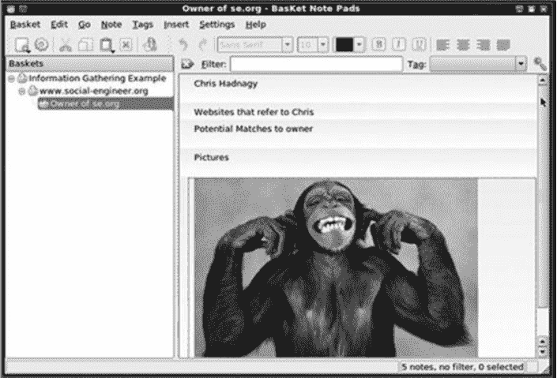
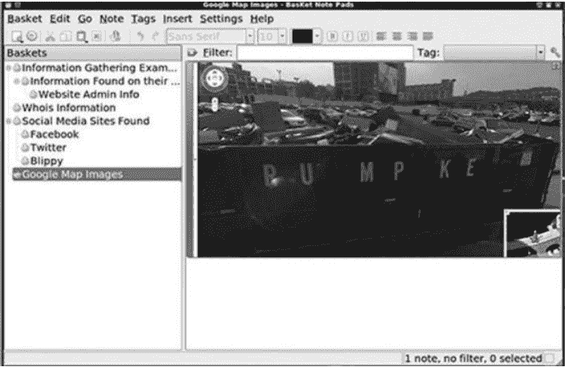
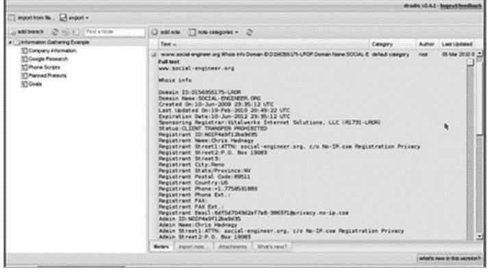
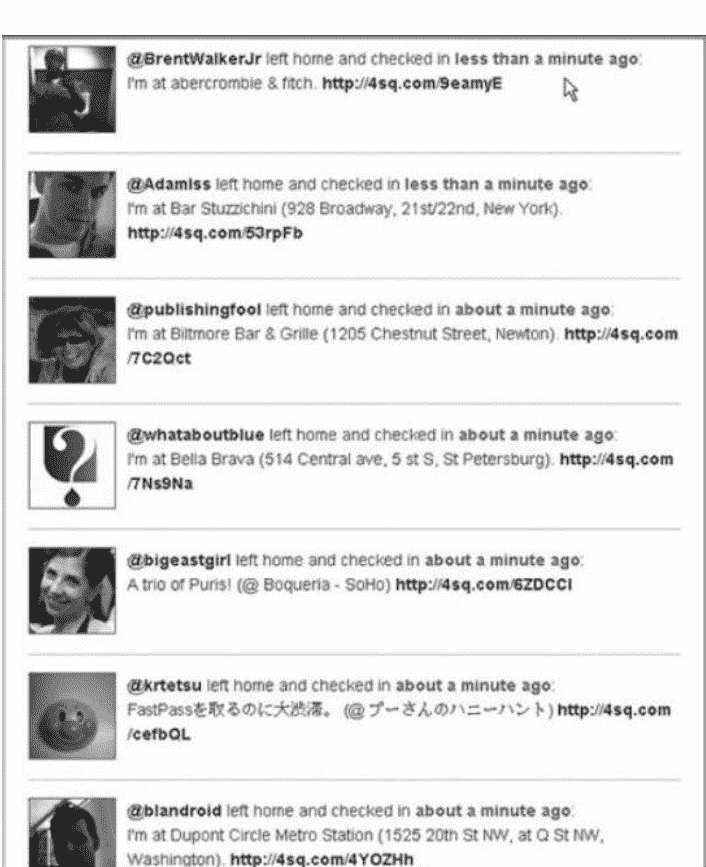
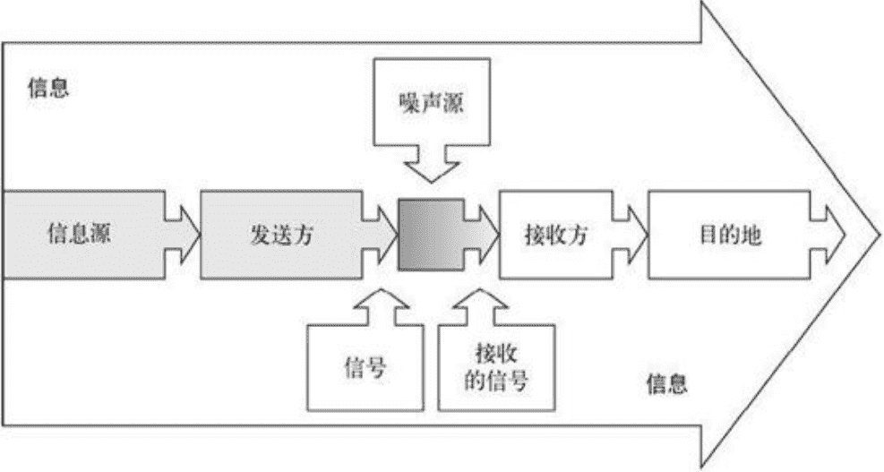
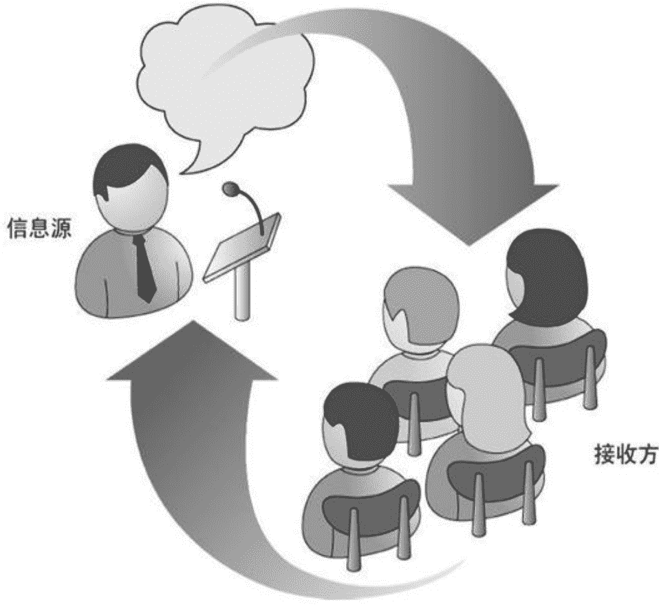

# 第二章：信息收集

> 战争的胜利百分之九十取决于情报。
> ——拿破仑·波拿巴

人们常说，任何碎片都可能派上用场。本章聚焦信息收集，正好印证了这句话。哪怕是极细微的痕迹，也足以让社会工程的入侵得手。

我的师友马蒂·阿哈罗尼浸淫渗透测试十余年，他亲身经历的案例就是最好注脚。那次受命的对象是一家网络上几乎查无实据的公司，突破口极少，难度极高。

马蒂先是在网上全面扫荡，寻找哪怕一丝蛛丝马迹。一次检索中，他发现该公司一名高管的企业邮箱竟出现在一个集邮论坛里，且该高管对上世纪 50 年代邮票有明显偏好。马蒂立刻注册了一个与 [www.stampcollection.com](http://www.stampcollection.com) 类似的域名，随后从谷歌抓取了一批 50 年代邮票的图片，迅速拼凑出一个“个人集邮册”网站。接着他写好一封邮件寄去。

> 亲爱的先生，
>
> 我在 [www.forum.com](http://www.forum.com) 上注意到您对 50 年代邮票很感兴趣。最近我祖父去世，留下了一本集邮册，我打算出让这批邮票。我已建好网站，您若想查看请访问 [www.stampcollection.com](http://www.stampcollection.com)。
>
> 谢谢！
>
> 马蒂

为了让效果最大化，他在发信前先打了电话。经论坛帖子找到高管办公室号码后，他自称鲍勃：“早上好，我在 [www.forum.com](http://www.forum.com) 看到您的帖子。我爷爷刚过世，留下许多五十、六十年代的邮票，我拍了照并建了网站，有兴趣的话我可以把链接发您。”

目标对邮票极为上心，一直在等邮件。马蒂发出邮件后静待点击。网站里被植入了一个恶意帧，帧代码利用了当时盛行的 IE 浏览器已知漏洞，一旦打开，目标电脑便落入马蒂掌控。

没多久，邮件被读了，链接也被点了，公司边界防线就此被打开。

就因一条看似无害的信息——受害者在寻邮时留下公司邮箱——整起入侵便发生了。所以才说，信息根本不存在“无关”之说。带着这个前提，我们来梳理信息收集会遇到的难题。

- 信息从何处着手收集？
- 社会工程师能动用的资源有哪些？
- 收集到的数据如何用来进一步勾勒目标画像？
- 要怎么归档、存储、分类，才能让调用时最顺手？

要做好充分且高效的信息收集，以上只是冰山一角。如今社交平台铺天盖地，人们乐于把生活各面公开，导致可被利用的破坏性信息远超以往。本章以社会工程实战为引，讲清信息收集的原则与用法，以及网上公开信息对个人与企业安全造成的冲击。

社会工程里很多招数本就源自其他行业，销售就是典型代表。销售通常健谈、亲和，在套取对方信息上极有心得。

我读过一本销售书，作者建议销售人员去挖掘客户推荐，抛出的提问是：“你觉得还有谁能像你一样从这款产品获益？说一个人就行。”

只用一句话，就能让对方敞开。推荐的对象可能是亲友、同事。掌握这些线索后，销售就能以“熟人介绍”的名义登门，信任感瞬间建立，不至于碰壁。

上门时常用的开场是：“我刚从隔壁简家过来，她买了我们的优惠套餐。用过之后续费一年了，还说你也会受益。能占用一分钟跟你介绍一下简刚买的套餐吗？”

这些销售套路被社会工程师大量借鉴。当然，社会工程师不会直接索要推荐，而是自行拆解分析。销售先从现有客户拿信息，再用这些信息让新目标更愿意倾听。更会暗示前一位客户已成交，并使用“优惠”“优先”等关键词迅速挑起兴趣。这种做法之所以有效，是因为它建立了信任，借助了熟人，让目标跨过最初的防备，更自然地与对方交流。本章和第三章会进一步展开。

作为社会工程师，这两个视角都很关键。回想第一章的主厨比喻：好厨师能辨认优质食材，清楚配方配料，可若拿捏不好分量，菜会寡淡或过咸，甚至难以下咽。只知道菜要放盐还不够，要懂得比例与搭配，烹饪艺术才算掌握。社会工程师只有熟练运用各类技术手段并知其适用场景，才能称得上高手。

本章帮你找到这个平衡。信息是社会工程“配方”里最核心的基料，第二节会详述。信息越优质，成功率越高。本章先讲如何收集，再讲从何处获取，最后讲如何整合运用，逻辑上也就完整了。

### 2.1 收集信息

收集信息就像盖房子。想从屋顶开始盖，只会失败。牢固的房子必须先打地基，再从地面往上建。收集信息时不要先想整理与使用，先建立文件或信息收集机制，把数据先抓下来才是要务。

事实上有很多工具可辅助此事。在渗透测试与社会工程审计中，我常用 Linux BackTrack 发行版，它就是为此而生。BackTrack¹与多数 Linux 发行版一样免费开源，最大的优势是内置了三百多款安全审计工具。

1. BackTrack 是基于 Ubuntu 的可启动光盘，集成了一套安全及计算机取证工具，简称 BT，目前最常用的是 BT5。——译者注

BackTrack 里的工具也是开源免费，且质量极高，多款可媲美甚至超越商业软件。其中尤其适合信息收集与存储的有两款：Dradis 与 BasKet，下面分别简述。

#### 2.1.1 使用 BasKet

BasKet 功能上像记事本，却强大得多。该软件现由王凯文 Kelvie Wong 维护，可在 BackTrack 里找到，也能到 [`basket.kde.org/`](http://basket.kde.org/) 免费下载。网站有详细安装指引，软件上手简单，界面不复杂。

图 2-1　信息收集阶段，使用 BasKet 轻松组织收集到的数据

如图 2-1 所示，界面简洁。在左侧空白处右键选择“New BasKet”，就能新建一个容器来存放数据。

建好后可直接复制粘贴内容、添加截图，也能放入 OpenOffice 或其他图表数据。

截图有多种做法，最省事的是复制图片后在新 BasKet 里右键“粘贴”。如图 2-1，图片的添加与备注都很便捷，可通过输入、粘贴等方式补充文字说明。

在常规安全审计中，BasKet 的组织与展示能力是其亮点。我习惯为不同类型数据建不同 BasKet，比如域名查询、社交媒体等。再用谷歌地图或谷歌地球抓取目标建筑与设施图片存入其中。收集完毕后提取使用也很快。图 2-2 展示了一个接近完成的 BasKet，里面信息丰富且有标签。

图 2-2 包括很多有价值信息的几近完整的 BasKet 截图

如图 2-2 所示，用 BasKet 存放与整理信息很直观。我会尽可能多地塞进去，因为再小的线索都可能有用。收集的内容涵盖目标网站、域名查询、社交网络、图片、员工联系方式、简历、论坛、爱好等一切与目标公司相关的数据。

收集完后点“BasKet”菜单，再点“Export”，就能把整个 BasKet 导出为 HTML 网页文件，便于写报告与共享。

对社会工程师而言，下文要详述的数据收集是每次行动的核心。但若信息无法及时调取与使用，就毫无价值。BasKet 及其同类工具让收集与使用变得简单，试过就会上瘾。

#### 2.1.2 使用 Dradis

BasKet 虽然好用，但当信息量巨大或需要多人协同收集、存储、调用时，就需要能多用户共享的工具——Dradis。开发者介绍，Dradis 是一个独立 Web 应用，提供信息中央仓库，统一管理采集的数据。

同为免费开源，可在 http://dradisframework.org/ 免费下载，支持 Linux、Windows、Mac，安装说明见 http://dradisframework.org/install.html。

安装配置完成后，可通过本地主机与端口访问，默认端口 3004。打开浏览器输入 http://localhost:3004/ 即可登录。

图 2-3 Dradis 简洁而易用的界面

登录后的欢迎页如图 2-3 所示。注意左上角的添加分支 Add Branch 按钮，添加后即可像 BasKet 一样录入备注、图片，甚至导入笔记数据。

Dradis 与 BasKet 只是收集存储的两件小工具，官网都有完善的配置与使用指南。

无论是 Mac、Windows 还是 Linux，都能找到对应的工具，关键是顺手且能处理大规模数据。

基于此，我建议社会工程师放弃 Windows 或 Mac 自带的记事本与文本编辑器，它们无法满足格式与区域高亮的需求。图 2-3 展示的是我使用的 Dradis 服务器端，其中一部分专门保存通话记录，用来根据收集到的信息记录想法，功能很实用。

这些工具体现了社会工程师如何利用收集到的信息。第一步就是像社会工程师那样思考。

#### 2.1.3 像社会工程人员一样思考

拥有数百兆的图片与数据当然很好，但回头翻阅时，如何保证挑出真正有用的部分？

你当然可以打开浏览器，随意输入长串关键词搜索，也能找到某种信息，其中一部分也许有用。可肚子饿时，你不会胡乱把食材往锅里倒就翻炒。需要计划、准备、考虑影响成败的因素，才能做出好菜。同样，社会工程师也必须先规划，再决定收集什么、怎么收集。

信息收集的关键在于转换思维。在信息爆炸的时代，我们必须改变惯性思维，学会对一切保持怀疑，看到信息时就用社会工程师的视角审视。利用网络搜索的方式要调整，对返回结果也要从社会工程角度去解读。无意间的闲聊、论坛里看似无聊的帖子，甚至一袋垃圾，都该用不同眼光对待。我的导师马蒂看到程序崩溃会异常兴奋，因为崩溃是找软件漏洞的第一步。作为社会工程师，也要对信息抱同样态度。每当发现目标人物使用多个社交网站，就要把它们之间的关联与数据整合起来，拼出完整画像。

举个例子，有次我去外州办事，租车自驾。我和同事把行李塞进后备箱，上车前发现后座有一袋垃圾。同事抱怨：“现在服务真差，我们付钱租车，至少该把车打扫干净。”

大家都希望车里干净，同事想把袋子扔到路边垃圾桶，我拦住他：“让我看看。”打开袋子，拨开快餐纸袋，里面竟有半张撕碎的支票。我赶紧倒空袋子，找到银行收据和另一半支票。那是一张面值数千美元的支票，被撕成四块扔进垃圾袋。拼起来能看到支票所有者的姓名、公司、地址、电话、账号与流水号。加上收据，我甚至能推算出存款金额。他应该庆幸我不是坏人，否则再多几步就能窃取存款。

这个故事说明人们如何对待自己的重要信息。这位租客在我之前用车，可能以为撕碎扔掉就安全了。类似案例在 [www.social-engineer.org/wiki/archives/BlogPosts/LookWhatIFound.html](http://www.social-engineer.org/wiki/archives/BlogPosts/LookWhatIFound.html) 也能看到，有人随意丢弃或在旧货市场廉价出售珍贵物品。

其中包括：

- 一幅被博物馆以 120 万美元收购的油画；
- 一辆 1937 年生产的、仅行驶 24 000 英里的 57S Atalante 布加迪跑车¹，最终以 300 万美元成交；
- 《独立宣言》珍本。

¹ 布加迪公司在过去 70 多年仅造了 3 辆 Atalante 原型，其中 2 辆存世，57S 型在试验中仅生产 17 辆。目前 4 辆保存在法国乡村博物馆，找到的这辆已消失半个世纪。——译者注

如果人们能把《独立宣言》珍本和油画一起丢掉，那丢掉账单、医疗记录、旧发票或信用卡账单又算什么。

懂得在公共场合与人打交道会有意想不到的效果。下面讲我对一家公司做安全审计的经历。审计前需要收集数据。让我们看看如何用看似无用的信息找到突破口。

对被审计公司的一名高管，我跟踪一两天就发现他每天早上同一时间去当地一家咖啡馆。在确认这个习惯后，我设计了一场“偶遇”。他通常早上 7:30 到店，坐半小时到 35 分钟，看报纸，点中杯拿铁。我在进店 3 到 5 分钟后跟进，点同样的咖啡，坐在他旁边。看到他看完的报纸，我借来翻阅。路上我已读过这份报纸，知道第三页有篇附近谋杀案报道。我装作刚看到，大声说：“这么小的镇子怎么会有这么骇人的事，太可怕了！您是不是也住附近啊？”

此时有两种可能：他不理我，或我的肢体语言与语调让他放松。结果是后者。他答：“是啊，几年前因工作搬来。我喜欢小镇，但正如你说，可怕的事越来越多。”

我接着说：“我只是路过。我的工作是为大公司提供高品质咨询，经常在各地小镇间跑。最近这种事越来越多，连乡下也不例外。”然后调侃道：“你不会碰巧是需要咨询服务的大公司领导吧？”

他笑了，感觉我在质疑他的身份，说：“我是 XYZ 公司的财务副总，不过不负责那个部门。”

“嘿，我又不是推销，只是喝咖啡。不过不知你明天或周三有空吗？我可以顺道拜访，给你一些信息。”

他说：“很想见，但周三要去度假。要不你发邮件，我回来给你电话。”并递上名片。

“我猜是去温暖明媚的地方吧？”我问，心想快到点了，该收尾了。

“和妻子乘游艇去南方。”我们握手告别。

他会很快忘记我吗？可能。但我已拿到颇有价值的信息：

- 直拨电话号码
- 出发度假的日期
- 度假方式
- 在本地居住
- 公司名称
- 职位头衔
- 近期搬来

其中部分在前期收集时已知道，这次会面让信息更丰富。现在可以启动下一步攻击了。度假的次日，我拨打公司直线，前台说：“抱歉，史密斯先生度假去了，需要留言吗？”

太好了，信息被证实了。我穿上西装，带上 9 美元名片来到公司。在前台登记后，我说自己与史密斯先生约好 10 点见面。她回：“史密斯先生在度假，你确定是今天吗？”

我用微表情技巧，故作惊讶：“什么？他的海上航行这周？我以为下周才出发。”

这句话很关键。为什么？我让前台相信会面是真实的。提到海上航行，说明我与史密斯有过深入交谈，甚至了解旅行计划。我流露出的尴尬与失落激发了秘书的帮助欲：“哦，亲爱的，真抱歉，要不我给他的助手打电话吧？”

“哦，不。”我答，“我只是想带点信息给他。这样吧，把消息给你，转告他就好。真的很尴尬，你能别告诉他我来过吗？”

“我会保密的。”

“谢谢。真想赶紧走，不过临走前能用一下洗手间吗？”通常不被允许，但凭借刚才的融洽、我的无助和她的同情，我仍有机会——而且成功了。

我把一个信封放在洗手间隔间里。信封贴着“私人”标签，里面是一个带恶意攻击病毒的 U 盘。走廊旁的休息间也放了一个，以提高成功率。希望有人会发现其中一个，好奇地插入电脑。

# 一场成功渗透背后的暗线：从信息拼图到交流操控

这套手法之所以让人后背发凉，恰恰在于它几乎没有失手过。而整个链条的起点，不过是咖啡店里一次看似随意的闲聊——如果没有那次对话，后续所有环节都无从谈起。

这个案例真正值得注意的地方，不在于“一点点信息也能引发入侵”，而在于那些信息是怎么被一点点收集起来的。对待任何数据源，都不能浅尝辄止：你要弄清楚它是什么、能提供什么、有什么局限，反反复复验证，直到自己能够熟练驾驭每一种采集路径。信息源的类型极其丰富，一个成熟的社会工程人员必须花时间去逐一吃透，搞明白各自的优劣和适用场景。这些内容，正是接下来要展开的重点。

# 一、信息从哪里来：先把目标摊开看

公司网站和个人主页，往往是最先被盯上的目标。经验丰富的社工，第一步就是尽可能多地从这些页面上捞东西。花在这个环节的时间绝不算浪费，因为很快你就能拼出一张初步画像：

- 他们靠什么赚钱
- 对外卖什么、提供哪些服务
- 办公地点在哪儿
- 招聘信息里藏着什么
- 哪些联系电话可以找到人
- 高管层和董事会成员有哪些人
- 官方论坛里用户在抱怨什么
- 邮件地址的命名规律
- 哪些特殊字符或词汇可能变成密码线索

看别人的个人主页往往更有意思。上面散落着关于一个人生活轨迹的碎片：孩子、住所、工作、爱好。这些东西必须按类别归档，因为它们会在未来某个环节派上用场。

同一个公司的员工，常常会出入相同的论坛、拥有相近的兴趣，甚至连逛的社交平台都高度重合。如果你在 LinkedIn 上捞到一名员工，大概率他的几位同事也在上面。把这些人串起来，公司的内部结构和人员脉络就会逐渐清晰。很多人还会在社交主页上用标签标出自己的岗位，这些标签能帮你大致推算出某个部门的规模和层级。

## 搜索引擎、域名记录与公开服务器

强尼·龙那本《Google Hacking for Penetration Testers》，让无数人第一次意识到：搜索引擎本身就是一个巨大的情报库。

Whois 是一个不能忽略的查询入口。它的数据库里存着大量域名注册信息，有时候连网站管理员的完整联系方式都能看到。通过 Linux 终端里的命令行工具，或者直接打开 www.whois.net 这类网站，你可以查到域名背后的人名、邮箱、电话，偶尔还能看到 DNS 服务器地址。这些注册信息能帮你描出目标公司的轮廓，尤其是它的服务器部署情况——既可以为下一轮信息挖掘铺路，也可能直接成为攻击的切入点。

对外开放的服务器，往往比网站本身暴露更多秘密。操作系统类型、跑了哪些应用、IP 地址段——这些信息拼在一起，就能大致推断出这家公司的信息架构。有了平台和应用层面的线索，再结合域名信息，就可以去技术论坛上翻找相关的配置讨论。IP 归属能告诉你服务器是自建的还是租的，域名解析记录则会透露服务器的名称、用途和地址分布。

我曾在一次审计时，用 Maltego 在网页上顺藤摸瓜，找到一个对外开放的网站服务器，上面堆着几百份文档——项目数据、客户名单、文档作者信息全在里面。对任何公司来说，这种泄露都足以致命。

需要特别提醒：端口扫描——也就是用 NMAP 之类的工具去探测公共服务器的开放端口、软件版本和操作系统类型——在某些地区是被法律禁止的。

2003 年 6 月，以色列人艾维·米兹拉希因为对摩萨德网站做了一次端口扫描，被当地警方以未授权访问计算机系统的罪名起诉。8 个月后，法庭裁定他无罪，理由是：不存在恶意的端口扫描不该被禁止。

1999 年 12 月，斯考特·莫尔顿的遭遇则更曲折。他所在的 IT 服务公司一直在为佐治亚州切罗基县的 911 安全中心做维护升级。一次例行扫描中，他碰到了另一家 IT 公司的网站服务器，结果被 FBI 以违反佐治亚州《计算机系统防护法》和美国《计算机欺诈与滥用法》逮捕。直到 2000 年，法官才以“未对互联网的完整性和可用性造成破坏”为由，撤销了指控。

到了 2007 至 2008 年间，英国、法国和德国相继立法，将“创建、传播或持有可用于入侵计算机的工具”列为违法行为，端口扫描工具也被划入其中。

当然，如果你做的是付费信息安全审计，这一切都应该在合同里写清楚。对社会工程人员来说，熟悉当地法律、不踩红线，是必须牢记的基本原则。

## 社交媒体与个人内容：人人都主动交出了底牌

越来越多的公司开始在社交平台上做推广。原因很简单：成本低，受众广。这同时也给社工人员打开了一扇新的信息窗口——活动安排、新品发布、新闻稿、蹭热点写的文章，全都源源不断地流出来。

社交网络的威力还在持续显现。每当一个新平台走红，就会迅速出现一大批模仿者。Twitter、Blippy、PleaseRobMe、ICanStalkU、Facebook、LinkedIn、MySpace——从这些网站出现开始，人们的生活轨迹和实时位置就被搬到了公开的互联网上。后面我们会专门展开聊这个话题，你会发现社交网络作为情报源，潜力远超想象。

博客、wiki、视频分享这类个人内容平台，不仅会暴露目标公司的内部信息，还会顺带透露上传者的态度和立场。一个在博客上骂公司骂得痛快的员工，会很容易和同样心怀不满的人打成一片。不管有意无意，人们总是习惯在网上倾倒大量信息，而任何路人都能随手读到。

举一个具体的例子。www.icanstalku.com——名字听着吓人，实际上它并不鼓励你去跟踪谁，它盯上的是那些毫无防备的 Twitter 用户。这个网站会扫描 Twitter 上的公开内容，找出那些用智能手机拍照并上传的人。很多人不知道的是，智能手机拍下的照片里会悄悄嵌入 GPS 坐标。你在网上发照片的同时，等于把拍摄地点也发了出去。

图 2-4 ICanStalkU.com 网站主页的典型场景

位置泄露只是社交网站众多隐患中的一种。在你完全没察觉的情况下，照片就可能暴露你的行踪。ICanStalkU 这类网站恰恰说明了这个问题有多严重。通过一个真实案例就能看得清清楚楚——有人因为社交网站上的位置信息，遭遇了入室盗窃和抢劫。故事链接：www.social-engineer.org/wiki/archives/BlogPosts/TwitterHomeRobbery.html。

不同类型的信息，能帮你从不同角度拼出目标的完整画像。人们习惯在 Twitter 上报告自己的位置、同伴和正在做的事；Blippy 可以绑定银行账户，让好友实时看到你每一笔消费发生在哪里、花了多少钱；带地理标签的照片、Facebook 上分享的生活片段和照片，都是社工非常偏爱的情报来源。只需要一点点时间，一个人的住址、职业、照片、兴趣就能全部摊在你面前。

社交网站之所以成为情报金矿，还有一个原因：可以匿名伪装。假如目标是一个刚离婚的中年男人，喜欢频繁更新 Facebook，你就可以扮演成一位想交新朋友的年轻女性。当人听到恭维和奉承时，往往会放松警惕，脱口而出许多不该说的话。伪装加上人们对“眼见为实”的天然信任，这一套组合拳下来，得手往往是时间问题。

## 公开报告与付费查询：有些信息明码标价

公开数据可能来自目标企业内部，也可能来自外部渠道，比如季度财报、政府文件、分析师报告和上市公司的收入数据。以邓白氏集团为代表的商业信息机构，提供的销售分析报告价格低廉，但里面往往装着目标公司的大量核心细节。

后面还会详细讲到的背景调查服务，例如 www.USSearch.com 和 www.intelius.com，以及各种类似的付费查询平台，定价从单次 1 美元到每月 49 美元不等。搜索引擎能帮你免费翻出不少东西，但真正的财务数据和个人隐私，往往需要通过这种合法的付费途径获取。最令人吃惊的是，某些服务商甚至直接提供个人的社会保险号。

# 二、眼睛就是最好的工具

观察也许算不上严格意义上的社工技术，但简单的留心和观察，就能让你获得大量关于目标的信息。员工进楼用的是普通钥匙、RFID 门禁卡，还是别的凭证？有没有固定的吸烟区？垃圾箱上锁了吗？办公楼外有没有监控摄像头？供电设备、空调机组这些外围设施的维护是哪家公司在做？这些细节，全都可能是入侵路径的入口。

上面只是随便列了几个可以在观察中找到答案的问题。如果你愿意花几天时间蹲守目标，用隐藏摄像机记录下一切，然后回到安全的地方反复研究，你能学到的东西会远超出想象。

# 三、垃圾箱里的秘密

翻垃圾能翻出价值，这件事听起来荒谬，但事实就是如此。人们会随手扔掉发票、通知、信件、CD、旧电脑、U 盘，以及各种五花八门的设备和报告，而这些东西里往往藏着让人惊喜的情报。前面说过，人连价值数百万的艺术品都能当垃圾扔掉——只要打心底认为某样东西是垃圾，就没人会多想一秒。

有些公司也意识到直接扔文件可能不安全，于是改用碎纸机粉碎后再丢。但问题在于，那些粗颗粒碎纸机处理过的文件，想要复原并不困难。看图 2-5。

图 2-5 单向粗粉碎后的文件，仍能辨认部分文字

图上这些碎片，有不少字仍然能完整读出来。只要有耐心，花点时间用胶带一点一点粘回去（如图 2-6），就能拼出相当一部分内容——而那些内容，很可能具备致命杀伤力。

图 2-6 只要肯花时间且有耐心，文档是能拼接回去的

但如果是双向粉碎机，碎出来的纸屑细到几乎无法复原。图 2-7 就展示了这样的效果。

图 2-7 很难想象粉碎前它是纸币

很多公司会把粉碎后的文件交给专业机构焚烧处理，还有一些公司则干脆扔给第三方，之后就再也不管了。结果可想而知——社工只要找到那家负责清运的公司，堂而皇之冒充工作人员，就能把那些“垃圾”全部带走。总而言之，翻垃圾是一种高效的情报采集手段。但做这件事的时候，有几条原则必须记住：

- 穿结实的鞋子或靴子。没有什么比跳进垃圾箱然后被钉子扎穿脚掌更糟糕了。鞋要跟脚，鞋带要系紧，确保脚不会被任何尖锐物伤到。
- 穿深色衣服。理由很简单：你必须穿那些即使弄脏弄破也不心疼的衣服，而且深色在夜里更不显眼。
- 带一支手电筒。
- 拿到东西就撤。除非你确定所在的地方偏僻到绝不可能被人撞见，否则最好的做法是直接拖走几袋垃圾，换个安全的地方慢慢翻。

翻垃圾桶几乎总能捞到点有用的东西。不过有时候，情报根本不需要通过翻垃圾获得。第一章里提到过一个例子：加拿大反恐部队打算建一栋新的办公大楼，结果施工蓝图被当成普通废纸扔掉了，连粉碎这一道工序都没有。那些图纸上标着监控摄像头位置、围栏布局以及各种保密细节。幸好捡到图纸的人没有恶意，不然后果难以设想。

这个故事本身只是无数荒唐行为中的一个样本，但站在社会工程人员的角度，翻垃圾确实是最有效的开源情报渠道之一。

# 四、让软件替你干活：从碎片到画像

第七章会完整介绍社工专用的工具生态，这里只做简单预览。

两款常用的密码分析工具分别是 CUPP（全称 Common User Passwords Profiler，意为“常见用户密码探查器”）和 WYD（全称 Who's Your Daddy，意为“谁是你爸爸”）。社工可以借助它们推导出目标企业或个人惯用的密码组合。

具体用法会在第七章展开。像 WYD 这类工具，能自动抓取个人或公司网站上的内容，然后根据页面里出现的词语批量生成候选密码列表。毕竟大多数人设置密码时，总喜欢用名字、日期这类与自己有关的词——这类软件要做的，就是把所有可能性穷举出来。

Maltego 这款由 Paterva 开发的分析工具，几乎是每个情报收集者都想要的宝贝。它本身就能完成基于网页的被动信息采集和查询，不需要依赖其他平台或工具。收集到的数据可以保存下来，在屏幕上以图形化网络的形式展示，方便报告、导出和二次分析。对于理解一家公司的整体结构来说，这东西极为顺手。

需要一直提醒自己的是：收集数据只是手段，真正的目的是吃透目标企业及其员工。当你掌握了足够多的数据，该用什么方式去操纵目标，自然就会浮现出来。要把目标公司当作一个有机整体来看待——员工们参加什么俱乐部？有什么爱好？加入过哪些社团？会不会给某家慈善机构捐款？孩子们是不是在同一所学校念书？这些都是做深入分析的切入点。

分析做得越透彻，伪装就越不易被戳穿，而且你能快速判断出该问什么问题、哪天适合打电话、哪一天适合当面接触——所有这些线索，都会让攻击变得更加顺手。

到目前为止讲的方法，基本都是现实世界中手动收集信息的手段，几乎没有涉及技术层面的信息获取——比如 SMTP（简单邮件传输协议）、DNS（域名服务）、NetBIOS（网络基本输入输出系统）和 SNMP（简单网络管理协议）。关于这些内容，第七章会详细介绍 Maltego 在相关领域的收集功能。这些方法确实值得研究，但它们偏技术操作，并非本书重点关注的对象——本书关注的是“人”本身。

逻辑上，当信息收集完毕，你自然会想到一个问题：既然已经知道了去哪里找信息、用什么方式找、以及如何对信息进行分类、存储和呈现，那接下来到底该怎么用这些信息？

对社会工程人员来说，收集数据的工作结束之后，就该着手规划攻击了。而规划的起点，是建立一个模型，把信息使用策略写进去。交流模型，就是最好的起点之一。

# 五、交流模型：一切操控的底层脚本

> 交流模型越精巧、越清晰，花在交流上的时间就越少。
>
> ——约瑟夫·普利斯特利

所谓交流，就是把信息从一个主体传递到另一个主体的过程。交流至少需要两方参与，它从来不是单向的灌输，而是一个双向的循环：信息互换、思想碰撞、情感交互，以及意见趋于一致。

这个概念和前面的“社会工程”在结构上惊人地相似——唯一的区别在于，日常交流默认参与者之间已有共识，而社工与人打交道的目的恰恰是要达成这种共识。拆开来看，交流就是一个信息封装之后，由发送方沿着某个介质传递到接收方，接收方完成解码并送回反馈的过程。无论形式如何，交流永远离不开三个要件：发送者、信息和接收者。理解这个基本结构，对构建可靠的交流模型至关重要。有了模型，社工才能判断哪种传递方式和反馈路径最有效，以及什么样的内容最合适。

交流的形式五花八门。听觉层面有演讲、歌唱、语气语调；非口头层面有肢体动作、手语、辅助语言、触碰和眼神接触。不管采用哪种形式，信息的内容和传递方式都会在接收者身上产生实实在在的效果。

要为目标人物搭建交流模型，必须先弄懂底层规则。有些规则是无法绕开的，比如交流双方永远会有一对发送者和接收者。与此同时，每个人的经验背景不同、世界观不同，导致完全相同的信号在不同人那里的解读可能千差万别。

正因为每个人都有独属于自己的现实图景，不同的人对同一事件的感知、体验和解释必然存在偏差。如果有兄弟姐妹，做一个简单的实验就能证明这一点：让他们回忆同一段经历，尤其是一件带感情色彩的事，你会发现，对方的叙述和你的记忆可能完全对不上。

每个人都有无形的身体空间和心理空间。是否允许别人靠近并进入这个空间，取决于许多复杂因素。每一次交流，本质上都是某种程度的边界试探。社工所做的事情，就是把对方带入一个可被影响的空间，进而掌握他的状态。高效的沟通，是把所有人拉进同一个精神场域。这种过程在每一次互动中都会发生，只是它太过日常，以至于绝大多数人都感受不到。

人际交流的信息永远包含两个层面：语言层面和非语言层面。前者可以是口头的、书面的，或者其他任何文字形式；后者则包括表情、肢体语言，甚至情绪氛围和排版风格这类细节。

无论双方交换了多少语言或非语言的暗示，整个过程的基本路径始终一致：信息包发出，接收者用自己的经验框架对信息进行过滤，形成个人理解，并据此构造意义——哪怕这个意义并非发送者的本意。发送者唯一的判断依据，是接收者回传的反馈，据此确认信息有没有按预想的方式被接受。

所谓“信息包”，指的就是一次具体的沟通行为——一句话、一封信、一封邮件。接收者在接触信息包时，会调动各种因素来赋予它意义：此刻的情绪、好恶、内心的波动。这一切都会影响最终的解读结果。

社工要做的，就是利用这些语言与非语言的线索，悄悄改变目标的感知，最终达到自己想要的效果。

以下的交流规则，需要被牢牢记住：

- 永远不要默认对方与你的处境相同；
- 永远不要假设对方会按你的逻辑去理解信息；
- 交流不是僵化的、一次性的、固定不变的东西；
- 当多方参与交流时，始终假设每个人的情况都不同。

掌握这些规则，能极大地提升与他人的沟通效率。但这和“交流模型”有什么关系？或者说，它与社会工程之间的连接点到底在哪里？

接下来，就先从交流模型的原点讲起。

# 别把沟通只当“说话”：它更像一套可拆装的讯息投送系统

先追问一句：两个人对话时，真正发生的到底是什么？

表面看是声音来回，深层却更像一次打包投递。眼睛看到的、耳朵听到的、皮肤触到的、舌尖尝到的，乃至口头语言，都可能成为原料。这些原料被组合成一组消息，传到指定对象手里；对方再拆包、加工，还原出“你到底想表达什么”。评估整条链路的方法，就是我们常说的传播过程。

1947 年，两位学者——香农与韦弗——把这件事做了简明梳理，并提出后来影响深远的经典框架。学界后来常把它看作这一领域的开山之作。公开百科词条把它概括为：讯息起点、内容、编码器、信号、传输路径、干扰、解码器、终点，以及出错概率、编码解码、传输速率与通道容量等概念。

他们用图示呈现这套框架，见图 2-8。

图 2-8 经典传送框架示意

在这个常被叫作“传送式框架”的简明结构里，内容会以某种形态，从发出方抵达终点或接收端。它对沟通的基本理解很直接：沟通就是发出与接收消息的一种方式。长处也很明显——简洁、普适、可计量。

它依赖几个基础构件：

- 产生消息的起点；
- 把内容转成信号的发出端；
- 适合信号通过的路径；
- 能从信号还原内容的接收端；
- 消息最终抵达的落点。

沿着这套思路，香农与韦弗把传播中的课题归成三类：

- 技术层面：送得准不准？
- 含义层面：表达得是否精确？
- 效果层面：收到之后，是否被推动着做出预期动作？这一点在社工场景里尤其关键，必须牢记。操控者追求的，就是让对象产生自己预设的行为。

大约十五年后，大卫·贝罗对这套线性结构做了扩展，提出发送者—讯息—通道—接收者结构，也就是 SMCR。它把整个过程拆成几个更清晰的部分，见图 2-9。

图 2-9 SMCR 结构示意

这时，传播可理解为消息扩散的过程，而这个过程受三层规则约束：

- 符号与标记的外形规则；
- 符号、表情同使用者的关联；
- 符号与标记之间的对应及意义。

由此还可以进一步把传播定义为一种社交：不少于两方，共享一套符号与规则并互动。

2008 年，研究者 D. C. 巴尔芒把前人的成果与自己的研究结合起来，形成事务型传播框架，见图 2-10。

图 2-10 事务型传播框架示意

在这个框架里，路径和消息都可以有多种形态，并不局限于图中示意的口头语言。消息可以是书面文字、视频或音频；对象可以是一人，也可以是多个人；回应同样可以呈现为多种形式。

把这些成果放在一起研究，能帮助社工搭建可靠的沟通框架。受益的不只是社工，普通人同样如此。学会设计沟通方案，能改善你与伴侣、子女、上级、下级之间的互动。

因为本书聚焦社工，所以还要追问：他们能从这套理论里学到什么？读完理论之后，不少人会犯嘀咕：这些内容到底怎么用？别忘了，做社工的必须是沟通高手，要能进入并停留在他人私密的心理领地，同时又不让对象产生抵触。能否设计、落地并反复演练一套有效的沟通框架，是成败关键。接下来，就进入“如何搭建沟通框架”。

#### 2.3.2 搭建沟通框架

既然已经知道关键环节，不妨换到社工的视角重新看一遍：

- **源头：** 你就是消息的发出者。
- **通道：** 靠什么方式送达。
- **内容：** 你准备让对象接收到什么。
- **对象：** 也就是目标。
- **回应：** 有效传达后，你希望对方给出的动作。

这些环节该怎么用？第一步是带着目的去实践，可以先从社工里的典型桥段入手：

- 写一封仿冒邮件，设法让 25 到 50 名职员在上班时段打开某个非经营性质的站点，页面藏有攻击脚本，借此渗透企业内网。
- 上门冒充求职者，演一出咖啡泼到履历上的意外，再让接待处的人同意你把闪存盘接到电脑上补打一份。

设计策略时，倒推框架往往很有帮助。

- **回应**：你期待什么结果？最理想是多数收件人都会点开；哪怕只有寥寥数人甚至一人中招，也算收获，但真正想要的，是让多数对象落入圈套。
- **对象**：情报搜集能力在这里派上用场。你需要尽可能掌握对方的全貌：爱看比赛吗？男女比例如何？是否加入本地社团？空余时间玩什么？婚育状况怎样？年纪偏轻吗？这些答案会帮助社工判断该传递哪类消息。
- **内容**：若对象以 25 到 40 岁男性为主，其中又有人追足球或篮球联赛，那么体育、异性或赛事类网址更容易被点开。信里写什么当然重要，语法、拼写、标点也得逐一过目。经验表明，拼写马虎，往往是这类诱骗信被识破的常见破绽。
- 如果信里出现“点此处，填入口令以核对账号设置”这类句子，文字粗糙就足以坏事。诱骗信的文字要干净，还得抓住对象的眼球。哪怕意图一样，也要按对象性别、年龄等因素调整措辞。若对象多为女性，照搬同一封信多半行不通。
- **通道**：这一点不用纠结，传播手段已经定为电子邮件。
- **源头**：也不必费心，你就是消息的发出者。你的可信程度，取决于手上的社工本领。

##### 案例 A：仿冒邮件

目标人物是 45 位 25 到 45 岁男士，其中 24 人迷梦幻篮球联盟，并且天天到某站点投票；这些情况由论坛投票帖得到印证。

我们的目标，是让他们打开你控制的站点，域名与你熟客常去的那家只差单个字符。页面外观照搬原站，唯一区别是暗处埋了攻击用 iframe。页面中央放一枚灰色 LOGIN 键，按下后确实跳回真站；就在按键与页面载入之间的空当，隐藏脚本已经完成入侵。

这封信可以这样写：

> 各位会员：
>
> 梦幻篮球联盟有新变化：投票时你可以掌握更多操作权，另有一批专属功能即将上线。我们准备逐步向全体会员开放，但会收取少量费用。
>
> 首批 100 位登入者可以免单试用。打开信里给出的地址，进入活动页，按页面中央的 LOGIN 键，就能在自己的账号里看到新功能。地址：www·myfantasybasketballleague·com。
>
> 梦幻篮球联盟运营组

这封信至少能勾起那 24 位铁杆观众的兴致，让他们点开地址、浏览仿冒站并尝试免单功能。

拆解这封信：开头先抛出一个对老会员有吸引力的邀约；接着，不少人会注意到名额只给最早 100 位，于是信一到手就急着点开，而且往往是在上班时段。信中地址指向的页面藏有有害脚本；多数人可能中招，可哪怕仅一人上钩，社工的目标也就算完成。

还别忘了，这封信的语法和拼写都挑不出毛病，诱饵够香、诱惑够强，收信人很容易顺手一点。看似完美的诱骗信，底下垫着的正是一套扎实的沟通框架。

##### 案例 B：闪存盘

线下操作更棘手，因为全程面对面。在对象眼前，你只能把自己演成另一个人。每个细节都得背下来，现场不存在暂停重来或偷看提示。别忘了，打动对方的窗口常常只开一次，这点很要命；这出戏一旦失手，后面的剧情就没法继续。

- **回应**：要让接待处的人收下那枚装有木马程序的闪存盘。闪存盘接入主机后，载荷会自动运行，抓取与账号有关的资料，例如用户名、口令、邮件账号，以及存放整机账号口令的 SAM 数据库；随后这些数据被写入闪存盘的指定目录。与此同时，那台接待机还会向你控制的服务器建立回连隧道，从而拿到该主机乃至企业内网的入口权限。常用工具是 MSF（Metasploit 框架），或与它配合的社工套件（详见第七章）。MSF 能在目标主机里运行攻击载荷，还自带 Meterpreter 模块。操作者可以写脚本完成不少任务，比如记录击键、截取屏幕画面、读取目标主机的资料。
- **对象**：锁定具体人物时反而更棘手，因为一旦你的说法不被对方买账，整套计划基本没戏。你要显得热络、友好，还得让人信服。赢取信任的速度要快，拖久了对方会起疑；可推进太猛，又可能让人不安甚至害怕，机会同样溜走。分寸必须拿捏得刚刚好。
- **内容**：既然当面递话，表达就得干净利落。脚本大致这样：你在招聘版上读到一则数据库管理员岗位启事，于是拨通电话，接线的黛比说当日名额已排满，但你可以先把履历送过去，晚几天再谈。你开车前往途中，有只小松鼠忽然窜出，你猛踩刹车，杯子一歪，咖啡泼出来，包和履历都遭了殃。你后面还赶着另一场约见，可又很想要这份差事，于是请她用你的闪存盘补打一份履历。
- **通道**：当面口头表达，调动嗓音、神情和身体动作。
- **源头**：再说一遍，消息由你发出；除非你打算安排一个替身。

手里攥着被咖啡浸过的资料夹，里面塞几张湿纸，戏会更像真的。脸上带点懊恼又无助的神色，也加分。开口时礼貌些、诚恳些，争取换来对方的好感，甚至几分同情。闪存盘里放一份能直接打印的 myresume 文档（.doc 或 .pdf）。PDF 最普及，不少单位还在用存在缺陷的旧版 Adobe Reader。还要保证履历没用冷门格式，普通软件都能打开。

多数情况下，人是愿意搭把手的。只要桥段足够真、足够打动人，对方就乐意帮一个倒霉的人。若你自觉缺少社工天赋，有个偏方：在脚本里添一句——“今早我顺路送闺女去学校，她爬上椅子跟我道别时，一不留神把咖啡碰翻，全倒进我包里。那会儿我已经开出去老远，又快迟到，实在赶不回去。您能不能帮我补打一份？”

不管怎样，这套说辞多半奏效：接待处的人会把闪存盘接进她的电脑，机器随即被拿下，企业内网也就跟着失守。

### 2.4 沟通框架的威力

沟通框架是件利器，每个做社工的人都得掌握。最难的环节，是保证搜集来的资料可靠。

前面两个案例里，预案或框架没备足，失败就会找上门。练习这套框架的好办法，是写一份影响熟人的脚本——对象可以是伴侣、子女、父母、朋友或上级——让对方按你的设想行动。

目标别带恶意。比如，让某人点头更换度假目的地；说服同伴去你爱吃、他却反感的饭馆；或让对方同意你买一件平时不会入手的东西。不管目标是什么，把五个环节写下来，看看有书面方案时沟通会怎样。你会发现，目标越清楚，越能检验社工沟通手法，也越容易成事。依次列出并填好：源头、内容、通道、对象、回应。执行时再把它们串起来。

沟通框架能带出很多有价值的信息。没有它，社工的大多数行动都会失败。情报搜集是社工的关键；但只会搜集、不懂运用，终究白忙。

先成为情报搜集高手，再把它嵌进沟通框架去演练。这只是起点，却能改变你作为社工、乃至日常与人打交道的方式。不过，要让框架里的资料足够可靠，还有更多内容要挖。

学会提问，是沟通、影响他人并最终成为社工的关键。这部分留到后续章节展开。