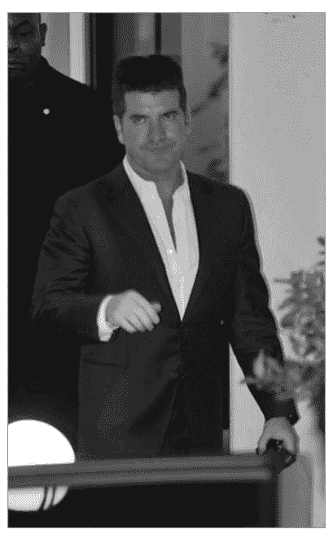
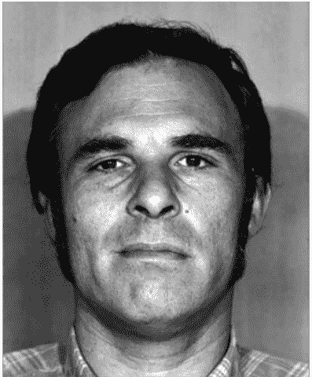
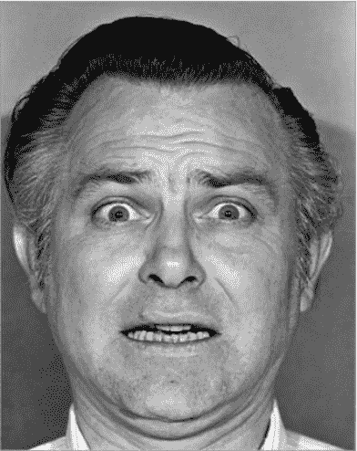
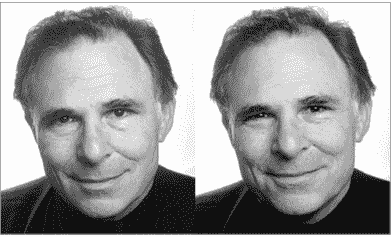
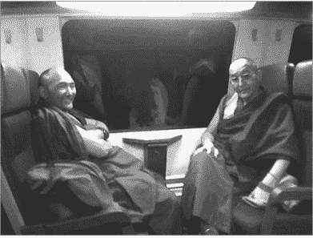
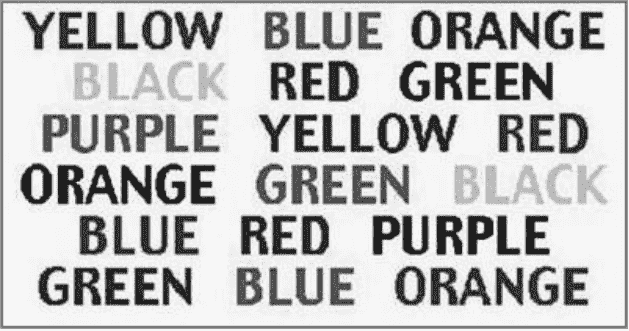

# 第五章：心理战术：社会工程心理学

# 别被电影骗了：社会工程高手真正厉害的，不是“读心术”

电影里的骗子和办案人员常被拍得神乎其神：他们似乎能逃过一切追查，盯一眼嫌疑人的眼睛就能判断真假，聊几句话就能让受害者交出毕生积蓄。看多了容易产生错觉：操纵人心好像是一门简单的手艺。

现实当然没这么戏剧化。但心理学确实能改变我们与人打交道的方式。荣格有句话大意是：左右我们的，往往不是事情本身，而是我们看事情的角度。这一章想做的，就是把社会工程中那些看似神秘的心理学工具拆开给你看。

这些方法并非凭空编造。其中不少技巧在社会工程情境中经过反复验证，也吸收了不少研究者的成果。微表情部分来自保罗·艾克曼博士等人的长期研究；神经语言程序学的源头可追溯到理查德·班德勒和约翰·葛瑞德；审讯与亲和力训练也都有执法、销售等领域的实践框架。它们有的证据扎实，有的仍有争议。这一章不神化任何技巧，而是揭开面纱，说明它们如何被用于社会工程，也说明普通人怎样识别和防御。读懂一个人说话、手势、眼神和面部表情里的信号，确实会让你看起来像会读心术。

重要提醒：这些知识也可能被恶意使用。把“坏人”的手段、思路和准则摊开，是为了让你认出他们的真面目，并更容易识别、抵御、缓解这类攻击。

## 一、想影响别人，先理解他的“思维频道”

改变一个人的想法，第一步不是急着说服，而是弄懂他如何接收和处理信息。2001 年 8 月，FBI 一份司法公告里提到一个要点：如果能让自己的非言语行为被对方接受，语言表达贴近对方，并在音量、语调和方言上同步，往往就不容易吃闭门羹。

换句话说，迅速判断目标的主导思维模式，再用不露痕迹的方式确认，对方就更可能放下戒备，甚至愿意说出私密信息。问题在于，很多人自己都说不清自己属于哪种思维模式。所以社会工程人员需要一套观察工具，识别之后快速切换沟通频道。在展开之前，先要明白这些原则为何有效：只有理解人们吸收、处理信息的模式，才能看懂背后的情绪、心理和身体表现。

### 五感，三种主要频道

传统上感官分五种：视觉、听觉、触觉、嗅觉和味觉。但和思维模式关系最紧的是三种：视觉型、听觉型、动觉型。人通常会有一种主导感官，它影响着记忆方式和决策方式。

一个简单的自测是：闭上眼回想清晨起床的画面，你最先想起什么？脸上的阳光、家人叫你的声音，还是楼下咖啡的香气？也有人先想起嘴里不清新的味道。这个实验不一定一次就准。作者曾和一对夫妇聊起此事：妻子醒来先看钟，担心迟到；丈夫则翻身发现妻子不在身边。几个问题后，大致可判断妻子偏视觉，丈夫偏动觉。现实里当然不能直接拦住目标问“你起床先想到什么”，那多半会被当成怪人。

每种感官还有自己的“参数”，也就是次感元：声音大小、光线明暗、环境冷热等。巴甫洛夫的经典实验是喂狗时摇铃，后来狗听到铃声就流口水。更值得注意的是，铃声越响，狗的口水越多。感官参数的变化会直接带来生理和情绪反应。人虽然不同于狗，但这个道理有助于理解思维模式：我们可能三种模式兼有，但总有一种更占上风，甚至同一主导模式内部也有强弱差别。

## 二、三种思维者，三种打开方式

### 视觉型：先看见，才相信

视觉型的人记得住画面：颜色、纹理、光线明暗。他们能描述过去场景，也能在脑中搭建未来图像。做决定时，他们往往需要“看到点什么”，因为视觉输入与决策紧密相连。有时，视觉上更吸引人的选项，会压过理性上更优的选项。男性中视觉型比例可能更高，视觉营销也容易吸引男性，但别把话说死，不是所有男性都靠眼睛做判断。

他们常说的话包括：“我明白你的意思”“我看那挺好”“我大概有印象了”。对应的次感元有：明暗、大小、黑白或彩色、动静快慢、清晰或模糊。面对视觉型，如果完全不提供视觉材料，想争论、协商、推销或影响他，会非常吃力。

### 听觉型：声音会替他们保存记忆

听觉型记住的是事件里的声音：闹铃太吵、有人低声耳语、孩子的声音、狗突然狂吠。他们通过倾听学习效率更高，别人讲给他们听，往往比让他们看更容易吸收信息。因为声音能唤起记忆，他们常说：“洪亮清楚”“这件事告诉我”“听起来不错”。他们的次感元包括音量、音调、音准、节奏和距离。

和听觉型交流，措辞要格外小心。词语就是他们的入口，用词不当，一场会面可能从高点直接跌到低谷。

### 动觉型：感受对了，话才进得去

动觉型最在意感受。他们记得温暖房间、拂过皮肤的清风、让人吓得跳起来的电影。他们喜欢用手感知物体，与其告诉他们某物多柔软，不如让他们摸一摸。帮他们回忆曾经触过的柔软物体，真实的情感和触感会再次浮现。动觉与触觉、本能、身体在空间中的位置感有关。他们常说：“我能抓住这个想法的要点”“那个是怎么抓住你的”“我会联系你”“我刚想联系”“这感觉怎么样？”他们的次感元包括强度、面积、质地、温度、重量。

动觉型可能是最难应对的，因为他们对画面和声音都不太买账。要建立沟通，得从感觉和情感层面连接。

### 怎么判断？少问，多观察

先做简短自我介绍，聊几句，留意对方的话。如果对方说话时不太看你，不一定是无礼，也可能不是视觉型。视觉型往往需要看着对方才能顺畅沟通。你可以随口说：“今天天气让人挺舒服，是吧？”观察他是否露出喜色。也可以戴一枚闪亮的大银戒指，说话时多打手势，看对方是否注意到甚至想伸手触摸。作者认识一位女士，看到柔软或高品质的东西就忍不住摸，嘴里说“那件毛衣看起来好柔软”，但真正暴露她动觉型身份的，是她径直走过去摸。她购物时几乎每件商品都要上手，摸过才有真实记忆。

提问时留意关键词：看、瞧、亮、暗，可能是视觉型；听、声音、响，可能是听觉型；摸、感觉、抓，可能是动觉型。任何线索都只是方向，需要更多问题验证。别不停追问，那会让人反感；更别用与对方模式完全相反的方式交流，容易引起不悦。原则是少问、多观察。

## 三、为什么懂思维模式很重要

作者曾与一个叫托尼的人共事。托尼能把水卖给快淹死的人，他非常相信销售中要找出并利用对方的主导感官。第一次见面，他会拿着一支很炫、会闪的钢笔，手势很多，观察对方视线是否跟着笔走。如果有效果，他就加大动作；没效果，就反复开合笔帽，发出轻微咔嗒声，足以干扰思绪。若对方是视觉型，这声音会吸引注意。一旦奏效，他会在对方每次认真思考时再开合一次，让声音和当时的话形成心理联结。再不行，他会隔着桌面轻拍对方手腕、手臂，或者坐得近时拍拍肩膀。他并不做过多肢体接触，而是在观察反应：躲开、接受，还是觉得被打扰。

靠这些微妙动作，托尼能在 60 秒内大致判断对方的主导感官，然后把对话切换到对应频道。他与人聊天时，总让对方觉得舒服。面对视觉型，他会说“你看这个怎样”，用看得见的东西或可视化场景营造舒适感。人在舒适氛围里会放松，社会工程中越能让对方舒适，成功概率越高。人天生愿意靠近让自己舒服的人：如果一个人让你觉得温暖贴心，或能听懂你的话、听出你的口音，你更容易信任他、敞开心扉，让他进入生活圈。

但必须重申：识别和利用主导感官不是精密科学，只是工具箱里的一件工具，不能神化。部分人类本性的心理学有科学依据，也有争议；有些被心理学家、执法部门和社会工程人员广泛认同，有些则未必可靠。

## 四、微表情：1/25 秒里的真实情绪

面部表情大家不陌生，喜怒哀乐都会写在脸上。可如果是假笑呢？在集市遇到不喜欢的人，我们也能笑着说：“约翰，真高兴碰到你，替我向莎莉问好。”表面开心，内心愤怒。这种持续较久的面部表情叫宏表情，更容易传达情绪，同样受情绪驱动，却不是自然流露，常能伪装。

微表情不一样。它是情绪的自然反应，不太受控制。情绪会触发特定面部肌肉，形成特定表情，很多只持续 1/25 秒。因为这些动作是无意识的，人几乎无法控制。达尔文 1872 年在《人类和动物的情绪表达》中就谈过面部表情的共通性和对应肌肉运动。20 世纪 60 年代初，哈格德和艾萨克斯最先发现后来被称为“微表情”的现象，1966 年在《面部微表情瞬间——心理的自我反应机制》中说明了发现“微瞬表情”的过程。同一时期，威廉·康登逐帧研究数小时磁带，发现人类表情的“微运动”，他也深入涉猎神经语言程序学和肢体语言。

保罗·艾克曼博士是微表情领域最有影响力的研究者之一。他把微表情发展成一门科学，研究 40 多年，获得研究科学家奖，2009 年入选《时代》杂志年度最具影响力人物。他开发的面部解读技术，影响了司法人员、政府官员、医生和普通人的交往方式。他与心理学家希尔文·汤姆金斯研究面部表情，发现情感并非完全由文化决定，而是在不同文化和物种间普遍存在。艾克曼还与莫林·奥沙利文博士策划“巫师”项目，是把微表情用于测谎的先驱。他们测试了来自不同行业、不同文化背景的 15000 人，未经专业训练却能不被测谎仪识破的只有 50 人。20 世纪 70 年代，艾克曼开发面部表情编码系统 FACS，用来标记和编码人类可能的表情，也涵盖欺骗时身体的反应。1972 年，他列出与基本生物情绪相关的表情：愤怒、厌恶、恐惧、快乐、悲伤、惊讶。

## 五、把它当成防御课，而不是“操控术”

这一章的内容足以写成一本书。这里能做的，是把大量信息压缩成准则。除了思维模式和微表情，还包括亲和力、审讯框架、神经语言程序学等。亲和力常被销售培训和销售人员提及，是获取信任、显示信心的重要方面；短时间内与目标建立友善关系，能显著提高社会工程人员的技能。一些优秀审讯者开发了训练框架，帮助执法人员有效审讯，其底层是深厚的心理学：读懂目标的思维方式，攻破心理防线。NLP 鼻祖班德勒和葛瑞德的理论改变了人们对思维模式和语言重要性的认识，也一直伴随争议。这一章不回避争议，而是讲清它们在社会工程中的应用。

学习这些内容，需要不断切换思维。模仿、学习、研究这些方法，既能提升安全能力，也会改变你与他人的沟通方式。别指望一蹴而就：掌握需要几年，达到专业级别更要大量实践。某些具体技巧可能很快上手；暂时学不会也别放弃，功夫深了自然有进展。这一章无法覆盖所有细节，会给出链接和建议；它不仅是行为指南，也是社会工程的基础，为你指明日后强化的方向。

最后回到那个类比：黑客用缓冲区溢出，让宿主程序执行恶意代码；如果有人能向人的大脑里“执行命令”，让目标按预设步骤行动、交出信息，是否说明思维可以被操纵？这种力量当然可能被滥用。公开它，不是为了教人作恶，而是为了揭开“坏人”的面纱，逐一分析其手段和准则，让你能识别、抵御并缓解这种攻击。

别被电影骗了。真正的社会工程高手不靠神秘读心术，而是靠观察、匹配、验证和耐心。学会这些，你未必会成为“读心神探”，但至少更不容易成为别人的目标。

# 微表情不是玄学，而是可训练的面部语言

很多人把微表情等同于影视里的读心术，认为那是凭感觉猜测。实际上它来自行为学领域长期累积的研究成果，而不是凭空想象。

Paul Ekman 的相关工作在执法与企业界得到应用。1990 年发表的《Basic Emotions》对早期情绪清单做了修正，把情绪分为积极与消极两大类。同一位研究者在情绪、面部动作与测谎主题上出版了多部著作，系统阐释了面部信息解码的价值。

对从事社会工程或安全意识工作的从业者而言，读懂瞬态面部信号的意义在于：更好地守护委托方，也能帮助委托方发现骗术中的细小破绽。

如果你对这块领域感兴趣，建议阅读 Ekman 的《情绪的解析》以及《Unmasking the Face》。下面用更通俗的方式梳理微表情的工作逻辑，以及它在实务中的用法。

Ekman 最初归纳出六类核心微表情，后续补充了轻蔑，形成七类。我们逐项拆解。

## 愤怒：辨识度高，却常被瞬间错过

愤怒 relative 容易捕捉。生气时嘴唇会压平，眉峰向中线靠拢，最典型的信号是眼球明显放大。

该情绪强度较大，常伴随次级反应。有时对某件事产生不满时，面部变化仅维持约 1/25 秒，因而难以察觉。

图 5-1：睁大的眼、抿紧的唇、锁住的眉，构成了愤怒的典型组合。图片提供：Paul Ekman。

可以自行体验该模式：

1. 将眉毛向下牵拉并向内集中，仿佛要让眉尖接近鼻根。
2. 在保持眉位不动的前提下，尽量睁大眼睛。
3. 将上下唇贴合收紧，不撅起。
4. 保持眼球扩张的状态。

第一次尝试的人常会感觉到明显的火气。关键结论是：面部动作可以诱发对应的内在感受，甚至对旁人产生传递效应。

对镜反复练习，直至动作自然。Simon Cowell 的一张公开照就呈现了非常典型的愤怒面貌。

图 5-2：该照中可清晰辨认出与愤怒相关的面部线索。

熟练掌握这些瞬态动作，有助于理解动作背后的心理驱动。当你既能复现也能解码，就更容易判断对方当下的精神状态。对社会工程活动的把控，离不开观察与复现的双向能力。

## 厌恶：生理排斥的外显

厌恶源于对某种事物或信念的强烈不适。对象不一定是实物，也可能是想法。

对特定食物的极度反感会触发该反应。更微妙的是，即使没有嗅到或看见，只要回想也会出现相似的面部模式。

一次迪士尼的经历让我印象深刻。朋友劝我坐室内过山车“太空山”，途中车体沾到湿湿的不洁物，伴随一股难闻气味，随即出现呕吐反应。身后乘客同步出现不适，甚至在另一条慢速观光列车的玻璃上留下呕吐物。更令人意外的是，观光列车上的游客仅看到玻璃上的痕迹便出现恶心反应，说明厌恶并不完全依赖直接接触。

典型表现是上唇上提、牙齿微露、鼻梁皱起。鼻部皱缩时颊部也会随之上移，像是在阻挡异味进入或隔绝不愉快的念头。

冬奥会的一张照片里，Yekaterina Yugina 的表情就很具代表性：上唇抬起、鼻部收缩。究竟在看什么数据已不可考，但明显对所见内容感到不快。

图 5-3：鼻部皱缩配合上唇抬起，是厌恶的显著标志。

按 Ekman 的研究，厌恶是对感官上不适刺激的身体反应。从实务角度看，这种信号往往意味着行动受阻；反过来，它也能提示是否已触及对方的底线。

一旦目标出现厌恶，基本可视为失败。外表、气味、风格等细节若引发排斥，操作空间会迅速收窄。例如面对高端律所，穿着过于张扬或带有强刺激装饰，很可能直接被拒。出现类似下图的面部信号时，最稳妥的做法是礼貌退出并调整方案。

图 5-4：该类面部信号出现时应视为危险提示。

伪装阶段必须审慎评估外在呈现。发现强烈的负面排斥反应时，及时撤离并更换策略，比硬撑更有效。

## 轻蔑：指向“人”的贬低

轻蔑常与厌恶混淆，但指向不同。早期清单里并未收录轻蔑。

在《情绪的解析》中，Ekman 指出：轻蔑针对的是人或人的行为，而非味觉、嗅觉或触觉。以吃牛脑为例，对“吃牛脑”这个想法的恶心是厌恶；对正在吃牛脑的那个人产生鄙视，则是轻蔑。

理解这一点很重要：轻蔑的对象是人格，而非物品。捕捉到轻蔑，就能更精准定位情绪根源。

面部模式与厌恶相似，鼻部轻微皱缩、上唇单侧抬起。厌恶是双侧对称，轻蔑往往只在一侧出现。下图展示了细微的单侧轻蔑。

图 5-5：注意 Ekman 面部右侧鼻部轻度皱起与上提。图片提供：Paul Ekman。

尝试模仿轻蔑会让人体会到一种混合了愤怒与贬低的状态。练习模仿并观察情绪变化，是很有启发性的训练。

Serena Williams 的一张赛场照片也呈现了单侧轻蔑特征，具体对象已无从查证，但不满情绪清晰可见。

图 5-6：左脸呈现轻蔑的局部特征。

轻蔑常伴随其他负面情绪，在人际互动中应尽量避免，尤其在社会工程情境下。

## 恐惧：被利用的驱动力

恐惧与惊讶在肌肉动作品质上相近，容易混淆。一次飞行中的经历让我改写了这一章节。

身高约 1.9 米，经济舱空间有限。我在笔记本上工作时，邻座乘客喝水未盖瓶盖，瓶子滑落朝向键盘。第一反应是恐惧：眼球放大、眉毛上抬、嘴角向后牵引。当时并未意识到面部变化，回想分析后才确认状态。

图 5-7：恐惧的典型面部特征。图片提供：Paul Ekman。

可尝试以下练习：

1. 用力抬高眉毛；
2. 慢慢张开嘴，嘴角向后拉；
3. 在眉毛上扬的同时尽量让它们向内靠拢。

身体会随之出现紧张感。若联想一个失控情境，例如急刹车时的尖锐声，感受会更强烈。

网上流传的一张议员照片也清晰显示了恐惧：眉头高抬、唇部微张、眉毛几乎皱起。

图 5-8：该照片中的恐惧表情一目了然。

在实务中，恐惧常被用作推动特定行为的杠杆。恶意提示如“电脑已感染病毒，点击修复”正是利用对损失的担忧。

我曾参与的一家企业就遭遇过类似攻击。攻击者冒充技术支持，声称财务负责人外出开会期间邮箱出现问题，若不处理后果严重。秘书因担心被追责而放行。若攻击者具备观察力，很可能通过面部线索判断焦虑程度并不断加压。

恐惧是一种强推进力，会让双方偏离常态决策。

## 惊讶：与恐惧近似但不同

学界认为惊讶与恐惧关系密切，区别在于嘴唇移动方向与眼部反应。

练习惊讶：

1. 抬眉，目标是睁大眼睛而非恐惧；
2. 下颌轻微下垂；
3. 熟练后加快节奏。

做此动作时常会不自觉吸气，产生类似惊讶的内在感受。

图 5-9：眼部与唇部的组合与恐惧有相似之处。图片提供：Paul Ekman。

惊讶可能是好消息，也可能是坏消息。女儿的童语、突如其来的通知都会触发。

Jessica Simpson 的一张照片就带有明显惊讶特征：眉毛上扬、下颌张开，可能刚听到令人吃惊的内容。

图 5-10：惊讶常被误认为恐惧，细节上存在差异。

积极的惊讶常伴随微笑。社会工程中，适时的惊讶可降低防御，例如机智的回应或恰到好处的玩笑，能让目标放松警惕。

## 悲伤：可被隐藏却可被读出

悲伤是一种强烈情感，旁人易产生共情。

练习步骤：

1. 轻微张口；
2. 嘴角向下；
3. 保持唇不动，颊部轻微上提，眼睑松弛；
4. 眼睛向下看，上眼睑下垂。

完成后常会感到低落。练习时长需控制，避免情绪残留。

图 5-11：下垂的眼睑与向下咧的唇构成悲伤。图片提供：Paul Ekman。

悲伤不一定表现为极度痛苦，可非常细微。人们常以假笑或“坚毅目光”掩饰，凝视前方、面部呆滞，实则在压抑真实感受。

一次对 Kate Gosselin 的访谈中，她努力压抑情绪，压抑感仍有痕迹。

恶意操作者常利用同情心获取利益。曾在餐厅听到一个年轻人声称车没油、妻子临产、需借钱的故事，讲述时面露担忧与悲伤，三位长者各给了 20 美元。几分钟后该年轻人却在吧台饮酒，说明情绪表演被精准使用。

## 快乐：真假之辨关键在眼

快乐话题庞大，这里仅聚焦微笑真伪。

18 世纪法国神经学家 Duchenne de Boulogne 的实验表明，真实微笑会激活颧大肌与眼轮匝肌。后者运动难以伪装，是辨别关键。Ekman 的研究得到印证。

真实微笑表现为眼部收缩、颊部上扬、下眼睑上提，从眼到口的整体牵动。

图 5-14：Ekman 演示的假笑与真笑对比。

遮住上半面部时真假难以分辨，对比眼部差异后即可区分。

真诚的笑容具有感染力。下图两位僧侣中，左侧者的笑容来自整张面部。

图 5-15：整张面部参与的笑容。

在社会工程中，觉察与模拟可信笑容很有价值。无论扮演销售、老师还是顾问，开场的一个微笑会影响后续信息处理的走向。

## 如何训练识别能力

以上只是地图，真正的训练在于把观察、模仿与解码连成闭环。看懂一张脸，也要读懂行为动机，这才是可迁移的能力。

**别把读脸当读心：极短神情的训练、陷阱与社工用法**

银幕上的“读脸高手”总被拍得神乎其神。那部以保罗·艾克曼研究为灵感的《Lie to Me》，主角扫一眼就能看穿一闪而过的神情，还能顺口讲出对方为何有那种感受。现实可没这么潇洒。

真实研究里，艾克曼这类学者多数时间守在录屏前，逐帧抠画面。要积累很多年，才能迅速捕捉、辨认并分析极短神情。上世纪七十年代，他通过一项专门研究看到，确有极少数人天生就能觉察并较准确判断这类信号；但人数极少，普通人仍要靠反复练习，才能展现、读懂和运用。

我自己的训练路径，是一点点磨出来的。先弄清某种极短神情该怎么辨认，再在镜前照研究者给出的步骤一步步模仿；手边备一张能代表那种感受的图片，照着练很有效。模仿顺了，就把重点转到酝酿情感、微调细节，直到脸部肌肉与内心感受合拍。接着去网络图库找各种神情图片猜感受；再把节目录下，关掉声音慢放，先判断画面中人的心境，再开声音核对。最后到日常互动里观察，既看能听见内容的聊天，也看没有声音的场合。

我起初没拿自己的谈话练，因为不用分心管措辞和接话，能把注意力全放在脸上，也不会被自己的其他感受带偏。在见到保罗·艾克曼之前，我一直这样练；见面后他又教了另一套。他的书同样有价值：有拆解与重建神情的分步教程，也有各类感受对应的面部照片和新闻实例图；《情绪的解析》讲得专业，值得翻。

后来，保罗·艾克曼把训练做成了线上课程。官网给出三条训练路径。每种极短神情配短片与文字说明，可反复播放形成过程，逐帧看肌肉变化。看得够多后先做模拟测验，提交判断，答对确认、答错纠正，需要可补课；觉得稳了再参加最终考核，最后一场不纠错，要在二十五分之一秒内辨认并给出判断，最后才出总分。按成长曲线，借这套系统练几年才熟。

但艾克曼和同事提醒得很清楚：就算很会读脸，也远远不够。为什么？表演者常从旧日经历里调出与目标感受相同的事件；想到开心时刻，笑就真了。硬装开心很难，若能调出开心记忆，脸部肌肉会自然跟随。因此，看出短暂神情背后的感受容易，读出起因却很难。原因无法靠科学一眼看透。我认识的一位女性，儿时与某人有过不快，那人又和我的另一位好友长得像；好友一来，她脸上会闪过惧怕、轻蔑与恼火。她排斥的不是眼前好友，而是记忆深处那个相似的人。

学这类信号要记住：一张脸只说明某种感受在，不能说明它为何在。练到熟时，我曾误以为自己会读心；越到这时越要提醒自己别下结论，离真正的读心差得远。下一步是把看脸与交流手法、身体信号、引导方式结合，既看清对方想法，也能把对话带向你要的方向。

社工审计里，这类能力有两条用法：一是用极短神情带动或诱发对方某种感受；二是借它识破隐瞒。

先说第一条。李文、理查德·津巴、史蒂芬·勒姆和肯·派勒做过一项研究，题目很长，大意是下意识的面部表现与焦虑特质在神经和行为上的证据。研究者把微型肌电记录器贴在受试者脸上，记录脸部与头部肌肉活动，再播放含有二十五分之一秒一闪而过神情的短片。结果几乎每次都出现同样现象：受试者脸部肌肉会复制片中的短暂神情；若是惧怕或悲伤，脸部也会起相应反应。问感受时，他们说的与片中一致。这让我看到，微妙的感受暗示能把人带进某种心境。我从安全角度称它为“神经语言入侵”，因为它把极短神情与 NLP 结合，在对方心里制造某种状态。

设想一名操控者想混进公司，让前台把带毒移动盘接到电脑上。他自称与人力主管约了面试，路上咖啡弄脏最后一份履历，请前台帮忙重打。这个说法容易换来共情。若他压不住慌张，前台也会紧张，请求容易泡汤；若他让脸上掠过一丝低落，同情被唤起，事情就顺得多。类似逻辑也见于公益广告：号召日捐一元、资助困难儿童，先播孩子无助画面，再给联系方式。不是人人都会捐，但多数人的心境会被带动。操控者练的就是这种暗示性神情，让对方的脑内反应跟上同一感受，更愿意照办。

这套手法也会被恶意使用，所以防御要跟上。不是把全公司都练成读脸专家，而是把安全规程培训做实。哪怕对方请求让你很想帮、想救、想照顾，也先按安全规则办。可以礼貌挡回：内部电脑不接受外来移动盘，附近有打印服务点，并问要不要转告负责人你会迟到。这样既让操控者落空，也让前台觉得自己帮了人。

第二条路是识破隐瞒。问一句就能知道真假当然好，但研究者争议很大：有人看眼神、身体信号和脸部神情，有人不信，也有人觉得能做成精准科学。无论站哪边，都不能只盯脸，因为短暂神情总和感受及反应相连。四类反应可作参照：前后对不上、迟疑、举止忽然改样、手部动作。

前后对不上最麻烦，因为现实里真会发生。我常漏掉琐事，伴侣会补全；经提醒也能拼回原貌。这不代表开头就在编故事，可能只是记忆有缺口，或把自以为了解的情况当成事实。遇到前后不一致，先别定罪，多问几句，同时看对方脸上细微变化。比如你以公益名义上门，想借赠送优惠光盘进入公司；前台说负责人不在，让你把资料留下。你看到老板的车停在那里，又是正常上班日，便说之前电话约过今天，可能自己把日期记岔了。她若从“不在”变成“我查一下”，这个转变就是提示。别急着认定她隐瞒，也许她真不清楚。看她那一刻是羞愧、恼火、为难还是困惑，再决定追问还是给台阶。若她显得恼火，继续逼问会关门；可换成“可能是我记错，那什么时候来合适？”若她显得为难，就用体谅让她愿意多说。细小的前后不一致，常是隐瞒的关键提示。

迟疑也相似。一个问题本该脱口而出，对方却卡住，可能在拖时间现编。伴侣问刚入手的数码产品花了多少，她知道我应当记得；我若停顿，可能是在盘算要不要照实说，也可能真在回想。孩子出勤记录显示缺了若干天，我印象只有两三天；若他立刻答“那天去看医生，你让我留在家中，还让我搭手干活”，反应快且有事实，可信度较高；若他卡一下说“报告可能错了”，就看那一刻神情：是被戳穿后的恼火，还是害怕惩罚的低落。还有人把你问的话复述一遍，表面确认，实则争取编答案的时间。单凭迟疑不能当铁证，有人习惯慢条斯理；我说话节奏偏快，不能把语速慢当成说假话。要看对方给出的感受与问题是否对得上。

聊到某个话题，对方忽然换姿势、变脸色或停顿，这些举止改样不一定等于欺骗，但值得在不惊动对方时多探几句；它可能说明他在拖时间、翻找记忆，或盘算要不要交底。

手部动作也常给提示：比大小、比快慢、比次数。有专家认为说假话时更爱反复碰脸蹭脸，心理学上有人支持这种关联。留意手部动作的幅度、频率、持续时间，也要看配合的脸部神情。

看出对方可能在隐瞒后，先想好怎么接。当场拆穿前台，容易把气氛弄僵，机会也没了。若你伪装成管理者，点破后“宽恕”可让对方欠人情；若你只是文员、前台或业务员等普通岗位，这招风险很高。

做安全审计的人，既要会看极短神情，也要分辨对方在讲真话还是遮掩，还要确认自己有没有把对方带向预期方向。某些场合，特定神情可用来调动对方心境。但别把脸部线索当答案：能看出恼火或低落，不等于知道为何如此。要结合情境谨慎推断较可信的缘由。

恶意操控者也会用同样手法，却不管后果。只要能坏掉对方价值信念、搅乱心理或让人丢饭碗，他们就会做。9·11 事件后出现过借灾难骗钱的人，自称失去亲人，收取捐款、礼物与关怀，甚至上媒体，最后被查出故事是假的。他们会花时间研究人，找容易被撬动的弱点。

最后聊 NLP，即神经语言程序学。它关注人如何思考、如何体验世界。框架不精确，也不符合统计公式，争议一直存在。研究者对其基础争论不休，但该框架仍能推出可操作模型，由此发展出快速改变或限制思想、行为和信念的技术。维基百科引《牛津英语词典》说，它是一种关于人与人交流的模型，关注成功行为模式与内在感受（尤其思维习惯）的关系；也被视为另类疗愈体系，教人自我觉察、顺畅交流并改变心理与情感反应习惯。这不是一本自助读物，虽能帮人改掉顽固思考习惯，重点仍是借 NLP 理解并影响身边人。不熟 NLP 的人可能先上网查，但先别急：你会看到夸张短片与表演，比如碰一下对方肩膀就让人把棕色看成白色，反而把 NLP 弄得更玄，也让怀疑者更不信。

NLP 起于 20 世纪 70 年代，理查德·班德勒与约翰·葛瑞德在格雷戈里·贝特森指导下提出，源头是研究当时几位很成功的治疗师。他们先归纳出一套原则，早期工作推动元模型出现，认为语言用法能促成改变。两人当时在加州大学求学，用研究原理做出名为元模型的疗愈模式；几本书出版后，继续细化核心原则，形成今天的 NLP，包括心锚、快速心境切换、框架重构、信念改写、嵌套回路、状态链接和次感元等应用。

说到底，极短神情只是线索，不是结论。它能让你捕捉情感影子，却解释不了来路。想用好，既要练眼，也要练判断，更要把安全意识和交流策略摆在前面。

拿到心理学学位后，班德勒和格林德开始办研讨会、做小组实操。那既是检验新模式的试验场，也是把技巧直接教给参与者的方法。在这段窗口期，一批脑洞很大又愿意下场的学生和临床治疗师围在他们身边，持续给 NLP 送血，体系因此越补越厚。

进入近几年，NLP 在管理圈被捧成新热词。培训机构、公开课、挂名专家像雨后蘑菇一样冒出来。领域没有统一的管理部门，想学怎么操控他人、怎么撒谎不被识破、怎么解决自己的心理问题的人都能找到入口。没有执照约束，各派各教各的版本，自行颁证。乱象堆在一起，让大众对 NLP 留下了很差的第一印象。

把这些表象剥开，NLP 扎实的历史底子依然能给社会工程加码。下面的内容先拆解 NLP 的核心准则，给进一步的分析打底。

#### 5.3.2 神经语言程序学的准则
上世纪七十年代初，NLP 就有了一套学习和探究的规范，也由此诞生了第一批专著，术语神经语言程序学由此确立。时间推移，约翰·格林德在内的一批人在不断添砖加瓦。后来被称作“新准则”的东西，构成了 NLP 发展的伦理与美学框架。

**1. NLP 新准则**

NLP 的初代思想诞生于七十年代。格林德后来意识到旧准则必须与时俱进。于是他联合格雷戈里·贝特森与朱迪斯·德洛齐耶展开研究，形成了更关注思维和信念如何生成、又怎样被转换的“新准则”。学习如何拓展认知、打破旧思维定式、改掉惯性习惯，都是自我改变的抓手。

新准则把焦点放在状态、意识与无意识的互动关系、知觉过滤等关键点上，指向人们的主观心境以及他们如何感知这些心境。这一批新概念推动了 NLP 的演进，让实务者可以用更新的视角去操作 NLP。不少新准则的基本原则如今已进入标准教材。要完整把握这一脉络，可以读格林德与德洛齐耶合著的《路途海龟：天才的条件》Turtles All the Way Down，这本书源自他们的工作坊“个人天赋的先决条件”。

归根结底，新准则的判断是：改变必须借助潜意识完成，新行为要与当事人原有的积极意图相吻合，而真正的改变发生于思维状态内部，而非仅停留在行为层面。它解释了 NLP 为什么能制造思想层面的剧烈变动。

对社会工程而言这是个关键锚点。因为一旦厘清新准则的运作逻辑，就能看到如何借此影响他人。只是在此之前，先要弄懂新准则所依赖的脚本。

**2. 新准则的脚本**

人的困境往往重复出现，于是新准则里形成了一组可复用的脚本，帮助治疗师在实践中落地 NLP。脚本的本质是引导参与者走过一系列特定的思考路径，最终走向预期的结果。关于 NLP 脚本的书不少，其中《NLP 技术大全：神经语言程序学的 200+模式与策略》The Big Book of NLP Techniques: 200+ Patterns & Strategies of Neuro Linguistic Programming 值得一读。

比如提升销售额的一个经典大纲：先让对方聊自己的梦想。一旦对方说出具体的目标或渴望，就把产品或服务包装成达成该目标的必要条件。把商品和需求挂钩，成交自然会跟上来。

搜一下网络会发现 NLP 自带生命力，学习角度和路径非常多。信息量很大，但对社会工程人员来说核心问题是：怎么用 NLP。

#### 5.3.3 社会工程人员如何应用 NLP
大量 NLP 脚本和原理带有催眠色彩。即使不以催眠为目标，社会工程人员也能拿来主义。比如教你如何用声音、措辞和精准的词汇去牵引对方的行为。

**1. NLP 之于语音语调**

声音对人的渗透很像 SQL 注入。注入点不在说的内容，而在怎么说。在日常对话的框架里，注入的时机无处不在。有时表达方式比表达内容更关键。

NLP 主张用嵌入式命令影响目标的思考或行动，另外通过改变语调给句子中的某些词加压，让潜意识自动聚焦。

举两个例子。
问“你不同意？”时，别像正常疑问那样在“意”上用上扬尾音，而是用下沉尾音，整句话听起来更像指示。
我还见过一句很管用的话：“我的客户通常会照我说的做。你要开始吗？”单独或配合其它语句时，语感会自然滑向命令。

仅此一点就能改变互动的质量，NLP 为此给出了完整的底层原理。

**2. NLP 之于句型结构**

英语里，句尾的音高会透露出疑问、陈述还是指令。上扬是疑问，平直是陈述，下沉则带有命令感。接下来几段里加粗部分表示语调下沉或上扬。

做个小练习。问“那是你的狗吗？”时尾音自然上扬。你可以把下沉点提前，悄悄在句中植入指令。试试下面几个句式，注意命令是怎么被藏进去的。

“记得去年圣诞节你的房间打扫得多干净吗？”潜藏的指令是“你的房间”和“干净”，同时带出一段愉快的过去回忆。典型的无痛植入。

“现在就买，立刻受益！”从偏低的音量起步，升到正常音高，在“受益”处收尾下沉。

“我公司在咨询界的地位越高，像你这样的优秀人才我们遇到得越多。”句子里先放一个愉快的评论“我公司地位越高”，悄悄提高对方被聘用的心理预期，这里还玩了个文字游戏[英语里 higher 和 hire 发音相近，潜意识会捕捉到“聘请”的暗示]。

从社会工程视角，你可以在电话审计时用这种构造来提高成功率，例如：
“我是技术支持部门的拉里，我们为代理设定了新密码。您的新密码是……”

实战里有几个要点。
- 反复练习。否则会听起来像刚上初中的少年。升降不能太夸张，必须做得微妙。
- 设计语句要周到。别指望一句话搞定。直接说“请让我现在进入服务器机房”通常无效，但用语调技巧让目标对想法更开放是可行的。
- 保持现实。几句话不可能让对方彻底顺从。技巧的价值是把目标先带进某个思维框架，让后续推进更容易。

还有一种技术叫终极声音，掌握后效果很强。我曾在播客里采访过一位天赋型 NLP 实践者。他开口时几乎没人能反驳，谈话的控制力和节奏让人脑中根本生不出抵触念头。怎么学会？

**3. 在社会工程中使用终极声音**

终极声音可以习得，但需要大量练习。在正常对话中植入指令一旦熟练就极具实用性。新手尝试时容易做作，只有练到自然才算入门。

催眠经常用到这种手法，例如：
“当内心平静时，你会感到自己很放松。”
这是一个标准的治疗句式，可替换成任何你想要的指令。多强调元音的延展，例如：“你……会放松……¹。”
¹ 原文是 “yooouurseeeelf reelaaxiing”。——译者注

NLP 大系网站 www.planetnlp.com/ 给出了三项练习来培养这项能力。
- **1. 让声音有动感** 把手放在鼻子上说“鼻子”，集中注意力重复，直到能感受到鼻腔振动。再把手移到喉咙说“喉咙”，再移到胸口说“胸部”。坚持到能明显感知各部位的振动差异。
- **2. 拓展音域** 从一个高音开始念“ar”，类似字母 r 的音。嘴巴张开，让音高持续下降直到气息耗尽。重复 10 遍。然后从低音开始念“ou”，像去掉了 y 的 you，让音高持续上升直到到顶。重复 10 遍。
- **3. 共鸣** 正确发声必须在面罩共鸣，也就是围绕鼻子和嘴唇的面部区域。
练习方式有两种：哼出最舒服的音调，找到后先哼“嗯”，立刻接“好了²”。重复数次，再尝试接“现在”、“一”、“二”、“三”。另一种是哼声后让嘴唇振动，像鸽子那样发出声音，音高时起时伏。若下颌或面部紧张会很难维持，正确练习几分钟后会感到面部发麻。
² 原文是“Ready”。——译者注

练几分钟后声音会听起来更轻快。不确定效果时录下来前后对比。每天花五分钟把三项都过一遍，改善最明显。

练习让你能控制声调、音高和音量。比如我本身嗓门大，几乎不会窃窃私语。通过这些小练习才能调控声学特征。

想在句子里藏一个隐含命令时，要降低语调，用细微变化让目标意识不到命令成分。否则会触发对方潜意识的警觉，让你功亏一篑。

和社会工程的大多数技能一样，不靠天赋就靠重复。正式审计前，先在家人朋友身上试手。

总体来看，学 NLP 做社会工程要盯住三件事。
- 音调。语调和重音会扭曲整句话的含义。通过调音和重音可以在目标潜意识里植入建议，提升接受度。
- 用词要审慎。为想要目标积极思考的问题选积极的词，为不需要过度思考的事选中性或消极的词。这能提高顺从度。
- 建立可用于电话或面对面审计的命令语句库。写下来反复练习，到需要时才能脱口而出。

最重要的是练习。控制语调、挑选词汇、组织表达并不容易，练到成自然反应才算入门。

NLP 是个力量很大的主题，很像微表情，这里只是掠过表面。掌握 NLP 技巧和面部表情识别后，下一步自然是用它们去互动。接下来一章会拆解专业审讯者使用的战术。

### 5.4 采访和审讯
情景一 门被猛地推开，犯人明显紧绷。“坏情绪”探员拎起衣领，一巴掌扇到墙上，凑近脸恶狠狠说：“把我知道的都交代，否则有你好受！”
情景二 坏人被绑在椅子上，半小时前已挨打。审讯者举起闪亮的钳子晃：“你必须马上说出……”
情景三 嫌疑人安坐椅上，两名警察进室。他们走到桌前，把标“证据”的文件放下。坐下前问：“要咖啡、苏打水，还是别的？”开瓶苏打的同时，一名警官说：“感谢你今天来协助我们……”

哪一个是现实审讯？猜第三个就对了。这是真实审讯的常规开场。前两幕大多来自好莱坞。除了战争时期或未禁酷刑的国家，第三种更接近大多数审讯的起始方式。

社会工程人员很少碰到目标坐在房间里等你发问。基于此，你会问：怎么把专业审讯和采访的技术搬到社会工程里？

先厘清采访和审讯的区别。下面表格列出部分差异，实际还有很多角度和观点未尽列。

| 采访 | 审讯 |
|---|---|
| 目标对象说话，你倾听 | 你复述被审者的陈述 |
| 目标引导方向，你复述并倾听，同时用 NLP 技术 | 你主导方向，同时用 NLP 技术 |
| 无指控 | 有指控 |
| 氛围温和 | 氛围强硬 |
| 在采访室，目标放松 | 在审讯室，被审者紧张 |
| 你收集信息：人物、事件、时间、地点、原因、方式 | 透露一点特定信息可换来更详细的细节 |

核心区别是，采访时目标身心舒适，而审讯通过环境和提问制造不适施压，逼迫交代。

审讯是一门靠经验磨出来的艺术。社会工程的很多手段都能加持审讯。诱导、解读表情手势、洞察人类行为，都能让你成为更好的审讯者。

采访本身很有用，只要熟练诱导就能驾驭。

审讯原则被成功的社会工程广泛借用。让目标进入身心不适的状态，信息收集会更容易，多数社会工程人员都愿意为此投入大量时间。

#### 5.4.1 专业的审讯技巧
在采访或审讯前，社会工程人员都必须完成充分的信息收集。要尽可能详细地掌握目标、公司和当前状况。明确接近方式，预想对话内容，并提前排练互动。留意周边环境和初步接触中目标的任何变化。

新手常犯的错是把每一次行为变化都当成大事。目标交叉双臂不一定是不想交流，可能只是冷、腋下出汗，或是对你的问题感到压力。

不要盯单一动作，要看动作序列。比如交叉双臂、头部偏转、双脚平放地面，这是一副封闭的姿态，语言在说：我不想透露信息也不想继续合作。序列变化才是关键，注意变化发生时的话题。

审讯开始时留意目标在以下方面的变化。
- **身体姿势** 直立、瘫软、倾斜
- **脸色** 苍白、发红、发白、起伏
- **头部位置** 抬起、倾斜、前倾/后仰
- **眼睛** 方向、睁合状态
- **手/脚** 动作、位置、颜色
- **口/唇** 位置、颜色、张合
- **主要感觉** 视觉、听觉、活力、触觉
- **声音** 音高、速率、变化
- **用词** 长短、音节数、卡顿、停顿

变化意味着要更留意某个或某组问题。例如你问“总经理在吗？我想把这份信息给他”，对方从放松转为防御，身体侧转、目光回避，这通常是说谎的信号，进一步挖掘可能挖到真相。

尤其注意措辞。审讯中要特别留意目标的声音和回答方式。你问完问题他多久才答？脱口而出往往是背熟的答案；思考太久可能在编造。反应时间因人而异，必须先摸清“自然”的基准。

确定基准并非小事，且要迅速。敏锐的观察是关键。一种方法是问需要大脑不同区域的问题：无威胁性的问题、需要简单回忆的问题、需要创造性思考的问题。然后观察激活记忆中心时的外在表现，如微表情或身体语言暗示。

另一个注意点是动词时态和代词使用的切换。从过去时跳到将来时，往往需要进一步调查。时态切换可能暗示欺骗，目标可能在编造或在回忆旧说法来圆谎。追问往往能揭破。音调是否随压力升高、语速是否变化也要记录。

不必想着一次学会全部。听与观察多练习，不假思索的快速判断会越来越顺。

专业审讯由多部分构成，下面逐一拆解，并说明社会工程如何借用。

##### 1. 正面交锋
执法里正面交锋不是指好消息，而是指警官直接告诉嫌疑人“就是你干的”。这是强指控。在社会工程审计中，你已确定想让目标做的事，现在要直接告诉他，甚至用前面提到的 NLP 技巧强化。

面对目标时，目的就是让他立刻照你预期行动。例如走向前台问：“总裁在吗？我和他有约。”或用正面交锋的说法：“我来找你们总裁，11 点我们有会。”第二个例子把会议说成已安排好的事实，语气确定会议必然发生。

##### 2. 主题延伸
警察审讯里的主题延伸，是审讯者假设一个故事场景来推断嫌疑人为何作案。审讯期间这个故事会被反复传递。警官陈述故事时，搭档会观察肢体语言和微表情，看是否与叙述吻合。

社会工程人员也能用，但要从目标视角思考你的伪装看起来像什么。“技术支持”、“经理”或“同事”会怎样说话、怎样行动、怎样办事？

对社会工程而言，主题延伸等于你展示的辅助证据直接支撑所描述的主题。无论电话还是面对面，接触时总有一种伪装在支撑故事情节。审讯的这部分技巧就是给伪装找理由。

比如一次审计，我伪装成普通员工。手里拿着从垃圾桶捡的行业杂志，跟随几名员工过门和保安。靠近保安时，我跟一名员工聊杂志上的文章。所有行为都在做主题延伸。目的是给那些本会拦你的人一个不拦你的理由。

融入环境越深，被识破的概率越低，也越能麻痹保安等人员，让你顺利进入。

##### 3. 应对拒绝和反对

**被挡在门外时，别急着退场：把“拒绝”变成“继续谈”的实战笔记**

电话里被推掉，面谈时被拦下，对方不让你进某个区域，也不肯把你要的资料交出来——这种场面，几乎每个做沟通、做销售、做授权测试的人都碰过。我给这类回应起了个名字：**礼貌性封口**。做促销的人最熟悉那几句：“没兴趣”“腾不出空”“马上要走”。表面客气，实际上是在把门关上。

门关上，不代表门就焊死了。真正要练的，是手里始终有一套拆解“不让进、不给料”的预案。对方抛出什么推托，你都能接住；如果嗅到气氛不对，最好先一步把话头引开，让对方连反对都不好组织。

早年扫楼推销时，我跟着托尼跑过不少楼栋。他敲门后的做法很特别：先自报家门，紧接着问一句——“先别急着拒绝，占用您五分钟，这五分钟能换来五百美金的决策价值，您换不换？”这一问，很多人就不好意思顺口说“没兴趣”了。托尼不是硬顶，而是先压低被拒的概率，再抛一个问题，把对方的注意力从“反对”挪到“值不值得”上。

到了人际渗透测试的场景，事情更绕。你不可能走到保安面前直说“我知道你不欢迎陌生人，但是……”，这话一出口，警觉值立刻拉满。更稳妥的做法是：提前预判可能出现哪些反对，再围绕主题、故事、身份包装、着装去做设计，把反对尽量消解在发生之前。可万一反对还是冒出来，回应也必须准备好，不能转身就跑，也不能直接挂断。一个合适的退出话术，往往能为下一轮接触留下入口。

比如可以这样软着陆：“理解，今天见不到老史确实遗憾。他原本盼着我过来。没关系，我改天电话再约。”话不硬，路没断，后面还能接上。

**对方开始盘算后果时，别让他把注意力跑偏**

前期铺垫顺利，双方已经面对面，目标往往会开始想：不让你进、不让你拿文件、不满足你的要求，会带来什么后果。这时要压住内心的紧张，按既定方向稳稳推进。

可以试试短短几句：“谢谢您帮忙。这次面谈我太紧张，把日程记串了。希望人事负责人的房间比这条走廊暖和一些。”等对方接话，再顺势问：“非常感谢。她什么时候回来？我电话另约。”重点不在话术多漂亮，而在于把对方的注意力重新拉回你的节奏。

**第一条路堵住，就提前留一道侧门**

授权测试里，第一方案未必奏效。提前准备一个能近似达成目标的替代路径，非常划算。

比如你已经想尽办法接近前台姑娘，希望她放你进去见老史。眼看所有招数都要失效，马上就要被请出去，这时可以启动 B 计划：“我很佩服您按预约办事的风格。只是我下次路过这里不知要等到何时。能把这份资料盘留给老史吗？我明天再电话问他能否安排见面。”

在反复练习、能快速运用询问技巧的同时，若准备几张夹带测试载荷的 PDF 资料盘，在授权演练中确实容易让对象中招。但这类操作必须严格守住合规边界。

**十二种问话套路，可以单用，也可以混搭**

美国国防部曾用一份名为“采访和审问”的材料训练工作人员应对测谎。材料里的专业手法，换到人际渗透测试中，也能变成一套工具箱。了解它们，等于多几种打开对话的钥匙。

- **开门见山法**：摆出笃定姿态，彻底排除对方“无辜”的可能；不靠威胁，而用“谁都有可能这样做”帮对方卸下防备。测试中可根据伪装身份使用：扮管理者、顾问或更高位角色时，要有信心，并假定对象理应回应你的问题。
- **侧面套取法**：让嫌疑人详细讲案发时在做什么，审讯者从中找遗漏、矛盾和失实之处，并让嫌疑人明白说实话最省事。测试中可不带身份色彩地接近对象，用引导性问题套信息，让对方成为谈话主角。
- **共情切入法**：压低嗓音、小声说话，显得善解人意；靠近坐，甚至轻拍对方手臂，适度的身体接触很有效。测试人员也能用：在门口等候时听到员工吐槽老板，或跟对象去本地酒吧，在聊天中表达体谅。哪里都能用，常常有效。
- **情感触动法**：作用于对方的道德或情绪层面，比如问“你的家人会怎么想？”让对方低落、紧张，再加以利用。测试中可以抓住对象暴露的弱点。我曾得知目标热心儿童肿瘤公益，就借这份情感让他做出本不该做的让步。
- **证据支撑法**：不带情绪，直接摆出有力依据；像商务谈判一样坐直、严肃、充满信心。测试中也可以用实事求是的姿态解释自己的出现，比如着装和工具都像信息设备维护人员，同时表现得本就该在那里。
- **强势施压法**：对审讯者来说，信息收集和权利侵犯只差一步，这条线绝不能越。可以提高音量，做出逼人的神情和动作，但绝不能侵犯嫌疑人的公民权利。测试人员同样要牢记边界。惠普案例中，受聘审计并不等于拿到触犯民法的权利；多数情况下，聘用你的公司也无权允许你监听家庭电话、翻看私人邮件或侵犯隐私。
- **混搭策略**：把两种方法结合，效果取决于对象个性。测试人员也可用组合战术。比如发现目标常去某家本地酒吧，就接近并展开对话；在轻松气氛里，这种战术更容易让对方打开话匣子。
- **镇定自若法**：让嫌疑人觉得案子已经结了，认不认罪无所谓，再操纵他说出知道的经过。测试人员如果不被抓到，可能用不上；但若在不该出现的地方或场合被拦，别慌，要表现得淡定。你的镇定会让抓住你的人降低警觉，也给你圆场的机会。凯文·米特尼克很擅长这一套，能不加思索地迅速反应；在危险场合保持淡定，还能让他获取很多信息。
- **给台阶法**：把罪行合理化，给嫌疑人一个供认的理由并保住面子；但理由不能好到让他在法庭上拿来辩护。测试人员也可以用，而且理由可以更顺，好到对象不假思索就知道这是配合你的借口。一种说法是“上面的人让我过来”，然后接：“我能理解您现在的为难，但如果在老史周一回来前还没搞定他的邮件问题，我不敢想象他会有多沮丧。”这样既给对方留面子，也让他满足你的请求。
- **夸赞抬举法**：关键是让对方自豪。找到对象非常自豪的一项成就，吹嘘他的长相、机智，甚至手法的精妙，可能让他的自尊心急剧膨胀，急切认罪来证明自己聪明。测试中，鼓吹目标的成就来获取机密很常见。美国核工程师案例里，测试人员就是靠着夸奖和吹捧，让他说出了本不该泄露的机密信息。
- **放大理由法**：如果审讯者夸大犯罪事实，嫌疑人可能承认真实情况。比如想把强奸罪扣到一个小偷头上，可以问：“要不然你为什么半夜闯进别人卧室？”这种问法往往会让嫌疑人承认自己只是想偷窃，并非要强奸。测试中也能放大任务理由，促使对象给你稍低的访问权限。比如：“我知道老史希望我来修电脑，因为他丢了很多数据；但如果您觉得不合适，我也可以通过公司的备用机处理他的电脑问题。”
- **小步推进法**：嫌疑人很少一次承认所有罪行，就让他逐步承认：当时在现场、拥有涉案武器或类似车辆，事实积累起来，最终形成完整供词。测试中，你可能被门卫拦在门口，这时可以试一句：“我明白老史很忙，不能见我。您介意把我们的产品资料盘转交给他吗？我今天或明天会给他打电话。”切入点虽小，但至少能把工具送进门。

刑事讯问是为了让嫌犯认罪；人际渗透测试“问”目标，要的东西不同。你想让人们在舒服的状态下提供信息，运用这些战术，信息更容易到手。总之，测试中的询问过程应该像采访一样顺畅。

**行动前，先把六个问题答清楚**

想用合适的采访或审问战术，得先回答几个问题。建议写在记事本上，再写下答案、做实战演练，这会给你的准备工作提供思路。

- **对象**：要面对的人是谁？扮演什么角色？姓名、职务以及其他有关信息都列出来。
- **由头**：已经做了哪些询问准备？目标是什么？必须明确。
- **时点**：安排在什么时段？白天还是晚上？工作环境里哪些因素决定行动时间？有没有打听到聚会信息？大部分员工是否休假？是午餐时间，还是保安换班期间？
- **场所**：询问在哪里进行？要去对象所在地吗？跟去健身房、本地酒吧或托儿所？哪里最容易拿到所需信息？
- **动机**：目的是什么？让对象说出某样东西的下落？泄露不该泄露的信息？还是进入某个房间或访问某台服务器？
- **手段**：用什么方法？神经语言程序学？暗嵌式指令？利用人性弱点的信息过载？还是细微信号观察？

**手势是隐形的语言，一个动作就可能坏事**

文化不同，手势含义可能天差地别。微表情有普遍性，手势却未必。美国人常用的动作，在别处可能是侮辱，也可能毫无意义。

不妨自测一下：用食指朝自己方向勾人；两指比出 V 形；坐下时把鞋底朝向别人；拇指食指成环；手掌向外摆动；下巴上下动。答案很有意思。

- 食指勾人：在美国只是“过来”；在中东、远东、伊比利亚半岛、拉美、日本、印度尼西亚以及港岛，可能被视为无礼或侮辱。掌心向下、弯曲所有手指来示意，更容易被接受。
- V 形手势：在美国是和平象征，在欧洲表示胜利；掌背朝脸，意思是“没门儿”。
- 鞋底朝人：在美国是舒适坐姿，无恶意；在泰国、日本、法国以及中东和黎凡特一带，鞋底朝人意味着不敬，因为那是身体最底下、最脏的部分。
- 环指手势：在美国表示一切正常；到了巴西或德意志，会变成下流动作；日本人用它指代钞票；法国人则解读为毫无价值。
- 外摆手：在美国是问候、打招呼或再见；在欧洲可能表示“不”，在尼日利亚则是严重冒犯。
- 下巴上下动：在美国表示认同，类似“是的”；在保加利亚和希腊，这个动作却意味着“不”。

这些例子说明：沟通本身往往比谈话内容更重要。了解对象的文化背景，避免用错手势，才能把对方带入更容易接受测试的状态。

手势用得好，影响很大。部分原则来自神经语言程序学研究，能在你试图引导对象思维时起到关键作用。方法之一是锚定：把特定手势和某种表达建立关联。比如谈正面、美好的事物时，只重复用右手做手势；谈坏事时只用左手。几次之后，对象脑海里就会开始“锚定”一个“事实”：右手动作和好事相关。销售用这招强化“自家产品/服务最好，对手不行”；一些政客也用它把积极想法和特定手势绑在一起，比尔·克林顿就是个范例。

另一种是镜像：尝试匹配对象的个性化手势。观察对象能得到很多信息：他害羞吗？说话大声、性格外向吗？接近胆小的人时，你动作和声音都很大，肯定会把他吓跑，甚至直接导致测试失败。同理，如果你很内向，面对“大嗓门”也要镜像对方的手势。镜像不只是模仿肢体语言，还包括模仿手势，让对方更容易跟着你的思路走。但要注意分寸：对象某个手势用得多，你在同样情境下照搬，可能激怒他。要模仿，但不要完全相同。对象思考时总把手放下巴，你可以把手放在脸的一侧，或用手指轻敲几次下巴作为呼应。

**双臂和手的摆放，也在替你说话**

执法人员培训时会强调观察采访和审问中对象手臂、手的位置。审问期间动作增多或“坐立不安”，说明压力在上升，审问正在产生预期效果。测试场景里也会看到类似迹象，但对象的压力信号可能意味着你该适当后退，除非你的目的就是通过压力吓退他。

人在放松时，肘部一般自然地放在身体两侧；感到威胁或害怕时，肘部会向胸腔收进，本质上是在为内部器官提供保护。手势也会透露不少信息：对象可能用手势描述不会说出口的东西。刑事审讯中，嫌犯可能用手势比划绞杀、射杀、刺伤，嘴里却只提犯罪或事件。观察这些微妙变化很重要。记录对象感到威胁或害怕的迹象，有助于你调整战术，让他重新放松。

其他值得注意的手势包括：张开手掌可能表示诚意；指尖搭在一起可能表示自认权威；敲击或击打手指可能表示焦虑；摸脸可能是思考，摸头发可能显示不安，摸耳朵可能表明犹豫。观察这些手势，能揭示对象的内心活动；如果这是你的伪装，这些动作也有助于你演好角色。

从测试角度看，有几个关键点值得记住：不要刻意背手势，而要记住手势附带的信息。如果别人常说“那家伙手势真多”，你就该少做些。重要的是消息，不是手势。避免单调，否则手势也会让人觉得平淡、无聊、重复，甚至让对象对你产生消极看法。不要表现出焦虑，比如敲手指或剧烈动作，这会告诉对象你很紧张，也分散听者注意力。手势太多同样会让人分心。要综合使用面部表情、手势和姿势，让它们融合、平衡，支撑你的伪装。

**聆听：听见不等于听懂**

也许没有哪项技能比聆听更有学问。聆听是测试过程的主要部分，但“听到”和“聆听”之间有巨大区别。

一般认为，人们对听到的东西连一半都记不住。你讲 10 分钟，对方可能只记住几分钟的内容。这是生活常态，对测试人员却不可接受。决定测试成败的，通常是对象说出的很细微的东西。这个领域能极大提高聆听技能：不光听内容，还要听说话方式、时间以及其中蕴含的情感。这些因素能帮助你感知述说者传递的信息。

成为好的聆听者听起来容易，做起来难。气氛紧张，你的最终目的是进入服务器机房，而你在听几个出来抽烟的员工闲聊，想跟着他们进楼，这时真正聆听很难，但也正是最需要认真听的时候。

也许一位员工开始抱怨上司——人事负责人老琼，说他最近多么粗暴无礼，她已经受够了。另一位接话：“你应该去财务部看看，那里也到处都是笨蛋。”这听起来只是两个疲惫又恼火的员工在抱怨，但信息已经漏出来了：她们的名字、主管的名字、所在部门，以及一些员工的日常举止和行为。之后如果你要提供被允许进入办公楼的证明，这些信息就大有用处。

一个人讲话的方式常常透露很多：他是在生气、沮丧还是开心？语速是加快还是变慢？情绪是越来越激动还是逐渐平静？关注这些，有时能听出弦外之音。后续步骤有助于完善聆听技能，不只在这类测试中有用，日常生活中也一样；把它用到授权审计中，过程和结局会大不相同。

说到底，被拒绝并不可怕，可怕的是没有预案。先发制人、准备回应、设计退出、留好替代方案、把对象注意力拉回节奏、用合适的问话方式、读懂手势和肢体信号、认真聆听细微信息——这些动作连起来，才是在“不让进”面前真正的破局方式。当然，所有技巧都要守住合法边界：让对象在放松状态下开口，才是人际渗透询问最顺畅的状态，而不是靠越线硬闯。

**别急着说，先学会“听”：5 个动作、9 个共识法则，让信任自己找上门**

很多人把沟通理解成“谁更会说”。可真正拉开差距的，往往是另一件事：你有没有让对方感觉，自己被认真接住了。无论是销售、谈判、管理，还是社会工程场景里的信息获取，耳朵都比嘴巴更先决定结果。会听的人，能拿到信息、拉近距离；不会听的人，话说得再多，也只会在关系门外打转。

### 一、有效聆听的 5 个动作

**1. 把注意力真正交给对方**
和对方交流时，手机、小物件、敲手指这类动作都该收起来。目光别飘，心思也别提前跑到“我下一句怎么回”“怎么反驳他”上。你一旦忙着排练反应，就容易漏掉关键信息，还会让对方觉得你并不关心。更麻烦的是，这种习惯很难改，需要反复练。与此同时，别让环境抢走你的注意力：背景噪音、旁人的笑声，都不该把你带跑。还要学会听“话外音”，表情、姿态、语气里的信号，同样值得接收。好奇可以有，但别把好奇变成审问，别让人产生被冒犯的感觉。

**2. 让对方看得见你在听**
光在心里认真不够，还要通过神态和动作传递诚意。点头可以有，但别像机械玩偶一样频率过高；关键是让对方确认“你在跟着我”。微笑也很重要，它能缓和气氛、表达真诚。不过微笑要分场合。对方刚说自己的狗去世了，你还在点头微笑，那就不是聆听，是失礼。

**3. 给出有分量的回应**
每个人都有自己的信仰和经验，这些东西会像过滤器一样，让我们漏听甚至误听对方的话。所以回应要先确保“相关”。对方在讲天空，你突然问“到底有多蓝”，这种问题没有意义。好的提问应该让对方感到：你确实在积极听，而且愿意进一步理解。适当复述或概括也很有效，但别像念读书报告，更别逐字背诵。用自己的话提炼核心意思，对方才会觉得你听进去了。

**4. 管住插话的冲动**
随便打断别人，既显得不尊重，也会搅乱对方的思路。更稳妥的做法，是等对方把话讲完整，你再接。当然，打断并非永远不能用。在某些策略性场景里，它也可能成为一种手段，电影《潜行者》里就有类似桥段：罗伯特·雷德福借争论逼迫门卫让步，最后在未获授权的情况下进了门。但这类情况属于少数，大多数时候，插话只会破坏沟通。

**5. 回应要合拍**
这一条最能区分聆听水平高低。如果你满脑子都是反驳、下一个观点，或者被旁边经过的人吸引，那基本可以判断：你没在听。有一次培训，我讲到操纵战术时，发现两个人明显走神，就随口插了一句：“然后把狮子放进 350 度高温里烤 15 分钟，它就脆了。”其他人笑成一片，我转头问其中一位：“你觉得呢，约翰？”他愣住，结结巴巴地说：“嗯……是的，听起来不错。”这种测试千万别用在目标身上。它会让融洽关系瞬间受伤。交流时要保持尊重，留意情绪，并给出与对方话语相称的反应。

### 二、反射式响应：把“我在听”说到对方心里

反射式响应不是鹦鹉学舌，而是积极聆听之后的一种回应技术。它有几个要点：先认真听；准备回应时先觉察自己的情绪；复述内容时用自己的语言；必要时用“听起来”“似乎”“好像”这类词，让表达不那么生硬。

比如对方抱怨：“这个工作糟透了，时间安排很差，工资还少。”你可以回应：“听起来，你已经对这里的工作很受不了了。”你心里也许想说的是“那就努力吧”，但前一种说法能让对方感到被理解、被同情。

还要记住：对信息作出反应，不要对人开火。即使你不认同对方的信仰或立场，也要给对方留面子，让他和你相处时觉得舒服。实在不赞同，也可以聊点别的转移话题。我曾因为成长环境里对尊重女性的强调，在听到目标用不当方式谈论女同事时压不住怒火，虽然努力克制，情绪还是写在了脸上和肢体语言里，最终导致失败。那一次让我明白：在需要聆听的场合，必须把内心成见压住，否则它会直接影响结果。

### 三、建立共识的 9 个关键

共识是什么？简单说，就是你和对方进入同一个频道，看法和感受出现同步。没有它，对话容易僵住；有了它，关系才可能迅速升温。社会工程、销售、谈判都离不开它。

**1. 真的对别人感兴趣。** 人和人之间有没有真心，很容易被看穿。虚假的微笑和关心撑不了多久。你得愿意接触人、了解人，建立共识才有地基。

**2. 管好自己的形象。** 肤色、性别、年龄等东西你改不了，但仪容、着装、体味、卫生、眼神、动作、表情都在你手里。自己都觉得别扭，别人也很难舒服。若伪装成门卫，举止措辞就要像门卫；若扮演商务经理，言谈着装就得体。别让这些细节毁掉对方对你的自动认可。

**3. 把聆听练好。** 这一点再怎么强调都不为过。想交朋友也好，想完成社会工程目标也好，听的能力都是必修课。

**4. 留意自己会给别人带来什么影响。** 有次我看到一位老太太从杂货店出来掉了东西，就捡起来追到停车场。她正打开后备箱，我这个身高约 1.9 米的男人出现在她身后，说“打扰一下，女士”，结果她转身就尖叫“救命，有人打劫”。问题不在善意，而在我没意识到自己的出现方式会让她害怕。接触目标前，要检查仪表和可能影响对方的个人因素：口气是否清新，脸上牙齿有没有食物残渣，外表有没有让人不愿靠近的地方。加州大学洛杉矶分校的艾伯特·梅拉比安提出过“7-38-55 定律”：别人对你的印象，只有 7%来自谈话内容，更多来自肢体语言和语调。所以既要管好表达，也要留意第一印象。满脑子只想着目的，很容易给人留下负面观感。

**5. 少谈自己。** 人都爱聊自己，有精彩故事时更是忍不住。但过度自我表达会破坏亲密感。让对方聊他自己，聊到尽兴，你反而容易被看成“难得的朋友”“很好的倾听者”“靠谱的销售”。对社会工程人员尤其如此：你的注意力一旦从目标身上移开，就可能走偏，离成功越来越远。让对方谈工作、角色、项目，你常常会被他释放出的信息量惊到。

**6. 同情心是共识的关键。** 同情不是居高临下，而是理性地认同对方的感受、想法或态度，并试着感同身受。比如银行女职员因为你忘签字、又忘带笔而态度不好，你可以说：“你看起来有点生气。我理解，客户丢三落四确实让人烦。不好意思，还是得向你借支笔。”你理解她的恼火，但不指责，再提出请求，效果通常比硬碰硬好。表达同情不能盛气凌人，也不能伪造。人们需要感受到你是真诚想建立信任。如果不够自然，就从家人、朋友、同事、同学开始练。恶意社会工程也常利用同情，尤其在灾难发生时，有人会借“感同身受”骗取信任，这一点也要警惕。

**7. 扩大知识面。** 你不必样样精通，但多了解一些行业和领域，会让对方觉得你有趣、有谈资。社会工程人员要保持阅读和研究习惯。目的不是当“万事通”，而是当目标突然问“你身上有没有 RJ-45 接头，帮我修一下服务器网络”时，你不至于一脸茫然。

**8. 保持好奇心。** 人一旦自以为是，哪怕不说话，态度也会从表情和肢体里漏出来。对别人思考和处理事情的方式保持好奇，能让你少做草率判断，也会显得谦逊、开放。你不必认同所有观点，但可以先试着理解：他为什么这样做？好奇心不会害死社会工程人员，反而能让你靠近对方，而不是急着评判对方。

**9. 设法满足他人的需求。** 这是很有力量的一条。威廉·格拉瑟在《选择理论》中提到四种基本心理需求：归属/联系/爱，权力/地位/能力，自由/责任，娱乐/学习。若能在交流中让对方找到满足这些需求的方式，关系就可能迅速牢固起来。

### 四、共识的力量，比一单生意更长久

为什么人更愿意帮朋友，而不是帮一个关系一般的人？设想一下：邻居曾让狗多次翻你垃圾桶、把你院子当厕所，现在却请你花一个小时去车库帮忙；另一边，儿时玩伴刚在五英里外买了房，需要你帮忙搬沙发上楼。多数人会更愿意帮后者。因为和朋友相处时，人更放松，界限更少，也更愿意放下自己的回报和需求。人天然相信朋友提供的信息，对陌生人的信息却会反复揣摩。这就是共识的威力。

我曾遭遇一次不严重的车祸：年轻司机突然超车急刹，我为保住车里三个年轻人的命，选择避开，结果车撞上岩石，心爱的捷达严重受损，脸也贴到了挡风玻璃上。对方投保的保险公司代理人第二天一早来电，礼貌询问情况，告诉我理算员会来定损；48 小时内，我收到支票和承担医疗费用的信。几天后，他又打电话问我身体恢复得怎样。我的保险公司呢？只来过一通电话，教我如何回答问题。后来我取消了原合约，去找那位代理人埃里克买保险。12 年过去，我所有保险都交给他。两年前有公司报价更低，我也没换。原因很简单：共识。埃里克像朋友，也像帮手，关心并了解我的家庭，从不硬推销。我信任他，所以愿意把保险交给他。

说到底，聆听不是被动接收，而是一套能练出来的主动能力。把专注、回应、反馈、克制插话和合拍反应练成本能，再把共识的九个关键融进日常，你会发现：信息更容易流向你，信任也更容易站到你这边。别急着说，先让对方感到“你真的在听”。

# 先让对方松下来，再谈点头：默契感与人脑过载的原理

不少人以为说服靠嘴皮子，其实关键一步是先让对方进入舒服的状态。只有在对方感受到被照顾、被理解时，想让对方点头的概率才会上去。别把算计摆在明面上，要表现出实在的帮助意图——往往结果会超出预期。对做影响工作的从业者而言，照顾需求所带来的杠杆，远比其他花招更稳。学会营造一个让目标放松、并恰好触到四类基本心理动机其中之一的情境，是打造稳固默契的可靠路径。

情报圈里常借“照顾期待”来推进任务。曾有人告诉我，南美某国政府长期利用最原始的“联结/亲密”动机完成渗透：安排极具吸引力的女性长期接触男性目标，这不是一次性关系，而是以数日、数周、数月甚至数年为单位的经营。随着相处时间拉长，要求会逐步升级，最终进入对方办公室，拿到接触权限后植入后门、木马或复制硬盘。这种手段破坏力极强，却异常有效。

在网络层面，影响者也会借助欲望做诱饵。一次实操测试里，团队向一家知名企业 125 名员工推送邮件，邮件里夹带标注为某当红女星私密照片、某流行歌手沐浴图的假文件，每张图都绑了恶意代码，点开即泄露电脑访问权限。结果超过四分之三的图片被点击，且明星年龄越小，点击比例越高。可见精准的默契有多关键。很多影响场景没有时间编造长线故事，成败更多落在非语言信号上。

## 身体先同步

另一类建立默契的手法源自神经语言程式学。所谓默契，本质上是与对方建立连接，让其处于放松的状态。催眠师与 NLP 从业者常用的做法，就是用一些微技巧让对方迅速进入自在。

**呼吸节奏可以温和靠拢。** 不是拿着表去数对方的每一次吸气，而是先观察对方习惯的模式，有人浅快有人绵长，再在不刻意的范围内做些相似的调整，不必机械对齐。

**声线与语调也可以靠拢。** 我在纽约的意裔家庭长大，说话快、音量大、手势也丰富；跟胆小害羞、语速慢条斯理的南方人交流，如果我不放慢节奏、收敛手势、转换沟通方式，基本没法对上频。留意对方的语速、音量、温和或清脆的特点，尝试用相近的方式对话。口音不要刻意模仿，除非用得极自然，否则半吊子的口音会直接破坏氛围。还可留意对方的口头习惯，比如“好的”“是的”，当时未必用得上，之后能自然融入自己的表达。我曾遇到一个目标，他说数量时会讲“这种要 6 个，那种要半打”。我不常用这种说法，硬用会显生硬，于是提取关键词，换成“那件事我肯定做过 6 次”来回应。有人喜欢耳语，有人喜欢低语，也有人说话时习惯轻触；如果习惯不同，先让他用舒服的方式表达，再适度跟随。

**肢体动作同样能迅速拉近。** 镜像之所以有效，是因为它能迅速建立亲近感，也可能因不匹配而在几秒内把氛围毁掉。看到对方双臂交叉，不要急着解读为排斥，也许只是觉得凉。你可以只抱起一只手臂，做出类似的姿态，而不是完全复制。坐在正在用餐的人对面，对方进食时你喝口水，也是相似而非相同的动作。人天生偏好与自己相似的人，这会带来安全感。比尔·菲利普斯是 Body-for-Life 计划的核心人物，他提过与镜像相近的观点：如果你很胖且只和肥胖者待在一起，就别指望变瘦，因为环境让你安于现状；想改变，就要多与身材好的人相处，心态会很快改变。社会工程同理：别指望目标改变，调整自己让对方感到自在即可。

把这些技巧配合积极的面部表情与态度，能在无意识层面建立稳固联系。想检验效果，可以轻轻抓头或摸耳；如果对方在接下来一两分钟内出现类似的小动作，说明默契已经形成。发展关系、开启对话时，这些方法能在生活的很多场景制造惊喜，也会让影响工作产生明显变化。

## 人脑也会“过载”

长期以来流传一个说法：人的思维可以像程序一样被改写。这是迷信吗？思维真的能被操控吗？

杯子容量有限，往 8 盎司的杯子里倒 10 盎司液体，必然溢出，甚至把杯子撑破。计算机程序也一样。设想一个只有用户名和密码两个输入框的小程序，正常运行时输入 admin 和 password 后弹出 OK 提示。开发者给用户名字段分配了固定内存，足够容纳 admin 这种长度。若你在该字段输入 20 个 A 再确认，程序很可能报错崩溃。原因就是输入超过分配空间，且没有合适的异常处理。

黑客的目标是找到能让程序崩溃的地址，再向其中写入恶意代码。通过控制执行流，他能让程序跑他想要的任何指令。对渗透测试者而言，让程序按自己意志运行是最大的快感。

人的思维也可以看作一套运行中的软件。随着时间积累，每个人形成自己的软件包，包含指令集、存储区和内存长度。存储区是数据发生操作或暂存的空间；在登录例子里，密码框的存储区大小就是允许字符数。输入超量时，程序员本应让程序处理更大数据；若未处理，计算机就会当机。背后是程序无法处理数据，分配内存被撑爆，直接退出——这就是缓冲溢出。

人脑的运行逻辑类似。我们为特定数据分配空间；当数据放不下时，大脑不会像电脑那样宕机，但会出现短暂的空白。这个空白正是植入指令的窗口：额外数据可以告诉大脑该怎么做。人类思维溢出的思路就是识别正在运行的程序，并向其中写入代码，从而引导思维方向。

一个简单的自测可以验证这个概念。黑白版读者可到官网资源查看彩色版本。要求是：尽量快速说出图片中文字的颜色，而不是读出文字本身。

图 5-16 人类思维缓冲溢出实验一

这个游戏远比表面复杂。如果你能顺利通过，可以不断加快语速。大多数人至少会一次习惯性地读出文字，而不是说出颜色，或是全程感到挣扎。为什么会这样？因为固有指令在起作用：我们下意识先读字，而不是先辨色。大脑看到了颜色，却先对拼写做出反应，于是脑中出现的是词而非色彩。这个实验说明，人脑执行的代码有时会与看到的东西相悖。

## 先懂运作，再谈植入

在论文《Modification of Audible and Visual Speech》中，米歇尔·科维尔、马尔科姆·斯莱尼、克里斯托夫·贝格勒和玛格丽特·威斯考特指出，科学家已证实人一分钟大约只能说出 150 个词，却能在同一时间内思考 500 到 600 个词。也就是说，大多数人在听你讲话时，大脑其实在高速运转。想靠加快语速让听者过载，几乎不可能。

还得明白人平时如何做决定。绝大多数决定都是自动化完成的：怎么开车上班、怎么冲咖啡、怎么刷牙、穿什么衣服，都没有经过深度思考。你是否开车到公司后，想不起路上经过的广告牌、走的路线或新闻里的事故？那时你处于自动化掌控状态，不需有意识地考虑每个转弯，顺着惯性就到了。人的多数决定也是这样产生的。有些研究者甚至认为，在正式决定前 7 秒，无意识层面已做出选择，之后才在现实中表现出来。当人最终有意识地决定时，依据的不只是听到的内容，还涉及视觉、触感和情绪。弄清人如何工作、如何思考，是制造过载、触发固有程序溢出的最快方式；弄懂之后，才有机会写入指令。

在软件攻击中，模糊测试用来寻找可被重写的漏洞，让攻击者获得控制权。方法是向程序发送不同长度的随机数据，测试它是否因无法处理而崩溃，然后趁机写入恶意代码。对人脑也一样：必须了解思维对特定类型数据会如何反应。观察人们在面对不同决定和数据时的反应，就能推断他们运行的程序。人脑中有些行为准则似乎天生具备，每个人都会遵循。

比如一栋大楼有内外两道门，你为陌生人开了第一道门，接下来他会怎么做？他要么帮你打开下一道门，要么等你进去后再关第一道。再比如在车流汇合处，你让一个不认识的人先行；稍后你想并线时，他也会不假思索地让。为什么？这与预期规律有关：人通常会遵循自己感受到的他人期待或要求来行动。利用这个规律，就能把“恶意数据”植入对方的程序，这被称为先入为主。

先给目标一点甜头，再提请求，就不太容易被拒绝。拿开门来说，你给别人开了门，他很可能会至少尝试为你开下一扇门。提要求之前，影响者可以先赞美目标，或提供对方认为有价值的信息。先给予，再请求，就显得顺理成章。下面这个例子很好地诠释先入为主：

> “你认识我的邻居拉尔夫吗？他总是开着那辆绿色的福特雅士。”

这句话预设了这些信息：我认识这位邻居；他叫拉尔夫；他有驾照；他开一辆绿色的车。想高效运用先入为主，就要综合措辞、肢体语言和面部表情去提问，让人感觉你陈述的是事实。它最基本的作用，是穿透理性防火墙，直入系统底层，即无意识层面。最快的方式，是通过隐藏指令注入你的代码。

## 隐藏指令的用法

一些行之有效的隐藏指令原则是：指令要短，3 到 4 个字即可；稍微强调会更有效；藏在普通语句里最有效；配合适当的面部表情和肢体语言。市场营销很爱用这种方式：“秒杀！”“限时特卖！”“即刻关注！”

如果你告诉某人某件事不重要或不相关，他反而会下意识格外关注，以便判断到底相不相关。有时用否定方式嵌入命令，会让目标别无他选，只能执行。另一个方法是让听众想象：当你问“……会怎么做”“当……时，你有何感觉”，对方必须经过联想才能回答。如果我问“当名利双收时，你会怎么做？”，听者自然会想象自己又有钱又有权的状态；同理，问“当你熟练掌握隐藏指令时，会怎么样？”，就是在迫使你想象成为专家后的感受。再比如，我告诉你“不要去想红色的奶牛”，你得先在脑海中勾勒出一头红色奶牛，然后才告诉自己不要想它。无意识会先把指令里的每个词构想出来，再执行下一步。

读一个句子时，无意识已经勾勒出句中描绘的情形。它直接处理句子，不太管上下文到底在说什么。另一个重要方面是，无意识能操控肢体语言、面部表情、语音语调以及手势，并把它们与表达的信息联系起来。也就是说，一旦无意识里的行为被破译，再叠加隐藏指令，人往往只能顺着走。

还要注意：嵌入指令时语气必须自然。过分强调某个词，只会让目标觉得古怪，进而怀疑你，嵌入指令也就失败了。就像软件缓冲溢出那样，传达的信息必须与想要触发的指令相匹配。

## 小结：指令是练习出来的平台

隐藏指令应用很广，也很容易出错，必须勤加练习才能成功。我不推荐用本章内容去做引诱等行为；现实中也能找到一些得体的视频，展示隐藏指令如何运作。使用这些原则，能创造一种环境，让目标更容易接受你的建议。

仅仅告诉目标“你会买我的商品”，并不代表他会一直买。那为什么还要用这些指令？因为隐藏指令搭建了一个平台，让影响工作变得更简单。企业也能从中有所收获：理解攻击者的目标何在，并在有人尝试这类方式时及时识破。

如果把隐藏指令的原则写成方程式，大致是这样：

**人类思维过载=预期规律+思维铺垫+隐藏代码**

首先，在与对象交谈时结合使用短语、肢体语言和假定性的言辞，假设你所要求的事情已经十全十美地完成了。然后，通过一些语句在对方思维中做铺垫，方便后续植入指令。本质上，这就是思维过载方程的体现。使用时要保守，尝试前进行大量练习；日常工作生活中就可以试。找一个通常不会响应简单要求的同事作为目标，看看他会不会替你煮咖啡。你可以问：“汤姆，你要去茶水间呀？能帮我带杯加两份奶精的咖啡过来吗？”然后不断提升指令难度，看看自己到底能得到什么；也可以运用上面的方程从他人处获取承诺，观察能拿到多少信息、注入多少指令。

这一章涉及本书中一些最深奥、也最令人惊异的社会工程心理学原理。理解人们的思维方式、思维定势形成的原因，以及怎样改变他们的想法，是成为影响从业者的必修课。下一章将介绍如何对目标施加影响。