# 第六章：影响：说服的力量

# 真正高明的说服，是让对方自己“想去做”

本杰明·富兰克林有句话，几乎能当作这一章的总纲：道理讲得再漂亮，也常常不如让人看见实实在在的好处。

很多人会问：影响与说服为什么不干脆放进前面讲社会工程心理学的部分？原因在于，心理学更像一套有规则的科学，条件齐备，结果往往可以推演；社会工程心理学也是预先设计好的。但影响与说服不止于此，它更像一门有科学打底的艺术，情感、信任和信念都在其中起作用。说到底，还是得摸清人是怎么想的、真正在意什么。

所谓说服，就是让对方主动按你希望的方式去想、去做、去反应，甚至去相信。这句话值得多读几遍。因为一旦掌握其中的门道，你就能让别人沿着你期待的方向行动，而且他们未必觉得被推动，反而可能是心甘情愿的。社会工程人员天天在用这套本事，恶意的操控者和骗子同样如此。

有些人把一生都投进了这件事：埃伦·兰格博士、罗伯特·恰尔迪尼、凯文·霍根，都为这个领域添了不少砖瓦；再结合 NLP 领域班德勒、葛瑞德以及杰米·斯马特等人的研究，你才有可能往“真正的影响者”靠近。

真正高段位的影响，往往安静、顺滑，被影响的人几乎察觉不到。等你练出这种眼力，再看商业、宣传和销售里的套路，会很容易对粗糙手法感到不耐烦。如果你跟我一样，甚至开车路上都会忍不住吐槽那些糟糕的广告，我太太对此已经很有意见了。

在展开社会工程人员如何使用说服策略之前，先说说几个关键要素：回报、操控，以及设定目标的作用。影响与说服可以拆成五个重要方面，下面逐一来看。

## 一、说服力的五根支柱

想让影响奏效，有五项原则特别关键：

- 目标要清楚；
- 共识要建牢；
- 环境要看清；
- 应变要灵活；
- 内心要自省。

社会工程真正追求的结果，是让对象去做一件未必对自己最有利的事，却还发自内心地愿意做，最后甚至反过来谢谢你。这种力量很惊人，也正因如此，能熟练运用它的人常被视作传奇。

NLP 培训专家杰米·斯马特说过：“地图非疆域。”这句话拿来说明五项原则的关系很合适：没有哪一项能单独包打天下，但每一项都像一张局部地图，为你标出拓展疆域的一个方向。

### 1. 目标必须明确

目标不能只放在脑子里，最好写下来。先问自己：通过这次活动、这次交流，我到底想得到什么？

前面聊 NLP 时说过，人的内部系统会受到思维和目的的牵引。你把注意力放在哪里，就更容易靠近哪里。当然，这不是说天天想着一百万就能天降横财；而是说，如果你把目标定在赚到一百万，并把精力放在具体步骤上，目的、知识和行动合在一起，达成概率才会提高。说服也一样：你是想改变对方的信念，还是想让他做某件事？假设好友正在做严重伤身的事，你想劝他停下，最终目标也许是让他不再伤害自己，但中间还藏着许多小目标。把它们列出来，影响路径才会清楚。

定完目标，还要问第二个问题：我怎么知道目标已经实现？杰米·斯马特在培训里就问过学员两句话——“你想要什么？”“你如何知道目标已经实现？”我听录音时，第一问能答上来，第二问却愣住了。想要什么我知道，可怎么衡量成功，并没有想清楚。

所以，明确目标、定义成功标志，是影响战术成败的分水岭。你知道自己要什么，也知道怎样算到达，接下来的行动才容易掌控。

### 2. 共识，还是共识

关于共识的构建，前文第 5.5 节已经详细拆过，这里只抓操作要领。

达成共识，意味着抓住目标及其潜意识的注意力，在他的潜意识里种下信任。这项能力会改变你和别人相处的方式，对社会工程人员来说，甚至会改变整个思维模式。

建共识，先从对方的心理状态入手。他是在起疑？烦躁？悲观？焦虑？不管他处在什么情绪里，你先感知到，再从那里起步。注意力要放在目的上，但更要放在理解对方上。社会工程人员必须尽可能了解目标，能想象出对方此刻的想法和心情。

比如你想影响一位好友，让他戒烟或戒毒。注意，你的目的不是“说服他戒”，而是“让他自己想戒”。重点不在你，而在对方。你不能反复说他的烟瘾对你有多大影响、你多讨厌那股味道；重点必须落在他会受什么影响。你也不能攻击他和他的习惯，而要先理解、接纳他的心情，共识才立得住，影响才可能发生。

很多人卡在这里：总想按自己的思路走。你了解他为什么吸烟吗？你知道这个习惯在心理、生理和精神层面给了他什么吗？只有真正站到对方角度，共识才结实；否则，你想影响他的努力多半会落空。

还有一点：别总指望靠逻辑建立共识。我曾去医院看望一位挚友，他吸烟四十多年，后来查出喉癌，癌细胞扩散很快，只能住院度过最后的日子。他的儿女来探望，却每隔一阵就离开病房。有一次他们出去后，我跟出去想安慰，结果发现他们在医院外抽烟，我一时说不出话。我不抽烟，也不打算抽，我知道烟瘾难戒，但看到父亲那样的痛苦后，他们怎么还能点起那根烟？

在那样的场景里，逻辑没有用。讲吸烟危害、讲健康风险，不会奏效，只会让心情沉重的他们反感，最多是我自己图个痛快。你不了解对方，就很难靠共识去影响对方。

要让人“想要”做一件事，得从情感和逻辑两头下手，很多时候还需要理解和谦逊。有一次我去某办公室办事，在停车场听到一个有趣的笑话，进大厅时还忍不住笑。接待台后的女士大概刚遇上尴尬事，看见我笑，立刻火了，冲我大声说：“没什么好笑的吧，你这个混蛋！”

我并不认识她，也知道争执对目标毫无好处。可我也看出她很难受。于是我走近接待台，看着她的眼睛，语气亲切地说：“如果你觉得我在笑话你，我道歉。我笑是因为在停车场听到你同事聊周末聚会，觉得挺有趣。”

她看着我，我能感到她更尴尬了。为了帮她挽回面子，我又提高声音说：“女士，很抱歉我的笑让你难堪了。”周围人都听到了，她的面子保住了。她明白我是在“为大家好”，态度马上缓和。一分钟后，她向我道歉，而我也顺利拿到了想要的数据——平时想拿这些资料，可没这么容易。

我的一位老师说过：“友善害人于无形。”这话很有道理。对人友善，是建共识的捷径，也是说服与影响的五项原则之一。

用友善和共识影响别人，还有一个办法：提出问题，再让对方自己选到你想要的结果。有一次团队合作，我就这样被影响了，做了一件原本不太想做的事。负责人很有魅力，也很友好，属于那种“魅力型”人物，跟谁都聊得来。他走到我面前说：“克里斯，我想单独跟你聊聊。这个小项目里我需要一个得力的帮手，积极、能干、有上进心。你最合适，不过我不想勉强，你怎么看？”

这种恭维让我很受用，也觉得自己“很重要”，于是回答：“我绝对有上进心。需要做什么，你说。”

他接着说：“我相信榜样的力量，也觉得你有领导才能。问题是团队里有些人做不到，所以需要一个能手告诉他们该怎么做。”

对话结束前，他已经把自己的想法变成了我的想法，我自然没法退缩。这次说服很成功。

### 3. 对自身和环境保持敏锐

对自身和周边环境保持警觉，是一种洞察力：既知道目标的状态，也知道自己在往哪走。它会告诉你，当前方向对不对。

观察目标的肢体语言和面部表情，大致就能判断你对他产生了什么影响。想真正掌握影响与说服，得先成为观察和倾听的高手。加拿大阿尔伯塔大学的认知神经心理学家克里斯·韦斯特伯里估计，人脑每秒能进行约 2 亿亿次计算。这些计算会通过面部表情、微表情、手势、姿势、语调、眨眼、呼吸频率、说话方式以及各种无声语言流露出来。掌握影响战术，就是敏锐地捕捉自己和他人身上的这些细微信号。

接受艾克曼博士的微表情训练后，我发现自己更会看了，对周围和自己的变化也更敏感。脸上出现某种表情时，我能分析它会给别人什么感受。这种对自我和环境的认知，是我生命中最重要的体验之一。

NLP 专家也提倡：尝试影响他人时，尽量减少内心杂音。如果你一靠近目标就开始想下一步怎么进攻、终极目的是什么、潜在阻碍怎么解决，这些内心活动会让你对周围变化反应迟钝。成为敏锐的观察者要下苦功，但这份功夫值得。

### 4. 别“疯狂”，要灵活

“疯狂”有个流行定义：反复做同样的事，却期待不同结果。愿意并且能够灵活应变，是说服策略的关键之一。

可以从物理角度想灵活性。如果任务是说服或弯曲某物，你选柳枝还是钢条？多数人会选柳枝，因为它有弹性，容易弯，任务能完成。想说服顽固不化的人很难成功；同样，自己不能灵活应变，也说服不了别人。

很多时候，审查不会按计划走。优秀的社会工程人员能顺势而为，根据需要调整目的和方法。这和预先计划并不矛盾，反而说明：事情偏离计划时别死板，边调整边推进，目的才可能最终实现。

别人看“疯狂的人”，和目标看“不能灵活应变的社会工程人员”，其实差不多。不能灵活应变，行为就显得不合情理，目标也很可能永远达不到。

### 5. 内省：先看懂自己的情感

这里的内省，不是禅宗式冥想，而是理解自己的情感。情感几乎控制着你做的每件事，也控制着目标的所作所为。了解自己的情感并不断内省，会为成为高效社会工程人员铺平道路。

回到劝抽烟朋友的例子。如果你打心底怨恨抽烟的人，这种情绪会影响你的言行，从语气和动作里漏出来，最终断送说服的可能。某些事情上你可能绝不会让步；留意这些事以及当时的情感，反而能为影响目标打开一条明路。

这五项原则，是理解“影响与说服”的关键。说服的目的，是创建一个环境，让目标自己想按你的要求去做；五项原则，就是搭这个环境的工具。

## 二、影响战术：回报的力量

社会工程人员必须练说服技巧，直到它变成本能。这不是说每件事、每个人都要去影响，而是说能随心调用这项能力，是杰出社会工程人员的优良品质。

影响与说服的许多方面都能为社会工程审查所用。有些用起来容易，有些不容易，但在“影响”领域都占着重要位置。下面说八种常见战术，媒体、政客、政府、骗子、诈骗犯和社会工程人员都经常使用它们。

### 回报：人性里一扇很难关上的门

回报是一种根深蒂固的期待：别人对你好，你会想回以善意。最简单的例子是开门：有人替你推开门，你会道谢，也可能顺手替下一个人扶住门。

回报规则之所以重要，是因为“回礼”常常在无意识中发生。理解这一点，社会工程人员就能更好地运用它。先看几个常见场景：

- 制药公司会给医生送价值 1 万到 1.5 万美元的“礼物”，包括晚餐、书籍、电脑、帽子、衣服等，上面印着公司标志。医生在支持或采购药品时，会更倾向哪家公司？
- 政客也常被类似方式影响。多数情况下，他们或说客会更支持那些帮过自己竞选的人。
- 商业活动里，尤其涉及合同时，销售人员可能先请客户吃饭，之后再要求对方在合同上让步，客户有时不得不让。
- 同事在你请假时替你代过班。现在他请你帮忙，而你已有安排，通常你会调整计划答应他。

这些都是回报。社会学家阿尔文·古尔德纳写过一篇论文《The Norm of Reciprocity》（http://media.pfeiffer.edu/lridener/courses/normrecip.html），其中有段意思很明确：回报规则通常包含两个最低要求——人们会帮助帮过自己的人；人们不会伤害帮过自己的人。基本可以把回报看成一个维度，它在各种价值体系里都能找到，是道德准则中普遍存在的“重要元素”。

按古尔德纳的研究，回报在不同文化背景中基本都起作用。用在合适场景里，它很难被拒绝。

回报的循环过程可以这样理解：

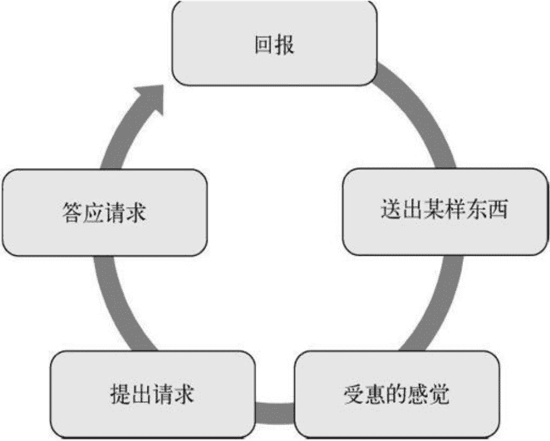

图 6-1 回报的循环过程

这个过程中有几个关键点。

**第一，送出的东西得有价值。**

不能送完全没用的东西。假设你送一本精装小说，可对方不收集也不读那种语言的书，这就白费功夫。

送出的可以是一项服务、一件物品、有价值的信息、一次帮助，或者任何接收方认为有价值的东西，甚至简单到替人开门、捡起掉落物品。一些销售组织推崇这一招，却因为送的东西没价值而前功尽弃。设想你参加展销会，每家参展商都送礼品。有一家只送廉价笔，你会毫不犹豫走开。下一家送的是谜题游戏，很吸引眼球，你拿起来玩了几分钟，销售员走过来问：“需要提示吗？”他演示通关技巧后，再问你是否愿意花点时间看看他们的服务。

这种局面，你怎么好拒绝？你拿到一个有趣的游戏，还得了免费提示，现在他只需要一分钟介绍服务。这是一个很漂亮的布局。

**第二，要制造真正的受惠感。**

对接收者来说，礼物价值越高，或者来得越意外，受惠感越强。

重要的是别把礼物用成露骨的操纵。不要说什么“我给你这么好的礼物，你欠我的”，甚至这么想，都会让受惠感消失。礼物必须完全免费，并且对对方有足够高的价值。

比如，美国人道协会会把定制邮寄标签当作免费礼物送出。标签漂亮、质量不错，也没有附加条件，人们可以用在节日贺卡或个人信件上。标签上有你的签名，几个月后你可能接到电话，对方希望你别忘了支持本地人道协会。这时接收者的责任感往往很强，多少会捐一些。

再看《财富》杂志：它曾为大学教授提供免费期刊，不附带任何条件，供教学使用。

反面例子也不少。很多公司误以为下面这些是好礼物：

- 漂亮夺目的公司宣传册；
- 没用的小玩具；
- 关于公司或产品的销售资料。

这些东西很难让人产生受惠感。接收者必须认可“礼物”有价值才行。还有一种能建立真实受惠感的“礼物”是信息。从某种角度看，给对方一条有价值、能带来好处或很实用的信息，比实物更能引起兴趣。

**第三，时机到了再提出请求。**

有一次进大楼，我看见一个像“老板”的人从车里出来，车停在“CFO 专用”车位上。他正在打电话，脸色不太好，我隐约听到他说自己有种糟糕的感觉，因为要进去开除一些人。从语气判断，电话那头可能是妻子或女朋友，他对这项任务很排斥。

我经过他身边走向前台，发现前台女孩正在玩扫雷。我走近时，她用标准口吻问：“请问有什么可以帮您？”脸上却写着无聊，心不在焉。我说：“嗨，我来开会，你老板马上要进来，心情很好……”我压低声音，拿着文件夹站在那里。几秒后老板进门，我大声说：“多谢你的帮助。”

她看着我说：“请稍等一下，先生。”然后转向老板：“早上好，史密斯先生，这边有您一些东西。”趁他经过时递过去一小叠纸。

老板进办公室后，她多次向我道谢。她很清楚，我刚才帮了大忙——我提前把老板要进门的消息递给了她，让她有机会从容应对。这份信息对她来说很有价值。于是接下来我的话就有了分量：“我需要你帮个忙。我想见人力资源部经理，你能让我尽快见到她吗？”

她把我带进经理办公室，还在门口介绍我是“她的朋友”。几分钟内，我的计划就成了，这就是回报带来的好处。

作为社会工程人员，留意适当的小机会，送出一条信息，会突显你在接收者眼中的价值，更重要的是让对方感激你。

多观察周围，看看能为目标做点什么，让他感谢你。记住，不必惊天动地，只要对他有价值。诀窍是别让对方觉得“不寻常”；急躁、迫不及待，只会带来厌恶。要自然地用这些原则。

所谓自然，就是先在日常生活里用起来：替人开门、保持礼貌、找机会帮别人一把。这些行为会变成第二天性，等到了社会工程审查活动中，做起来就不生硬。

回报是一个很强的影响战术。紧随其后、与它关系密切的，是义务等原则。

# 社会工程五大心理触发点

先说核心：多数说服并非靠技巧堆砌，而是触动人性默认的反应模式。

一、义务感
义务感来自规范与承诺的复合压力。他人替你开门，对方往往顺手回开；信息泄露也常因求助者制造出说出来理所当然的氛围。面向客服类岗位时，此类压力尤为有效。
赞美可作为触发器，但需自然。先夸后求，若生硬易显虚伪，反噬效果。反面示范：赞美外表后直接索要机房权限，明显失当。
自然的运用案例：靠近前台，注意到桌上小孩在乐园的照片。寒暄后轻声问这是孩子吗，好可爱。我也有孩子，他们让生活更有活力。对方回应后，可顺势提起自己曾与人讨论过新人力软件，却忘了联系人姓名。对方多半会主动提供信息，随后被一句谢谢与欠下情分收尾。此类互动易打开话匣。
黄金法则的变体也属此列：给予对方所需或赞美，易让人产生回馈的心理负债。实验显示，附带小礼物的捐赠请求，成功率显著高于裸请求。亦可自行验证：当他人发问时刻意沉默，对方会因期待回应而感到不适。
第一步制造期待，第二步让人想投桃报李。送礼物附带使用指引，亦能形成类似义务。

二、让步
让步即承认或示弱，常撬动回馈天性。
操作要点：明确告知让步内容，让对方难以不回应；提前埋下回馈种子，如展现倾听与柔性；低信任情境下可先做无风险让步；分批施压比一次性更易持续。销售与谈判日常都在用此逻辑。
电话募捐先提大额被拒，再降至小额，接受度骤升。汽车议价中卖家降价后，买家亦倾向抬价，以维持平衡。让步需对接收方有实际价值，且不能损害自身立场。

三、稀缺
稀缺提升感知价值。广告常用最后一天、限时、仅售等字眼制造紧迫。某家游戏厂商的主机初期供应紧张被解读为刻意营销，类似手法在汽车清仓中亦常见，广告长期滚动但销量仍好。
肉商案例：声称本批为最后一批，且数月才来一趟，以此推高欲望。对方若识破，可用计算核价反制，卖家只能不断降价，最终暴露稀缺为假。教训：稀缺要可信，否则反噬。
从社工角度，信息越受限、越难获取，价值感越强。可说我不便透露但…或我听说…以严肃语气暗示稀有。

四、权威
大众倾向服从被视为权威的主体。
韦伯划分三类权威：法律型、组织型、社会型。
法律型依托制度，冒充执法或保安易获顺从。
组织型依托层级，冒充高管或以高管名义行事可获取口令。实验显示，匿名研究者电话指令下，绝大多数护士会执行危险操作。
社会型来自群体认同，暗示已有上级许可即可降低防备。衣着、头衔、座驾等符号亦可快速建立权威感。

五、承诺与统一
人偏好言行统一，以减少认知负担。
直觉会提醒当下决定与既有信念冲突。若公开表达立场，后续行为更易沿同一方向。反思提问：若时光倒转，是否仍会做出同样承诺，可帮助自检。
这五种机制单独使用尚显温和，组合后威力倍增。理解它们是为了在收到人情、让步、稀缺暗示、权威符号或承诺框架时，能多停一秒，辨明是判断还是本能反应。

承诺与一致性的力量，往往藏在我们不想当“言而无信的人”的那点心理负担里。

在商业厮杀里，这一点被反复利用。很多公司明明砸钱做推广并不能立刻换来更高的回报，却还是愿意持续加码，因为他们赌的是长期占位。经典的例子就是可口可乐和百事可乐长达数十年的广告战。两家都放出不退让的信号，所以一方一有新品或新战役，另一方几乎立刻跟进。宣传并不能把一个喜欢百事的人硬改成可乐粉，但承诺感会让对攻变成必然。

拍卖场里这种心理更赤裸。像 eBay 这样的平台，投下一轮出价就等于向自己下了个小承诺，别人抬价后自己往往会跟着抬上去，有时甚至抬过心理价位才收手。罗伯特·坎普收购布鲁明代尔百货就是这种效应的极端案例，他比合理估值多掏了约 6 亿美元。研究社会谈判的马克斯·巴泽曼引用《华尔街日报》记者的话总结得好：“我们已经不再基于价格进行交易，而是基于自我意识……”

只要牵涉到博彩、嘉年华这类场景，承诺同样是操盘手。市场顾问瑞安·希利在专栏里讲过自己带女儿去马戏团的经历，详见 www.ryanhealy.com/commitment-and-consistency/。他花 44 美元买票、5 美元停车，车程 40 分钟才到。女儿想要棉花糖，他递过去 5 美元，心里想应该够了。卖家却说一袋要 12 美元。已经答应过女儿、已经在路上了，他很难当场改口，最后还是掏了 12 美元买下一袋。

这种“虚假一致性”可以概括为：人们会按照既往经验或心理预期去行动。技术人员来公司，预期他会进服务器机房，伪装者只要提出同样的要求，就容易被放行。因为行为与预期吻合，目标不会起疑。

对社会工程而言，承诺是一把相当好用的杠杆。恰尔迪尼在《影响力》里点破核心：

> 使用承诺和言行一致操纵他人的关键在于初始承诺。也就是在作出承诺、明确立场之后，人们会更加愿意同意那些和他们初始承诺一致的要求。很多说服专家会尝试引诱对方选择一个初始立场，该立场与他们随后要求的行为一致。

实操上就是先让对方透露一点点向最终目标靠拢的细碎信息，再用“你已经这么说了”把对话往前推。反过来，攻击者自己的话和行为也要自洽，先从小事入手，再逐步扩大收集面。

讲个不现实的极端：直接问核设施的发射码肯定碰壁，且无法回撤。若从小处慢慢加码，信息索取会显得自然不突兀。渐进虽慢，却比一上来就急着要密码更有效。保持冷静、每次都把审查步骤写下来，目标和路径才不会乱。

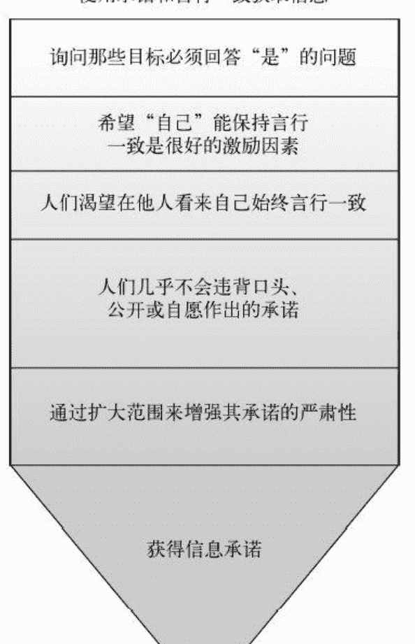

图 6-2 清楚地定义目标有助于你获得信息承诺

把承诺放到口头上，约束力会更强。恰尔迪尼也说过，作出决定后我们会承受来自外界和内心的压力，要求行为与决定保持一致。有人向配偶口头保证要减肥，就会一直被这份“欠下的”义务追着走。反悔时人们往往声音变小、目光闪躲，因为心里有愧。

哪怕是极小的承诺也能被放大。律师常在电话里先问：“嗨，今天好吗？”对方随口答“很好”。随后律师顺势说：“听到你这么说真好，因为有人需要你的帮助。”一旦对方点头承认状态不错，就很难在后续请求上轻易说不。

这并不意味着要对每个简单问题都过度警惕，只是要明白一个承诺不等于后面的所有承诺都自动生效。我曾和一个同事共事，他擅长让人觉得决定是自己做出的，诀窍就是先确保对方遵守了某个诺言。答应了一致，就很难再撤回。

当然，说“不”也是自我保护。之前有个冻肉推销员的案例，我妻子就意识到自己可能被“划算感”带跑，直接找我来挡，因为我“不受推销员欢迎”。

1972 年托马斯·莫里亚蒂博士做的海滩实验直观展示了承诺的威力。助手带着收音机在海滩假装受害者，离开去买饮料时另一名助手假装偷走收音机。20 人里只有 4 人阻止。第二次实验里，受害者在离开前先请旁边晒太阳的人帮忙照看收音机。结果 20 人里有 19 人站出来阻拦，甚至有人动用武力。差别就在于那句看似随意的“帮我看一下”，它制造了承诺。

社会工程人员会先诱导出一个小动作或认同，再以此为支点扩大影响。

喜欢，是另一条主线。

人们倾向于喜欢那些表现出喜欢自己的人。销售常被教导客户会买自己喜欢的人卖的东西，这不假，但关键反过来：你必须先让对方感受到被关注。微笑和热情很难完全伪装，长期影响需要真诚的关心而非纯靠魅力。魅力短效，喜欢才持久。

特百惠的成功就是典型。1990 年乔纳森·弗伦岑和哈利·戴维斯的论文 Purchasing Behavior in Embedded Markets 指出，多数人购买并非因为产品刚需，而是为了让妻子高兴、帮助朋友、避免社交尴尬。害怕失去好感的情绪驱动了购买。

研究也显示，人们更愿意接受朋友的糟糕建议，而拒绝讨厌之人的好建议。从社会工程角度，这要求不仅赢得信任，还要真正对目标产生兴趣，这与第四章提到的伪装战术相连。伪装不仅是模仿思想，更要“成为”那个角色，才能让对方发自内心地愿意帮忙。

吸引力在这里也起作用。1972 年布尔沙伊德、沃尔斯特和迪翁的研究《美丽的就是好的》表明，人们会把外貌吸引力自动延伸到人格、幸福感、职业成就等评价上。一种特质的光环会扩散到整体判断，这就是晕轮效应。详见 http://www.social-engineer.org/wiki/archives/BlogPosts/BeautifulGood.pdf。

营销里处处可见这种用法。曾有一则电视广告讽刺营销手法：一位打扮精致、气质自信的年轻女性自称“公认的有吸引力的 18~24 岁女孩”。她并非顶级美女，却足够让你觉得她在年龄范围内。随后她说自己不属于任何特定种族，看起来混血，对多数人群都友好。接着展示她练跆拳道、啦啦队、赏花等片段，传递健康活力。最后推销护垫。整个广告同时运用了喜欢和晕轮效应。

想用好喜欢的原则，不靠整容，而是靠理解目标。了解对方的接受边界、穿衣习惯、喜好厌恶。假扮药品代表去诊所审查，西装革履、发型干净是常态，莫西干发型或鼻环只会立刻暴露。服饰、发型、饰品都应让目标感到自然，先营造舒适感，再建立信任。

恭维是入门技巧。适当时问一句“你的鞋子很漂亮，在哪买的？”人们喜欢正向肯定，会为了再听一句赞美而继续对话。明尼苏达大学关于肯定强化的研究指出，过度肯定会失效，穿插提问会让强化更持久。

让人产生好感大致可归为四步：自信积极的态度、建立共识、与目标和环境同步、有效沟通。尼古拉斯·布斯曼在《How to Make People Like You in 90 Seconds》里提到，人在见面头两秒就决定喜不喜欢，改变第一印象很难。他强调提问多、主动倾听、对对方话题保持兴趣，这些都能显著提升好感度。

共识或社会认同，则是“别人都这么做所以我也该这么做”的心理捷径。

恰尔迪尼描述过一个经典实验：几个人在街上抬头看天，路人也会跟着抬头，甚至导致交通受阻。市场营销极爱用它：公布高销量、展示带 Logo 的 T 恤都是在暗示“大家都在用”。名人效应同理，人们希望拥有与偶像相似的特质。

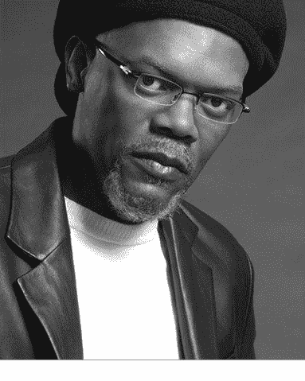

图 6-3 塞缪尔·杰克逊戴着袋鼠（Kangol）帽

另一个实验涉及痛苦耐受。克雷格博士让参与者接受电击并标记痛苦程度，随后在“能忍受痛苦的人”在场时重复测试，参与者不仅主观报告痛苦减轻，皮肤电位和心率也真实显示不那么痛苦。痛苦的表达部分取决于周围人的表现。

老节目《真实视频秀》里电梯实验也很有名。事先安排的几个人会集体转向左侧、右侧或向后站，几秒后其他乘客也会无意识模仿。社会认同提供了一个快速判断行为是否合适的捷径，也因此容易被操纵。

社会认同在两种情境下最强：不确定时，人们会模仿他人判断对错；相似性高时，榜样的说服力更大。

我曾被保安拦下，装作疑惑地说：“昨天吉姆检查我的证件就让我进去了，我以为你们有记录。”听到吉姆的名字后，对方就放行了。这种借助“别人已同意”的暗示，往往比硬闯更有效。社会认同是当今影响战术中最致命的工具之一，能让社会工程师以更小的阻力引导他人行为。

说服真正高明的地方，不是逼别人点头，而是让对方自己生出“我愿意”的念头——愿意去做、去想、去信。能把动机种进目标心里，这是一种很硬的能力，放到社会工程领域，几乎称得上重型装备。前面讲过的原则和手法，都是让这件装备真正运转的零件；但从知道到用好，中间还隔着大量刻意练习。

要提醒的是，技巧一旦练熟，想彻底放下并不容易。社会认同看上去很好用，可一旦拿来影响别人，就必须格外克制，社会工程从业者更应如此。技能内化之后，最好主动把它用在助人上。比如你开始练读微表情，甚至拿它去揣摩目标反应，最初会有一种“我是不是会读心”的兴奋感，而这恰恰是要警惕的地方。技巧要继续磨，头脑也要保持清醒，别以为自己已经全懂了。

如果能用这些本事劝人戒烟、陪人开始运动、走向更健康的生活方式，就算真正挖到了它们的价值。把技术迁移到社会工程场景，也就没那么遥远。

不少手段能不能奏效，取决于你是不是真的对人有兴趣、愿意关心、有同理心。如果这不是天赋，就得下功夫练。我建议你在这上面花时间，它会让你成为更出色的社会工程人员。

再试着让自己相信：掌握这些技巧可以变得轻松。再试着让目标进入你希望他们体验的状态。更进一步，连交谈双方所经历的事实都能被重新摆放——下一节会展开，冲击力很强。

### 6.3 改写现实：框架

所谓框架，可以理解成人做判断时随身带着的“取景框”：生活里的信息和经历进入这个框，会改变人的反应方式。用非专业的话说，你和他人过往的经历塑造意识，意识再影响选择。

超市碎牛肉包装上常见“七五成瘦”的写法，而不是“两成半肥”。两种说法脂肪比例一样，但前者更容易让人联想到健康，买家也更愿意接受，商家自然选它。这个例子虽小，却说明一个道理：事实不变，换一种呈现，原本显得“不好”的东西也能被看得“不错”。

下面几个领域，能帮你体会取景的威力。

#### 6.3.1 政治活动

政治很早就懂得取景。竞选口号、政策命名、新闻措辞，哪怕只差一点，公众的理解就可能完全不同。

认知语言学者拉考夫观察过：同一件事，说“用法律手段惩治恐怖主义”和说“向恐怖主义开战”，公众感受并不一样。9·11 之后，时任国务卿鲍威尔把袭击定性为犯罪；当公众要求更强硬的回应时，布什总统抛出了“反恐战争”的说法。

美国社会保障计划也是如此。这个名字本身就带着“可靠、可依赖、给未来兜底”的暗示。

再看“紧急援助”和“经济刺激”。前者听起来像给漏水的船往外舀水，容易招来反对；后者则像给经济打气、推动增长。两者做法相近，但后者更容易被接受，差别就在用词。

加州大学伯克利分校教授巴特勒在《战争的框架》中，谈过西方媒体如何给政治事件和战争取景。她提到媒体对“国家暴力”的报道方式：某些人群被描绘成威胁，而不是需要保护的生命；他们被贴上迷失、被关押、失业、饥饿、可随时抛弃的标签。在这种扭曲逻辑里，为了保住“活人”的安全，牺牲他们竟被说成合理。

以上只是政治取景的一角。

#### 6.3.2 日常生活中的框架运用

参考框架可以看成一组看法、条件或假设，它决定人如何接近、认识、理解某件事。这个解释能帮我们看清取景是怎么起作用的。

任何能改变认知或决策方式的呈现，都可以叫框架。朋友说她上周去镇上，因为修路多绕了十六公里；你怕迟到，可能特意选一条更远的路，哪怕这消息已经是一个多星期前的了。

大脑天生不喜欢混乱。遇到无序，它就会努力找规律。图 6-4 就是个有趣的例子。

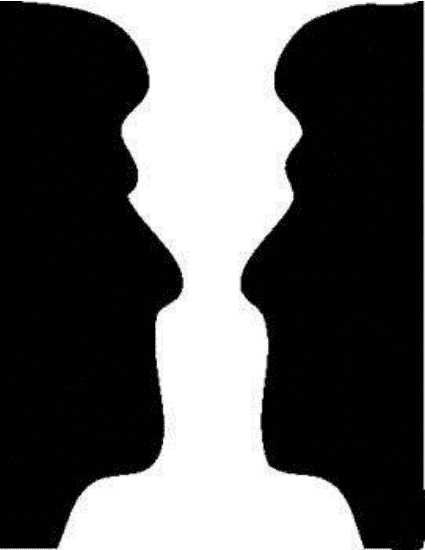

图 6-4 换一种取景，你看到了什么

在你当前的取景里，什么算背景，什么算前景？人会不自觉地寻找熟悉图案。看云、看天、看没有生命的物体时，我们也常看出人脸。看图 6-4，试试把前后景对调，打破第一眼形成的认知。

另一个例子，是早年在网上疯传的一封邮件：每个单词内部的字母都被打乱，只保留首尾字母在正确位置。奇妙的是，英语熟练的人往往仍能顺畅读下去。它想说明的是：大脑不是逐个字母认词，而是把单词当成整体抓取；人能从混乱中快速提炼规律。至于这是不是剑桥大学的研究，并不重要，现象本身已经够有趣。

很多取景是隐形的。企业营销常把潜意识线索藏进设计里，悄悄改变目标对产品的印象。图 6-5 你可能见过很多次。

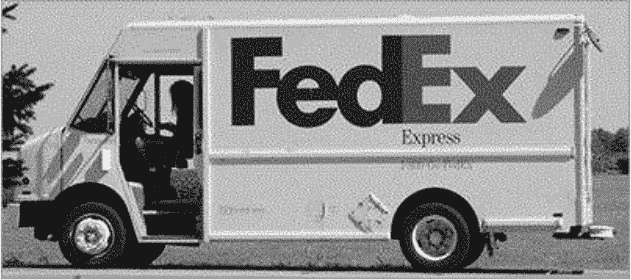

图 6-5 你能看出标识里的取景吗

提示之后再去看 FedEx 标志，会发现负空间里藏着一个箭头。设计者在访谈中说，这个箭头想传递移动、速度、动态服务的联想。找到了吗？图 6-6 用圆圈标了出来。

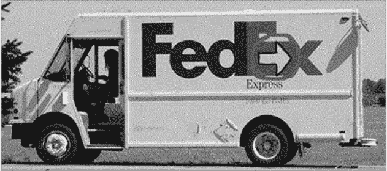

图 6-6 箭头暗示持续移动与优质服务

FedEx 不是孤例。几十年来，不少公司都把取景信息埋进标识，希望公众按品牌期待的方式记住自己。亚马逊标志（图 6-7）里就有两层意思：一是顾客满意后的微笑；二是这个微笑同时构成从 A 到 Z 的箭头，暗示这里什么都能找到。

图 6-7 你看到满意顾客的微笑了吗

立体脆（Tostitos）的标识也很有意思（图 6-8）。两个 T 像两个人分享一片玉米片，中间是一碗莎莎酱。2004 年品牌方在记者会上说，它定位为“社交零食”，聚会、看球、日常碰面都能拉近亲友关系，新标识正体现了这种连接感。

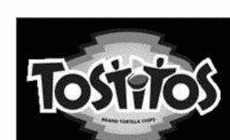

图 6-8 这个标识是否让你想分享玉米片

营销中的取景远不止图形。关键在目标感知到的价值。高价服饰店里，衣物整齐陈列，顾客会觉得标价配得上品质；把同款领带、衬衫挪到折扣店，和 2.5 折商品混在一起，价值感立刻缩水。营销高手就利用这种心理。有些公司的取景太成功，品牌名干脆变成品类代称。比如“帮我施乐一下”其实指复印，施乐是品牌；再如“你 Google 了吗”指搜索，谷歌成了动词；要纸巾时说“给我舒洁”。还有一些名字，很多人没意识到是商标：阿司匹林最初是拜耳注册的商标；Thermos 是热水瓶品牌，归属德国 Thermos GmbH；邦迪创可贴归强生所有；飞盘“弗里斯比”是 Wham-O 的商标。它们流行到人们拿来做同类参照。我平常不吃阿司匹林这个牌子，却也会说“来两片阿司匹林”，拿到惯用品牌也照样满意。

框架相关信息很多，需要提炼成核心原则，才方便放到真实社会工程里用。前面已经把概念和日常应用讲得比较细。进入社会工程之前，先看看框架联盟的不同形态。

#### 6.3.3 框架联盟的四种类型

斯诺与本福德在一篇讨论社会运动中框架与意识形态关系的论文里提出：当个人取景因为一致或互补而勾连起来，就会出现框架联盟，产生共振，这是群体取景转变的关键。随后，他们列出影响取景成效的四个条件。

- **取景工作的稳固度、完整度与彻底性**　斯诺与本福德指出三项核心任务，投入程度会决定参与程度。

三个步骤是：

1. 把问题诊断清楚；
2. 分析并给出解决方案；
3. 若奏效，就号召行动。

投入越深，受众越可能受取景影响而采取行动。

- **提议取景与大众信念系统的贴合度**　如果取景跟人的核心信念或价值系统毫无关系，人们会直接忽略它。

一个认定吃肉等于虐待动物的人，很难被劝去特色牛排馆吃饭。取景要跟个人核心信念对上频道，才容易成功；除非你的目标本来就是撬动核心信念。反吸烟广告是一次颇具争议的大规模尝试：志愿者把裹尸袋堆到烟草公司门口，用死亡人数制造冲击，想让支持吸烟的人重新掂量吸烟的代价。

- **取景与参与者处境的关联度**　取景必须让目标觉得“这跟我有关”，而且这种相关性要可信、可验证。

想用营销取景劝温饱都成问题的人去坐豪华邮轮，技巧再高也白搭。要从框架走到联盟，相关还不够，还得能证明，哪怕证明只存在于目标心里。

2007 年，可信度较高的新闻杂志《洞察力》曾报道，总统候选人奥巴马就读于一所以激进伊斯兰教义闻名的穆斯林学校。消息一出，很多人马上相信。为什么？因为这契合他们的现实取景，而且消息来自“可靠”媒体。后来 CNN 派调查人员核实，发现故事是伪造的，并作了报道。

这是一个通过高可信渠道投放“事实”、改变人们取景的例子。想相信奥巴马是激进穆斯林的人迅速传播了故事；真相揭露后，不少人的取景又转了回去。

- **反向循环、对社会变迁的持续关注，以及取景出现的时机**　世界局势会摇晃社会取景。多年前，若建议美国等西方国家的公司给员工做全身透视安检，几乎会被当成荒唐事。

隐私倡导者会反对：别人可能看到私处，保存照片，拿来嘲笑或骚扰。这个理由足以让厂商卖不动。可 9·11 之后，恐怖威胁上升，这类设备还是进了世界各地机场；反对者大声抗议，甚至搬出儿童色情法律，也难挡。为什么？因为“安全”的社会取景变了，新做法就被公众接受。

斯诺与本福德认为，按这四点搭好取景，社会可能借框架联盟发生大规模转变，社会运动正需要这种转变。他们关注的是整体社会，但这些原则放到小场景、人与人之间同样有效。比如你想进楼，保安想拦你；把他的取景与你的伪装调成同一频道，成功率就会高。记住：取景不是凭空造出来的，它总要借用已有文化符号，扎在个人信念与经验里。明白这一点，用起来才顺手。

##### 1. 框架桥接

凯西·马什查与调查研究中心把框架桥接解释为：同一主题下，思想上一致、结构上却不相连的两个或多个取景被接在一起。

操作时，盯住目标在意的价值，找到双方取景的重叠区，或者至少让对方觉得存在联盟。它是最基础的形态，偏防御，常靠强调某件事比别的事更要紧，从而把它和别的议题挂上钩。

全身透视安检的例子也能看到“放大”的影子：厂商把设备包装成反恐工具，借近期袭击和人们对飞行的恐惧，把产品取景与大众恐惧接上，于是机场部署获得支持。其实类似机器早就有，9·11 之前人们并不买账。

放大还有另一种用法：搅乱原有取景，让持某种信念的人松动。比如重视隐私、认为自己有权选择安检方式的人，被厂商影响：对方强调其他方式不完善、不安全，还拿“内衣炸弹”说事，于是新设备被衬得更好更安全。

社会工程人员也能借力。比如想说服保安放你进垃圾箱区域，扮成废品处理承包商是个办法；再补一句“有个垃圾箱出了状况需要处理”，就把事情抬到公司安全隐患的高度，保安更容易同意你进去查看。

##### 3. 框架扩展

所谓框架扩展，是改变取景边界，把一群人的观点、兴趣，尤其情绪，纳进更大的框里，从而把参与者拉进来。换句话说，把目标在意的其他议题接进原取景，联盟或共识就容易出现。

环保、绿色主张者可能把取景扩到反核议题，原因是担心环境风险。但扩展不能贪多：塞进太多旁支，原有取景的吸引力会被稀释，支持者可能流失，主框架也会被冲淡。

# 谁在你脑子里作画？——心智模具、换模与暗控的隐形逻辑

先把话落到单个人身上：真正好用的招法，往往不花哨。想拉人进同一阵线，路线要直、步骤要少；关系网铺得越乱，对方越可能嫌麻烦而退出。行骗者动手前，常先借“套话”铺垫：饭桌闲谈里顺走一点个人或单位底细，或者挂上记者身份，让提问获得一种“我有资格问”的正当感，于是平时撬不开的信息也有了入口。

## 一、旧解释失灵，换模就该上场

当你想推的心智模具无法让人产生共鸣，甚至冲撞了对方习惯的日子、礼数、既有解释方式，就得换模。换模不是硬掰，而是抛出新的论据，证明“换一套看法更划算”，把对方原来的信念一点点迁到你要的位置。新模具要配新的价值坐标，才能让人愿意参与、愿意站台。上世纪七十年代，保守派的思想外壳被重新塑造，后来转向更激进的环保议题，这属于大范围的社会换模。个人生活里，改宗换信也天天发生：一套信仰系统被替换，人的心理结构随新信念重新对齐。

但换模是实践中最难啃的骨头之一，它至少消耗五样东西：

- **时间**：整套信念不是开关，一按就变；还要借用别的拉同盟技巧，熬很久才见影。
- **精力**：先弄清对方现在信什么、你想让他信什么，这只是起步；他为啥抗拒、卡在哪道心理关口，找起来很费神。
- **教育**：知识是底气。你得让对方弄懂新解释框到底长什么样。
- **逻辑**：讲解不能全靠煽情，必须让他自己推导出“这步行动说得通”；这一步只能靠理性说服。
- **情感纽带**：道理让人点头，感情让人抬脚。你投入的情绪，对方能接收到；但表达要贴合你扮的角色。扮的是学业顾问，却像拉拉队长一样亢奋，同盟就搭不起来。

一旦对方的解释框与你的并轨，他做你期待之事的动力会明显变强。前面几种拉同盟方式都厉害，可真把换模玩透的人，推动力近乎没有上限。

## 二、四条规则，把心智模具变成武器

先记住：所谓心智模具，就是人脑里组织概念的那套结构。你要做的，无非是新建一套、与别人的那套并轨，或把对方带进你的那套。三条路都绕不开下面四条规则。

**规则一：你吐出的每句话，都会在对方脑内点亮一幅图。**  
人思考时就在描画，这改不了，但能借力。你聊起他的上司，他脑中就会浮出上司；你说那人正在门外打电话、脸色难看，他脑海里立刻长出难看的表情、手势和语气。这种心理图式会牵动情绪和反应。用语言作画，是极厉害的招法。精挑细选的词，能让对方脑内出现你希望他看到的场景，把他挪进你设定的解释框。为什么有人讲故事特别抓人？因为他能造出心理画面，让你像亲眼看见一样。不是要求你句句都像说书，但要记住：词句有勾景的力量。

举例：只说“昨晚我吃了意面”，你若不爱美食、不是意大利裔，或上次吃得不愉快，可能毫无波动。换成“我太太拿自家种的番茄和罗勒熬酱，添了新蒜和牛至，用红酒提味，浇在仔细煮好的面上，旁边还有她烤的蒜香面包”，不管你爱不爱意面，脑内都会冒出一盘热腾腾的食物。细节越足，画面越强，冲击越大。但别演过头——你的目的是让对方看见画面，不是让他盯着你或你的表演。

**规则二：模具里出现的词，会激活对应的心理图式。**  
你不必把答案说穿，也能让对方脑内长出同一幅图。读这句：“我看见小虫在网里扑腾，想逃却逃不掉。没多久，它被裹进丝茧，成了别个的晚餐。”我没写蜘蛛，你已想到蜘蛛。这就是间接表达控制心智的力量。像 Toastmasters 这类训练表达的组织，也教人用语言调动听众情绪。故事若能让对方自行描绘你设想的图式并投入感情，你就更容易带节奏。这需要提前设计。对方大脑处理信息、生成画面时，你可以悄悄埋下想法。与直接描述意面不同，这条规则允许对方自己补图。比如意面故事讲到最后，你说：“她把酱浇在煮好的面上。什么面？不告诉你，自己猜。”等对方脑内开始画，你再补：“我用叉子卷面时，酱很稠，挂在每一根面上。”画面仍是意面，但对方参与感更强。

**规则三：否定也会点亮模具。**  
我若说“别去想网里的蜘蛛”，你脑内先冒蜘蛛，再命令自己别想。提醒对方“小心、留神、防着某事”，会自动把他推进你想要的解释框。熟练的行骗者常用这招。某次安全测试，我故意把几个带毒闪存盘丢在显眼处，盼着有人手快插上。我走到一个已取得信任的员工旁边，说：“约翰，听说内部通知让大家留意一批遗失的闪存盘，现在正找呢。”管理员丢下带毒盘，却叫人去找，本质上是在对方心里埋下“照做”的种子。这种说法还卸掉了对方捡到可疑盘时的顾虑，让他找到后插进电脑，看看是谁落下的。

**规则四：让对方反复想，模具会越扎越深。**  
大脑每关注或琢磨一件事，这件事就会被加固。你让受众对你想推的解释框想得越多、描得越细，它越牢，对方越容易陷进去。回看信息传播模型，媒体很懂。有一次我去印度，新闻里当时的美国总统让欧洲民众恼火。我刷资讯平台，看到欧洲一些地方把长得像他的假人挂上街，外面裹着星条旗烧掉。我很震惊，当晚跟妻子通话：“天哪，欧洲这些新闻真够疯，是不是？”她却完全没听说。为什么？新闻机构和资讯平台主导了人们的注意力图式。

行骗者也能学媒体：省略、漏掉细节，或者干脆不提某件事，让对方得出“像是自己想出来”的结论，其实那结论由信息发布方设定。只放出想放的那部分，就能造出你希望对方思考或感受的解释框。媒体还爱打标签。想给正面定义，就说“坚固的防御”“健康的经济增长”，这些词画出稳定、健康的图景，帮人得出正面判断；想给负面定义，就贴上“恐怖分子”“阴谋论”之类的签，画面立刻变暗。你也能用描述性词给事物命名，把对方带进你的模具。有回我大步往前，突然被门岗拦下。我一脸惊讶又带歉意：“哦，昨天那位很热心的门岗老汤查过我的证件就放行了，我以为有记录呢。”把前一位门岗说成“热心”，当前这位就自动进入我设的图式：若他也想得到好评价，就该像老汤那样“热心”。模具之所以管用，是因为它扭曲现实却不至于假到不可信。你可以造想要的图景，但不能完全离开事实。

有一项研究，作者是克兰多尔、艾德尔曼、斯基塔卡和摩根，论文标题大意是《现状表述会提高对严刑审讯的支持》。美国多数人反对战时用严刑逼情报。研究者想看：换一种表述，能否让部分人觉得严刑并非不可接受。他们让 486 人读两段材料。第一段说，美军在中东审嫌疑人时用了高压问讯，这是一种新手段，首次广泛使用；第二段几乎相同，只把第二句改成“这并非新手段，美军已沿用四十余年”。两段都列了水浸、睡袋闷脸、绳索吊成痛苦姿势、隔离、连续多日不让睡等做法。七档同意度从“完全反对”到“完全赞成”，反向折算后，高分代表更支持。结果：被描述为“沿用多年”而非“新做法”时，严刑审讯的评分更正面；让它看起来像常用手段，支持度和正当感都上升。只改一小块表述，研究者就让大量参与者与某种立场并轨，使他们大体接受严刑可容忍。文章还评论，这类操作可用于很多领域，影响判断、决策、审美和政治偏好；适当改变呈现方式、设置道德选择和价值困境的措辞，会对公共选择与政策产生深远影响。这证明心智模具甚至能撬动人们多年固守的根本信念、判断和决定。对行骗者来说，多数时候不必设这么高的目标，不用改观念，只需让人做一件细想会觉得不妥的事。四条规则加上周密设计，能让心智模具变成破坏力极强的工具，这也是恶意操控者天天使用它的原因。在欧美语境里，人们受的教育常常就是接受外部设定、接受被塞进“想什么”和“怎么想”。

十多年前若有人说，荧屏上几乎全是素人实境节目，你可能会笑：那多无聊多蠢。可零六年美国西海岸一家大报称，这类内容数量涨了近三成，之后也没明显回落。因为看这类节目被呈现为时尚新潮，因为我们被告知它好看、有趣、所有人都在看。这个例子说明：几年前多数人觉得蠢的事，也能被改写成“适合做”的事。心智模具绝对是一门艺术，与沟通、影响科学结合后，就成了熟练操控者手里的利器。用某种形式传递信息，他们就能“轻松”与对方并轨，促使人不觉内疚地行动，改变其对现实的感知。

心智模具和影响是操控术的重要部件，但“影响”常被拖进暗角。再往下，就是暗控。

## 三、暗控：控制对方的那只手

很多人觉得暗控阴暗，因为通常描述会让人发怵。网上定义大意是：用精明、迂回的方式影响甚至控制他人或自己，尤其为自身利益。这也解释了为何不少行骗者偏爱它：靠技巧控制或影响别人、达成目的，吸引力太大。从洗脑手法到销售员的隐晦暗示，暗控被视作该学该精的技能。它的目的，是压过对方的批判性思考和自由意志。当对方按熟悉流程无法决定时，操控者可以给他灌入想法、价值、态度或道理。

常见六种用法：

1. **提高对方的受暗示性**：极端时，缺觉或挨饿会让人更易被暗示；缓和些，时间紧迫下的隐晦提示也能让人更容易受影响。
2. **夺取对方环境的控制权**：从控制他能接触的信息种类和数量，到微妙地拿到他的社交账号访问权。能看到他的社交媒体，就能掌握其交流信息，并控制他收到的内容。
3. **制造怀疑**：动摇并深挖对方的信仰系统，有助于让他做你想要的行为。但要巧，不能一上来就贬低；可以质疑他执行的制度、工作或信念，逐步削弱其理性决策能力。
4. **制造无力感**：这是战时审问里的阴招，让对象对信念逐步失去信心。行骗者可以亮出从权威人物处获得的“事实”，釜底抽薪，让对方感到无力。
5. **让对方产生强情绪**：怀疑、罪恶感、羞耻等情绪足够强时，可能改变整套信念系统。不能制造破坏性的负面情绪，但制造害怕失去、害怕受罚等反应，会推动目的达成。
6. **严重威胁**：对生理痛苦或其他可怕情形的畏惧能让人在压力下崩溃。除非伪装成商业间谍，多数行骗者不会用；常规活动中，通常借权威制造强烈恐惧或潜在损失感。

不过大部分时候，暗控没这么极端。设想拥挤房间里有人喊你的名字，你多半转身问：“谁啊？”这时你已被影响，只是未必带恶意。心理层面更复杂：大脑听到名字，会自动形成应答，“谁啊”和出声之间的连接极短。即使你不作声，或者那人叫的不是你，大脑接到问题也会形成应答。无意中听见两人交谈并听到一个问题，你脑中也会形成应答，可能是一幅画，也可能是一个声音。对方无意听到别人谈论类似他脑中的某个人，脑内就会浮出画面；听到“小鸡为什么过马路”的笑话，脑中就会出现小鸡、马路或整个场景。

另一种暗控靠反射式联想。人会不断适应，把特定声音、行为同感觉、情绪挂上钩。若每次提到积极事物都伴随圆珠笔按动的脆响，一阵子后，这声音就会和积极感受绑在一起。经典实验里，那条狗听到铃声就分泌唾液。问题在于，这种训练能否施加于人？让对象流口水不是多数行骗者的首选（这是个笑话），但能否训练对方在特定输入下按你想要的方式响应？商业和营销里已有不少暗控实例。

十多年前的五月，美国媒体曾披露一个案例。几个儿童常用药品牌的生产商，在液态非处方药里发现一批解热镇痛成分有缺陷，却不想花大钱收回。他们雇了许多临时雇员，到各家零售终端买断所有问题药品再处理掉。不幸的是，一名临时雇员疏忽，把写有该计划的内部记录落在一家药房，随后事情被报给美国药监机构。根据记录，药监机构要求公司分四次收回所有问题药品，其中一次就达一亿三千六百万瓶。但已经太晚：报道称七百七十五名婴幼儿服药后出现副作用，最终三十七名孩子离世。报道没有说明死亡是问题药品本身还是药物反应所致——这不是重点。重点是，这是一次非常阴险的暗控尝试：为保住公司形象，他们放弃正确流程，罔顾全球孩子的生命安全；落在药房的那份记录里，只字未提“收回”。

看懂这些，不是为了学坏，而是为了在别人替你搭好解释框、递来标签、悄悄拨动情绪时，能停一下问：这幅画，到底是谁画的？

# 别急着怪自己耳根软：一套把注意力悄悄牵走的操纵术

有些套路并不靠大声命令，而是先替你换个焦点，再让你觉得“事情本来就是这样”。从药品召回、疾病营销，到货架摆放、音乐气味、颜色暗示，再到金钱、信念和同伴压力，操纵的逻辑常常藏在不起眼的小步骤里。

## 01 先造一个坑，再扮成来填坑的人

布洛芬制剂召回事件里，事情败露后的操作很值得琢磨。公司先把事实讲歪，说专家认为这种制剂对儿童没有多大风险；随后正式道歉、解雇 6 名高管。真正的戏码接着上演：面对质询，公司否认这是外界所说的“隐秘召回”，改口称是在检验“有害批次药品”，于是安排合同工把药买回去测试，若真有问题再走正确流程。这里用的是转移视线，让公众别盯着已经发生的行为；同时还用了掩饰手法，把不认可他们做法的人说成误会——公司只是在测试，以判断要不要召回。

这场风波没有成为大众焦点，也说明公司在影响媒体和司法系统方面颇有一套。更值得聊的是，转移策略并非企业专属。你去了不该去的地方被逮住，编一个可信故事，把对方注意力从眼前问题挪开，就能争取时间、改变焦点。比如保安拦住你，你不必慌，冷静反问：“你知道我在这儿干什么吗？听说有存着重要数据的 U 盘丢了，明天上班前必须找到。你要不要检查一下盥洗室？”

保罗·威尔森在《骗术真相》里设过一个局：明星从商店偷 CD，店员扣住人等警察；保罗走进来，自称警察，晃了晃只装着孩子照片的钱包，就把明星“逮”走，还带走 CD 和收银机现金，没人质疑。这个例子把“问题构造”说透了——先有一个“小偷明星”的问题，再把自己扮成解决方案。想让人接受要求，不妨先摆出一个问题，让“好人”顺势登场。

## 02 把一种病症，做成一个市场

1998 年，制药巨头史克必成发起广告宣传，向大众传播“社交焦虑症”概念，发布 50 个新闻故事及调查，用“你有社交焦虑症吗”之类问题告诉人们这是什么、怎么判断。之后，他们改动医学杂志广告文案，从“帕罗西汀意味着从抑郁症、恐慌症和强迫症中恢复平静”，换成“让他们知道自己能……第一种也是唯一一种获认可的社交焦虑症治疗方法”，这一改动花了约 100 万美金。1999 年，公司又投入 3000 万美金，在平面媒体和电视上宣布找到了治愈社交焦虑症的良药——帕罗西汀；还买下热门电视节目固定档期，用调查测试数据宣称 1000 万美国人患有社交焦虑症，如今有希望了。

到 2000 年，帕罗西汀拿下这个快速增长市场的一半份额，公司斩获“2000 年美国新型抗抑郁药零售处方市场第一名”。2001 年，FDA 批准它用于一般性焦虑症和创伤后应激障碍。“9·11”之后，抗抑郁、抗焦虑药物处方量大幅增长，帕罗西汀的广告则对准人们普遍的恐惧与无助感。这里不是说这类药物毫无作用，也不是说公司动机一定险恶；真正耐人寻味的是市场操纵的路径：从教育宣传起步，走到销量猛增，中途还“创造”出新的失调。先抛出一个可怕问题，再拿“事实”证明它真实存在，这种问题构造既用于市场宣传，也见于政治和个人层面。

## 03 货架、音乐、气味和颜色，都在替你说服

凯马特提出过产品陈列示意图，也叫货架图，用来告诉零售商如何依据颜色、尺寸等标准摆放商品，以刺激购买欲。研究者分析人们逛店、思考、购买的方式，再设计控制视觉输入的机制；软件和专门公司则负责计划执行。常见布局有三种：水平放置，把同款商品挨个横排，最小有效吸引区间约 15~30 厘米；垂直放置，让每种商品占不止一层货架，同样保持 15~30 厘米的视觉空间；块放置，把有共性的商品或品牌并排、上下堆叠、中心环绕，或用磁力挂钩组合。

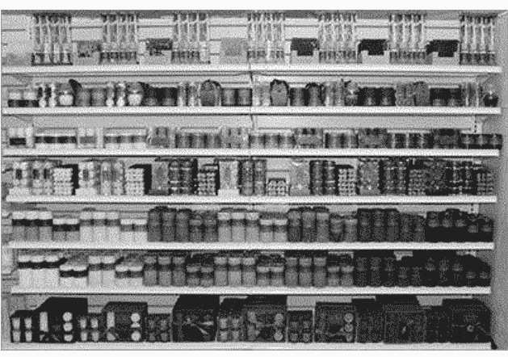

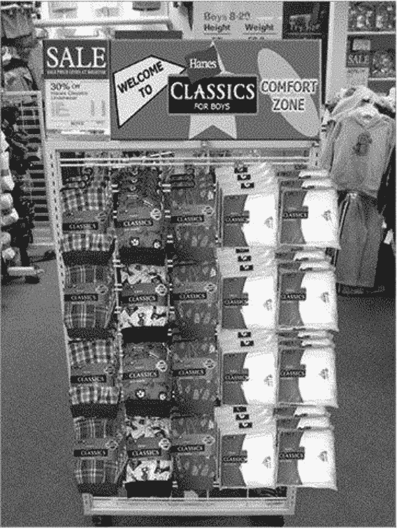

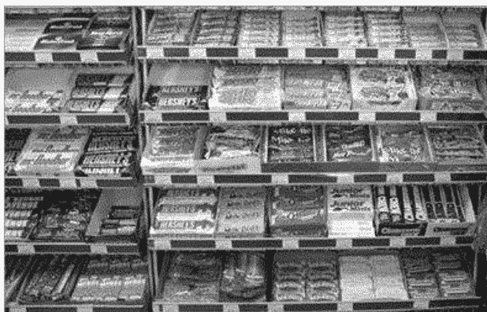

货架图不是唯一手法。商场循环播放特别设计的音乐，购物者停留时间平均增加 18%。杰-查尔斯·沙巴特和理查德·米琼研究加拿大大型购物中心后发现，空气中喷洒特制香味能促发快乐情绪、刺激消费，一周内平均每位购物者多买 50 美金的东西。大型商场和水果店的体验当然不同，但懂一点大脑如何分类，就能组织自己的“货架”，去影响目标的感觉、情绪和思维。

颜色也是情绪开关。白色常让人想到纯洁、明亮、干净，传递安全、中立、善良、忠诚，所以婚礼常用，投降也用它；黑色关联权力、高雅、神秘、力量、权威、深度、稳定，也给人平静安宁，还能衬托其他颜色；红色连接兴奋、喜悦、喜庆、行动、能量、健康、速度、激情、欲望和爱，会刺激情绪、加快心跳呼吸、升高血压，但也要小心，它也能表达武力、威胁、征服、暴力甚至复仇；橙色带来温暖、热情、吸引、决心、力量和忍耐，鼓舞活力，甚至刺激食欲，但过量或搭配不当会显得不安全、无知、迟缓；金色常与明亮、智慧、财富、威望相连；黄色关乎能量、乐观、喜悦、高兴、忠诚、精神饱满，让人感到受重视，还能影响记忆，所以贴纸多为黄色，少量正面，太多则让人分心或吹毛求疵；绿色让人想到自然、和谐、生命、丰饶、雄心、保护与和平，带来平静安全，但使用不当或过量也可能引发贪婪、内疚、妒忌、混乱；蓝色是天空与海洋的颜色，关联智慧、直觉、真理、宁静、健康、力量、知识，能镇定冷静、减慢新陈代谢，也是眼睛最容易适应的颜色，但别让目标感到寒冷或沮丧；紫色连接皇家、高贵、奢侈、创意和神秘；棕色关联地球、可靠、易接近、惯例和秩序，给人牢固、相关或有序之感。

这不是说穿一身蓝就能让人交出密码，而是说策划行动时要把外表和着装纳入方案。社会工程人员会分析目标，确保颜色增强而非破坏操纵效果：与慈善机构会面别穿绿，因为绿色可能引发贪婪或野心，和慈善使命相冲；穿蓝色套装拜访律师，则可能让人冷静、更愿敞开心扉。小心筹划、合理使用，能提高社会工程审计的成功率。

## 04 婴儿、青蛙和条件反射

条件反射遍布日常交谈、市场宣传和恶意操纵。人像巴甫洛夫的狗一样，会被训练得对特定事物产生反应。多数人想到婴儿会微笑，说到动物觉得可爱，听到某些流行产品甚至哼出广告歌。这类战术很隐秘，常常起了作用我们还不自知。

米其林多年在广告里用婴儿，表面理由是“轮胎承受了很多”，深层含义是：婴儿让人微笑、幸福，这种正面情绪会让你更容易接受接下来传递的信息；看多了，再看到米其林轮胎也会生出温暖幸福之感。百威广告里的青蛙喊着“百—威—啊”，还有克莱兹代尔马和动物朋友，第一次看觉得滑稽，却说不清为什么因此想买啤酒。秘密就在条件反射：你大笑，之后开车买啤酒时看到纸板上的青蛙或骏马又笑了，积极情感便和品牌绑在一起。

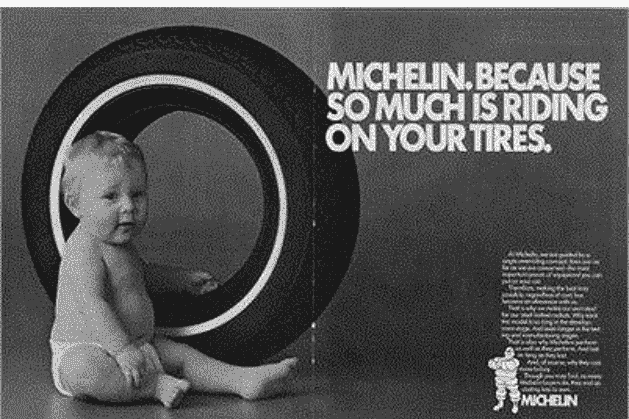

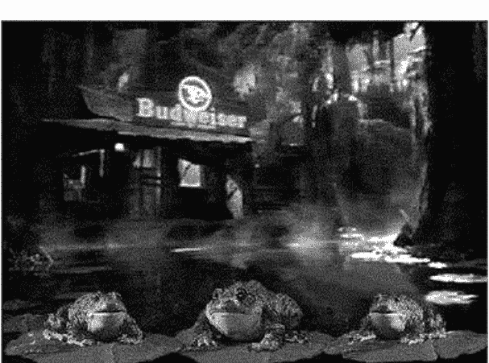

以销售和市场为主导的公司常用这招，让消费者买自己而非对手。社会工程人员不卖产品，但同样想让目标“买账”：认同伪装，采取他们期望的行动。

## 05 钱、信念、同伴：操纵的三台发动机

操纵未必都负面，但背后总有激励。激励就是刺激你行动的任何东西，金钱、爱、成功，甚至憎恨、嫉妒、羡慕都算。人们操纵他人，常见三类动机：金钱、意识和社会。

金钱激励最常见，许多骗局和销售战术背后都有它。有人天天买彩票，长期花掉几百美金，中 20 美金就开心，继续盼大奖；优惠券也是非恶意的金钱激励，特定商店买特定商品可省下若干美元，精打细算或想试用的人就会去那家店；再教育培训机构也常描绘“学完收入大增”的图景。恶意攻击者的动机是经济收益，伪装角色也会围绕“可以要钱的人”设计，比如扮成慈善组织，因为请求捐助、询问财务信息再寻常不过。

意识激励更难描述。理想因人而异，却能深刻驱动行为。有人梦想开餐馆，就会长时间工作、投入比员工更多精力，不太计较金钱，因为那是梦想而非普通工作。梦想和信念深植人心，几乎和人不可分割；提到“我有一个梦想”，许多人会想到马丁·路德·金。人会靠近拥有相似梦想和目标的人，“物以类聚，人以群分”，这也成了被操纵的入口。基督教电视传道者就是例子：信仰或渴望信任上帝的人聚在一起，彼此增强信念和做正确事的愿望；传道者却借这种意识宣称上帝希望某座教堂繁荣，于是听众钱包鼓起来。几番激励布道、几滴眼泪之后，支票不断送来。他们同时动用金钱和社会理想，把听众思维转成自己的思维；追随者甚至相信“牧师比自己富裕得多”是上帝旨意，思想已被改变或操纵。意识激励也用于道德教育，恐惧就是强激励。《格林童话》里坏人受罚或死亡，好人历经困难得到巨大回报，借恐惧让孩子知道做坏事会有可怕后果。市场营销也爱在“志趣相投的人碰面”处投放广告：尿布公司选家庭杂志，动物保护组织选动物园，运动器材公司瞄准体育赛事，让商品在共同思维模式的人群中热销。

社会激励同样有效。2007 年，奥丽埃纳·班迪耶拉、伊万·鲍龙考伊和艾莫然·拉苏尔发表论文《Social Incentives: The Causes and Consequences of Social Networks in the Workplace》，分析工作中有朋友一起工作的情况。结论是：社会激励真实存在；排除生产技术、补偿方案等外部因素后，朋友的存在仍会影响效率；人们一起工作时会遵从共同规范。朋友在场会提高能力较差者的效率，也会降低能力较强者效率。按件计酬时，能力强的人会放弃 10%收入以遵从规范；至少有一个比自己能力强的朋友的工作者，会提高 10%生产力以符合规范。总体上后者影响占主导，社会激励对公司业绩的净影响为正。朋友存在会让人更努力或更放松；没有外界压力时，同伴压力也会影响效率，这种压力可理解为标准：有人不想显得什么都能干或像拍马屁，平时懒散的人也不想显得懒惰，于是适当更努力。职业道德会被朋友影响。管理上的好策略，是把最努力的人和天生领导者放到领头位置。社会工程人员也会用“尾随战术”：混在一大群就餐或休息回来的人里，装成其中一员，过门时保安一般不会拦。这也是对人群的操纵，让人认为某种行动或态度可以接受；娱乐圈里可接受行为标准和道德水平逐年下滑，常被“自由”旗号掩盖。激励不止三类，还能继续分化，但社会工程师如何应用更值得注意。

## 06 操纵不是让人舒服，而是让人照做

操纵不是让目标喜欢你的所作所为并感到舒服，而是迫使其做你想要的事。“强迫”意味着迫使某人以某种方式行动或思考，或通过武力支配、阻止、控制。操纵和强迫利用心理力量改变目标的观念、信仰、态度和行为，关键在于用不易察觉的小步骤渐进推进。社会工程人员不想惊动目标；有些方法争议很大甚至可怕，但诈骗犯、身份窃贼每天都在用。操纵的目的之一，是制造焦虑、紧张和过度的社会压力；目标有了这些感觉，就更可能采取操纵者期待的行动。也正因如此，人们对操纵常持负面看法，可它频繁出现在社会工程中，就必须被拿出来讨论。看懂这些套路，至少在下一次注意力被牵走前，能多问一句：我看到的，是问题本身，还是别人想让我看到的问题？

社会工程里最核心的能力，不是技术，而是让人“自愿”往你想要的方向走。下面这些操纵手法的原理，来自几十年的行为研究，拆开来看会很清晰。

**一、让目标更容易被暗示**

提升暗示感受度，本质是先把人调到易受影响的状态。神经语言程序学的手段、视觉和听觉提示都能做到，甚至不用说话就能植入情绪反应。

我亲眼看到过一次条件反射的训练。操纵者一边说正面内容，一边微笑并让钢笔咔嗒作响。重复四五次后，目标自己也跟着笑了。随后他刻意在谈到一个让人沮丧的话题时再次发出咔嗒声，目标先是笑了一下，随即尴尬起来。那份尴尬就成了切入口。

要让场景配合暗示，需要整体设计：话术、画面、穿搭的颜色，全都服务于提高易感性。不断重复同一个想法，也是一种强化的方式。

精神病学家威廉·萨金特在《思维的战场》里提到过，人一旦被恐惧、愤怒或激动扰乱，接受暗示的能力会上升，判断力则会下降。先制造情绪波动，再植入信念，时机就到了。

BBC 节目《骗术真相》里演过一遍。卖场设摊卖奖券，中奖的奖品远高于票价。一名女士中了大奖，情绪非常激动。此时保罗·威尔森趁她亢奋，提议她必须立刻打电话并提供银行信息来领奖。她毫无犹豫就照做了。激动时，人更容易接受“合理的建议”。

提前摸清对方的喜好、孩子名字、支持的球队、爱吃的食物，用这些细节营造共鸣的氛围，暗示的入口就打开了。

**二、把环境握在手里**

环境控制常见于网络诈骗、欺诈和身份盗用。进入同一个社群、同一个组织，就等于获得了与目标“同框”的机会。能通过社交关系找到他的情绪按钮，效果更强。

我曾为客户追查一个非法诈骗团伙，在对方炫耀战果的论坛里找到账号后，我进去“同居”了。先当朋友，再博取信任，从社交动态里摸清行踪，最后拿到联系方式。

控制环境不一定很夸张，可以是悄无声息地靠近，或是让某些刺激物被看见、被遮蔽。现实里无法完全掌控全场景，所以必须先研究再进入。先进入目标的网络或现实圈子，花时间建立关系、收集情报，最后才收网。

警察的审讯室、战时的审讯布置都是典型案例。通过灯光、座位、气味、氛围营造放松、紧张、害怕、焦虑等情绪，让审讯对象的心理状态完全按需要波动。

**三、逼对方重新校准**

慢慢削弱一个人的信念、自我意识或对局面的掌控感，会让他不安，最终怀疑自己原本认为是正确的东西。

邪教就常用这招。他们先让迷茫的人对现有信仰产生动摇，再以无比的说服力占据主导，受害者甚至觉得家人朋友才是错误的。

在日常层面，可以让对方重新评估安全观念或公司规章。比如销售人员想拉单子，公司明令禁止未扫描文件直接下载。你打电话说：“我是 ABC 公司，想采购超过一万件的产品，需要获取三份报价对比。我把询价单放到我们官网了，能发你链接吗？两小时后我要开会，希望会前能给我一个初步报价。” 这就是逼迫对方重新评估公司政策。在时间压力下，他大概率会直接下载。

**四、制造无力感**

让人感到脆弱、无力，是很有效的阴暗手段。常伪装成愤怒的上司，用咄咄逼人的态度、没有回应的质问，把对方逼到自我怀疑的角落。

我曾内部扫描时被管理员拦下。我回敬道：“你知道公司一年要扛多少次入侵吗？我是在帮你加固，你却在拦我工作。”这种压迫感让她瞬间觉得无能为力，最后退让了。

时间紧迫也是好办法。没有思考空间，只能立刻决定。海地地震后出现过一个假网站，声称只有通过特定验证的人才能查询失踪亲人的信息。很多人因绝望和无力感，提供了不该点开的内容，最终被利用。BBC 当时也发了警示。

**五、用非肉体的惩罚**

羞耻、内疚、焦虑、被剥夺特权，这些心理惩罚和无力感相连，却更让人想“重获好感”。只要觉得没达到期待，就会怀疑自己，从而按攻击者的方式反应。

我不建议常规使用羞辱，但见过团队用它软化目标。一次在公共场景，一名攻击者伪装成权威人物。和目标交谈时，团队里的女性成员插话提问，激怒了他。他冷冷说：“你一定是我见过最蠢的人。”说完就走。女性看起来沮丧受伤，目标立刻开始安慰她。正是这份同情，让目标吐露了本不想说的信息。

**六、用隐晦的威胁**

威胁不一定是绑架。它可以是暗示不配合就会被辞退、会带来其他坏结果。政府也常用这种叙事来操控情绪，比如渲染经济崩溃来控制民众。

在审计中，表现得忙碌、烦躁、负重，也是一种威胁感。谈话时释放权威的表情同样会让人不安。商业上，挂号信、快递寄不明物品，都在传递一种“你最好紧张”的信号。目标会因此不自在、焦虑，最终做出事后后悔的决定。

一旦人觉得完全无力，屈服就显得“合理”。这正是社会工程操纵和普通影响的区别：用完负面手法后，操作者立刻抽身，不管目标余波。

**七、正向的操控方式**

正向操控和负向目的相同，最终让对方的想法与你一致，但方式让目标事后不会需要心理治疗。父母对孩子沟通的经验里，有几条非常实用。

1. 情绪自控。不要让对方的表现带走你的情绪。一旦你被牵动，就是对方在操控你。控制负面情绪，才能始终掌握主动。适当且克制地表达关心会让对方放松，但过度情感会破坏节奏。
2. 找积极话题。可以在寒暄时讲个小笑话，给予得体称赞，但要避免油腻。比如见门卫，先自我介绍，再夸她孩子的照片可爱，问下几岁，自己也有孩子。自然、有品味的积极开场能降低防备。
3. 默认会成功。假定目标会按你期望行动，会回答你想问的，会接受你的要求。这种心态会改变你的肢体语言和面部表情，让伪装更可信。注意不要自大。
4. 换个开头。研究显示非传统开场白更有效。OkCupid 的数据表明，性感、美丽、热辣等词效果差，酷、棒极了、迷人更好。嗨、嘿、你好过于平淡，最近怎么样、最近可好、哈喽等会更让人回应。社会工程里，变化的接近方式会显著提升反馈。
5. 用过去时讲负面。想表达不满却不想让对方重复纠缠时，用过去式给他一个重启的机会。例如“当时你说我不能去找史密斯先生”比“你说我不能去”更能淡化冲突，也让对方察觉当时的感受。
6. 预演并拆解。先想好如何处理负面态度。假设你伪装成技术支持，想进机房，已知每天十点有人去抽烟。但前台刚收到坏消息，情绪很差。你必须提前设想反驳点、可能的话术、对方的态度，并让同事扮演难缠的门卫进行演练。不照本宣科，保持弹性。

正向操控让目标不仅不反感，还会产生“我帮了个忙”的成就感。

**收尾**

操纵是社会工程的重要一环，背后是几十年行为科学的累积。很多人第一反应是“我不想操纵人”“学这个不对”。但操纵并非全是黑暗，它也可以用在好的方向上。

理解什么能触发行动，让行动对目标自己也有好处，这就是影响力的本质。影响力和说服的艺术，是让人主动想要按你的方式去做、去反应、去相信。这扇门打开后，影响力才真正成为可掌握的能力。下一章我们会聊操纵中用到的实物工具。