# 第七章：社会工程工具


> 人是使用工具的动物，没有工具，一事无成；有了工具，无所不能。
> ——托马斯·卡莱尔（Thomas Carlyle）

1. 托马斯·卡莱尔（1795—1881），苏格兰评论家、讽刺作家及历史学家。——译者注

成事在人，成也在器。器具是否趁手，直接决定了社会工程执行者的发挥上限与成败概率。光有装备远远不够，关键在于能否熟练驾驭。器到用时方恨少，器多用拙更致命。

本章要拆解的是三类装备：实体操作类、电话类以及软件类。拥有最昂贵或最炫目的单品，并不能自动让你成为社会工程人员。工具在安全审计里的定位更像烹饪时的调味，量得恰当才提鲜，过量或不足都会破坏整体口感。你不希望在任务现场像背着一身装备的蝙蝠侠一样扎眼，也不想在抵达目标门口时因缺了一样小物件而被挡在门外。

社会工程可用的器械种类繁多，本书并非手把手教你开锁或伪造来电显示，而是提供足够的判断依据，帮助你筛选出真正能提升实战效能的装备。

本章先聚焦开锁器、撬片与影像采集等器械。市面上一些新奇的装置能让普通从业者产生詹姆斯·邦德般的错觉，下面会介绍它们的原理与使用方式，并配以图片展示。随后会谈到攻击中如何篡改来电号码，盘点几款主流的信息收集类软件，最后再触及密码分析类工具。

### 7.1 物理工具

物理安全指企业或个人为防范风险所采用的一切非计算机手段，多涉及机械锁、监控摄像头、门窗感应器等。洞悉物理安全的工作逻辑，是成长为优秀社会工程师的基础之一。并不要求精通每一种装置，却要对目标部署的安全机制有清晰认知，这样才能在审查环节扫清阻碍，顺利推进。

#### 7.1.1 开锁器

在谈技巧前，先了解锁的核心机理。

图 7-1 是简易弹子锁的示意。

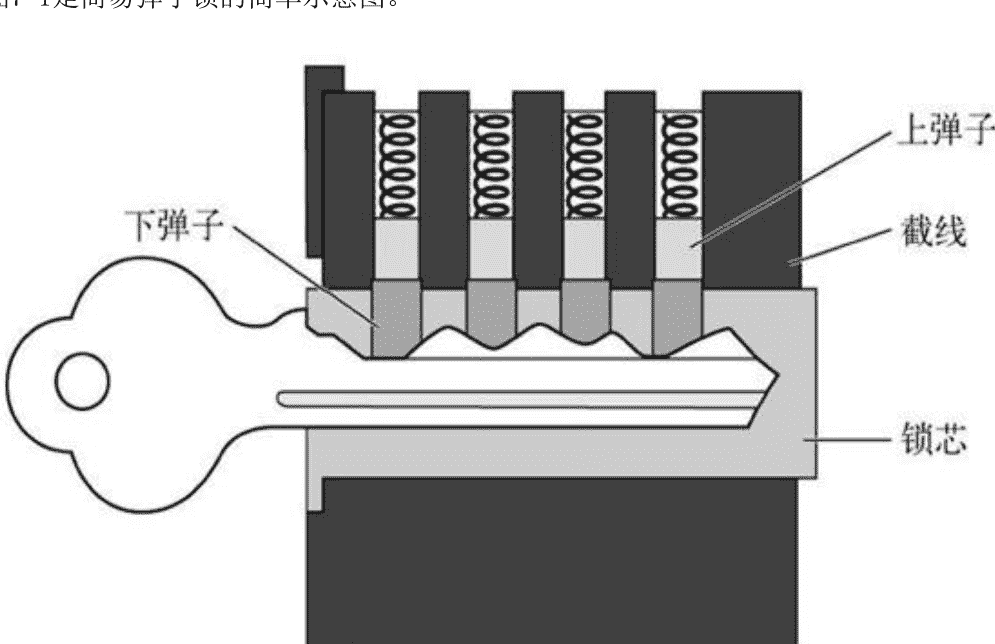

图 7-1 弹子锁的简单示意图

弹子锁的工作原理是借助钥匙将上弹子与下弹子抬升到特定高度，当两者的分界线与锁芯、锁栓的缝隙对齐时，锁体即可转动，从而打开门、机柜或展示柜。

开锁器模拟的是钥匙逐个推动弹子到位的过程，让锁芯得以自由旋转。操作时通常需要两件核心器械：拨片与扭力扳手。

**拨片**为一根末端弯折的细长金属条，手感接近牙医工具。插入锁膛后上下拨动，尝试让弹子落入正确位置。

**扭力扳手**为扁平的小型金属片，用于在拨动时对锁芯施加持续的旋转压力。

**梳子**外观与拨片相近，却是用来快速“梳”动所有弹子的工具。对耙锁有吸引力的原因在于它能以较高速度打开大部分常见锁具。

基本开锁流程如下。

1. 将扭力扳手插入锁眼，朝钥匙开锁的方向施加扭转。张力的拿捏是关键，过大或过小都会让弹子无法归位。张力合适时会在内部形成一个小小的平台，让锁芯能够卡住弹轴。
2. 插入拨片，逐一挑起弹子，直到能感受到它们处于稳定状态。上弹子就位时会传来细微的咔嗒感。所有弹子归位后，锁芯便可旋转，锁即开启。

以上只是入门皮毛。若想深入，可参考以下站点。

- [`toool.us/`](http://toool.us/)
- [`home.howstuffworks.com/home-improvement/household-safety/security/lockpicking.htm`](http://home.howstuffworks.com/home-improvement/household-safety/security/lockpicking.htm)
- [`www.lockpicking101.com/`](http://www.lockpicking101.com/)

这些只是开锁教学资源的一角。作为社会工程人员，抽时间练习开锁是明智之举。当关键信息被锁在服务器机柜、办公抽屉或设备箱中时，随身的一套迷你开锁工具往往能成为胜负手。

开锁套装的体积跨度很大，图 7-2 中这套只有名片大小。

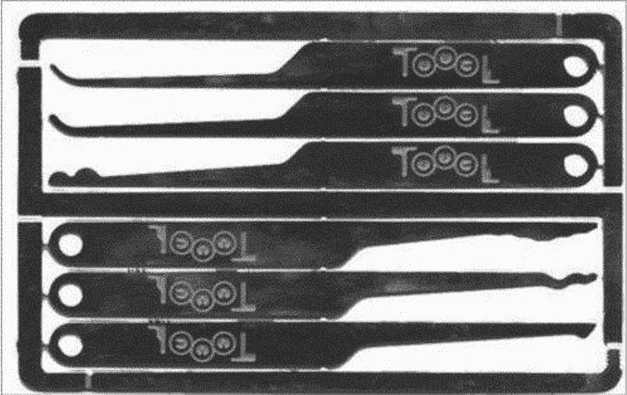

图 7-2　这种名片大小的开锁套装很适合放在皮夹或钱包中

也有与折刀相仿的便携款。

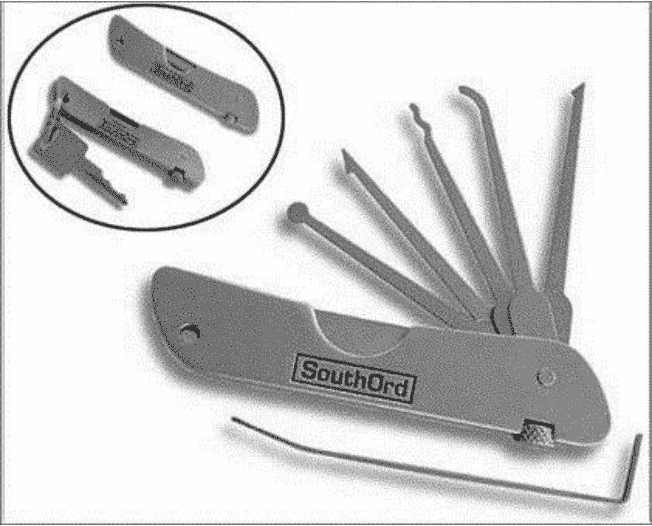

图 7-3　这套跟随身小折刀的尺寸差不多

更专业的全配套装则体量更大。

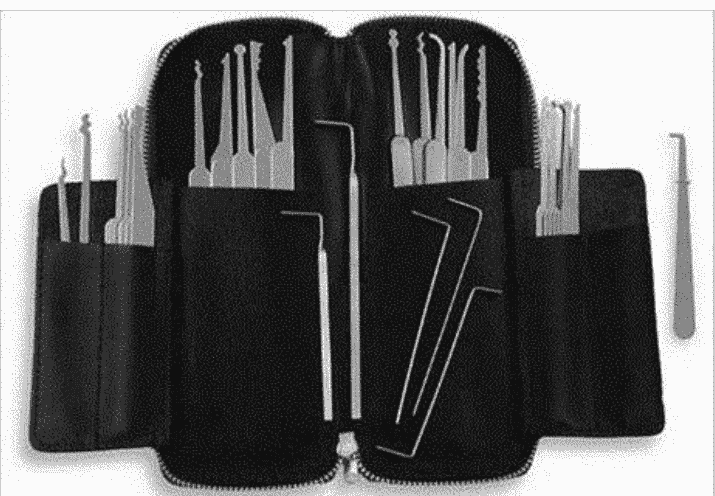

图 7-4 该开锁套装比较大，所需工具一应俱全

提醒：务必在关键时刻到来前先学会使用。就个人经验而言，我先购入了不同尺寸的玛斯特（Master）牌挂锁，反复练习直至全部打开，再购置如图 7-5 的透明练习锁。它们适配多种弹子结构，能让练习效果最大化。

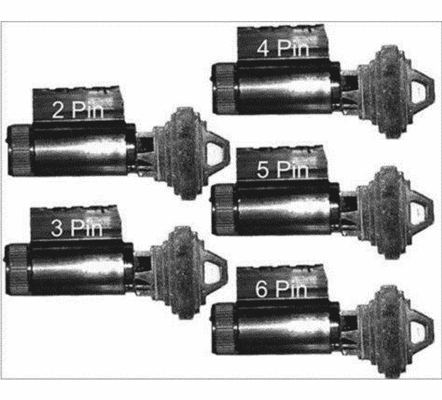

图 7-5 这些透明的锁可以让你看到整个操作过程

我在会议上也见过自制锁墙这类精巧训练装置。实地收集时，记录下待开锁具的类型、品牌与具体型号，也能为后续行动做好铺垫。

##### 1. 实际应用

影视作品里常把开锁描绘成几秒钟的奇迹。现实中，除少数高手外，大多数人需要经历大量失败才能掌握拨锁与耙锁。耙锁需要天赋与手感，在锁内轻快耙动的同时维持适当的扭力，就能撬开多种锁型。学会耙锁后，你才能真正理解扭力的作用与锁被打开时的触感。

许多公司开始采用 RFID、磁卡等电子门禁，看似让机械开锁过时，实则锁仍在使用，开锁技能仍有价值，关键时刻甚至能救急。

一个真实案例说明携带工具的意义。在一次行动中，我被一扇门卡住，社会工程手段无法绕过。掏出随身的袖珍开锁器，用耙锁方式约半分钟便进门了。类似经历在从业者中并不少见：对锁原理的理解加上合适的工具，才造就了最终的成功。企业可能花数万甚至数百万美元采购硬件、防火墙、入侵检测系统，却只用廉价玻璃和一把 20 美元的锁来守护，情况屡见不鲜。

撬锁伴随被发现风险，练习与速度至关重要。若现场有摄像头，单纯记录闯入过程并无太大威慑，除非有人实时监看。一些简易的规避手段包括用 LED 强光直射镜头，或用帽子、头巾遮挡面部。

##### 2. 打开磁性锁和电子锁

磁性锁因成本低、安全性相对提升而流行。按形状、尺寸与磁力等级划分。它也不绝对安全：若断电且无后备电源，大多数磁锁会失效，门即开启。

世界知名社会工程师兼黑客强尼·龙，谷歌黑客入侵数据库创始人、《非技术黑客》作者，曾讲述用衣架与毛巾绕过磁锁的经历。他观察到员工推门时锁会释放，且门缝足以塞入系着毛巾的衣架。轻摇毛巾即可打开锁。

我曾复现该过程，只要长度合适、施力轻微，两分钟内即可打开。即便安装专业商务锁、防弹玻璃金属门并配备后备电源与断电自动上锁栓，衣架与破布依然可能奏效。

高技术手段也有，比如 RFID 克隆器，可抓取并重放 RFID 密码以解锁。市场上亦有多款磁卡复制设备。

##### 3. 各种各样的开锁工具

除扭力扳手与拨片外，推刀、撞匙、挂锁垫片等也常被使用。

- 推刀
被称作打开旋钮锁最快捷的工具，如图 7-6 所示。旋钮锁常见于服务器机房或办公室。推刀能在不损毁门体的前提下切入释放门闩。

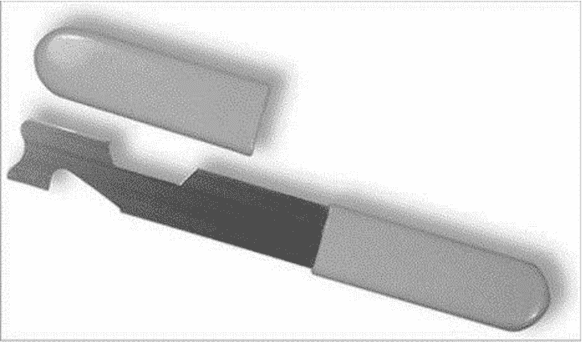

图 7-6　典型的推刀

- 撞匙
撞匙虽已流传多年，却因被用于犯罪而频繁登上新闻。它是特制的钥匙，插入锁中轻微震动，使弹子排成一线，从而转动锁芯。具体手法是插入钥匙，抽出 1-2 个凹口长度后用力轻敲。图 7-7 即为典型撞匙。

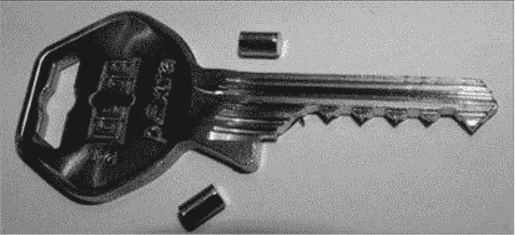

图 7-7　典型的撞匙

- 挂锁垫片
垫片是一片薄金属，插入挂锁底部以解除锁定机构，将锁轴与锁定机制分离。如图 7-8 所示。

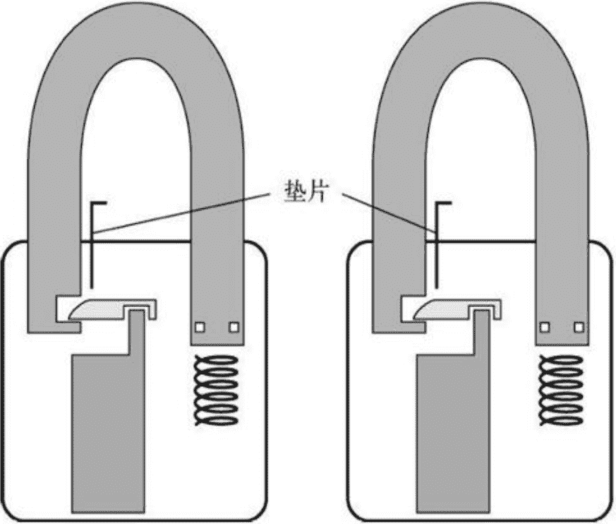

图 7-8 垫片的工作原理

图 7-9 展示的是专业垫片，也可用易拉罐自制。

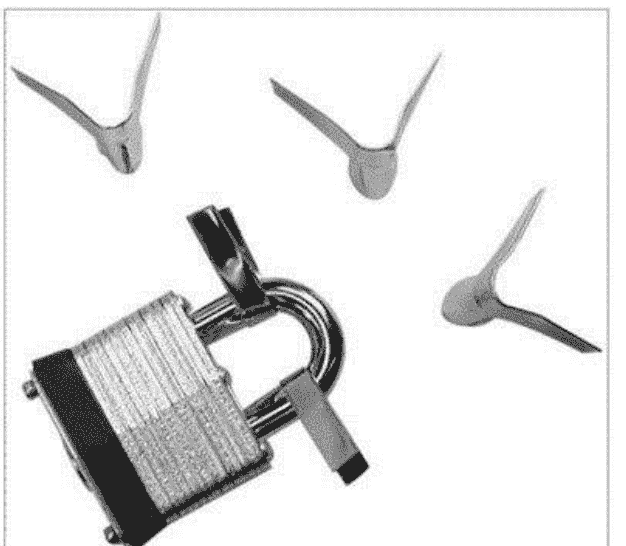

图 7-9 专业垫片

近期案例显示，利用橡皮筋在链锁上施力即可轻松打开宾馆或带链锁的房门。麻省理工学院发布的《MIT 开锁指南》提供了更深入的说明。

你可能会好奇是否存在难以撬开的锁。防撬双锁 Bump Proof BiLock 就是为此设计的双孔结构，几乎无法被撞开。

我在职业生涯中发现，问题往往不是锁本身，而是锁周边的漏洞。公司可能为服务器机房配备生物识别与密钥，却在旁边留一个单层玻璃小窗。此时开锁器已无用武之地，打破玻璃即可进入。

寓意很明确：单靠锁无法保证安全，安全是一种意识，而非单件硬件。

并非每个社会工程人员都要成为开锁专家，但掌握基础原理与实践经验，可能直接影响行动成败。

以上只是部分开锁工具的简述。另一个极具价值的装备是录音录像设备，见下一节。

#### 7.1.2 摄像机和录音设备

摄像机与录音设备常与“偷窥”关联，于是问题出现：为何在社会工程中要用针孔摄像头与隐蔽录音？答案很简单：为取证，也为自保。

先谈证据。社会工程审计本质是对人的测试，旨在帮助企业修补由人为因素造成的安全薄弱点。恶意入侵者也可能用同样手法。许多人除非看到确凿证据或亲眼目睹同事被骗，否则不愿承认会被欺骗。原因可能是难堪，或担心老板反应。录音设备提供证据，也可用于审计方与客户的培训。

使用这些设备的目的不应是让员工难堪。记录的信息更适合作为后续学习素材，展示员工如何认同攻击者伪装的角色。证明攻击可行只是第一步，如何帮助企业与员工识别、规避、减轻此类攻击，还有很长的路要走。

第二个原因是自我保护，面向专业从业者。仅凭肉眼无法记录每个微表情与细节供后续分析。摄像机捕捉的细节可为深层分析提供依据。录像还能客观证明你做了什么、未做什么，无需依赖记忆。对理解行动成败原因也有教育意义。

执法部门广泛采用这一原则。警察与联邦探员用其记录拦检、会谈与讯问，作为自我保护、培训与法庭证据的依据。

录音同样遵循相同逻辑。重要提醒：在许多地区，未经许可录音属违法行为。社会工程人员必须确保合同中明确其合法使用权。

录音设备形态各异。我曾使用过一支兼具书写功能的笔型录音器，可放进口袋，清晰拾音范围达 20 英尺（约 6.1 米），配 2GB 内存可录数小时内容供分析。

##### 1. 摄像机

市面上有纽扣状、钢笔状的摄像头，可隐藏在笔尖、时钟、泰迪熊、假螺帽与烟雾报警器中，几乎任何物件都能改装。图 7-10 即为隐藏在领带中的安装方式。


图 7-10　隐藏在领带中的摄像机

这条领带内置全彩摄像头，以 12 伏供电并连接小型录制设备。佩戴进行审计时，能录制 70 度视角内的一切。

使用此类设备的好处在于从业者可以专注于伪装与诱导，不必担心遗漏细节。

我曾对一家在线售票主题公园进行安全审计。该公司设有一售票窗口，女员工操作 Windows 电脑。我假装在酒店购票后无法打印，将票转为 PDF 并邮件发送给自己，请求她查看文档并声称自己可远程登录。工作人员点击 PDF 时，电脑已被恶意代码感染，开始自动收集信息。后续录音与重现过程为该公司提供了宝贵教训，避免了数千美元损失。

一种基于充值卡的设备可通过手机信号将音频发送到任意号码，社会工程人员随时拨入收听。这在获取密码或个人信息时能节省大量时间。

关于精巧摄像机的讨论可持续数小时。图 7-11 与图 7-12 展示了执法者常用的“间谍装备”。所有物品中都隐藏了摄像或录音功能，可秘密记录目标信息以供分析。

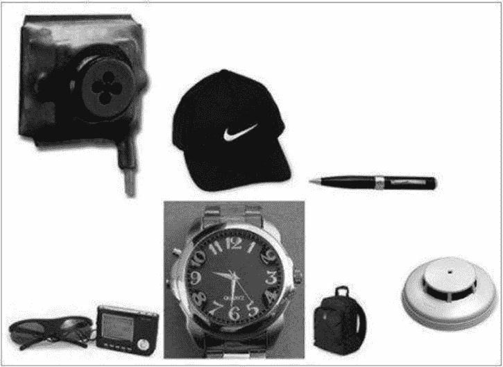

图 7-11　图中的笔可用来录音，其他物品都带有隐藏的具备录音功能的彩色摄像机


图 7-12 这些物品也可通过隐藏的摄像头来录音录像

##### 2. 使用工具

使用录音摄像设备的基本原则与使用伪装或诱导手段一致。

最重要的是练习。若放置位置不当，可能只录到天花板或模糊噪音。出发前调试装备并确认摄像与录音角度、确保坐下、起立、行走时信号稳定，是必要的准备。

再次强调合同中列明录音录像权限的重要性。无许可使用可能带来法律风险，查阅当地法规是明智之举。

社会工程师绝不能使用这些设备故意记录他人窘态或侵犯隐私。

本节对这些工具的概述与使用建议，希望能为从业者提供选择空间。

下一节将介绍社会工程师可用的其他工具类型。

#### 7.1.3 使用 GPS 跟踪器

社会工程人员常想了解目标不在办公室时的动向。上班路线的停留点会泄露大量信息。整合并分析这些数据，有助于设计合适的伪装或提问策略，诱导目标产生预期反应。了解目标每日工作起始时间，对红队[¹]的物理渗透也极有帮助。红队的目标是侵入并获取有价值资产，以暴露公司物理安全的脆弱性。

# 授权测试者的工具箱：车载 GPS、Maltego 与 SET 能做什么

先划清边界。网络安全领域里的“红队”，并不是随意搞破坏的人。他们通常是计算机与网络安全专家，在系统主人明确授权后，用攻击者思路去测试系统，找出恶意黑客可能利用的漏洞。这个角色也被叫作伦理黑客，相关工作包括入侵测试。下面这些工具与方法，更适合放在授权审查和防御视角下理解。

## 一、SpyHawk：一枚吸附式 GPS 追踪器

掌握目标行踪有很多路径，车载 GPS 追踪器是其中常见的一类。SpyHawk 超级 GPS 跟踪器可在全球范围使用，能从 spyassociates.com 买到，价格大致在 200 至 600 美元。它靠磁力固定在汽车上，可保存目标数天的活动信息。安装配套软件不复杂：运行安装程序，按屏幕提示走完流程即可。界面设计比较直观，日志条数、时区以及其他自定义项都能在跟踪管理器里调整。

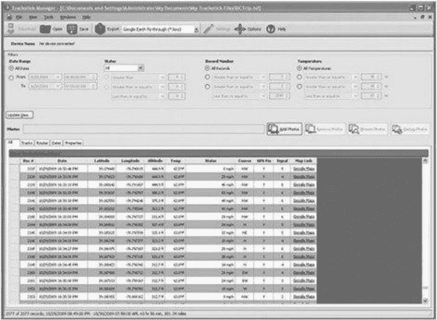
图 7-13：跟踪管理器把常用设置集中在一个界面上，上手成本不高。

SpyHawk 机身轻巧，便于隐藏。它只有一个开关键，内部却有一些巧妙逻辑：感应到移动就启动记录，静止一段时间后自动停止。设备磁力较强，可以吸附在金属表面，但粗糙表面或塑料部位并不适合。初次使用时容易担心设备丢失，因此把车头盖下方作为一个稳妥位置，会更安心，记录效果也往往不错。靠近目标车辆时，轮胎附近、引擎盖下、后备厢等金属区域都比较安全；若能接触车内，把设备塞进脚垫下或尾灯附近也是思路。第一次测试时，我把装置放在引擎处，隔着金属引擎盖，记录质量依然很完整。另一次测试中，设备连续采集了 5 天数据，从记录看，目标车辆开得挺猛。

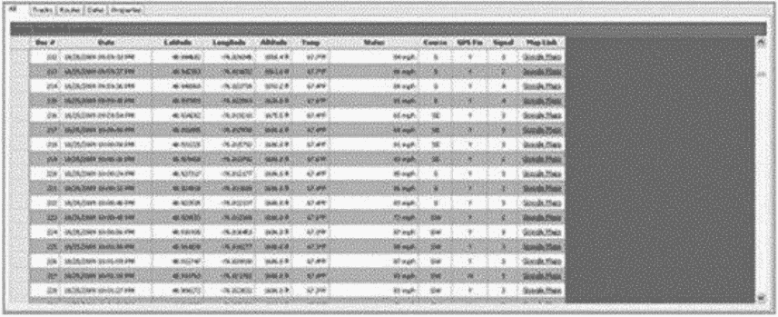
图 7-14：测试数据里，目标车辆的速度表现相当激进。

记录中的时间、日期与持续时长，可以帮助还原行驶轨迹。

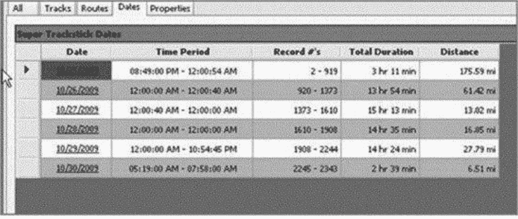
图 7-15：借助时间标记，目标的移动路线更容易被勾画出来。

把这些数据放进谷歌地球，速度、时间、停留时长等信息会一起呈现。

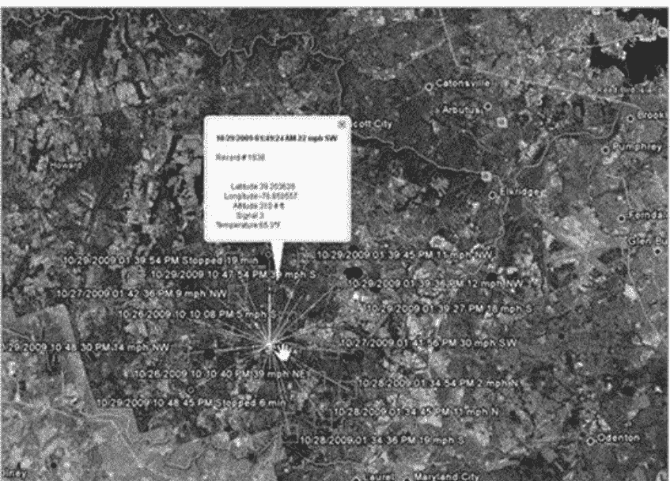
图 7-16：跟踪器输出可直接接入谷歌地图体系查看。

软件还能把完整线路图展示出来。


图 7-17：软件生成的整段行驶路径一目了然。

在谷歌地球或谷歌地图中继续放大，还能观察更细的节点。


图 7-18：放大后，目标移动路线中的细节更清楚。

### 数据能读出什么

这些轨迹数据对社会工程人员很有价值。假如能掌握目标公司 CEO 常去的咖啡店、喜欢的商店、健身会所，攻击者就能据此设计成功率更高的行动方案。知道对方在哪些地点停留，也更容易判断在何处复制 RFID 证件、取得钥匙模印的机会最大，而不必冒险伪装成邻居靠近目标。图 7-19 的数据集里可以看到车速、停车日期和具体时间；点击谷歌地图链接，再点“导出”，就能把数据送进谷歌地图或谷歌地球。

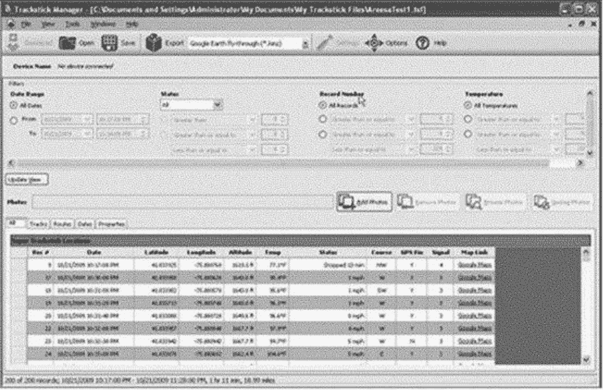
图 7-19：数据集保留了速度、停车时间等关键字段。

在谷歌地球打开后，停车点、行驶路线、暂停次数都能显示出来。

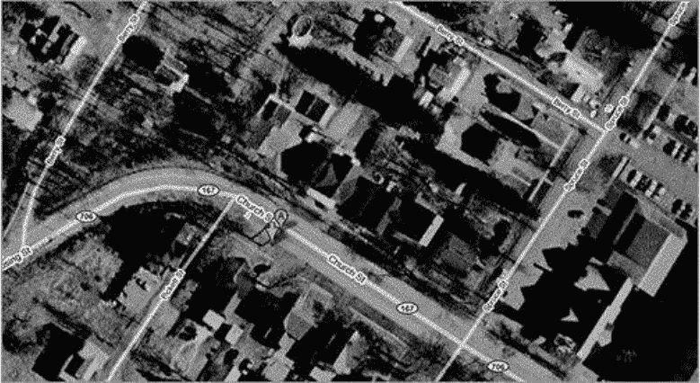
图 7-20：路线中的暂停位置也能被标出来。

如果想看完整路线，也可以选择一种输出格式，把全程导出。

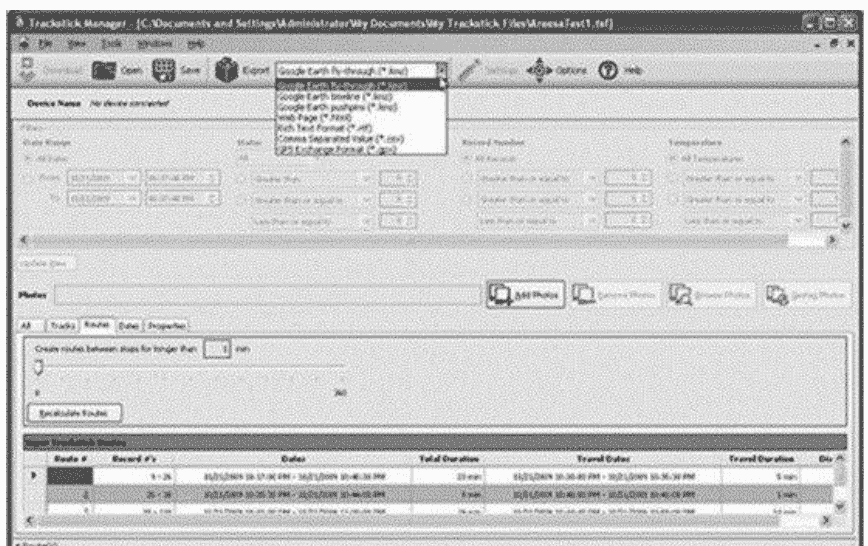
图 7-21：整段路线可以按需导出。

图 7-22 展示的是从谷歌地图导出的结果。

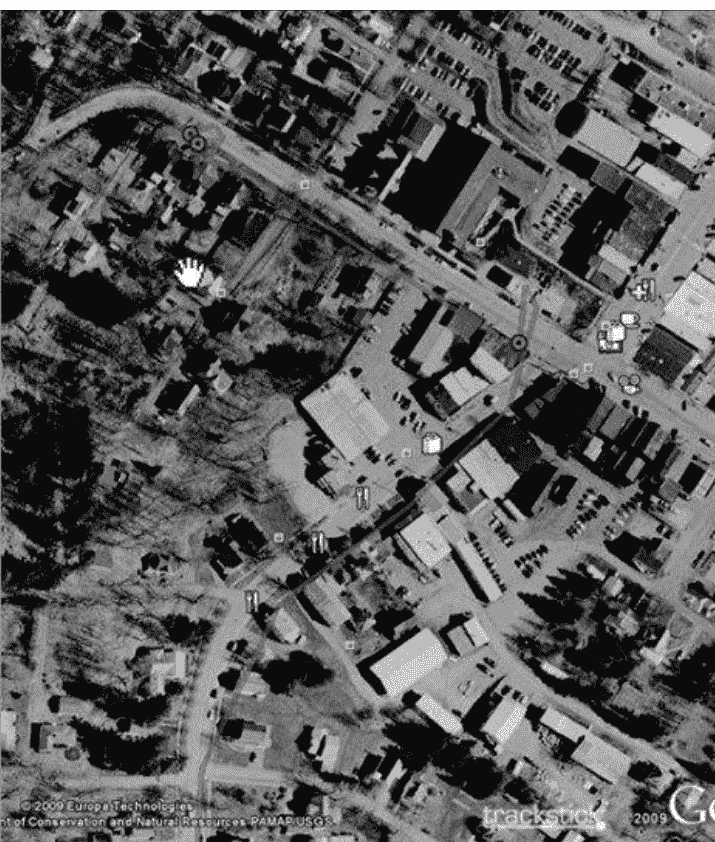
图 7-22：导出后，目标移动路线在谷歌地图上呈现。

这一节远不足以穷尽社会工程人员使用的工具。真正拉开差距的，是反复练习和持续研究。知道某件工具能否决定一次审查的成败，只是起点；专业的社会工程人员需要不断练、反复练，并掌握正确用法。social-engineer.org 给出的社会工程框架中，还分析了许多能提升实战能力的工具。仅靠物理工具并不够，效果还取决于工具质量，以及第二章所说的全面信息收集。下一节要讨论的，则是信息收集领域里非常神奇的一类工具。

## 二、Maltego：把互联网信息连成关系网

信息收集是社会工程的关键环节。若在这一步投入不足，整个行动可能功亏一篑。现在，社会工程人员可以用多种工具来收集、分类和运用信息。这些工具改变了人们查看数据、使用数据的方式，也让搜索不再局限于常规搜索引擎，而是打开互联网资源的大门。

Maltego 就是其中之一。收集和分类信息常是薄弱环节，而 Maltego 能围绕一个域名、一个 IP 地址，甚至一个人，同时发起几十种搜索；它会提示各项信息的权重，帮助判断重要程度；GUI 界面用不同颜色区分对象，还支持导出；更关键的是有免费版本可用。这个工具由 Paterva 公司开发，免费社区版可从其网站下载，BackTrack4 的各个版本也集成了 Maltego。若想解除免费版在转换次数、保存数据等方面的限制，大约花 600 美元可获得完整授权。

一次审查让我见识了它的威力。任务是对一家小公司的网站做安全审查，目标是进入该公司 CEO 的计算机。可这位 CEO 严谨、古板，不常上网；作为印刷公司老板，他只关心生意，对高科技兴趣不大。任务难度显然不低。我先打开 Maltego，以公司域名为起点，提取网站页面和 Whois 数据库中的电子邮件地址，作为信息基础。接着查这位 CEO 的邮箱是否在其他网站或链接中出现。结果发现，他曾给当地一家餐厅写评论，并公开了邮箱；在另一个州的一家餐厅评论中，他也留下了邮箱。评论显示，他去该州探亲时光顾过那家餐厅，甚至提到了兄弟的名字。继续用 Maltego 追查，我找到了他父母和兄弟在该地区的住址。再以姓氏搜索，又发现一些新链接页面，其中提到他在当地创业时用过的另一个邮箱，还提到他与当地教堂发生矛盾、后来转去另一家教堂。随后，他 Facebook 上链接的一篇博文里，有全家观看最喜欢球队比赛的照片。不到两个小时，我用 Maltego 整理出这些结果：他喜欢的食物、喜欢的餐厅、孩子的姓名和年龄、离婚状况、父母名字、兄弟名字、成长地、宗教信仰、喜爱的球队、家庭成员的相貌，以及过去的生意。

一天后，我给目标发了一封邮件，内容是针对当地公司的摇奖信息：中奖者可以去他喜爱的餐厅享用免费大餐，还能拿到三张扬基队球赛门票。参与公司需要同意与一名销售代表简单讨论当地慈善活动，同意后名字进入抽奖序列。我伪装成“乔”，准备了一份与 CEO 通话的提纲，目标是让他接收一个 PDF 文档——那正是圈套。打电话时，他应该已经收到邮件，于是我很容易切入：“是的，他正在等我电话。”通话中，CEO 接收并打开了邮件，里面包含详细摇奖信息和恶意加密文件；该文件会发起反向会话，让我侵入他的系统。当然，他的屏幕没有显示异常，他只是对 Adobe 反复崩溃感到烦躁。我告诉他：“很遗憾你打不开文件，我们会把你的名字列入抽奖名单，今天再发一些额外信息给你。”但在发邮件之前，我召集了报告会，说明目标是如何被完全入侵的。

这次行动能成功，Maltego 功不可没。它帮助我们以更优方式收集、组织和分类数据。可以把 Maltego 理解为一个信息的关系型数据库，它寻找互联网信息之间的联系，也就是应用中的“实体”。后台会挖掘电子邮件地址、网站、IP 地址和域信息。比如，点几下鼠标，就能通过目标域名自动搜索相关邮箱地址；在屏幕上添加“电子邮件”转换器，输入想查的地址，就能看到结果。

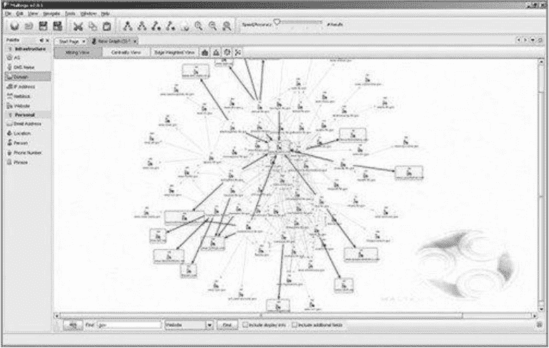
图 7-23：Maltego 把收集到的信息以关系图方式展示。

之所以用 Maltego，是因为它能自动采集大量信息并完成关联，省下数小时搜索时间，还能把关系图直观呈现。它真正的强项不是单纯堆数据，而是找出数据之间的关系。数据挖掘固然有用，但展示信息之间的关联，对社会工程人员更有价值。我在 social-engineer.org/se-resources/贴过一些视频，讲解如何高效使用 Maltego。前面的案例中它屡屡建功，不过后续入侵还用了另一个强大工具。

## 三、SET：把钓鱼与网站克隆流程化

社会工程人员会花大量时间打磨技能，但许多攻击方式仍要借助带恶意代码的邮件或 PDF 来实现。这些事可以用 BackTrack 中的工具手动完成。筹建 social-engineer.org 时，我和好友戴夫·肯尼迪聊过。他是流行工具 FastTrack 的开发者，FastTrack 通过 Python 脚本和网页界面，把渗透测试中一些常用攻击自动化。我向戴夫提议：不如为社会工程人员做一个类似 FastTrack 的工具，点几下鼠标就能生成 PDF、邮件和网站，让使用者把注意力放回“社会”本身。戴夫认真考虑后，决定编写一些简单的 Python 脚本，让社会工程人员能创建附带恶意代码的 PDF 并随邮件发送。社会工程人员工具包（Social Engineer Toolkit，SET）就这样诞生了。写书时，SET 已被下载 150 多万次，并很快成为社会工程人员审计时的标准工具包。

安装并不复杂，只需要 Python 和 Metasploit 框架。BackTrack 发行版已经带有这两个软件，BackTrack4 甚至直接包含 SET。若要从头安装，也不麻烦：进入安装目录，在控制台运行命令即可。

```
svn co http://svn.secmaniac.com/social_engineering_toolkit set/
```
执行后，会得到一个名为 set 的目录，所有 SET 工具都在其中。运行时，在 set 目录输入./set，就会启动初始菜单。social-engineer.org 上有完整菜单展示和逐项说明。下面重点看两个常用功能：鱼叉式网络钓鱼和网站克隆。

### 鱼叉式网络钓鱼

网络钓鱼通常指恶意诈骗者通过定向设计的电子邮件“广撒网”，诱导人们访问特定网站、打开恶意文件或输入敏感信息，为后续攻击铺路。在今天的互联网环境里，识别并防御这类攻击是基本生存技能。社会工程审查人员可以用 SET 制作有针对性的邮件来测试客户，再统计有多少员工上钩；这些结果可用于培训，帮助员工识别和避开陷阱。

在 SET 中选择选项 1，会出现几个方向：执行群发邮件攻击、创建文件格式负载、创建社会工程模板。做邮件式鱼叉攻击，选第一个；第二个用于生成恶意 PDF 或其他文件，作为附件发送；第三个用于建立模板，留待以后使用。在 SET 里发起攻击并不复杂，关键是选对菜单。比如要发一封邮件，向受害者发送伪装成技术报告的恶意 PDF，就选选项 1——执行群发邮件攻击。接着选择攻击向量，选项 6 对不少版本的 Adobe Acrobat Reader 有效，利用的是 Adobe util.printf() Buffer Overflow 漏洞。随后几步处理技术设置：点击选项 2——Windows Meterpreter Reverse_TCP，用 Metasploit 接收反向会话，或使用受害者电脑的 IP 和端口，以避免入侵检测系统报警。端口选择 443，让数据流看起来像加密的 SSL 数据。SET 会生成恶意 PDF 并设置监听。之后，它会询问是否修改 PDF 文件名，例如改成 TechnicalSupport.pdf 这样更隐蔽的名称，再输入邮件信息。最后，SET 发出一封看起来很专业的邮件，引诱收件人打开附件。


图 7-24：邮件表面无害，附件却可能藏着恶意负载。

邮件发出后，SET 会建立网络监听器，等待目标打开文件。目标一旦点击 PDF，监听器就会执行恶意代码，让攻击者进入受害者计算机。整个过程惊人地简单，点击六七十下鼠标就能完成，审计者因此能把精力集中在真正的社会工程环节。这类攻击破坏性很强，因为它利用客户端软件漏洞，而且多数情况下屏幕上不会出现任何提示。它只是 SET 能发动的众多攻击之一。

### Web 攻击与网站克隆

SET 还允许审计人员克隆任意网站并在本地运行。这种攻击的强大之处在于，社会工程人员可以用多种方式诱骗他人访问克隆站点并从中获利。既可以伪装成负责网站更新的开发者，也可以对网址做细微修改，比如增加或删除一个字母，最终把人引向克隆网站。一旦有人访问，攻击者就能发动多种攻击，包括信息收集、证书收集和直接入侵。

在 SET 主菜单选择选项 2（网站攻击），会看到 Java Applet 攻击方法、Metasploit 浏览器入侵模式、证书获取攻击方式、标签绑架攻击方法、中间人攻击方式，以及返回上一级菜单等选项。选项 1 的 Java Applet 攻击尤其值得警惕。通常，它会在用户界面弹出 Java 安全警告，声称该网站已由 ABC 公司签名，并要求用户同意。进行这类攻击时，先选选项 1，再选选项 2——网站克隆（Site Cloner）。随后输入想克隆的网站地址。这里可以选客户官网、客户供应商网站或政府网站，关键是对目标有意义。练习中假设克隆 Gmail，屏幕会显示相应信息。

```
SET supports both HTTP and HTTPS

Example: http://www.thisisafakesite.com

Enter the url to clone: http://www.gmail.com

[*] Cloning the website: http://www.gmail.com

[*] This could take a little bit...

[*] Injecting Java Applet attack into the newly cloned website.

[*] Filename obfuscation complete. Payload name is: DAUPMWIAHh7v.exe

[*] Malicious java applet website prepped for deployment
```
完成后，SET 会询问要在自己与被害者之间建立哪种连接。若采用本书讨论的技术，就选择 Metasploit 的反向会话界面，也就是 Meterpreter。SET 还提供多种负载加密选项，目的是避开反病毒系统检测。

## 写在最后

从车载 GPS 跟踪，到 Maltego 的信息关联，再到 SET 把钓鱼邮件和克隆网站流程化，这套工具链展示了社会工程审查中“物理线索+在线情报+攻击模拟”的组合力量。工具本身不会替人做判断，真正重要的是在合法授权范围内反复练习、研究，理解正确用法，并以全面信息收集作为基础。否则，再强的工具也只是空中楼阁。

在网络安全圈里，社会工程学攻击往往比代码漏洞更致命。真正的攻击者不一定硬刚防火墙，更擅长利用人性的漏洞。但工具终究只是工具，会用、用对，才是关键。

先来看一个毫不花哨却极其有效的套路：SET（Social Engineering Toolkit）能够瞬间把一个克隆网站“撑起来”。它内置网站服务器，攻击者选好要仿冒的页面后，它自动提供站点服务，同时打开监听器，等着目标自投罗网。接下来，社工人员只需编一封钓鱼邮件，或者给目标打个电话，把对方引到假网站上。当访客打开页面时，看到的是类似下面的画面（图 7-25）：

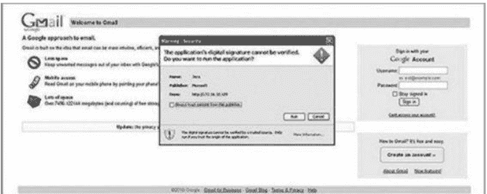

谁会不相信微软签名的小程序呢？

一个号称“微软签名”的 Java Applet 会跳出来，告诉访客：必须允许安全证书，才能继续访问。只要目标按下“允许”，攻击者马上就能接管对方电脑。整个过程，几秒钟而已。一个看似权威的签名，就这样成了入侵的通行证。

SET 的“胃口”远不止克隆网站和钓鱼。它是一整套面向真实审查场景的攻击工具箱，而且还在不断进化。比如新加入的“传染性媒体生成器”，能让攻击者把恶意文件做成 DVD、CD 或 U 盘，再悄悄混进目标公司大楼。一旦有好奇的员工把这些介质插入电脑，恶意负载立刻激活，机器瞬间沦陷。SET 也能制作简单的负载和监听器，例如一个支持反向会话的 EXE 文件：社工人员把它放进 U 盘，趁乱插进目标机器，点击运行，一条直连攻击者服务器的隧道便迅速建立。

如果你觉得 U 盘太老套，还可以试试 Teensy HID 攻击。Teensy 是一块小到可以塞进键盘、鼠标等外设里的可编程电路板。用 SET 给它编程，指定插入电脑后要执行的命令——通常是创建反向会话或监听端口。更惊喜的是，SET 还提供了 Web 界面，自动启动 Web 服务，操作门槛大幅降低，界面概貌见图 7-26：

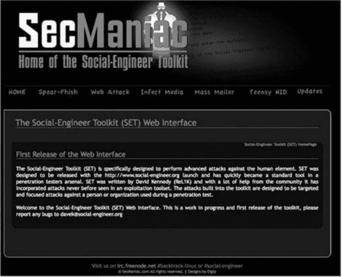

SET 越来越受欢迎，离不开开发者愿意倾听反馈、持续加料。想了解每个菜单项的具体用途，可以访问 www.social-engineer.org；需要保持工具更新，除了这个网站，还可以盯住 www.secmaniac.com。

说完网络工具，我们把视线转向一个最古老也最常被低估的武器：电话。在手机、VoIP 和自制电话服务器普及的今天，社工专家手里的电话，早已不是简单的通讯工具，而是一台“话术机器”。人们一边厌恶推销电话，一边又习惯在电话里放松警惕；公交、地铁上，有人捧着手机谈私事，手机里还存着各种密码和个人资料。这些场景，都在为社工人员提供素材。虽然电话社工也有局限，但它完全可能在短时间内撬开一家公司的大门。

电话攻击能否成功，很大程度上取决于“可信度”。如果来电显示写着公司总部、供应商或老板的名字，有多少人会多问一句？无论是苹果还是安卓，都有大量 App 可以任意篡改来电显示。花不了几个钱，就能把拨出的号码伪装成任何地方打来的电话。利用这个能力，攻击者可以扮演远程分部、公司内部、合作方、水电公司、快递员，甚至直接冒充你的顶头上司。而这一切，可以拆成两部分：背后的技术，以及一个编得足够圆的借口。

来电显示篡改本身相当简单——你实际拨出的号码，和对方屏幕上看到的号码，完全是两回事。比如你从垃圾桶里翻到目标公司供应商 ABC 公司的名片，拿到号码后，就可以把来电显示改成这个号码，再打给目标“确认一下下午的约定”。谁会怀疑呢？

具体实现上，最流行的方法之一是 SpoofCard。它的玩法是：输入 PIN 码、想显示的号码、目标号码，然后就能把来电显示随意换成号码，其随卡还提供约 800 个号码可选。录音、变声、男变女、女变男，也都是基础功能。好处是即买即用，不需要额外硬件和软件，大量用户验证过有效；唯一缺点是要付费。

不想花钱也有办法。SpoofApp 把 SpoofCard 的技术完整搬到了智能手机上（www.spoofapp.com）：打开 App，输入真实要拨的号码和你想让对方看到的号码，点几下屏幕，目标屏幕上就会跳出那个假号码。整个过程都在应用内完成，非常省事。

如果你喜欢自己掌控一切，Asterisk 可以帮你搭建专属电话系统。只要有空闲电脑和一个 VoIP 服务，就能部署起来。它的优点是免费、安装后容易使用、灵活度高，而且完全归你控制；缺点是得准备额外的电脑或虚拟机，要懂 Linux，还需要一个 VoIP 服务商。最大的好处是：所有呼叫方和被叫方的信息都由你自己决定，个人信息和账号数据完全不经第三方之手。

技术到位，脚本（Script）也不能落下。电话社工最怕的就是“照着念”——目标一听就会觉得对方像录音机，立刻竖起防线。更好的做法是：把脚本当成作战地图，确保所有关键点不遗漏，但绝不逐字背诵。写完之后反复练习，让自己听起来自然、真诚、可信。信息收集得越充分，脚本就越有针对性；了解目标的兴趣和爱好，还能快速拉近距离、建立共识。比如之前攻击一家印刷公司 CEO 时，社工人员准备的大纲里只有要说的核心内容、想覆盖的要点，以及类似“说清楚”“别忘了提慈善部门”“放慢语速”这样的提示。这样的打法，既能在通话中游刃有余，也能应对突发状况。电话是老工具，但只要技术和话术配合得当，它依然是攻破企业的“短平快”通道。

最后聊聊密码分析工具。在社工人员眼中，密码从来不是一串随机字符，而是目标个人生活的一面镜子。很多人习惯所有平台用同一个密码，且强度低得吓人。BitDefender 曾对 25 万名用户做过调查：其中 75%的人，邮箱密码和社交媒体密码完全一样。再想想此前有 1.7 亿 Facebook 用户的个人信息被人用 P2P 种子形式挂到网上，简直是给攻击者送弹药。

尽管安全警告年年有，中招的人却一年比一年多。人们在社交网络上晒出自己的家庭、生活、宠物、喜欢的事物……这些“蛛丝马迹”通过密码分析工具，足以拼凑出一个人的全貌。要知道，密码破解工具往往要连续跑几小时甚至几天，很多人以为这样很麻烦，但实际上，弱密码让这项工作变得异常轻松。

为什么密码分析这么有效？因为人太可预测了。2009 年，化名 Tonu 的黑客做了一个实验：他拿到某个社交网站一批刚废弃的 URL，伪造出登录页面，记录访问者的输入。结果让资深社工专家都大为震撼：73.4 万人里，有 3 万人直接拿自己的名字当密码，约 1.45 万人用姓氏。更夸张的是，最常用的密码榜首是“123456”——仅男性用户就有 17,601 人使用；第二名是“password”，4545 人；后面还跟着“12345”、“1234”、“123”、“123456789”和“qwerty”。女性用户最偏爱的同样是“123456”，也有 1885 人。还有 66%以上的人，密码长度只有 6 到 8 位。这种强度，遇到 Cain and Abel 等破解工具，几乎等于不设防（图 7-27）：

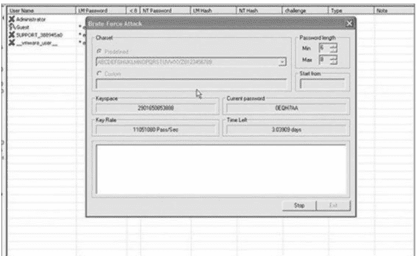

注意图里剩余时间写着 3.03909 天。三天就能拿下一个服务器管理员权限，对攻击者来说，简直是超短线投资。但如果同一个用户把密码拉到 14 到 16 位，并混入大小写和特殊字符，破解时间会怎样？请看图 7-28：

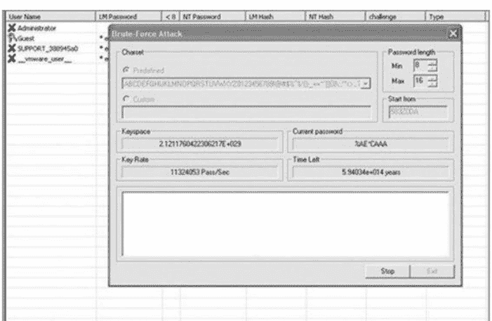

剩余时间直接飙到数万亿年。没错，是万亿年。密码只要长一些、复杂一些，暴力破解就几乎成了不可能的任务。可惜，很多人并不愿意这么做。

为了对付这种“人懒密码弱”的现状，社工专家们开发了不少自动分析工具。比如 CUPP（Common User Password Profiler），由 Muris Kurgas（也称 j0rgan）编写，是 BackTrack 渗透测试系统里的一个脚本，也可以从 www.social-engineer.org/cupps.tar.gz 下载。由于弱口令实在太普遍，CUPP 在合法的渗透测试和犯罪取证里也相当实用。Tonu 的统计已经说明了一切：73.4 万人中，超过 22.8 万人只用了 6 位密码，1.7 万多人用“123456”，约 4600 人用“password”。CUPP 正是基于这些人类的惯性，快速生成一份高度个性化的弱密码字典。在 BackTrack 4 里跑一遍的效果如下：

```
root@bt4:/pentest/passwords/cupp# ./cupp.py -i

[+] 输入对象信息以生成字典 [小写！]

[+] 如果不知道相关的信息，只需输入回车!:)

> 名字: John

> 姓氏: Smith

> 昵称: Johnny
```

```
> 生日 (DDMMYYYY; i.e. 04111985): 03031965
> 配偶名字: Sally
> 配偶昵称: Sals
> 配偶生日 (DDMMYYYY; i.e. 04111985): 05011966
> 子女名: Roger
> 子女昵称: Roggie
> 子女生日 (DDMMYYYY; i.e. 04111985): 05042004
> 宠物名: Max
> 公司名: ABC Paper
> 还要加入一些与目标有关的关键词吗？ Y/[N]: Y
> 请输入每个词，以逗号分隔 [i.e. hacker, juice, black]: christian,polish,sales person
> 需要在每个词的尾部加入特殊字符吗？ Y/[N]: N
> 要在每个词的尾部添加一些随机数吗？ Y/[N]n
> 黑话模式? (i.e. leet = 1337) Y/[N]: Y
```

```
[+] 现在生成字典.....
[+] 排序并移除重复字符.....
[+] 字典保存到文件中，共生成 13 672 个密码
[+] 现在你可以使用了，祝好运！
```

只要把目标的基础信息喂进去，它就能产出一个包含 13,672 个密码的字典文件，直接省去社工人员大量瞎猜的时间。

另一个神器叫 CeWL。按开发者介绍，它是一个 Ruby 应用，能顺着给定 URL 向下搜索指定深度，甚至扩展到外部链接，把网页上的词语全部抓下来，生成可用于密码破解的字典文件，John the Ripper 等工具可以直接拿它喂字典。更多介绍见 www.digininja.org/projects/cewl.php。以某目标公司网站为例：

```
root@bt:/pentest/passwords/cewl# ruby cewl.rb

--help cewl 3.0 Robin Wood (dninja@gmail.com)

(www.digininja.org)

Usage: cewl [OPTION] ... URL --help, -h: show help --depth x, -d x: depth to spider to, default 2 --min_word_length, -m: minimum word length, default 3 --offsite, -o: let the spider visit other sites --write, -w file: write the output to the file --ua, -u user-agent: useragent to send --no-words, -n: don’t output the wordlist --meta, -a file: include meta data, optional output file --email, -e file: include email addresses,
```

```
optional output file --meta-temp-dir directory: the temporary directory,default /tmp -v:
verbose URL: The site to spider.
root@bt:/pentest/passwords/cewl#    ./cewl.rb    -d    1    -w    pass.txt
http://www.targetcompany.com/about.php
root@bt:/pentest/passwords/cewl# cat passwords.txt |wc -l 430
root@bt:/pentest/passwords/cewl#
```

仅从该公司网站的一个页面，CeWL 就提取出 430 个候选密码。虽然不一定一击必中，但配合 CUPP 使用，已经能大幅缩小攻击面。有兴趣的话，可以输入自己的生日、昵称、宠物名、常用词跑一遍——结果很可能让你后背发凉。

写了这么多，还是要强调：工具只是助燃剂，不是魔法。社会工程的核心始终是人的观察力、判断力和临场应变力。拿着最顶级的装备，却不知道在什么场景下用、怎么用，那和玩具没什么区别。真正的高手，早已把工具的“手感”内化成了自己的本能。

**练熟工具，才有胜算**

这一章想讲透的道理其实很朴素：用工具，光“会用”远远不够，关键还得“用熟”。电话也好，软件类工具、网络手段也罢，甚至各类间谍工具，真正撑起成功的底座，是反复练习。练得越熟，临场越稳。

放到社会工程活动里，电话就是典型场景。来电显示可以动手脚，说话声音也能变换，看似花样不少。但如果你拿起电话后，语气发僵、心里发紧、状态发虚，或者明显没准备好、说来说去没有实质内容，那么原本想要的结果很可能落空，甚至会让对方察觉不对劲，导致整件事失去可信度。

这个原则放到伪装技术上，同样成立。准备冒充某个人之前，先得把对方摸清楚：他平时怎么说话？会表达什么？习惯用什么方式表达？他具备哪些知识？又会主动打听哪些信息？这些都不是临场发挥能糊弄过去的。

再看工具层面，不论社会工程人员使用的是软件工具、硬件工具，还是两者兼有，都值得投入时间把每个工具的详细功能吃透。原因很直接：工具的每一个特征，都可能左右审计工作的最终成败。

工具的价值也很明确：它能大幅压缩审计时间，还能补上审查人员可能存在的短板。第八章的案例分析，就把这一点展现得格外清楚。