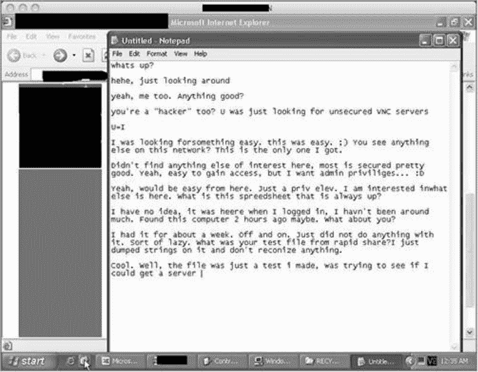

# 第八章：案例研究：剖析社会工程人员

社会工程最值得警惕的地方，往往不是攻破某台机器，而是让人心甘情愿地配合。门锁再牢，流程再细，只要关键环节由人承担，话术、身份和情绪就可能成为绕过防线的那把钥匙。下面几段材料，正好展示了这种风险如何在真实场景中落地。

## 一、一本手册与一次伪装：基思如何让梅林主动帮忙

基思在操作过程中多次切换身份，而且切换得相当自然。SSA 的在线手册帮了他大忙：他从中掌握了很多信息，提问时顺畅得像一个真正的内部人员。对诱导者来说，那本手册几乎像量身定做的宝典；措辞拿捏准了，他的身份听起来就像真的。

他还用共识与框架把伪装撑得更像真的。共识并不好建，基思却做得漂亮，说明事先练得充分。他调动多种影响策略，让目标觉得请求合情合理，警惕心随之下降。比如，他把责任感和换位体谅揉在一起：诉说自己缺少趁手工具、又得不到管理层支持时，梅林便觉得该帮他。

他还会用关键词句争取同情，同时强调自己在政府部门工作。类似“上司对我颇有不满”的话，暗示他正陷麻烦，而 SSA 的梅林正好能拉他一把。道德感会让人觉得自己该帮有困难的人，鲜少有人对求助置之不理。梅林也一样，不但觉得该帮，还把个人行程告诉了基思。最终，基思调动的是社会工程框架里一整套不必面对面也能奏效的关键技巧。

政务系统终究由人管理运行，所以面对这类手法并不天然免疫。这不是主张用机器全面替代人工，而是提醒：不少组织把关键环节压在长期超负荷、薪酬偏低、精神紧绷的员工肩上，操纵这些人并不难。坦率说，这一轮操作很难再挑毛病；作者并非常做此类攻击，而基思把框架用得很出色。有些人长期处在被苛待、被斥责的环境里，一点善意就可能让他们格外卖力地帮忙。米特尼克在《欺骗的艺术》里也表达过类似判断：依赖人操作的系统很容易被攻破。

## 二、一周攻破过度自信的 CEO

另一个案例里，海德纳吉遇到一位自信到近乎傲慢的 CEO。此人认定自己不会被社会工程攻破，理由有两条：平时不怎么碰科技产品；脑子够聪明，能识破他口中的“愚蠢游戏”。公司内部安全团队得知后，便请海德纳吉把这位 CEO 列为审计对象。他们盘算得很清楚：只要 CEO 没过关，后续安全整改的审批就会顺畅得多，对公司整体安全有利。

目标是美国一家大型印刷企业，握有工艺专利和供应商资源，竞争对手正盯着。IT 与安全部门认为公司有薄弱点，说服 CEO 做一次安全审查。电话里，CEO 很傲慢，说攻击他纯属无稽之谈，他会用生命守护秘密，连部分核心员工都不掌握全部细节。海德纳吉的任务是打进公司、拿到某台服务器权限，并取走其中专利资料。难点在于服务器密码存在 CEO 电脑里，没有他点头，连安全部门也碰不了。

他照例从情报收集起步：用网络资源和 Maltego 等工具，摸到服务器位置、IP、邮箱、电话、地址、邮件服务器、员工姓名与头衔等。网站暴露了邮箱规则——名.姓@公司域名。CEO 邮箱没直接找到，但多篇文章提到其姓名与头衔（化名查尔斯·琼斯）。这些信息并不神秘，普通社会工程人员也能拿到。按规则发信失败，改用昵称 Chuck，试 chuck.jones@公司域名，居然通了，于是得到一个已验证邮箱；接下来要确认它属于 CEO 而非同名者。

他又花更多时间用谷歌和 Maltego 扩大搜索。Maltego 的转换插件能在域名范围内像搜索引擎一样翻文件；域名文件大量出现，很多带元数据，含日期、创建者等。跑元数据转换后，发现不少文件创建者是 Chuck Jones，内容也指向 CEO 身份。浏览中，一个 InvoiceApril.xls 吸引注意：当地银行开具的营销项目发票，列了银行名、日期、金额，却没写项目名称。银行官网只保留近期内容，6 个月前项目已查不到。

他扮成某公司汤姆致电银行市场部，说整理账本时发现一张 4 月、3500 美元的赞助发票，项目名空着，想知道对应活动。对方敲着键盘查后回答：那是银行儿童癌症基金会年度活动，你们是银牌赞助商。他还顺势说自己是新人，谢过对方。随后，他又顺着 CEO 做更细调查：父母和姊妹姓名、孩子照片（来自 Facebook）、住在父母附近时去的教堂、对喜爱餐厅的评价、自己喜欢的球队、大儿子喜欢的球队、就读大学、孩子学校等，都进了资料袋。

他想弄清公司为何资助儿童癌症基金会，甚至怀疑 CEO 某个儿子患病。于是再打电话给公司市场经理苏，自称 XYZ 的汤姆，受本镇第一国家银行委托，对 4 月儿童癌症基金会出席者做反馈调查。苏说这是每年都做的活动，本地报道不少，还希望网站多展示银牌赞助商。问到为何选择该基金会，苏说恰克特别上心，他是 CEO，大概家里有人患癌；追问是不是孩子，苏答不是，可能是侄子或表妹，她也不确定。海德纳吉道谢后结束通话。他确认不是 CEO 孩子患癌。恶意攻击者未必会因此收手，但他仍按计划推进。

已知 CEO 来自纽约，偏爱多明戈餐厅，常带孩子看大都会比赛后去吃饭，还在评价里列出最爱三道菜；Facebook 显示他住得离父母近，常去探望。海德纳吉设计身份：为三州地区癌症研究募款的志愿者，捐款者可参与抽奖，奖品是大都会两场门票加一张三选一餐厅券，多明戈在列。他还假装自己刚在纽约地区工作不久，以免被问到本地细节时露馅。核心目标仍是让 CEO 打开带恶意代码的 PDF，从而反向控制其电脑；若对方 Adobe 版本不合适，就转而劝他下载 zip 并运行里面的恶意 EXE 安装包。他为话术反复排练，测试 PDF 与 EXE，还用谷歌地图查好多明戈位置以备闲聊；接收回连信息的设备也准备就绪。

下午 4 点，他拨通电话——公司网站写明周五 4:30 下班。此前与 CEO 谈审计的是搭档，所以对方听不出他的声音。他先问查尔斯·琼斯在不在，接线人疲惫地转接。CEO 接起，海德纳吉自称美国癌症研究会托尼，介绍年度募资、男女老幼受癌症折磨。对方让他别叫琼斯先生，直接称呼恰克。这让他暗喜：对方没拿“忙”当借口挂电话，还愿意拉近距离。他接着说，活动面向曾捐款单位，小额 50 到 150 美元，设抽奖，奖品是两张大都会门票和双人免费晚餐，餐厅三选一，共 5 位幸运者。CEO 听到大都会明显来劲。海德纳吉顺势提到莫顿、巴塞尔、多明戈。CEO 一听多明戈就说喜欢。海德纳吉说前几天第一次去，蘑菇鸡肉很棒——这正是 CEO 第三喜欢的菜。CEO 纠正：该尝法式菠萝，那才是招牌，他每次必点。海德纳吉说周末再去一定试，随后说明自己不是电话要钱，会发 PDF，感兴趣就填表连支票寄回。CEO 同意。他问邮箱，得到 chuck.jones@公司域名；又请对方打开 PDF 阅读器，在“帮助”菜单点“关于”报版本号，答案是 8.04。海德纳吉说怕发打不开的文件，稍等别挂，随即发送。CEO 说收到了，还盼着中奖。海德纳吉请他检查邮件，听到双击声后，BackTrack 上的 Meterpreter 开始响应，命令行界面弹出，脚本属主信息变化类似 Explorer.exe。CEO 喊黑屏不能动。海德纳吉嘴上说奇怪、检查一下，实际在确认能否访问硬盘，并立刻上传反向命令行，以便对方关机重启后仍能进入。他让 CEO 等几分钟；CEO 说去洗咖啡杯、离开会儿不挂电话。这段时间足够他布好下次进入的通道。CEO 回来后，海德纳吉道歉，说不知为何这样，不想耽误时间，先回去重做 PDF 周一再联系。CEO 说好，周末愉快。挂断后意外又惊喜：电脑没关，仍活跃。CEO 把一切存在安全硬盘，只有他能访问，但资料都是 Word。海德纳吉立即下载那些 Word 文档，几小时后访问服务器，打印出对方想保护的全部内部工作流程。

周一早上，他不再以募款人托尼出现，而是安全咨询专家，带着打印出的“秘密”与密码，以及与 CEO 和员工的通话录音。首次会面时客户往往震惊，指责他利用人性弱点、手段不道德；等听到恶意攻击者也会照搬这些套路，情绪从愤怒滑向后怕，最后才理解审计的价值。

这个案例的骨架仍是社会工程框架：情报搜集决定成败，网站、Maltego、电话都是入口；信息越充分越好，哪怕教堂、亲属姓名看似无用，也可能备用；邮箱命名规则与 Maltego 挖出的服务器文件，才是真正开门的钥匙。资料还要分类整理，BasKet 或 Dradis 比一大坨文本更可用；搜集与整理同等重要。站在坏人角度想，不是全部，但专业审查者为保护客户，必须尽量证明客户有多脆弱；信息越多，漏洞越容易暴露，这是成功路径。伪装越真、话题设计越贴人，越容易得手；问题要问到关键处，信息储备足够，才能提出有效问题，再配合关键词与 NLP 式表达，影响力会放大。期间他不断换身份：有时以员工身份联系供应商，有时以供应商身份套内部员工；每个角色都要提前准备、进入状态，才能在实战中自然。演练同样关键，它能验证策略、保证落地，并在意外中保持从容。可改进之处：只靠恶意 PDF 有风险，可搭一个仿真的癌症研究网站，把 PDF 挂上去，网站和文件都埋代码，成功率翻倍且多一层后备；另一个风险是 CEO 离开后电脑未关，若不如此只能等周一，可先发恶意 PDF 攻入，再发一份“正常 PDF”让他阅读，延长其在电脑前的时间，为利用漏洞争取窗口。整个审计约花一周调查、搜集、整理与演练；一周时间，公司机密就可能落到对手或出价更高者手中。案例里的对话细节值得反复琢磨，文字难还原语气、语调和节奏，读者不妨代入场景，想想自己会怎么接话。

## 三、乐园票务窗口的现场测试

另一个主题乐园项目更像现场实战。它有趣，因为有现场测试，也把书里许多社会工程技巧拿来检验；商业性质明显，一旦骗局成功，可能拿到上千个信用卡账号。

目标是检验一家主题乐园票务系统的安全：顾客购票信息登记时，每台终端都会连到后台服务器，记录客户资料与金额。乐园想知道，攻击者能否用恶意方式让工作人员做出某些动作，从而造成危害。重点不是为难员工，而是证明票务登记电脑一旦被入侵会带来什么安全后果；而且这里不靠黑客技术，而靠社会工程。若真发生入侵，会泄露哪些数据、哪些服务器受影响？乐园方面不想推演太深，只想看第一阶段——社会工程入侵是否真能实现。于是必须先摸清售票流程：员工在终端上会做什么、不会做什么，尤其是有权做什么、无权做什么。

他先浏览乐园网站，用 Maltego 和谷歌翻报道与资料，再亲自到乐园买票，和售票员聊几句，观察窗口布局、电脑位置和“办公室”细节。这个办公室让他找到了切口。聊天时他说自己来自一个很有名的小镇，对方问是哪儿，听完照例问“那地方在哪？”他反问能否上网，得到肯定后，请对方打开谷歌地图，输入邮编 11111，切到卫星视图，看看镇子有多小。对方惊叹从没听过。短短几分钟，他掌握了售票员工作区布局、售票方式，以及计算机可连外网。

他再上乐园网站找突破口，需要一种进入对方电脑系统的办法。此时他的伪装很合理：一个带家人来玩的父亲。故事是：原本没打算来乐园，在酒店上网看到优惠，去大厅一问却贵很多；再确认价格才发现优惠只限在线支付，于是线上付了钱，随后突然想到门票得打印出来才能被检票器扫描。酒店打印机偏巧坏了；钱已付，怕浪费，就把票转成 PDF 发到自己邮箱。这个说法自然。接下来他先打电话确认“是 XYZ 主题乐园总办事处吗”，得到“有什么需要帮忙”。他要接触内部人员，通过提问拿到答案；转到采购部门后找到了合适目标。他自称 SecuriSoft 公司的保罗，说公司正在为新软件做免费测试，该软件能阅读甚至打印 PDF，请对方试用，并要发一个免费下载地址。对方说可以，但不一定感兴趣，可以先发资料。他又问对方用的 Adobe 阅读器是什么版本，对方答“第 8 版”。对话停在这里，但切入点已经出现。

## 四、这些案例真正提醒了什么

这些案例放在一起，指向同一个事实：组织系统由人运转，所以并不天然扛得住社会工程。不是要用自动化或计算机系统全面替代人工，而是提醒，很多组织把关键环节交给长期超负荷、低薪、高压的员工，操纵他们并不困难。有些人习惯被苛待和斥责，一点善意就可能让他们不遗余力地帮忙。米特尼克在《欺骗的艺术》中也表达过类似判断：依赖人操作的系统很容易被攻击。对组织来说，真正的防线不能只写在设备上，还要落在人员流程、权限设计、信息最小化和员工支持上。

真正意义上的社会工程，从来不是强迫对方做什么，而是让人在毫无防备时心甘情愿地配合你。信息的收集、角色的营造、人性的拿捏，每一步都在为最后的“开门”做铺垫。

当目标系统的版本信息到手后，我便着手制作一个带反向连接功能的 PDF 木马——只要对方双击打开，他们的电脑就会向我敞开一条通路。我将这个文件命名为 Receipt.pdf，先发到自己的邮箱。第二天，全家趁着周末出游，我在乐园门口布好了一场戏。家人远远地站在一旁，我独自走向售票窗口。

“嗨，缇娜，今天忙吗？”我瞄了一眼她胸口的名牌。

她笑着回应：“还好，请问有什么需要？”

我指了指不远处的家人，说一家人正住在附近的希尔顿，女儿看到乐园的广告后吵着要来，我们就在官网订了优惠票。话锋一转，我坦白遇到的麻烦：官网票价要比现场便宜 15%，我用酒店房间的电脑付了款，可酒店的打印设备突然罢工，票没出来，只能把文件存成 PDF 发进自己邮箱。我试探着问：“这要求可能有点冒昧，能请你登录我的邮箱，帮我把票打出来吗？”那个邮箱看上去再普通不过，里面放着“孩子的照片”“爸妈结婚纪念日”这类日常邮件。

她沉默了片刻，似乎在权衡。我趁热打铁，指了指女儿那张又期待又紧张的小脸，补了一句：“我真不想让她失望。”这一下，她的防线松动了。

“行，那我需要做什么？”

“你先打开 Gmail，账号是 Paul11234，后面接@和 gmail 点 com。密码是一个字母一个字母来的：B-E-S-M-A-R-T。”——这密码确实上不了台面，但紧要关头，“放聪明点”也算句提醒。（译者注：BESMART 意为“放聪明点”，隐含告诫。）

几分钟后，她双击了那个 PDF，屏幕瞬间一黑。

“哎呀，是我哪里弄错了吗？完了，这下我真成了年度最差老爸了。”我夸张地拍了拍脑门。

“先生，真是抱歉……要不这样，成人票您按原价买，孩子这边我直接放行，行吗？”

“你人太好了，太感谢了。”我笑着递过 50 美元，请她退出我的邮箱。就在女儿为入园欢呼的同时，乐园的票务系统已经被我拿下了。几分钟后，搭档发来短信：已经“进”去了，报告要的数据也都“扒”出来了。我们在园里玩到尽兴才离开，周一的汇报材料就此齐活。

#### 8.4.3 社会工程框架的应用

这个案例说明，情报不一定只能隔着网线收集，亲自到现场往往能拿到更生动的东西。我在园区里摸清了几个关键点：对方用的是什么类型的计算机系统，售票员遇到异常状况会如何反应，票务运转的流程是什么样的。这些信息全部来自实地观察。

这次行动最值得记取的，是“伪装”的深层含义：它不仅意味着编一个故事、换一身行头、学一种口音，更要求你彻底代入角色的处境，站在他的位置上思考和感受。

我能毫不费力地把握“父亲”的语气、举止与心态，因为我本身就是父亲。我担心被女儿埋怨的焦虑是真的，情绪也做不了假，售票员自然能从我的言语中感到那份诚意。再加上远处那个眼巴巴的孩子，以及酒店打印设备出故障的细节，整段表演便显得顺理成章。

第二章提到，社会工程师需要提高演技，至少会撒谎。但在我看来，真实情况比这复杂。从专业角度讲，伪装是要塑造一个足够真实、能牵动目标情感和行为的角色。几句干巴巴的谎话骗不了人，攻击者必须“变成”那个人。所以，选择一个与自己生活经验贴近的角色，是非常聪明的做法。

“以‘文档工具免费试用’为由”这个借口有明显软肋：它可能在起步阶段就被对方当场拒绝，让后续手段全部作废。这次能成，有一个重要运气成分——售票员用来打开 PDF 的软件，恰好和公司内部版本一致，没有打过补丁，才给了我乘虚而入的机会。

利用人类固有的惰性，说到底是场赌博。这场赌局我赢了。有时最明智的策略，是让自己先相信这个请求理所应当——你的自信会扩散到语言和表情里，让对方觉得没有什么可疑。第五章提到的“我真的需要你的帮助……”这类话术也很有效。人天生乐于助人，尤其是当对方向你发出请求的时候。

即使是素不相识的人，也可能因为你一句求助就倾尽全力——就像这位售票员，为一位“可怜的父亲”登录陌生邮箱、打开不明文件。她只是想让孩子免票入园，这个小小的善意，最终酿成了整个系统被攻破的后果。

一旦系统沦陷，存储客户信用卡信息的数据库就成了猎物。哪怕只是随手抽取部分数据，也足以让这家乐园背上巨额经济损失、法律诉讼和公众信任危机。

随后是另一个经典场景。

“您好，可以简单问几个问题吗？”

“嗯，你说。”

“你们这边废料桶大概有多少个？”提姆一边问，一边确认有没有专门收纸张、U 盘和硬盘的回收桶，最后落到最关键的问题上：“清运一般安排在一周里的哪几天？”

“每周来两次，一区周三，二区周四。”

“好，我明天下午把报价发你。请问发到哪个邮箱合适？”

“发我私人邮箱吧——用户名是 christie.smith，域名是 company.com。”

话匣子一打开，两人便聊得热络起来。临挂电话，提姆装作不经意地追问：“能不能透露你们现在用哪家清运商？我想参考一下他们的报价标准。”

“呃……”对方犹豫了几秒，还是说了：“行吧，是废物管家。”

“谢谢克里斯蒂。我相信我们这边的价格会有竞争力的，回头联系。”

拿到信息，提姆访问了废物管家公司的主页，把他们的 Logo 保存成图片，然后在一个在线 T 恤印刷平台下了单。72 小时后，一件印着那家公司标志的工服送到了他手上。既然垃圾周三、周四清运，他就把行动定在周二夜间。

接着，他给目标公司的安保值班室打了个电话。

“你好，我是废物管家这边的约翰，负责你们公司场地的清运。克里斯蒂·史密斯办公室报修，说有个垃圾箱坏了。我查了下你们周三才清垃圾，所以想今晚提前过去看一眼情况，如果真坏了，明天我们随车带新的来。周二晚上方便吗？”

“稍等，我翻一下记录……可以，乔明天在岗。你到了先停到保安亭旁边，他会给你开张出入证。”

“多谢。”

次日，提姆穿着印有 Logo 的工服，一手夹着记事板，出现在公司大门口。他的准备非常充分——连轮班保安的名字和垃圾清运的日期都一清二楚，这让他的身份显得毫无破绽。

“乔，我是约翰，昨天电话联系过。”

保安看了一眼，点点头：“嗯，名单上有你。”递过出入证和地图，指了个方向：“需要我找人带你去吗？”

“不用，路我熟。”

提姆开车直接驶向废料区。出入证和工服给了他充足的时间。他知道二区存放的是非食品类废弃品，于是从那边翻起。

没花多久，他就翻出了几块旧硬盘、几个 U 盘、几张 DVD 和一捆纸袋，全部搬上车。一个多小时后，他回到保安亭，说问题处理完了，随即离开。回到自己的办公室，提姆开始细致地检索这批“回收物”，收获远远超出预期。

公司规定，报废的硬盘和 U 盘必须先擦除数据，再交给专业部门处理。但总有员工图省事，把报废的 U 盘、无法开机的移动硬盘顺手扔进废纸堆。这些人不知道，某些软件可以在不启动盘体系统的情况下把数据完整导出，哪怕介质已被格式化，内容依然可以恢复出来。

在其中的一只纸袋里，提姆发现了几张躲过碎纸机、又被咖啡渍污染过的文件。最醒目的是，其中夹着一份几天后就要启动的 IT 外包合同。这份纸面上的意外收获，直接为他指明了下一步方向。

DVD 多数是空盘或坏盘，倒是那枚 U 盘里有真东西——CFO 的姓名、私人直线，以及一批敏感的人事档案。

得到的筹码已经够多了，但提姆还想再向前推一步。第二天中午，他特意挑在午餐时间打电话给合同上的联系人——赌对方不在工位上。

“你好，请问塞巴斯蒂安在吗？”

“他出去吃饭了。有什么事我可以转告吗？”

“我是 XYZ 公司的保罗，想确认一下我们团队明晚到场地开工是否可行。”

“可以的。注意不要影响我们的正常工作，尽量别在下午 5:30 前到。”

“明白，明天见。”

提姆当然不会跟外包团队一起出现。他算准时间差，在昏暗的停车场等了许久，看到 IT 公司的人进入大楼；约半小时后，他才走向门口，说自己和刚进去那批人是一起的，只是回车里取了些资料。保安没有起疑，放他进了办公区。

接下来的任务是侦察。他转了几圈，顺着交谈声找到几名穿工装的人，判断出这正是外包 IT 团队。他从容地走上前，说：“你好，我是保罗，施瓦茨先生——我们 CFO——手下的。有人跟你说过 prod23 那台设备吗？”——这是他早就从情报里锁定好的目标。

“啊，那台啊，我们被告知不能碰。高层专门交代过它的加密情况和重要性，别让我们沾手。”

几句话，关键情报已经到手：

- 外包团队被明确告知：那台设备不能碰；
- 磁盘做过整体加密；
- 内部运维的人随口说漏了嘴——唯一的钥匙，是管理员随身 U 盘里的那份密钥文件。

这三点把难度拉高了——管理员不在场，物理防护又极其坚固，硬闯几乎不可能。提姆冷静盘算后，将目光锁定了管理员本人。

他先去了管理员的第一间办公室，门锁着；第二间同样锁着；到了第三间，门虚掩着，轻轻一推便开了。他迅速闪身入内，拉上窗帘，关掉灯。

他的工具包里装着各种软件和穿戴用的衣物，这一次用上的，是一枚可以引导 Linux 系统的启动 U 盘——预装了 BackTrack 的版本。BackTrack 里自带一款免费开源的虚拟机软件 VirtualBox。

提姆把 U 盘插进管理员机箱背后的 USB 口，让机器从 BackTrack 引导起来。随后，他用 SSH 连回自己的电脑，设好监听端口，再通过管理员的机器向外建立一条通道，让他的电脑随时可以伸手进来。接着，他在系统里启动了敲键记录功能，把每一次按键都实时送回自己这边。

接下来的操作是整套计划的最狠一击：他打开 VirtualBox，新开了一台虚拟机，把管理员的本地硬盘作为系统盘挂载进去——相当于把管理员的操作系统和账号信息完整搬进了一个虚拟的“玻璃房”里。他把虚拟机的登录界面调成整屏，去掉所有工具条，又将 VirtualBox 的退出热键改成了一个异常漫长的组合键。这样一来，即使管理员误触，也不容易发现自己的电脑正在被“放映”。

这套方案并非没有风险。用启动盘把硬盘接进虚拟机，一旦中途断电或系统崩溃，整条后路都会被切断。但只要顺利走通，管理员每一次敲击都会被记录，而且借着他电脑上建立的外联通道，提姆几乎能翻阅这台机器上的一切。哪怕连接中断，他也能凭着录下的用户名和密码，从虚拟机里重新进入系统。

提姆还预留了退路：他顺手在另一台电脑上布置了后门，又用一张手机 SIM 卡组装了一个小型窃听装置——任何一部电话拨过去，都能听到装置附近六米内的说话声。

几小时后，他撤离了目标公司，回到自己的办公室。确认设备运行正常后，他静待收网。

第二天一早，他先确认外联通道还开着，然后拨通窃听线路，听办公室的动静。没多久，第一条敲键记录出现了——里面正是管理员的账号和口令。

此后的记录不断涌入。提姆深知此刻冒进可能暴露，于是按兵不动。大约 12 点 15 分，敲键记录忽然停掉，他猜测管理员去用午餐了。他立刻检查那条外联通道，借助刚截获的密码，从管理员那台机器一路打通到机房的核心设备，再转接到自己的电脑上。

通道一通，他赶在下午 1 点前拼了命地拖数据。这时，窃听器里飘出一句：“这会还要开到几点？”——看来管理员正在开会。他果断启动了更大规模的传输。然而约 30 分钟后，敲键记录出现了波动，他马上收手，毕竟大量文件传输会拖慢网络，容易惹人警觉。等到风头过去，他继续整理已经到手的资料，战果相当丰厚。

但这还不是终点。当天夜里，他再次混进目标公司，来到管理员的办公室。这次门上了锁，他掏出一把推刀，轻轻拨开了锁舌。进去后，他先关掉虚拟机，拔下 U 盘，重启电脑，再按原路撤离。离开前，他把窃听装置也收了回来，确认没有留下任何痕迹。

周一的项目会上，他带着一叠打印好的文件和一块装满数据的硬盘，推门而入。会议室里，所有人的目光都凝固了。

#### 8.5.3 社会工程框架的应用

这个故事值得回味的地方太多了。整个过程可以浓缩成三个词：练习、准备、情报。无论是撬锁、搭通道，还是乔装改扮、套取信息，每一个环节都必须经过千百次重复，才能在实战中行云流水。

情报收集的分量，我无需再赘述，但有一点必须强调：如果提姆没有在事前做足功课，这次行动注定失败。

他通过电话沟通、实地踩点摸清了盘面，又为自己选了一套合适的硬件装备，行动环环相扣。拆解这次攻击，你能看到社会工程的几条底层法则被如何一步步落到实处。

提姆对情报的嗅觉极其敏锐：他会在网上顺着一条线索挖出整串信息，懂得在电话里用自然的话术引导对方，面对面时又能施展极强的说服力。这些能力，让他手中的情报无论深度还是广度，都远远超过一个只会写代码的黑客。

这些情报，反过来又支撑了他的每一次伪装和试探。

翻垃圾桶的计划堪称教科书级别。没有工服、没有预约，他凭什么走进那些区域？凭的是无懈可击的说服力。他遇到的每一个工作人员都没有起疑，甚至主动为他放行。当你与一个人接触时，对方全程没有产生任何戒心——这样的伪装，才配叫完美。提姆做到了，他在废料区翻了个底朝天。

他进入大楼之后的操作更精彩，但风险也成倍上升——任何一个反常动作都可能让他当场暴露。事实上，他可以直接闯进服务器机房，拎走数据再闪人，大概也没人拦得住。但那样做的话，公司事后根本不会知道自己最重要的机密已经外泄，更不会察觉系统被人动过手脚。

提姆选择了最冒险的一步棋：在管理员的电脑上跑虚拟机。这条路的失败概率太高——管理员一次重启、系统一次崩溃，或者他碰巧按下那串不合时宜的组合键，整个行动就会曝光，等于告诉对方“你的电脑已经被控制了”。

换作我，可能会挑一条保守一点的路：定制一个 EXE 程序，在目标电脑与我的机器之间搭一条隐蔽通道，再用修改启动脚本的办法骗过杀毒引擎，失败的几率会低不少。但提姆的方式，显然更有性格，也更接近社会工程的“艺术”。

这个故事带给我们最古老的忠告，还是那句黑客格言：“不要轻易相信任何人。”如果某天有人打电话说，某某领导批准他进来看垃圾箱，而你既没有接到本人通知，也没有看到备忘录，最稳妥的做法就是回拨电话核实。离开工位前关机，并确保电脑无法在没有口令的情况下从 U 盘引导启动——这些都是最基础但也最有效的防线。

当然，这些防护措施会拖慢工作节奏，增加日常维护的成本。是否值得，取决于机器里存放的数据到底有多重要。在这个案例中，那些数据足以让整家公司垮掉，所以无论多严密的防护都不为过。可惜的是，这家公司在服务器周围堆砌了硬盘加密、摄像头、生物识别锁等层层设施，却偏偏漏掉了一把关键的钥匙——管理员的办公电脑。这个缺口，险些终结掉整个企业。

下面是一组约翰与入侵者对话的截屏。注意看图 8-1，约翰主动开启了话头，第二行起，是对方的回复。

图 8-1 对话实况截图

对话原文很长，里面保留着未经修饰的错字与行话，但能清晰还原这次交手的全貌。约翰首先说话。

—嗨，忙啥呢？
—闲逛呗。
—哈哈巧了，我也就随便转转。发现什么好玩的东西了吗？
—你也在扫机器？找那些 VNC 没设防的主机？
—你和我，一个路子。这网里还有别的目标吗？我只摸到这一台。
—没看见什么有意思的，大部分机器都守得很紧。这台确实好进，可我想要的是管理员权限…… :D
—那还不简单，权限往上升一级就是。我更想知道这台机器里还藏着什么。那个一直开着的表格是什么鬼？
—我进来的时候它就这样了，还没顾上看。这台电脑我摸到也才两个小时。你呢？
—我一周前就发现了，隔三差五来看看，一直懒得动手。你放在快速共享里那个测试文件是怎么回事？我把里面的字符串抠出来看了看，糊得很。
—哦，那是我的试验品。想跑一个木马程序，结果被防火墙摁住了。
—哈哈，同病相怜。我搞了个 Metasploit 的载荷，一样没跑通，所以还在这儿研究呢。你是本地人还是从外面来的？我认识好几个丹麦的哥们儿。
—挪威的，我家有亲戚在丹麦。
—平时逛不逛论坛？我从前常去几个，后来都废了。
—我一般泡编程圈。你做这行多久了？方便透露下年纪吗？我二十二。
—也就一年上下，纯属好玩。还在念书，十六岁，给自己找点事做。听过 evilzone 这个圈子吗？
—没去过。我也是好奇，想看看自己能折腾出什么名堂。顺嘴说一句，我写了个 VNC 扫描程序，翻到过不少机器，也就这台有点嚼头。
—哟，写的是啥？能发来瞅瞅不？你在圈里叫啥名字？
—拿 PureBasic 敲的，火候还没到，暂时自己用，以后可能放出来。我把源码发你，你自己编一下试试——不过你得先去软件仓库弄个 PureBasic 的编译器。:P
—那敢情好。可以传到 IRC 那边挂着的 Pastebin，它支持匿名贴。我没碰过 PureBasic，平时只写点 Python，Perl 也算略懂。

一次凌晨的记事本聊天，把一场随机的渗透变成了教科书级别的社会工程实战。

画面里，正在扫网的黑客先提议把工具丢到 Pastebin 上，让对方稍等几分钟。他报出自己在 IRC 用的小号是 jack_rooby，问对方的网名。对面回说不玩 IRC，邮箱联系就行，随后留下 intruder@hotmail.com，并用自己的全名在编程论坛活动，坦言这可能不是最佳做法。黑客想加 MSN，对方答应，顺便说认识懂技术的朋友很爽，后续有卡壳或新发现都可以互相丢过来。两人自嘲已经“同一阵营”。

工具链接很快来了：http://pastebin.ca/1273205。黑客补充说这东西还在 alpha 阶段，界面没做完，只能靠几个变量调。对方表示马上测测，测完会邮件反馈。

接下来是工具的能力介绍。跑上几个小时就能扫出大量服务器，而且自带安全配置和漏洞探测，即使有密码保护也能尝试进入，结果会标记为“不安全”。当然也会误报，自己实测就好。聊到 VNC，黑客说自己也看见不少需要密码的 VNC 服务，能不能进要看有没有漏洞，进得去的少数情况需要专用客户端，指向了 http://intruderurl.co.uk/video/，让下载 ZIP。

关于后门，黑客承认大部分工具都是自己鼓捣出来的，目的就是边做边学。虽然还不算完整，只是想先看看服务能不能跑起来。

对话很快转向求助。黑客说有点想放弃，但还是想试试别的方法。他没有自己的僵尸网络，有人叫 Zoot54 想卖给他，还有人担保，可他不信任。自己写工具也不顺手，Perl 和 Python 在 Windows 主机上效果不佳，转用 Metasploit 又碰到防火墙报错。对方建议 Perl、Python 其实是很好的入门，语言学会一个，其他自然不难，可以试试上手更快的 PureBasic。僵尸网络确实酷，但自我传播在 Vista 上很难。自己也不会轻易放弃这台服务器，还会继续找突破口拿更高权限。

聊了半天技术后，黑客问对方有没有 MySpace 或 Facebook，只用邮箱吗。对面说先用邮箱，等完全信任才会加 Facebook，自己没 MySpace，会保持联系。黑客又问是不是走命令行，还是同一个图形界面。对方回复只用 TightVNC 这类工具，确保不会踢掉其他用户，自己不喜欢命令行。

黑客自嘲自己用命令行总会失误把连接掐断。这里出现一个小插曲：对方开玩笑说感谢他没把自己踢掉，刚进来时还以为撞上了管理员。随后两人发现目标公司在美国中部，现在对方那边是半夜。黑客做了网速测试，发现上传比下载快，觉得对 DoS 比较有利。对方也确认了 DoS 的意思。

两人还聊到打印机恶作剧。黑客说自己之前输出过 “hello world”，想象中午有人看到表格里鼠标乱动会吓一跳。随后都吐槽有台 VNC 服务器竟然没设密码，太离谱。黑客说他向打印机输出过内容，希望能被看到。对面分析这不是普通用户能干的，没管理员权限跑不起来，应该是管理员或怪胎设的，否则后门早就能用了，可能配置被改了。

黑客问靠这个能不能赚钱，对面说自己靠编程吃饭，不做黑客或安全类工作，但这确实是个好方向，人愿意为安全测试付费，做得好能赚不少。黑客说自己买了本“有道德的黑客”书，里面有不少程序，年龄要求不清楚，但他觉得是起点，Metasploit 尤其值得研究。对面表示会去看看，随后说有点累了，不能整天盯着简陋的记事本聊天。

最后两人约定邮件保持联系，黑客说会把记事本聊天记录保存下来。

这段对话的真正主角不是黑客，而是化身黑客的渗透测试员约翰。伪装成另一个人本就不容易，通常需要精密准备，但为了客户安全、揪出入侵者，他必须入戏。最终约翰拿到对方的照片、邮箱和联系方式，把这个恶意入侵者上报给客户，系统随之修复，再也不允许如此轻易的入侵。

这个高度保密的案例证明，专业化的社会工程可以成为守护客户安全的利器。

#### 社会工程框架的运用

有意思的是，这家公司根本不是黑客原本瞄准的目标。黑客只是在网上扫着玩，不小心撞上了。对外开放的访问权限有多危险，如果不是刚好被测试人员碰到，后果难以想象。

从中学到的经验也很多。约翰在行动前并没有打算用社会工程，只是想做一次常规渗透。有时候必须临时启动社会工程技能。

约翰为何能临场发挥？很可能因为他日常就在使用这些技巧，熟练度足够自然。

最核心的启示是熟能生巧。约翰完全可以在黑客出现时直接亮明身份，说自己是管理员，所有行为都被记录，黑客生涯到此为止，还可以用威胁把对方吓跑。可那样黑客极可能立刻撤离，甚至回来格式化系统、制造更大破坏来掩盖痕迹。约翰选择了更灵活的做法，在目标身上搜集大量信息，再借助邮箱、姓名和 Maltego 软件，还原出此人的完整活动轨迹。

另一个收获是随机应变。约翰开始收集信息时，自己也不确定对方是黑客还是管理员。对第一句“嗨，什么情况？”的回应多种多样，在没有准备时间的情况下，他只能用行话、以黑客的方式接话。

### 小结

整本书想强调的是，用知识来保障安全。只有正视风险，了解“对手”如何思考，承认恶意存在的现实，才能真正保护自己。下一章会专门讨论如何防御和减轻社会工程攻击。