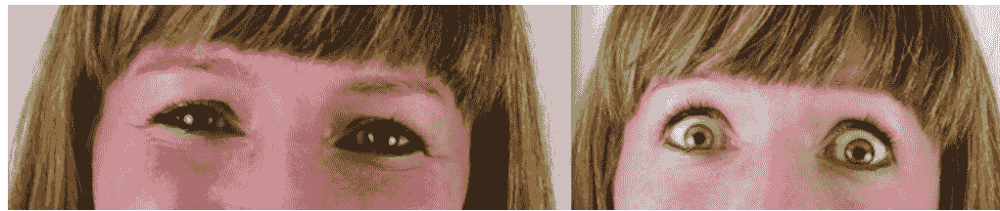
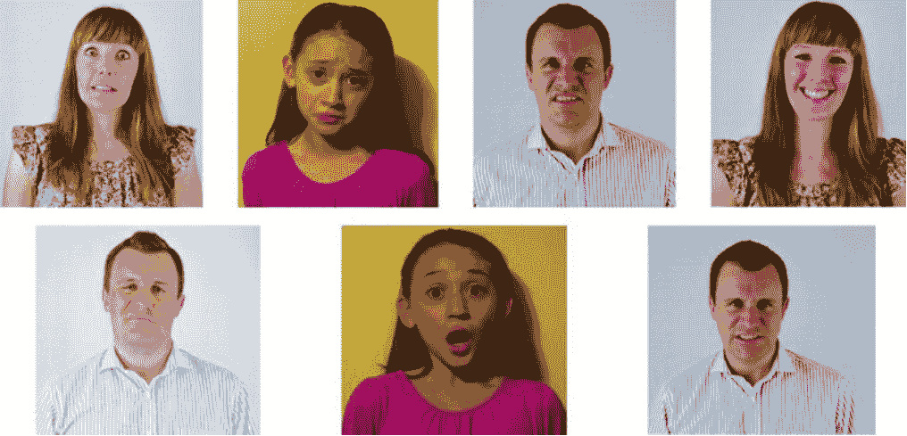

# 第一章：什么是非语言交流

# 那些没说出口的话：非语言沟通的七个切面

艾琳·克莱蒙特·德·卡斯蒂列霍有句话说得透彻——情绪往往不走语言这条道，它从连本人都没留意的身体反应里悄悄渗出来。这正是本章要展开的话题：非语言交流。

早年间我在《社会工程：安全体系中的人性漏洞》里聊过沟通模型这件事。信息从发出到被接收，走哪条路、用什么载体，效果大不一样。拿电子邮件来说，寄件方想传递的心情、目的、内容，只能寄托在字面、颜文字和措辞上；收件方也只能依据自己当时的状态去揣摩。反馈的形式五花八门，而且相当要紧。换成面对面就不同了，对方接收到的是话语之外还有姿态、神情拼成的整幅画面。搞社会工程的人，得顺着接收方的习惯去调整自己的表达路子。

这一章把镜头对准非语言交流。这块内容既厚又杂，先厘清范围再往下拆。搞明白感官怎样左右沟通方式，是往下走的地基。不妨设想一个场面：你站在讲台上，底下一会儿有人张嘴打哈欠，一会儿有人低头划手机，一会儿有人托着腮帮子眼皮直打架——不用谁开口，听众已经不耐烦了，这判断靠的就是非语言信号。

学界围绕非语言在整体沟通里占多大分量，讨论一直没停过，有研究给出的数字超过一半。跟艾克曼博士共事那阵子我弄明白一件事：这个比例压根不是铁板钉钉的，沟通类型、目的、对象换了，数字也跟着浮动。但各家研究有个共识——非语言在沟通里权重极高。

短信和邮件闹出的误会最能说明问题。收到一条语气带刺的信息，第一反应是被冒犯了，过后才反应过来寄件方压根没那个意思。原因在于寄件方不在跟前，读信息那一刻的心情会直接扭曲解读。我自己就栽过：某天从早忙到晚，累得够呛，手机跳出一句“打你电话一直没人接，要是今天真在干活就回个电”。当时我火冒三丈，觉得对方在暗指我偷懒——可那天我干的活可能顶他三周的份量。我敲了封长邮件准备还击。再读一遍才察觉，满纸都是我自己读出来的火气。发信息那位平时常跟我逗闷子，是我把紧张和压力糊到了文字上。邮件不会发声、没有表情、也没法用肢体动作帮忙判断意图。要是当面，我看见他的笑脸、感受到那股轻松劲儿，绝不会把话往职业操守或时间管理上靠。

非语言形式的分量由此可见，难怪有人穷毕生精力钻研它。本书会深挖艾克曼博士等人的成果，并讲清楚它对社会工程师怎么用。

加州大学伯克利分校人类发展研究所所长约瑟夫·J·坎波斯，伙同安德森、威灵顿、内山、巴尔布-罗斯几位博士，搞了个“视觉悬崖”实验。他们把一名会爬但还不会说话的婴儿搁在桌子一头。桌面铺着玻璃板，底下是棋盘格纹路，让婴儿产生错觉：对面那截仿佛陡得吓人，像要掉下去。越过那处“险崖”，桌子另一头边缘摆着玩具，玩具旁边能瞧见爸爸或妈妈的脸。按规矩，妈妈不许出声，只能靠面部表情鼓励孩子朝她爬。到了悬崖位置，妈妈要做一个持续较久的夸张神情——要么欢喜要么惊恐。要是欢喜，笑的时候眼角会挤出细纹，艾克曼博士管这叫“真诚的微笑”，等于告诉婴儿一切稳妥；要是惊恐，嘴巴咧开、眼睛瞪圆。

图 1-1　妈妈露出真诚微笑时，婴儿接收到的是什么信号？

图 1-2　妈妈换成惊恐神情时，婴儿又会怎么判断？

妈妈欢喜时，婴儿往往无视视觉悬崖，径直朝目标奔去；妈妈惊恐时，婴儿立刻变得格外小心，甚至有孩子在琢磨要不要越过去的时候摇了摇脑袋。这个实验以及同类研究说明，非语言沟通的深度、分量以及对互动对象的影响力都不可小觑。对社会工程师来说，怎么专业地运用非语言信号同样关键。往目标跟前凑的时候，假如自己流露出惊恐，目标也可能被传染生出疑虑；反过来，传递出欢喜，就更容易拉近距离、推动事情办成。

到这儿为止，我一直把非语言沟通当成一个大筐。其实里头类型多得很。研究者对怎么分类意见并不统一，下面只挑我认为真正有助于弄懂的七个层面来谈：身势学、人际距离学、触摸、眼神交流、嗅觉、着装、面部表情。挨个说。

## 身势学：身体也在开口

身势学系统地琢磨肢体动作跟沟通之间是什么关系，比如脸红、耸肩、眼珠转动。说白了，它描述的是肢体语言怎样把心里话抖搂出来。艾克曼 1975 年发过一篇《交际性的肢体运动》，盯住大卫·埃弗龙 20 世纪 40 年代那本著作，里头拎出身势学的四块：象征动作、演示性动作、操纵性动作，外加我称作 RSVP 的那一层。

象征动作多半牵扯到手，属于非语言动作，通常经过反复掂量，好比说话时斟酌用词；可也会冒出类似嘴瓢的状况。设想朋友在屋子另一头瞅见你脸色不对，用口型问“没事吧”。她兴许耸耸肩再竖起大拇指；你呢，可能揉揉肚子然后把拇指朝下戳，意思是胃里不舒服。俩人一个字没说，靠几个手势就完成了一场微型对话。可同一个手势挪个地方，含义可能翻个底朝天。在中东，“竖拇指”可不能随便比划，当地意思完全两码事。下图这个手势怎么解读，全看用在哪儿：

图 1-3　这个手势是“一切顺利”，还是贬损他人？

在美国，类似下图那个动作表示一切稳妥；可到了中东、非洲部分地区以及其他一些地方，它可能意味着冒犯。

图 1-4　同一个手势，可能友善，也可能失礼，关键看用在哪儿。

社会工程师必须吃透象征动作，还得弄清左右其含义的那些因素：使用区域、文化土壤、试图影响的对象。时机不对、手势不对，原本挺有影响力的沟通可能一眨眼变成冒犯。

演示性动作，艾克曼 1972 年在《手部动作》里给的定义是“与演讲、措辞、内容、声调变化以及声音响度密切相关的行为”。换句话说，它能给嘴里说的话加码，跟象征动作有几分相似，只是通常更含蓄、更下意识。别人喊“啊哈”或者吼“等等”时，你脑子里能浮现出配套动作吗？有人说“我开车一路朝北，盘山公路绕了将近三个钟头”，又会配什么动作？你八成已经能想象画面了，因为你经历过、使用过太多回。

操纵性动作，指的是因为紧张或不舒服而对身体某部位或衣饰进行控制、修饰的行为；反过来，因为松弛或自在而做出的类似举动也算。摆弄手指或袖口、搓手、调整扣子或衬衫、修整头发，都归这一类。艾克曼的著作讲明，这些表现并不是欺骗的下意识流露，而是显示做动作的人对处境、他人、被问及的问题或者周边环境感到不自在。它们容易让人往欺骗上联想，可这不代表使用操纵性动作的人就在扯谎，这也是我反复强调的观点。在社会工程语境下，操纵性动作能帮你摸清他人是否自在；弄懂大脑怎么感知这些信号，还能帮社会工程师跟目标打交道时触发某种情绪。

RSVP 四个字母分别代表节奏、语速、音量、音高。它不光牵扯实际说出口的词，还牵扯话外的一切。说话的节奏能流露紧张、镇定、自信之类的状态；语速能折射情绪、籍贯、对所说内容有多少底气；音量提供线索——是悄声耳语还是吵吵嚷嚷，音量拔高可能代表火气上来了；音高同样要紧，高亢可能出于害怕，低沉可能因为难过或拿不准。留意停顿、重复、用词或语气上的变化，能帮你咂摸出对方真正想表达的东西。

下面几种情形值得盯住：

- 代词切换：起先用“我”，后来变成“我们”，可能是欺骗的苗头。即便不指向欺骗，也是个不错的提示，帮你听出事情起变化的缘由。
- 口吃和用词重复增多：说明说话人的忧虑和压力在往上走。友情提醒：口吃该怎么界定没有明确标准，没法断定它是不是这人说话的常态，因此判断时要留个心眼。
- 声调起伏：能折射欢喜、反感、火气、轻蔑之类的情绪变化。可以试试：下回板着脸盯着你家狗，怒气冲冲地吼“我爱你”，它多半会缩到墙角去。这说明说啥不重要，声调和神情才要紧。
- 不给正面答复：人不想接话时，常用绕弯子的方式回避问题。
- 停顿：停顿反映认知负荷，往往伴着眼神动作。说话人停顿是为了攒出回应；听的人要琢磨，这停顿是为了回忆，还是在编瞎话。“别打断停顿”是一句要紧的箴言。可很多时候，听的人会去填说话人的停顿，这也许让对方喘口气，也可能通过引导性提问或点评反过来影响对方。

学会观察这些情形，并且留意它们怎么出现在你自己的谈话里，能帮你成为更靠谱的沟通者和社会工程师，从而摸清交流对象是否自在、真实情绪什么样。

## 人际距离学：空间也在传话

20 世纪 50 年代，爱德华·霍尔博士头一个提出“人际距离学”，琢磨我们怎么使用周遭空间，以及不同用法怎样左右自在程度。“私人空间”这个词就打这儿来的。霍尔博士主要谈了四类空间：

- 公共空间：拿西方文化当例子，说话人和听众之间 4～8 米是双方都能接受的合理间距。回想一下音乐会或者总统电视讲话，就能体会某种程度的公共空间是合理的。
- 社交空间：适用于社交场合。想想你跟家里人裹着沙滩巾坐在沙滩上，能容忍旁边的人挨多近？霍尔博士给出的数字是 1.2～3 米。
- 私人空间：我们跟家人或朋友互动时的合理间距，也适用于排队时跟前后的人保持的距离，范围是 0.6～1.2 米。
- 亲密空间：留给能碰我们、能对我们耳语、跟我们亲密接触的人，距离不到 0.3 米。

假设你在 ATM 前排队，后头那位离你只有十多厘米，你往前挪，他也跟着挪，甚至能感到他在你后脖颈子呼气。你会觉得瘆得慌吧？那是因为这个陌生人闯进了你的亲密空间。可在中东，人们把美国人的亲密空间距离当成社交空间距离来使。你要是在当地做生意的美国人，忽略了这风俗，就会发现自己聊天时一直往后退。另一方面，一些欧洲文化里，人们对私人空间的需求跟美国人对社交空间的需求差不离。跟不同文化背景的人打交道时，弄懂并记住这些差异非常重要。还是那句老话：这能帮你摸清对方是否自在。

## 触摸：碰一碰能推开信任那扇门

触摸是人类体验的一部分，我们能从中学到不少。很难想象要是感受不到冷、热、锋利，日子会多麻烦。沟通时，触觉会极大地帮大脑感知正在发生的一切。触摸还能传递情感、建立信任。法国瓦纳市南布列塔尼大学有一项研究指出，简简单单碰一下素未谋面者的手臂，能把陌生人之间互相帮忙的概率从 63%抬到 90%。当然，文化差异、年龄、性别和背景这些因素也会掺和进来。尽管如此，这项研究仍能让社会工程师看到：跟性无关的触摸，对营造融洽气氛有多大忙可帮。用得恰当，非语言沟通的这一面能为社会工程师推开交流那扇门。

克莱蒙特大学的宏观经济学及神经学教授保罗·扎克研究催产素。催产素是脑垂体自然分泌的一种化学激素，能让人生出信任感。保罗教授发现，让人产生催产素的关键是一个简简单单的拥抱；方式得法的话，俩人之间轻轻一碰也能释放出某种化学物质，营造出信任融洽的气氛。这两点对社会工程师都至关重要。保罗教授在书里提到这种被他唤作“道德分子”的物质，也在我播客上聊过这话题。

## 眼神交流：眼睛确实会走漏情绪

你八成听过“眼睛是心灵的窗户”。这话有道理，因为眼神交流是非语言沟通的一部分，会影响我们对他人情绪状态的观察。下面两幅图里是同一位女士，可差别一眼就能看出来：哪幅是欢喜，哪幅是害怕？

图 1-5　同一张脸，哪种眼神属于喜悦，哪种属于恐惧？

这种情况下，不用说话，甚至不必看其他五官，光瞅眼睛就足够了。眼睛对沟通的重要性不用多费口舌。有人觉得看说话人目光朝哪儿能判断他是否扯谎，可新近研究把这话否了。不过，我们仍然能从眼睛以及说话人的自在程度里挖出不少信息。

眼神交流这课题让我挺来劲。别人跟我讲一件事时，我往往想快点抓住事实。所以对方说话时，我常把目光挪开。我可能看起来心不在焉，其实在使劲听；可跟我讲话的人多半不这么想。即便我并不想骗人或显得冒失，从文化角度讲，双方谈话时保持一定的眼神交流仍是必要的。有意识地运用眼神交流对社会工程师非常有利。然而，也别一根筋地认为凡是挪开目光的人都在扯谎。要留意那些目光变化幅度大的人，或者说话时不敢正眼瞧你的人。关注一个人的不自在，对解读其情绪状态有大忙可帮。

跟艾克曼博士聊天那次，我问起眼神交流的分量。他说：“得看情境，眼神交流的含义多着呢，比如维护地位、挑逗他人，或者表明某人在扯谎。谁要是认为挪开目光就是扯谎，那可就大错特错了。”

## 嗅觉学：气味会拽出记忆和情绪

嗅觉学研究气味跟非语言沟通之间是什么关系。我们的身体会把特定气味跟情绪、感觉挂上钩。气味能极大地勾起人们对人、事、物的回忆和情感。回想你做最爱吃的那道菜时，闻到那股味儿，会发生什么？反过来，闻到曾经让你反胃甚至想吐的气味，又会怎样？光是脑子里过一遍，都能让你嫌恶地皱起鼻子。气味是一股强大的力量，信息素能吸引异性，甚至诱发害怕之类的情绪。

那气味对社会工程师有什么意义？我们的嗅觉体验挺要紧。浓烈的香水或古龙水对某些人来说是一种冒犯，体味同样意味着不尊重。因此社会工程师绝不能让目标对象遭受体味的冒犯（除非对方压根不在意这回事）。

## 着装：穿戴在无声地做自我介绍

看看你能不能答出下面几道题：

- 一名女子穿着棕色衬衫和棕色休闲裤、头顶棕色棒球帽，开车到你办公地点，递了几件包裹。她干什么工作的？
- 一名穿红蓝相间衬衫的年轻男子在你住所前停下，手里捧着方形盒子。他干什么工作的？
- 一名男子上身穿带姓名标识的衬衫，两手沾满油污，头顶棒球帽。他又干什么工作的？

你多半能猜出来，他们分别是 UPS 快递员、送披萨的外卖员和机械师。凭什么？因为你瞅见了他们的穿戴。衣着、珠宝、妆容甚至发型，都能帮我们把不同的人区分开来，这一切都在无声地向旁人介绍我们自己。

至于面部表情，它是非语言沟通七个层面里的最后一个，前头视觉悬崖实验已经让我们见识过它的威力：妈妈一个真诚的笑或者惊恐的神情，就足以改变婴儿愿不愿意越过那道“悬崖”。读懂这些信号，也就读懂了沟通里那些没说出口、却一直在起作用的部分。

先讲一段我的亲身经历。那次我需要进一间库房，但不能撬锁，也不能破坏栅栏——唯一的办法是让别人主动放行。于是，我换上印着自己名字的衬衫，戴了一顶和衣服风格相符的帽子，大摇大摆走到门口，告诉工作人员我是垃圾处理公司的，过来检查压缩机。结果，没人查我的证件，也没人打电话给总部确认。凭什么呢？就凭这身行头与那句话彼此匹配，看起来毫无破绽。

着装的力量不止体现在这种“小把戏”里。电台主持人汤姆·米施克的职业生涯，起源于他给当地电台打的一通恶作剧电话。他在电话里扮演各种不同人物，而这些虚构角色一炮而红，最终让他得到了现在的工作。汤姆告诉我，他塑造每个角色时都会花心思去琢磨，甚至连角色会穿什么衣服都要设计好。可见，“穿什么”从来不只是穿搭问题。

研究者对“着装认知”做过一个很有趣的实验。他们拿出两件完全相同的白外套，分别对志愿者说，这是医生的工作服，那是画家的罩衫。大家的直觉反应是：医生的白大褂自带专注、谨慎、责任感；画家的白外套完全没有这些特质。接着，志愿者穿上衣服，测试注意力。结果很明确：只有当一个人穿上白大褂，并且认为它是“医生的”白大褂时，专注力才会得到显著提升。换句话说，衣服的象征意义和穿着体验必须同时在线，才能塑造我们的心理和行为。

面部表情同样是一座信息金矿。艾克曼博士的研究让我明白，解读情绪不能只看脸，而要调动全身信息——表情、手势、姿态、声音。如果它们彼此矛盾，就更需要仔细分辨。下面这个常用的练习，就非常考验你的观察力：看到以下面孔，你能读出什么？

**图 1-6　这些图片分别代表了怎样的情绪？**

能准确识别情绪，并不需要知道“为什么”，只需要知道“是什么”。这足以让你调整接近对方的方式，让沟通更顺利。比如，你多半不会去招惹右下角那位男士；面对第一排左二那位女士，你可能会放低姿态；看到左三的表情，你会想知道是什么让他如此厌恶。

我自己的经历也印证了这一点。有一次在希思罗机场，过关队伍排得老长，27 个窗口只开了 3 个，人人焦躁。更糟的是，两个工作人员还去休息了，只剩一人忙碌。屏幕上居然还提示：旅客的投诉有助于我们提升服务。我当时也准备去投诉，尤其是还要赶下一班飞机。可当那个经理模样的人走下来时，我住了脚。他双拳紧握，指节发白，下巴收紧，嘴唇紧闭，步伐沉重。这分明是已经气炸了，而不是普通的不耐烦。我猜不出原因，但我知道，此刻抱怨只会引火烧身。果然，我听到他对同事说：“给美国政府干活的人，凭什么在我的国家这样对我？他不过是游客！”如果我冲上去，恐怕误机都是小事。

读心术再强，也要用得得体。我曾因为不当的言辞伤害了一位好友，后来她找我谈话，我满脑子都是“我我我”，觉得被攻击，立刻防御起来。再见面时，我看到她脸上没有愤怒，只有伤心，她的身体也在往后退。那一刻我才意识到，她不是被我激怒，而是被我伤害了。把“我”从问题里拿掉，才能真正理解别人。

艾克曼博士在《情绪的解构》中说，最好的回应方式往往是对你的发现保持沉默。不要轻易评论你看到的情绪，除非你了解彼此的关系、过去和未来。真是智慧的提醒。

归根结底，我们交流时的大量信息都不是通过语言传递的，而是通过脸、身体、手和脚。社会工程师们很早就懂得这一点，所以才能识破别人的情绪，判断何时该进、何时该退。我们同样可以学会这些，不是为了操控，而是为了真正理解身边的人。