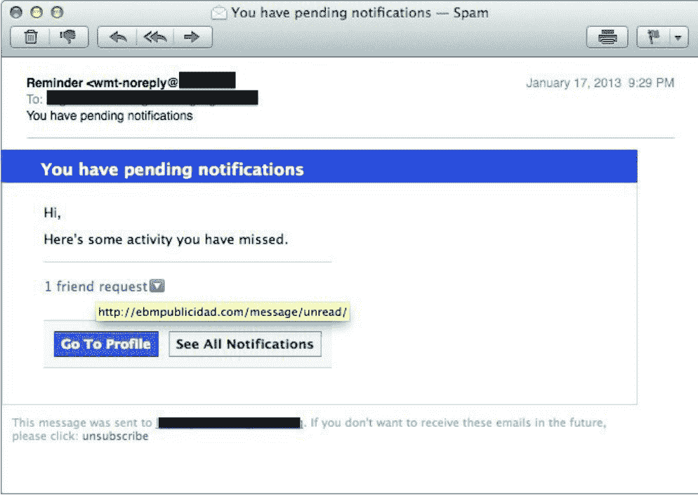
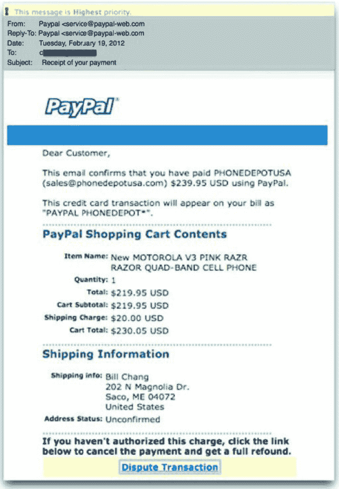

# 第二章：什么是社会工程

# 社会工程：真正被撬开的，往往是人心

卡尔·古斯塔夫有句话，大意是：启蒙不是把光明想得多美，而是知道黑暗藏在哪里。放到信息安全里，这句话同样成立——系统漏洞固然危险，但更常被利用的，是人性里的缝隙。社会工程就是这样一门学问：它通过影响和沟通，让人采取某个行动，而这个行动未必对他自己有利。

先讲一次我亲历的任务。那次不允许使用暴力，我要做的是混进库房，检验安保是否可靠、员工会不会按规范行事。方法不是硬闯，而是找借口、换身份，从三四个方向叠加影响。进出口、摄像头位置，以及其他可能被罪犯盯上、日后用来破门的地方，我都需要拍照记录。

我把车开到库房门口，按下对讲：“你好，我是废弃物处理公司的保罗，来核对垃圾压缩机的编号。”

门“嘀”一声开了。里面是通到天花板的金属结构，像个陷阱。保安探出头，让我稍等，说巡视员会来陪同。几分钟后，罗伊出来接待我。他先把我带到保安桌前，对方要证件。我看看他，又看看那金属结构，说钱包落在车里了，但有公司证件，能不能通融。保安复印了证件，发给我一枚徽章。罗伊随后带我走到压缩机旁。

看了几秒，我说：“你们运气不错，这台机器的编号不在抽检名单里。”

罗伊一愣：“什么意思？”

“机器不错，压缩机运行状态很好。”

回程路上，我忽然说：“糟了，手机忘在压缩机那边，我得折回去拿。”几分钟后，我在办公室见到罗伊，握手，归还访客证，然后离开。

这次收获不小。除了证明该公司需要更严格地执行安保政策，我还用手机轻松拍下了不少关键位置：监控摄像机、出入口、重要货物存放点。社会工程未必总靠骗局推进，很多时候只是日常交流方式的延伸——怎么说话、怎么倾听、怎么让对方接受你的说法。我在上一本书《社会工程：安全体系中的人性漏洞》里谈过社会工程师需要的身体、心理和个人素质，这里不重复，只把常用技能和方法串起来。

关键一步，是让目标把你当成“自己人”。“自己人”可以来自工作场所、信仰、衣着、音乐，任何能把人聚到一起的东西。你越像他们中的一员，收集信息和获得访问权限就越容易。

## 一、信息：社会工程的血液

信息对社会工程师，就像血液对身体。掌握得越多，可用的渗透媒介越多，也越能看清对方的强项和弱点。采集方式分线上和线下：线上可以用谷歌、Maltego；线下靠拍照、定位、诱导。互联网让采集更容易，也意味着数据更多，难点变成如何分类和储存。我常用 DAP，也就是“详细行动计划”：把对目标发现的信息、观察到的态度或行动、信息如何得来都记下来，再把想用的媒介与这些信息关联，形成针对每个目标的行动方案。

道德黑客约翰尼·朗开发过早期的谷歌黑客数据库，后来 Offensive Security 团队接管了这个项目，现在的网址是 www.exploit-db.com。Maltego 则能收集个人、网站或公司的数据，并用图解方式呈现，方便阅读使用，更多信息见 www.paterva.com。谷歌地图和必应地图也很好用，把地点放大到足够大，就能看街景。提前了解建筑布局、防护措施和摄像机位置，能省下不少现场考察时间。经验法则只有一句：没有哪条信息注定无用，哪怕很少一点，也可能影响全局。

## 二、托辞：把自己演成那个人

托辞就是扮演相应角色，做相应的事，有点像体验派表演：你变成你伪装的那个人。穿着、证件、肢体语言和知识，都能让角色更可信。前面那个案例里，我的托辞是“废弃物处理公司员工”。我得让着装匹配身份，借助“着装认知”进入角色，传递正确信息；证件要逼真；肢体语言要像个蓝领，而不是高管；还得懂垃圾压缩机、编号位置、要找什么、工作需要什么工具。

托辞不一定亲力亲为。在我教的“五日课程”里，学生每晚出去收集公共场所的信息，练习用技能与陌生人建立和谐与信任，再快速完成信息分享。有一堂课，我让一组学生回酒店房间，佯装呼叫中心做信息收集。他们下载了一个叫“繁荣办公室”的应用，一部手机播放办公室背景音，其他人用手机通话。电话另一端听到“呼叫中心”的声音，就信了。无论面对面、电话还是邮件，托辞都要覆盖着装、语言、措辞、声音和沟通方式，让对方相信你就是你声称的那个人。

## 三、诱导与密切关系

诱导的艺术，是不直接问，而是在平常对话里拿到信息。你要和目标聊他的生活、家庭和工作，建立融洽关系，让他喜欢你、愿意敞开心扉，给出你需要的细节。这是社会工程最重要的方面之一。书后会花大量篇幅谈非语言交流对诱导的影响；掌握非语言交流，能让你成为诱导高手。

我的朋友、作家罗宾·迪克尔在《那不是“我”的一切》里定义并论述了建立密切关系的技能。他能很快教会任何人用最佳方式获得认可、营造信任。信任会让对方愿意交谈，说出可能很有价值的信息；也可能让人采取行动，比如点击恶意链接，或者对社会工程师放行。密切关系，就是对方敞开心扉、愿意信任你并分享生活信息时，你感受到的亲近和信任。罗宾把它拆成 10 项：

- **人为时间限制**：提前让对方知道，不会占用他太久。
- **匹配的非语言行为**：非语言信号要和话语一致，否则令人生疑。
- **放慢语速**：慢一点说，显得从容，不暴露紧张。
- **打同情牌**：用“您能帮帮我吗”这类有力量的话。
- **自我抑制**：暂时放下自我，先认可对方，哪怕对方并不完全正确。
- **包容**：用温暖和真诚接纳对方，也接纳他的知识和技能。
- **多问“怎么样”“什么时候”“为什么”**：开放式问题能引出更多回应。
- **让步条件**：先释放一点信息，让对方安心，再分享他的信息。
- **互惠互利**：予人玫瑰，手有余香。
- **调控预期**：别贪心，情况不妙就调整。

这 10 项非常有效，高效的社会工程师必须掌握。

## 四、影响，还是操纵

影响，是让别人做我们想让他做的事，同时让他自愿觉得，这也是他自己想要的。罗伯特·西奥迪尼博士终身研究影响力，是这方面最伟大的思想家之一。他把影响力归纳为 8 项：

- **互惠互利**：人感到受了恩惠，更容易主动泄密。
- **义务**：社会规范或亏欠感，会推动人去做某些事。
- **让步**：先让人问小问题、答小问题，再引出更重要的问题。
- **不足**：信息越稀有、越难获得，就越显得有价值。
- **权威**：人天生倾向听从地位高的人。
- **坚持和承诺**：一旦进入某种状态，人会倾向于保持反应一致。
- **爱好**：人喜欢喜欢自己的人；感到被欢迎，就愿意回报。
- **社会认同**：别人都这样做，就认为这样做正确，这是从众心理。

掌握、理解并使用这 8 项原则，就能成为社会工程大师。操纵与影响力差别不大，细看甚至很像，但仍有必要分清：影响是让别人做我们想让他做的事；操纵是让人做他本不想做的事。想影响他人时，通常希望对方因为见到你而感觉更好；操纵他人时，你不再关注他的感受，得到想要的东西才是目标。

作为社会工程师，我尽量不施加操纵，因为那会让客户不适，破坏关系，让客户心扉紧闭。我更愿意影响客户，让他们以开放心态接受建议、培训和改变。有位朋友打了个比方：操纵就像让孩子接受肌肉注射，药能让他好起来，但针扎下去会痛。专业的社会工程师无论怎样获得信息，都会让对方“有些痛”，目的则是用客户能接受、疼痛最小的方式增强安全感。

## 五、框架与非语言交流

房子的骨架决定结构，人的“框架”则由情绪、心理、个人史和家庭史搭成。是什么促使她这样思考、行动和谈话？这些动机就是她的框架。过往经历会改变一个人看世界的角度和反应方式。社会工程师若了解对方的框架，就能在自己的框架与对方框架之间架桥。最简单的办法是找共同点，建立亲密关系；桥一旦搭好，双方就成了彼此队伍里的“一员”，收集信息也会容易许多。

非语言交流占据我们交流的大部分。我们说的话是肯定还是否定，往往由“怎么说”和“说话时看起来怎样”决定。社会工程师若能察觉、分析并解读微表情、宏表情、微妙的微表情、会话信号和肢体语言，就能理解目标的情感组成。如果在接触前预先了解对方的情绪状态，我们就能调整接触方法、开场白、提问方式和谈话类型。

我的第一本书对非语言交流只做了肤浅研究，仅介绍基本面部表情。在保罗·艾克曼博士帮助下，本书深入阐述面部、手部、肢体、腿、躯干和情绪的关系，也会介绍这些部位如何帮我们洞悉目标情绪。先要讨论的是，非语言交流如何在三种社会工程形式中发挥作用。

## 六、社会工程的三种基础形式

社会工程有三种攻击形式：网络钓鱼、电话诱导和身份模拟。了解三者差别很重要，因为非语言交流在这几种形式里都能起作用。

### 1. 网络钓鱼

网络钓鱼是社会工程中使用最广的形式：群发或定向发送含恶意文件、链接、指令的邮件。用户点击、打开或照做，就可能造成破坏、资料丢失和其他损失。写这一章时，我正好看到一则新闻：可口可乐公司一名经理收到邮件，发件人冒充总裁谈公司节能，声称公司正在推进此事。邮件和附件都是非法的。他打开文件后，程序运行，黑客得以远程访问他的电脑，最终殃及整个网络，数月都未被发现。

钓鱼邮件很普遍。有机构声称，每 300 封邮件里就有 1 封是钓鱼邮件，这还不包括针对性攻击。社会工程师锁定某人后，会发送包含其个人喜恶的个性化邮件；也可能用“捕鲸”，把定向钓鱼邮件发给大银行首席执行官这类更显眼的目标。无论哪种方式，邮件都会利用收件人的恐惧、好奇或畏惧，促使他做出不符合自身最佳利益的行为。

Facebook 用户多，自然常被冒充。一封典型的 Facebook 钓鱼邮件，会做得像真邮件：设计、颜色、标题都照搬。判断真假可以看几处：发件地址并非 Facebook，有时只是域名做了很小的改动，人们容易忽略；问候语只是“你好”，而正常邮件通常会带姓名或用户名；最大的线索是链接，鼠标滑过时显示的并非 Facebook，而是社会工程师的网站；有些邮件更“聪明”，链接、按钮甚至退订链接都会把人导向恶意网站。可对照图 2-1：

伪造 PayPal 邮件也很常见，如图 2-2：

这类邮件盯上的是钱包。人担心钱被偷，点链接后赶紧登录核实，正好中了圈套。虚假网站、登录系统和设置演示会套取凭证；攻击者拿到后登录账户，偷走钱。

在网络钓鱼中运用非语言交流，乍看很难，因为邮件是书面语。但框架能支撑人的精神与心理之“家”，社会工程师可以通过改变框架，让目标在自己的框架内思考、感受并反应。这个过程叫框架桥接：在两个人的框架间搭桥，让对方在桥中间相见，或者借桥找到共同兴趣。框架的主要规则之一是，我们所有的话都会激活框架。大脑靠情境思考，会在脑海中形成所说话的场景；场景制造情绪反应，反应又可能让目标做出不利行为。

蓄意攻击的社会工程师会触发目标的一系列情绪，最常见的是恐惧——损失、盗窃——或悲伤，后者常与同情、“帮帮我”的恳求连在一起。像“请于 24 小时内完成，否则您的账户会被暂停”这样的话，会诱发恐惧。想到账户可能未经许可被他人使用，人就会因恐惧而行动。言语先在心里画出画面，画面再激发情绪。

表情符号在文本、邮件和即时消息中用得越来越多。奥黛丽·尼尔森博士是《The Gender Communication Handbook: Conquering Conversational Collisions Between Men and Women》的作者，她把表情符号定义为“非语言的、书面形式的情绪指示符”。同一句“哇！看来你没有想清楚”，不加表情像批评，加哭脸更负面，加笑脸就变成调侃。针对目标的情绪，会影响他对消息的反应。表情符号通常不出现在诱发恐惧的邮件里，却会出现在冒充朋友、Facebook 好友或潜在恋爱对象的钓鱼邮件中，用来显得开心、友好、开朗。

### 2. 比恶意软件更危险的电话诱导

电话诱导是社会工程第二种常用工具。过去 18 到 24 个月，黑客活动分子攻击大公司时，多采用电话诱导。比如黑客组织 UG-NAZI 攻击一家基于 Web 的发票公司：他们先大量采集该公司数据库管理程序的信息，再致电技术支持公司申请重置密码。因为掌握全部信息，他们能回答密保问题并重置密码。结果，UG-NAZI 下载了数千兆客户信用卡号，之后为了好玩删除服务器。这只是近期新闻中的一例。

电话攻击为何越来越多？首先，来电显示欺诈既便宜又容易。欺诈号码可以和真正拨出的号码不一致，社会工程师能伪造任何想伪装的号码，让接电话的人以为电话来自技术支持公司、供应商，甚至美国总统。来电显示欺诈能迅速营造信任，因为号码似乎“证明”了呼叫者身份真实。

### 3. 身份模拟

第三种基础形式是身份模拟：借身份包装取得接触与信任。它与网络钓鱼、电话诱导一样，非语言交流都会在其中发挥作用。

说到底，社会工程不是魔法。它研究的是人如何被信息、关系、情绪和身份推动。看见这些“黑暗处”，才能补上制度、培训和警觉的缺口——这大概也是安全防御真正的起点。

# 一通电话，为什么能让人亲手交出“钥匙”？

电话是远距离操控的捷径。操控者不必站到目标面前，也不用和对方身处同一个国家，仅凭声音就能套取信息、推动行动。练熟几套说辞之后，他就能编出可信的故事，并让被盯上的人逐步放下戒心。

素材里记录了一次“三重攻击”，很能说明问题。

第一重，是钓鱼邮件。攻击者给目标公司的员工发信，声称可以免费领取 iPhone 5——那是当时苹果的最新款。代价是员工要拿自己的域登录凭证去填一张表。结果，几百名职员把账号口令交了出去。

第二重，是电话跟进。攻击者摇身一变，成了外部技术支持公司的“保罗”，通知这些员工：你们已经中了钓鱼邮件的招，电脑被装了跟踪器，现在需要运行一个可执行文件来清除它。这个文件当然不是清理工具，而是能让攻击者远程操控电脑的恶意软件。电话打出去的当天，98%的人连一句追问都没有，就按要求执行了。攻击者只是自报家门，说自己是技术支持方，需要把“之前的工作”做完。

这套说辞为什么有效？素材把它和 20 世纪 60 年代心理学家斯坦利·米尔格拉姆的服从实验放在一起看。实验中，一部分志愿者被要求对答错题的另一些志愿者施以电击；随着对方痛苦增加，旁观者的不适也在上升。可“研究者”一句“实验仍需继续，请大家配合”，就足以让人继续。第二重攻击借的正是这种权威感：攻击者反复强调“系统必须清理”“不这么做，网络会出更大的问题”，语气自信、姿态权威，听者便容易服从。

第三重更细。电脑上已经装好恶意软件后，攻击者和团队还想再验证一步：冒充已经运行过文件的公司员工，给技术支持公司打电话，要求恢复被删除的 VPN 证书。拿到这个证书，就能进入网络中最关键的部分。

电话那头是技术公司的西尔维娅：“您好，请问有什么可以帮您？”攻击者伪造了公司员工的来电号码，说自己是詹姆斯，刚下载了不该下载的东西，运行杀毒软件后 VPN 证书也被删了，请再发一份。对方让他报全名，他说“詹姆斯·史密斯，叫我吉姆”。紧接着，西尔维娅来了一句：“你难道没听出我的声音吗？我就是西尔维娅啊。”攻击者并不知道这两人是什么关系，一句话就可能穿帮。他赶紧圆场：对不起，我太紧张了；我点了钓鱼邮件，电脑下载了讨厌的软件，清理时越弄越糟；现在头昏脑涨，像感冒了，嗓子也不舒服；偏偏 VPN 证书又丢了，请帮帮我。几句之后，西尔维娅恢复了证书。几秒钟，通关的“钥匙”就到手了。为什么顺利？来电号码、姓名、缘由，三样都对上了，听上去毫无破绽。

## 电话里，也有“看得见”的表情

微笑会让声音带上愉快的色彩。2001 年，Scharlemann、Eckel、Kacelnik 和 Wilson 以“微笑的价值：有人脸的博弈论”为题的研究指出：微笑能提高陌生人之间的信任度；照片里即使是同一个人，受试者也更愿意相信面带笑容的那一张。更关键的是，即使对方看不见笑，也能从声音里感觉到笑意。

除了笑，身体姿势、手势、声调、音量、语速和音高，都会左右电话另一端对说话者及其内容的感受。这些都是能放大影响力的无声信号。

第二重攻击里，攻击者把自己包装成技术支持代表，声调要专业，不能发慌；目标看不到脸，却能“听”到笑容，而笑容有助于建立信任；姿态也要显出权威。到了第三重，他假扮闯祸员工给技术公司打电话，脸上要摆出恐惧，音量、音高和语速都要压低放慢，让非语言行为传递出“对不起，我搞砸了，请帮帮我”。他通过调整表情，让情绪与身份匹配，说辞才更可信。

连坐姿和着装也会影响电话那头的听感。素材提到，研究者亚当·加林斯基的“着装认知”实验揭示：我们对着装的感知，会影响自己如何处理被要求完成的任务。换句话说，同一套衣服会因人的表现不同而带上不同含义；工作中的穿着也会反过来影响人的行事方式。

## 身份扮演：先让人安心，再让人配合

身份模拟之所以能奏效，是因为它直接嫁接在信任上。当一个人戴着徽章、穿着合适制服、行为又与自称身份一致时，对方大脑会迅速自动回答三个问题：这个人是谁？有什么证据支撑他的说法？我安全吗？这三个答案一落地，心就安了。剩下的“你想做什么”“你为什么在这里”，交给剧本去完成。素材里那个库房故事就是这样：不必讲太多细节，制服已经说明了一切。

面对面攻击还会绕开一些技术障碍。防火墙和邮件系统可能拦截 PDF、EXE 附件，但若把文件装进 U 盘，插进电脑就能安装，被拦下的概率小得多。攻击者多次把标着“机密”“员工福利”“保密相册”的 U 盘、DVD 故意落在工作场所，利用好奇心引人上钩。臭名昭著的蠕虫病毒攻击，以及对荷兰兰斯曼化工的未遂攻击，都说明 U 盘能扮演重要角色——对恶意软件的好奇，很危险。

身份模拟中的非语言交流尤其关键。面对面互动更私人，无声信号对目标的影响最大。怕被识破而紧张恐惧，很正常；但如果剧本要求你扮演权威人士，紧张和恐惧就会毁掉“我就是我说的那个人”的非语言关联。理解非语言信号，才能控制所扮演的角色。例如，双手插兜是示弱姿态，需要表现顺从时可以用，需要树立权威时就该避免。

有时，身份模拟几乎不靠言语，尾随就是典型：没有权限的人跟着员工混进某处。常见做法有三类。其一，守在办公楼后方的员工吸烟区，那里往往安防薄弱，攻击者混成“烟友”，再跟着人进去。其二，扛着大箱子或大物件走向大门，总有善良员工看到你步履维艰，帮你开门；如果是一位娇小有魅力的女性拎着重箱，争着开门的人会更多。其三，制作看起来真实、其实刷不开门的假徽章，几次刷卡失败后，乐于助人的员工往往会放行。每个人心里都有一部雷达，觉得“哪里不对”时就会报警；这种不妥感，常建立在非语言行为给人的感觉上。所以，操控者能否用姿态表达出正确的“感觉”，格外重要。

## 同一套技能，意图不同，走向就不同

社会工程并不总被用于坏事。素材把社会工程行为定义为：能够影响人们采取行动的任何行为，而这些行动可能符合、也可能不符合他们的最佳利益。技能本身是中性的，差别在意图。

积极的一面很好懂。一个小女孩想买芭比娃娃，先问妈妈，妈妈说“问你爸爸”。她跑到沙发边，依偎着爸爸说：“妈妈说如果你同意，就给我买新芭比。爸爸，求求你了。”爸爸看着女儿的大眼睛，答应了。小女孩并不懂心理学、非语言交流和沟通建模，却把这些都用上了。第一次向妈妈开口，往往选在做了一件值得表扬的事之后，或与妈妈亲近的时刻，那时信任与爱的荷尔蒙正在上升；真正起作用的是和爸爸的互动：身体靠近带来情感纽带，“妈妈已经同意”构成社会认同，几股力量合在一起，请求便难以拒绝。

更严肃的场景里，这类技能可用于修复和治疗：教人重新构建、重新思考自己的信念体系。信念一变，人可能走上不同的路。影响力可以帮助人们停止消极思考、摆脱酒精和毒品滥用、终止虐待倾向；也能帮人改造思维方式，营造成长氛围，改掉积习。素材里还有一个育儿例子：孩子小的时候拒绝吃早餐，父亲没有把它看成对抗或“坏孩子”，而理解为孩子想控制生活中的一个环节、想拥有选择权。于是有一天，他不先摆好早餐，而是问：“我知道你上学前吃早点很烦恼。今天你做主：麦片还是鸡蛋？”孩子选了，觉得自己被授权，父亲也开心，因为孩子吃了饭。这是积极的社会工程，基本原则是双赢：没有失败者，改变让双方都更好。

消极的一面，意图就变了：操控者不关心帮你改善生活，只关心自己能得到什么。有人让三兄弟去抢银行，自己先假扮联邦便衣探员兼顾客进入银行；抢劫开始时他出面“制止”，把同伙“逮捕”，还拿走所有钱当作证据。银行员工以为安全恢复了，可事后根本没有警察来跟进。1990 年 3 月 18 日，波士顿加德纳博物馆侧门被敲响，保安从猫眼里看到两名穿制服的“警察”，便开了门。来人没有武器，却让保安屈服并被捆绑。不到 90 分钟，13 件艺术品被偷走，总值 3 亿至 5 亿美元。2003 年安特卫普钻石劫案中，里昂那多·诺塔巴托罗在住着许多钻石商人的办公楼里租了地方，一住三年，只为建立信任和密切关系；随后他和同伙假扮钻石商人闯入多重保护的金库，洗劫了价值超过 1 亿美元的宝石。他们最终被捕，原因竟是五人中有一人忘记烧掉装有作案证据的袋子。还有对 HBGary Federal 公司、太平洋生物网站和可口可乐公司的黑客攻击，都从一封钓鱼邮件开始；“夜龙”和“蠕虫”等攻击则用到电话和专用硬件。无论针对公司的复杂行动，还是路边冒充孙辈骗老人钱财，都包含策划、搜集信息和大量非语言交流。

更黑暗的一层，是精神变态者对社会工程技能的利用。素材提到，作者采访过前 FBI 特工兼心理学家玛丽·埃伦·奥图尔，谈到一些后果灾难性的案例。泰德·邦迪在 20 世纪 70 年代四年多时间里制造了 30 多起凶杀案，他假扮警察，借权威实施攻击；最有效的方式之一是扮成拄拐杖或打石膏的伤者，用恳求换取帮助和同情。受害者出于同情伸出援手，等来的却常常是死亡。积极、消极、丑陋，表面看技能组合几乎一样，主要差异仍在意图。

说到底，社会工程就是：任何能推动一个人做出符合或违背自身利益之举的影响行为。无论用邮件、电话还是面对面沟通，非语言交流既能提升交流能力，也能保障安全。它本就是交流的一部分，在日常生活中无处不在，既有趣也令人警觉。素材所出自的书并不打算穷尽社会工程的全部内容，而是希望帮助安全专家、教师、家长、总裁、临床医学家等读者，提升对最常用非语言行为的了解。后面每一章会聚焦一个身体部位及其在非语言交流中的表现；下一章要研究的，是身体中最“健谈”的部位——手。手会有意无意地“说”些什么？怎样读懂手部语言？又怎样用手影响他人的情绪？这些，留待下一章揭晓。