# 第三章：了解手的语言

> “舌作语说与耳，手作势说与眼。”
> —— 詹姆斯一世

在人与人之间的互动里，手指的运用之广之细，是人类才独有的特权。手很神奇，几乎能完成一切。想想小时候一看见吓人的东西，本能地会紧抓父母的手寻求庇护。

更早之前，我们就用手去丈量世界。小一点学会自己吃饭穿衣，再大一点就能画画、雕刻、烹饪、用工具。外科医生要练几百小时让双手做到救命时分毫不差，音乐家要练指法与击键，道理都一样。1980 年，约翰·内皮尔在《手》里提出一个有趣的说法：我们靠眼睛和双手去探查周遭，其中只有手能在转角处帮我们看清、在黑暗里摸到东西。他还认为，人类是唯一能用手做有意义交流的动物。哪怕你口才再好，没有手的配合，表达也会打折。

本章要说的就是，交流中我们如何借助手来传递语言与情绪。内皮尔说“手是头脑的镜子”，因为脑子里想的不仅会写在脸上，也会写在手上。

情绪与手势之间联系很直接。1973 年，保罗·艾克曼博士与华莱士·弗里森博士的实验就验证了这一点。他们在论文里提出“手部动作”概念，拆解了不同情绪在手上的呈现方式。基于他们的研究以及后来的跟进实验，下面要讲的就是如何去理解、观察并解读手发出的信号。

### 3.1 用手在对话

想到手部沟通，第一反应往往是手语，但这里谈的不是手语。手语固然迷人，是与大脑紧密关联的交流系统，我更想聚焦的是人们如何通过手释放情绪本身。

你推开客厅门，地板上全是饼干屑，你会问儿子饭前是不是又偷吃了，证据就摆在地上和他的脸上。儿子在纠结要不要撒谎时，他的双手会怎样？

再想想高中时被点名在全班朗读作文的场景。老师喊到你，你走上前，双手颤抖地捧着稿纸。同学要么被你的窘态逗笑，要么等着课后取笑。那一刻你的手在干嘛？

再回想一次求职面试。你给自己打气，表现自信，觉得自己够格也需要这份工作。问题一个一个答得顺畅。面试官忽然问到一个你完全没接触过的领域经验，你得抉择是编还是承认不懂。那时你的手在做什么？

最后想想看过的警察审讯录像。嫌疑人一脸得意，甚至敲着桌子表不满。警察诱导式发问：“6 月 1 日在 Lazy Tree 酒吧，你见过里科和他的女友吗？”

嫌疑人大喊：“没有！我说了那天晚上根本没见到他。”说完重重一拳砸桌。

刑警耸肩，用一根手指点他：“哦，所以那天你确实在酒吧。那你之前怎么说晚上根本没去？”

嫌犯脸色一变“呃，哦”时，他的双手会做什么呢？

四个画面里，象征动作、手势、演示性动作或操纵性动作都在上演。最后一个审讯里，你大概能想象他因紧张而搓手、玩戒指、拽衣角。不同场景的区别是什么？又暴露了怎样的情绪？

艾克曼与弗里森早期的研究里，就把情绪通过手的体现分成象征动作、手势、演示性动作和操纵性动作四个维度。任何一类都能用来判断情绪状态与信息真伪。

在日常沟通里学会辨认、使用这种非语言表达，对社会工程师尤其关键。艾克曼的研究还参考了大卫·埃弗龙 1941 年的工作《手势与环境》。埃弗龙对比了两组来自不同国家的纽约移民，发现世代传承的文化对象征动作和肢体语言的使用影响极大。

在此基础上，艾克曼与华莱士建起一套理解框架，分成三块：源头、编码与用法。

#### 3.1.1 源头

非语言行为的源头是指它如何成为交流风格的一部分。艾克曼与华莱士把源头分成三类：神经系统类、生存本能类，以及随文化、阶层、家庭或个人而变化的类。

知道源头的意思是，我们要用他人的经历与背景，而不是自己的感觉，去判断手部象征动作的含义。

#### 3.1.2 编码

编码讲的是行为与含义的关系。动作看起来怎样，并不决定它用了哪种编码。

艾克曼解释，一个任意编码的象征动作，其视觉形象与本意并不挂钩。最典型的就是竖中指，生理上既不代表鸟，也和它想表达的侮辱无关。

相对的，形象编码的动作，外形与意义相符。比如用拇指与食指比出枪的形状，一看就懂。

固有编码则更进一步，动作形式与意义一致，同时动作本身会被真实执行出来。比如在爱开玩笑的家庭里，调侃时会真的用拳头轻敲对方一下。动作不只是象征的拳头，还包含了真实的轻击。

#### 3.1.3 用法

用法就是在什么情境下使用手部非语言行为。外部条件、配合的语言行为、传递的信息内容，以及交流是互动还是单向，都在影响用法。

把源头、编码、用法结合起来，就能帮我们看清人们在努力表达什么、此刻是什么情绪。下面分三块来谈：象征动作、演示性动作、操纵性动作。

##### 1. 象征动作

艾克曼把象征动作定义为五件事：

- 能直接翻译成一两个词的简短短句；
- 在某个群体、阶层或亚文化中有准确共识的含义；
- 通常是有意用来向别人传递特定信息；
- 接收者明白这信息是故意发给他的；
- 发出者对这次交流负责任。

就像说话会口误，象征动作也会“用错”。但大多数人对自己用的手势是清楚的。

了解源头能帮助社会工程师读出说出来或没说出来的情绪。

这种暗示往往很强。图 3-1 的手势多数人会读成“我爱你”，在某些地区却是拉丁国王帮的标志，在那里要慎用。
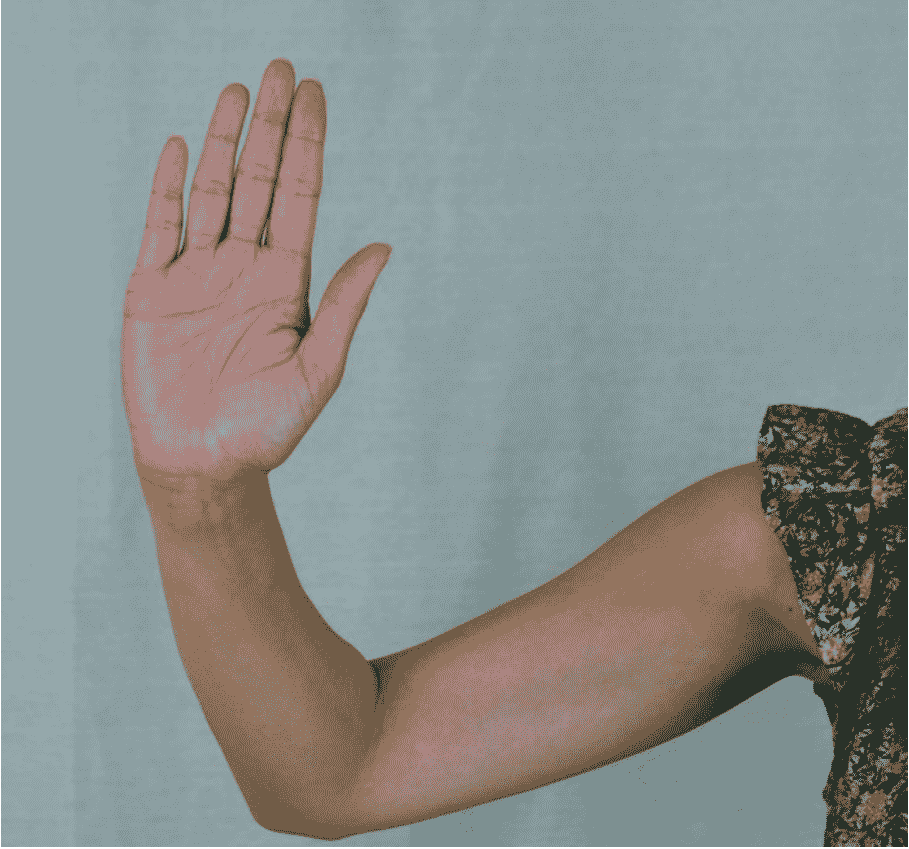

图 3-2 “过来”还是“走开”？
图 3-3 的手部象征动作在美国意为“过来”，在日本却是粗鲁手势，到新加坡则代表死亡。
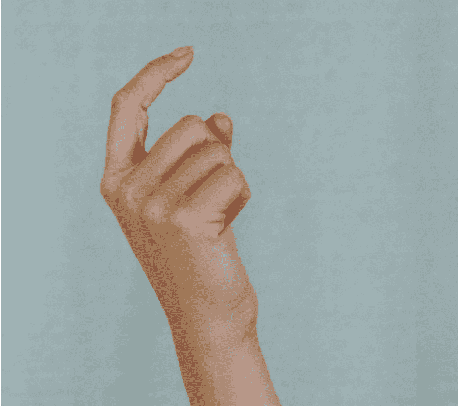

图 3-3 是“过来”，还是诱惑或死亡？
图 3-4 的手势常被理解为“好运”，但对意大利人和土耳其人来说却像女性生殖器，亚洲人也视其为猥亵。
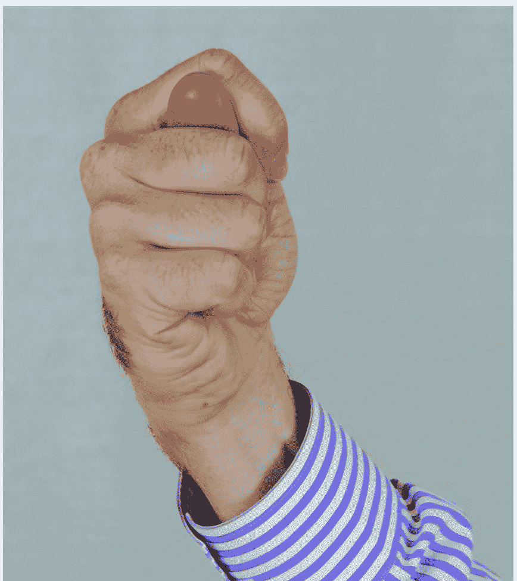

图 3-4 是“好运”还是猥亵的手势？
这些只是冰山一角。每个象征动作都有直接的语言对应，且含义精确。它们都是有意的，接收者知道是冲着自己来的，发信者也心知肚明。这就是象征动作的定义。

很多身体部位都能做象征动作，但主要集中在手，其次是头、脸和躯干。

##### 2. 演示性动作

在《手部动作》里，艾克曼说：“演示性动作是指与说话、措辞、内容、声调起伏、响度等同步发生的行为。”简单说，手势是强化说话内容的姿态。和象征动作类似，它是有意的，但更表面。

二者区别在三点：

- 演示性动作通常没有精确的语言意义；
- 它一般不会脱离对话单独出现；
- 只有说话者会做，听者通常不会。

情绪、问题或态度的变化会让演示性动作频率改变。尴尬时，使用会明显增多。

演示性动作的类型或频率的突变，往往暗示欺骗或基准态的重大偏移，这提醒社会工程师要多加注意。

演示性动作可分为八种：

- 发令动作，用来强调某个词或短语；
- 表意动作，用来“速写”思路；
- 指示动作，用来指向物、地点或事件；
- 节律运动，用来表现事件节奏；
- 空间运动，用来描述空间关系；
- 活动电影，用来描述身体或非人体的运动；
- 象形动作，用来描绘涉及的物体；
- 象征动作，用来阐明某事，甚至能替代一句话。

观察演示性动作既有趣，又能帮助判定基准态、理解想法、捕捉情感触发点。

艾克曼在《说谎：揭穿商业、政治与婚姻中的骗局》里提到一个规律：“我们说话越多，演示性动作越多。愤怒、恐惧、焦虑或兴奋时，使用会更频繁。”

他也解释了为什么人会停止使用演示性动作。情感投入、尴尬、假装关心，以及说谎技巧不佳的人会把注意力放在编造内容上，而不是如何更自然地描述事件。

这些迹象说明，熟练的社会工程师会盯着目标的基准态，以及任何偏离。

##### 3. 操纵性动作

操纵性动作是指所有对身体部位或衣着进行整理的行为。紧张、不适、习惯或想放松的需求都会触发它。注意，发现有人做操纵性动作时，不要立刻等同于欺骗。

相反，它是观察基准态变化的好线索。可以问自己：话题还没进入情绪层时，对方是怎样的？观察基准态的波动，能帮你捕捉情绪变化的信号，强调不是因为欺骗才变化。

玩弄头发、转戒指、整理袖口扣子都属于操纵性动作。它们能显示对方是在自我安抚还是高度紧张。图 3-5 到图 3-7 就是常见的例子。
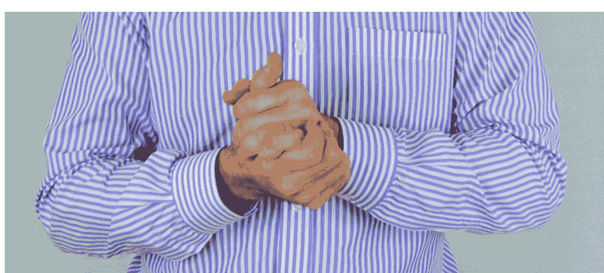

图 3-5 搓手是一个常见的操纵性动作
当人紧张或没把握时常搓手。比如本的基准态是尖塔形手势，代表自信。当我问他前晚在哪时，他开始做出图 3-5 的动作。这个偏离告诉我们问题或相关思考让他不自在。

图 3-7 表示紧张的另一姿势
《说谎》里艾克曼说：“操纵性动作存在于意识的边缘。”人们知道自己在做，但常被潜意识触发。对话中留意基准态及其变化，对理解情绪内容帮助巨大。

关注这些细节，能让你在交流中占据优势，也能判断自己的提问是否让人不适。

#### 3.1.4 高度自信的手部表现

手既是工具也是沟通者，还会泄露自信程度。读懂它对社会工程师很重要。人们喜欢被肯定，自尊需求很强。善用这一点，能让自信者迅速建立亲近感，并不惜代价维持这种感觉，甚至透露有价值的信息。

下面几种手部动作常暗示高度自信：

- 1. 尖塔形手势
当手指形成塔状，就是这个动作。可由一根手指，比如食指，也可由双手完成，如图 3-8、3-9 所示。

图 3-8 单个手指构成的尖塔手势
图 3-9 中，本的尖塔手势配合面部表情，显出满满的自信。别人做这个动作时，通常也是这种自我感受。
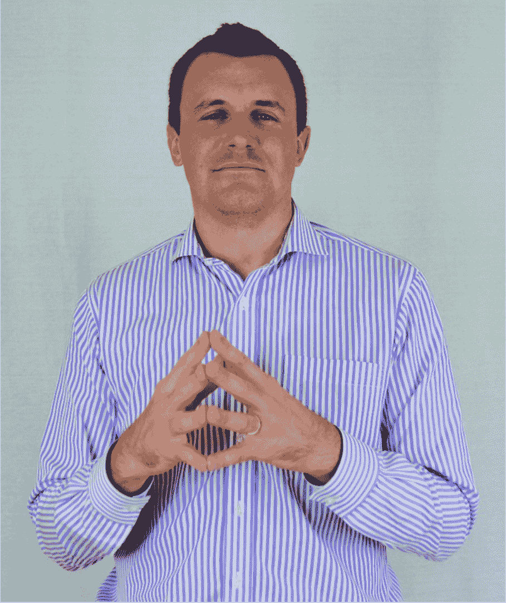

图 3-9 双手构成的尖塔形手势
图 3-10 的人是乔丹·哈贝格，他在 The Art of Charm 平台上教人如何更自信。图中的站姿在说：“我很有力量，你该听我的。”

图 3-10 他想给别人留下什么印象呢？
乔丹不仅用尖塔手势展示自信，前倾的身体显示掌控欲，微侧的头部显得可信。关键是微微向前，而不是过度强势。适度的前倾代表兴趣，有助收集信息。尖塔、微倾、前倾头的组合，把自信与关注都强化了。

有时尖塔手势还带有领地意味：“我对我说的话很有把握，你怎么挑战都行。”图 3-11 中著名天气预报员伯尼·雷诺在火药味采访里的手部动作就是例证。

领地感强烈时，人们会采取图 3-13 那样的姿态。
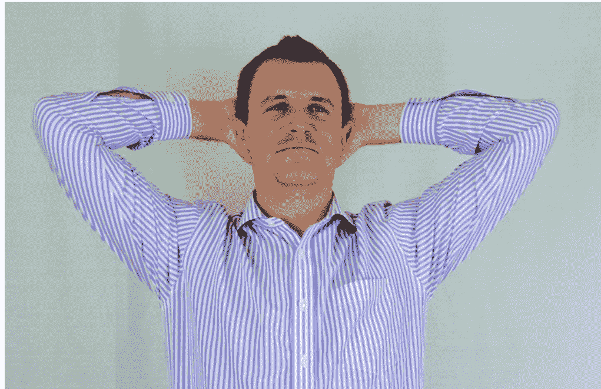

图 3-13 高度自信的领地意识表现
想象本解决了一个紧迫问题，回答时很可能带尖塔手势。回答完后，可能出现图 3-13 的状态。本不仅自信满满，还会让周围人感受到。关注自我的人，眼神里常带着自信与期待回应。

- 2. 拇指动作
当某人觉得自己很重要、很有把握或想让周围人安心时，常会用拇指。拇指常暗示高度自信或刻意表现自信。商人、领导的照片里常见，如图 3-14。

图 3-14 当某人说什么很重要的时候，使用拇指能够暗示高度自信

- 3. 腹部动作
解剖学上“腹部”指朝向下腹的身体部位。开放式地露出这些区域，会让人显得可信、好相处。

双手张开能发出邀请。回顾历届美国领导人照片，前总统克林顿常用双手张开的姿态。如图 3-15，张开双手等于邀请对方加入并对提议满意。配合侧头和微笑，杀伤力很大。
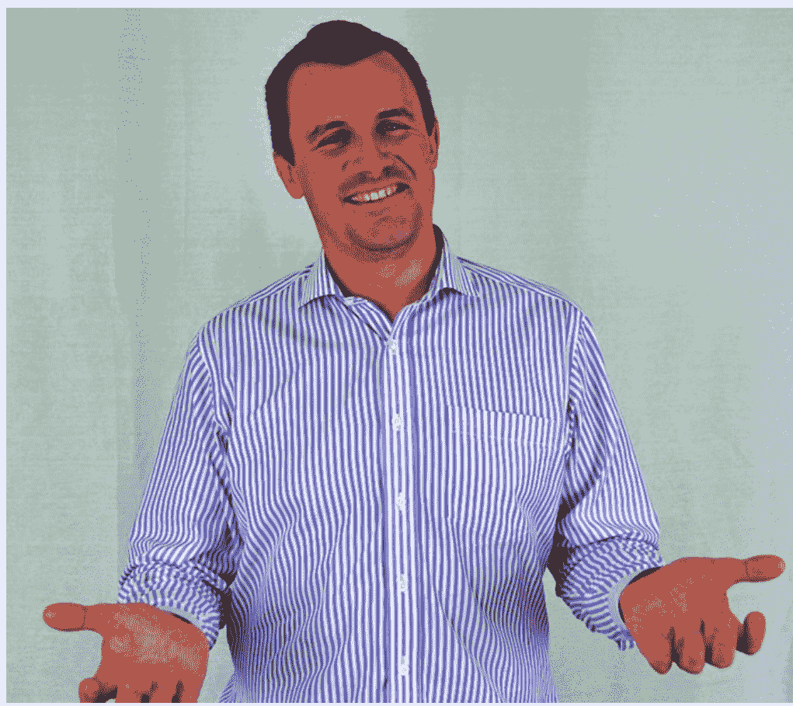

图 3-15 “请跟我来。”
如图 3-16，与开放动作相对的是手指并拢。这类动作与命令和要求相关，少了开放感。
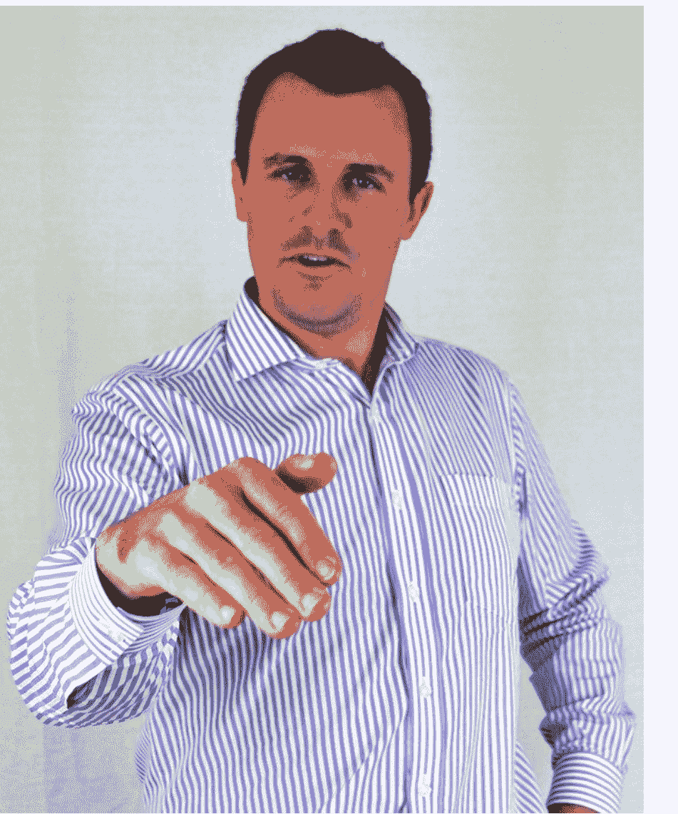

图 3-16 “你得按我说的去做。”
这类动作常见于命令、指责场景，往往伴随更严厉的肢体语言。

挽起袖子、女生双手叉腰也是开放性动作，等同于“我敞开心扉，请你也坦诚”。想快速建立信任，可尝试这种非语言信号。

- 4. 生殖器指向
最后一种自信手势是“生殖器指向”。大意是“我年富力强，看证据”。做这个动作的人会把拇指勾在腰带扣或裤兜里，手指指向生殖器。如图 3-17。
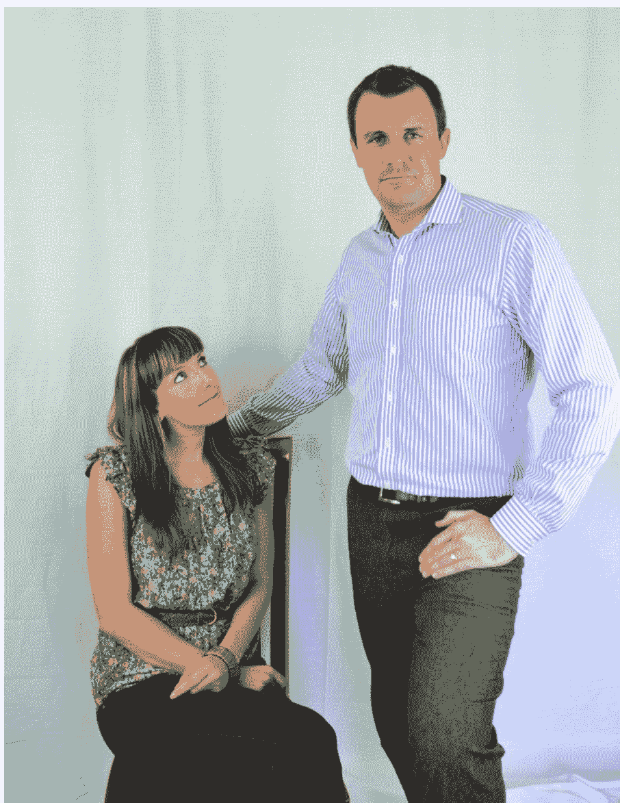

图 3-17 “看我多强壮！”
这是自信与支配的表达。你可能在老西部片和《快乐时光》重播里见过。现在知道了，请多留意。

#### 3.1.5 低自信和按压手部的动作

手也能透露情绪低落或压力。下面几个例子能帮你更清晰地判断。

- 1. 揉搓双手
紧张或不适时人会握紧双手。如图 3-5 所示，我们称之为“白色指关节效应”。有时会搓手、揉手，也会摆弄戒指等。不断叩指、用手抓揉、对衣物身体做操纵性动作，都是消极状态的表现。

- 2. 拇指动作
竖拇指表示顺利，拇指向下就是坏消息。高举拇指是自信，放低拇指或藏起拇指则是缺乏自信或自我安慰。注意图 3-19，虽然手部呈现尖塔形，代表高度自信，但藏起来的拇指却暗示相反的情绪。

标题：手比嘴更早“说话”：读懂手部信号，才能更稳地靠近别人

别低估一双手。情绪常常还没说出口，指尖、掌心、手腕的位置已经先露了底。手放得越高，通常越说明这个人心里有底；反过来，双手收拢、藏起来，往往就成了自信不足的旁证。

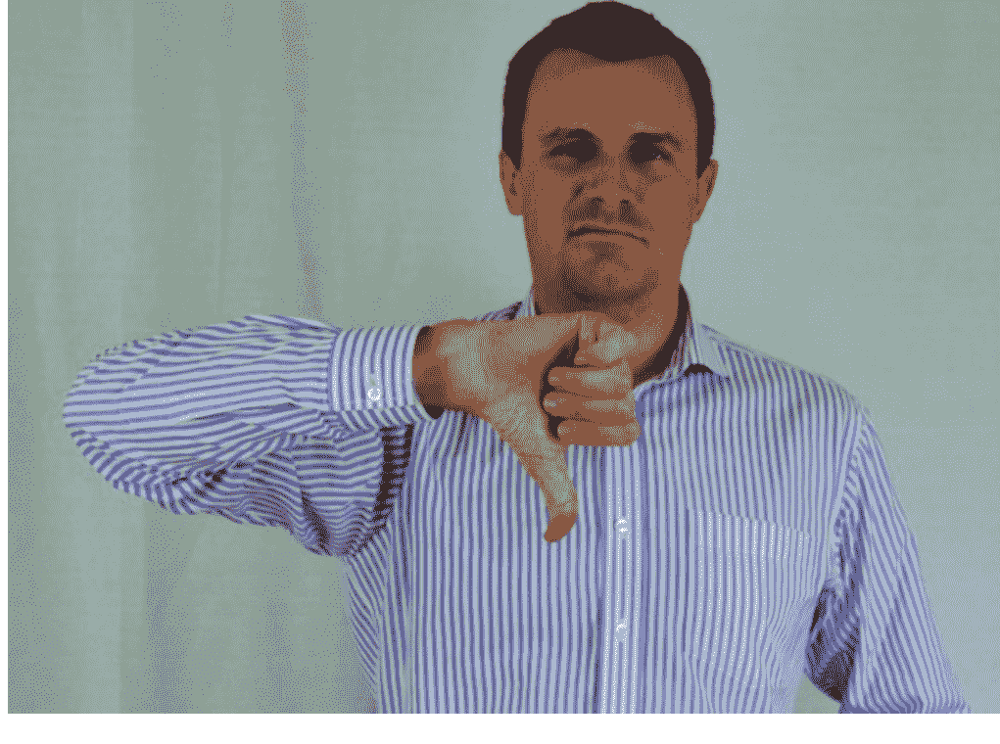（图 3-18：不满情绪的外露）
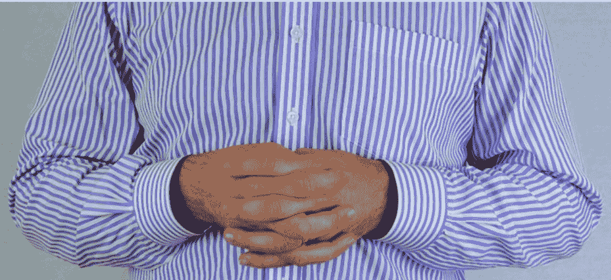（图 3-19：拇指藏起来，常常是底气不够的暗示）

当一个人底气不足时，双手会不自觉进入“闭合”状态。图 3-20 里的情形就很常见：站着时把手背到身后，或者塞进口袋。看到这种动作，别急着下结论，先结合其他信号一起看，再判断对方是不是因为不自信才这样做。就像本，站姿看着挺有把握，可两只手一藏，说明他并没有表面上那么笃定。

还有一个细节很关键：看一个人怎么指向别人。快速扫过去的一眼，可能是不耐烦，也可能是在强调，甚至已经带着火气。反过来，掌心向上、手指自然伸开，更容易拉近距离，也会让对方对你多几分好感。

3.2 读懂双手：靠练，不靠死记

信息太多怎么办？答案很朴素：练。用一位海豹突击队第六小队成员的话说，“完美的练习造就完美”。但练习也怕跑偏，错误的重复只会把坏习惯喂大。观察得越多，越要把注意力放在线索含义的推敲上；练得越扎实，越细小的信号在你眼里就越清楚。

等你能稳定关注这些动作，就可以试着用出来。比如走进一间办公室，看到图 3-21 的场景，先花一分钟研究一下。

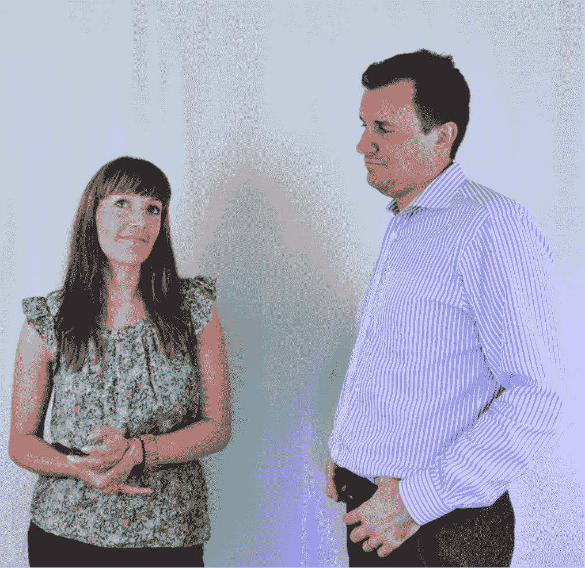（图 3-21：这个画面，你看到了什么？）

本是不是在有意展示支配感？萨琳娜的手又透露出什么？她对本靠近的方式感到不适，这并不难看出来。作为社会工程师，如果你想尽快获得萨琳娜的信任、和她建立密切关系，会怎么做？

直接孤立本并不合适；更好的做法是让萨琳娜知道你察觉到了她的不舒服，同时又不把她推到更尴尬的位置。你可以让本停下带有生殖器指向意味的手势，再把对话引向积极方向。用自信但不带领地意识的手部动作，比如开放性的手势、拇指指向类动作，会更稳妥。

如果你凑过去后对着萨琳娜做指向动作，或者摆出领地姿态，基本就等于和本拉开一场领地争夺战，只会让气氛更紧张。相反，自信而平和的动作能缓和局面，帮你赢得双方信任，进而建立密切关系。接近他人的方式，往小了说是礼貌，往大了说，直接关系到业务的成败。

3.3 收个尾：别急着逐帧分析

这部分内容确实多，上手也不容易，更不可能一夜之间掌握。我的建议是：别一上班就盯着手、手臂、拇指乃至生殖器指向的动作逐帧分析，先去留意那些“非专业”的场景。到商场远处看看两个交谈的人，去酒吧观察男子怎样追求女孩、又怎样被拒绝，你会被自己看到的东西惊到。新闻、采访、脱口秀里，也有大量类似行为可看。

但目标不是抓住每个小动作、给每个动作配一个准确解释，而是寻找对方基准状态的变化，从而读出互动中的情绪走向。对方自信满满，就调整接近方式去适应；对方温良羞怯，就把自己的姿态放得更温和安静。学会调整接近方式和非语言手部动作，去适应你想加入的一方，这会提升社会工程师的能力，也让你成为更有魅力的沟通者。

当然，手部只是开场。下一章，我们把目光移到身体的其他部位：躯干、腿和脚。