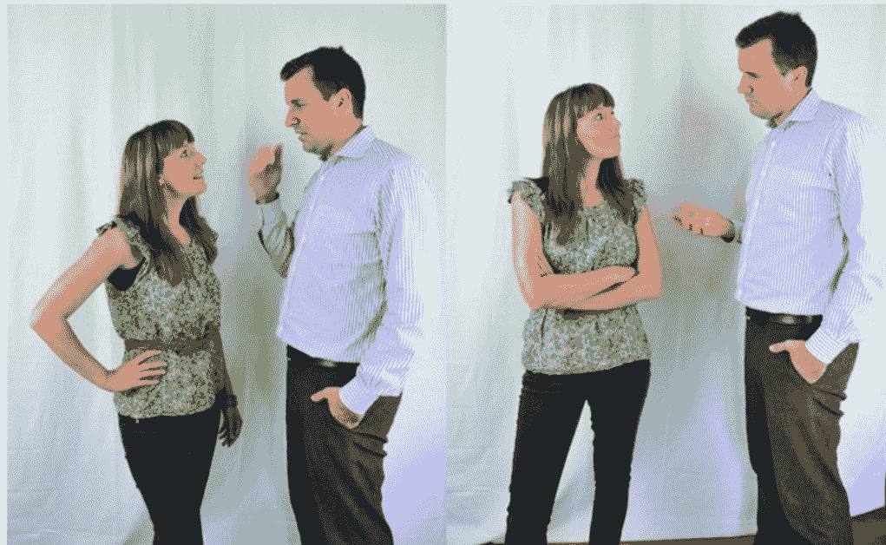
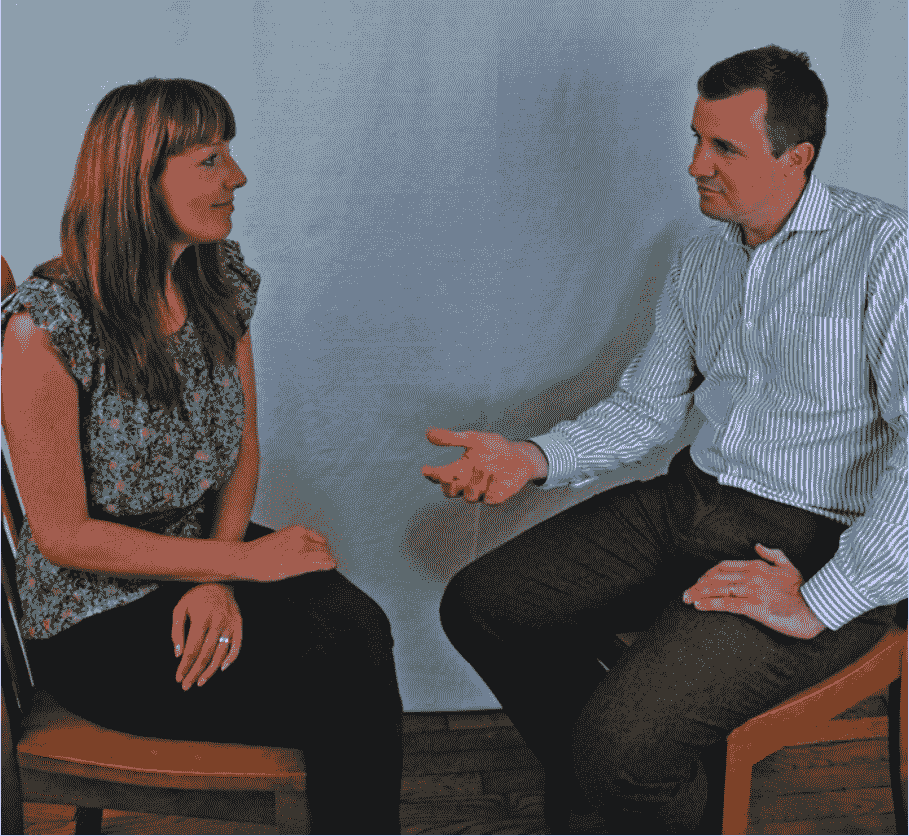
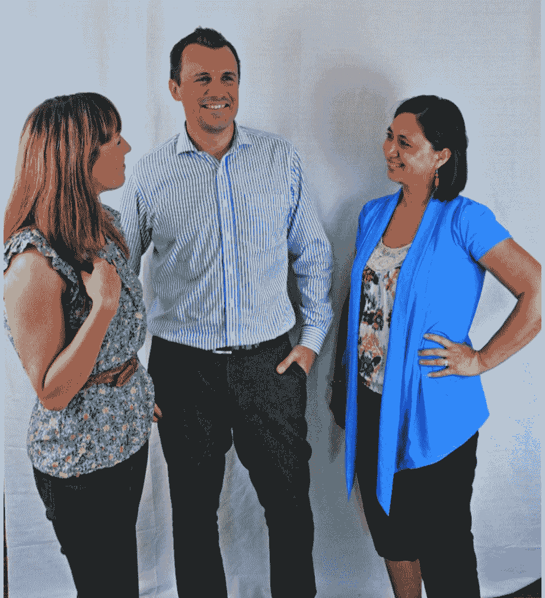
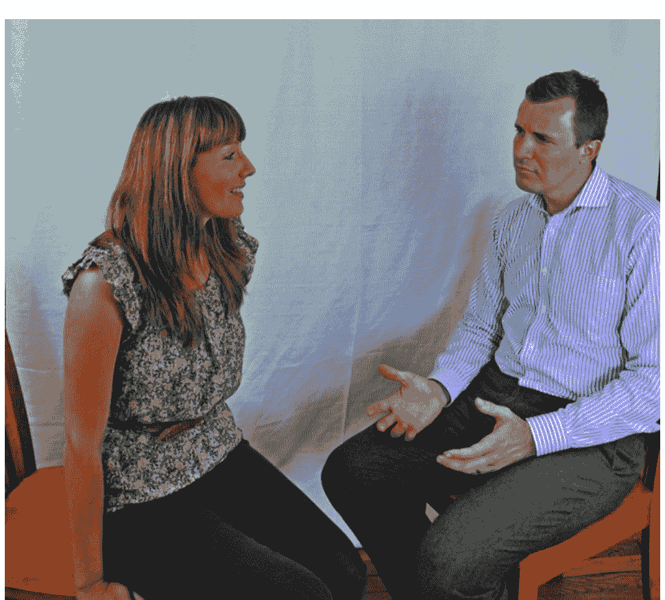
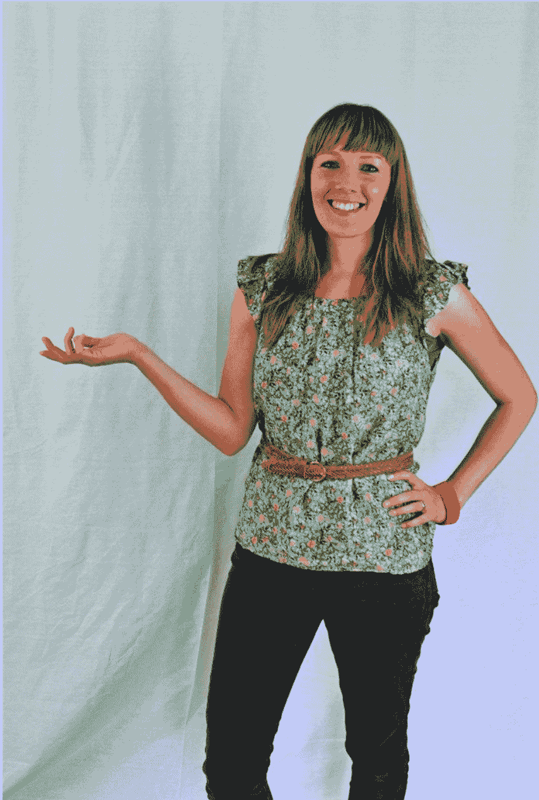
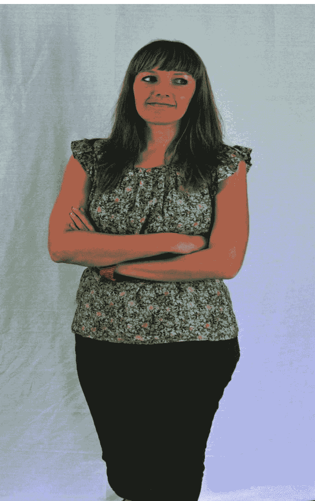
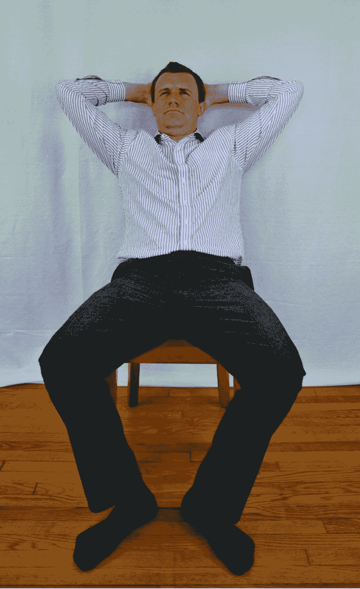
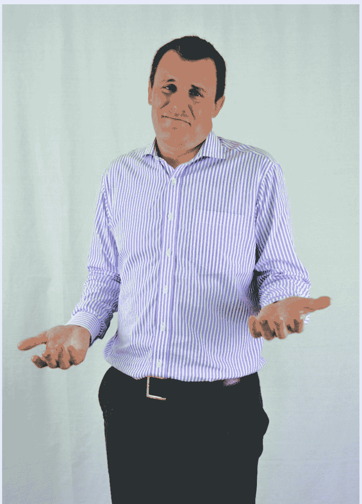

# 第四章：躯干、腿和脚

# 别只盯脸！真正泄露情绪的，常是躯干、腿和脚

斯坦尼斯拉夫斯基曾把身体动作比作一把钥匙，说它能打开心灵被锁住的部分。上一章我们聊到手如何传递情感——甚至不开口，仅凭双手就能讲清一件事。那么，身体下半截是不是也藏着同样的秘密？躯干、腿和脚，会不会正是情绪状态的重要信号源？

腿脚负责承重、行走和保持平衡，也是感官体验与敏感度的重要来源。更关键的是，控制非语言行为的大脑边缘系统，会让身体下半部分忠实反映情绪。双手和手臂长在身体前方，我们容易留意到它们；腿脚却常被忽略。所以与人打交道时，腿、脚和躯干的动作，往往更能暴露真实感受。先从腿脚说起。

## 腿脚：会“说话”的下半身

腿脚能透露一个人是开心、难过、紧张、不适，还是有领地意识。读懂这些信号，有助于判断对方的心情。电影《快乐的大脚》里，那只企鹅开心时就会跳舞；现实中离得也不远——人高兴时可能不自觉弹跳、摇摆，甚至脚趾都翘起来。罗宾·迪克尔把这种向上抬起的姿态称为“对抗地心引力”的动作。

腿脚的朝向不仅能暗示要走还是想留，还能表现兴趣高低。我们往往更关注面部，尤其约会时。可约会中一方可能礼貌周全，真实兴趣却写在腿脚上。比如男士走向笑容热情的女士，如果女士的腿脚没有朝向他，或始终没往他那边移动，那多半说明她并不感兴趣。做社会工程的人要特别留意这类线索，据此判断双方是否建立了足够融洽的关系，能否让对方持续把注意力放在你身上。

腿脚也适合展现领地意识。交谈时若发现对方双脚站开的距离变大，通常意味着他感到受威胁，想在自己的地盘外建立主导感。左图里萨琳娜和本双腿相靠、脚尖互指，说明谈话顺畅；一旦有人说了什么，或其中一方焦虑、防御，就会变成右图那样：萨琳娜双腿分开更大，脚尖也不再朝向本。

图 4-3 从舒适（左）到不适（右）

再说跷二郎腿。跷不跷、怎么跷，都能很大程度反映一个人是否自在。前面说过，摊开的手势常代表信任与热络；腿也一样，能显示开心、坦率、热情，或因不适而对别人设障。

图 4-5 她是友好的吗？

我们很快就能决定喜不喜欢、信不信任一个人。非语言行为是内心感觉的真实写照。跷腿时，腿会礼貌地朝向喜欢的人；而图 4-5 那种情况，则是用跷起的腿在自己和不喜欢的人之间立了一道屏障。

腿脚在非语言交流里含义丰富。把视线往上移，还会有更多发现。接下来看躯干和手臂。

## 躯干和手臂：倾向哪里，心就在哪里

想象拥挤地铁上只剩你旁边的空座，来了位看起来很久没洗澡的男士，气味难闻，你又无处可去。你大概会先把头转开，再让身体倾斜几厘米。这点距离并不能驱散气味，可你还是会这样做。为什么？因为人会远离不喜欢的东西，靠近喜欢的事物。若这位男士刚洗过澡、气味清爽，又换成有魅力的异性，你的倾向可能就完全不同了。

躯干的无意识倾斜，能表明我们喜欢群体里的谁。回想一群朋友相处时，知道谁和谁情感亲近后，再看他们的躯干朝向，往往能印证。图 4-6 里，两位女士都倾向本，而本更倾向萨琳娜，真正兴趣一目了然。

图 4-6 本真正喜欢的是谁？

就算坐着，躯干也能传递想法。图 4-7 里，萨琳娜是舒服还是想走？如果看出她想离开，就对了。躯干移向前方这类动作，可能正说明她想走。

图 4-7 留下，还是要离开？

观察躯干的关键是倾斜度：倾向哪里、怎样倾斜，既暗示喜欢谁、不喜欢谁，也说明舒适还是想离开。这些迹象能帮我们恰当地调整应对。记住，若某人身体倾向另一个人，可能代表感兴趣或自在；反之则是不适或不感兴趣。这个简单判断也能帮到社会工程师：如果和你打交道的人离你很远，也许是你表现得过于强势。

我曾想从坐在旅馆沙发上的一对夫妻那里获取信息，便径直走过去。近两米的身高突然出现在他们面前，我又俯身倾向那位男士提问。直觉告诉我搞砸了——男士尽量后仰，几乎把自己埋进沙发，明显不感兴趣。

另一个方法是：建立密切关系后，暗示你很感兴趣。当对方开始表达情感或想法，你稍稍前倾，表示正在认真听，也说明你信任他、愿意听他说话。这对建立和维持关系很有帮助。

想想决斗前的大猩猩：鼓起胸部，仿佛在说“我很庞大，别惹我”，同时吸入更多氧气备战。人也一样，想宣示领地时会挺胸。另一个清晰信号是胸部起伏：胸脯起伏、呼吸粗重，都是为了吸入更多氧气，一定程度上是不适的表现；耸肩后大口呼气，则可能出于伤心或放弃。

手臂只是手的延伸吗？它们在交流中和手作用一样吗？有趣的是，手臂像桥梁，把躯干和手的非语言行为连在一起。看图 4-8 和图 4-9，判断哪位更让人想接近。

图 4-8 这种非常开放的姿势是热情和友好的表现

图 4-9 手臂呈现这种状态，同时伴有其他肢体语言，是在说“我对你的想法不感兴趣”

图 4-9 里，交叉双臂凭直觉就像在设屏障。但要注意，交叉双臂并不总等于屏障——可能只是冷，或单纯觉得舒服。要看其他迹象：图 4-9 中躯干和腿的姿态已表明不感兴趣。交叉位置也关键：高于胃部、低于胸部时，多为不适的防御姿态，像在说“我不舒服”。别只看单一动作，要留意相对基准态的突然变化。

换句话说，图 4-8 展示的是开放的腹部动作（第三章提过）。手臂敏感部位或前侧露出来时，基本在说“我和你在一起很舒服，我信任你”。看到这种表现，可判断关系已较密切。腹部动作还能表现自信度。图 4-10 里，本向后靠、双腿分开，是在宣示领地，但这种开放的腹部动作会显得失礼甚至自大，而且他宣示的领地未必真属于他。

图 4-10 当本这样坐着的时候，他是在宣示自己的领地，但是这种开放的腹部动作很失礼

耸肩是父母常见的手臂动作。图 4-11 这种动作伴随语言出现时，是什么意思？有趣的不只是做动作的人常说“我不知道”，还在于动作和言语可能不符。看访谈、脱口秀、总统辩论等现场活动时，候选人停顿一两秒后回答，嘴上点头说“是的”，却出现图 4-11 那种轻微耸肩——点头在说“是的”，肢体却在说“我不确定”。要重点关注单一耸肩：许多人以为这是非语言矛盾行为，因为心里想说“是的”，大脑却在说“不是”或“我不知道”。单一耸肩通常是无意识的，更值得注意。

图 4-11 相当熟悉的耸肩动作

## 总结：把躯干、手臂和呼吸连起来看

躯干和手臂能传递大量信息。总体来说，留意躯干倾向：前倾、后仰，朝向你或远离你，都能表现兴趣与舒适度。手臂也一样，看它是封闭设障，还是敞开建立密切关系；对方封闭手臂时，是不是感到了威胁？手臂敞开，是否意味着关系更近、更自在？还要注意呼吸：平静还是紧张，是否深呼吸。这些能帮你判断对方是受威胁、生气，还是平和镇静。

社会工程师的目标，是营造平静放松的环境，让目标对象感到舒适。当你看到非语言行为用得恰如其分，就离成功不远了。要真正看透这些迹象，还得关注身体最后一个部分——面部。下一章，我们就聊脸。