# 第五章：面部表情背后的科学

人遇到突发状况时，身体会先切到应战或撤离的预备状态。可是把场景换到生日惊喜现场，明明没有危险，身体仍会不自觉靠近制造惊喜的物件，随后笑出来。艾克曼把惊讶归类为一种通路情绪，初始的愣神过去后，它能把人引向恼怒、愉悦或哀伤等不同方向。

对做心理渗透的人来说，这一点很值钱。确认自己安全之后，惊讶更容易转化为好感，接下去的笑声、放松和轻松感会连串出现，也就更容易占据主动。

这并非说下次测试要躲进柜子里突然跳出喊生日快乐。换个更贴近日常的例子会更清楚。

有一次我进入某栋大楼，想在前台拿到通行权限。靠近柜台时，我注意到接待员情绪明显低落。我没用惯用的开场白，而是关切地问最近情况如何。对方透露耳环不见了，那对饰品价格不菲，还是配偶赠予的纪念物，所以她很沮丧。我表示理解并陪她一起找。运气不错，我瞥见她发间有光一闪，正是那只耳环。她抬手触到发间的那刻，脸上出现了又惊又喜的神情。她开心到完全忘了询问我的身份，多谢几声后才问我们谈到哪一步了。我回说要去见人事专员，五分钟后需持证通行。她递给我门禁卡并替我开了门。这一次，惊喜与愉悦刚好把局面推向了我想要的方向。制造惊讶并不等于要从壁橱里蹦出来。

惊讶在脸上大致长这样。眉毛上抬，眼睛尽量睁大；相较恐惧，惊讶时眉弓弯曲更明显；下颌会微微松开。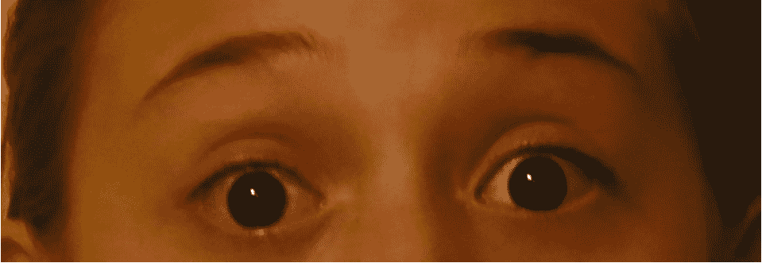

## 悲伤：把同情变成通行证

我与那位女孩素不相识，可看到相关报道时心里仍泛起悲痛与孤寂。这正是悲伤的穿透力。人天生带着同情与怜悯，很容易被牵动。悲伤的强度可以从轻微不适延伸到极度哀痛。读懂它有助于更好交流。对社会工程而言，恰当地流露悲伤，对赢得对方同情很有帮助，同情与悲伤本就紧密相连。

我曾受雇以电子方式获取某栋大楼的进入许可。任务是用移动存储把恶意载荷植入公司网络，甲方想检验禁止员工使用外来设备接入电脑的政策执行情况。我着衬衫打领带，夹着马尼拉文件夹，里面放着打印的所谓个人简历。同事在便携存储中装了一份简历，内嵌恶意代码，也就是常说的壳，一旦被点开就能远程操控目标网络。我还准备了一份干净版本，以防带壳版本失效。

车停好后打开车门，咖啡泼到了装简历的文件夹上。

走进办公楼时，我清楚需要真实且适度的悲伤，过分哀痛或带怒都不合适。那种状态与阿玛雅表现出的真实复杂悲伤相近。
我拎着湿漉漉的文件夹走到前台，秘书惊呼发生了什么。我扫了眼她桌上的照片，照片里有小孩和宠物猫。

我说明自己刚经历失业期，今天才拿到这里的面试通知。路上因紧张，突然有猫从路边窜出，我不想伤到它，猛打方向导致咖啡洒在文件夹和座位上。简历全湿了，猫没事，简历毁了。

对方表示很遗憾并问能如何帮忙。我带着深切的悲伤说，便携存储里还有电子版，能否帮忙打印一张。随后把存储递过去。

几分钟后简历打印完成。同事发来只有一字的短信，表示壳已触发。秘书问姓名以便通知琼斯女士。

我说保罗·威廉姆斯，约见时段为上午十一点。

她回应今天运气不佳，XYZ 在隔壁，ABC 才是这里。

我道谢说多亏了她的帮助，现在得赶紧过去，不然会迟到。

微笑着离开时感觉很不错。既拿到干净简历，也实现了对网络的远程操控。

面部表情是唯一原因吗？并非如此。它只是让故事更有分量和可信度。表现得当，旁观者会自然产生悲伤与同情。关于悲伤表情的使用要提醒一点：紧张时流露悲伤或恐惧可以，但当你需要表现自信蓄势时却挂着悲伤，就会释放矛盾信号。面部管理要谨慎。

悲伤是一种复杂的表情，包含多重肌肉动作。嘴巴可能张开，也可能只是嘴角下垂；保持口部姿势时脸颊会上提，动作类似眨眼。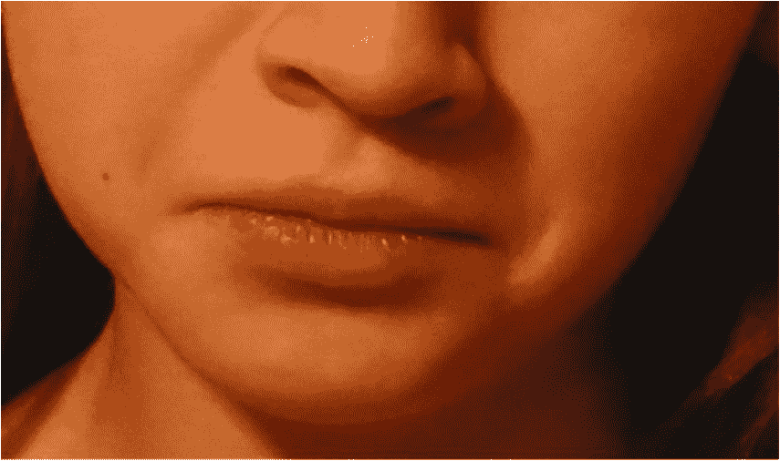上眼皮下垂时视线通常向下，头部会略低，前额因紧张出现皱纹。眉心内角挤拢形成 V 形。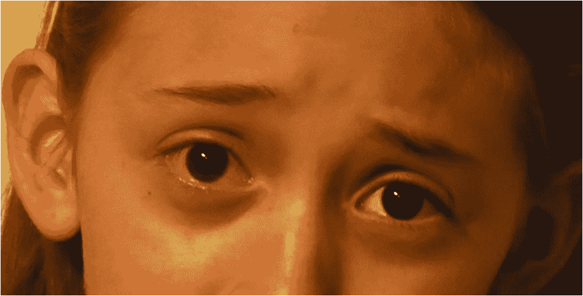极度哀痛时嘴张得更大，嘴角更下撤。即便很细微，仍能看见下垂的嘴角。悲伤最容易从眼睛泄露，即便嘴唇不动、面部被遮挡，眼神仍会透露情绪。难点在眉毛控制：有时是眉毛内侧上扬，而非整条上扬；眉头抬起并向中部聚拢；双目低垂；下唇中央向前突出。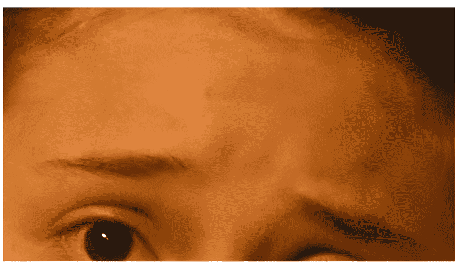

艾克曼注意到，只有少数人能有意完成这些动作单元的组合。PK 说，这些人能通过唤起同情顺利影响他人；演员伍迪·艾伦、内森·连恩以及图中的阿玛雅，都是善用眉眼表现悲伤的高手。熟能生巧，也包括建立共情联系。

## 轻蔑：最该收起来的表情

艾克曼在《情绪的解析》中指出，轻视只是对人或行为的感受，而非对味道气味触觉的反应。宾大研究员周毅学在《轻视与自尊》中定义为对在道德或社交上逊于自己的个体或群体的情感反应。费舍尔与罗斯曼进一步认为，轻视的目的是把对象排挤出自己的社群或阶层。

从这些定义看，轻视是一种消极情绪。做社会工程时不愿表现它，也不愿在互动中看到它。

一次与销售团队聊天，无意听到名叫吉姆的人谈当月业绩。他没直说自己多成功，却提到拉尔夫当月表现平平，暗示自己胜出。其他人离场后，我在拉尔夫脸上看到那种单侧的微妙变化。
拉尔夫很快察觉不妥，重新挂上笑容追上人群，不想被孤立。我走过去说，我是新同事，刚才那番话太荒唐了，对方看起来傲慢自大。

拉尔夫看着我像能读懂心思，说他没那么坏，只是更看重自己，声音渐弱。

我回说不管怎样，相信下个月你肯定能反超。

此时我已走到近门口。他替我开了门，我尾随进入办公区。他感谢鼓励后便各自离开。迅速捕捉面部信号并回应，让我能在对方可接受的情感层面互动，最终潜入办公楼。

轻视是我不推荐呈现的情绪之一。我见过也用过轻视的信号，但不想加入那种感觉。若长期怀有轻视，它会转为愤怒。这种情绪把人带向消极路径，所以我会丢弃它。

轻视包含优越感、作态或自大，往往呈现在单侧或面部局部，比如一侧嘴角上扬，同侧脸颊或酒窝上提。社会工程师需要留意这些迹象：脸颊仿佛被挤压导致眯眼；下巴上抬以便俯视被轻视的对象；颊肌抬起时同侧唇角不对称地上扬。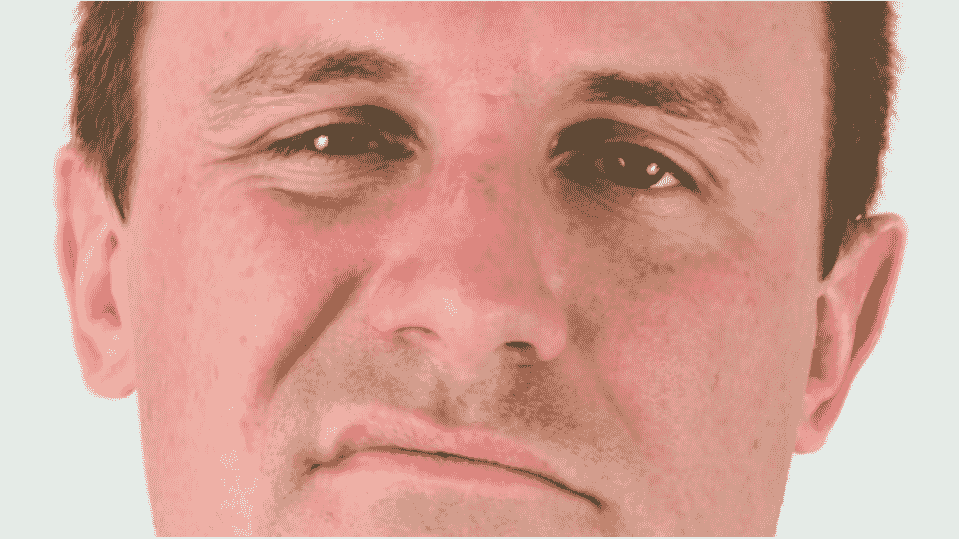轻蔑可能是仅次于开心最易观察的情绪，你会惊讶于它出现的频率，但别忘了思考产生原因。嘴和脸颊一侧因轻蔑抬起时会形成假笑，之后可能出现点头或其他自大姿态。对新手来说，轻视很容易被错过，却是需要掌握的重要信号。一旦学会识别，日常里就能轻易发现。

为了说明要旨，我转述 PK 讲过的一个故事。那是在阿拉伯国家的经历。雇主请他吃饭，却特别要求不要给那桌点酒，这在伊斯兰文化中很常见。PK 说他当时在一个同事脸上看到了一丝轻蔑的微表情。后来与助理建立密切关系后，助理告诉他雇主很虚伪，因为出国时经常饮酒。那位助理资历不如雇主，却更像虔诚的穆斯林，因为他从不饮酒。

若在交流中看到轻蔑表情却不明所以，请迅速重新评估是否需要改变接近方式或肢体语言。确保表达不过于攻击，不使用冒犯性语言或笑话。外出工作时，也要确保自己在目标眼中不会显得无礼。

## 厌恶：别把嫌弃看漏

轻视通常针对某个人，厌恶的触发源却很多，比如气味、味道、触碰、景象，或想到某些事物或某个人时的感受。甚至我们自己的所作所为都可能让自己反感。厌恶能在人身上触发强烈的心理反应。厌恶某物时是什么感觉？有人晕血，有人想到呕吐就恶心。读到这里，你的脸上可能已经浮现相似表情。

PK 告诉我，人们在测试和真实情境里常会忽略厌恶，因为难以辨别。然而训练自己在交流中观察厌恶，能极大改善互动。当我让大家列出艾克曼提出的常见情绪时，大多数人迅速说出开心、悲伤、惊讶、恐惧和愤怒，却少提厌恶或轻视。可这两种情绪对社会工程师都很重要。厌恶常与愤怒混淆，但两者特征各异。

想象一名执法人员与嫌犯面谈。问到失踪人员时，嫌犯脸上闪过厌恶。这意味着什么？执法人员需要更深入询问：厌恶是对执法人员的反感，还是想到了暴力场景，抑或其他原因。经过训练后你就能捕捉到这种表情。正如 PK 所说，你看到的会比你想看到的更多。

厌恶可拆解为若干信号。皱鼻子，仿佛要切断鼻子与异味的联系，褶皱通常出现在鼻梁上。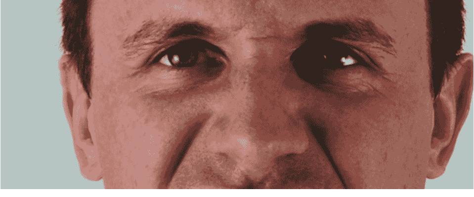嘴唇会卷起，有时张开并露出牙齿；典型厌恶中上唇靠近鼻子，露出上牙。脸颊常出现大幅褶皱，越过鼻梁形成大大的倒 U 形。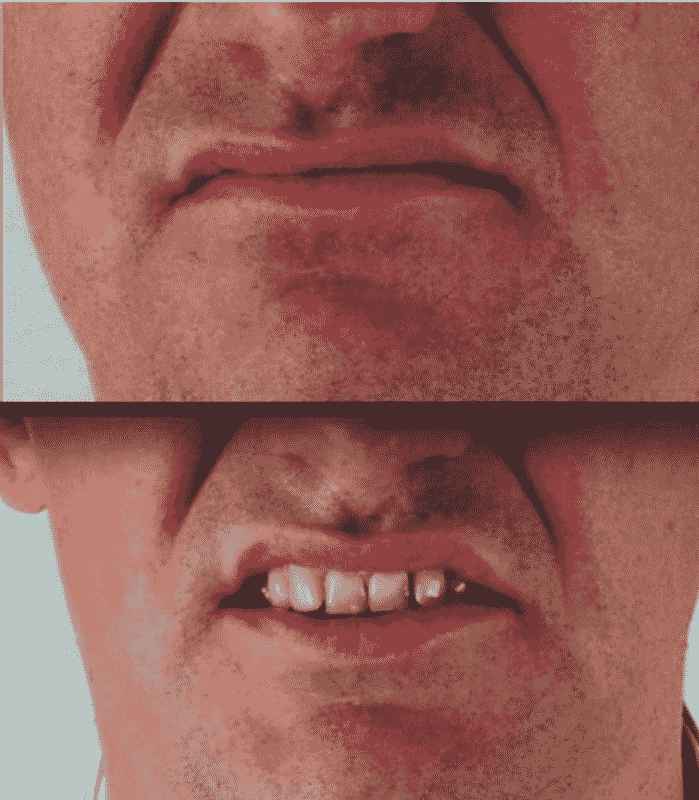眉头紧锁时，还会衍生恼怒等情绪。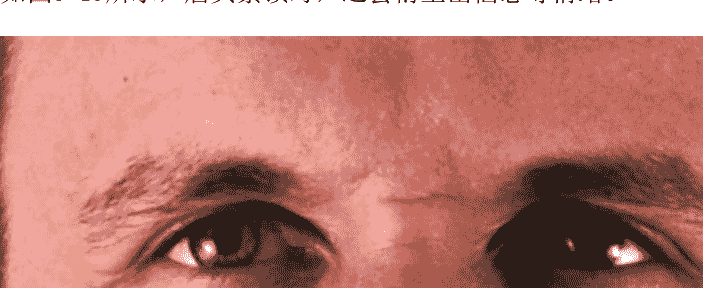

## 愤怒：看见它，但别挂在脸上

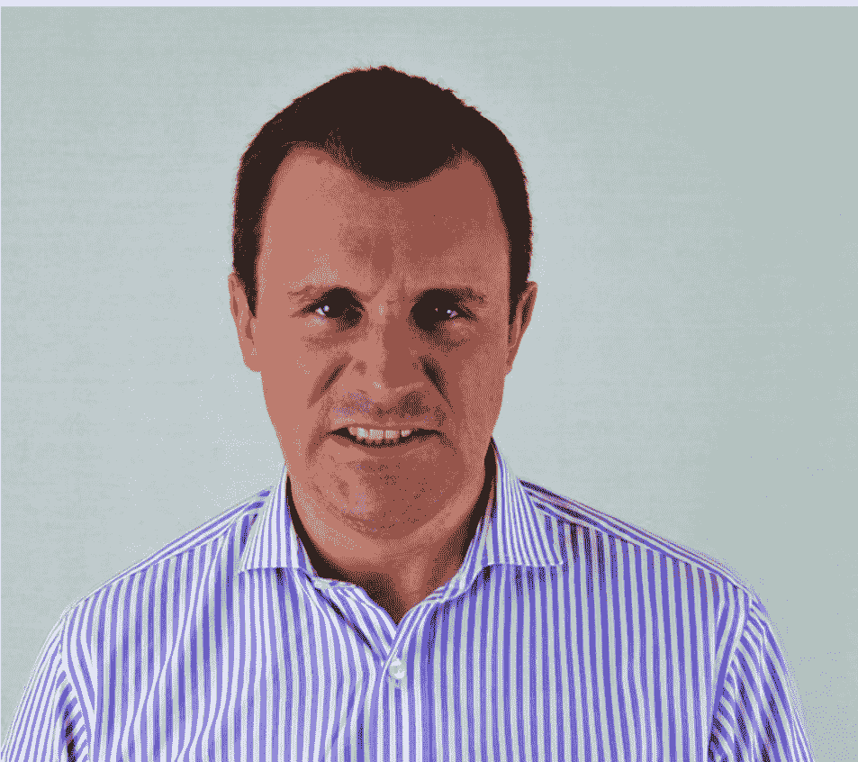
我能看出那位男士很生气。我掏出电话假装在通话，随后放慢脚步想听清他在说什么。偷听到他似乎与供应商有小争执。这对我是个改变说辞的好机会。从谈话中我得知通话对方是制作考勤系统的厂商。我进门直奔前台，说我是保罗，来检查考勤系统。老板告诉我你们与供应商有重大分歧，现在需要更有竞争力的报价，能否告知服务器在哪检查。

前台带着我穿过上锁的门进入服务器机房。对信息技术人员喊说罗伊，保罗需要进去检查考勤系统，他会处理好所有问题。

这是一次因观察到愤怒情绪而取得成功的经历。还有一次不太成功。当我与一位目标交流时，他开始贬损一位女同事。我感觉自己有点激动，他一定察觉到我露出了类似愤怒的表情，于是终止谈话走开。很难做到，但社会工程师仍需要在交流中抛开个人感受与偏见，让目标自由表达观点，无论观点是否与你相左。

有一次我采访到一名审讯人员。他讲述逮捕一名嫌犯的经历。嫌犯因偷窥女性卧室自娱受指控。他有牛仔靴恋物癖，一旦女士穿着那类靴子，激情就会被点燃。部分调查人员希望其认罪。我们都能想象那种场景：人员用拳头敲桌子或作威胁状。可这些愤怒表现并没让嫌犯开口。后来，我的朋友走进去，安静坐下，脸上既无愤怒也无厌恶。他开口说我也喜欢女人穿牛仔靴，最爱天然棕色靴子。

看了他几眼后，嫌犯大声说棕色？看到红色靴子后，你眼里还容得下其他颜色吗？

从那之后谈话顺利起来，嫌犯对所有罪行供认不讳。社会工程师要努力不让愤怒痕迹留在脸上。因为愤怒会带来主观感受，给工作造成灾难性后果。

愤怒时身体会发生很多变化：呼吸变重，肌肉绷紧，进入备战状态；下巴收起保护颈部，双手也会握紧。脸部同样表现紧张和皱眉，但做这些动作必须谨慎，否则会显得很愤怒。可以拉低眉毛，像要用鼻子碰到眉毛内侧，再尝试瞪眼。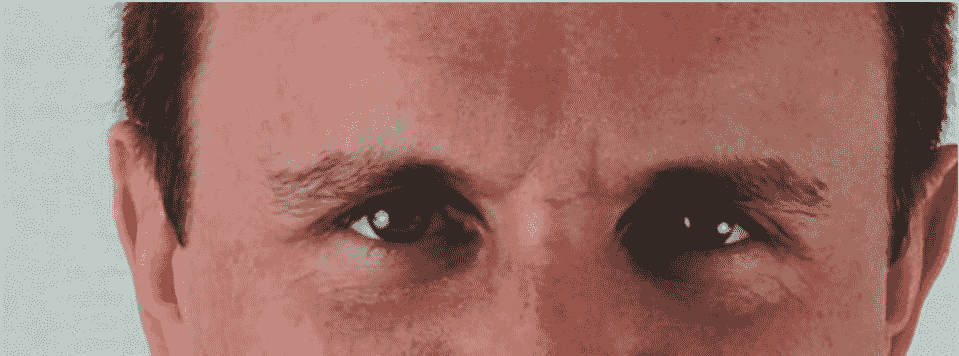

情绪表情不是操控别人的道具，而是观察和回应的线索。惊讶可以成为通向好感的跳板，悲伤可以搭起同情的桥，轻视、厌恶和愤怒则需要被看见、被辨认，也要谨慎地不挂在脸上。真正有用的，是读懂对方此刻站在哪一层情绪里，再用合适的方式靠近。

聊情绪微表情，最容易被忽略的就是愤怒的细微收敛。

当嘴巴打开的幅度像图 5-22 那样，就要把牙关死死咬住，下颌线也跟着绷紧。

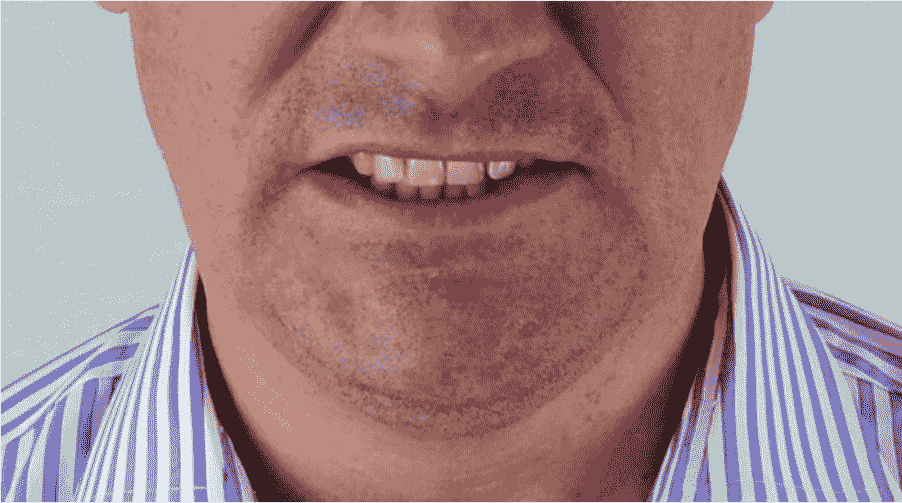
图 5-22 愤怒时会下颌紧绷、牙齿咬合

其实下巴往里收也是一种自我保护的本能，颈部不自觉地缩起来，像是准备好迎战或撤退。

别以为这些照片是盛怒的爆发，它们只是很克制的信号。但正是这些不起眼的细节，让我们在对方情绪刚冒头时就能捕捉到愤怒的痕迹。哪怕只有一点点蛛丝马迹，也足以提升我们的察觉力。

图 5-23 杜兴式微笑时唇角上挑，目光也随之笑起来

图 5-24 社交式微笑时眼部肌肉并未加入

很多人展示社交式微笑时，旁人不会立刻去分析你用了颧大肌而没动眼轮匝肌。但潜意识里会觉得哪里不对劲，感觉对方的情感没有落到实处。

社会工程师的目标就是让对方主动放松、愿意靠近、觉得自己可靠。最简单有效的办法就是一个发自内心的微笑。有篇叫《微笑的价值：人脸博弈论》的研究，斯加勒曼、埃克尔、卡雷尔尼克和威尔森在文中指出，微笑这个小动作能迅速搭起情感桥梁，向对方传递可信与善意，并带来愉悦感。想看原文可以去 www.sciencedirect.com/science/article/pii/s0167487001000599 查阅。

明白这一点后，工程师不仅要练就紧张、恐惧、愤怒等情绪的拿捏，也要把开心练熟。配合的手段很多，比如下一章会讲到的头部轻微倾斜，第 3、4 章提到的腹部放松动作，以及第二章讲过的声音放低。

真诚微笑的拆解，可以按这三步来练习：

- (1) 先在脑中调出一段真正让你开心的回忆，让情绪先起来。
- (2) 嘴角上扬的同时带动脸颊向上提，像图 5-25 那样把唇部拉起。
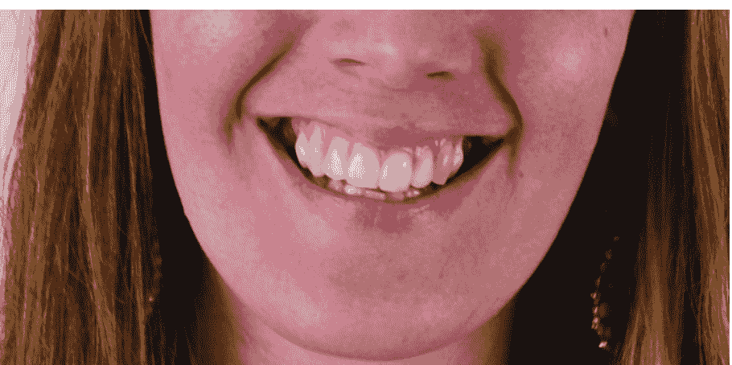
图 5-25 观察脸颊上提的路径，它会把嘴唇往上牵引形成笑容。真心的笑会牵动口腔、颊部、下颌等多块肌肉，有时还会泛起潮红

- (3) 眼睛跟着收紧、脸颊继续上提，眼角自然出现鱼尾纹，如图 5-26。
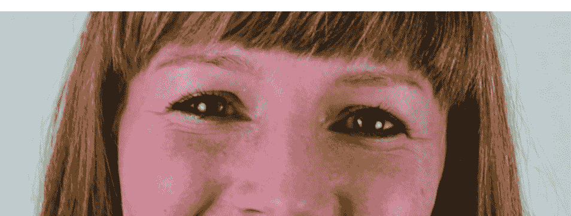
图 5-26 真正的愉悦总能从眼中读出来

当你看到别人真心笑时，自己也会不自觉地更开心。这是大脑的镜像机制在起作用，接收到的情绪信号越多，感受就越鲜明。

读到这里，你可能会好奇要怎么通过训练来辨认这些情绪。

### 5.3 完美的练习造就完美

学会模仿并读懂社会工程师常用的表情技能，既是成为高手的必经之路，也是保护自己不被恶意操纵的防线。观察面部其实没有想象中难。艾克曼博士及其学生长期研究这个领域，也开发出辅助工具。靠着艾克曼的微表情训练工具 METT 和进阶版 METT 培训高级工具，我的识别能力被打磨得更准了，我的课程里也常常用到它们。

这不是唯一路径。我的起点很简单：一本《情绪的解析》和一面镜子。我照着书里每章的描述去动脸，有时盯着镜子，有时闭眼感受，反复直到肌肉记忆和书里说的感觉对上号。之后我开始对照自己真实的情绪体验，检查动作和感受是否一致。

我也开始留意身边人的宏表情，并强迫自己在每次对话里抓一个微表情。比如练过愤怒后我知道，生气时会瞪视、眉头紧锁、嘴唇和下巴收紧、下颌下沉。随后我就去家人朋友脸上找这些细微迹象，感觉像打开了新世界，能更清晰地知道他们此刻的真实状态。然后犯了所有新手都会犯的错：看到表情就认定原因。我一度很沮丧，后来学会克制这种冲动，纯粹观察情绪本身，才发现还有太多要学。随着练习，我和孩子、妻子、朋友的交流明显顺畅了。

再后来我意识到面部表情的商业价值，自己掌握的非语言技能完全可以影响他人的情绪状态。

练得越多，速度和准确度就越好。我开过五天的面部训练课，课后有学员问我能不能把这项能力关掉。我说关不掉。即便我们不一定每次都要用这些信息，也很难再忽视已经看见的东西。

这就像学外语。我多次去中国大陆和香港，为了旅行方便开始学中文。学了几节课后，我惊讶地发现自己能在中餐厅或亚裔超市里捕捉到一些熟悉的词汇。

面部观察同理。知道得越多，无意中捕捉到的信息就越多。因此总结两条铁律：其一，俗话说熟能生巧，但错误重复只会固化错误，所以要改成完美的练习造就完美；其二，不要妄下结论，表情从不等于情绪的原因。

### 5.4 总结

面部既能用有意识的宏表情传递情绪，也能用无意识的微表情泄露情绪。学会读取表情内容并发现矛盾点，能让社会工程师更专业，也能帮你识别正在发生的恶意攻击。

从个人层面看，懂脸就是懂自己、懂沟通。你会更容易建立长久的关系，与人交流更顺畅，更了解身边人。

我在都柏林授课时，遇到一位年轻有活力的德国女生，她对人际心理充满热情。一次外拍的工作中，我抓拍了她“专注”的瞬间，那张照片里其实流露出典型的愤怒信号。我向她展示后，对她未来的沟通帮助很大。这类自我觉察能极大提升技能，也能帮助我们管理自己的情绪输出。

训练面部表情时，学生常会觉得信息量爆炸，部位太多、细节太多。遇到这种情况，我会先用一节课讲更基础、更易上手的内容，再逐步进入精细训练。

这一课讲的是舒适感与不适感的表情区别，这也是下一章要深入的内容。