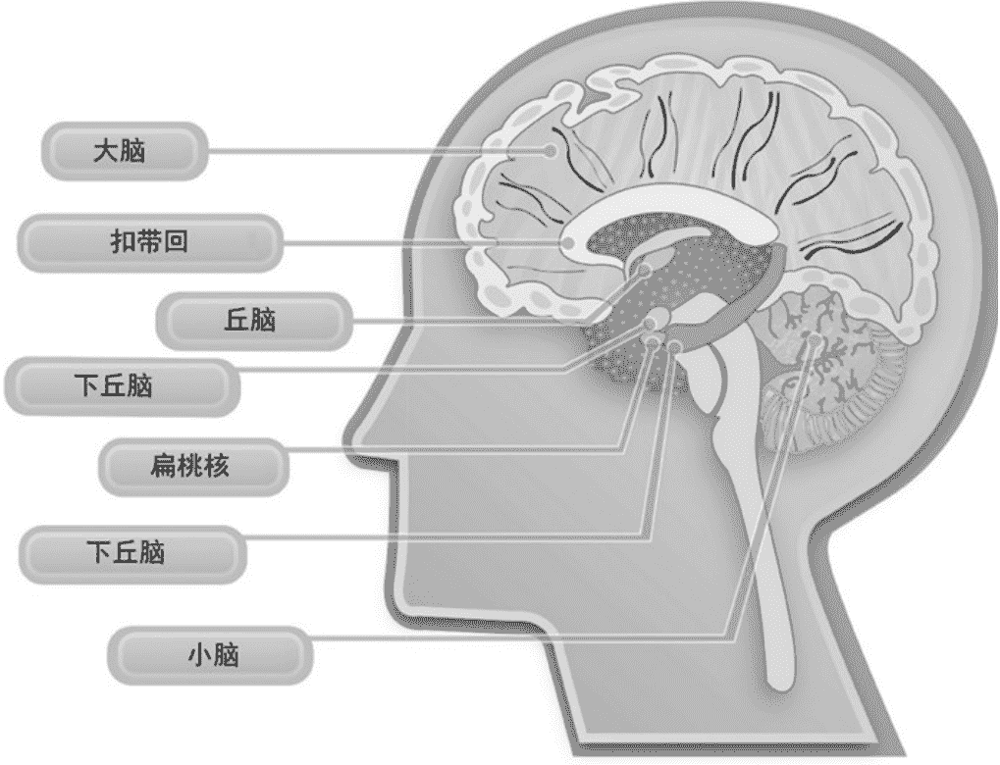

# 第七章：人类情感处理器

> “我们从来没有意识到，生活里那些细碎的情绪，正在悄悄牵动着我们的走向。”

> ——文森特·梵高

把大脑比作电脑，只是个粗糙的类比。电脑是一套硬件协同工作来产出结果的机器。

双击图标打开程序，代码被加载进内存，CPU 跳转到指定地址开始执行，输入正常就能得到图形化输出。我在键盘上敲字，信号被译码，内存和算力把字母投到屏幕。若我胡乱摁键，屏幕就是一串无意义的字符；若我闭眼无念，屏幕也会“说胡话”。有时候也能拼出词句，却没有主线、没有重点。

情绪信息的处理，逻辑上竟与此相似。感官像是键盘鼠标在接收外部输入，记忆与生活经验则是存储在后台的资料库，用来评判这些输入会触发什么情绪反应。内部的处理器发出指令，基于既往经验和当下的情绪负荷决定我们怎么回击。

正是这个机制，让非语言交流变得关键。忽略它，就像对着键盘乱敲，可能偶尔蹦出几句像样的段落，总体却是一堆废话。

情绪会扭曲我们对现实的判断与反应。小时候我极爱吃鸡蛋，妈妈做了一种她叫“面包蛋”的早餐，在白吐司上挖个圆坑，平底锅煎一下后打进一颗蛋。那种黄油般的幸福感我总在期待。

家里养鸡，鸡蛋永远新鲜。有天我去拿了几个准备做最爱的早餐，第一个蛋敲进锅里时，我看见的是血肉模糊、尚未成型的

图 7-1 扁桃体是脑中一枚小小的核团，专门管情绪

研究指出扁桃体里布满致密神经核，几乎所有感官输入都会先经过这里再分发到别处。从某种意义上说，我们的视觉、听觉、触觉全都先被这个区域过一遍。

1992 年，D. G. 阿马拉尔的研究指出，扁桃体的投射范围极广，覆盖脑干、下丘脑、海马、基底神经节以及大片皮层，这些区域共同参与情绪与行为的调控。

### 扁桃体如何工作

东京大学佐藤亘的论文《扁桃体在情绪信息处理中的作用》对这一过程做了系统梳理，并探讨了感官输入如何影响我们的输出。

论文还涉及无意识状态下的情绪探测。2004 年，河内山佐藤提出，人在无意识视野里会单独接收到负面愤怒和中性的情绪信息，且在负面情绪下皮肤电反应明显强于中性状态。

多项研究一致指向：扁桃体对情绪的反应是下意识且被感官驱动的。2002 年，H. 欧雅博士的《人类扁桃体的电生理反应》发现，刺激出现后 50 至 150 毫秒内扁桃体就被激活，而视觉皮层的激活通常需要 200 至 300 毫秒。速度的差异证明了情绪处理的先发性。

作为社会工程从业者，我觉得这些发现很有意思。大脑在我们还没开始“思考”前，就已经开始处理线索。作家塞巴斯蒂安·荣格尔在《战争》一书中描写美军在阿富汗的实战观察，提到扁桃体能在 15 毫秒内处理听觉信号，只留下待思维捕捉的影子。他还指出，扁桃体需要负面经验来判定威胁，触发源包括面部表情、穿着、视觉暗示、声音、气味等各种感官线索。

由此可知，优秀的社会工程师必须对目标有透彻的了解：他喜恶何在、习惯如何、有何困扰。对此足够了解，才能避免使用会让对方觉得冒犯的外形、表情或着装，也能知道该说什么、不该说什么。

如果这一切成立，就意味着可以主动影响他人的扁桃体，植入我们想要的情绪状态，让后续操作更顺畅。

### 7.2 人为劫持扁桃体

设想一下：你瘫在办公桌前，案头堆满工作，预算被砍，团队不断离职，电话响起，今天还有三场会，配偶发来消息说车要修，邮件一直在震。同事说你之前发的报告数据有误，要立刻改正，并且不要再敷衍了事。你回了一封简洁却带着怒意的邮件，按下发送的瞬间全身松了下来，随后又多了几分不安。你打开“已发送”，盯着那段文字，忽然觉得要不要再跳出去让局面好转一点。

发生了什么？这正是研究者所说的扁桃体劫持。情绪处理器超负荷运转，逻辑中枢新皮质几乎被切断。肾上腺素、激素和血压飙升，记忆效率下降，沟通能力受损，决策进入自动驾驶。

凯斯西储大学的一组研究人员做了验证。他们招募 45 名大学生，让他们在核磁共振仪里待十分钟，完成五组任务。先是 20 道书写题加 20 段视频题，要求他们设身处地思考他人感受；随后是 20 道书写题加 20 段视频题，要求用物理学解决。每次作答限 7 秒，两组任务间间隔 27 秒，两大实验块之间间隔 1 到 5 秒。

结果很清晰。当受试者处理能引发共情的题目时，分析相关的脑区活性下降，社交脑区被点亮。处理物理逻辑题目时，与共情相关的区域沉默，分析网络活跃。完全休息时，两套系统同时在线。

对社会工程师而言，这意味着只要把人推向情绪与共情的方向，逻辑思考就会被削弱。

骗子早就利用这一点。自然灾害、濒死的孩子、疾病等能触发情感的素材被反复使用，因为一旦共情被点燃，人就容易失去理智而掏钱。社会工程师同样会用悲伤、恐惧等情绪来换取信息、行动或金钱。

回想第五章的 USB 钥匙案例。我穿着西装，拿着被咖啡浸湿的简历走进公司，问前台能否借用电脑重新打印。当我走向柜台时，她的大脑要处理：

- 这是谁？
- 他想干嘛？
- 我该怎么回？

这些问题进入她的处理中心。我需要劫持这个中心，让逻辑关闭。于是我的叙事派上用场。我流露出悲伤与担忧，她的扁桃体先对我的故事和表情做反应，共情区被激活，逻辑区被压制。最终她只用社交脑区回应了我的请求。

有一些研究进一步提升了这种劫持能力。

### 7.3 我们看见什么、我们做什么

西北大学与威尔士班戈大学的李、辛巴格、布恩、帕勒等人合作发表了《从无意识情绪表情和特质焦虑影响中获得情绪启动的神经和行为证据》。摘要指出，无意识获得的情绪信息会左右我们的情感判断，但其神经机制和在威胁感知中的个体差异尚不明确。他们用脑电记录受试者在看到快乐或恐惧面孔 30 毫秒后，再看惊讶面孔时的脑电位。目的是检验大脑是否能在无意识层面识别非语言信号并影响决策。

研究以莱科里和格斯纳德 2001、2005 年的基准为起点，认为人类拥有持续扫描环境刺激的自动系统，会寻找非语言反馈来理解世界。这也能解释为何有时会莫名不安、紧张甚至恐惧。大脑像雷达一样捕捉周围人的愤怒、恐惧等负面信号，从而让我们保持警觉。

惊讶面孔被选为呈现面，因为它既可能源于积极体验也可能源于消极体验。他们推测惊讶的歧义性，会对前面 30 毫秒闪现的开心或恐惧面孔更敏感。实验使用了 70 名被试的 140 张惊讶面孔、7 张开心面孔和 7 张恐惧面孔。

被试在暗室隔音环境中面对屏幕，通过对讲机交流。每人会在看到恐惧或开心表情 30 毫秒后，看到 70 张随机的惊讶面孔，然后对它们进行“非常积极”到“非常消极”的评级。

论文第 101 页提到，看过恐惧或开心面孔后，人们对惊讶面孔的评级出现了显著差异。也就是说，短暂的情绪先导会让后续的歧义面孔被偏向积极或消极。

帕勒博士一再提醒不能过度解读感受来源，但他也指出，能读懂微表情的人会更懂得体谅，更敏锐地察觉他人的真实意图。

第一章提到的“视觉悬崖”实验也证明，非语言交流从婴儿期就开始塑造我们对情境的反应。对社会工程师而言，这有三层价值。

#### 7.3.1 读懂他人表情

学习捕捉他人的非语言信号，能帮助我们把握真实意图和动机。细微或明显的表现，都是沟通的有效杠杆。

需要再次强调：解读情绪是强有力的工具，但别沉迷于搜寻每个微小线索而忘了倾听。倾听本身也是建立信任的利器。在使用这些技能时保持平衡。

#### 7.3.2 我们的情绪输出

面部表情和非语言行为会改变他人的决策倾向。

压力来临时，肌肉紧绷、出汗、茫然，脸上和身体流露出的紧张会传染给对方，除非我们的托词就是要表现恐惧，否则只会让对方困惑。

就像婴儿等待非语言许可才能跨越视觉悬崖，交流对象也在寻找能否信任你的线索。因此，对不安与紧张的练习与控制至关重要，才能输出合适的情绪内容。

若需要表现紧张或恐惧，道理相同。以咖啡洒在简历的经历为例，如果我在讲这个悲伤故事时表现镇定、从容、自信，效果会大打折扣。因为语言与非语言不一致。

#### 7.3.3 非语言的社会认同

除了观察目标，还要感知环境氛围。周围是低沉还是欢愉？这种氛围感会帮助我们校准自己的情绪输出。

有一次航班晚点严重，我错过了两次转机。机长广播说雷击导致机场部分供电中断。总电源和备用电源都被击中，我走进航站楼时唯一的光源是保安手电筒。人群混乱，乘客对工作人员大声咆哮。我走向自认为正确的登机口，看到长队里满是愤怒的人。

这就是典型的社会认同。情绪会带动人们做出平常不会做的事。大家像发疯一样，紧张在人群中蔓延。通常我们不会在这种局势下编造托辞，但情绪内容既能影响一两人，也能感染一群人。

即便秘书对你真诚微笑，也要留意整体的紧张气氛，以便调和出相配的情绪表达。

作为社会工程师，牢记这些要点就能影响他人的决策。我们的目标是营造容易触发共情的环境，共情会关闭逻辑中枢。正如纽约传奇脱口秀主持人乔·富兰克林所说：“真诚是成功的关键，如果我们能假装真诚，那就成功了。”

### 7.4 像社会工程师一样劫持扁桃体

读到这里，或许会想这些原理对社会工程有什么用。无论动机如何，社会工程师的目标都是让他人采取行动。了解大脑的决策机制，能极大提升引导效果。

我喜欢把复杂发现简化。劫持扁桃体的核心公式是：感官输入触发共情 + 逻辑中枢关闭 = 扁桃体被劫持 + 提出要求。

只要在激发共情后再提请求，许可率会显著提高。怎么做？我们的大脑会本能地镜像周围观察到的情绪。若社会工程师流露适度的悲伤，对方共情机制就会被点燃。故事与共情连起来，理性与逻辑中心立刻被关掉，处理权交给了情绪中枢，决策就基于感觉而非思考。

我曾为一家公司做电话信息采集，目标是通过电话拿到本不该提供的信息。

一次我扮演该公司员工吉姆，用这个名字打了多个电话，成功获取了安全计划的部分信息。

我继续以吉姆身份致电技术支持，想让他们通过电话恢复我的虚拟专用网证书。通话开头是：

“您好，技术中心苏·史密斯，请问有什么可以帮您？”

“您好苏，我这边有点麻烦。刚才电脑在线杀毒时我不小心删掉了虚拟专用网证书，自己恢复不了，可我马上要交报告，能帮帮我吗？”

“当然可以，请问您叫什么名字？”

“詹姆斯，您叫我吉姆就行。”

“吉姆，您的用户名是什么？”

“我能报全名吗？我总是记不住数字。”

“没问题。”

“詹姆斯·巴洛。”

“吉姆？吉姆·巴洛？等等，你没听出来我的声音吗？我是苏西啊。”

对话在此停顿了约 30 秒。我面临的情况是苏西认识吉姆，而我却表现得不认识。电话里面部表情失效，我该如何应对？

我先发出一声长叹，表达沮丧与不安。随后说：“啊苏西，很抱歉，我真笨。今天实在糟透了，我感冒了，所以声音听起来不一样。然后又把证书删了。安保同事还对我大吼大叫，因为我未经许可用了在线杀毒。要命的是我车早上还爆胎了……”再长叹一声。

“哦吉姆，真替你难过。今天确实糟糕。我能帮你什么？”

“我得把报告交老板，您也知道他是什么样的人。我现在登不上 VPN，能帮我恢复证书吗？”

几分钟后证书到手。怎么做到的？等式再次应验：先建立共情再提要求，对方逻辑中枢被关闭，行动基于感受。

整个过程中我假扮吉姆，但我并非此人，所以必须用有限的非语言行为，叹息，以及言语上的不幸遭遇，先建立共情。只有确定苏西同情我后，才提出请求并获得响应。

方法很有效，用得当几乎无解。关键在于提出要求前如何适度建立共情，这需要练习。

### 7.5 总结

社会工程师不必是研究者、神经学家或心理学家，但优秀者至少知道什么能让人们听话。

强行控制扁桃体的简易公式：辅助非语言行为 + 情感共鸣内容 + 恰当要求 = 扁桃体被控制。

简言之，建立情绪内容，尤其是共情或悲伤，是核心。最佳方式是用适度的非语言行为表现悲伤和共情来支撑话术。一旦扁桃体被触发，逻辑关闭，就是提出要求的时机。哪怕对方逻辑再强，只要要求合理，往往会被满足。

艾克曼博士以及本章提及的研究者毕生探索情绪对人的影响。阅读并运用这些成果，能极大提升我们操控他人情绪的能力。

反过来，若安全专家能与客户一起理解这些原理，就能通过观察环境捕捉情绪被控制的时机，进而制定风险规避计划或针对性培训，提升对这类攻击的警惕。

理解机制运作方式，能帮助社会工程专家发现安全漏洞，并确定培训与修补措施。

下一章将介绍这些规则在诱导中的具体应用。我在第一本书中也讲过诱导，本书不会详述全部诱导技巧，主要聚焦那些使用了非语言交流原理的部分。