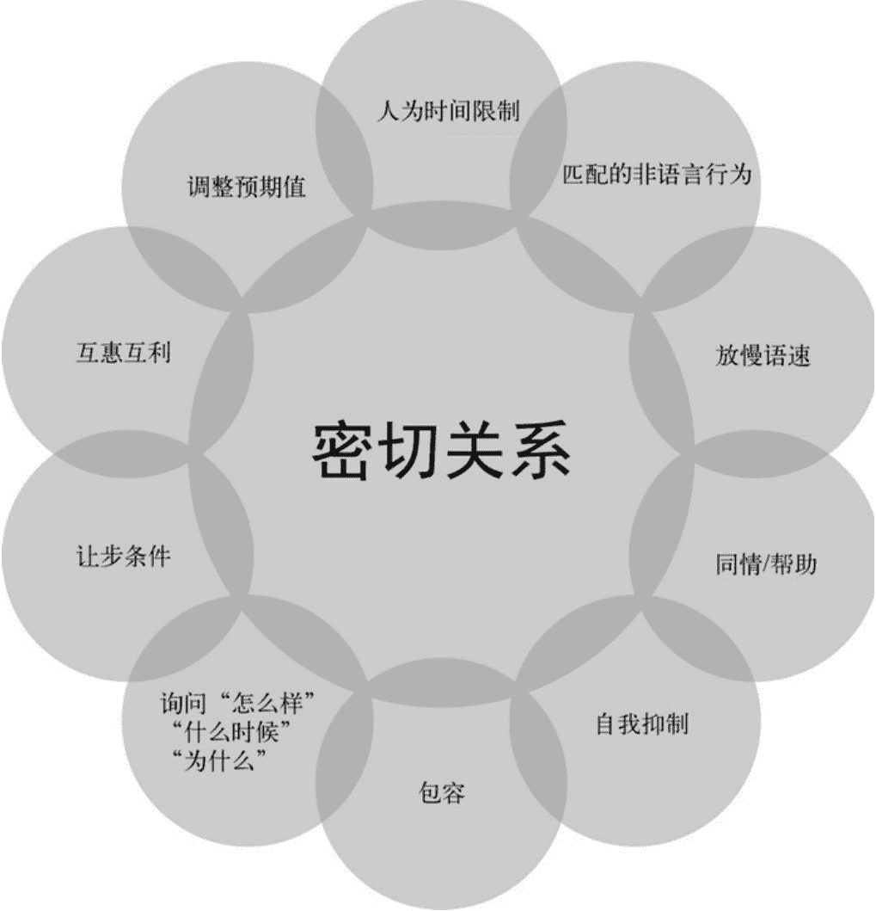
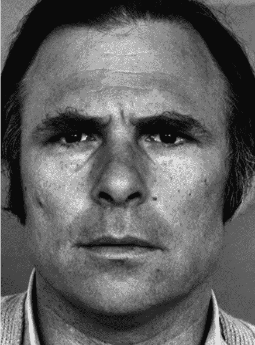

# 第八章：关于诱导的非语言方面

> “感觉就像波浪：我们不能阻止波浪的到来，但可以选择在哪里冲浪。”

> ——乔纳森·马丁森（Jonathan Martensson）

诱导在我看来，就是在不摆明问的情况下把信息引出来的手艺。这不等于不问，也不等于信息不需要问。军方和英特尔内部常拿“ASKINT”开玩笑，意思是 Ask Intelligence，探情报就是一句：你开口，人家就给了。真正的分水岭在于怎么问，以及用什么技术去让对方开口。我常会援引罗宾·迪克尔在《It’s Not All About “Me”》里总结的十条迅速拉近关系的准则，这十条也正是诱导的核心骨架。

- 人为时间限制：用“我能打扰一下吗”“我五分钟后要走，能问个小问题吗”这类说法，让对话显得轻松无压。
- 匹配的非语言行为：嘴上说担心，眼神肢体却在表达愤怒，对方会立刻察觉言行不一，谈话很快会产生危险信号并感到不适。身体语言必须与所讲内容同频。
- 放慢语速：语速越快越容易出错，也越显没底气，容易让人觉得内心藏着别的算计。
- 同情/帮助：共情和悲悯是人际最强的黏合剂。编一个需要对方伸手的小困境，很快就能把关系拉近。
- 自我抑制：最难也最关键。先压住自己的需求，让对方的观点、想法和需要排在前面。推迟自我关注，能放大对方的自我关注，人自然愿意亲近你。
- 包容：恰到好处的赞美会触发多巴胺分泌，产生奖赏感，为关系加固。
- 询问“怎么样”“什么时候”“为什么”：这类开放式提问能引出感受和动机，认真倾听就能收获大量信息。
- 让步条件：即拉丁语的 Quid pro quo，你给一点，我回一点。人们说话久了得不到回应会不安，适时透露自己生活中的一点点有价值的信息，能让对方更自在，但切忌用碎片信息反过来掌控对话。
- 互惠互利：心理学上的回报倾向。哪怕只是为对方开扇门，对方心里都会产生回馈的冲动。
- 调整预期值：熟练后容易兴奋想多要信息，反而触发对方防备。要管好自己的期待值以及每次使用技巧的频次。

当亲密感建立起来后，人们会自愿、自发地把信息递过来。

我没法把十条全展开，但需要先把定义钉准。迪克尔的书里已经做得很完整，我只能敬陪末座。你会在图 8-1 看到这些原则的汇总。

图 8-1　建立密切关系的 10 项原则

十条里都藏着非语言的成分，而所有步骤都能从“匹配的非语言行为”里获得加成。

当有人走近你，无论线下还是线上，脑子里几乎会同时冒出几个问题：他是谁？他想要什么？他危险吗？他会待多久？十条原则都在用非语言的方式默默回答这些问题，既不过度也不缺位。下面重点拆几条，看看身体语言如何改变效果。

### 8.1 人为时间限制

陌生人靠近的第一焦虑，就是“这人会在我生活里占多久”。其他疑问都能后续解决，这个没答清就会不安。

从肢体角度回应这个问题，关键在于你的待人方式是否让对方觉得你在把注意力放在他身上。假设你因为自己有困难来求助，心理上其实你在关心如何解决问题，而不是对方。人们本质自私。你不认识他，你只想把自己的事办成。如果肢体表现出“我很在意你”，对方会感到压力，你也更难推进。求助还分是一次性还是长期。

所以无论是靠近目标还是保持距离，我都建议先给自己设一个人为的时间上限。这样对方感受到的不是你在打量他，而是在处理你自己的事，安心感会立刻上升，也不会担心被长时间占用。

比如有一次在书店，我想向一位顾客请教选书。他正陪着年幼的儿子。我站到书架侧边，只把头转向他，说：“不好意思打扰一下，能给我五秒钟吗？我侄子跟您儿子差不多大，我要给他买书，总是不懂这个年龄段喜欢什么。”一个“五秒求助”最后聊了 25 分钟。我拿到了他的全名、生日、工作经历等大量细节。迅速建立信任并完成诱导，正是因为我用非语言传递了时间有限、目的明确的信号。

### 8.2 同情/帮助

在社会工程的词汇里，最有穿透力的几个字就是“您能帮帮我吗”。这个请求会触发对方本能的安全性、便利性和行动判断。

如果能激活目标的同情心，逻辑脑会先降温，回应性就会提高。下面这个例子连社会工程都算不上，却很典型地说明了非语言在求助中的作用。

我从超市出来，看见一位老太太推着购物车掏钥匙，一小叠钱掉了。我捡起来追上去。她正把东西往后备箱放，身高约一米五，我近两米。拍了她肩膀说：“打扰了，这是您掉的钱。”

她先是惊讶，随即变成恐惧，甚至喊“我被抢劫了！”。

怎么错的？是接近方式。我没有侧身靠近，也没放慢脚步，只想着“我是在帮她”，却用了错误的身体和面部信号。

求助时肢体和表情必须精细设计。想表现适度悲伤，就不能挺胸摆强势姿态，也不能流露出恐惧、愤怒或开心。提出请求时若表现得过分沮丧，也会让对方紧张。

回想书店的场景，如果我含泪上前，那位父亲很可能立刻带孩子走开。

非语言必须与请求的情绪匹配，这是同情/帮助原则能否奏效的关键。

有时完全不说话也能被帮助。有一次我走进写字楼大堂，站在角落等下一步时机。叹息声有点大，门卫停下问：“你还好吗？”

我回：“不太好，谢谢。”肩膀下沉，慢慢转身。

她追问：“怎么了？需要帮忙吗？”

“嗯，如果您能在五分钟内带我去见人事经理就好了，不过这不可能。”我又叹了口气，说我该去人事办公室见人，却忘了名字。

“大概是贝斯·史密斯，我带您去，跟我来。”

“贝斯！对，就是她，太感谢了！”

“别紧张了，一切都会好起来的。”她刷卡开门时这样说。

一点点紧张、两次叹气，加上同步的肢体，我就进了门，还能在大厅自由活动。

### 8.3 自我抑制

自我抑制是十条里最能促成诱导的一条。人们喜欢谦逊的人，因为他们会承认错误，也成全他人。这需要延迟自我意识，让非语言说话。

翻回之前的图 5-1 不看文字，先看画面，会想到谦虚吗？几乎不会。再看图 5-20，有谦卑感吗？想要接近的人吗？大概率不是。图 4-10 也一样。这些姿态和表情都不是谦卑。自信、紧张、沮丧、被拒时，身体语言根本藏不住。

想想你认识的真正谦逊的人。那个人让你感觉自己很重要、很舒服。

我有个朋友布拉德·史密斯，不久前离世。他是自我抑制的典范。下面两件事都有关他。

一次社会工程竞赛，原定房间临时被占办派对。我带着器材、横幅，特别沮丧，血压都上来了。队友只说“会搞定的”“真没劲”，没人帮我冷静。快要被杏仁核劫持时，布拉德走进来，看见我脸上的怒气。

他轻轻碰了下我手臂，身体姿势放低但不弯腰，声音很轻：“嗨，能单独聊一会儿吗？”

我没好气：“布拉德，我心情很差。”

他说：“我能看出来，也知道为什么。你能花点时间跟我这个不太懂的老头聊聊吗？”

轻触、柔声、不居高临下的语气，全是自我抑制。我和他坐下，二十分钟后我冷静下来，逻辑恢复，能继续解决问题。

同日，一名自闭症的年轻参会者崩溃了，大家都很焦躁。布拉德同样轻触、柔声：“我不太了解你的情况，能聊一会儿吗？”他陪对方坐下超一个小时，倾听生活，帮助对方学会应对压力。

当我们像布拉德那样延迟自我时，要求更容易提出，也更容易被满足。我后来拆解过他的做法，核心非语言要素有：

- 声音压低；
- 轻柔、去性别化的触碰；
- 温和的眼神；
- 身体姿势偏低。

这些动作常伴随求助。你很难拒绝这样的人。一旦对方点头，温暖的微笑和点头倾斜会传递信任，你也要表达感激。

自我抑制像是魔力，打破隔阂，让人愿意交流。

### 8.4 询问“怎么样”“什么时候”以及“为什么”

从非语言角度看，信息收集的最后一环就是善用怎么样、什么时候、为什么。它们比问在哪里、是什么、是或否更能打开话匣。

比如问“你要去哪度假？”和“为什么选佛罗里达做度假地？”哪个更能让对方展开？第二个问题会牵动对方的偏好、经历、动机，社会工程师就能读到更多。怎么样、什么时候、为什么类问题更能激活大脑。

非言语在这种提问里尤其关键，因为限制性的提问会让人不舒服、不信任。

回看图 4-3 和图 4-11，哪张更让人放松？

图 4-3 里拇指动作、面部表情、挺胸都在传递“我只对你的问题感兴趣，别指望我回答”。

图 4-11 里开放的腹部姿态和真实的好奇表情说明他确实在听。腹部和表情传递信任，也换来信任。

提问时我们很自然会流露这些信号。但当注意力放在任务或目标上时，容易变得僵硬。恐惧、不安、担忧、愤怒会浮现，非言语就从“相信我”滑向“注意警告”。诱导和亲密感的这些细节至关重要，后续还有很多对话技能值得训练。本书引用艾克曼的研究，称之为“对话信号”，下一节详述。

### 8.5 对话信号

正如第六章讲的舒适与不适，有时微小线索就能决定走向。相对于 25 分之一秒的微表情，新手更易察觉不适。但按十条原则，艾克曼在 1979 年《人类行为学》里专门写了眉毛作为对话信号的章节。

先回顾前言里提到的面部动作编码系统 FACS，以及与对话信号相关的三种动作单元。

#### 8.5.1 动作单元 1：扬起眼眉内侧

额头中央的垂直肌肉能抬起眉毛内侧，形成斜三角形，额头中部出现皱褶，而非整片抬起。艾克曼在图 8-2 展示了它。

图 8-2　面部动作编码系统中的动作单元 1

#### 8.5.2 动作单元 2：扬起眉毛外侧

与 AU1 协同的侧部肌肉抬起眉毛外侧。眉毛呈拱形，眼窝被撑开，有时眉尾会出现细小皱纹。图 8-3 为呈现。

图 8-3　面部动作编码系统中的动作单元 2

#### 8.5.3 动作单元 4：拉低眉毛

三条额部肌肉共同控制，眉毛整体或局部下压，眼褶下移，眼孔变窄，眉距拉近，不伴随皱鼻。图 8-4 即为该动作。

图 8-4　面部动作编码系统中的动作单元 4

看似技术化，却是理解后续内容的基础。谈到对话信号时，我会单独或组合使用 AU1、AU2、AU4。

### 8.6 情绪的对话信号

面部能表达情绪，眼眉也能在对话中泄露感受。论文《人类行为学》把第五章的内容以动作单元形式做了归纳。

惊讶会见到 AU1+AU2，眉内侧外侧都抬起呈拱，上眼睑上提，下巴下垂。恐惧是 AU1+AU2 混 AU4，上眼睑上提，下眼睑绷紧，嘴唇张开。愤怒出现 AU4，眉毛下压集中，下眼睑和嘴唇绷紧。悲伤是 AU1+AU4，眉成倒 V，上眼睑放松，脸颊微提，下颌下压。

厌恶和开心都能看到 AU4。厌恶时眉压得更深，开心时压得较轻。

在没有其他情绪面部动作参与时，眼眉可以独立行动。艾克曼把这类与情绪无关的眉毛运动定义为对话信号。

下面是我整理出的常见对话信号，以及对社会工程师的意义。

### 8.7 分解对话信号

解读对话信号要注意两点。艾克曼发现，对话信号与微表情不同，会随文化变化；而且对话信号是可以控制的。大多数听者意识不到自己在发信号，但我们可以有意识地发出信号以建立亲密、表示在认真倾听、赞同、反对等。

介绍时请只动眉毛做这些组合，感受一下区别。

#### 8.7.1 命令信号

类似第三章的手部命令动作，眼眉命令用于强调，常伴重音。最常见的是 AU1+AU2 组合，最大限度抬眉，传递惊讶、疑问或怀疑。作为听者，轻微抬眉会表达“惊喜的开心——让我印象深刻”，有助于拉近关系并鼓励对方继续说。

另一个相关的是 AU4。它可表达认知负荷、困惑或混乱。知道 AU4 能表现困惑后，社会工程师要注意在表现自信时避开它。若接近时显得困惑，可信度立刻下降。

AU1+AU4 组合会让眉毛变成倒置 V，传递悲伤。当对方出现不愿服从迹象时，这个动作可以挽回。单独用 AU4 则可传递兴趣或专注。

#### 8.7.2 强调信号

就像文章里给重要短语加下划线，对话里的强调作用相同。下划线可以覆盖很多字甚至整句，对话信号亦然。可以用 AU1+AU2 组合，也可用单独 AU4，但感受不同。说话时提高音量、拖长个别词时，会看到眉毛抬起，AU1 和 AU2 同时出现。

很多人以为交流全靠说话，其实在开口之前，我们的眉毛、嘴角和头部动作，早就泄露了太多信息。

你有没有过这样的时刻？聊天时想强调某个词，不自觉地加个感叹号或问号，同时额头上的肌肉也开始“上岗”了。这个细微变化，其实是典型的对话信号。

这些信号主要靠三组动作完成：AU1、AU2 和 AU4。其中 AU1 和 AU2 常用于表达感叹，而 AU4 则用来传达严肃、重要或困难的内容。它们就像给语言加上了“心理标点”，让听的人不仅听到声音，还能“看到”情绪。

当你对某个问题存疑，或对对方的话感到困惑时，眉毛也会有自己的反应。扬起眉毛，往往意味着提问或不确定；而如果一个人困惑到极点，她可能会用 AU4 把眉毛压低、拉向中间，用来表示“我有点跟不上”。

还有一种常见的情形：话到嘴边却想不起那个词。这时候，AU4 会登场，眉毛向内聚拢，帮大脑“使劲”。有些人甚至还会弹响指，仿佛这样能把词从记忆里“弹”出来。等终于想起来，紧锁的眉头也就跟着松开了。而如果一个人边想边抬起眼睛，那可能需要 AU1 和 AU2 一起配合。

说到这里，你也许要问：既然都离不开 AU1、AU2 和 AU4，那对话信号还有什么特别？别急，特别之处在于——这些信号常常不需要语言就能传情达意。

假设有人在跟你讲一件事，讲到某个节点，他突然压低并拢紧眉毛，伸出一根手指，声音也变小了。不用听内容，你大概率已经猜到，接下来他要说严肃、不祥或消极的部分了。这就是非言语对话信号的威力。艾克曼博士的研究也证实，这类信号在社会工程师的沟通中非常关键：当对方不说话时，我们依然能读懂他想传递的信息，从而更好地影响交流走向。

更值得玩味的是几种纯动作的“暗语”：

- 怀疑：如果一个人在使用 AU1 和 AU2 的同时，嘴角下拉、下唇上抬、上眼睑放松，脑袋还左右晃动，那这基本就是“我不太信”的现场直播。
- 模拟惊讶：睁大眼睛、张开嘴，再加上 AU1 和 AU2，一副“哇，真的吗”的表情就出来了。
- 肯定与否定：快速仰头配上 AU1 和 AU2，在西方大多表示“赞同”，但到了希腊和土耳其，同样动作却成了“不”的意思。文化背景，决定了解读方向。
- 复杂的疑虑：如果只看到一侧眉毛扬起，那就要注意了。艾克曼博士发现，这种“半挑眉”很少自然出现，更多是故意做出来的。换句话说，它不一定是真怀疑，可能是对方想让你知道他正在怀疑。他甚至拿上世纪三四十年代的电影举例说明这个现象。有人会把这个动作和《星际迷航》里的斯波克先生联系在一起，还有人想到约翰·贝尔西——他总是挑起一边眉毛来刻意表示怀疑。但请注意，故意并不等同于欺骗，这只是说明信号本身并非本能流露。
- 点头：这可能是最不起眼，却十分好用的信号。当你在说话时，对方如果频繁地垂直点头，其实是在给你“投喂”安全感。多数听者自己都没意识到这个动作，而说话者接收到这些正向反馈后，会明显更放松、更愿意继续讲。对于想建立信任或引导对话的人来说，善用点头，等于掌握了一个温柔又高效的工具。
- 摇头的“变种”：我朋友 PK 分享过他在巴基斯坦的见闻。刚到那里时，他发现当地人点头的方式很奇怪——不是左右摆头，也不是标准垂直点头，而是把耳朵往肩膀方向轻轻倾斜。后来一打听，原来这是南亚地区特有的对话信号，意思是“我已明白你的意思”。后来他在印度也看到了同样的动作，算是区域性的默契。

说到底，对话信号并不复杂。艾克曼博士在《人类行为学》中专门提过：如果不去认识这些信号，我们在研究情绪表现时很容易被绕晕。因为对话信号太常见了——想真正理解情绪，必须先分清哪些是习惯性的“标点”，哪些是真实感受的“外漏”。

对任何一个擅长沟通的人来说，掌握这三组动作——眉毛上、眉毛下、点头鼓励——就足够了。更重要的是练习：去感受自己做这些动作时内心的变化，也去观察别人身上稍纵即逝的表情线索。真正的沟通高手，不是话最多的人，而是最会“看见”的人。

顺便说一句，如今我们越来越多地依赖屏幕交流。2011 年的一项调查显示，31%的美国人宁愿发短信也不愿意面对面聊天。到了社交媒体泛滥的今天，这个数字恐怕只增不减。越是如此，那些藏在眉梢、眼角和点头之间的非言语信号，就越显得珍贵。这是社会工程师的秘密武器，更是每一个现代人值得捡回来的沟通能力。