# 第一章：真实世界的钓鱼攻击

# 真实世界里的钓鱼攻击：别让“没多想”替你点下那个链接

《间谍亚契》第四季第 13 集有段对话很传神：拉娜怀疑眼前有诈，亚契却先否认；他补的那句更妙——自己从来不把什么事当成陷阱，可事情往往偏偏就是陷阱。

既然接下来要聊上一阵，我先把话说明白。我自认脑子不算差，但干过的蠢事一点不少。很多蠢事都有个相似的起点：要么我大喊一声“快看这个”，要么脑子里冒出“要是……会怎么样”。可多数时候，坑并不是大呼小叫挖出来的，也不是想象力太丰富惹的祸，而是没动脑。没动脑往往会滑向一个结果——冲动。我接触过的骗子和罪犯都很清楚，让人冲动，正是他们得手的捷径之一。网络钓鱼这些年总被反复提醒，原因也在这儿：它太容易让人不假思索地行动了。

先交代一句：后面说到干坏事的家伙，我会用“他”。别误会，这不是说骗子清一色是男性，也不是性别歧视；纯粹是为了行文利落，不必反复写“他们”或“他或她”。所以，当我说“他”干了坏事，那个“他”可以是任何人。

## 一、网络钓鱼到底钓的是什么

先把定义说清楚：所谓网络钓鱼，就是有人冒充权威来源给你发邮件，目的要么是影响你的判断，要么是套取你的个人信息。说白了，就是坏人发来一封鬼鬼祟祟的邮件。它把社会工程学和诈骗手法拧在一起：附件里可能藏着恶意软件，点开就往你电脑里钻；链接也可能把你带到非法站点，诱你下载程序，或者把隐私交出去。鱼叉式网络钓鱼则更精准——攻击者会先花时间研究目标，再写出跟对方个人信息、私人关系有关的邮件。正因为它像是“为你量身定做”的，检测和防御都更难。

这年头，只要有电子邮箱，大概率都收到过钓鱼邮件。报告里也显示，不少人点过邮件里的链接。点下去并不自动等于智商掉线；更常见的情况是没想全，或者手里信息不够，于是判断跑偏。我有次从密西西比州比洛克西一路开到亚利桑那州图森，那才叫真笨。

## 二、谁会被盯上，为什么被盯上

钓鱼者的动机通常很典型：钱，或者信息——而信息最后往往也能换成钱。你大概见过那种“被废黜的王子需要你帮忙转移巨额家产”的邮件，这就是骗局的一部分。富人毕竟是少数，可当一群普通人各自掏出一点“转账费”去帮王子周转时，钓鱼者就发财了。也可能有冒充银行的邮件来索要资料，一旦身份被冒用，后果不轻。

公司里的普通职员同样是目标。单个职员掌握的信息也许有限，但登录信息一旦落到黑客手里，公司网络就可能被打开一道门。如果黑客觉得收获够大，攻击可能到此为止；如果不够，这也可能只是更大攻击的开场。更高价值的目标则是大公司或政府高层。人在组织里的位置越高，越可能被鱼叉式钓鱼盯上，因为攻击者投入的时间和精力能换来不菲回报；到这一步，损失往往落在整个经济体头上，而不只是某个人。

如果攻击者不是普通罪犯，也不图迅速变现，事情就更麻烦。有些人出于政治目的或个人信仰，专门让大型组织难堪。比如叙利亚电子战部队（SEA）就多次被提及，他们的钓鱼攻击让一些媒体吃了亏，包括美联社、CNN 和福布斯。美联社的 Twitter 账号被攻陷后，道琼斯指数一度下跌 143 个点，损失可想而知。媒体自身的公信力和声誉也受到冲击，至于哪个后果更严重，够争论一整天。往积极处想，这也逼着大家反思：社交媒体真的是获取可信爆炸性新闻的最佳途径吗？

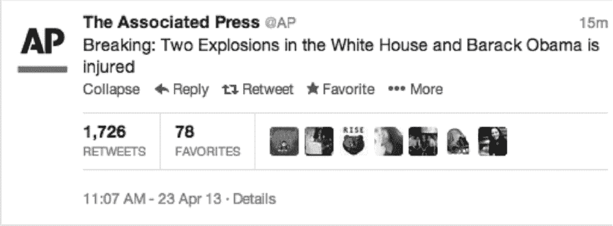

再往深处说，还有公司和国家层面的网络间谍活动。这里牵扯的是商业秘密、全球经济和国家安全，哪怕是最不关心时事的公民，也明白后果不轻。

所以我想强调：网络钓鱼和每个人都有关，不只是安全人员的议题。你可能不会天天琢磨网络间谍，但你一定关心自己的银行账户和信用卡积分。我母亲到现在还没搞懂怎么在手机上查语音留言（真事），可她知道不该打开陌生人发来的邮件。你母亲也该记住这条规则。

## 三、他们是怎么下钩的

最省事的办法之一，是把发件人一栏伪造成你认识的人，或者看起来合理的来源，比如电信公司。第四章里，我和克里斯概括过一些简单步骤，帮你判断发件人是否合法。同时也要明白：邮件来自熟人，并不代表它就安全。

另一种常见手法是网站克隆。骗子把合法网站复制一份，骗你输入个人可识别信息（PII）或登录凭据；这种假站点也可能直接攻击你的电脑。克里斯亲身遇到过假亚马逊网站，这是个很典型的例子。首先，很多人都在亚马逊买过东西，对它的网站和邮件太熟悉了，反而容易扫一眼就放过；其次，假站点做得足够好，连对这类骗局有经验的人也可能中招。

克里斯这些年在客户许可下做过不少钓鱼测试，发过数十万封钓鱼邮件，很了解这类邮件怎么写、为什么有效。可就在去年，他收到一封“亚马逊账户将被冻结”的邮件，偏偏赶上我们准备 DEF CON 年度竞赛。那段时间他忙得团团转，坐在办公室里简直像在但丁笔下的九层地狱里打转。你可以想象后面发生了什么。

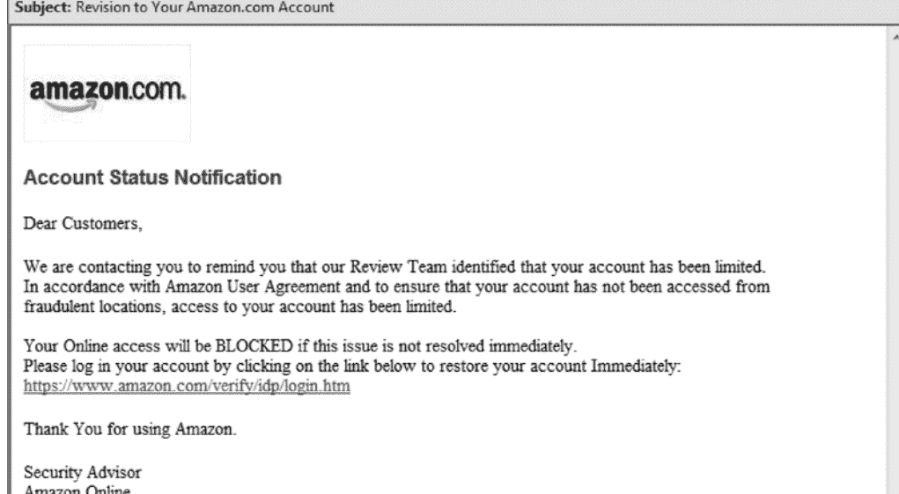

那封邮件的语言水平并不达标，甚至有点怪，比如单词里字母随机大写。这其实是钓鱼邮件的常见特征，很多发件人母语并不是英语。可关键在于：对一个匆匆扫一眼的人来说，它的质量已经够用了。克里斯点开链接，进入一个看起来像亚马逊的页面。哪怕仔细检查，也很难发现破绽，因为它就是原网站的克隆版。

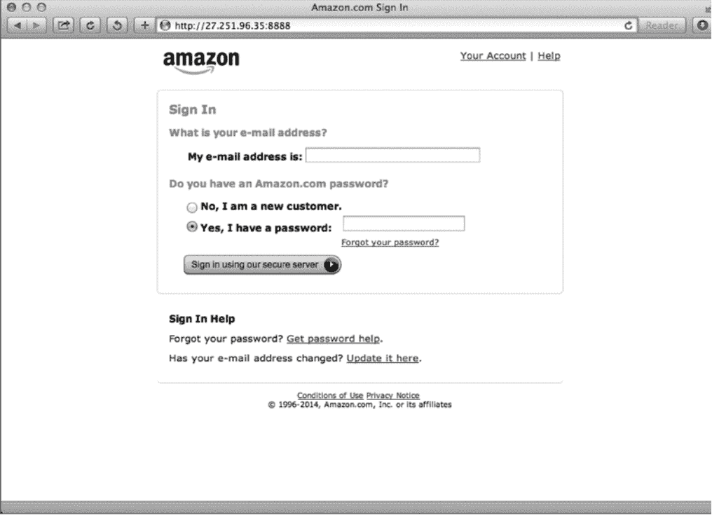

这时，他多年的训练起了作用。他看了一眼网址，发现那是个非法站点。要是把登录信息输进去，账户里的 PII 和信用卡信息就会被劫持。这封邮件差点骗过克里斯，原因并不神秘：假网站是克隆的，而邮件到达时他又忙又累、注意力分散，这些都会妨碍批判性思维（详见第四章）。网站克隆之所以有说服力，就在于它让人相信：这封邮件说的像是真的。

最后还有一种套路：骗子给刚收到钓鱼邮件的人打电话。这叫语音钓鱼，也叫电话钓鱼。它的恶意目的不少，从给邮件增加真实感，到直接索要保密信息，都干得出来。这个套路反过来也提醒我们保护 PII 有多重要。我成长的年代，社会安全号码和电话号码会直接印在支票上、地址下方，简直像在对罪犯说：“请来偷我的身份信息吧。”想象一下：你先收到“银行”邮件，紧接着又接到“银行”电话，对方让你点链接去更新账户信息——是不是很容易深信不疑？

最近还有一起企业级钓鱼攻击叫 Francophoning，因为目标公司主要在法国。手法很精心：一位行政助理收到关于发票问题的邮件，随后电话来了，对方自称公司副总裁，要求她立刻处理邮件里提到的发票。她点了链接，后台随即加载恶意软件，攻击者由此控制她的电脑并窃取信息。这个案例有趣的地方在于多个要素同时起作用，比如权威身份和性别差异；但最想说明的一点是：同一个故事从多个渠道传到你耳朵里，它就会显得更可信。

## 四、几个真实案例，代价都不小

我和克里斯都善于从例子里学习。这里得先提反钓鱼工作组（APWG，www.apwg.org）。不用长篇介绍，一句话就够：这是一个全球安全爱好者联盟，专门研究、定义并报道全球钓鱼攻击。

按 APWG 在 2014 年 8 月发布的报告，钓鱼攻击的数量仍然惊人。2014 年第二季度，消费者向 APWG 报告了 128,378 个不同的钓鱼站点和 171,801 封不同的钓鱼邮件，这是 APWG 开始追踪这些数据以来第二高的季度数值。交易服务和金融机构是主要目标，占整体的 60%。同时还有一个新趋势：针对在线支付和加密货币的攻击在增加。

**塔吉特公司**的遭遇，可能是目前最出名的案例之一。它影响了近 1.1 亿消费者，估计约 4000 万条信用卡信息和 7000 万人的个人可识别信息被泄露；你的数据说不定也在其中。有意思的是，攻击者似乎并非一开始就冲着塔吉特去的。这是一次攻击升级：最初的受害者是塔吉特的一家暖通空调供应商，这家供应商拥有塔吉特的网络证书。该供应商的一名员工收到钓鱼邮件，点开了会加载恶意软件的链接，恶意程序随后从承包商那里偷走了他的登录信息。承包商的网络又和塔吉特的网络相连，用于账单、合同递交等。全部细节还不清楚，但攻击者最终进入了塔吉特的服务器，并攻陷了交易系统。塔吉特已经花了两亿多美元重制被盗信用卡，这还没算日后可能发生的欺诈。对提醒公众认识钓鱼危险来说，这是一堂生动又昂贵的课。

**RSA 公司**的经历则不太一样。今天提起 RSA，人们先想到的往往是 2013 年底与国家安全局有关的加密算法风波，那件事的影响甚至盖过了 2011 年 RSA 遇袭事件。和塔吉特那种偶然被卷入不同，RSA 遭遇的看起来是一场针对其员工的攻击。一封发给 RSA 低层员工的邮件里带着恶意 Excel 附件（见图 1-4），附件中的程序包含键盘记录等能力。攻击者因此拿到企业内部网络和数据的访问权限，直到几周后才被发现。

**可口可乐公司**在 2009 年 2 月也遭到攻击，直到 3 月接到 FBI 通知，公司才意识到大量敏感数据已经被盗。当时可口可乐正试图以 24 亿美元收购一家软饮料制造商，收购最后失败了。失败原因众说纷纭，但至少有一家安全组织声称，谈判策略和收购价格等关键信息被泄露给了对方，才导致谈判崩盘。

**美联社**的攻击之所以令人印象深刻，是因为一条 Twitter 消息就能对股票市场产生巨大冲击。黑客只是用了简单的鱼叉式钓鱼，让美联社员工误以为邮件来自同事。

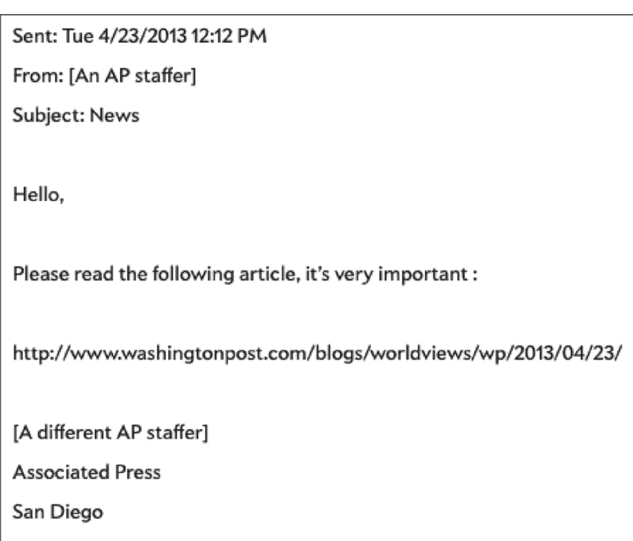

那封邮件虽然含糊，却来自“已知”的来源，而且似乎指向《华盛顿邮报》网站上的一个合法页面。实际上，受害者点开的链接通往一个仿冒站点，用来收集登录信息。该站点还允许用户用 Twitter 账户授权登录，后面的 Twitter 账户被盗就由此而来。

显然，不管公司堆了多少技术控制和安全策略，它们仍然和普通人一样容易中招。

## 五、普通人常遇到的钓鱼套路

聊网络钓鱼，不提“尼日利亚 419”骗局总会留下遗憾。它也叫预付款骗局，历史其实有 200 多年了。想想平信时代，这种骗局生效很慢，可它照样有效。它被称为“尼日利亚骗局”，是因为很多此类骗局来自尼日利亚；数字 419 则指尼日利亚刑法中欺诈类犯罪的编号。

你可能见过这类故事：一位富有王子声称自己被废黜，需要你帮忙转移大笔财富；或者一个将死之人后悔从前吝啬，想请你帮忙把财产捐给慈善机构。情节怎么变，基本特征却不变：

- 金额大得吓人；
- 对方信任你这个彻头彻尾的陌生人，让你去转账、付款或者代为持有这笔钱；
- 你会得到报酬，但前提是你得按对方的要求做下面这些事——而“下面这些事”，正是整个骗局真正收网的地方。

419 骗局的套路模板简单得惊人：先让你报上收款账号，方便对方把钱打进来；接着让你垫付一笔转账手续费，理由是那边政局动荡或当事人有难处，根本掏不出这笔钱。

最近我邮箱里就收到过一封差不多的信（见图 1-6）。发信人自称身处加纳，不是尼日利亚——不过领会精神就好。

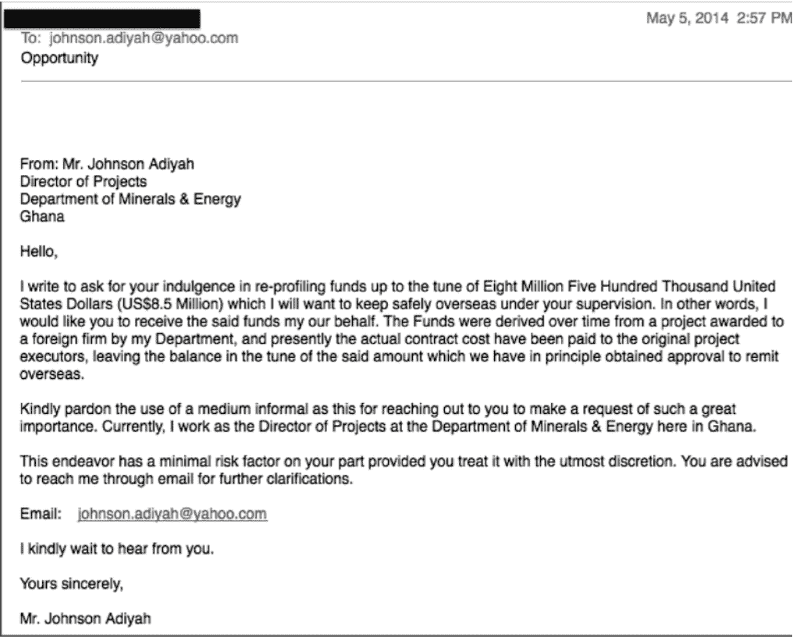

图 1-6 一封 419 钓鱼信（收件人：米歇尔）

这套路几乎一眼可辨，可我凭什么断定对方不是某位非洲王储，只是骗子？

- 身份对不上号：我与非洲权贵素无来往，也没和加纳的采矿能源部门打过交道，更没见过一位署名约翰逊·艾迪约亚（Johnson Adiyah）的先生。
- 反过来也一样：他凭什么认得我？更夸张的是，信里连收件人的名字都没写。谈着数百万美金的生意，居然连对面是谁都没搞清？
- 天上掉馅饼的事并非不可能，可这份请求来得毫无由头，实在突兀。
- 信任也给得过头：天大的事不找银行、不找熟人、不找律师，偏偏托付给我这个八竿子打不着的外人。我自认挺靠谱，可你知道这笔钱能换成多少顿蟹饼大餐吗？
- 最后，信虽然后面八成点过拼写纠错，英文却读着别扭，一看就不是母语者写的。假如我现实里真有个加纳籍的约翰逊朋友，这点毛病倒也无关痛痒。

这套 419 骗术属于最初级的花招，按理说极好辨认。但你不免要嘀咕：都过了两百多年，怎么至今还有人信？就算是你自己，说不定也收过类似的电邮——它凭什么还能骗到人？

- **贪婪**。排在第一位、也是最根本的动因。那笔钱对大部分人而言是几辈子都见不到的天文数字，足以让人头脑短路。万一故事是真的呢？答案当然是否定的。可一个人要是连“自己迟早会发横财”都愿意相信，再让他相信陌生阔佬会把钱送上门，也就没那么难了。
- **认知盲区**。后面章节会从好几个侧面展开。到今天，仍有一大批人——我老妈就是其中之一——压根料不到电子邮件能被人用来偷走身份资料和存款。
- **轻信**。世上确实有人对谁都掏心掏肺。如果能活在一个放心信任别人也不会遭殃的世界，那该多好。可惜现实不是。

除了拿巨款当诱饵，骗子还爱用几套屡试不爽的话术，至少能让你点开邮件时心里咯噔一下。

##### 1. 金融题材

要说骗子最爱的题材，金融绝对排在头名。钱这个东西谁都离不开：储蓄、汇款、报税，桩桩件件绕不开银行和税务机关，所以信箱里出现这类通知，很少有人直接删掉。具体骗法千变万化，但万变不离其宗——哄你去某个网页重新填写账户资料，美其名曰“核实”。典型剧本包括：

- 账户疑似被异地登录；
- 银行更换了新的安全验证流程；
- 贷款或税款没有按时结清。

图 1-7 至图 1-10 都是现成的例子。比起 419 的粗制滥造，这批货讲究得多，常常配上商标与配图，乍一看还挺唬人。我们把这档归为进阶版。

Subject: Wells Fargo Online Fraud Prevention.

From: "Wells Fargo Online"<wellsfargo@wellsconnect.wellsfargo.com>

Dear Wells Fargo Online℠ Customer:

Wells Fargo's Internet Services Group Fraud Operations would like to verify some recent activity on your account. To help protect your Wells Fargo account(s) from unauthorized access, we have restricted your online access, which will remain in effect until you re-activate.

To re-activate your account, log on to www.wellsfargo.com

If you aren't enrolled in Online and think you've received this message in error, please call our Customer Support team immediately, using the phone number on the "Contact Us" page on Wells Fargo Online.

Note : Make Sure Your Fill Out All The Informations Requested For Your Personal Security Reason.

Sincerely,

JOSHUA RAMSEY

ISG Fraud Operations

图 1-7 仿照 Wells Fargo 官方通知的高仿信

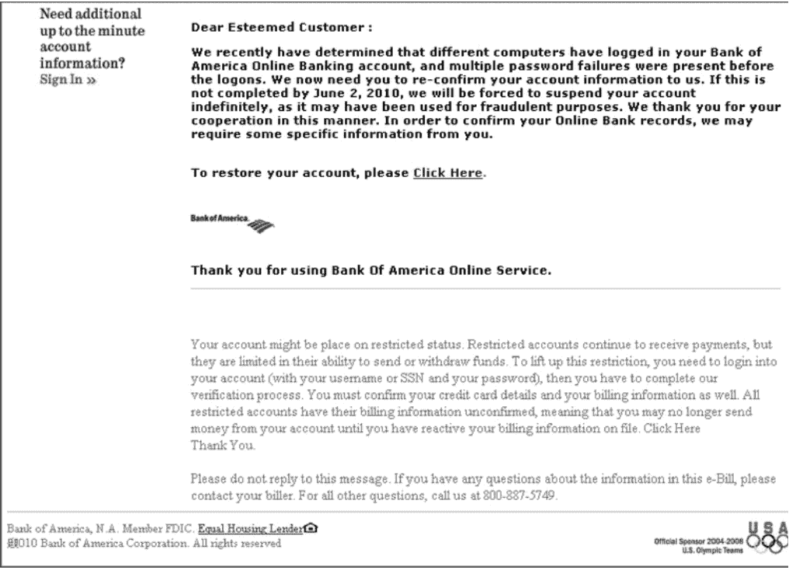

图 1-8 仿照 Bank of America 通知的高仿信

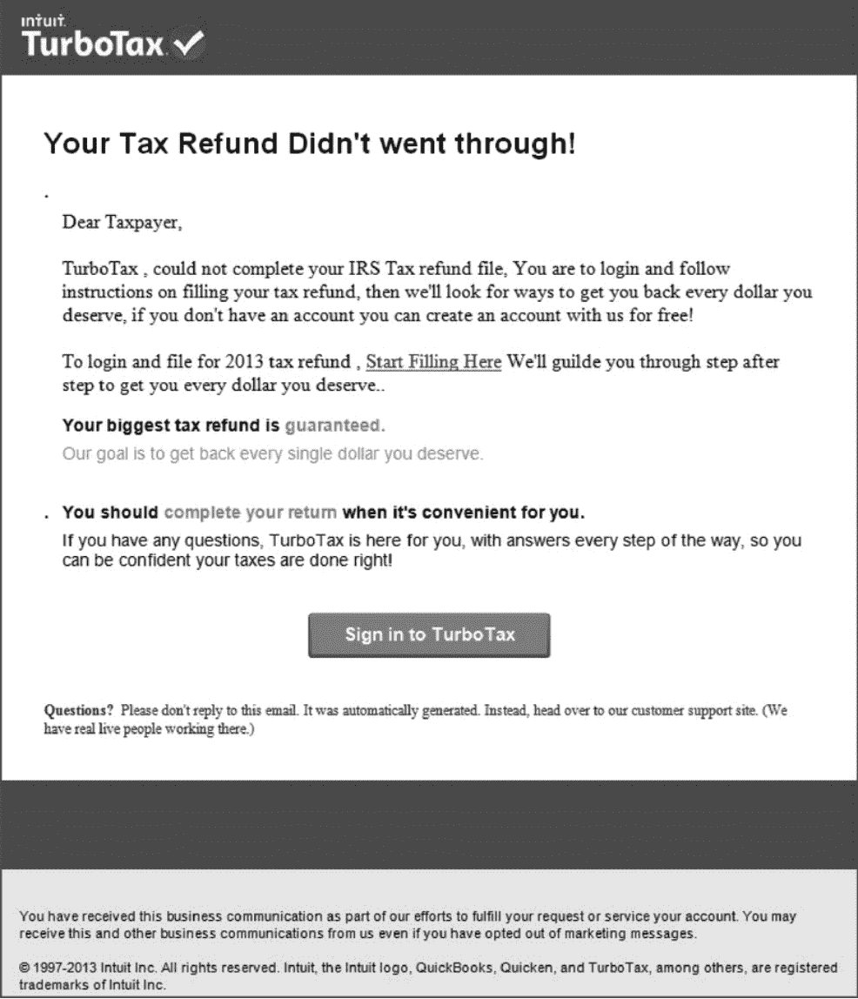

图 1-9 冒充纳税申报的高仿信

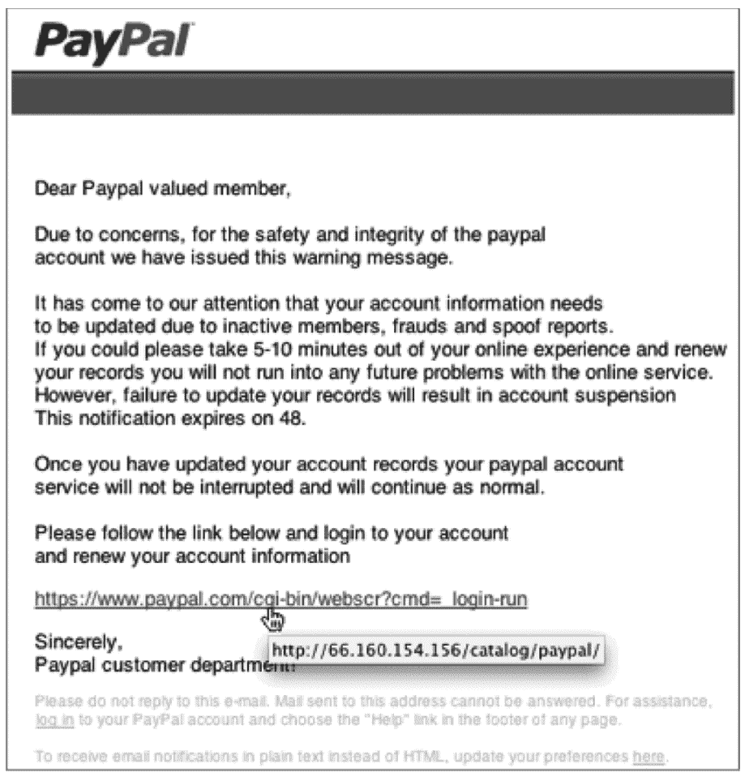

图 1-10 借 PayPal（贝宝）名头的高仿信

骗术虽然升级了，马脚却依然好找：

- 开头的称呼总是模糊不清。正规银行怎么会连收件人的名字都写不出？一句“尊敬的客户”就打发你，太假。
- 从语法到拼写再到大小写，偶尔仍会露馅——虽较 419 那种粗货顺眼，却远达不到正规商务函件的水准。
- 信里让你“验证”的那个链接，点开后的网址与信头自称的机构八竿子打不着。
- 措辞不断施压，动辄以“账户即将被冻结”来催人马上行动。

换言之，这些邮件靠的是恐吓与焦虑，逼人立刻照做。凡是跟钱有关的坏消息，谁都坐不住。常用的施压手段就那么三板斧：

- **权威背书**。这是影响力原则之一，到第三章会展开——人是群居动物，对各类“官方身份”天然会顺从。
- **倒计时**。信上明说“48 小时后账户注销”，紧迫感一下子拉满。刻在基因里的生存本能会警告你：获取资源的机会被设了期限。
- **描绘危害**。想象银行提示“账户存在异常活动”，让你觉得有黑客正在暗中下手——谁能不当回事？毕竟，只有我本人（以及史努比）才合该在我的存款附近出现。

##### 2. 社交平台猎场

第二个常被利用的场景是社交平台。这类服务的命脉就是互动，所以官方发来信件，提示新好友申请或叫你去点某个链接，你基本不会多想。论技术含量，它和金融钓鱼半斤八两，识别方法也差不多。但依我看，它甚至比前者还好骗：既然加入了平台，收到邀请本来就正常，甚至是求之不得的事。而且这种信没有银行通知那种“出事”的味道，防线不知不觉就松了。

和金融钓鱼一样，它也会拿恐惧当杠杆，见图 1-11。

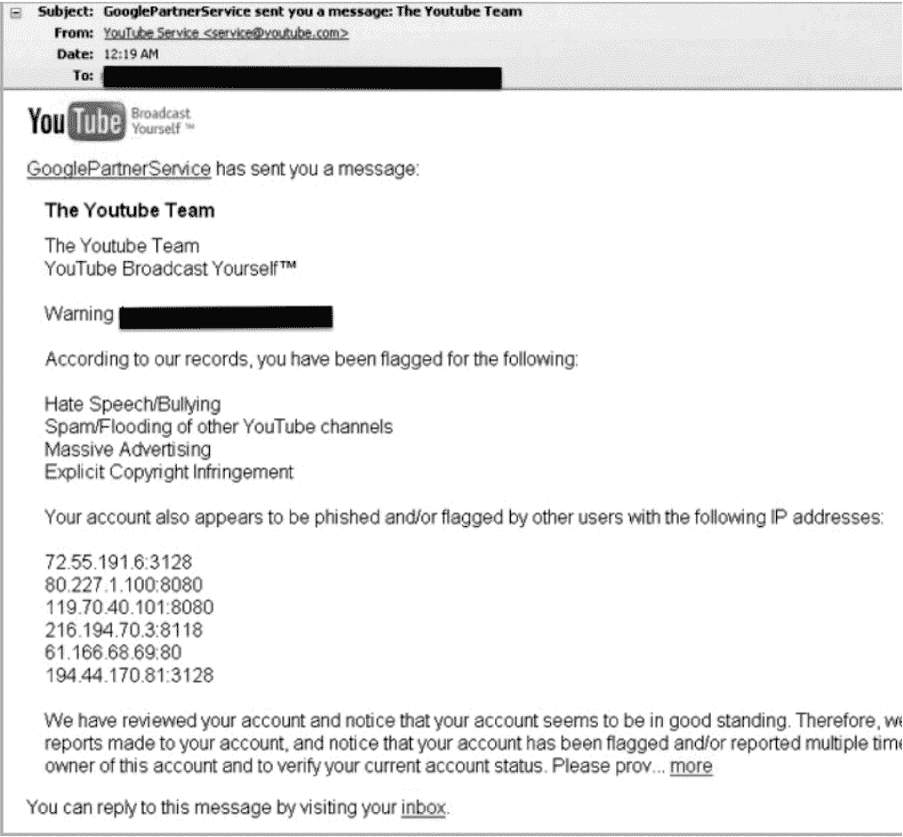

图 1-11 仿 YouTube 通知的高仿信

恐惧固然好用——没了社交账号，不光闹心，还特别不方便。但社交平台真正的高招是“人情债”。平台靠连接与参与壮大，设计上不断暗示：参与互动很好玩，群组让人有归属感。骗子把这套心理照单全收。不少人点开链接，不是看不出风险，而是不想扫兴——不愿一口回绝他人的好友申请，也不想已读不回显得失礼，哪怕对方与自己素不相识。见图 1-12 与图 1-13。

###### [redacted] wants to be friends on Facebook.

Facebook <notification+qktox4c9@facebookmail.com>

If there are problems with how this message is displayed, click here to view it in a web browser.

Sent: [redacted]

To: [redacted]

facebook

[redacted] wants to be friends with you on Facebook.

177 friends · 2 photo · 21 Wall posts

Confirm Friend Request

See All Requests

The message was sent [redacted] If you don't want to receive these emails from Facebook in the future or have your email address used for friend suggestions, you can unsubscribe. Facebook, Inc. P.O. Box 10005, Palo Alto, CA 94303

图 1-12 仿 Facebook 好友申请通知的高仿信

From LinkedIn

Subject LinkedIn Information service message

To Me

11:59 AM

###### LinkedIn

###### REMINDERS

Invitation reminders:

From _________ (Your employee)

###### PENDING EVENTS

There are a total of 3 notes awaiting your response. Visit your InBox by clicking here.

Don't wish to obtain email information? Change your auto-informers settings.

LinkedIn respect your privacy. Not once has LinkedIn made your e-mail address acceptable to any third-party LinkedIn member without your allowance. 2013, LinkedIn Corporation.

图 1-13 仿 LinkedIn 提醒的高仿信

作者闲话：我小时候也有过一种特殊的“远程关系”——笔友。那时要建立一段笔友关系，可比今天认识网友费劲多了。社交平台至今仍让我觉得有趣：它让结识新人这件事变得毫不费力，不再局限于老同学、老同事的熟人圈。可代价也随之而来——越是渴望新朋友、积极拓展人脉的人，越容易被这类鱼饵盯上。从这个角度看，离群索居反而最安全。就在此刻，我的收件箱里还积着 34 条待处理的加友邀请（并非钓鱼），我大概该去清一清，免得别人以为我拒人于千里之外。

##### 3. 跟着大事件行骗

最后这类最让人不齿。每当有大事刷屏——地震海啸、飞机失事、恐怖袭击，这类全民都在盯着的大事件一出现，骗子就闻风而动。他们消费的是恐惧、好奇与同情这些天然情绪。冷静细看，这些骗术大多停留在中档水平，非法痕迹相当明显；可惜不少人完全被情绪推着走，根本不做判断。怎么让人不假思索就行动？把情绪点燃到极致。第二章会讲到这个现象：杏仁核劫持（amygdala hijacking）。

塔吉特自曝系统被入侵后不到一昼夜，骗子就开始贩卖身份焦虑。当时已知的诈骗手法至少有 12 种，其中之一是冒充塔吉特官方，向顾客解释事情经过，并送上一份“免费”的信用记录监控服务。¹¹^ 这封信件高仿得惊人，正文几乎是那封官方通知的翻版（见图 1-14），你很可能要核对发件地址和网址才能辨出真伪。更讽刺的是，塔吉特官方正牌通知的发件账户恰恰是 TargetNew@target.bfi0.com——单看这串地址就足够让人打问号。趁着一片恐慌和迷茫，这次数据泄露被骗子们榨干了价值。

¹¹^ Casey Hill, “Email ‘from Target’ to Customers Is a Phishing Scam,” December 20, 2013, http://www.market-watch.com/story/scammers-pounce-on-target-fiasco-2013-12-20 .

**Dear Target Guest,**

As you may have heard or read, Target learned in mid-December that criminals forced their way into our systems and took guest information, including debit and credit card data. Late last week, as part of our ongoing investigation, we learned that additional information, including name, mailing address, phone number or email address, was also taken. I am writing to make you aware that your name, mailing address, phone number or email address may have been taken during the intrusion.

I am truly sorry this incident occurred and sincerely regret any inconvenience it may cause you. Because we value you as a guest and your trust is important to us, Target is offering one year of free credit monitoring to all Target guests who shopped in U.S. stores, through Experian's® ProtectMyID® product which includes identity theft insurance where available. To receive your unique activation code for this service, please go to creditmonitoring.target.com and register before April 23, 2014. Activation codes must be redeemed by April 30, 2014.

In addition, to guard against possible scams, always be cautious about sharing personal information, such as Social Security numbers, passwords, user IDs and financial account information. Here are some tips that will help protect you:

- Never share information with anyone over the phone, email or text, even if they claim to be someone you know or do business with. Instead, ask for a call-back number.

- Delete texts immediately from numbers or names you don't recognize.

- Be wary of emails that ask for money or send you to suspicious websites. Don't click links within emails you don't recognize.

Target's email communication regarding this incident will never ask you to provide personal or sensitive information.

Thank you for your patience and loyalty to Target. You can find additional information and FAQs about this incident at our Target.com/databreach website. If you have further questions, you may call us at 866-852-8680.

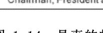

Gregg Steinhafel

Chairman, President and CEO

图 1-14 官方正牌，还是鱼饵？

不用说，常去塔吉特购物的人风险最大。这家零售巨头体量惊人，数据一泄露，几乎每个美国消费者都心头一紧——试问，谁没跟塔吉特打过照面呢？

# 灾难、银行通知、职场邀约……骗局为何总能让人上钩？

先说明一点：我拉出这些案例，不是要对谁贴标签，而是想借真实事件敲个警钟——灾后冒出的那类“蹭热点骗术”，往往比直接吓唬人更阴。它们不靠明晃晃的威胁（那已经够糟了），而是借你和亲友、机构、熟人的关系做文章。

那起马拉松赛事惨案发生后没几小时，黑产就开始撒网。¹² 不少诱饵信只丢一个“现场视频”的入口，勾人猎奇；点进去却可能落到偷偷投放有害程序的页面。图 1-15 就是其中一个花样：假借 CNN 名义发信，利用大家对权威的服从和好奇心提高得手率。

¹² 来源：一篇 2013 年 4 月 18 日发布的安全博客文章。

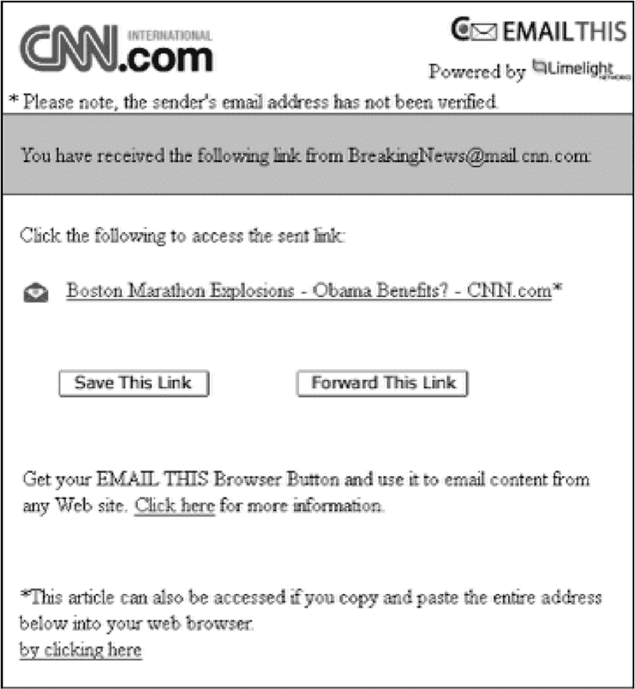
图 1-15：蹭波马事件热度的假新闻信变体

更扎心的是冲着善心来的骗局。灾后几小时，求助信就会冒出来。图 1-16 是 2011 年东日本大地震与海啸后流传的一封；有报道说，首震过后三小时，这类骗术已出现。

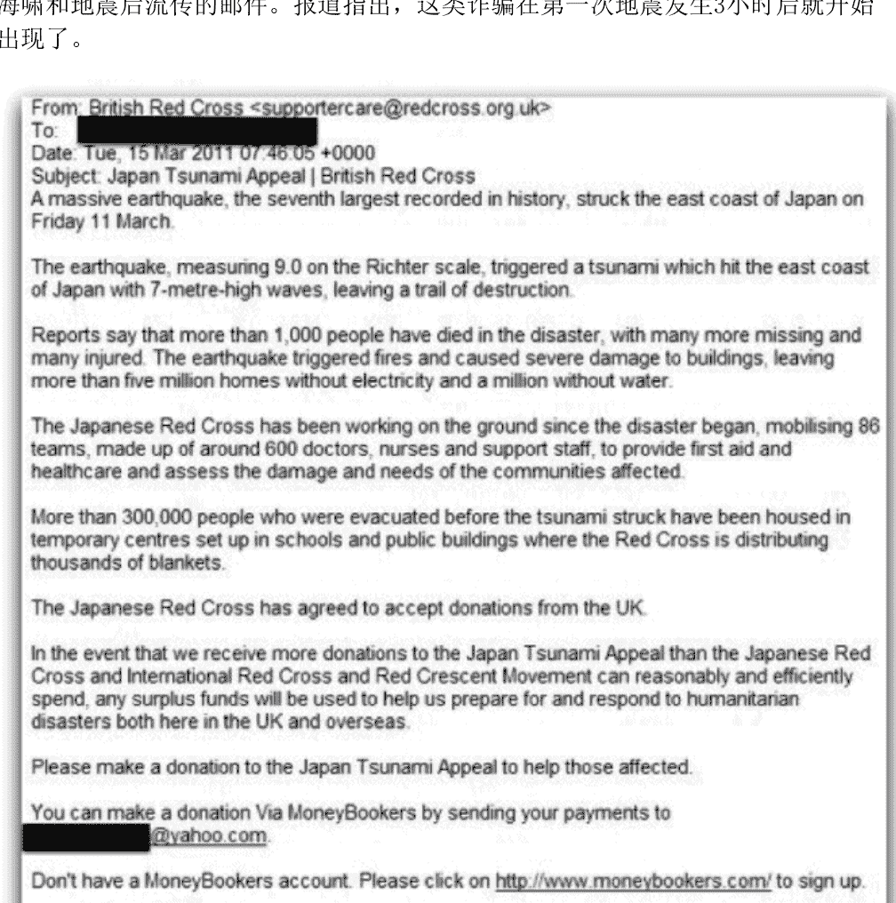
图 1-16：东日本灾后流传的假募捐信

其实图 1-16 并不难识破：红会只在自己官网收款，不会让捐款人通过 MoneyBookers 之类渠道往某个免费邮箱打钱。可在那种悲伤时刻，急着帮忙的人太多，仍有人中招。借灾难行骗者还会打电话、甚至上门哀求，把戏演得更真。

## 先给骗术画个群像

现实中的在线欺诈花样繁多，但主题有迹可循：419 预付费/身份盗用类、银行与支付平台、职场社交网络、以及蹭公共热点。名单还能拉长——任何能在线上沟通的主体都可能被冒名，比如拍卖网站、视频平台、应用更新提示、邮递机构。多数骗局属入门级到中等，共性也强：行骗者会按下这些心理按钮——贪念、害怕、对权威的服从、与人连接的愿望、猎奇心、恻隐之心。

不少欺诈信原本有迹可循，但手法升级后，线索越来越淡：称呼与署名模糊；寄件方陌生或可疑；所附地址来路不明；错字、病句、标点毛病；理由离谱（419 类尤其明显）；催得很急。

## 骗术升级：中阶与高阶

读到这里，信息密度可能像瀑布冲脸。前面只是入门，后面还有更绕、更让人头疼的招。我们团队按难度分级，一是帮委托方判断眼前遇到什么，二是追踪他们识别复杂骗局的成长。第六章会展开高阶手法。

先看中阶。之前例子多为初中阶，有些卡在中阶与高阶之间。比如某零售巨头那起：信本身不假，坏在可点地址被引到危险站点。下面拆一个金融机构的假通知，见图 1-17。

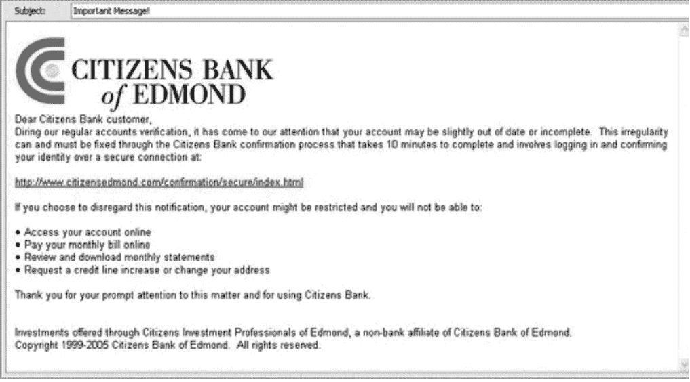
图 1-17：中阶金融骗局示例

这封信高明在哪？哪些点会推着人点下去？

- **真标识**：较精的诱饵会嵌入真实 logo 和图片，显得正规。大家习惯了企业来信带标识，警惕性就松了。
- **制造紧张**：信里说，不操作，账号可能被停用。
- **催得急**：没给明确期限，却让人想立刻处理。

按前面的要点，图 1-17 不难看穿：没有称呼具体收信人；寄件方查不清；语句别扭，主题也不自然；可点地址会跳转。你若把指针停在那个可点文字上，很可能发现它并不通向真正银行站点，而是拐到某个可疑地址。

**提醒**：这里说的“查”，只是把指针停在可点文字上，看清真实指向。除非你是安全行家或电脑防护很强，别点，也别复制去访问。

图 1-18 乍看像前一个金融案例，但几处设计让它更难认。请细看再想。

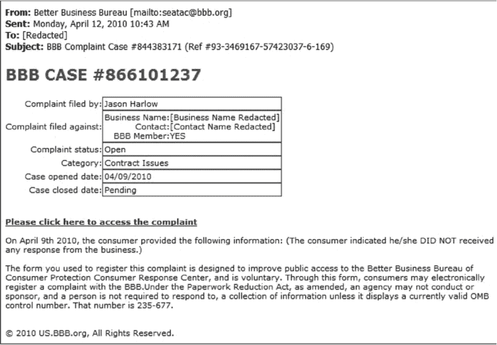
图 1-18：伪装成商业改进局通知的中阶骗局

观察后你会发现，它比普通诱饵更老练：称呼更贴近具体收信人，还点出对方公司；虽然没放图片或标识，但商业改进局本身名头够响；它把紧张感用得更足——一封“投诉信”，点名合同问题，还说公司没回复投诉方，足以让老板心里一紧；它还借权威撑场面，列出参考号、案件号，以及一个看着像政府预算部门的编号，显得很正式；回信地址也伪装成该机构官方域名。

好在仍有破绽：主题里的案件号和正文对不上；没有写明具体经办人，虽然挂着机构名，但这类事通常该有专人对接；可点地址若查，会发现不属于该机构域名；还有轻微语句毛病；而且我核实过，商业改进局并没有设所谓的“维权事务部”。

再看高阶。图 1-19 比图 1-13 那封职场社交邀约更狡猾，我怀疑它是仿制件，和图 1-14 某零售巨头那封类似。

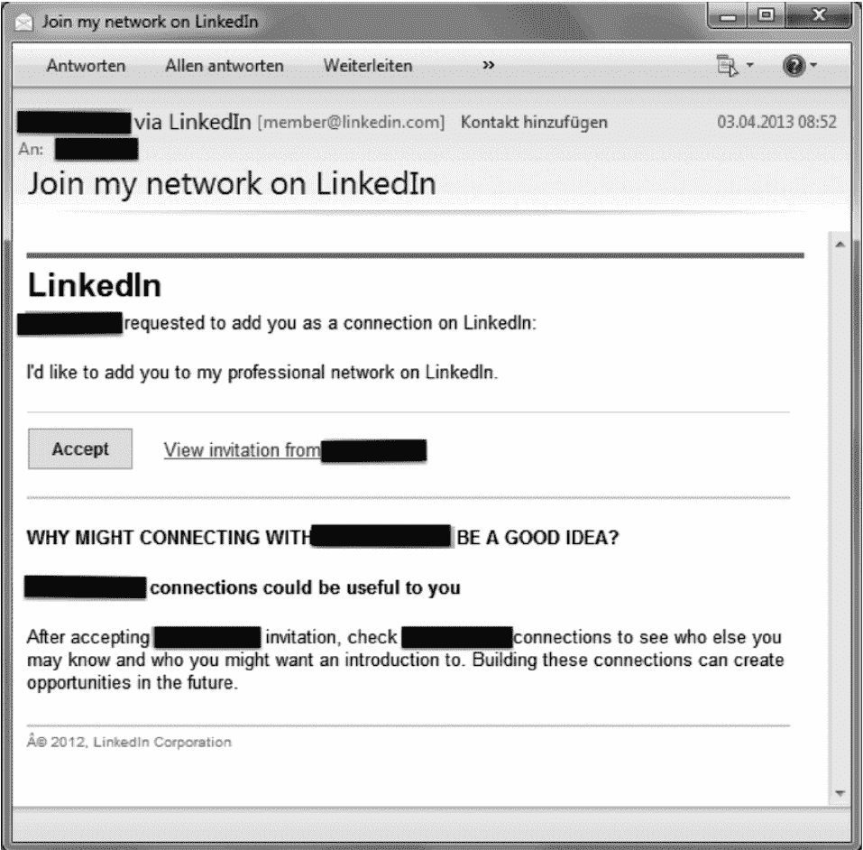
图 1-19：伪装成领英通知的高阶骗局

它为何奏效？寄件方像个“真人”——他有领英账号，所以似乎就顺理成章；领英本来就是职场社交网络，陌生人发邀约不稀奇；信里有领英标识，格式也和你以前收到的邀约差不多。

确实，图 1-19 做得很像。若它是仿制件，语言、版式、标识可能都挑不出毛病，所以要多做几步：看可点地址指向何处（再说一次，是看，不是点）；核对寄件邮箱是否与关联你领英账号的地址一致，多问一句；仍不踏实，就先别理会这封信，直接进领英看有没有邀请。

图 1-20 是我一位朋友收到的信。他是某电信运营商的长期客户，收到该运营商来信本不奇怪；好在他警惕性很高，回复前先查。我基本确定这是一次高阶骗局。

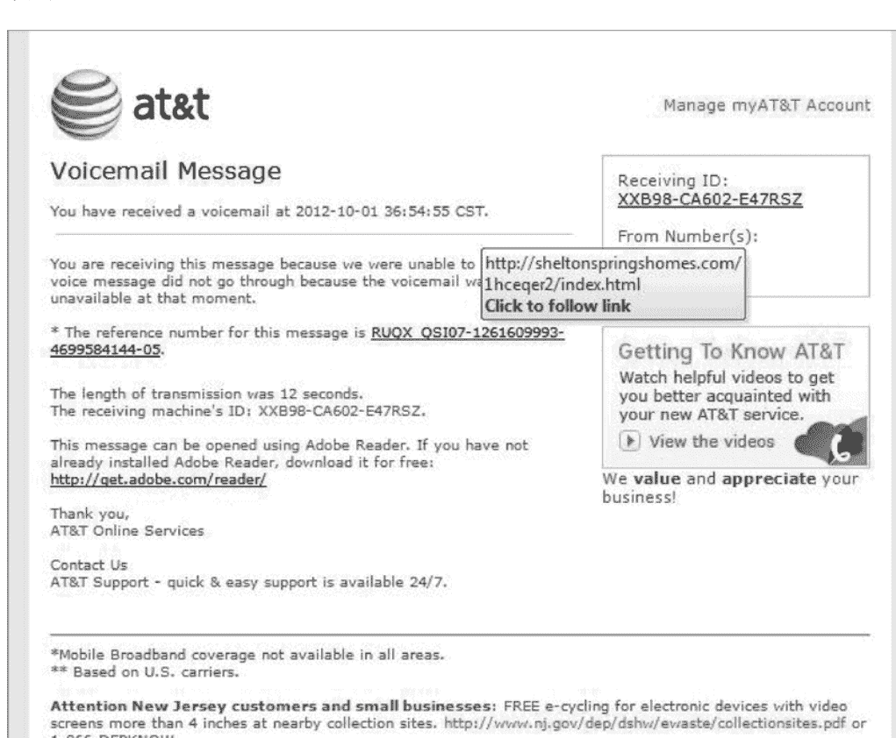
图 1-20：伪装成电信运营商通知的高阶骗局

我不确定图 1-20 是否为该运营商真信的仿制件；如果不是，那它确实像真的，多数普通收信人会信，原因包括：用了运营商的标识、颜色和配图；没有明显错字、病句、标点问题；拿“语音留言打不开”当借口，让人立刻想处理。

那朋友怎么躲过？他花了一点时间才想起，收到这封信的收件箱并不是绑定该运营商的那个，这帮了大忙；信里没有称呼收信人；回信地址里藏着带毒地址。他逐个查看可点地址，发现一个细节：整封只有一处地址带毒，其余都正常。若不是查得彻底，它看起来就像真信。

显然，这封电信诱饵很难认，因为它确实过了基础筛查。幸运的是，朋友从不通过信里的可点地址进任何账号。希望你读完后，至少回头审视自己的收信习惯。

## 矛尖式定向欺诈：为你量身定做

最后谈定向精准骗术（spear phishing）。它针对特定对象定制。行骗者会花时间摸你底，至少知道你姓名和邮箱；了解多深，取决于你多重要。借助搜索引擎，他能在社交网络找到你的账号、网站，或你参与过的任何线上内容。你若足够重要，他可能掌握你的爱好、资产，甚至家里情况；若挖到你的难堪旧事，他甚至不掩饰对你手里东西的企图，可能拿来勒索，或诱你帮他拿到更多信息。扯远了，回到正题。

令人脊背发凉的是，这种调查能做出很难防住的诱饵。一个非常想从你身上拿走东西的人，什么招都使得出。他会知道你是否曾患重病、如今是否支持公益组织；会知道你否沉迷线上博彩，或房贷是否压得喘不过气。这些正是定向骗术的要害：为你个人定制。

图 1-21 是一起针对企业高管的近期定向攻击。¹³ 想象一下，你的收件箱里躺着一封这样的信？

¹³ 来源：2008 年 4 月 16 日的一篇科技报道。

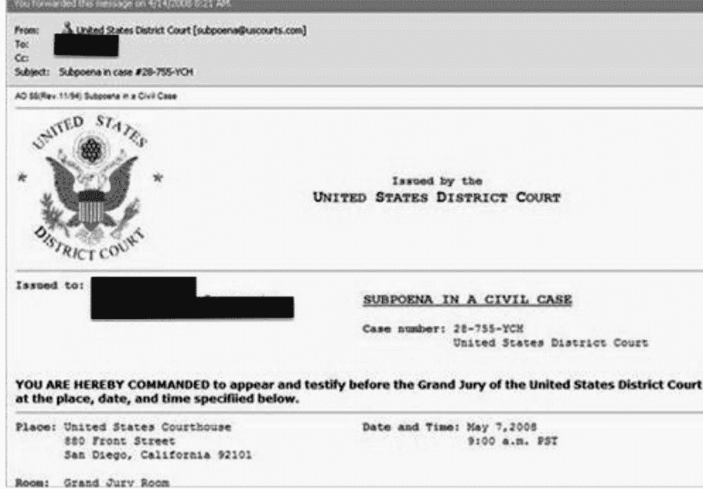
图 1-21：矛尖式定向欺诈示例

来拆图 1-21 为何有说服力：信里用了联邦司法机构的徽标；借害怕和对权威的服从——谁收到法庭通知会开心？个人信息很全，有姓名、邮箱、单位、电话；还制造截止感，写明到场时间以及缺席后果；没有明显错字或病句；回信地址看起来像司法机构官方电邮。

说实话，这封信对任何人都很难辨真假。我能找到两处破绽：点开通知指向的页面，会落入危险站点，这个例子里会装盗号工具；回信地址看似官方，但真正的司法电邮后缀都以 .gov 收尾。就这两处机会，让你识破这封制造压力的假信。再强调：除非你已养成牢固习惯，否则很容易栽。

## 收束：别只问点了什么，更问为什么点

到这里，你已初步看清在线欺诈的世界。本章要点包括：Phishing（网络钓鱼）的含义；常见目标与作恶者；行骗动机；行骗者惯用的技术；借热点灾难做文章的实例；生活里高频出现的套路；以及骗术分级一览。希望你对这一问题的认识更深：它是什么、波及多广、为何人人都更难躲。

再用几组硬数据收尾：2012 年 5 月至 2013 年 4 月的那一年跨度内，逾三千七百万名账号持有人报告遭遇过此类攻击。这还仅来自单一渠道，是我们恰好掌握的部分。全球每日电邮发送量约三千亿封，其中九成属于垃圾内容或携带恶意代码。¹⁴ 这些数字只说明一件事：只要你有邮箱，迟早会撞上一封诱饵信。

¹⁴ 来源：2014 年 4 月 28 日的一张安全信息图。

先松口气，因为接下来水会变深。骗局不只关乎你点了什么，更关乎你为何会点。让我们钻进“人性底层”，看看哪些心理开关会被拨动。是不是有点意思？走起。