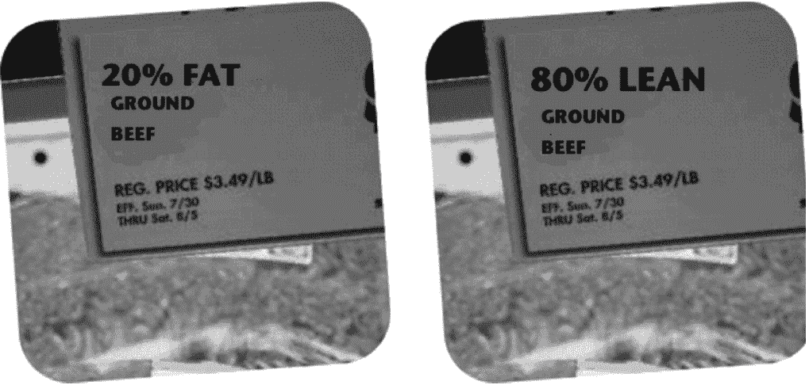
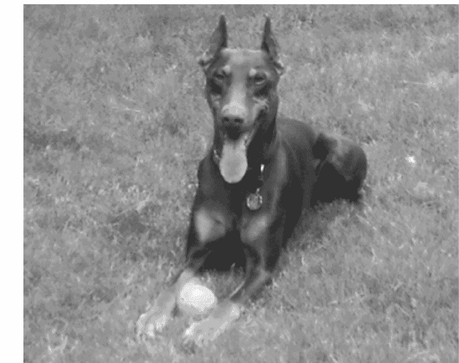
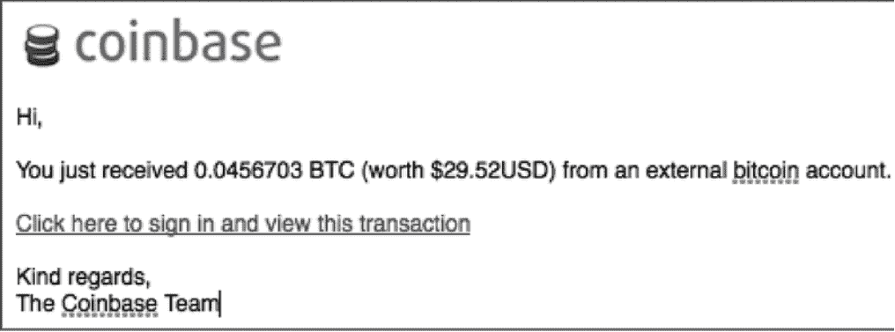
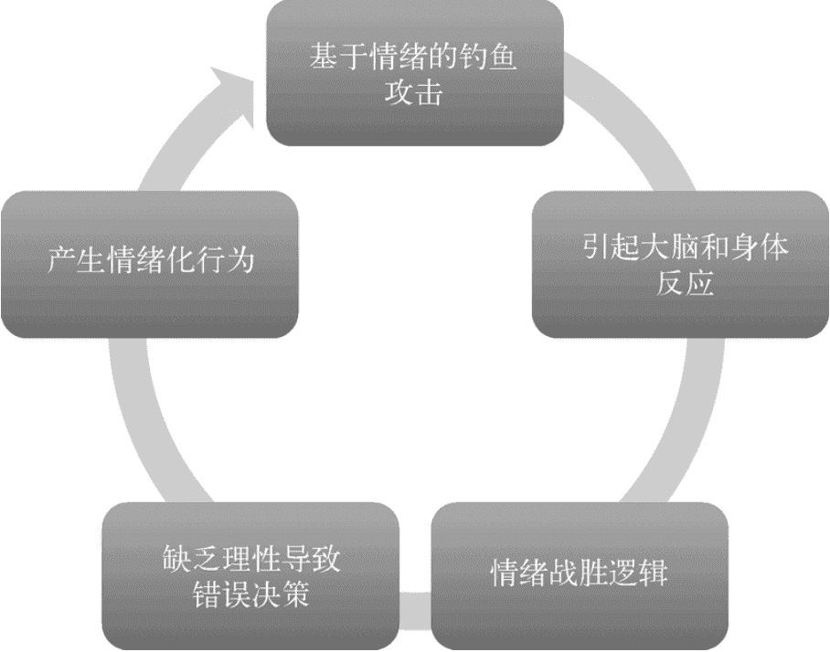
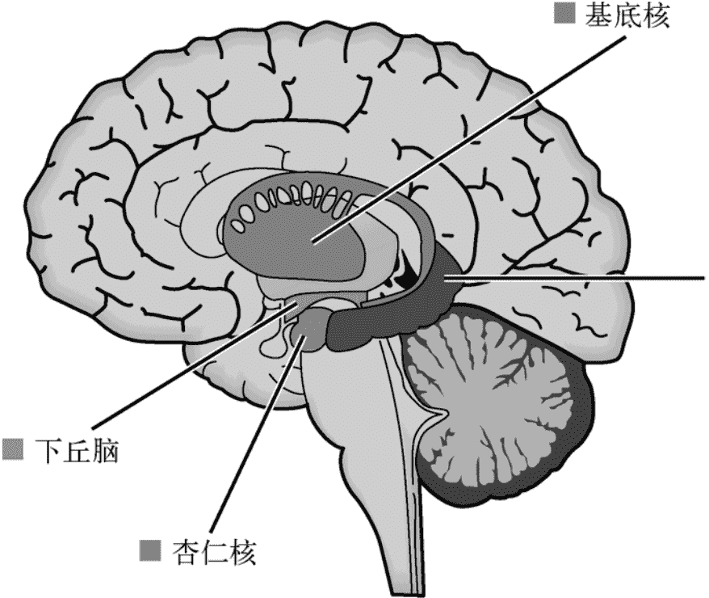
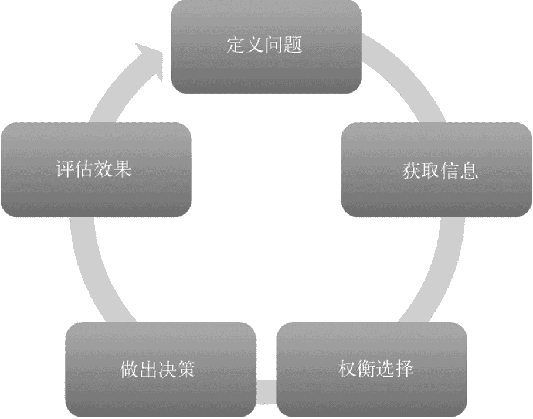

# 第二章：决策背后的心理学原则

一个选择是否明智，和我们当下喜不喜欢它，往往不是一回事。有人 17 岁进军校，烈日下穿着厚军装看球赛，热得直冒汗，心里反复骂自己“选错路了”；可几十年后回头看，那段经历反而成了好事。可见，决策质量与当时的满意度并不能简单画等号。判断里还掺着视角、情绪等变量；我们每天都在信息不全的情况下做大小决定，而且常常凭直觉、反复地拍板——网络钓鱼者最喜欢的正是这一点。

决策并不只是“权衡利弊”四个字。它是一个复杂的认知过程，心理学、体育、商业、经济学、政治学等领域都有各自的研究模型。影响决策的因素很多，其中不少怪癖都指向同一个源头：生存。快速思考也好，危急时更敢冒险也好，本质上都在提高存活概率。虽然大多数人不再靠尖牙利爪讨生活，但适应机制仍在运转。

### 一、脑子里的“快捷方式”

**认知偏差**是一种思维定势，通常来自过往经验。它有时能帮我们更快、更好地判断，但也常让人漏掉信息，进而做出错误选择。如果人真能像机器一样理性，面对同样事实就该给出同样答案，可现实并非如此。

比如同一盒肉，标“20%肥肉”和标“80%瘦肉”，含义完全一样。在美国，多数人却更愿意选前一种说法。你会挑哪一盒？

这就是**框架效应**：同一件事换个说法，反应就变了。我和丈夫曾在一个网页上看到一幅“抽象画”，满屏参差的绿、蓝、橙、红、紫点，起初觉得不怎么样；凑近才发现，那是彩虹桉树树皮的近景照片。图片没变，语境一变，失望立刻转成惊喜。

另一种常见偏差是**可用性启发法**——哪件事容易想起来，就更容易被我们拿来当判断依据。美国被自动贩卖机砸死的人其实比遭鲨鱼袭击的人多，但多数人还是会猜鲨鱼。原因很简单：鲨鱼伤人的新闻和电影画面太容易浮现，而售货机压人的事很少听说。大脑一旦能迅速调出某个例子，就会高估它的频率或重要性，决策自然容易被带偏。

还有**确认偏误**：我们会找支持自己看法的信息，甚至把中性信息解释成对自己有利的样子。你若认定杜宾犬凶，在公园看见它叫，可能马上觉得它在示威，而不是在玩闹；回家后搜的也是“杜宾犬伤人”，而不是“杜宾犬救婴儿”，甚至直接搜“狗伤人数据”。

这只狗是在笑，还是准备咬人？当然，确实有脾气暴躁的杜宾犬，但并非全都如此。若没意识到自己没看全信息，判断就会失真——就像有人把杜宾犬形容成“大号、有气味的小宝宝”，这说法显然也带着个人认知系统的滤镜。

### 二、身体状态会偷偷改写选择

困、饿、憋得慌，都会影响判断质量。研究发现，一夜不睡的人更容易做冒险决定：大脑中偏乐观的区域更活跃，计算负面结果的部分却没那么积极，于是人会高估成功概率。赌场早就懂这套：明亮灯光、性感鸡尾酒女招待、没有钟也没有窗的房间，都在让人忘记时间、持续下注。

饥饿也不只让人脾气变差，还会推高冒险倾向。对人类和动物的多项研究都显示，越饿越容易选择冒险，这从生存角度看说得通——食物短缺本就是威胁，身体启动的是祖先留下的求生反应。至于憋尿，图克等人的研究更有意思：努力忍住去洗手间的冲动，似乎会把自我控制“溢出”到别的领域，让人在不相干的事情上更能压住冲动。那个价值百万美元的问题大概是：“又饿又困又想上厕所时，你会怎么选？”答案不确定，但吃饱、睡好、上完厕所之后，你的反应多半会不一样。

### 三、环境与人群也在推你一把

外部环境既包括物质条件，也包括身边的人。温度、光线未必直接决定你点鸡肉还是汉堡，却会影响你对情境的感受。短暂冷热刺激能改变信任游戏中的选择，大脑里负责温度感知和信任判断的区域还有重叠；温暖常与亲近、信任、慷慨相连，酷热则更容易和愤怒、好斗、判断受损挂钩。大热天堵在去度假村的路上，谁都不觉得美好。

光线也有类似效果：明亮环境会放大情绪。心情好时，亮屋子让人更愉快；正在悲伤或生气时，同样的亮度反而更难受。行为还会传染。人是社会动物，同伴压力、从众和服从对选择影响巨大。早在 1951 年，阿施就用实验揭示了群体压力如何扭曲判断。不确定性也会推着我们看别人怎么做：在吧台点三明治，该不该给小费本不确定，可一个显眼的小费罐就在提醒你。群体大小、地位和一致性同样起作用——如果“所有人”都给，明星或 VIP 也给，人就更难无动于衷。历史上，从众常常保证安全：看见别人都在逃离一只鬃毛特别的猫科动物，跟着跑大概没错。

### 四、底线只有两条

第一，人做决定时并不总是理智、有逻辑，影响因素很多。第二，钓鱼攻击者知道我们如何决策，并会操纵情境，把我们引向错误选择。了解这些，不是为了成为行为经济学专家，而是为了让自己和公司更安全。

### 五、当局者迷，旁观者笑

生活里总有人做出事后看来很离谱的决定。2014 年心脏滴血漏洞闹得人心惶惶，多数人赶紧改密码，偏偏有位先生把密码公开贴到《华盛顿日报》网站上，还说谁想用就用。结果当然有人用了。他后来网上认错，也算学到一课：不锁门是一回事，告诉所有人你没锁门、还挑衅别人来偷，就是另一回事。

再问一次：如果打算抢一家店，你会怎么遮脸？
A. 套透明塑料袋；
B. 用荧光笔涂脸；
C. 拿胶布、巧克力或饼干挡脸；
D. 以上都不选。

这不是段子，新闻里真有多起劫匪用这些办法反侦察，最后都被抓了。戴个经典黑色滑雪面罩有什么问题吗？至少比透明塑料袋靠谱。

还有个更典型的例子：某商店失窃，其中一条裙子很有辨识度。店家在社交媒体上描述嫌疑人和失物。幸运的是，小偷穿着偷来的裙子自拍，还设成自己社交账号的新头像，三小时后就被捕了。这个故事告诉我们：要偷东西，社交账号真不是炫耀战果的好地方。

说到底，决策从来不是纯粹的计算题。看清偏差、身体和环境的手，才更可能在“想按确认”的那一刻，及时停一下。

# 别急着笑：那些离谱决定背后，可能是杏仁核在“抢方向盘”

先看一则旧闻：2014 年，伊利诺伊州一名女子把偷来的裙子穿在身上自拍，还把照片发到网上，随后被捕。笑点很足，但这面镜子照出的东西并不简单：决定做得对不对，和做完之后满不满意，并不是同一把尺子。至少在按下快门、点击发送的那一刻，当事人对自己挺满意。

这些让人哭笑不得的故事，其实藏着几条关于决策的提醒。

第一，决策质量与满意感并不总是一回事。那些选择看起来离谱，可当事人当时未必觉得糟糕。第二，一个决定往往是认知、情绪、环境一起搅出来的结果。她为什么发自拍？是骄傲，还是觉得不会被发现？第三，信息永远不可能齐全，可日子不会等我们补完作业。在《华盛顿日报》网站发帖的那位先生，可能就没完全掂量出事情有多严重。第四，很多判断几乎是肌肉记忆，快过思考。抢东西当然不是小事，可拿塑料袋遮脸的那位，显然没把手段想周全。

带着这些认识，再看钓鱼攻击，就明白多了。

高明的钓鱼者未必读心，却摸透了决策的基本套路：先点燃情绪，再让理性电路跳闸。只要能隔着屏幕把你搅得坐不住，就有机会让你做出平时不会做的动作。之前说过钓鱼主题会借情绪，下面这些用法更极端。

图 2-3 不算高明，却精准戳中贪婪：白给 30 美元，只需点一下鼠标，谁会跟钱过不去？比特币（BTC）在一些国家能兑换真实货币，总量有限、价格随供需波动，交易在双方之间直接完成，不必经过第三方金融机构，因此成了颇受欢迎的匿名支付方式。图 2-3 里的 Coinbase，就是一家比特币交易公司。

图 2-4 则借了英国国家卫生院（NICE）的壳。NICE 是真实机构，邮件看起来像正规通知：血检报告显示白细胞偏低、血小板偏低，血红蛋白正常，还提醒打印附件、尽快去看家庭医生。谁不怕被诊断出癌症？这种邮件比丢社交账号、丢银行账户更让人焦虑，因为它直接质疑生命，恐惧感非常明确。

图 2-5 更狠：一封宣告熟人死亡的邮件，用了过世者的真实姓名和地址，邀请收件人参加“朋友生命礼赞”，还署了殡仪馆接待员的名字。恐惧、伤心、好奇一起涌上来，这封利用情绪的钓鱼邮件威力强大，连美国联邦贸易委员会（FTC）都注意到了。

图 2-6 则转向欲望。俄罗斯单身女性在线、免费看资料，甚至写着“美丽新娘可能是你的”。谁不渴望爱情，或者至少渴望一点类似的东西？线上世界不过是线下世界的翻版。

这些例子不同，情绪循环却大体相同：看到邮件，你解读内容，情绪起波动，身体跟着反应，血压上冲、心跳加快；反应越猛，批判性思考越容易掉线。若再叠上认知偏差，人几乎会缴械，成为冲动和情绪的俘虏。身体还按远古剧本办事，哪怕威胁只藏在收件箱里，它也像准备生死斗争一样动员起来。图 2-7 画的就是这个恶性回路。

图 2-7 情绪化决策循环

要理解这套机制，得认识一下杏仁核。它是一小团灰色组织，位于下丘脑下方、海马体左侧，别看体积小，五种感官送来的信息都先到它这里登记，再分发到大脑其他区域。Clutch 乐队主唱尼尔·法伦会穿一件带“演出味道”的衬衫，闻到那股味，杏仁核一认，肾上腺素就位，人进入演出模式。更关键的是，杏仁核处理刺激比大脑更快，它抢跑在前，先让身体自动反应，等理性脑赶到时，动作已经做了一半。

图 2-8 杏仁核在大脑中的位置

如果送进来的是恐惧、贪婪、欲望或好奇，接下来会发生什么？情绪与理智本该互相制衡；一旦杏仁核被强刺激点燃，它会压过负责理性思考的区域，把理性中心暂时关机。等大脑跟上进度时，做主的已经换成感性系统。

我少年时有一段狼狈经历。刚搬到南方，二月初参加沙滩聚会，气温不过 7 到 10 摄氏度，我这个北方人却觉得像夏天。女孩们围着火堆，男孩们下水玩，我负责生火，也乐得守在火边。朋友马特过来，把冲浪板扔到我脚边，激我：“你想像个女生一样坐在这儿，还是去和男生们一起玩？”

理性清单本该说：水温低、我没冲过浪、风浪大、可能溺水。可 15 岁的大脑只想着：漂亮女孩在看，不能丢脸，哪怕溺水也要死得酷。我抓起板跳进冷水，心脏差点蹦出来。短裤被浪冲走，我在女孩们的笑声里狼狈不堪，最后马特拎着短裤来救我，说：“抓住我的裤带，白痴。”那场冒险以肺炎和扭伤手臂收尾。每次刺激升级，我的选择就更糟——杏仁核被劫持，理性中心关门，挽回面子的冲动接管了决策。

钓鱼邮件也是同理。它触发恐惧、贪婪、欲望或好奇，大脑便不再听理性中心的话：“别点链接”“该报告管理者”“我不认识什么 Abu Abu Ali Abu 王子，他也没理由给我 4000 万美元”。一封写得巧的邮件，确实能让人失去理智，做出情绪化决定，最后暴露自己、陷入尴尬，甚至蒙受损失。我想不出点邮件怎么会弄丢短裤，但意思你懂了：杏仁核被劫持时，人停止理性思考，只凭情绪拍板，而这通常是最糟的决策方式。

那还能控制杏仁核吗？可以，但需要一点时间。劫持来得快，强情绪会延长它；只要停下来、缓一缓再做决定，控制权就会回来。

乔和萨拉的故事很典型。两人在邮件列表里长期不对付。一次，乔把萨拉移出列表后，对几个人骂她“无能的黑洞”。同事开玩笑：“乔，你发那封邮件时忘了把萨拉移出列表。”乔吓坏了，没核实就公开道歉。萨拉回信说，既然他承认错误就原谅他，但不确定人事经理是否也这样，祝他周末沟通课程愉快。乔这才发现被戏弄，怒火上头，回骂“你们两个笨蛋死定了”，还说萨拉“确实对得起每一句评价”。他点击发送——这次真忘了把萨拉移出列表。若他花 30 秒检查一下，也许就看穿恶作剧，一笑了之；结果却要花几天和人事经理谈话，再写正式道歉信。

所以，读到一封让你恐惧、愤怒、充满欲望或强烈好奇的邮件时，先停 30 秒。在点链接、回邮件或做任何动作之前，想想该怎样验证。钓鱼者未必知道“杏仁核劫持”这个词，但他们知道：情绪一上来，人就会采取不符合自身根本利益的行动。这就是社会工程学最要命的地方。

最后，决策应该是一个周期性过程。图 2-9 给出的复盘框架，核心几步是：一，确认自己真的理解问题——你要的是好决策，还是感觉好的决策？信息够吗？该听别人意见吗？以前有没有类似情况，结果如何？二，尽量完整地收集信息——偏见和个人感觉是否在影响判断？你是否被他人左右，又该不该被左右？三，考虑切实可行的选项——有没有不同视角、其他选择？可能结果是什么？四，做出决策。注意，拍板是第四步，不是第一步。把这套流程循环起来，从自己和别人的经历里学习，别让同一个坑绊倒两次。

情绪反应很正常，不必自责；你要做的只是调整一下，避免日后后悔的行为。别急着成为纸上谈兵的心理学家，哪怕只多停半秒、多想一步，家里的决策和工作的判断都可能更安全。

先说说大家最容易跳过的最后一步：复盘。决策做完之后，别急着翻篇，停下来问自己一句：这个结果符合我最初的预期吗？如果符合，是哪些条件帮了忙？如果不符合，又是哪里出了岔子？更重要的是，从这一次选择里，你能带走什么经验？

这里可以参考图 2-9 的基础决策模型。当然，并不是说每件小事都要照单全收，比如今天吃切达奶酪还是瑞士奶酪，就不值得兴师动众。但如果你能在重大决定前养成走一遍流程的习惯，久而久之，这套思考方式就会沉淀为你的本能，用不着每次从头纠结。行动之前，哪怕多花一分钟让想法落地，也远胜仓促出手。

这一章，我们一直站在决策者的位置看问题——比如拿纸袋还是塑料袋，选巧克力还是覆盆子；同时也提醒过你，面对陌生邮件时，不妨多一分谨慎。

那么下一章，镜头会转向另一群人：那些编写钓鱼邮件的人。他们手里握着什么工具？又是靠什么手段，精准点燃你内心的情绪？作为社会工程学从业者，我和克里斯必须先弄懂影响与操控背后的机制，才有能力帮客户筑起防线。所以，接下来不妨看看帷幕后面，真正执笔的那个人。