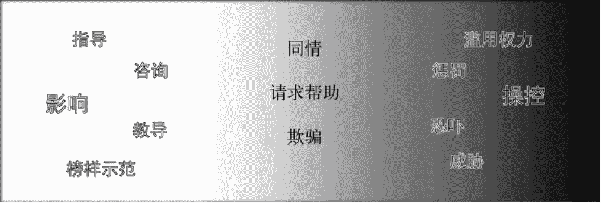
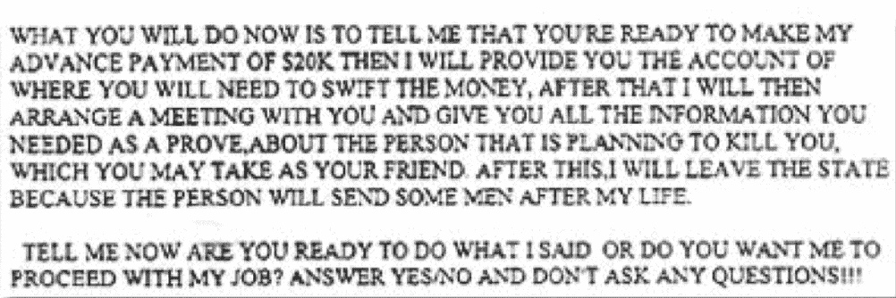
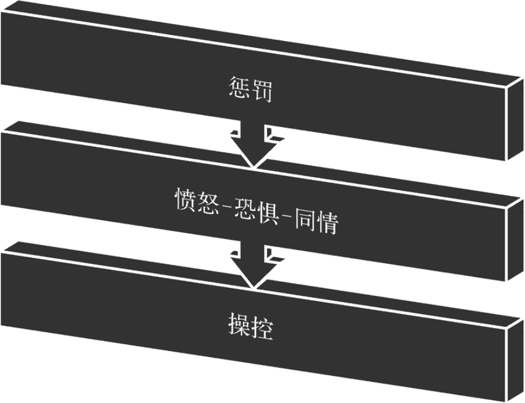
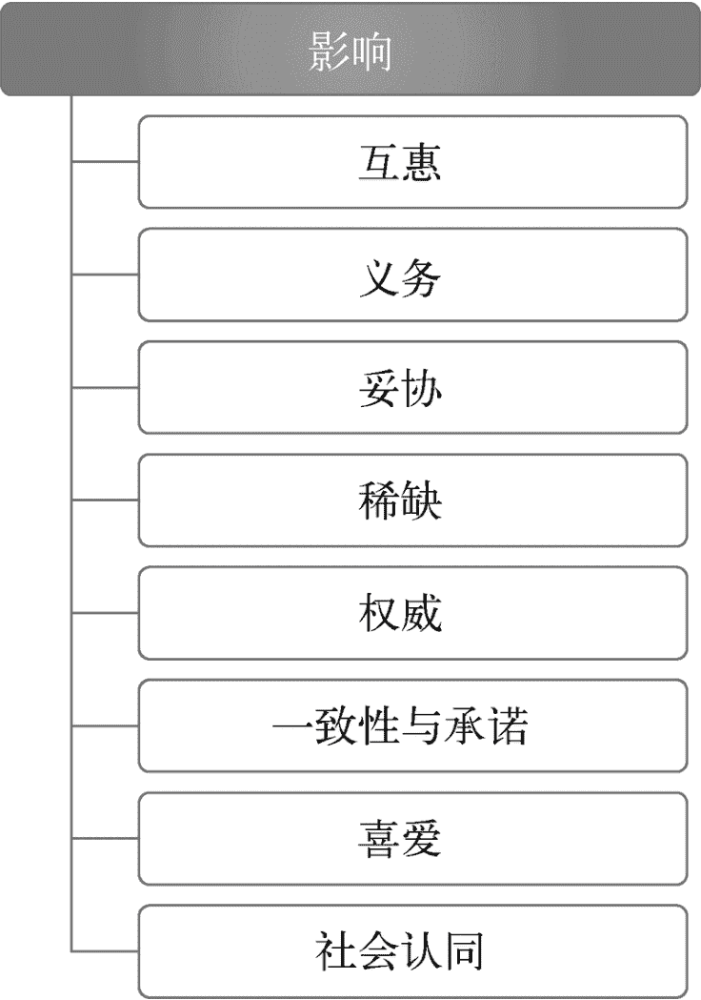
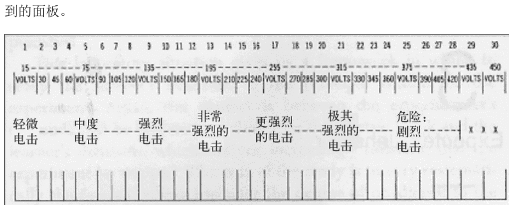
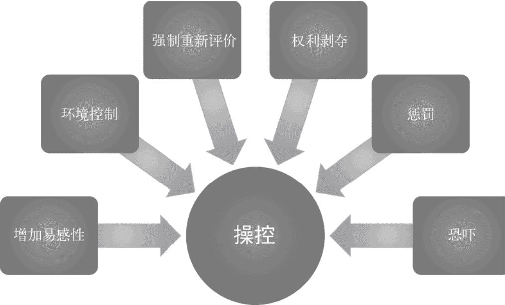

# 第三章：影响与操控

> “这不是你要找的机器人。”

> ——欧比旺·肯诺比，《星球大战 4：新希望》

聊到社会工程，就绕不开影响与操控。这两者其实是第二章里所有决策的推手。人们行动的理由千差万别，而高手正是读懂这些理由，顺势把选择往自己想要的方向引。

先把概念捋清楚。克里斯在首部作品《社会工程：安全体系中的人性漏洞》里给影响下的定义是：让对方按你期望的方式去行动、去回应、去思考、去信任。操控看起来很像，但它更偏向负面使用，几乎总是为了操纵者自己有利。

影响和操控常被混用，二者确实都指一个人对另一个人产生作用。但体感完全不同。你会说某人“坏影响”，却很少会说“好操控”。手段可能导致相似的结果，关键在于达成结果的路径和当事人的感受。影响偏向正向，比如给家人提建议，引导他吃得更健康。操控偏向负向，比如因担心人身安全而被迫交出信息。中间还夹着大片模糊地带，很多互动同时具备好的一面和坏的一面。影响本身就会制造张力，没有张力就没有改变的动力。所以影响和操控的界限不是一条线，而是一块因人而异的灰色区域。

图 3-1 影响与操控
图里列出了实现影响和操控的常见手法，后面会展开。按定义看，指导属于影响，威胁属于操控，而中间仍有大量悬而未决的空间。最终落到从业者如何抉择。

请求帮助是很有力的工具，也可以是很狡猾的操纵。冒充求助进入安保部门和谎称孩子生病骗钱，本质完全不一样，大多数人都能分辨。区别重不重要？取决于你要达成什么。

### 3.1 为什么要分清二者

我和克里斯为企业提供社会工程的实战服务和培训。客户在乎的是安全稳固和员工成长。从经营角度看，与其不断流失和再培训，不如深耕现有团队更划算。公司不希望员工因被耍而泄露信息，或因点开钓鱼链接而沮丧。他们深知员工主动参与安全建设的重要性。员工若对测评、培训和成长抱乐观态度，参与度就会高。正如克里斯常说：要让一个人因为遇见你而感觉更好。

图 3-2 通过威胁让人屈服
设想你收到图 3-2 那样的邮件，随后得知这是公司授权的钓鱼演练。发件人绝不可能靠这封邮件交到朋友。这其实是 FBI 公布过的一个真实勒索诈骗案例，收件人一旦追问，就会收到更多威胁恐吓。

发现自己被影响而行动，人们难免尴尬或生气。若员工感觉是被恐惧、愤怒或羞耻逼出来的，就更难处理，对企业也更糟。这种氛围不利于学习。对一个想为公司做贡献的人来说打击很大。我们强调区分影响与操控，不只是因为善良，也因为我们是教育者，清楚界限分明才能让培训真正落地。

### 3.2 怎么判断区别

承认灰色地带很微妙很正常。准备开展社会工程训练前，可以先自问几个问题。

#### 3.2.1 能否建立融洽感

融洽感的定义很长，但直觉上很好识别：是否相互喜欢、相处舒服。建立这种默契是高效社会工程必须快速养成的能力。没有融洽感，影响很难发生。建立之后，人们更愿意答应请求，因为喜欢你、感觉有连接、想帮你。

用操控的人不太需要甚至不可能建立融洽感。想靠威胁的人，根本不在乎和目标产生联系，甚至联系越少越好。对大多数人来说，对有私交的人下手操控，心理上很难做到。

#### 3.2.2 目标发现被测试时的感受

我常在心里问自己：如果他点开了我的钓鱼邮件，他此刻是什么感觉？尴尬甚至愤怒也可能产生教育价值。你把挑战摆在面前，他没发挥好，可能带来风险。但如果你紧接着给出下次做对的信息，就能营造学习型环境。理想的文化是员工不因中招而羞愧，反而期待下一次的演练，我们见过这样的企业。

反之，若你靠恐惧、愤怒、羞耻或无助逼人就范，后续的抵触会很大，教育机会就被情绪淹没。人们记住的是你带来的感受，而非教训。

#### 3.2.3 测试的真实意图

这里说的是你自己的动机和需求，不是给客户看的漂亮结论。你真的关心组织是否在成长提升吗？还是只想获得“赢家”的快感，因为你让别人做了不该做的事？这是私人问题。大多数人喜欢赢，有时社会工程会像一场游戏。

好消息是，你完全可以既赢，又为公司服务。但总有进展停滞、挫败感升温的时刻，甚至焦虑自己没做出业绩。那时用操控的诱惑会变大。关键在于反思选择和动机。如果你真把公司利益放第一位，会做出更明智的决定。

### 3.3 操控：来者不善

一个常见疑问是，为什么不用操控？毕竟坏人就爱用。这是法律与伦理问题。坏人只求赢，不在乎受害者，也不关心教育效果。坦白说，操控更有效、更省事。但在专业场景里，它只会破坏而非实用，也不是长久之计。

被操控过的人，下次很难再听你的。这在某些情境下或许可以接受，但在企业安全和专业协作里并非最优，因为你需要长期信任关系。

在测试和教育中克制是不切实际的，但也不需要跳进火山口才知道烫。安全目标完全可以在不恐吓、不激怒员工的前提下达成。专业的信息安全工作可以很有挑战，却不造成伤害。

### 3.4 谎言，全都是谎言

回到图 3-1 的例子，欺骗是最能抓人眼球的一个。大家对欺骗的印象通常是负面的，喊“你是个骗子”绝对不是夸奖。

把伦理道德简单挂钩到是否撒谎，我觉得有问题。判断标准不在于社会工程中是否用了欺骗，你多少都会用。关键在于意图和动机。

比如我老公已经吃了两包糖果和半包饼干，我告诉他米饭布丁没了，其实是我藏起来了。若动机是为他健康着想，这是一回事。若我只是想独吞，那动机就自私了。行为和结果一样，被发现后的感受却完全不同。顺便说，米饭布丁真的很好吃。

撒谎名声不好，但我们或多或少都在做。我们是社会动物，懂得在群体中说什么不说什么。要是你完全坦诚地表达对朋友穿搭、母亲家具品味或伴侣健康状态的真实看法，人际关系会崩塌。真相会伤人。

人类似乎天生带欺骗倾向。研究显示，婴儿在会说话、甚至能理解“实话”概念之前，就具备欺骗他人的能力。朴次茅斯大学的瓦苏德威·雷迪博士发现了这一点。有父母的人能证实：婴儿会“假哭”。不饿不难受尿布也不脏，就是在围栏里发出“哇哇？”的声音，四处看有没有人注意。这是一种社交参与的本能。行为若被强化，就会持续。欺骗是一种社交适应，不必一概妖魔化。

### 3.5 惩罚与操控

图 3-1 里另一个典型是惩罚。行为心理学里，惩罚是会降低行为再现概率的后果，比如孩子撒谎后受罚。

本书讨论的是成人之间操控性质的惩罚，不涉及父母管教。在社会工程里，惩罚是用负面结果逼目标按期望行动。表面目标和实际目标常不一致。惩罚直接作用于某人，却往往控制另一个人的行为。用惩罚改变成人行为是可能的，但这不是高明的暗中操纵，只是“你大喊，我给你一拳，你就不叫了”式的直接因果。

以惩罚为手段的操控会像催化剂，激发行动或借助强情绪迫使就范。当惩罚在公众场合上演，旁观者会形成“等待结果”的张力场，每个人可能产生恐惧、愤怒或同情。

图 3-3 惩罚作为操控手段
当然有人会漠视或回避。但惩罚够重时，效果仍在。恶意攻击者正是追求这种可控的回应。

想象你走进公司食堂，一个男人正对着哭泣的女员工破口大骂。骂完后她含泪求助，说老板威胁要因胸牌忘在家里就解雇她，需要去行政处补办。你愿意帮忙吗？

图 3-4 你会帮助这位女士吗
你可能机警地带她先走完整套安检流程，也可能因义愤直接带她去补办。这就是操控的现场。

### 3.6 影响的原则

了解区别后，就该深入影响本身，弄清哪些因素起作用、为何起作用。罗伯特·恰尔蒂尼、艾伦·科恩和戴维·布拉德福德等人在这一领域贡献巨大。一起回顾他们的成果。

图 3-5 影响的原则
基于研究和实战经验，这里提几件事要留意：

- 人类行为不总理性，这些原则常同时生效。
- 有些案例横跨多重原则。
- 真实案例往往同时展示影响和操控，这正是中间灰色地带的体现。
- “专业建议”旨在提升理解和灵活性，对为企业提供安全服务的人尤其重要。

#### 3.6.1 互惠
定义 互惠是普遍信念：付出该有回报。善有善报、以眼还眼都体现了它。科恩和布拉德福德认为这是所有影响的基础。
例子 一个真实案例是“退款”诈骗，先给目标一个好处感，目标觉得收了礼，就有义务以个人信息回报。
专业建议 礼物不一定是实物。微笑、倾听、同理、帮对方开门，只要对方感受到价值，就能产生影响力。

#### 3.6.2 义务
定义 互惠靠礼物，义务靠传统、礼节、个人感受和社会角色。比如让路后收到的挥手礼，很多人会觉得被挥手是一种义务。
例子 典型的祖父母骗局，骗子冒充陷入麻烦的孙辈，要求保密并索钱。骗子会提前研究昵称等细节，激活“你不想让孙子受伤害”的社会角色压力。
专业建议 对不熟的人如何制造义务感？从身份标签入手。他是父母吗？是否自认乐于助人？识别后设计一个符合他自我认知的需求场景。

#### 3.6.3 妥协
定义 妥协会让人觉得主动权易手。人们在让步一次后，往往更易再次让步，这就是登门槛效应。传单发给你，你至少会停下脚步看一眼。
例子 祖父母骗局也是妥协的经典。某祖母被骗超两万美元，不是立刻掏空，而是先妥协一次后，骗子继续索要，她就不断让步。

> > 8 Kathy Tomlinson, “Senior Loses $20,000 to Scammer Posing as Grandson,” CBC News website, March 20, 2012, http://www.cbc.ca/news/canada/senior-loses-20-000-to-scammer-posing-as-grandson-1.1148359 .

**实战心法**    老练的社工有时会先亮出妥协姿态，借此带节奏。这一招等于告诉对方：主动权在我这儿，我让给你了，哪怕这个“让”小到可以忽略。卖车的销售天天这么干。

#### 3.6.4 稀缺

**概念**    东西越少、越难搞到，人们越觉得它值钱。这条规则像是刻在骨子里的。远古时候，最后一块鸡翅落不到嘴里，可能真的会饿肚子；今天它更多是一种心理满足——看着兄弟姐妹干瞪眼，那种满足感尤其上头。

说起来有点好笑：我研究这套把戏为生，对稀缺的机理一清二楚。可每当“史上最低价，错过哭一年”的广告蹦出来，我偶尔还是会点下单，有时候一买就是俩。

**案例**    从哪儿讲起呢？几乎每天都能撞见骗局，或者踩着骗局边线的营销。上世纪七十年代，有位叫鲁贝尔的夜店老板在门口拉起了天鹅绒围绳，只放特定客人进去。结果人们挤破头也要来。同样的路数还有仿制金币的广告，含蓄地催你“赶紧下手，晚了拍大腿”。

**实战心法**    稀缺和互惠一样，未必是看得见摸得着的东西。你约见过大人物吗？他真的只在某个周四的一点二十分能匀出十分钟给你？这种“时间紧、名额少”的感觉，是怎么把你的急迫感拉满、又左右你的行动的？

#### 3.6.5 权威

**概念**    权威就是拍板定调的权力。它可以来自法律等正式渠道，也可以来自人格魅力或口碑。

**案例**    我们从小到大，就是一边听权威的话，一边跟权威较劲。成年之后，面对有权威感的人或权威符号，我们往往会条件反射式地配合。街对面站着一位戴安全帽、穿反光马甲的人冲你招手，多数人就照他说的走了。

有个极端到离谱的滥用案例：有家快餐门店接到自称执法人员的来电，对方说店里有员工涉嫌偷拿东西或者沾毒，要求店长按电话里的指示，把该员工关进后屋搜身，甚至加以羞辱。可见权威一旦被滥用，操纵起人来有多容易。

> > 9 Andrew Wolfson, “A Hoax Most Cruel: Caller Coaxed McDonald’s Managers into Strip-Searching a Worker,” Courier-Journal.com, October 9, 2005, http://archive.courier-journal.com/article/20051009/NEWS01/510090392/A-hoax-most-cruel-Caller-coaxed-McDonald-s-managers-into-strip-searching-worker .

还有个耐人寻味的案子：一名女子冒充某连锁早餐店的区域经理，煞有介事地转了一圈，随后从钱箱里取走现钞。她不过是装出了“自己人”的样子。警方表示，“从头到尾既没威胁，也没动家伙”。

> > 10 Mike Morris, “Police: Woman Posing as an Area Manager Steals Cash from SE Atlanta Waffle House,” AJC.com, February 26, 2014, http://www.ajc.com/news/local/police-se-atlanta-waffle-house-robbed-by-woman-pos/ndcz4/?_federated=1 .

**实战心法**    亮明权威，不一定要挂个工作牌。你的穿着、谈吐、文字风格、身体姿态，甚至邮件签名，都在替你说一句话：这事我门儿清，照我说的做。给女性朋友一句额外提醒：受外貌、年纪、音色等因素影响，亲自立威可能会更费劲。留意自己正在释放什么信号，在能力范围内选好能取信于人的说法。

#### 3.6.6 一致性与承诺

**概念**    这一条讲的是：人一旦采取某个行动，后面的行为就会不自觉地跟前面保持同步。不出所料，它常常和让步原则绑在一起——让了一次步，前后一致的惯性会推着他再让一次。试想，一个主意一天三变的人，你会怎么看？谁都不愿被贴上这种标签。

**案例**

据媒体报道，某位女性在某个宗教背景的交友平台上吃了大亏。被骗的一方和行骗的一方，恰好都印证了这条原则的威力。她跟其他上当者一样，为了证明自己的真心，把积蓄全掏给了“求婚者”；而骗子则演足了痴心爱人的戏码，几乎天天发邮件、描绘将来。

11 Rheana Murray, “Online Dating Nightmare: Widow Robbed of $500K by Scamming Internet Companion,” Daily News website, November 8, 2011, http://www.nydailynews.com/news/national/online-dating-nightmare-widow-robbed-500k-scamming-internet-companion-article-1.974887 .

**实战心法**

某人点头应下一件事，接着再答应第二件的概率就上去了。老手懂得循序渐进地加码，既不让对方觉得突兀或受冒犯，也能压住自己“老伸手要东西”的不适感。上世纪六十年代，心理学家米尔格兰姆做了一个实验，把“层层加码”这件事展现得令人咋舌。

12 S. Milgram, “Behavioral Study of Obedience,” Journal of Abnormal and Social Psychology 67(1963): 371 - 8.

这项研究本意是测量人对权威的听从度，但它同时也成了“层层加码”的绝佳注脚。受试者要用假电击“教”学生记单词，对方每错一次，电压就往上跳 15 伏特。图 3-6 画的就是受试者面前那块控制盘。

图 3-6 米尔格兰姆的“电击”控制盘

把自己摆到“老师”的位置想想：一开始你答应参加一项重要研究；接着你接受了实验的各项安排；然后你照着指令做。第一下是 15 伏特，对学生不算什么，可他不断出错，你只好一路往上调。电压越升，你心里越不是滋味。十五伏特与一百五十伏特，差了十万八千里。你要在哪儿刹住？停不停得下来？中途退出会不会毁了实验？你舍得就这么打住吗？

话说回来，米尔格兰姆想测的是人对权威的听从，但从中也清楚映出，前后一致与承诺给个体施加了多大的压力。

#### 3.6.7 喜爱

**概念**    你有没有碰到过一见面就投缘的人？先不提他快速拉近距离的本事，你觉得你喜欢他什么？我们天然偏爱那些对自己抱有好感的人，也天然偏爱跟自己相像的人。营销方早就吃透了这一点：请来的演员要么是我们欣赏、想效仿的，要么是能让我们产生共鸣的。

**案例**    糟糕的是，心怀不轨的人常拿“帮自己喜欢的人”这份心软做文章。“游客被困”式钓鱼之所以屡屡得手，是因为骗子先盗走某人的邮箱，再顶着此人的名义给他的亲友、父母发信，声称急需用钱。¹³^

> > 13 Liz Phillips, “How I Got Caught Up in a ‘Stranded Traveller’ Phishing Scam,” *The Guardian* website, November 13, 2013, http://www.theguardian.com/money/2013/nov/13/stranded-traveller-phishing-scam .

**实战心法**    怎么让人瞬间对你生出好感？干这行的社工会有意识地打磨几样本事，比如认真倾听，让身势与话语对得上号。还有个简单有效的加分项：找出你和对方身上真实存在的相似点。一旦有了共同话题，对方就很难开口拒绝。

#### 3.6.8 社会认同

**概念**    我眼下就卡在一个挺实在的难题里。有些餐厅是先到柜台下单、再自己找座等叫号。小费给不给？我拿不准。有时候推我去掏钱的，是吧台边搁着个小费罐——这就算行为层面的社会认同。**社会认同**说的是：人会下意识参照别人的做法来决定自己怎么做。碰上这类模棱两可的场合，这股力量格外明显。

**案例**    人天生是社会动物，社会认同才显得这么有分量。我们心里会嘀咕：“既然大家都这么干，那八成错不了。”骗子早就盯上了这种心理，而如今网络与社交平台把人和人绑得这么紧，问题就更大了。第一章里提过，灾难过后骗局会暴涨，因为人们想伸把手的心被利用了。这类把戏在社交平台上扩散得飞快¹⁴^，造成一种“人人都在捐”的错觉。

> > 14 Matt Liebowitz, “Tips to Avoid Japanese Earthquake Phishing Scams,” NBCNEWS.com, March 11, 2011, http://www.nbcnews.com/id/42036358/ns/technology_and_science-security/t/tips-avoid-japanese-earthquake-phishing-scam/#.VBYrJkig6bB .

**实战心法**    社工常故意营造出“大家都这样”的氛围，推着人往前走。眼看别人填了问卷、签了请愿书，你会不会交出资料，意愿也跟着上涨。一群人凑在那儿议论，路过的人几乎没可能忍住不探头看一眼、听一耳朵。

### 3.7 与影响相关的更多乐趣

下面这块内容，正可由社会认同自然引出，因为它多少解释了这些原则为何能奏效。最根本的答案在于它们都借力于人的天性，不过还有其他因素在推波助澜。

#### 3.7.1 社会性与影响

人的群体属性和影响之间，有什么关系？几乎方方面面都沾边。如今医学昌明，无论体格强弱都能活下来；而在医学不发达的年月，人要靠族群的庇护和慰藉来抵挡外界威胁。除了少数有名的例外，那些决意离群索居的人最后都……没活下来，连同基因都一并消失了。古时候最严厉的惩处之一，就是把人赶出族群。所以，对周遭人际环境保持敏感，并非小题大做，而是关乎能否活下去、能否把基因传下去。

这已经写进了我们的天性。族群的需要无论是明说还是暗示，我们天生会作出反应。所以，别急着责怪躲避同伴压力的孩子，也别嘲笑那些随大流的人蠢——他们不过是跟着求生本能走。

**实战心法**    到了现代社会，社工凭着对人作为群体动物的理解，去复刻一种众人互相影响的场面。即便是“独狼”，在特定环境和身边人群的作用下，也多少会感到无形的群体牵拉。社工常设一个局，烘托出紧张、不安的气氛，或催着人动手。最顶尖的那批人做起来毫不费力。最见功力的地方在于——场面是刻意设计的，对方感受到的却是双方（甚至一群人）之间的真诚往来。

#### 3.7.2 生理反应

前面第二章已经聊过杏仁核负责什么，它在情绪与理性两套思考中各管一摊。大脑受到刺激时，体内也会上演一串有意思的变化。虽说把脑部反应和身体反应拆开来讲并不严谨，我还是分开说说。

人体一旦察觉威胁，杏仁核马上启动一套自保机制。不管威胁是条要吃掉你的鲨鱼，还是一封通知你确诊癌症的邮件，身体的应对方式如出一辙。

神经系统会自动往体内输送压力激素，心跳加速、血压攀升、瞳孔放大、血液涌向核心肌肉群。15 这些生理变化让身体进入随时可以行动的状态。要紧的是记住：这恰好是身体为拿出最好状态（包括脑子转得快）所做的铺垫。16

> > 15 Harvard Medical School, “Understanding the Stress Response,” Harvard Health Publications website, March 2011, http://www.health.harvard.edu/newsletters/Harvard_Mental_Health_Letter/2011/March/understanding-the-stress-response .

> > 16 Dan Goleman, “The Sweet Spot for Achievement,” Psychology Today website, March 29, 2012, http://www.psychologytoday.com/blog/the-brain-and-emotional-intelligence/201203/the-sweet-spot-achievement .

**实战心法**    这个事实说明，社工若能左右对方承受的压力大小，也就能间接左右对方判断的水准。再配合几个能引发相应身体反应的动作，想推动局面就有了着力点。

#### 3.7.3 心理反应

被人这样推一把，心里会起什么变化？打个比方：我们那些不靠嘴说的举动，对旁人影响极深。想让人火冒三丈，最灵的一招，就是让你的面部表情、肢体动作跟嘴里说出来的话对不上。他另有一本讲身势语的专著，谈得更细。

反过来，你也能主动调节那些不用嘴的表达，去引导别人的反应。近期研究显示，“发怒的表情”这一人类共有的表情，已经成了一种脸部信号，用来传达谁更强、更有破坏力。17 这种威吓表情来自本能，连从没见过它的盲童也能做出来。研究团队认为，是为了在谈判博弈中占便宜。无论在哪种文化里，一张怒脸都传递出强势的意味。

> > 17 Andrea Estrada, “The Universal ‘Anger Face’ : Each Element Makes You Look Physically Stronger and More Formidable,” ScienceDaily website, August 28, 2014, http://www.sciencedaily.com/releases/2014/08/140828184811.htm .

即便不跟对方直接打照面，社工照样有办法影响对方的反应。艾伦·兰格博士与同事做了个有意思的实验：请参与者试着在公共复印处插个队。18 结果发现，只要参与者给出理由——哪怕理由很站不住脚，比如“我想先复印，能让我插个队吗？”——被点头的机会也会明显上升。这说明：开口求人时附带个理由，不管什么理由，都能提高被答应的机会。

> > 18 E. J. Langer, A. Blank, and B. Chanowitz, “The Mindlessness of Ostensibly Thoughtful Action: The Role of ‘Placebic’ Information in Interpersonal Interaction,” Journal of

关于心理反应，最后再补一句：左右别人如何回应你的变量很多，但别忘了，社工多半是在求人搭把手。助人这门学问又大又复杂，不过有些部分显而易见。大部分人在掂量帮不帮时，会清楚权衡风险与麻烦。一般而言，人们更愿意向女人和小孩伸出援手，情绪好的时候也更乐于搭把手。最后，身边有人在场时，人们反而没那么愿意帮忙——除非有人先站出来（这不又是社会认同嘛）。

**实战心法**    人所在的处境，显然能被拿来推上一把。弄懂某种举动会带来什么效果，社工就能管住自己的举动，从而铺好条件，等对方说出那句“行”。

### 3.8 关于操控需要知道的事

操纵这回事，落到你和公司头上，弊端远多于好处，所以这里快速过一遍几种常见手法。（没错，这一节我不提供实战心法。）图 3-7 把下面几条归了个总。

- 让人更易上钩。怀有恶意的社工会使出浑身解数，抬高人们对旁人建议、对糟糕判断的轻信程度。前面说过的激烈情绪，乃至身体反应被挑起来，都是让理智断线的关键招数。

- 控制周遭环境。心怀不轨的人一旦挤进对方的生活圈，通常就会用上这一手。网上网下都能找到一箩筐。

- 逼人推翻成见。出手的人设法让对方怀疑自己已知已学的东西。这招常与其他手段并用，比如威胁恐吓。

- 抽走掌控感。常与滥用权力结伴而来，施害方会让对方觉得除了听话别无他路。

- 施加惩戒。前面聊过，这属于把坏结果直接砸过去，让那些看在眼里（而非亲身经历）坏结果的人心生畏惧。

- 威吓。惩戒是把坏结果真用出来，威吓则是拿惩戒当威胁挂在嘴边。

图 3-7 操控的办法

读到这里，是不是有点觉得手段下作？没错，操纵是管用的，可在你准备用它之前，先想想自己晚上还得睡觉。

### 3.9 总结

这门学问的内核，就是有目的地牵着旁人去做决定。顺着你的意图，这些动作可以是善的，也可以是恶的。读完这章，你应当可以：

- 分清影响与操控之间的界线；

- 弄懂影响的原则，以及它们为何管用；

- 明白这些原则的效力，是社会本能、身体与心理三方面共同塑造的；

- 摸清几种常见的操纵套路，并在有人对你使这些招时一眼识破。

到这儿，理解钓鱼式骗局的基础，你算是打牢了，也明白了它们为何能得手。把做决定、影响与操纵这几块走一遍，你对钓鱼式骗局算是摸到了门道。

下一步，怎么把这些知识用来护住自己和公司？另一位作者会在第四章展开，他会讲些我们的实战经历，还有客户们做得漂亮或栽跟头的那些决断。第四章还会给普通读者和行家都备上建议，帮你在住所、在单位都能护住自己。