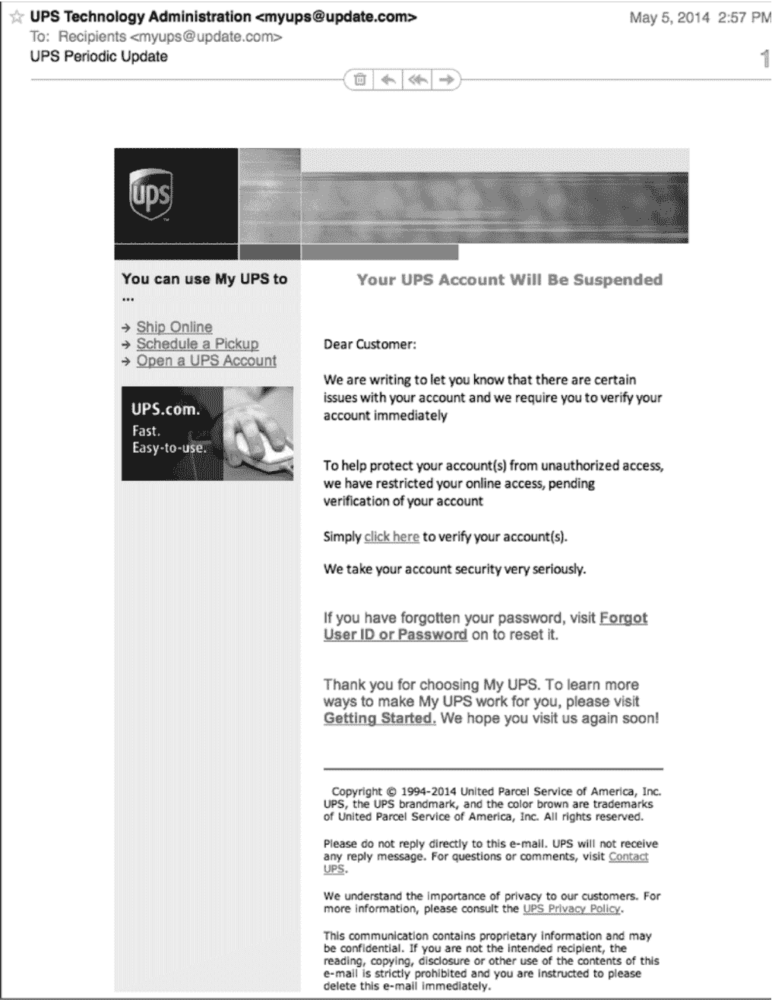
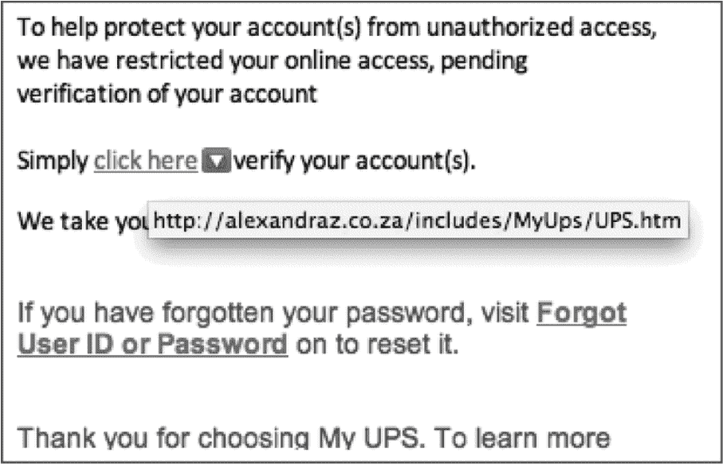
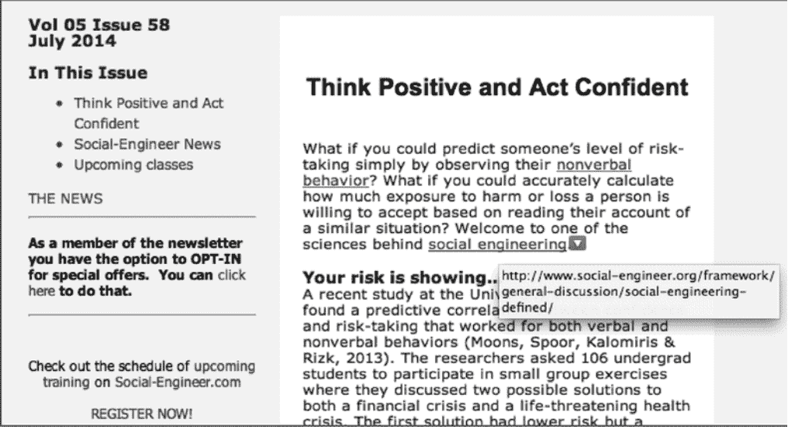
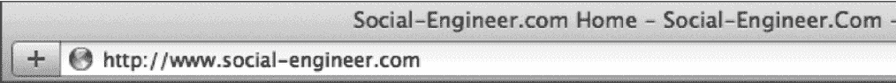
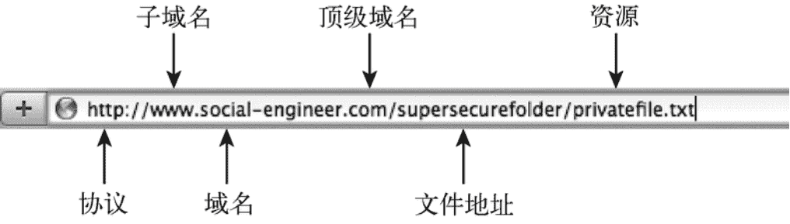
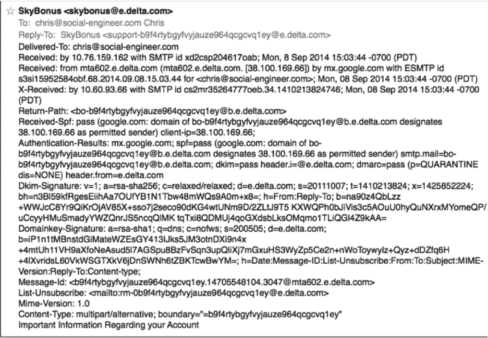
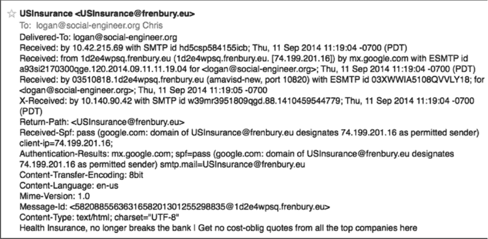
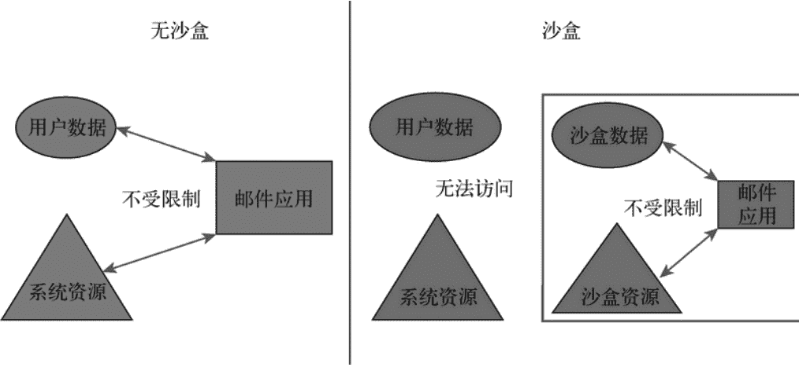

# 第四章：保护课程

> > “学校和真实生活的一个重要区别在于：学校先教你知识然后考试，生活则通过考试来教你知识。”
> >
> > ——克里斯托弗·海德纳

经历过我们常驻心理医生以及专门负责钓鱼演练的同事米歇尔的训练之后，现在该把学到的东西付诸实践了。过去我跟无数在网上投入大量精力的公司聊过，他们都想知道如何给员工上自我防护课。本章正是在这些交流和他们踩过的坑的基础上整理出来的。

本章会分享一些来自全球顶尖组织总结出的经验，以及如何把它们落地使用。我发现所谓的“专业级”建议和“大众级”建议差别明显。

这里的大众，指的就是普通人。家里没有专职的 IT 人员可以随时求助。上班时，隔壁工位也没有一个能一边吐槽你技术不行一边告诉你怎么办的电脑宅。中小企业乃至部分大企业，往往也请不起常年待命的安全专家。如果你觉得自己属于这类人群，那么接下来的普通人建议就是为你准备的。专业建议更多针对拥有专职安全团队的大型机构。不少做法对两类人群都适用，所以本章同时对普通用户和专业人士都有价值。

另外，本章还会提到 DEF CON 上著名的“绵羊墙”。DEF CON 是全球规模最大的黑客与安全盛会之一，每年主办方会把在会场里连上未知网络、被“薅”走账号密码的“绵羊”信息公开展示。目的很简单：让大家直观感受到安全信息的获取有多容易。

我不会点名哪家公司做了哪些蠢事。我的绵羊墙里列的，是曾经合作过的伙伴提出过的、或者不幸实际使用过的那些得不偿失的点子。

本章的意图是提供一套不容易过时的核心思路和基本原则，帮助你抵御前三章提到的各类攻击。

让我们开始第一课。

### 4.1 第一课：批判性思维

- 类别：普通和专业

如果我的第一课不从批判性思维这个关键点切入，那真是失职了。这一部分我在上一本书《社会工程 卷 2：解读肢体语言》里已有讨论，我认为这是对抗任何社会工程攻击最核心的防护。

允许我在这里重申一下。很多人把批判性思维等同于抬杠、缺乏信任或为质疑而质疑，这都不是我的定义。

我把它定义为：提醒自己不要全盘接受信息。不要因为没时间核查、因为压力太大没空思考，或因为收件箱里还有 150 封未读，就默认邮件内容是真的。停下来想几秒。听起来费时间，但自问下面几个问题其实只要几秒钟。

- 这封邮件是我认识的人发来的吗？
- 我会预期收到这样的邮件吗？
- 邮件里的要求合不合理？
- 它是不是在刻意煽动情绪，比如恐惧、贪婪或好奇，最关键的是它是不是在催促我做点什么？

花两三秒钟逐一思考，能显著提升识别钓鱼邮件的能力。

阅读后面课程时，可以把这几条问题套进去，你会立刻感受到“想一下”和“不加思考”在识别真实威胁时的差距。

即便你已经自问了所有问题，本节里还有一些额外加固建议。

#### 攻击者是如何绕过防御的

攻击者的目标就是让你别去想，尤其是别做批判性思考。他们会利用情绪按下你的刹车，记得第二章提到的杏仁核劫持吗？通过唤起恐惧、悲伤或愤怒等情绪，逼你做出不该做的行为。

当你收到来自陌生人的意外邮件，并且它明显在挑动情绪时，就该提高警惕。先停几秒，读点别的内容让自己冷静，再决定下一步。

### 4.2 第二课：学会悬停

- 类别：普通和专业

假设你在家或在办公室，收到了像图 4-1 那样的邮件。你会有怎样的反应？

图 4-1　UPS 钓鱼邮件

第一反应可能是：“不能让我的 UPS 包裹出问题，得赶紧查。” 也有人可能根本没用过 UPS，却会惊慌：“怎么有人用我的名字注册了 UPS 账号？”

无论哪种，都很容易因恐惧或好奇去点邮件里的链接。那封邮件标识对，看起来正式，甚至和你以前收到的 UPS 邮件很像，这些细节会强化它的可信度。

好在你已经读过前三章，能意识到这可能是精心伪装的恶意邮件，用来引诱你下载木马、泄露个人信息或参与违法操作。这时你可以先做什么？

把鼠标移到链接上，但不要点。悬停一下，看看会发生什么。你会看到类似图 4-2 的提示。

图 4-2　悬停成功而不点击

我对 UPS 把账号信息放在南非服务器上持怀疑态度，后缀 .za 正是这一点。因为悬停能暴露 URL 的真实地址，而那个地址并不指向 UPS，所以可以判定为钓鱼。

看到这样的链接后，用批判性思维再问自己：

- 这封邮件来自我认识的人吗？
- 我预料到会收到这样一封邮件吗？
- 邮件里的请求合理吗？
- 这封邮件是否试图唤起某些情绪，比如恐惧、贪婪或者好奇，或者最重要的——它是否试图让我做点什么？

这封邮件语义模糊，第一个问题你甚至无法回答。你既没有期待也没有请求它，而 URL 指向完全不同的网站。不要因好奇去点，立刻删除即可。

悬停能快速展示链接指向何处，也能帮助你迅速回答上面那些判断问题。

举个例子，你订阅了每月推送的《社会工程人员通讯》。邮件里的链接你先悬停，会看到图 4-3 的内容。有时攻击者会阻止悬停，那就点开后再次确认地址栏是否为合法地址。

图 4-3　一个安全且正确的链接

这封邮件是你主动订阅的，链接也符合订阅来源。基于这两点，可以放心点击。

#### 4.2.1 点开后感觉不对劲怎么办

这种情况确实会发生。首先，如果你是公司员工，请立刻告诉 IT 或安全部门。这能节省大家的时间，也能避免后续麻烦。

如果你不是公司员工呢？先回想点击后网站向你索要了什么。是账户信息？用户名和密码？还是让你下载并安装一个“程序”？

如果网站要你输入账户信息，而你已经填了或新建了账号密码，那么要立刻行动。先确认这个用户名密码是否在其他地方复用过。如果复用过，马上去改。

如果你有邮件所涉公司的真实账户，并且把信息输了进去，就给该公司打电话，说明你可能把凭证泄露给了恶意方，让他们马上修改以保护账户。

如果你安装了邮件要求安装的程序，很可能中了病毒、木马或其他恶意软件。需要清理电脑，并在另一台干净电脑上修改大部分账户的用户名和密码，或在清理后再改。

我不能预知你中了哪种病毒，所以无法给出更细的处置步骤。不懂如何处理，就找专业人士求助。

无论如何别慌。监控重要账户是否有异常，也可适当修改密码以提高安全等级。

我说的别慌，不是让你不紧张。而是应该迅速行动，惊慌只会让事态恶化。深呼吸，想清楚该做什么，然后立刻修复能修复的部分，防止损失扩大。

#### 4.2.2 攻击者是如何绕过防御的

攻击者很清楚受害者可能受过悬停训练。很多邮件服务商也会比对链接显示文本与实际 URL 是否一致。于是攻击者会购买近似域名来掩盖真实目标。例如攻击者买了 http://secure-你的银行.com，你悬停时会以为看到了“正确”的域名，于是信以为真并点击。这时批判性思维就关键了：你的银行会用这个域名发邮件吗？如果存疑，就去查证。

另一些攻击者会用已注册的域名让网站看起来合法安全，这些域名常用 trusted、secure 等字眼来误导。

还有黑客会攻击全球真实服务器，用合法服务器发送钓鱼邮件。他们利用人们对这些服务器的信任来引诱点击恶意文件或链接。是的，黑客侵入网络后藏在背后，利用被攻破的邮件服务器或互联网设备发送邮件，通常先窃取上面的邮箱地址，再联系第一批受害者。

请谨慎对待这些手法。悬停有帮助，但点击前三思永远是底线。

### 4.3 第三课：URL 解析

- 分类：普通和专业

先声明，本节不是写给网络专家或精通 URL 结构的人。对象是那些想通过了解 URL 来保护自己普通用户。如果你觉得内容太基础想差评，请直接跳过。

URL 是统一资源定位符的缩写，指互联网资源的地址。就像告诉你我家地址、你在 GPS 里输入就能找到一样，输入 URL 就能访问对应资源。比如图 4-4 就是我公司主页的地址。

**图 4-4　我的公司主页的 URL**

一个 URL 由多部分组成：http、://、www、social-engineer、.com 等，每一部分代表什么呢？

- http：访问时用的网络协议。http 是标准协议，https 有 SSL 证书，ftp 是 FTP 服务器协议。大多数钓鱼邮件使用 http 或 https。
- www：服务器的子域名。子域名可以是 ww1、files、secure、blog 等。
- social-engineer：服务器的主域名。
- .com：顶级域名，可能代表国家如俄罗斯 .ru、组织 .org、企业 .com 等。
- TLD 后可能跟斜杠 /，后面是资源存放的目录。

如果我想把 social-engineer.com 下名为 privatefile.txt 的文件地址发给你，并使用标准协议，地址形式如图 4-5。

**图 4-5　privatefile.txt 文件的 URL**

为什么要懂 URL？因为很多恶意钓鱼正是利用你知识盲区来欺骗你。比如我声称来自微软，要你下载 file.txt，请判断下面哪些属于微软，哪些有风险？

- http://microsoft.com/file.txt
- http://secure-microsoft.com/file.txt
- https://secure.microsoft.com/file.txt
- http://microsoft.com/secure/file.txt
- http://rnicrosoft.com/file.txt

你觉得如何？下面是分析。

- 第一个是合法的，虽然没有 www，但确实指向真实微软站点。
- 第二个要小心，secure-microsoft.com 中的 “-” 表示它和 microsoft.com 是完全不同的域名。
- 第三个是安全的。属于合法公司，文件在 https 服务器上。secure 子域名是隶属于微软主域名的。第二个 URL 试图伪装安全，但用的是 “-” 而不是 “.” 来分割，"." 表示子域名属于主域名，而 “-” 代表全新域名，所以不可信。
- 第四个也是合法的，只是位于下一级目录。
- 第五个很迷惑。不是 m-i-c-r-o-s-o-f-t，而是 r-n-i-c-r-o-s-o-f-t。小写的 r 和 n 靠得很近且字体合适时，看起来就像小写的 m。

恶意钓鱼手法很多，学会解析 URL 是必要的防御能力。

说个我自己的经历。有人雇我做钓鱼演练。正如前面提到的，到你读到本书时，我这一年已发送超过 300 万封钓鱼邮件。数量庞大，但每一封都是客户要求的员工培训，或是我教学的一部分。我不会窃取他人信息，也不会清空银行账户。

还记得第一章那个假冒亚马逊网站吗？我发送了 300 多万封，难道不该识破？本该如此，但我差点上当。救了我的是 URL 解析，因为邮件里的网址以 .ru 结尾，我立刻察觉是假亚马逊，即使页面做得和真的一模一样。

即便是资深安全专家也会失误，但接受 URL 解析等培训，能显著降低受害风险。

#### 攻击者是如何绕过防御的

和悬停一样，攻击者可以购买看起来合法的域名，越像真实域名越容易让人相信。

他们也会买相似域名。再次强调，secure-DOMAIN.com 与 DOMAIN.com 是两个不同的域名，但若结尾用了合法名称，受害者就可能误判为官方网址。

同样，黑客会攻陷全球服务器，用合法服务器发送钓鱼邮件。这种攻击更危险也更难察觉。悬停和 URL 解析能帮你规避。

保持批判性思维、点击前停下来思考并自问几个分析性问题，这些方法都能让你从容应对。记住，若已操作失误，请及时上报相关部门。

### 4.4　第四课：分析邮件头

- 分类：专业

本节属于专业建议，因为它涉及邮件来源的深入分析。如果你对邮件头不熟悉，本节并不适合你。由于邮件服务商众多，我无法为每家提供具体定位方法，但可以告诉你邮件头是什么以及如何利用它们。

在你常用的搜索引擎里输入 **Email headers in <服务商名称>** 就能找到对应说明。

回到 GPS 的类比。你来我家后，我可以查看你的行程记录来确认你走的路线。如果你说走第一条路线，但 GPS 显示你在第二条路线上花了大量时间，我就知道你迷路或改道了。

邮件头的作用类似，它能告诉你邮件是如何到达邮箱的。看看我在写这一章时收到的某封自称来自达美航空的邮件，说我的里程账户有异常需要注意。

能否通过邮件头判断真伪？邮件头如图 4-6 所示。

**图 4-6　好的邮件头还是坏的邮件头**

如果你像我一样看不懂图 4-6 的内容，可以参考表 4-1，它把邮件头拆解清楚。

**表 4-1　拆分后的 Delta.com 邮件头**

| 邮件头属性名称 | 值 |

|---|---|

| To（发送至） | `chris@socialengineer.com Chris<chris@socialengineer.com>` |

| Reply-To（回复至） | `SkyBonus <support-b9f4rtybgyfvyjauze964qgcqv1ey@e.delta.com>` |

| Delivered-To（已发送至） | `chris@socialengineer.com` |

| Domainkey-Signature（域名密钥签名） | a=rsa-sha1; q=dns; c=nofws; s=200505; d=e.delta.com; b=iP1n1tMBnstdGiMateWZE sGY413IJks5JM3otnDXi9 n4x+4mtUh11VH9aXf oNeAsud51AGSpu8BzFvSqn3upQ1iXj7mGxuHS 3WyZp5Ce2n+nWoToywy1z+Qyz+dDZfq6H+4lXv ridsL60VkWSGTXkV6jDnSWNh6tZBKTcwBwYM=; h=Date:Message-ID:List-Unsubscribe:From:To:Subject:MIME-Version:Reply-To:Content-type; |

| Message-Id（信息编号） | &lt;b9f4rtybgyfyvjauze964qcgcvq1ey.14705548104.3047@mta602.e.delta.com&gt; |

# 邮件头会“说话”：从一封 Delta 邮件，看懂钓鱼、沙盒与安全教育的真正落点

先看一封让人放心的邮件。它被投递到了正确的收件地址，退信路径和回复对象都明确落在 delta.com 上；域名签名、信息编号里也能找到 delta.com 的痕迹。退订入口同样指向 e.delta.com，MIME 版本是 1.0，内容类型为 multipart/alternative，并附带对应的 boundary。SPF 则是“发件方策略框架”的缩写，用 IP 地址来核验发件人身份，常被拿来识别垃圾邮件；所谓“退订信息”，就是服务器给用户提供的快速退订字段。把这些线索串起来，基本可以判断：这封邮件确实来自它声称的合法地址，可信度较高。

可就在同一时间，另一封“健康保险优惠”邮件也躺进了收件箱，也就是图 4-7 所示的那封。

**图 4-7　所谓的健康保险优惠**

只需把鼠标悬停在链接上，真伪就能露出马脚。不过，更值得看的是它的邮件头，如图 4-8。

**图 4-8　邮件头 II**

不摆表格，你能从里面读出什么？邮件正文声称的域名是 usinsuranceonline.com，可邮件头里冒出来的却是 frenbury.eu。一个非美国网站，跑来给我送美国保险优惠，这难道不别扭吗？把邮件头拆开看，关键信息更清楚：To 和 Delivered-To 都是 logan@socialengineer.org；Return-Path 是 USInsurance@frenbury.eu；Received-SPF 显示 pass，但通过认证的是 frenbury.eu 这个域，并指定 74.199.201.16 为允许发件人；Authentication-Results 同样给出 spf=pass；Message-Id 里也带着 frenbury.eu。也就是说，邮件头中的域名和邮件里吹嘘的域名根本对不上，回信地址、认证结果都指向一个欧洲站点。稍有安全常识的人看到这里就该警觉：来源不明或不可信，就不要点链接，最好上报，然后删除。

## 邮件头能帮忙，但不是万能护身符

那是不是学会查邮件头就安全了？并不是。某些钓鱼攻击还有更隐蔽的目的：先渗透网络，再拿到 SMTP 服务器的使用权。为什么要费这个劲？因为“熟人来信”太容易让人放下戒心。你收到过朋友发来的邮件，结果发现那其实是一封恶意邮件吗？如果有，你就明白：钓鱼者很清楚，朋友的身份能让人更容易信任附件、链接或文件。

攻击者会先控制合法电脑，再利用它的邮件服务器，向联系人、好友以及收件箱里其他随机地址群发恶意内容。你收到这种邮件再去分析邮件头，看到的可能是一封“合法邮件”。所以，邮件头分析确实能帮你避开一些欺诈邮件，却不能保证 100% 识别所有骗局。相信任何邮件之前，批判性思维都不能缺席。

## 第五课：沙盒，聪明但并非铜墙铁壁

沙盒是什么？简单说，就是专门划出一块环境，让未经测试或不受信任的代码在里面运行。这些代码可能带病毒、恶意软件，或者出于其他原因不可信；沙盒让它们几乎影响不到主机，用户可以先观察，再决定要不要放到真实系统或网络里使用。图 4-9 就是一个简化示意。

**图 4-9　简化的沙盒**

这个思路很妙，对不少威胁都管用。有些公司会把收到的邮件统一送进沙盒：链接由自动系统确认，附件被扫描，甚至被打开；确认安全后，才发给指定人员。iOS 和 Android 上也有沙盒类应用，可以打开邮件附件而不影响手机本身。普通家庭和小企业通常想不到这一层；大公司则常用虚拟机搭沙盒，让任意操作系统的“虚拟电脑”来测试邮件和应用。作为防钓鱼的可行手段，沙盒值得提一句。

但攻击者也在进化。写本章时我读到过一个故事：名为 Quarian 的组织在 2011 年用附件传播恶意软件，伪装成 PDF、DOC 或 XLS，主要对政府部门搞鱼叉式钓鱼。后来它又升级出更麻烦的版本：自动安装成 Windows 服务，不再只是运行程序；通过一串命令连接境外服务器下载有效载荷——也就是病毒中真正执行有害动作的那部分代码；还依赖 AppID 或命令行交互，从而躲开沙盒检测。更早些时候，我和 BackTrack（后来的 Kali Linux）创始人、安全专家马蒂·阿哈罗尼共事，他演示过一种能通过虚拟机直接感染主机的恶意软件。这说明什么？攻击者更聪明了，他们在学习如何绕过我们用来防御的方法。有一条规则始终成立：只靠技术，无法让人免于社会工程攻击。

## 那些听起来不错、实则坑人的“坏主意”

有些建议表面很合理，甚至被公司拿来培训员工，但实际弊大于利。

**第一，复制粘贴链接就安全？** 如果邮件里有个危险网址，你选中、复制、粘贴到地址栏，会进入哪里？还是那个危险网址。有人会说：URL 看起来像 www.microsoft.com，但指向恶意网站，复制文本不就能避开？技术上，让用户复制纯文本，确实可能访问文本所示的站点；可一旦用户误点链接、右键复制了链接，或者把几种操作混在一起，仍然可能进入恶意网站，把恶意软件带进网络。所以对普通用户，最稳妥的说法是：别点、别碰、别复制粘贴；除非你非常懂 URL 解码，否则也别试着分析它。

**第二，把可疑邮件转发给懂电脑的朋友？** 这相当于把一封潜在危险的恶意邮件复制五份送出去。朋友若和你在同一家公司，你可能在公司内部散播威胁；若在别的公司，你可能帮社会工程人员传播了病毒。这就像“我怀疑自己感冒了，于是向五个朋友咳嗽，看他们会不会感冒”一样荒唐。一次审计中，我们做过 USB 遗失测试：U 盘里放了一个会“给家里打电话”的 PDF，连上我们的服务器后接入 Metasploit——一款开源安全漏洞检测工具——并给我们远程 shell。文件名很诱人：EmployeeBonuses.PDF。我们只在约定地点放了一个设备，回到办公室却拿到了七个 shell，分布在人事部门、IT 部门以及同部门其他位置。原来，第一个人打开文件时崩溃了，就找人事部门的技术高手；第二个人打开也崩溃，又找 IT 部门的朋友；那位朋友在三台电脑上试；最后人事员工干脆随便找人“试试打开”。结果，大家为了看奖金，把文件传遍了公司。分享在这里不是关照。可疑钓鱼邮件同理，公司最好有清晰的报告渠道；没有的话，赶紧补上。

**第三，手机打开恶意邮件没关系？** 有人会说：“手机不像电脑那样容易感染病毒。”这话早就过时了。针对手机的恶意软件和病毒并不少。再想想 BYOD（自带设备）：客户把垃圾邮件都发到 iPad 上，用他以为的“个人沙盒”打开，然后把设备带进办公室，连上公司网络——病毒就可能蔓延到整个公司网络。移动设备上打开恶意邮件，绝对该被列入立刻抛弃的建议。

**第四，好反病毒软件能拯救一切？** 反病毒软件靠病毒签名工作：签名像指纹，是一段能识别病毒的代码。厂商把指纹放进数据库，软件扫描网页、文件、文件夹或程序，发现匹配就清除。问题在于，它是管理软件，不是安全软件。它能抓已知签名的病毒；新出现、尚未登记指纹的病毒呢？使用多态 shellcode、每次载入都改变签名的病毒呢？我的好友、SET（社会工程人员工具包）开发者大卫·肯尼迪就演示过：同样的 shellcode，大多数反病毒软件都检测不出来。好人能做到，坏人也可能做到。那要不要放弃反病毒软件？当然不。继续用，它能拦住流行过一阵子的讨厌病毒；但别把它当救世主，它挡不住有特别目的的攻击者。

## 总结：别绝望，答案在教育

写到这里，我想起一个多态编码工具——Shikata Ga Nai，名字来自日文，意思是“无事可做”，也可译成“没有希望”。回顾前面这些内容，你也许会有点 shikata ga nai。但别担心，我的目标是帮你找回一点希望。

目前至少可以确认几件事：坏人更高明、更坚定，也更努力，他们似乎总领先一步，并利用你的弱点取胜；只靠技术救不了你，技术也不该被当成社会工程学的解决方案；钓鱼是真正的威胁，轻则丢银行账户信息，重则丢国家机密，介于两者之间的东西也可能一并失去；如果你的职责是保障公司安全，那你要找出给你出坏主意的人，然后清除坏主意——注意，是坏主意，不是人。

还能做什么？教育是关键。公司需要持久、定期、基于真实案例的安全教育，让员工把观念扎下根，形成安全意识文化。你可能会说：“我让员工参加 30 分钟或 60 分钟机考，每月发五页安全知识邮件，他们就是学不进去，所以教育没用。”我同意：这种教育确实没用。想想员工每天收到 50、100、200 封邮件，还有全职工作、会议、电话、报告、私人邮件、个人问题和工作压力；再塞一个强制机考，大多数人只会觉得像看着钱在火炉里烧。答案也没那么糟：不需要重新编程所有用户，不需要解雇所有人，更不必退回纸笔时代。第五章就会围绕这个主题展开。