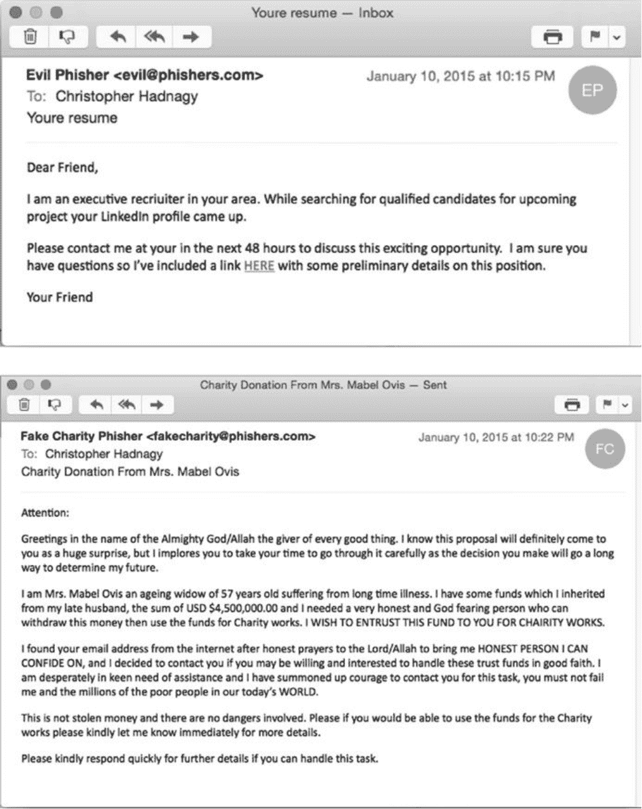
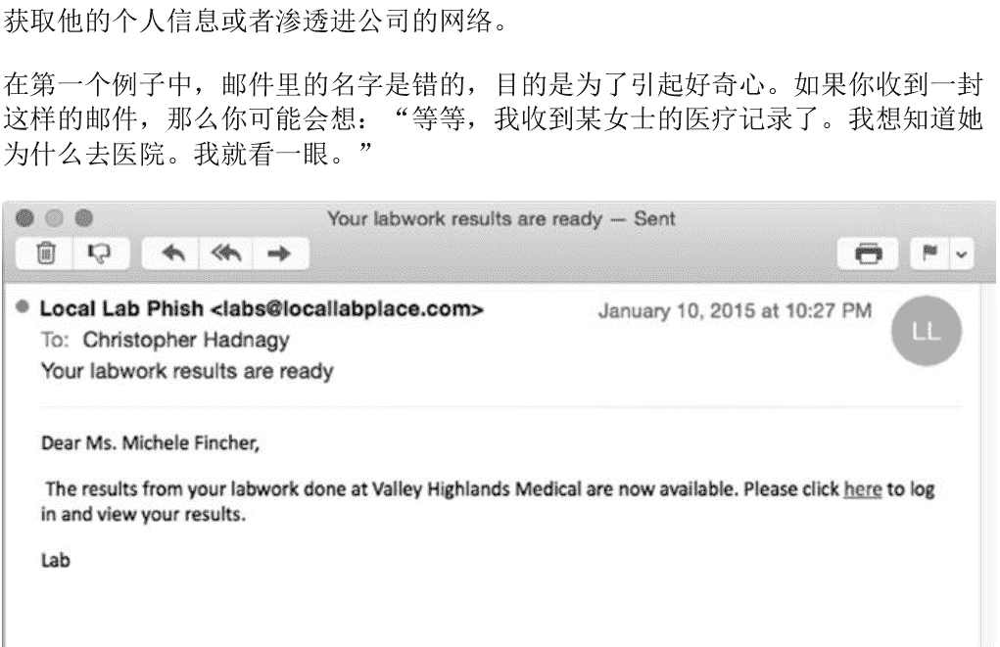
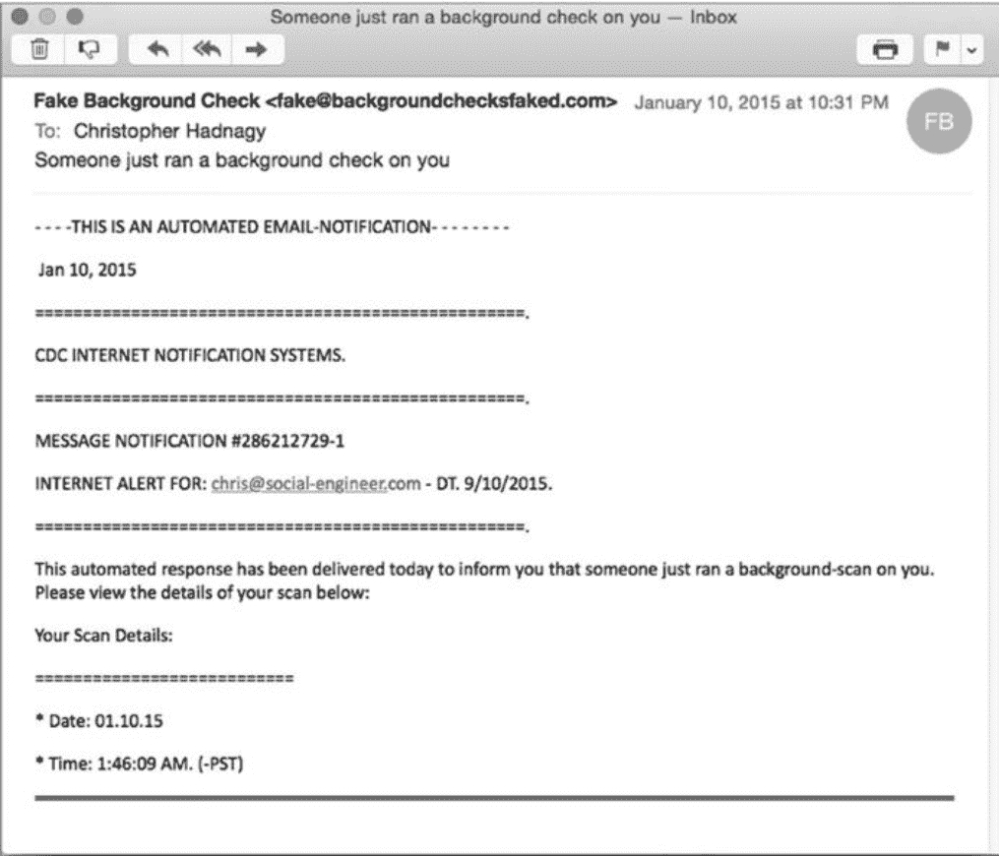
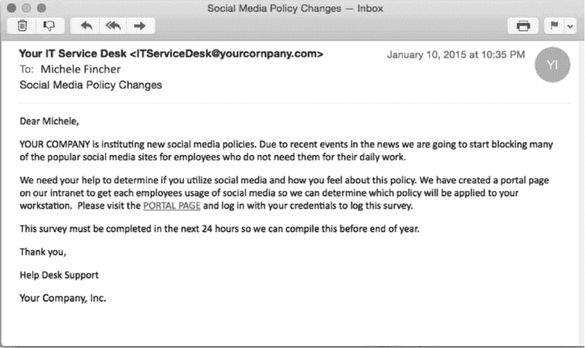
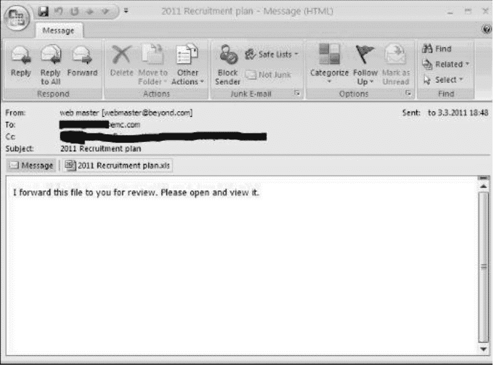

# 第五章：规划钓鱼攻击旅程：开展企业钓鱼攻击项目

熟悉我们的人都知道，我俩爱下厨也爱吃。任何一顿好饭，都是从几个简单问题开始的：

- 我想吃点什么？

- 该用哪份菜谱？

- 这顿饭图的是什么？

- 还有别的要备齐的吗？比如餐具、配菜之类？

你要是拿这些问题去问米歇尔，她只会甩给你俩字——“羊肉”。不过我得把话题拉回来，这章讲的不是吃，是钓鱼演练培训。但这两件事确实像：开火之前，有些底子上的问题必须先想明白。

说明：别被表象骗了——对自己公司搞钓鱼演练听着简单，可你要是连下面这些问题都不回答，只管闷头发邮件，那注定要翻车。

#### 5.1.1 动机是什么

问一句“为什么”，好像谁都会，但你的答案得能真正影响培训怎么搞。你启动这个项目，究竟是图什么？下面这些理由，你中过哪一条？

**为了合规**

公司制度、董事会要求，有时候是合同谈判桌上的条件，都能决定他们想要你的组织做哪种测试。我们跟一些大企业打交道时就碰到过这种情况：法规或者别的硬性规定压着，公司必须做钓鱼测试并且上报结果。

拿合规当理由，本身不算错。可我们发现，如果这是唯一的动力，很多公司就会挑最省事的路子走一遍，拿到数据交差完事。这种应付式的测试，往往倾向于用偏弱的模板，大家眼睛只盯着点击率数字。

再说一遍，摸清基线是好事，但千万别把合规当成搞钓鱼培训的唯一由头，这一点很关键。

**被上面要求做**

有时候是某位老板、CISO 或者别的什么人，让某个部门去组织并发送钓鱼邮件做演练。每回我听说某个项目的起因是这个，我都会去找那个提要求的人聊聊，挖一挖他到底为什么想搞（无非是下面列的某一种）。如果你也是被安排来做这件事的，那你也该反过来问问他们这些问题。

**想提升安全意识**

不少公司把钓鱼演练当成年度常规动作之一，用来检验员工对钓鱼的抵抗力。这类测试按月或者按季度发，而且几乎总带着教育目的。

安全意识是非常普遍的一种启动理由，也说明公司在往前看。通常来说，定期搞钓鱼演练对营造安全文化有明显推动作用，这是好事。

另外，我们见过有人从对钓鱼一窍不通，一路变成（不管在家还是在单位）能识破最高段位钓鱼邮件的高手。这个转变本身就是开展培训的强有力理由，对员工怎么看安全意识有长远影响，也能让他们感受到公司有多在乎他们和他们的福祉。

**出了安全事件之后的反思**

很多公司是在发现漏洞或者出了类似安全事故之后，才回头搞钓鱼演练的。演练是为了先拉一条基线，然后教育员工或者解决某些问题，再重新测一轮看看有没有改善。

当然，遗憾的是，不少公司都是被攻破了或者嗅到钓鱼苗头了才动手。我见过演练结果报到董事会之后，董事会拍板搞一系列持续演练来提升安全意识的情况。这当然是好事，能让员工受到教育、保住安全。

我的观点是：组织不该等到挨了打才启动这类项目。“鸵鸟式”安全法（把头埋进沙子里，假装自己不会被盯上）基本不管用。安全委员会的口风已经从“如果你被攻击了”变成“当你被攻击时”，因为看起来早晚我们都得挨一下。

别做枝头那颗低垂的果子——趁钓鱼者还没把你从树上摘走，赶紧训练和教育起来。

**把钓鱼演练纳入渗透测试**

把钓鱼演练当成渗透测试的一部分，在企业里已经很常见了。做法有好几种。一种是通过加载可执行文件或者带代码的附件，让渗透测试人员拿到 shell（也就是远程访问你网络的通道）。另一种是钓鱼邮件把你引到一个页面，那里会收集你的凭证信息。第三种是诱导员工访问一个 404 错误页面，而且不告诉他们这其实是演练。第四种则是把员工引到一个教育页面。[¹]

[¹]: 教育页面，即点击钓鱼邮件链接后，会引导你进入一个关于防范钓鱼攻击的安全教育页面。——译者注

不管你的公司选哪种，把钓鱼演练放进渗透测试里都是个好主意。我知道这话会带出一串新问题。比如：我现在的渗透测试公司能把钓鱼测试做好吗？他们在安全领域有经验吗？我们对这次测试该抱什么态度？

这些都是好问题。在跟渗透测试公司沟通之前，你脑子里就该有清楚的答案，这样才能确保拿到你想要也需要的服务。

**为什么要问“为什么”**

好了，你现在对搞培训的基本理由应该比较清楚了。但为什么搞清楚动机这么重要？

很简单。因为这个答案会影响你怎么组织培训、怎么用钓鱼邮件、选什么媒介，以及该期待什么样的结果。

举个例子，假设你搞培训是因为刚挨了一次攻击。你总不会指望哪家钓鱼服务商立刻帮你把点击率从 90%降到 10%吧？挨打之后马上反应是很吃力的，需要快速行动、快速决策。所以这时候培训的主要目标，是让大家知道钓鱼邮件长什么样、是什么、怎么缓解，而不是把总点击率压下去。

反过来，如果你搞培训是为了在未来十二个月里提升安全意识，那你自然可以期待比较大的变化。

开火做饭之前，先搞清楚为什么做这顿钓鱼培训，能帮你做得更好，给员工和上级端上一道更香的菜。

知道了为什么，接下来就该定怎么做了。

#### 5.1.2 主题选什么

准备做饭的时候，你大概会先想想这顿饭的主题。比如给超级碗派对备一桌菜，你肯定不会用跟结婚二十周年纪念日一样的套路，对吧？（我当然希望你不会在二十周年纪念日上拿餐巾纸折个翅膀就坐到电视机前。）关键是，主题会改变整桌菜呈现的样子。

这话听着可能跟前面几节有点像，但差别挺重要。下面聊几种常见主题。

**通用型**

这一类几乎什么都能装，从老掉牙的 419 骗局到伟哥广告都算。我得说这类钓鱼现在不太多见了，但如果你的组织之前从没遭遇过钓鱼，而你想拿一些容易辨认的邮件开个头、给大家热热身，那可以把它当饭前开胃小菜。

通用型钓鱼能帮你划一条基线，看看人们对带链接的东西有什么反应，也能发现他们在察觉可疑时有没有采取该有的动作。

一点建议：如果你打算跟服务商合作或者自己搞，千万别在通用型上停留太久。在那些一眼就能识破的钓鱼上耗太长时间，会让人烦。

**媒体/新闻**

现实世界里这类钓鱼更常见。举几个例子。

- “有人在对你做背景调查。”

- “突发新闻：〈某地〉发生炸弹爆炸。”

- “〈某种灾难〉重大新闻！点这里看详情。”

- “你被邀请接受 CNN 采访，请选一个方便的时间段。”

不管出于什么原因，新闻和媒体向来是钓鱼的常用题材，这个主题能勾住很多人的兴趣。它可以帮助学员分辨新闻故事的真假，也能让他们理解钓鱼者利用某个特定题材时想达到什么目的。

**其他主题/来源**

我前面两节列的邮件类型只是部分例子。实际上钓鱼邮件种类多得很，就算没有上百种，也远远超出这里能列完的范围。

既然列不全，我就把跟你的公司无关的其他主题也纳进来，它们可能来自供应商或者内部渠道。看上去像是从 Facebook、亚马逊、LinkedIn 发来的钓鱼邮件，都可以归到这一类。

- **供应商**

  社会工程人员找目标公司的一个办法是：把目标在用的所有供应商都查出来。钓鱼者会去研究废品管理公司、电话和网络提供商、电力公司、软硬件供应商，甚至你的安全服务供应商。

  为什么这些信息对他们有价值？因为社会工程人员清楚，你和你的员工更愿意信任那些看起来靠谱的供应商，更愿意点开它们的链接、附件，或者把信息交给它们，而一个突然冒出来的陌生来源很难做到这一点。

  钓鱼者就是利用这一点，想让你“做出一些不符合自己最佳利益的举动”，他们乐意冒充你的供应商来达到目的。一个社会工程人员如果知道你用的废品管理公司叫 WasteR-Us、域名是 www.wasterus.com，那他给你发一封来自 accounting@waterus.com（对，故意拼错的）的邮件，就可能让你打开一个带恶意代码的 PDF。

  这里有个难题：安全服务供应商拿别家公司的商标和标志来做测试，合法吗？符合伦理吗？我对此有些想法，放在下面 5.1.3 节里讲。

- **内部来源**

  内部邮件看着是个很好的主题，能帮员工理解钓鱼的危险。让员工接触看起来和公司网址很像的 URL，或者声称来自人事、IT、管理层或者 C 级管理者²的邮件，都能帮他们认清钓鱼者的惯用套路。这也是训练员工解码 URL、更仔细看发件地址的好办法。（更多关于这些防护手段的内容见第四章。）

² 指 CEO、CFO 等级别的管理者。——译者注

你想把这个主题的演练难度推到多高？我们公司从来不建议一上来就拉满。你不会想让员工感到无助。我建议刚开始别搞太难，邮件里留一些破绽提示，然后再慢慢加难度。

是的，我听过一些争论：“坏人可不会客气，他们今天就直接上最高难度。”我同意这话，但也别忘了这个简单的事实：我们不是坏人。我的意图和目的跟坏人不一样。我的目的不是证明“你的员工有多蠢”，而是帮你把培训做好，让员工在工作和生活里更安全。这不能靠让人觉得自个儿蠢、没指望来达成。所以，尽管从简单起步不是 100%还原现实，但这套方法在训练里确实管用。

到这你会发现，选主题跟定动机一样重要。往下走之前，花点时间把这两节的内容仔细过一遍很值得。先想清楚为什么搞钓鱼培训、打算从什么主题入手，然后再决定钓鱼培训的哪些特性能把演练办得更贴近实战、更有教育意义、更成功。

#### 5.1.3 邮件里要不要用商标

在继续往下规划之前，我得先停下来聊一个钓鱼圈子里吵得很凶的话题：“邮件里用不用商标，这是个问题。”

想象你收到一封来自希腊某个组织的钓鱼邮件，看起来像是 UPS（联合包裹速递服务公司）发来的——有商标，措辞很官方，页脚甚至还带着法律条款。虽然邮件设计得像 UPS，但里面的链接全指向一个恶意信息窃取网站，会偷走你的密码、用户名、账户信息等等。

随着坏人越来越多地用这招，不少公司也开始选择在演练邮件里使用商标，来测员工的反应。这个决定在钓鱼专家、供应商、法务部门，以及那些商标被拿去用的公司之间，激起了不小的争论。

在说我的看法之前，先声明两句：我不是律师，我讲的也不是法律建议。在决定演练里用不用商标或者其他品牌之前，你应该先找家律所咨询一下。

标识。现在先把这些放一边，下面给一些基本信息。

商标是指公司用来表示产品或服务属于它们的文字、图像、短语或者符号。美国联邦法里主要的商标法规是《美国法典》第十五编的《兰哈姆法》（Lanham Act, 15 U.S.C. §§ 1111 - 1129）。尽管商标法过去几十年里发展了不少，添了很多复杂条款，但几条基本要求没变：原告必须在开庭前找到被告未经授权使用商标的证据。

- 原告必须证明自己拥有有效商标。

- 原告必须证明被告未经授权，在所售商品、服务或广告上使用了相同或近似的商标。

- 原告必须证明被告这么用商标容易让人混淆。

其中第二条对钓鱼来说最关键，因为它意味着：只要不在带广告或者产品促销信息的钓鱼邮件里用商标，就更安全；反过来就不然，哪怕你只是拿它来糊弄自己的客户或者自己的员工。

在你决定用不用商标之前，还有几个问题要考虑。

- 你和你的客户有没有可能拿到商标持有者的授权？（如果能，请确保拿到纸质许可。）

- 就算有充分理由说明你没侵犯别人的商标，最后官司也赢了，你也要考虑高昂的律师费、耗掉的时间和承受的压力。真要有公司决定起诉你，你准备好为庭审砸进去大量时间、金钱和精力了吗？

- 你正考虑在钓鱼邮件里用某家供应商的商标，好让它显得更真实，但你的客户是不是也在用那家供应商的服务？如果不是，这么干值吗？举个例子，我见过一封用 UPS 商标的钓鱼邮件，几乎骗过了所有人。但我现在的客户只用 FedEx（联邦快递）。那仅仅为了用 UPS 商标，就向这位客户提议在训练里发带 UPS 商标的邮件，岂不是太傻了？

在钓鱼演练里，你对这些问题的回答，会极大地影响你对用不用商标、怎么用的态度。

我知道你现在可能想知道我的看法，那我就直说了：我赞成用商标。拿做饭打比方，我第一次试着做奶酪蛋糕时没买烤盘。做出来的蛋糕是没问题，但不如外面卖的那么好看。你们中要是有人也做过奶酪蛋糕，就知道问题不在买不买烤盘——

曾经我在安全会议 DerbyCon 上有个特别好的机会，玩了一把趣味版测谎仪。我们先问一些特别尴尬的问题，然后看被测者是说实话还是撒谎逃避。测谎的人首先得设一条基线——也就是说，先问一个不可能撒谎的问题，看看被测者的真实反应。我们的基线问题是：“这间房里的灯亮着吗？”

这条基线的作用，是帮测谎者了解一个人说实话时的心跳速度、呼吸频率和出汗量。测试开始后，就拿基线来衡量波动程度。

成功的钓鱼培训项目，都是从基线开始的。可你该怎么给钓鱼攻击设基线？这里有两种思路：“警戒线”和“出人意料的钓鱼攻击线”。

##### 警戒线

第一种设基线的办法，是提前告诉员工你在搞钓鱼演练项目，并且发出警告。大体上，你要宣布演练开始，解释你的目的是给公司和个人营造更安全的环境。然后你会隔一段时间给他们发钓鱼邮件。

建议你甚至可以告诉他们你希望他们采取什么动作：

- 识别钓鱼邮件

- 报告钓鱼邮件

这种提前打招呼的信息在公司里传开之后，影响会很大，能帮员工明白接下来会发生什么、该怎么应对。

##### 出人意料的钓鱼攻击线

第二种开展培训的方式更激进一些。这种情况下你不预先警告，也不先设基线。你在没有任何提示的情况下直接发钓鱼邮件，然后看结果怎么样。

为什么有人选这种法子？因为它给出的画面最清晰，能直接看到员工面对真实世界钓鱼攻击时的反应。

另一些人选择提前警告员工，是因为他们想让员工在每一次教育机会里都做好最佳准备去抵御钓鱼。

哪种方法更好？老实说，我没法给你标准答案。这取决于你们的企业文化、员工、经验，还有很多别的因素。

我能说的是，这两种方法都能帮你设一条基线，都能把钓鱼演练当作教育员工的工具。我的建议是：挑最适合你的那种，然后拿它当训练的起点。

决定了怎么设基线之后，你该怎么知道该发什么样的钓鱼邮件？

#### 5.2.2 设定难度

哪怕你从这本书里别的什么都没记住，也请留意这一节，因为这是整个项目最要命的地方。这一节之所以重要，是因为它讲的是怎么设定钓鱼攻击的难度。这些年我一直在给见过的钓鱼邮件做分类。我和米歇尔开始搭档之后，建了一个钓鱼库，里面装着大量真实的钓鱼邮件样本，并且按系统分了类。

这套分类的依据是钓鱼邮件的难度级别——具体说，是按识别它是否为钓鱼邮件的难易程度来划的。我和米歇尔把它分成下面四类，几乎能把所有基本钓鱼邮件都装进去。

下面带你概览一下不同等级的钓鱼邮件，然后再聊怎么用它们。

##### 一级钓鱼攻击

一级钓鱼攻击是最容易认出来的，通常跟（第一章里描述过的）419 钓鱼邮件相关。有很多指标能看出它是“钓鱼”，大多数普通用户都应该觉得找出这类邮件不对劲的地方很容易。

我和米歇尔给这些邮件分类的时候，挑出了一些显著特征，可以用下面这些指标来划一级钓鱼：

- 非指向性的问候和结束语；

- 拼写错误和糟糕的语法；

- 简易的信息/不太可能成立的理由（比如“你已经继承了上百万美元”）；

- 勾起贪婪、恐惧或者好奇的心理；

- 正文里出现恶意链接；

- 奇怪的邮件地址/陌生的发件人。

说到网络钓鱼攻击，很多人第一反应是：这种老套路还有人会上当？但现实是，它们不仅还有人信，而且成功率远超你的想象。

##### 别小看“初级玩法”

先聊聊最常见的初级钓鱼攻击。虽然不少安全和反垃圾邮件系统已经把这类邮件拦截，但你依然能偶尔在收件箱里看到它们的踪影。第一个标志就出现在这里。

这类邮件可能在你看来的确有点可笑——比如中奖信息、来自“王子”的转账请求之类的。但真实情况是，它们确实骗到人了。还记得之前聊到“人性弱点”的内容吗？这些攻击之所以屡试不爽，全在于利用两种原始情绪：贪婪和恐惧。对损失的担忧、对意外之财的期待，以及一点点的好奇心，这些情感足以让理性靠边站。

举一个真实的案例：有个参与过恶意攻击的人，跟我讲过他和他团队的“业务”过程。他们不仅仅是发邮件那么简单，还会安排“真人出场”来增加可信度。想象一下这个场景——

你回复了一封邮件，对方告诉你需要签一些法律文件，并约你到一个城市的某间办公室见面。你去了，推开门，看到一位穿着某国军装模样的人，桌上摆着各种看起来特别正式的文书。你会被要求签下一份份银行转账文件、法律文件、律师授权文件，然后交出一张 5000 美元的支票。当时你可能觉得，跟后续“即将到手”的 450 万美元相比，这笔钱简直微不足道。但一周之后，你会接到通知，说因为“政府流程问题”，需要再付 5000 美元来“解冻资金”……

这个团伙通常从每个人身上骗走 5000 到 15000 美元，然后消失。他们同时面向 5 个、10 个、20 个甚至 100 个人下手，一个外国小团伙加几个美国本地帮手的组合，一周就可能入账 100 万到 400 万美元——没错，你没看错——然后他们挥挥衣袖就走人了。

所以，真别取笑这种攻击“太蠢”。我去年发送了 300 万封钓鱼攻击邮件，初级攻击的点击率在 5%到 7%之间。算出数来了吗？至少 15 万人点击了。而对于攻击者来说，他们只需要其中一个人点开链接、运行恶意软件，就能开始瓦解你的整个网络防线。15 万人，够多了。

##### 进阶版：二级钓鱼攻击

二级钓鱼攻击就要“聪明”一些了。它跟初级版本有相似之处，但主题明显更讲究、更隐蔽。这类邮件的特征可以总结为：

- 非针对性的问候与落款；
- 拼写大体正确，但偶尔有些语法小瑕疵；
- 信息结构比初级复杂，但本质上依然很基础；
- 依然靠贪婪、恐惧或好奇来驱动你行动；
- 文本中藏着恶意链接；
- 发件地址奇怪，或发件人不明。

这里和初级攻击最大的区别在于主题选取。“你中了 450 万美元”这类话少了，取而代之的是更贴近公司或个人信息的内容，用好奇心和恐惧感来推着你去点那个链接。

举个例子：有封邮件里，对方的姓名拼错了。为什么故意拼错？就是为了勾起你的好奇心。你可能想：“咦，我收到了这个人的医疗记录？她去了医院？我看看怎么回事……”

第二个例子玩的则是“害怕秘密被发现”的心理。这两类邮件的共同逻辑就是：驱动你去做一件本不该做的事——点击链接、打开附件，或者执行某个操作。

这里对应和两个占位标志。

##### 高阶版：三级钓鱼攻击

到了三级这个级别，邮件已经非常接近真实的鱼叉式钓鱼攻击了，识别难度大大提高。这级邮件的特征包括：

- 指名道姓的问候和结尾；
- 拼写完全正确；
- 语法也挑不出毛病；
- 内容复杂，会激发恐惧或好奇心；
- 文本中有恶意链接；
- 偶尔会有可疑的邮件地址，但发件人看起来像模像样；
- 经常出现品牌商标。

这级邮件看起来太真实了，哪怕是有经验的安全专业人士，也需要花时间才能分辨真伪。前面提到过的那封“伪装成亚马逊官方邮件”的案例，就是典型的三级攻击。

我在撰写这一部分时，恰逢另一条关于 AT&T 内部漏洞的新闻闹得沸沸扬扬，成千上万的账户处于风险之中。当时我提醒家人和朋友要小心钓鱼和语音钓鱼攻击，结果我收到了这样一封邮件（处展示的正是那封邮件的截图）。

这封邮件从问候语到格式，再到商标和链接，看起来都极其正规。它不一定吓唬你，而是纯粹利用你的好奇心——“免费智能手机”谁不想要呢？邮件里多数链接真的指向 AT&T 官网，唯独最关键的那个链接把用户引到了一个身份盗取页面。发件人的地址其实是“attwireless@plwomv.me.uk”，明显不是 AT&T 官方域，但如果你没留意，绝不会察觉。

再举一个经常用于企业内部安全培训的三级钓鱼攻击例子（处展示）。这封邮件的发件地址是“yourcoRNpany.com”，和真正的“yourcompany.com”只差了一个字母。这种细微差别非常容易忽略，但如果员工接受过识别这类细节的培训，就能及时察觉。

三级攻击的复杂度已经足够高，一般不会直接用在零基础员工的安全培训中，更适合有一定经验的群体。

##### 终极形态：四级鱼叉式钓鱼攻击

到这个级别，攻击已经高度个人化，而且成功率极其可观。有意思的是，它不一定需要花哨的外表，有时候反而是全球最简单的邮件。

还记得 2011 年的 RSA 攻击事件吗？处展示的正是那封鱼叉式钓鱼攻击邮件。它只被发给了 RSA 公司内部的少数几个人。看起来普普通通，但就是有效。同样简单的还有那封打到可口可乐公司的邮件，正文只有一句话，却让整个公司中了招。

这类攻击为什么能成功？关键在于“适配”。收件人本身就在等待这样的邮件到来——他们期待某个主题的邮件，所以收到后不会怀疑，而是直接照做。不假思索，就中了。

在很多鱼叉式攻击中，大量工作在发邮件之前就已经完成了。攻击者会做足情报收集（OSINT），搞清楚谁是目标、走哪条路径最容易穿透、用什么样的话题让目标失去戒备。

在我们做的渗透测试项目中，鱼叉式攻击也遵循同样的逻辑——先收集情报，再发给客户一份完整报告：发现了什么、如何利用、发邮件之后又得到了什么样的结果。

因为涉及客户隐私，我不能展示真实邮件的细节，但可以分享几个实际用过的标题思路：

- 我们看到一个客户的家庭住址，附近正好有一栋房屋挂牌出售。通过进一步收集发现，这位客户自己也在考虑卖房，于是我们发邮件说“提供免费房产估价”；
- 有位高管喜欢带家人去巴黎度假，我们就发送了一封“春季巴黎特价之旅”的广告邮件；
- 一位高管从军事院校毕业即将满 25 周年，我们发邮件请他担任“25 周年重聚大会的主讲嘉宾”；
- 还有一位高管的女儿“讨厌父亲”，我们以学校辅导员的身份发了一封附带 PDF 报告详情的邮件。

这些听着毛骨悚然？的确是。这类攻击中潜藏的恶意不容置疑。但如果一个高层管理人员掌握着整个公司网络的“钥匙”（我们甚至服务过接触核设备钥匙的人），那么通过这样的测试和培训让这些人意识到攻击有多现实，是非常必要的一步。

还有一种很常见的四级攻击：多重攻击。举个例子：

上午 11:00，约翰收到一封邮件。11:30，他接到“IT 部门拉里”打来的电话：“约翰，我刚发给你一封邮件，里面有个 PDF 文档，是关于你的工作站升级路径的。我需要你打开它，看看你的电脑是不是符合这些条件。”约翰照做了，但 PDF 打不开。“拉里”在电话里说：“你是不是还在用 Acrobat 6.0？我们本来两个月前就该帮你升级了。我重新存一个你能打开的版本，午饭后再打给你。”约翰挂上电话，觉得一切都很正常。而“拉里”此刻已经通过约翰下载的恶意软件侵入了公司网络。

还有一招：给高管寄一个全新的硬件设备，比如一个价值两百美元的微软键盘，里面嵌入恶意芯片。你猜有多少高管会拆开包装，顺手插到自己电脑上？几乎是百分之百。

这些攻击目标明确，只针对特定的人，不撒网，不用广散弹，只用一根鱼叉去捕鱼。而在很大程度上，捕到的都是“鲸鱼”。

##### 从哪个级别开始？

那么问题来了：如果是给自己的团队安排钓鱼攻击培训，应该从哪个级别开始？

答案比想象中简单，基本分成两种路径：

- 路径一：先钓鲈鱼，再钓马林鱼。也就是从一级攻击开始，看看员工承受力如何，补补漏洞，再逐步升级。循序渐进。
- 路径二：直接深潜捕大鱼。也就是从三级起步，当点击率降下来之后再往下调，找到合适的基准线再稳定下来。

个人来说，我更推崇路径一。它让员工在培训过程中有“赢”的感觉，心态会更放松，也更容易接受后续的学习。这是不是安全效果最棒的路径？我不敢下定论，但它是让人乐于参与安全项目的好办法。

具体如何取舍，还要看实际情况。举两个真实案例：

- 某家公司从未做过钓鱼攻击演练，但管理层已经意识到这个问题，计划每季度做一次全员测试。我们决定：第一季度从二级攻击的低难度版本开始，第二季度升至二级攻击的高难度版本，第三季度再上升到三级攻击的低难度版本。结果点击率上升，报告率也小幅提升。第四季度我们继续维持三级低难度版本，点击率下降了。说明持续培训对这家公司是有效的。

- 另一家公司已经自行做了一年的钓鱼攻击演练，点击率一直很低，管理层也很支持这个项目。我们每月对全体员工做一次测试。从二级攻击的中等版本起步，每月提高难度，到了第四个月达到三级攻击的中等版本。点击率在上升的同时，越来越多人能够识别出钓鱼邮件。

从哪个级别开始，取决于很多因素。以下几个问题可以帮助你确定：

- 你的团队之前接触过钓鱼攻击测试吗？
- 你的上级（也就是那个可能随时叫停项目的人）是否坚定地支持这个方案？
- 你打算多久测试一次？
- 是否要覆盖全体员工？

##### 邮件怎么写，先别急着点“发送”

基线已经定好、等级已经选好、人人都点头了，钓鱼攻击项目可以启动了。如果你用的是钓鱼攻击工具，可能会忍不住直接从模板库挑一个，点击发送。等等，先别急。

模板确实有不少做得不错，但它们真的适合你的公司吗？结合前面那些问题，你应该已经有了明确方向：需不需要加商标、要不要用指名问候、是否需要和同事配合演出。然后再考虑怎么帮到员工，这件事更有价值。

我个人的风格是：从新闻里找真实的案例，用来说明攻击者是如何做的。举个例子——在“9·11”事件过去两三年后，临近纪念日的那段时间里，以此为陷阱的钓鱼邮件就开始出现了。

好了，以上就是关于钓鱼攻击从低到高的完整梳理。别把这类攻击当笑话，也别忽视培训的力量。网络安全的防线，往往只是差在一个人的一念之间。

做钓鱼邮件演练这事，最难的其实不是技术，而是拿捏人心。

我干过一件挺露脸的事——捏造了一家根本不存在的慈善机构，写了一封跟“9·11”挂钩的钓鱼邮件。说真的，那封邮件写得相当漂亮，情绪钩子一个接一个，我自己都有点得意。但发出去之前，我把它先送去了人事部门走审核。结果呢？被拒了。我当时真没想通，还专门开了个会去问原因。后来我才知道，这家公司里有太多人在那场袭击中失去了至亲好友。你想想，如果公司为了搞个培训，真把这样一封邮件推到他们眼前，他们会是什么感受？

我知道你想说什么——“坏人可不会手下留情，所以大家必须学会识别啊！”这话没错，我完全同意。可问题在于，我不是坏人。我拿客户的钱，就得替他们着想，包括他们的情绪和员工的感受。一封邮件如果会造成长久的心理创伤，那就不该发。最后那封邮件没出去，但那一课我记住了。

再说个反面教材。我发过一封新手难度的二级钓鱼邮件，大意是：“感谢您把信用卡绑定的邮箱改成了 attacker@hack.com。”措辞当然比这润色得多，但内核就这么回事。群发给了上万人。不少人皱了皱眉，也就过去了。可有位女士反应极其激烈——她把名下所有信用卡全注销了，银行账户也搬了家，还回信说要以死相威胁。

这回我换了个角度去看。她点开了链接，链接把她引到了一个教育页面，可她看完之后还是选择把卡全砍了、账户全挪了，而不是用之前培训里教过的办法——比如先给 IT 打个电话确认一下。要是她照着学过的那套来，大概也不至于折腾成这样。

所以，给你的培训项目挑一个合适的难度起点，按前面说的那些原则去设计邮件，让它看起来像真的，然后开始演练。

提醒一句：你知道那是钓鱼邮件，因为是你自己写的，所以每句话在你眼里都明摆着。但别以为你看得清，别人就看得清。刚开始，简单点。

#### 追踪和统计

第七章会细讲钓鱼数据追踪工具。先想清楚你需要什么工具、什么功能，因为你选什么工具，直接决定你能拿到什么数据。邮件营销软件只能大概告诉你谁点了，而功能齐全的 SaaS 方案能把每个细节都给你扒出来，这中间的差距可不小。

选软件的事我不在这儿展开，但有一点得说：你的统计口径和数据需求，本身就是做决策的依据。

到这一步，你可能已经有了一套挺完美的培训计划。可要是数据跟不上，前面全白搭，不是吗？这也是平庸的钓鱼演练操盘手和专业选手（我说的是拿这个当公司服务卖的人）之间最大的分水岭。

差别在哪儿？就在他们收集了什么数据、又怎么把数据呈现给公司。我听人说过：“我们只要点击率就行了吧？”不行。

点击率当然重要。可我给你打个比方：第一个月你发一级难度的邮件，点击率 10%；第三个月你发三级难度的，点击率飙到 90%。光看点击率，好像员工一夜之间全变傻了，但事实根本不是那么回事。

回头想想你搞培训的初衷：教会员工识别、上报、抵御钓鱼攻击。什么样的数据能让老板觉得钱花得值？项目该怎么设置才能收益最大化？哪些数字能告诉你下一步怎么改？这些问题我一个个来答。

##### 只是统计数据而已，女士

前面说过，你得先定下来哪些数据对你重要，再谈别的。老有人问我“到底该看哪些数据”。在逐条解释之前，你先琢磨一个问题：聊到钓鱼攻击，什么样的员工算好员工？这好像很简单——点链接的不好，不点的好。那除此之外呢，还有没有别的好行为、坏行为？

希望你已经在公司里搭好了一个让员工上报可疑邮件的通道。如果员工能把任何觉得不对劲的邮件转给一个专门的“受理口”，公司能省不少心，说不定还能顺带揪出几个漏洞。所以，愿意上报的员工，都是宝。

也有人问我员工该怎么上报。我的建议是：让他们把邮件转发到部门指定的邮箱。转发件可以拿来做分析，员工也能收到后续该怎么处理的指引。有些公司说干脆设个电话热线，但你想想，5000 人的公司，一半员工每人每天收到一封可疑邮件就打电话来报，那接线的人得疯，效果也好不到哪儿去。

下面这几项数据，我认为是关键。

- **点击人数。** 最直观，也最基础。这是你的基准线，告诉你多少人把公司置于风险之中、多少人需要回炉。但光有这个数字说明不了太多问题，你得拿它当底子去挖更多东西。

- **上报钓鱼邮件的人数。** 假设你们已经有了上报通道，这是“解决”钓鱼问题的关键一环。我们的目标是营造一种氛围：所有员工看到可疑邮件后——在点之前——就先上报。其实你还得让员工知道，万一点了之后该怎么办。删掉邮件不算好办法，他们需要一个地方去报告。很多次我刚跟一家公司合作，第一件事就是帮他们把上报通道搭起来，这一步太重要了。

- **点了但没上报的人数。** 你知道点邮件不好、上报好，那点了又不报的人，正好把你不希望的两件事全占了。这批人需要更多训练和帮助。

- **点了也上报了的人数。** 员工虽然点了，但事后还是报了，这是好事。为什么？说明尽管他做了一步不该做的动作，但培训让他意识到风险还在，并且采取了积极的补救措施。

- **没点也没上报的人数。** 这批人因为没点，暂时没有暴露风险。但你仍然希望他们能把收到的可疑信息报上来。上报是每个员工都该掌握的重要一步。

- **没点却上报了的人数。** 这是模范员工。他们做了你期望的事——不光认出了钓鱼邮件，还报告给受理口，帮了其他人一把。

回到假设上来。如果你们有上报通道，那你需要知道每次演练里有多少人识破了邮件并且报了上来。追踪的方法我下面说。

你已经知道，最需要帮的是点了却不报的人，最棒的是没点还报了的人。所以你要盯住这两类人的数量变化，并且希望后者一次比一次多——那说明你的功夫没白费。

追踪的办法不少，但我发现，帮 IT/技术支持中心（或者其他管钓鱼演练的部门）设几条规则，这活儿就轻松多了。

举个例子，我们有时候会在邮件里埋一段跟背景色一样的白字——对，白底白字，我们管它叫“白色文字”。（这招我是从哪儿学来的来着？）这段文字里得塞一些正常句子里绝不会出现的字符，比如 Th1$s$aphi$hingemai10rz-DATEHERE。

然后设一条规则：让收报告的那个邮箱里某个指定文件夹——比如“Oct201X Phishing Reporters”——按条件自动过滤。除非你的 SaaS 方案本身就能追踪（第七章细说），这么操作下来，月底你就能拿到一份清单。用点 Excel 的小技巧，把这份清单跟另一份“谁点了、谁没点”的名单一对，想要的数据就到手了。

我们还给那个专用邮箱加过一些挺实用的功能。比如设好规则之后，谁往这个邮箱转发邮件，发件人就会收到一封感谢信，告诉他这封邮件里藏着钓鱼攻击，他报告得很到位。

如果你决定这么干，早期的名单会清清楚楚告诉你现在是什么水平、该往哪儿使劲、哪里还得补课。

#### 5.2.5　报告

前面所有的折腾，都是为了这一刻：出报告。那份文档背后是你的汗水、眼泪、心血、纠结和熬过的夜，最后汇成一份沉甸甸的东西。

这一节不教你怎么写报告，只简单说说我们怎么呈现数据，说不定能给你几个灵感。

拿 X 公司举例。1000 名员工，希望我们每月搞一次钓鱼演练。他们之前从没做过这类训练，提了两个要求：别用别家公司的商标，只用自家的；从一级难度起步，再看着办。

报告里会有这样一张表。

| 第一个月：一级钓鱼攻击 | 数目 | 统计数据 |

|---|---|---|

| 发送邮件数 | 1000 | 100% |

| 点击数 | 750 | 75% |

| 报告数 | 50 | 5% |

| 点击/未报告 | 705 | 70.5% |

| 点击/报告 | 45 | 4.5% |

| 未点击/未报告 | 15 | 1.5% |

| 未点击/报告 | 5 | 0.5% |

当然还配图表和说明文字。第二个月，我们再来一轮，报告里放同样的指标，同时标出跟第一个月的差异。

| 第二个月：一级钓鱼攻击 | 数目 | 统计数据 | 变化 |

|---|---|---|---|

| 发送邮件数 | 1000 | — | — |

| 点击数 | 600 | 60% | -15% |

| 报告数 | 350 | 35% | 30% |

| 点击/未报告 | 350 | 35% | -35.5% |

| 点击/报告 | 250 | 25% | 20.5% |

| 未点击/未报告 | 13 | 1.3% | -0.2% |

| 未点击/报告 | 100 | 10% | 9.5% |

后面的月份我就不往下列了，你大概已经看明白了。你可以拿这张表告诉老板：一个月的时间，培训不光把点击率压了 15%，还把上报率提了 30%。再往深里说，最需要补课的那批人少了 35.5%，而“没点还上报”的员工多了 9.5%。

这样的报告，能让主管一眼看出你干出了什么成绩，也能让他们相信，这个培训项目值得花时间和钱。

- **体贴（Thoughtful）** 你知道员工每天手头有多少事、扛着多大压力吗？知道的话，你在备课时就会多想一层，别给人家已经够忙的日子再添堵。同时，你还帮他们做好了准备，去保护自己、家人和公司不受钓鱼攻击。这本身就是一种体贴。

我见过不少好心人，把 BEST 方法改得过于复杂，结果适得其反——员工没学到东西，反而搞得又懵又丧。你要是老老实实按 BEST 方法来，通常结果不会差。举个例子，有一家合作公司用了本章这些方法，从一开始 89%的点击率、不到 10%的上报率，一路改到 7%的点击率、75%的上报率。

当然，培训项目的最后一步是：重复。别以为一年搞一次钓鱼培训就能保员工平安。

我问你个问题，你得老实回答。读完下面这句话，给你五秒钟。

请说出过去一年安全意识培训课程里分数最高的三个……开始计时。

如果你说实话，你大概会盯着屏幕愣一会儿，憋出一个分数，但三个大概率说不全。对员工收到钓鱼邮件后的反应速度来说，五秒钟已经算很长了。别指望他们能记住去年你讲过的东西。换我是你的员工，超过 45 天，你就别指望我还记得了。

### 5.3 总结

读完这一章，你可能在想：“哇，活儿真不少，我得赌一把了。”说实话，开头确实要费些功夫。有时候光是拿到上级、人事、法务还有其他部门的授权，就够你跑断腿。推进项目的同时还得罪不起所有人，也不容易。但一次又一次，我们在帮公司落地项目的过程中就看到了回报。

有家公司说，跟邮件有关的恶意事件降了 70%。70%！光这一条，前面受的累就都值了。那家公司可以烦我，但只要有 70%的员工不再像去年那样暴露在恶意软件的威胁下，就够了。

钓鱼攻击之所以存在，是因为对恶意攻击者来说，这手段简单、好使、有赚头。你得保持警觉，也得有股韧劲，把培训一直推下去，让它真正发挥出最大效果。

在帮你挑软件之前，还有一个话题得聊：公司政策。翻到下一章之前，先停下来想想——积极的、消极的、甚至难看的公司政策，你觉得能从里面学到什么？下章见。