# 第七章：专业钓鱼攻击者的工具包

# 第七章：钓鱼高手的工具箱

> “技术不过是工具罢了。”
>
> ——比尔·盖茨

五六岁那年，祖父第一次带我出海。那是一次真正的远洋捕捞，船驶离码头后，岸线在视野里一点点退去。我怕吗？一点也不。祖父用一根粗绳拴住我的腰，另一端牢牢固定在船栏上。他笑着说：“万一你掉下去，我们好歹还能钓条大鲨鱼上来。”

船开到渔场，船员们纷纷抄起巨大的钓竿。那些线轮比我整个人还大，钓线末端挂着硕大的钩子。有人把一只大虾穿在钩上，将线沉入海中，然后把竿递到我手里。我那点小手劲儿，连竿都握不稳，更别提往上拉什么了。看我吃力，船员换了根东尼虎牌的小钓竿给我。握着它，我感觉自己终于像个大人了——可结果呢？一无所获。

问题出在哪儿？小钓竿根本不适合海钓。最初那根大竿子本身没毛病，只是我没那个力气，也没那个本事驾驭它。这一章要讲的，正是这个道理。

到这儿为止，本书已经聊过钓鱼攻击背后的心理机制、怎样做好相关的培训，以及决策的逻辑——如何在推进工作的同时绕开常见的坑。剩下最后一个话题：工具。

但事情不止“工具”这么简单。把一张工具清单甩给你，说一句“玩得开心”，当然省事。可我想站在专业钓鱼攻击者的立场，给你一份概览。

### 本章概览

我会逐一介绍自己用过的每一款工具，说明它们是什么、免费还是付费、各自的长处与短板，以及我的个人评价。章末还会做一个横向对比。

别急，还有。我还会把 SaaS（软件即服务）、托管服务和 DIY 三种模式放在一起比较，帮你判断哪种方式更适合自己。

我的目的不是让你偏爱某一种方案，而是给出诚实的使用反馈。过去大约五年，我以专业钓鱼攻击者的身份，用这些工具向数以百万计的人发起过钓鱼攻击。为了尽量客观，我采访了排名前五的商业软件厂商，以及开源软件 SET（社会工程人员工具包）和 PhishFrenzy 的开发者。我问了他们下面几个问题，并说明可以附上产品截图：

- 你会怎么描述自己的工具？
- 它最大的优势是什么？
- 它最大的短板是什么？

受访者可以只答其中一题、答一部分，或者干脆全不回答。他们的回答构成了本章的部分内容（其中的营销话术我做了删减）。每一节末尾，我会附上个人评价——难免带点主观偏好，但重点始终围绕这几个问题：

- 上手这款工具需要多高的知识门槛？
- 用户信息的安全性如何保障？
- 使用中还遇到过别的麻烦吗？（比如导入收件人名单要花多久、图形界面是否顺手、能不能同时处理多项任务、反馈机制是否方便。）
- 技术支持跟不跟得上？

好，我们开始。

## 7.1 商业应用

这一节说的是商业应用，也就是付费产品。下面几款是我心目中钓鱼攻击软件里的第一梯队。之后我还会介绍一些可用的开源工具。

#### 7.1.1 Rapid7 Metasploit Pro

厉害的渗透测试人员不好找，所以把他们的时间用在刀刃上格外重要。Rapid7 Metasploit Pro（www.rapid7.com/products/metasploit/editions-and-features.jsp）能借助闭环式漏洞验证来呈现风险水平、划分风险优先级，也可以通过模拟钓鱼邮件攻击来衡量安全意识。它内置的 Rapid7 NeXpose（www.rapid7.com/products/nexpose/）可用于验证环境中的漏洞、展示系统风险并排定行动次序。端到端（end-to-end）的钓鱼攻击项目让你能够安全地测试用户行为，并对没通过测试的人给出分析。另外，你还能在 Rapid7 UserInsight（www.rapid7.com/products/user-insight/）里查看钓鱼测试结果，获得更完整的用户风险画像。

**优点**

- 借助 Rapid7，你既能衡量用户的安全意识，也能通过渗透测试评估安全措施的实际效果——比如漏洞发掘和 Java 有效载荷。
- Rapid7 是一套功能全面的攻击安全工具，钓鱼攻击只是其中一环，漏洞发掘、证书检查、Web 应用测试也都覆盖在内。
- 它是本地部署应用，个人网络调查结果的隐私有保障。
- 自带 UserInsight，能给你一份包含钓鱼攻击在内的用户全局风险概览。
- 只需一次授权，Rapid7 就能向不限数量的用户提供不限次数的钓鱼攻击项目。

**缺点**

- 本地部署意味着你得自己托管和维护。
- 钓鱼攻击模板非常基础。
- 内置的钓鱼训练模式也比较初级（不过可以接入第三方训练方案）。
- 漏洞发掘功能可能让部分用户不舒服，好在可以关掉。

**屏幕截图**

图 7-1 和图 7-2 是 Rapid7 Metasploit Pro 的界面截图。

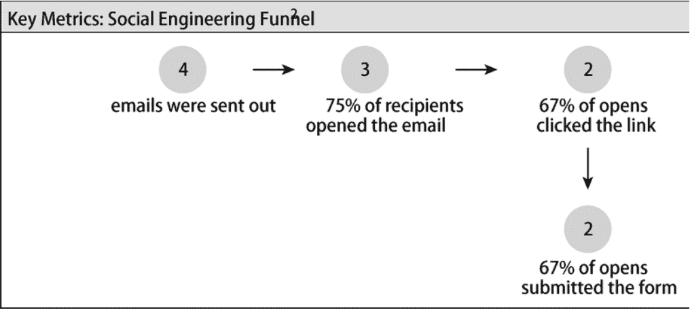

图 7-1 Rapid7 Metasploit Pro 统计页面

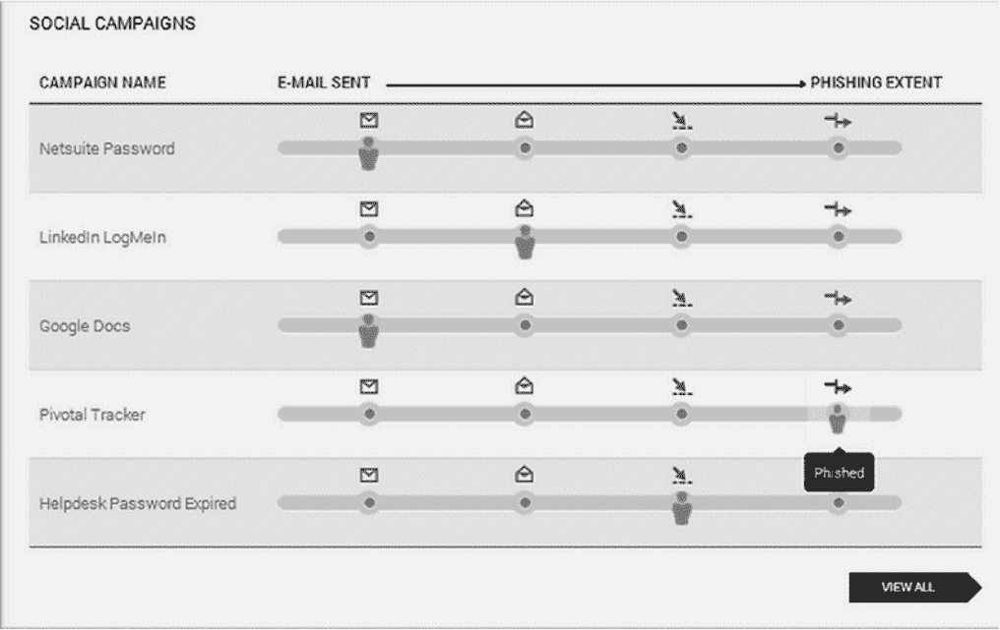

图 7-2 Rapid7 Metasploit Pro 钓鱼攻击追踪页面

**个人评价**

以下是我对 Metasploit Pro 的看法。

- **上手需要多高的知识门槛？**

  Metasploit Pro 的配置不算复杂。我觉得凭直觉就能应付，不需要什么特别的软件知识。所有软件的学习曲线大多集中在图形界面上，有些元素我一开始不太习惯，但用下来发现其实挺顺手。

  它并不是给纯新手准备的，但也不要求你成为专家。使用过程中，我在一些简单环节上卡过壳，比如查看结果、设置伪造邮件，好在说明文档写得清楚，加上几个简单教程，大部分问题都迎刃而解。

- **用户信息的安全性如何？**

  这款工具由你自己托管，安全水平高不高，主要看你怎样部署。要是把它放在公网服务器上，却没有任何防护，被攻破只是迟早的事。软件内部的安防水平，我们没有做专门审计去验证，不过它设有密码保护，对用户数据的防护看起来也还算到位。所以结论是：这是本地部署工具，安全性掌握在你自己手里。

- **使用中还遇到过别的麻烦吗？**

  界面大体上顺手，凭感觉就能操作；唯独邮件服务器和发送时间的设置让我绕了点弯。我那个版本没法并行处理多个任务。报告功能是现成的，数据也能导出，给客户出报告时省了不少事。

- **技术支持跟不跟得上？**

  我提出问题后，客服响应迅速，疑惑很快就打消了。

#### 7.1.2 ThreatSim

ThreatSim（http://threatsim.com/）的出发点，是帮机构依据员工的实际行为来判断风险、压低风险。本质上，它是个安全意识培训平台，目的是教会员工辨认潜在威胁，并在关键时刻做出安全的选择。早先的版本能让机构给员工发模拟钓鱼邮件，谁要是上了钩，马上就会收到针对性的即时培训。后来加入的场景化训练，则把重点放在员工日常做安全判断时常见的那些情境上。ThreatScore 这款用户风险管理产品，会从历史行为、安全知识、技术能力、岗位特征等维度给员工打分，让安全管理员有据可依，从而降低终端用户面临的风险。它采用 SaaS 模式交付，按终端用户规模以订阅方式售卖。

**优点**

- **自定义选项丰富。** 在 ThreatSim 里，钓鱼邮件和培训内容都能按需定制。从发件人姓名、地址、着陆页域名，到一整块邮件正文编辑区，都在可调范围内；编辑器还支持直接把真实钓鱼邮件拿来剪切、复用。它的网页抓取能力相当强，能把目标网站原样“搬”下来，做出一个高度逼真的落地页。每套训练都可以从内容到图形再到排版全部重做，用户想要什么样的信息，就能搭出什么样的信息。
- **漏洞检测。** 它能探查目标使用的浏览器，揪出 Java、Adobe、Flash 之类的过时组件——这些老版本恰恰会放大钓鱼攻击中恶意软件的感染风险。
- **高级钓鱼模拟。** 它准备了不少用于模拟高级攻击的功能：邮件可以在一个时间段里随机发送，让演练更像真的；可以按目标“屡次中招”的频率生成动态名单；还能结合每个人的历史表现和技术水平，给出独立的风险等级。
- **容易上手。** 它的界面（见图 7-3）设计得颇为顺手，发起攻击、查看结果都能高效完成。名单管理走的是两步式更新，离职的人删掉、新来的人加上，操作不复杂。数据可以整体导出，客户拿去做深度分析也没问题。
- **多语言支持。** 机构一旦走向全球，就容易进入钓鱼攻击者的视野；训练内容只有本地化，效果才出得来。为此 ThreatSim 内置多语言支持，现有内容覆盖 14 种语言，并且可以按客户需要继续扩充。

**缺点**

要说不足，ThreatSim 主要就一点：信息给得太满。有些用户会觉得它呈现的内容多到让人吃不消。

**屏幕截图**

图 7-3 到图 7-7 展示了 ThreatSim 的屏幕截图。

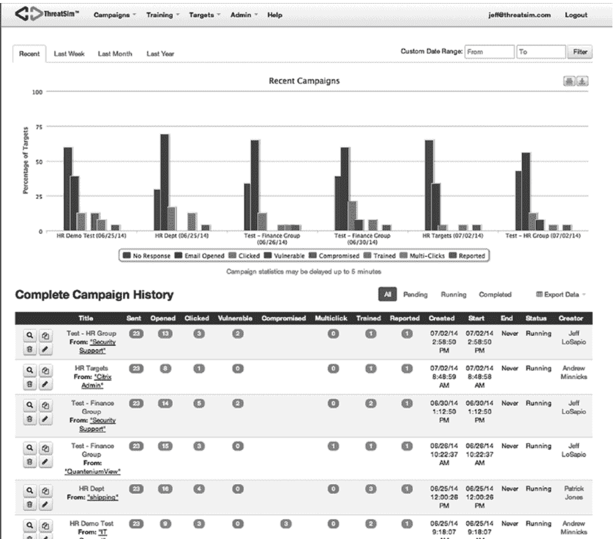

图 7-3 ThreatSim 面板

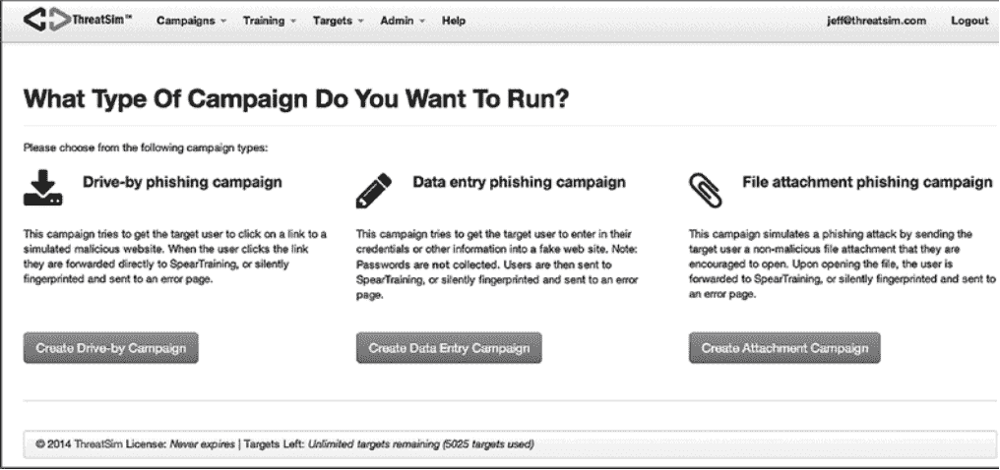

图 7-4 ThreatSim 任务设置

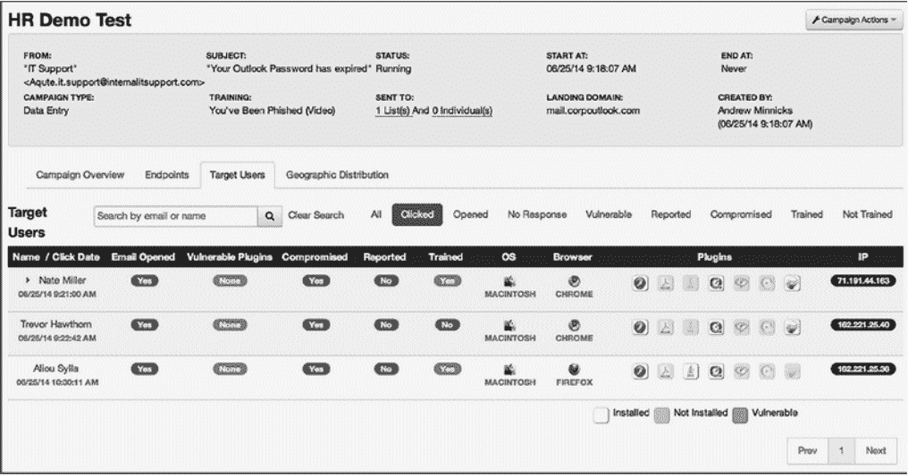

图 7-5 ThreatSim 任务结果

**新建 Drive By 活动**

**活动详情：**

| 字段 | 值 |
| --- | --- |
| 活动邮件模板 | English — Shipping Template |
| 活动标题 | Engineering Group - Test 3 |
| 活动时长 | 立即开始活动 |
| 日期 | December 03, 2014 |
| 时间 | 10:40 AM |
| 选项 | 永不结束活动 |
| 名称 | QuanteniumView |
| 邮箱地址 | QuanteniumViewN@shipment-confirm.com |
| 着陆页域名 | wwwapps.shipment-confirm.com |
| 邮件主题 | Your package has shipped |

**邮件内容：**

Discover more about US:

Visit www.shipment.com

Sign up for Additional E-Mail from US

Read Compass Online

This message was sent to you at the request of this shipper to notify you that the electronic shipment information below has been transmitted to us. The physical package(s) may or may not have actually been tendered to us for shipment. To verify the actual transit status of your shipment, click on the tracking link below or contact Time/system USA, Inc directly.

**重要配送信息**

**预定送达：** %DATE% %TIME%

**配送详情**

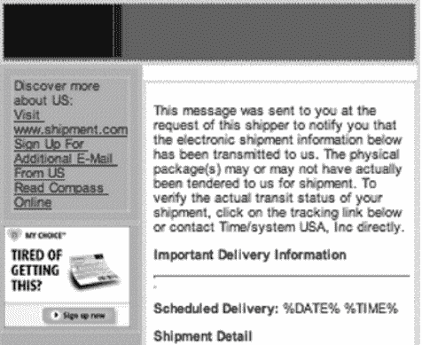

| 字段 | 值 |
| --- | --- |
| 用户培训类型 | What Just Happened? |
| 目标 | Demo (25) |

- 创建活动
- 给自己发一封测试邮件
- 保存草稿
- 放弃

图 7-6 ThreatSim 钓鱼邮件设置

**你被钓鱼了**

别关浏览器，也别慌，这是 *COMPANY* 授权的一次模拟演练。接下来我们会告诉你什么是钓鱼攻击，以及如何避免上钩。

这个网页底部有一个“确认”按钮，你需要点击它，表示你已经完成了培训。

**钓鱼攻击是怎么运作的**

1. 首先，攻击者会在组织的各个层级中挑选目标。从高管及其员工、系统管理员、客服代表、人力资源到财务，任何人都可能成为目标。甚至包括你。
2. 然后，攻击者会给你发一封邮件，试图诱导你采取行动，比如点击链接、打开附件，或者登录一个假网站。
3. 当你点开攻击者的恶意链接或打开恶意附件时，你的电脑就会被一种叫恶意软件的程序感染。
4. 恶意软件让攻击者得以进入你的电脑，读取你的邮件、访问你硬盘和网络上的文件，并借助你的电脑攻击网络中的其他用户或系统——这一切都从你的机器开始！
5. 攻击者收集到所需数据后，会将其打包压缩并上传。


图 7-7 ThreatSim 教育页面

**个人评价**

以下是我对 ThreatSim 的看法。

- **上手需要多高的知识门槛？**

  ThreatSim 的上手难度很低，明显照顾了新手，同时又不失扎实。用它搭一封钓鱼邮件，几乎不费什么力气。导入名单、安排发送时间，顺着界面点下去就行。报告模块的强度比我预期弱一些，好在数据最终顺利导出。这个团队一直在迭代产品，整体体验确实顺手。

  一些新添的功能也让操作更省心，其中我最中意动态名单生成：先立好筛选条件，系统据此拉出一份名单。比如以“使用语言”为条件，就能把所有讲西班牙语的用户单独归成一组，随后针对这组人投放西班牙语钓鱼邮件。

  此外，可定制的培训视频、以及面向“上钩者”的强化训练工具，也都在我的好评清单里。

- **用户信息的安全性如何？**

模拟钓鱼攻击训练是不少企业提升安全意识的“必修课”。市面上产品五花八门，到底哪款值得入手？下面结合亲测经验，逐一盘点几款主流工具的亮点与槽点。

**ThreatSim：数据自己掌控，响应速度快**

ThreatSim 主打本地化部署，数据存放在自己的服务器上，同时也会借助亚马逊云服务器做负载均衡，具体视需要而定。我曾用它一次性发送上千封钓鱼邮件，整体效果相当不错。需要说明的是，我并未对本产品进行第三方安全审计，所以无法对其安全等级给出结论。不过，软件在安装时设计了多重身份验证，能确保只有授权用户才能进入系统。整个使用过程几乎没有值得一提的麻烦。技术支持方面，团队反馈非常迅速，我们在一次大型培训项目中遇到问题，他们连续数小时与我们并肩协作，直到问题解决。

**PhishMe：沉浸式教学，鼓励主动反馈**

PhishMe 是一款 SaaS 产品，用沉浸式教学法训练员工识别和规避钓鱼攻击。所有员工都能体验到以假乱真的钓鱼场景，还可以通过 PhishMe Reporter 插件主动上报可疑邮件，为安全团队提供实时威胁情报。它的高级报告能力按项目追踪个人与群体行为，并统计回应趋势，帮企业找到薄弱环节，也为安全管理改进提供证据。

它有几个鲜明优势：
- 体系化而非一次性：能结合企业文化和业务需求，搭建可持续的培训项目。
- 场景素材更新快：时刻贴近最新攻击趋势，并同步提醒企业安全人员。
- 鼓励员工主动上报：专利 Reporter 插件以标准化方式收集可疑邮件，既有助于早期威胁侦测，也能评估培训效果。
- 支持标杆对比：可以匿名与其他用户比较训练成果，也支持与同行业竞争者进行专项对标。
- 企业级平台：SaaS 服务运行于专业安全设备——美国采用 SOC 3 认证设备，欧洲符合 ISO 9001/27001 及相关隐私规定。

官方没有公布缺点。个人使用感受：PhishMe 对新手非常友好，设置任务、上传名单都直观易懂，列表生成和定时任务的界面也符合直觉，基本不需要学习成本。数据安全方面，我没有做安全审计，软件具备多重认证机制，而且该公司并未使用亚马逊云做负载均衡，数据只存在于 PhishMe 自有服务器上。不过，平台也有一些局限：我感觉它缺少其他产品中常见的健壮功能，比如用户报告这一块；变更请求的处理速度也较慢。技术支持团队虽然专业，但回应不太及时，我的问题通常当天得不到答复，有一次项目进度甚至因此被拖延。

（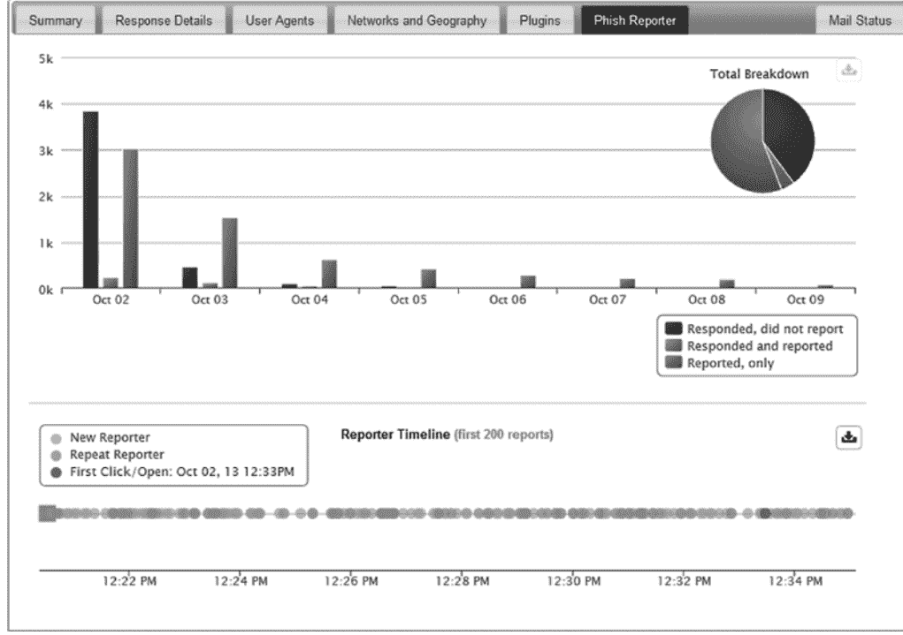）

**PhishGuru：自动化训练，教育提示立现**

Wombat Security 的 PhishGuru 通过发送模拟钓鱼邮件来评估员工的易受攻击程度，并鼓励他们继续学习。如果有人中招，屏幕上会立刻弹出持续 10 秒的教育提示，讲清刚刚发生了什么、以后该如何避免。系统还会自动为中招员工安排后续训练邮件。

这款工具的亮点包括：
- 自动化流程大大提升模拟效率，让真实钓鱼攻击的成功率明显下降。
- 自动注册功能与安全教育平台打通，可无缝安排进阶训练。
- 可自由选择攻击发送的日期和时段，并随机抽取收件人，让员工难以察觉这是一场演练。
- 教育提示直接内嵌在钓鱼邮件中，确保员工理解自己为何上当。
- 报告结果可以按需定制，灵活生成不同维度的智能报表。
- 每月新增钓鱼模板，持续模拟最新外部攻击。

唯一不足是：未经许可不能使用其他企业商标的模板。

个人体验：PhishGuru 和前面几款工具一样容易上手，邮件设置、任务创建、名单导入等操作都非常直观。Wombat Security 深耕社会工程学训练多年，相关模块可以轻松融入现有培训。你既不需要会编程，也不必成为钓鱼攻击高手。安全方面，我同样没有做过安全审计，不过登录时支持多重验证和分情况授权，使用中也没有发现明显问题，整个流程顺畅稳定。技术支持团队相当可靠，回应迅速，能感受到他们专业、友好且在乎客户需求。

（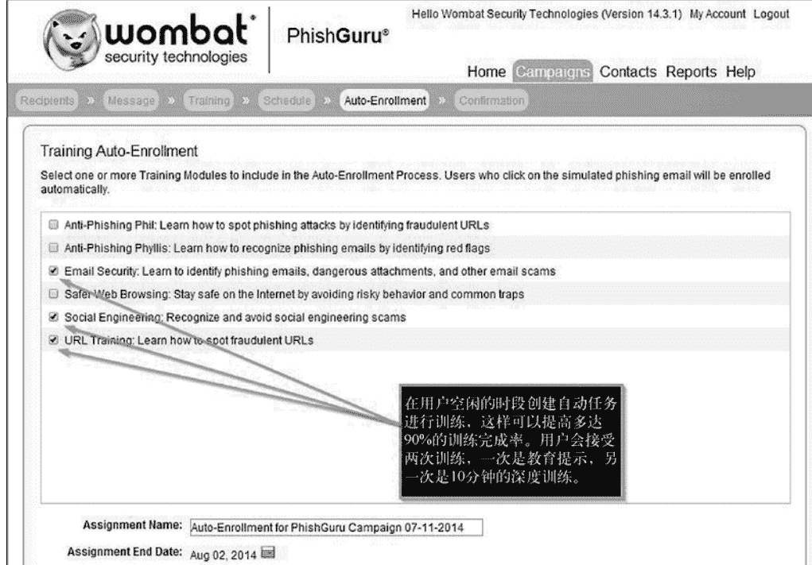）
（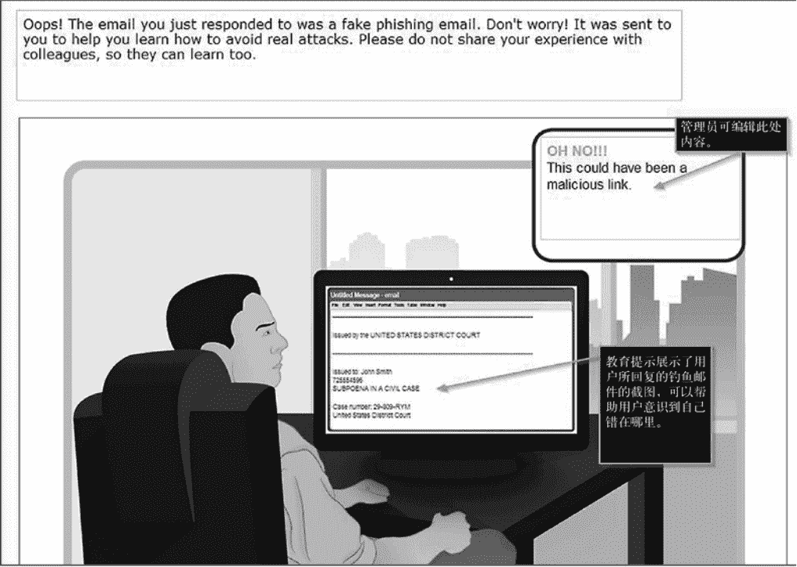）
（）

**PhishLine：专业防护与数据分析的深度玩家**

PhishLine 是一款企业级 SaaS 方案，可模拟真实世界的社会工程学与钓鱼攻击，并提供在线安全意识训练、基于风险的调查以及丰富的报告指标。

它的优势相当突出：
- 攻击模拟覆盖面广：不止是链接型钓鱼，还可测试 U 盘、短信、语音、仿冒门户页面、智能附件等多样载体；丰富的定制功能让安全专家能精准衡量真实威胁。
- 报告与度量能力惊人：收集大量数据，便于历史分析；不只是简单汇总，还能从人员、流程、技术等维度进行可视化洞察，并输出分级报告与关键指标。
- 服务团队有“安全基因”：PhishLine 由安全专家开发并支持，与普通开发者支持有本质区别，不仅能处理软件问题，还能帮你应对复杂的钓鱼攻击与威胁。
- 风险调查融入培训：可在同一平台完成针对性训练和风险调研，再把关键指标整合进企业整体安全策略。

最大的短板是界面和定制功能对新手不太友好。

实际体验：PhishLine 是我用过的同类工具中功能最强者。虽然界面并非面向新手，但创建钓鱼邮件、启动项目、导入名单这些基本操作并不难。真正的王者级功能是报告系统——无论你是新手还是数据分析专家，都能从中挖到想要的数据。我最钟爱的功能是事件反馈：员工只需通过邮件客户端转发可疑邮件，系统即可追踪、分类和统计正确回应的人，从而看出谁真正“通过了测试”。当然，高级数据功能可能需要学习或请教技术支持，但一旦掌握，你会惊叹于它的能量。安全方面，我同样未做安全审计，但和 PhishMe 一样，PhishLine 也不依赖亚马逊云做负载均衡，所有平台和均衡都在自有服务器上，这无疑是额外的一层保护。唯一让我觉得吃力的还是界面复杂度，有些功能在别家系统里可以凭直觉完成，在这里却需要教程。技术支持团队给人印象极深，我见过他们为了一个并非自身问题引起的客户难题加班到深夜；他们愿意接受反馈，改进速度飞快。

（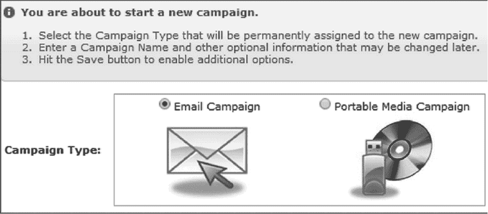）
（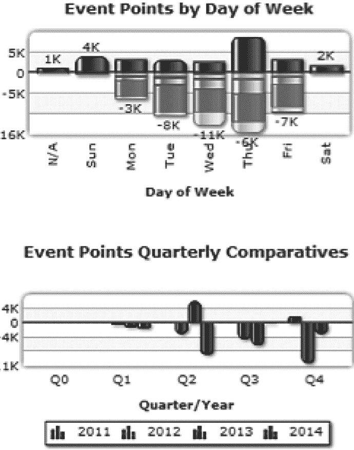）
（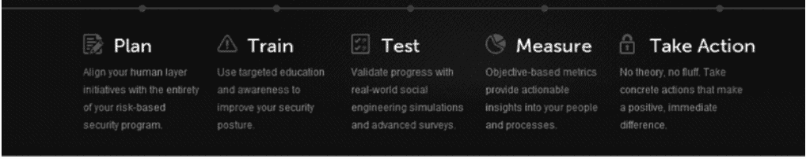）

**开源方案：自由灵活，但有技术门槛**

除了商业产品，开源工具也值得关注。

Social Engineer Toolkit（SET）功能强大且丰富，通过命令行和 Python 脚本运作，好在开发者大卫设计了一套易上手的菜单界面。由于完全部署在自己的服务器上，安全与否全看你如何配置。我在不少小型项目中使用过 SET，但面对上千个邮件地址的大客户时，工作量会显著增加。它更适用于社会工程学渗透测试，是否适合每月定期钓鱼培训，我个人持保留态度。技术求助方面，大卫通常回复很快，但开源工具往往需要自己啃文档、搜答案。

（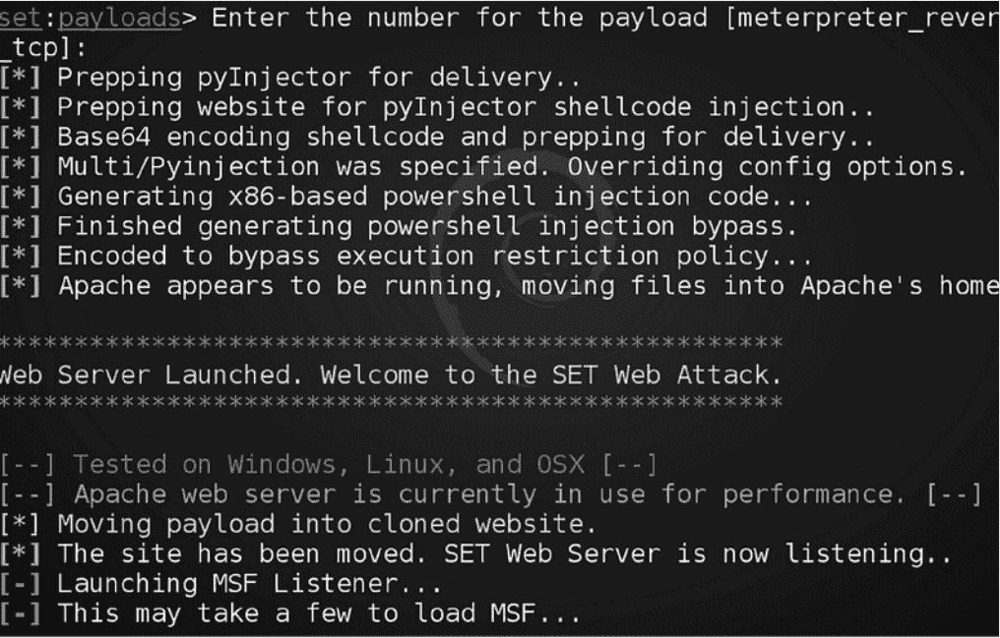）
（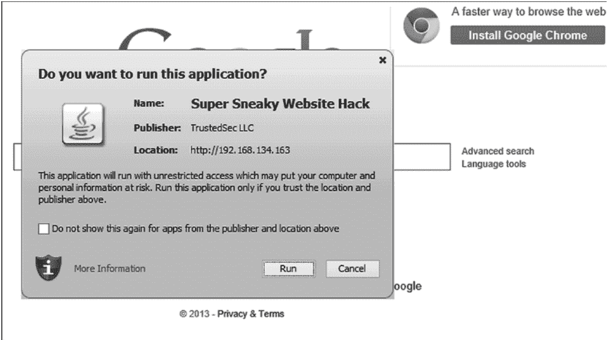）
（```
msf exploit(handler) > [*] Meterpreter session 1 opened (192.168.14.163:443 -> 192.168.134.159:50921) at 2014-11-24 14:28:42 -0500

msf exploit(handler) > sessions -i 1
[*] Starting interaction with 1...

meterpreter > shell
Process 3696 created.
Channel 1 created.
Microsoft Windows [Version 6.3.9600]
(c) 2013 Microsoft Corporation. All rights reserved.

C:\Users\davek_000\Desktop>
```）

Phishing Frenzy 则是一款基于 Ruby on Rails 的 Linux 开源应用，主要为渗透测试者管理钓鱼邮件攻击。它的优势包括：框架弹性强，可与社区共享模板和场景；功能丰富，支持实时追踪、多任务并行等；开源许可允许你自由添加所需能力。唯一的明显短板是只能在 Linux 环境下运行。

（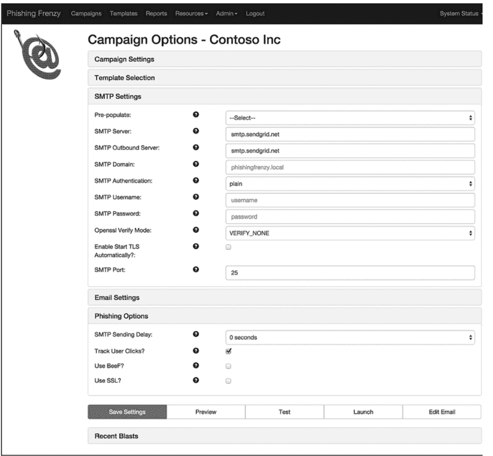）
（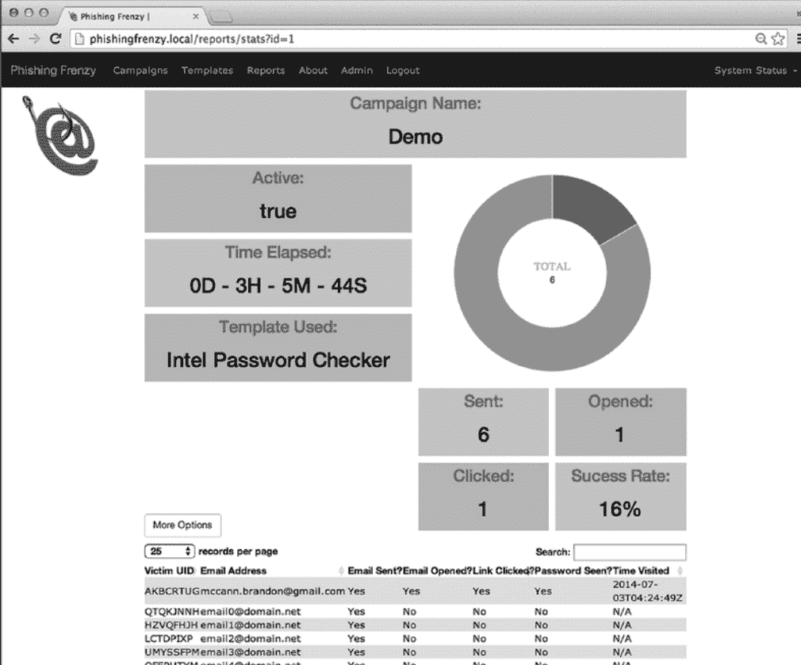）

综合来看，商业 SaaS 产品适合追求开箱即用、专业服务的企业；开源工具则更对技术型团队的胃口，灵活可控，但需要投入维护精力。没有绝对最好的工具，只有最适合自身需求的选择。希望这份亲测体验能帮你在安全建设的路上少走弯路。

下面是我对 Phishing Frenzy 的真实使用感受，不同于参数表上的功能罗列，是上手后的体感。

先说上手门槛。这是一款开源定位的工具，界面逻辑挺顺，菜单找得到东西，整体排版也干净，操作上不需要很专业的背景。让我比较在意的是钓鱼邮件怎么搭。软件本身没有可视化编辑器，无法直接在线拖拽改样式，所以流程是：先在本地用 HTML 编辑器把邮件写好，再把 .html 文件传到自己的服务器上当作模板挂给任务用。对新手来说，这一步会觉得卡，不够友好。

再说数据安全。工具是跑在你自己买的服务器和硬件上的，安全边界完全取决于你的部署方式和运维水平。

除去邮件模板这块的设置成本，整体体验还是可用的。报表模块不算花哨，功能比较基础，但支持数据导出，拿出去做二次分析没问题。放在开源阵营里，它算是一个不错的选择。我自己累计发过几百封测试邮件，最近一次使用过程很顺利，没有卡点。

技术支持方面。作者并不是把这个项目当成主业，还在做全职工作。但回复速度出乎意料地快，服务器部署的疑问能及时解答，发现漏洞也会跟上修复。

### 工具功能快速对照

这一章节的信息量很大，仅靠文字回顾很难形成直观印象，所以我整理了一张功能对照表，方便大家快速检索。

符号说明：
- Y 表示具备该功能
- N 表示不具备
- NA 表示不适用
- * 或 # 表示脚注有补充说明

| 功能 | RAPID7 | THREATSIM | PHISHME | WOMBAT | PHISHLINE | SET | PHISHING FRENZY |
|---|---|---|---|---|---|---|---|
| 类型 | 商用 | 商用 | 商用 | 商用 | 商用 | 开源 | 开源 |
| 能否设置训练开始时间 | Y | Y | Y | Y | Y | N | N |
| 能否设置训练结束时间 | Y | Y | Y | Y | Y | N | N |
| 能否在钓鱼邮件中使用商标 | Y | Y | Y* | N | Y | Y | Y |
| 能否导出所有数据 | N | Y | Y | Y | Y | Y | Y |
| 能否处理事件反馈或者报告事件 | N | Y | Y | N | Y | N | N |
| 如果能够处理的话，是否列出是谁报告/点击，报告/未点击 | NA | Y | Y | NA | Y | NA | NA |
| 能否进行钓鱼短信测试 | N | N | Y | Y | Y | Y | N |
| 能否进行 USB/媒体创建测试 | Y | Y | Y | Y | Y | Y | N |
| 能否伪造邮件地址 | N | Y | Y | Y | Y | Y | Y |
| 是否有多重认证 | NA | Y | Y | Y | Y | NA | NA |
| 是否利用亚马逊云服务进行负载均衡 | NA | Y | N | Y | N | NA | Y* |
| 能否为每一个用户单独设置 | Y | Y | Y# | Y | Y | NA | N |
| 能否从 XLS、CSV 中导入数据 | Y | Y | Y | Y | Y | N | Y |
| 是否有在线技术支持 | Y | Y | Y | Y | Y | N | N |
| 能否同时运行多个训练项目 | N | Y | Y | Y | Y | N | Y |
| 一次训练中发送的邮件数是否有限制 | N | N | N | N | N | N | N |

表格脚注：*仅限有授权时；#根据请求而定；*根据设置而定。

图 7-23 软件对比表格

### 谁来负责这件事

本章最后要问一个有点自我推销但很重要的问题：钓鱼演练的执行，谁来操盘。

上面提到的所有系统最终都需要人手操作。你可以让内部同事来扛，也可以交给像我们这样的外部团队。我不能替你决定，但可以提供几个自检问题。

如果让内部员工来做，他是专职负责，还是身兼多职？从前面的内容能看出，做好一次钓鱼培训其实就是一份全职工作。

你要记得，每月都要发邮件、维护名单、确保发送合规，还得输出一份像样的总结报告。

你的人选，无论内部还是外部，是否具备撰写、审校和评估钓鱼邮件的经验？

在社会工程学攻击层面是否有经验？有没有渗透测试背景，能编出可信的攻击理由？

你每个月愿意投入多少时间在这件事上？这个答案会直接帮你判断是招人、买服务，还是靠现有团队来做。

这不是一锤子买卖。现在就有客户一开始用本章的工具由内部团队自管，运行几个月后发现吃力，最终选择外包。无论起步怎么选，都可以中途调整。关键是，别管谁来管，员工最终要意识到钓鱼的风险并学会防御。

### 总结

这一章的目的是把前六章的信息收敛起来，帮你挑到能落地执行培训方案的工具。是选开源还是商用？是追求功能全面还是上手简单？这些都需要你自己判断，也可以请安全服务商一起评估。

工具只是手段，核心在于你在组织里怎么推进钓鱼培训项目。选错工具的感受就像：你想造一个鸟舍，身边只有一把尺子，工作推进不起来，很快就会挫败放弃。

选对了的工具能帮你减少摩擦、加快进度，让你把精力放在效果评估上，而不是反复折腾操作本身。希望这些分享能为你的决策提供帮助。