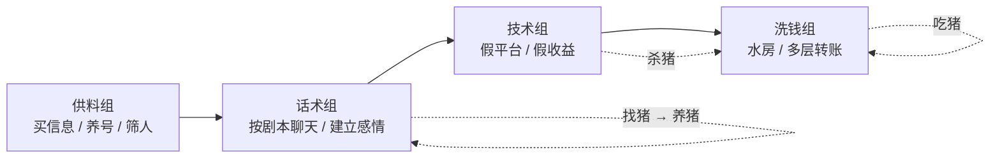
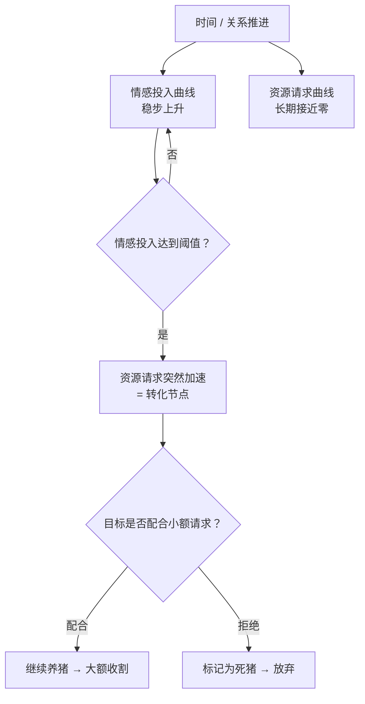
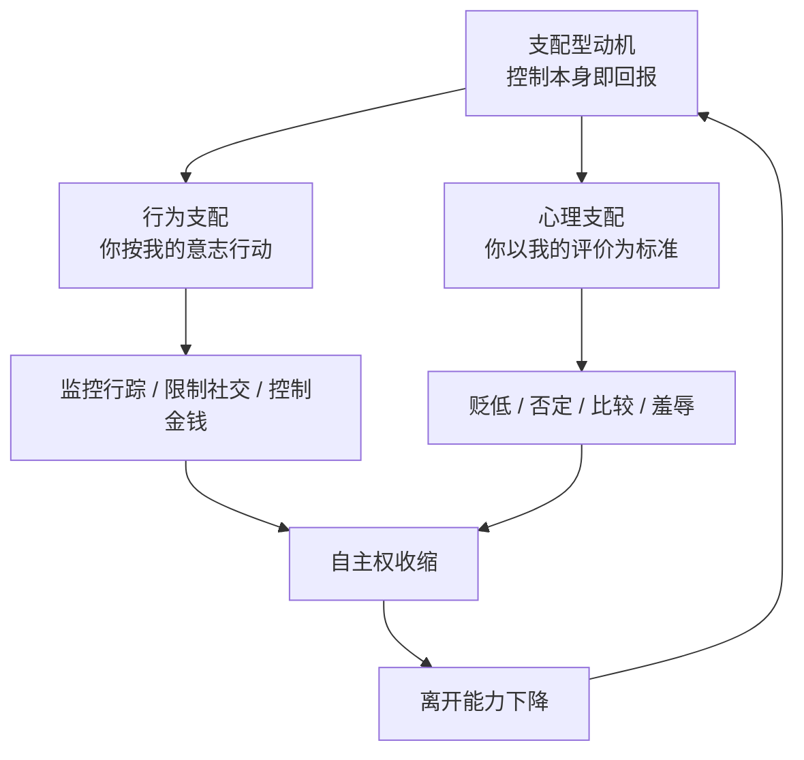
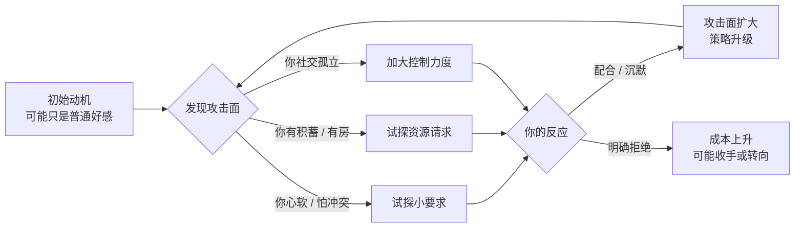
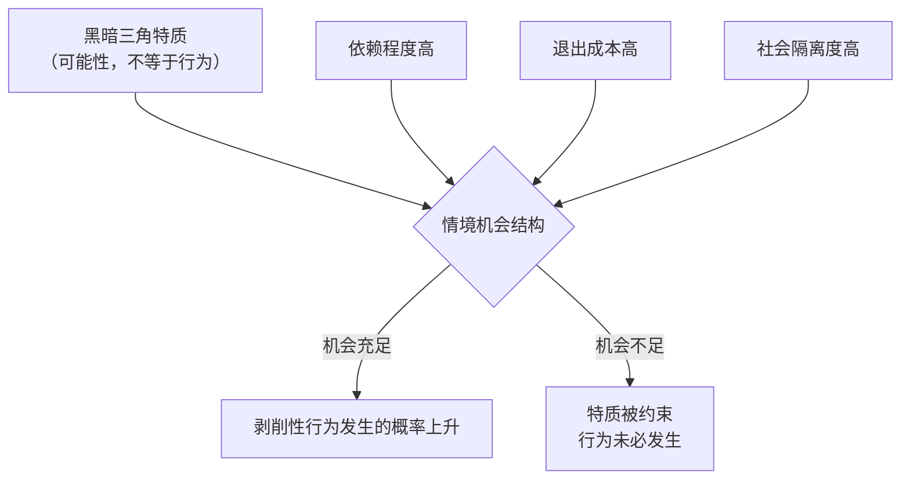

# 第1章 攻击者模型与动机类型

在学任何防御动作之前，我们得先弄清楚一件事：对面那个人，到底想要什么。

这句话听起来像废话，但它其实决定了后面所有章节的读法。同样是每天给你发早安晚安、记得你随口提过的小事、在你难过的时候第一时间出现，背后的动机可能完全不一样。有的人是真的喜欢你，有的人是想从你这里拿到钱，有的人是想拿到"你听我的话"这件事本身带来的满足感，还有的人一开始什么都没想，只是走着走着发现你好拿捏，于是顺手多捏了两下。

这四种情况，在表面上可以长得一模一样。所以红队视角的第一课，不是教你怀疑一切，而是教你建立一个分类框架：当你观察一段关系时，先问自己——这段关系里，除了"两个人互相喜欢"之外，还有没有另一个目标函数在运转？

所谓"目标函数"，是个从工程和数学里借来的词，用大白话说就是：这个人做每件事，最终是在让什么东西变大。正常人谈恋爱，目标函数大概是"我们俩都过得更好""这段关系让我开心"。工具型攻击者的目标函数是"我从这段关系里能拿到多少资源"。支配型攻击者的目标函数是"我对这个人的控制程度有多高"。这两个东西一旦混进关系里，很多看起来浪漫的行为，性质就变了。

本章把攻击者分成三种模型：工具型、支配型、混合型（也就是情境型）。要提前说明的是，这是一个分析用的简化模型，不是给人贴标签的诊断手册。现实里的人不会在额头上写着"我是工具型"。我们分类的目的，是让你在观察行为时多一个提问的角度，而不是让你拿着三个筐去给身边每个人归类。

---

## 1.1 工具型攻击者：关系作为获客渠道

### 把"谈恋爱"当成一条销售漏斗

工具型攻击者的核心逻辑只有一句话：关系是达成外部目标的渠道。

外部目标包括什么？钱、住处、身份、户口、工作机会、社会资源、情绪劳动，甚至只是"有人替我做饭洗衣服"。在这些目标面前，情感投入不被当成情感，而被当成成本。就像开一家店要付房租、进货、打广告一样，对你好、陪你聊天、听你倾诉，都是"获客成本"的一部分。

这个说法听着很冷，但它精确地描述了一类真实存在的操作方式。你在对方眼里不是"一个我喜欢的人"，而是"一条线索""一个客户""一个还在培养中的账户"。对方对你的好，是投进去的饵料，不是长出来的感情。饵料是要算投入产出比的：投多少、投多久、什么时候收网，都有一套账。

这套账最极端、也最工业化的形态，就是大家常听说的"杀猪盘"。

### 杀猪盘的流水线

杀猪盘不是一个骗子坐在电脑前单打独斗，而是一条分工明确的流水线。理解这条流水线，不是为了猎奇，而是为了明白：为什么有些"完美恋人"可以同时在跟几十个人聊天，还丝毫不乱。

它的分工大致是这样的：

- **供料组**：负责搞到"猪"的信息。包括从各种渠道购买个人信息、在婚恋网站和社交平台上批量养号、筛选出"有一定积蓄、单身或离异、渴望陪伴"的人。有些团伙甚至会从平台内部人员那里买数据。
- **话术组**：负责聊天。他们手里有剧本，有"七天话术""三十天话术"，规定第一天聊什么、第三天怎么自然地发语音、第几天开始透露"我以前受过伤"。聊天的人可能同时操作好几个账号，用复制粘贴加人工微调的方式维持"专属感"。
- **技术组**：负责做假平台。假投资网站、假博彩 App、假交易所，页面做得跟真的似的，账户里的数字可以随便改。你以为自己在看收益曲线，其实那是对方后台的一个输入框。
- **洗钱组**：负责把钱洗出去。也就是俗称的"水房"，通过大量银行卡、第三方支付账户把骗来的钱层层转移，等警察追到的时候，钱已经不知道转了多少手。

整个流程有一个很形象的四段式叫法：**找猪、养猪、杀猪、吃猪**。

找猪是筛选目标，养猪是培养感情和信任，杀猪是诱导大额投入然后收网，吃猪是分赃和洗钱。你在新闻里看到的"网恋对象带我投资，结果血本无归"，基本都能塞进这个四段式里。

这张图里最值得盯住的，不是四个组的名字，而是**顺序**。工具型攻击链有一个非常稳定的时间结构：先投入，后索取；先建立情感，后提出资源请求。而且这个"后"，往往不是慢慢过渡，而是在某个点之后突然加速。

### 转化节点：资源请求曲线为什么会突然抬头

如果你把一段关系画成两条曲线，横轴是时间，纵轴分别是"对方的情感投入"和"对方对你提出的资源请求"，你会看到工具型攻击链的一个典型形状：情感投入曲线先稳步上升，资源请求曲线长时间趴在接近零的位置，然后在某个时间点突然抬头，并且抬头的斜率远大于情感投入的斜率。

这个突然抬头的位置，就是"转化节点"。

转化节点的常见触发条件有三类：

1. **情感投入达到阈值**。对方判断你已经足够信任 ta、足够离不开 ta 了，于是开始试探性地提要求。这个阈值不是固定的，有人聊两周就够，有人要聊三个月。
2. **目标出现可利用的窗口**。比如你刚失恋、刚换工作、家里出事、生病住院，防御力下降，对方会加快节奏。
3. **外部压力**。比如团伙有业绩考核，或者对方发现你开始起疑，决定提前收网。

注意一个细节：在转化节点之前，资源请求不是完全没有，而是**金额极小、性质极轻**。比如"帮我充个话费""我这边网络不好，你帮我登录一下这个链接""你先投两百块试试，亏了算我的"。这些小请求的功能不是赚钱，而是**测试**——测试你愿不愿意为"关系"付出，测试你的防备心有多重，测试你听不听话。

这里就引出了工具型攻击者最核心的一个筛选机制：**愿意付小钱的人，才会被继续养；不愿意的人，会被迅速放弃**。在杀猪盘的行话里，不愿意配合的目标会被标记为"死猪"或者直接备注"死"，然后不再投入时间。所以，你在关系早期收到的那些"小小不然"的请求，其实是一次筛选考试，而不是感情升温的自然产物。

### 工具型关系的可检测痕迹

工具型攻击者再专业，也会留下结构性的痕迹，因为 ta 的目标函数不在关系本身，而在关系之外。你可以留意这几类信号：

- **进度感太强**。关系像有 KPI 一样往前赶：第几天该确定关系、第几周该谈未来、第几个月该"一起做点投资"。正常的感情也会有推进，但不会像项目排期。
- **情感投入与资源请求挂钩**。每次 ta 对你特别好之后，紧跟着一个请求；或者每次你拒绝请求之后，ta 的"好"会短暂降温，等你松口了又热回来。这种"投喂—索取"的配对，是工具型的典型节奏。
- **对你的了解是"采集式"的**。ta 记得你的收入、存款、家庭负担、有没有房、能不能借钱，却对你的内心矛盾、童年细节、真正的恐惧兴趣寥寥。信息采集是有选择性的：只采集"有用"的部分。
- **回避可核实的现实**。工作单位说不清、家人朋友见不到、视频总是不方便、见面总有理由推迟。因为一个虚构的人设经不起线下核实。

这里要强调一句：**单条痕迹都不足以定性**。一个人可能只是性格急、可能只是真的最近很忙。红队的做法不是"抓到一条就定罪"，而是"记录模式"——当多条痕迹在时间上稳定地一起出现，才值得提高警惕。

### 小练习

回顾一个你听说过的情感诈骗案例（新闻、纪录片、身边人的经历都行），画一条"情感投入—资源请求"的双轴时间线。横轴是时间，纵轴有两个刻度：情感投入有多深、资源请求有多大。

画完之后观察：资源请求曲线是不是在情感投入达到某个阈值之后**突然加速**？这个加速点出现在第几天、第几周？在加速之前，有没有出现过金额很小的"试探性请求"？

这个加速点，就是工具型攻击链的转化节点。你不需要评判案例里的受害者"怎么这么傻"，只需要看清结构：**骗子不是靠一句谎话得手的，而是靠一条被设计好的时间线。**

---

## 1.2 支配型攻击者：控制本身作为回报

### 不是图你的钱，是图"你听我的"

工具型攻击者要的是外部资源，支配型攻击者要的东西更抽象：**对另一个人行为和心理状态的支配权**。

这句话需要拆开讲。什么叫"支配权作为回报"？就是说，ta 从这段关系里获得的快感，不来自钱、不来自性、也不完全来自陪伴，而来自两个事实：

1. **对方按照我的意志行动**。我说往东，你就往东；我说这件事不许做，你就不做；我心情不好，你就得哄我。
2. **对方以我的评价作为自我标准**。你觉得你好不好，不再由你自己判断，而由我说了算。我说你胖，你就觉得自己胖；我说你自私，你就开始反省自己是不是真的自私。

这两个事实一旦成立，攻击者就获得了一种"造物主式"的满足感。这种满足感不需要你付出金钱，甚至不需要你付出什么具体的东西，它只需要你**交出自主权**。所以支配型关系里，受害者常常有一种奇怪的感觉：明明对方没骗我钱，甚至对我还不错，但我怎么越来越不像我自己了？

### 恶性 PUA 与 coercive control

支配型逻辑在现实中有两个典型的极端形态。

一个是**恶性 PUA 的"自尊摧毁—情感虐待"阶段**。PUA 这个词原本指的是一套搭讪技巧，但其中有一支演化成了系统性的心理操控：先通过人设和话术让你着迷，再通过打压、否定、比较，把你的自我价值感一点点拆掉，最后让你相信"除了我，没人会要你"。到了这个阶段，关系里的权力已经完全不对等，受害者离开的能力被心理层面废掉了。

另一个是** coercive control，中文常译作"强制控制"**。它不是一个单一动作，而是一整套让受害者失去自由的模式：监控你的手机和行踪、限制你和谁见面、控制你的钱、决定你穿什么、反复贬低你、用威胁和惩罚维持服从。英国、澳大利亚等国家已经把 coercive control 写进法律，把它认定为家庭暴力的一种形式——因为它的伤害不是靠一次殴打，而是靠日复一日的"收紧"。数字监控、查手机、要求共享定位、规定几点必须回家，都是这套模式里的常见零件。

这张图是一个闭环：控制带来服从，服从强化控制，控制又进一步压缩你的自主空间。支配型关系最危险的地方，不是某一次特别恶劣的行为，而是这个闭环会自己越转越紧。

### 一个关键区分：ta 在意的是你的行为，还是你的服从？

支配型攻击者有一个很容易观察的特征：**ta 的情绪反应，针对的不是事情本身，而是"你有没有听 ta 的"**。

举几个具体场景，你可以对照着感受一下：

- 你因为加班，没能按 ta 要求的时间回消息。如果你解释清楚、态度诚恳，ta 就接受了——这是针对**行为**。
- 你因为加班没回消息，ta 不管你怎么解释，都持续冷脸，直到你反复道歉、保证下次一定秒回，ta 才"原谅"你——这是针对**服从**。
- 你想周末和朋友出去，ta 说"你去吧，我没关系"，但接下来两天都阴阳怪气、爱答不理——这也是针对**服从**，只是包装成了"我没拦你"。
- 你对某件事有不同意见，ta 会跟你讨论、甚至被你说服——这是针对**行为**。ta 不接受任何不同意见，并把你的不同意见定义为"你不爱我""你变了"——这是针对**服从**。

这个区分为什么重要？因为**针对行为的分歧是可以协商的，针对服从的要求是只能被满足的**。你可以和一个在意行为的人讲道理、找折中方案；但你没法和一个在意服从的人讲道理，因为 ta 要的本来就不是"这件事怎么解决"，而是"你低不低头"。

更隐蔽的一点是：支配型攻击者往往会把"服从"包装成"爱"。ta 不会直接说"你必须听我的"，而会说"我这么在乎你，你怎么能这样对我""如果你真的爱我，你就会……"。于是，"听 ta 的"被翻译成了"爱 ta 的证明"，你不服从，就变成了你不够爱。这套翻译一旦被你接受，你就很难再对 ta 的要求说"不"，因为说"不"会让你先过自己心里那一关。

### 支配型关系的可检测痕迹

- **你的自主空间在持续缩小**。以前能见的朋友渐渐不见了，以前能做的事渐渐不做了，理由都很"合理"：ta 会不高兴、ta 会担心、ta 说那个人不适合你。
- **你的自我评价越来越依赖 ta 的反馈**。ta 夸你一句，你高兴一整天；ta 冷你一下，你开始怀疑自己是不是哪里做错了。
- **你花越来越多时间"管理 ta 的情绪"**。说话前要先想"这句话会不会惹 ta 不高兴"，发消息前要反复删改，回家前要先在楼下调整好表情。
- **道歉变成一种日常动作**。明明不是你做错的事，你也会先道歉，因为道歉是让 ta 情绪恢复的最快方式。
- **"离开"这个选项在你脑子里越来越模糊**。不是你没想过，而是每次一想，就会自动冒出一堆"但是我走了 ta 怎么办""但是我也有错""但是可能再也遇不到这么爱我的人了"。

### 小练习

回想一次你观察到（或亲身经历过）的情境：**对方在你妥协之后情绪明显好转，在你坚持己见之后持续冷脸。**

现在问自己：ta 的情绪变化，是针对**你的行为**，还是针对**你的服从**？

判断方法很简单：假设你用另一种方式满足了同一个实际需求，但没有"低头"，ta 会不会接受？比如，ta 要你今晚回家吃饭，你因为加班回不去，但你提前点了外卖送到家、打了电话解释——如果 ta 接受了，说明 ta 在意的是"一起吃饭"这件事；如果 ta 依然冷脸，说"你就是不在乎我"，说明 ta 在意的是"你必须按我说的做"。

前者可协商，后者只能被满足。看清这一点，你就知道该往哪个方向用力了。

---

## 1.3 混合型与情境型攻击者：攻击面驱动升级

### 现实里很少有"纯种"攻击者

前面讲的工具型和支配型，是两个理想类型。现实中的案例，大多数是混合的，甚至一开始根本不是"攻击"。

有的人最初只是想谈个恋爱，但在相处中发现你特别心软、特别好说话、特别怕冲突，于是开始多要一点、再多要一点。第一次要的时候 ta 可能还有点不好意思，第二次发现你答应了，第三次就变成了理所当然。这个过程里，ta 未必有一个"我要控制你"的宏大计划，但行为确实在往支配的方向滑。

还有的人一开始只是图点小便宜，后来发现你家里条件不错，目标函数就升级了。或者反过来，本来想骗钱，结果发现从你身上获得"被服从"的快感更强烈，于是转向了心理控制。

这种"走着走着就变了"的路径，在红队分析里叫**攻击面驱动升级**。所谓攻击面，就是目标身上可以被利用的弱点、资源和结构条件。攻击者不一定事先想好全套剧本，但 ta 会顺着攻击面往前走：哪里松就往哪里钻，哪里疼就往哪里按。

### 黑暗三角：特质不等于行为

心理学里有一个概念叫"黑暗三角"，用来描述三种在社会交往中容易产生剥削性行为的性格特质：

- **马基雅维利主义**：把人际关系看成工具，擅长算计、操纵，为了达到目的可以不在乎道德。大白话就是"把人当棋子"。
- **自恋**：需要持续的崇拜和特殊对待，缺乏共情，容不得别人比自己重要。大白话就是"世界应该围着我转"。
- **精神病态**：冲动、缺乏愧疚感、共情能力低，做了伤害别人的事也不太会觉得不安。大白话就是"伤害你之后，ta 真的不难受"。

研究发现，这三种特质和"短期导向、剥削性的关系策略"之间存在稳定的关联。也就是说，黑暗三角得分高的人，平均而言更可能把关系当成获取资源或满足自我的手段。

但这里有一个必须要说清楚的边界：**特质不等于行为**。一个人可能自恋，但一辈子没伤害过谁；一个人可能共情能力低，但在稳定的关系里也能守规矩。反过来，一个平时看起来温和善良的人，在特定情境下也可能做出剥削性的行为。

所以，红队视角不主张"看这个人像不像坏人"，而主张"看这个情境有没有给坏行为提供便利"。这就像你不能因为一个人有刀就认定他要伤人，但如果这个人有刀、现场没有监控、没有目击者、受害者还跑不掉，那风险就实实在在地上去了。

### 情境的三个调节变量

决定"特质会不会变成行为"的，主要是三个情境变量：

1. **依赖程度**。你越依赖对方（经济上、情感上、生活上），对方越容易施加影响，因为你不听话的代价更高。
2. **退出成本**。你离开这段关系要付出多少？社会圈重叠、共同财产、孩子、名声、沉没成本，都会抬高退出成本。退出成本越高，攻击者越有恃无恐。
3. **社会隔离度**。你身边还有没有能给你第二意见的人？如果你已经被孤立到"有事只能跟 ta 说"，那 ta 就成了你唯一的现实校准器，想怎么定义现实就怎么定义。

这三个变量合在一起，构成了一张"机会结构图"。攻击者未必有意识地计算这张图，但 ta 的行为会本能地往这张图里最省力的方向走：挑最依赖的人下手，挑最难离开的关系加码，挑最孤立的目标收网。

这张图想告诉你的，是一个有点反直觉的结论：**防御的重点，不是去鉴定对方是不是"坏人"，而是去改变情境结构**。你有独立收入、有能说话的朋友、有可以随时离开的底气，很多潜在的剥削行为根本不会启动，因为成本太高。反过来，如果你把自己活成了一座孤岛，就算对方本来没那么坏，关系也更容易滑向失控。

### 小练习

回顾一段你曾经感到"对方在试探我"的关系。列出三次对方在你不同反应之后的行为调整：

- 你抵抗的时候，ta 怎么做？
- 你沉默的时候，ta 怎么做？
- 你配合的时候，ta 怎么做？

然后判断：这些调整是在**了解你这个人**（比如发现你不喜欢某种玩笑，就换一种方式），还是在**校准对你的控制参数**（比如发现沉默等于默许，就专门在你沉默的时候推进）？

前者是关系里的正常磨合，后者是把你的反应当成数据，用来优化下一步的操作。两者的区别，就看 ta 调整完之后，关系是变得更对等，还是变得更单向。

---

## 本章小结

这一章讲了三种攻击者模型，但真正要记住的，不是三个名词，而是三句话：

1. **工具型攻击者把关系当渠道**。情感投入是获客成本，资源请求是转化动作。你要看的不是 ta 对你有多好，而是"好"后面有没有跟着一条向你要东西的曲线。
2. **支配型攻击者把控制当回报**。ta 在意的往往不是事情本身，而是你听不听话。分清"针对行为"和"针对服从"，是识别这类关系的第一把尺子。
3. **混合型和情境型提醒我们，特质不等于行为**。不要急着给人贴标签，而要看你所处的结构：你是不是太依赖、太难离开、太孤立。结构一变，很多行为根本不会发生。

最后再回到开头那个问题：这段关系里，除了"两个人互相喜欢"，还有没有另一个目标函数在运转？

健康的关系里，两个人的目标函数是并排的，甚至是交织的：我希望你好，你也希望我好，我们都希望这段关系好。而在被攻击的关系里，目标函数是单向的：你的资源、你的服从、你的注意力，被算进了对方的账本，而对方的账本从来不给你看。

红队视角不是让你变得疑神疑鬼，而是让你学会看账本。看账本的目的，也不是为了抓坏人，而是为了确认一件事：**在这段关系里，你是不是也被当成了一个有自己目标的人，而不是一个被计算的对象。**

下一章，我们会把镜头从"攻击者是谁"转向"他们怎么挑人"——也就是目标画像与易感状态的识别。你会看到，攻击者筛选的从来不是"谁笨"，而是"谁此刻有缝"。
