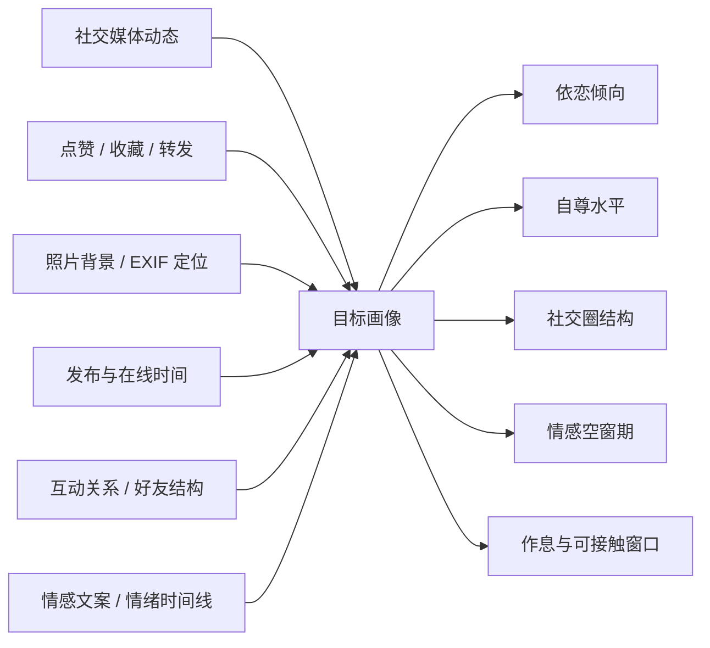
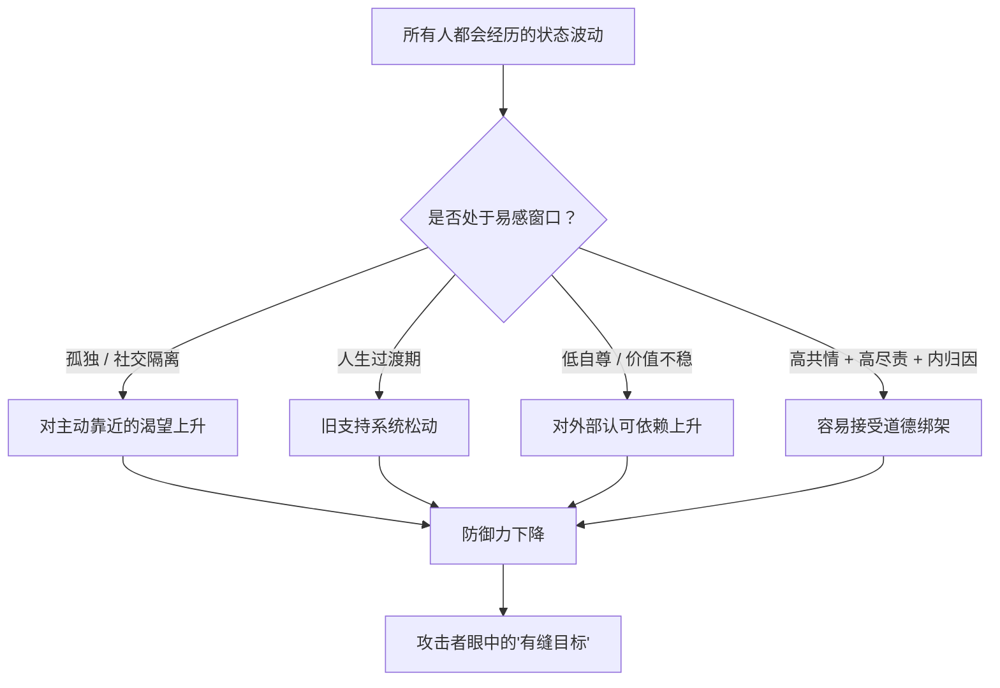
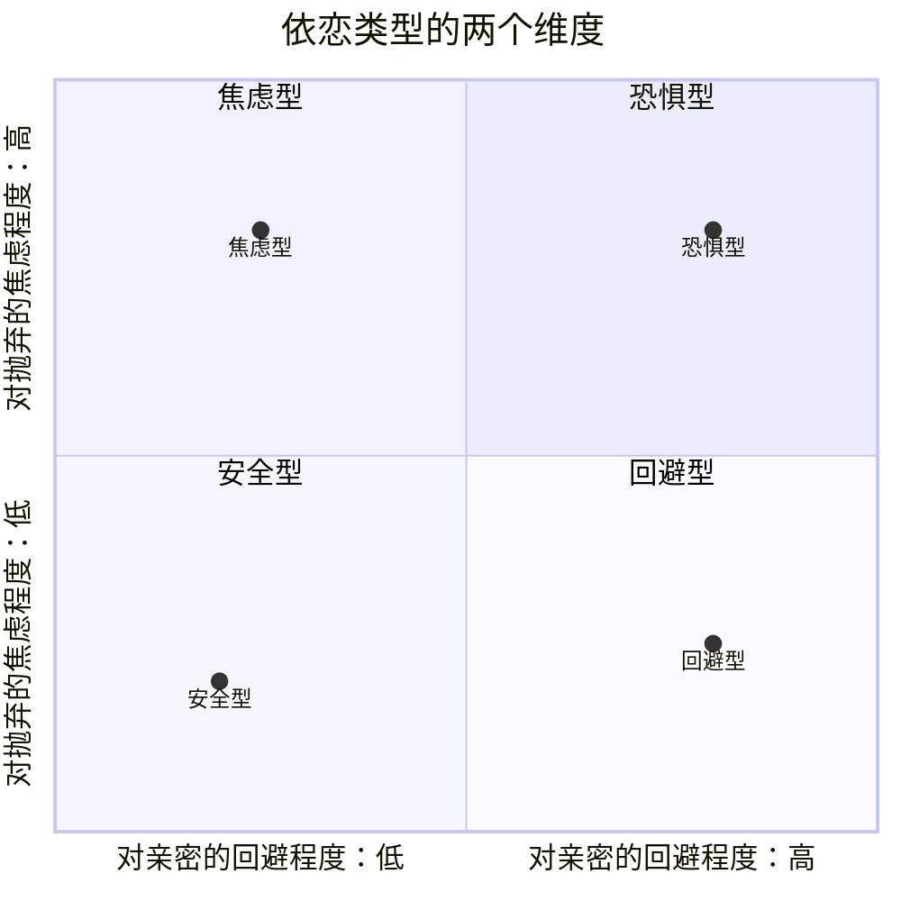

# 第2章 目标画像与易感状态识别

上一章我们看了攻击者的动机。这一章我们换个角度，看他们怎么挑人。

很多人以为，被情感操控、被诈骗的人，是因为"太笨"或者"太贪"。这个想法既不公平，也不准确。真实情况是：攻击者筛的从来不是"谁笨"，而是"谁此刻有缝"。就像小偷不会去研究谁家最蠢，而是去看谁家窗户没关、谁家晚上没人、谁家装了容易撬的锁。

一个人再聪明，在刚失恋、刚搬家、刚失去亲人、连续几个月孤单到没人说话的时候，防御力都会下降。这不是智力问题，是状态问题。社会工程里有一个很朴素的说法：攻击者不创造漏洞，他们只是发现漏洞。人身上的"漏洞"，很多时候就是一些暂时性的、所有人都可能经历的状态。

这一章分三部分：先讲攻击者怎么从公开信息里拼出你的画像，再讲他们最偏爱哪几种易感状态，最后讲依恋类型这个被严重滥用的分类工具。读完你会发现，防御的第一步不是把自己变成一座堡垒，而是知道自己在哪些时刻最容易被人趁虚而入。

---

## 2.1 公开信息源：社交媒体作为"无意泄露"

### 你发出去的每一条动态，都是一块拼图

信息收集是社会工程的第一步，而它最依赖的东西，不是黑客技术，而是目标自己主动暴露的内容。

你发过的东西，可能包括：今天吃了什么、在哪个城市、养了什么宠物、周末去了哪里、最近心情不好、转发了哪首歌、给哪条情感文案点了赞、照片背景里露出了小区名字、定位显示在某家医院。单独看，每一条都人畜无害。但把它们放在一起，一个人就能拼出你的生活轨迹。

社会工程人员管这叫"开源情报"（OSINT），说白了就是：不撬锁、不翻墙，只用公开信息做拼图。拼图的威力在于，它不需要任何一条信息特别敏感，只需要信息足够多、足够交叉。

举几个特别容易被忽略的点：

- **点赞和收藏记录**。你点赞了什么内容，往往比你自己发的内容更能说明你的状态。连续点赞伤感文案，说明可能刚经历情感挫折；点赞育儿、相亲、独居生活的内容，说明人生阶段；点赞某个城市的美食，说明你可能在那边生活或常去。
- **照片背景**。窗户外的楼、桌上的快递单、镜子里的反光、宠物身上的名牌，都可能泄露住址、工作单位、生活习惯。更隐蔽的是照片的 EXIF 信息——很多手机拍照时会自动记录 GPS 坐标，上传原图就等于把拍摄地点一起发了出去。素材里提到过一个叫 ICanStalkU 的网站，专门扫描社交平台上带定位的照片，提醒用户"你正在被跟踪"。
- **发布时间的规律**。你几点发动态、几点在线、周末活跃还是工作日活跃，能拼出你的作息。作息一旦被摸清，什么时候找你、什么时候你最容易回复，就都有了答案。
- **互动关系**。谁经常给你评论、你和谁互动频繁、你的朋友是什么样的人，能拼出你的社交圈结构。社交圈结构决定了一件事：如果有人想接近你，通过谁介绍最自然。
- **情绪时间线**。你什么时候情绪低落、什么时候表达孤独、什么时候在怀念某个人，这些内容连起来，就是一张"情感空窗期地图"。

### 杀猪盘的"八大信息"

杀猪盘的话术文档里，有一个很具体的操作要求：第一次聊天就要设法拿到"八大信息"——姓名、年龄、工作、居住城市、家庭背景、兴趣爱好、作息时间、投资经历。

这八项不是随便列的，每一项都有用途：

- 姓名、年龄、工作、城市：确认身份，判断经济能力和生活阶段。
- 家庭背景：判断有没有可依附的资源，有没有可能借到钱，家庭关系是否紧密（紧不紧决定了好不好隔离）。
- 兴趣爱好：制造"共同点"的原材料，也是后续聊天的抓手。
- 作息时间：决定什么时候找你最容易得到回应。
- 投资经历：判断你有没有理财习惯、有没有可动用的资金、对"高收益"的接受度。

注意这个顺序和方式：他们不会一上来就查户口，而是把这些需求拆成看似关心、看似闲聊的问题，穿插在正常聊天里。比如不直接问"你收入多少"，而是聊到工作时顺口说"你们那个行业最近是不是挺难的"；不直接问"你住哪"，而是说"我今天路过某某区，那边房价好像很贵"，等你自己接话。

这就是信息收集的进阶形态：**不是偷看，而是让你自愿、主动、愉快地交出来**。这一点我们会在第 8 章详细展开，这里先记住一个原则：**当一段对话让你觉得"聊得很舒服"，但聊完之后对方知道的远比你多，那这场对话的信息流向就是不对称的。**

### 信息是可以交叉验证的

单条信息可能不准，但多条信息放在一起，就能互相印证。社会工程人员收集信息时，不会只看一个平台，而是把微博、朋友圈、小红书、抖音、豆瓣、大众点评、招聘网站、校友录、二手交易平台全部串起来看。你在 A 平台说自己在某公司上班，在 B 平台发过工牌照片，在 C 平台吐槽过某个领导，在 D 平台卖过公司发的礼品——四条信息一交叉，你的单位、岗位、甚至部门氛围就都清楚了。

更麻烦的是，这些信息一旦被拼出来，就很难"收回"。你三年前发的一条动态，可能早就忘了，但它还在那里，还能被翻出来。所以防御信息收集的第一条，不是"以后小心点"，而是**先去看看自己已经暴露了什么**。

### 小练习

以旁观者的视角，审视你自己近三个月的一条社交动态（朋友圈、微博、小红书都行，挑一条你觉得"很普通"的）。

问自己：一个陌生人仅凭这条动态，能合理推断出你的哪些信息？包括你的城市、职业、作息、情绪状态、感情状态、消费水平、社交圈。

然后列一张"我无意中给出的攻击面清单"：哪些信息是你主动发的？哪些是照片背景、定位、点赞记录"顺带"泄露的？哪些是你以为只有好友能看到、其实是公开的？

这个练习不是为了让你从此不敢发动态，而是让你对自己的"公开画像"有一个清醒的认识。知道自己在别人眼里长什么样，是防御的起点。

---

## 2.2 易感状态：孤独、过渡期与低自尊

### 攻击者找的是"缝"，不是"笨"

前面说过，攻击者筛选的不是"谁笨"，而是"谁此刻有缝"。那么，哪些状态算"有缝"？

研究和案例反复指向几类：

1. **孤独与社交隔离**。长期缺乏稳定的人际连接，没人说话、没人关心、没人给第二意见。孤独的人对"有人主动靠近"的渴望更强，也更容易把陌生人的善意放大。
2. **人生过渡期**。失恋、离异、丧亲、迁居、换工作、生病、退休。过渡期的共同点是：旧的支持系统松动了，新的还没建立起来，人处于一种"悬空"状态。悬空的时候，谁递过来一根绳子，人就会抓得很紧。
3. **低自尊或自我价值不稳**。觉得自己不够好、不值得被爱、需要外部认可才能确认自己的价值。这类人更容易被"你是我见过最特别的人"打动，也更容易在被打压时相信"果然是我不够好"。
4. **高共情、高尽责、习惯内归因的组合**。共情强的人容易替别人着想，尽责的人容易觉得"关系出问题我也有责任"，习惯内归因的人遇到冲突先反省自己。这三样单独看都是优点，合在一起，就特别容易在关系里被"道德绑架"：对方一示弱，你就心软；对方一指责，你就自责；对方一说"都是因为你"，你就开始找自己的错。

这里要特别强调：**易感状态不等于缺陷，更不等于活该。** 孤独是人之常情，失恋是大多数人都会经历的事，共情和尽责是值得珍惜的品质。攻击者的可耻之处，恰恰在于他们专门挑人类最柔软、最正常的时刻下手。理解这一点，是为了让你在脆弱的时候多一层警觉，而不是为了让你在受伤之后多一层自责。

### 杀猪盘的目标画像

杀猪盘对目标的筛选，有一个相当清晰的画像：**单身、离异、渴望陪伴、有一定积蓄**。

这四条要放在一起看：

- "单身、离异、渴望陪伴"决定了情感需求是敞开的，有人对自己好，很容易投入。
- "有一定积蓄"决定了有收割价值。骗子不会在没钱的人身上耗太久，因为投入产出比不划算。
- 有些团伙还会专门挑"年龄焦虑"比较重的人，因为这类人对"终于遇到合适的人"的珍惜感更强，更容易在关系里让步。

除了这四条，还有一些更细的筛选条件：社交圈是否简单（好不好隔离）、家庭关系是否紧密（有没有人会给 ta 提醒）、性格是否强势（好不好压）、有没有借贷能力（能不能榨出更多）。这些条件拼在一起，就是一份"可攻击性评估"。

### 一个反直觉的事实：骗子也在"筛掉"很多人

这一点很多人不知道：杀猪盘不是见谁都骗。他们有成本意识，会在早期用极低的成本做筛选，把"不好搞"的人迅速放弃。

比如前面提到的"买花篮"测试：让你花几百块买个花篮、充个话费、投个小额理财。愿意付的人，被标记为"可培养"；不愿意的人，被备注为"死"然后放弃。这不是因为几百块值得骗，而是因为**愿意为"关系"付小钱的人，才有可能在后面付大钱**。

这个逻辑对我们其实是个好消息：**早期的一次明确拒绝，可能就直接把你从对方的名单里划掉了。** 你不需要识破全局，不需要跟骗子斗智斗勇，你只需要在第一次感到"这个请求有点怪"的时候，干脆地说"不"。很多攻击链，就是在这个"不"字上断掉的。

### 小练习

以攻击者的视角，重读你自己近一个月的聊天记录（挑几段你愿意回顾的）。

标记出你在哪些时刻透露了这些信号：孤独、过渡期、自我怀疑、对陪伴的渴望、对某段关系的失落。

然后标记：在这些信号之后，有没有人的接触频率出现了跃升？比如你刚发完一条伤感的动态，某个人突然开始频繁找你聊天；你刚说自己最近很累，某个人立刻变得特别体贴。

只观察相关性，不下结论。因为接触频率上升也可能只是巧合，或者对方真的关心你。但这个练习会让你对自己的"信号—回应"模式变得敏感。下次再出现类似的配对，你至少会多问一句：这是关心，还是踩点？

---

## 2.3 依恋类型的快速判断及其滥用

### 依恋理论本身是严肃的

依恋理论是心理学里一个相当严肃的框架，最早来自对婴儿和照料者关系的研究，后来被用来理解成年人的亲密关系模式。它的核心观点是：人在早期关系里形成的"我值不值得被爱""别人靠不靠得住"的内部工作模型，会影响成年后怎么靠近别人、怎么处理冲突、怎么面对亲密。

粗略地说，成年人的依恋类型常被分成几类：

- **安全型**：对自己有信心，对别人也有基本的信任。能亲近，也能独处；有冲突会沟通，不会一下子上升到"你不爱我了"。
- **焦虑型**：特别在意关系，特别怕被抛弃。容易过度解读对方的冷淡，需要反复确认"你还爱我吗"，对方回消息慢一点就开始焦虑。
- **回避型**：特别在意独立，特别怕被吞没。别人一靠近就想后退，冲突时习惯躲开、冷处理，不太愿意暴露脆弱。
- **恐惧型（混乱型）**：既渴望亲密，又害怕亲密。想靠近又怕受伤，行为上常常忽冷忽热、自相矛盾。

这张图只是想给你一个大致的方位感，不是给你或别人做诊断。现实里没有纯种类型，大多数人是混合的，而且会随关系、年龄、经历变化。

### 操纵者怎么把它简化成"操作分类"

问题出在"滥用"上。

依恋理论本来是用来**理解**人的，但一些操控者把它简化成了一套"操作分类"：焦虑型好拿捏，因为怕被抛弃；回避型要推拉，因为怕被吞没；安全型不好搞，因为不容易被情绪带走。

一旦变成操作分类，它就不再是理解工具，而是狩猎指南。比如对焦虑型的目标，操控者会故意制造不确定性：消息回得忽冷忽热、行踪说得含糊、偶尔提一句"有个朋友对我挺好的"。焦虑型的人为了缓解不确定感，会投入更多去确认关系，而这份投入正好被对方当成"你离不开我"的证据。

更隐蔽的一种用法，是利用焦虑型"渴望了解伴侣和关系本身"的倾向。焦虑型的人会反复问"你在想什么""我们到底是什么关系""你是不是不开心"，这本来是一种对关系的投入。但操控者可以把它反向利用：通过有选择地透露"只有你懂我""只有你会这样问我"，把自己包装成"唯一理解你的人"，同时把其他所有可能给你意见的人排除在外。

于是，一个原本用来理解关系的倾向，被改造成了"只信我一个人"的入口。

### 为什么"读懂依恋类型"不能拿来当策略

这里要划一条很重要的线：**你可以用依恋类型来理解一段关系，但不能用它来设计策略。**

理解的意思是：当对方在你表达需求时习惯性消失，你可以想"ta 可能是回避型，冲突对 ta 来说很难受"，然后决定怎么沟通、要不要继续。这是为了让你少一点自责，多一点判断。

策略的意思是：你知道对方是焦虑型，于是故意忽冷忽热，让对方更离不开你。这是操控。

两者的区别不在知识，而在目的。同样一套知识，用来减少伤害就是理解，用来增加控制就是操纵。这本书讲这些，是为了让你在被别人"分类"的时候能认出来，而不是为了让你去分类别人。

还有一点要提醒：**依恋类型不是固定标签，更不是"免死金牌"。** 一个人可以说"我是回避型，所以我不擅长沟通"，但这不能成为 ta 冷暴力、失联、翻脸不认人的理由。类型可以解释倾向，不能豁免责任。

### 小练习

回顾一段你熟悉的关系（可以是恋爱、暧昧、家人、朋友）。列出对方表现出的三个行为线索：

1. **消息回复模式**：是稳定回复、秒回后消失、还是长时间不回又突然热络？
2. **冲突反应**：是愿意沟通、追着你要说法、还是直接躲开、冷处理？
3. **对亲密的舒适度**：是自然亲近、需要反复确认、还是一靠近就后退？

根据这三条，大致判断对方偏向哪种依恋倾向。

然后，**只把这个判断用于理解，不用于策略设计**。问自己：如果 ta 是焦虑型，我能不能在沟通时多给一点确定性？如果 ta 是回避型，我能不能在冲突时给一点空间，而不是追着要答案？

这个练习的目的，是让你把依恋知识用在"怎么让关系更健康"上，而不是用在"怎么让 ta 更听我的"上。前者是理解，后者是操控。这条线，希望你一直记得。

---

## 本章小结

这一章讲了三件事：

1. **公开信息是攻击者的第一手材料**。你的动态、点赞、照片、作息、社交关系，单独看都不敏感，拼在一起就是一张画像。防御不是不发动态，而是知道自己在公开场合长什么样，并且对"聊完天后对方知道得比我多"这种不对称保持敏感。
2. **易感状态是所有人都可能经历的正常状态**。孤独、过渡期、低自尊、高共情高尽责，这些不是缺陷，而是攻击者专门挑选的"缝"。理解这一点，是为了在脆弱时多一层警觉，而不是在受伤后多一层自责。
3. **依恋类型是理解工具，不是狩猎指南**。你可以用它来理解自己和别人，但不能用它来设计控制。知识本身不分善恶，分善恶的是使用它的目的。

最后留一个判断问题，供你在任何关系里使用：

**这段关系里，对方了解我的速度，是不是快得不正常？**

正常的关系是双向的、渐进的：你了解 ta 一点，ta 了解你一点，速度大致对等。而信息采集式的关系，往往是单向加速的：ta 很快知道了你的收入、家庭、软肋、作息，而你对 ta 的了解还停留在一些不可核实的说法上。这种不对称，本身就是一条值得记录的痕迹。

下一章，我们讲攻击链真正开始的地方：接近性制造与初始服从测试。你会看到，"偶遇"是可以设计的，"共同好友"是可以借用的，"顺手帮个忙"是可以拿来筛选的。
