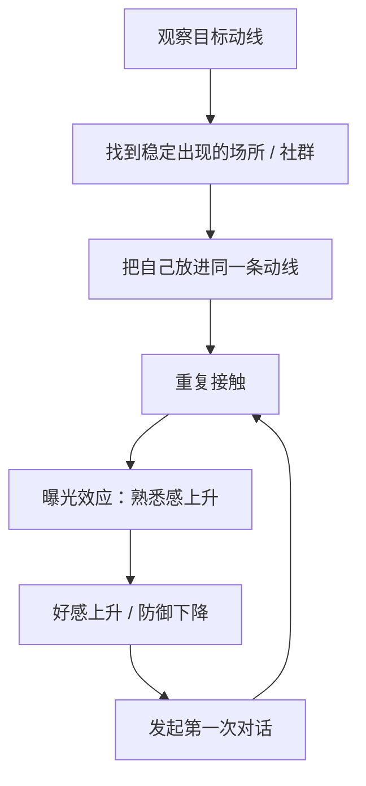
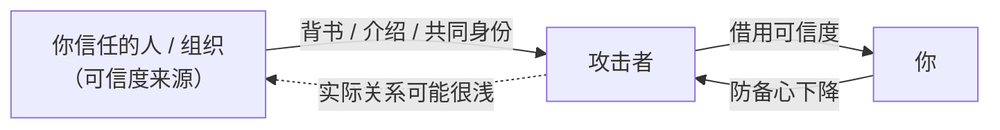
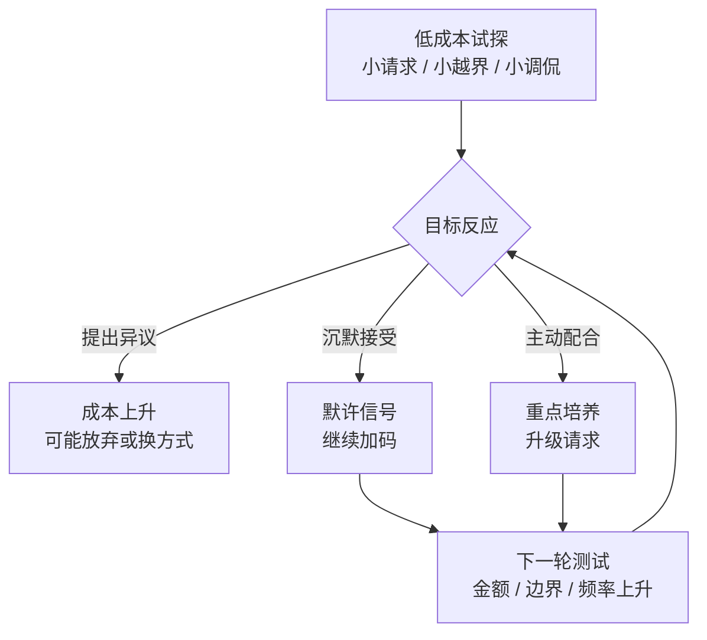
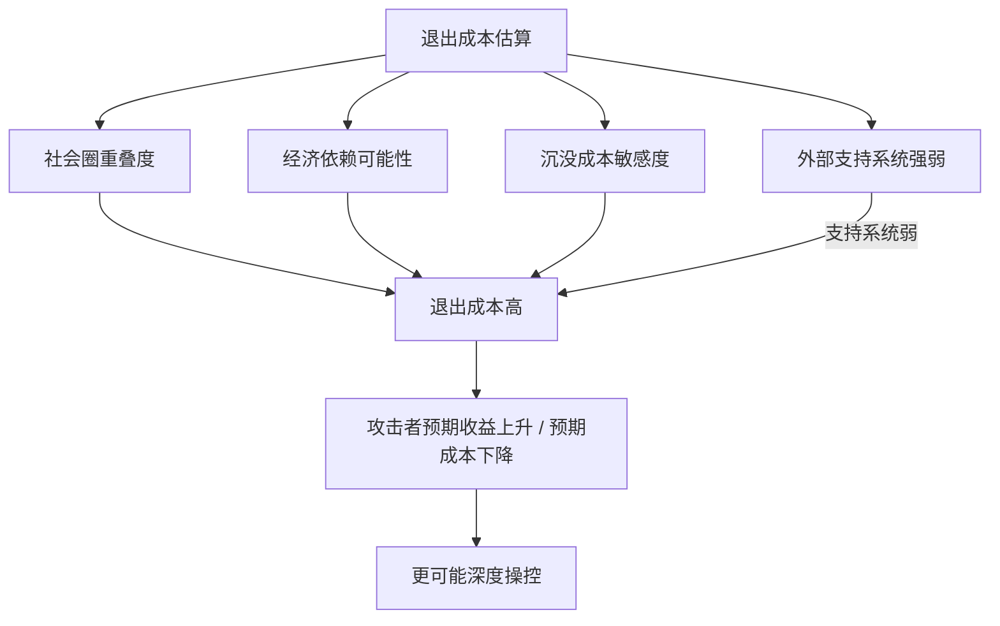

# 第3章 接近性制造与初始服从测试

前两章讲的是"谁"和"挑谁"。这一章讲攻击链真正开始动起来的地方：怎么出现在你生活里，怎么让你觉得"这个人挺自然"，怎么用一些几乎感觉不到的小动作，测试你好不好推。

很多人对"被操控"的想象是戏剧化的：一个明显可疑的人，说一些明显可疑的话。但现实里的接近，往往非常日常。ta 可能只是经常出现在你常去的咖啡馆，可能只是和你同一个兴趣群里很活跃，可能只是"恰好"是你朋友的朋友。你甚至会觉得是自己运气好，遇到了一个聊得来的人。

这一章有一个核心观点：**接近是可以被制造的，信任是可以被租借的，服从是可以被测试的。** 这三件事单独看都不算攻击，但组合起来，就是一条完整的"进入"路径。

---

## 3.1 "偶遇"与曝光效应的工程化

### 曝光效应：见得多了，就会喜欢

心理学里有一个很稳定的现象，叫"曝光效应"（mere exposure effect）：**在其他条件差不多的情况下，人们对反复看到的人或事物，会产生更强的好感。**

这个效应不需要对方做什么特别的事，甚至不需要说话。光是"经常见到"，就足以让好感往上涨。你想想自己有没有这种体验：一个人第一次见觉得一般，见了几次之后，突然觉得"还挺顺眼的"；一家店第一次路过没感觉，每天路过之后，就有点想进去看看。

曝光效应本身是中性的，它是人类大脑处理熟悉感的一种方式。但在攻击链里，它可以被"工程化"：既然重复接触能提高好感，那就主动制造重复接触。

### 偶遇是怎么被设计出来的

素材里有一个很典型的案例。一名做安全审计的人要接近某公司的高管，他先跟踪了一两天，发现对方每天早上 7:30 会去同一家咖啡馆，坐半小时，看报纸，点中杯拿铁。摸清这个习惯后，他设计了一场"偶遇"：估好时间进店，点同样的咖啡，坐在旁边，借报纸搭话，几句话就聊到了对方的公司、职位、度假计划。

这个案例的重点，不是那个人多会聊天，而是**偶遇之前的那一步**：先观察，找到目标稳定的动线，再把自己放进那条动线里。

现实中的"工程化偶遇"大概有这么几种：

- **场所型**。摸清你常去的咖啡馆、健身房、书店、宠物公园、通勤路线，然后"恰好"频繁出现。出现次数多了，你对 ta 的熟悉感就上来了。
- **社群型**。你加入的微信群、豆瓣小组、兴趣社群，ta 也在里面，而且比你活跃。你发什么 ta 都接得上话，慢慢就成了"群里的熟人"。
- **线上型**。批量添加好友、在同城群和评论区高频互动、给你的每条动态点赞评论。线上没有物理距离，制造"高频接触"的成本更低。
- **共同好友型**。这个下一节细讲，属于"借道接近"。

这个循环一旦转起来，你会觉得"我们好有缘"。但"有缘"的感觉，是可以被人为制造出来的。区别在于：自然的偶遇，频率是随机的、分布是散的；被设计的偶遇，频率是稳定的、每次出现之后都有推进动作。

### 怎么估"基线概率"

判断偶遇是不是被设计的，有一个很朴素的方法：**估基线概率**。

选一个你常去的场所或社群，先估算一下"随机遇到同一个人"的正常概率。比如你每周去三次健身房，每次待一小时，健身房有一百个常客，那随机遇到某个特定的人的概率大概是多少？不用算得很精确，有个数量级的概念就行——通常是很低的。

然后回想最近一个月：你实际"偶遇"某个人多少次？如果实际频次显著高于你的基线估算，而且每次偶遇之后，对方都有推进对话的动作（借东西、搭话、加好友、约下次），那这就不是巧合的概率分布了，而是一个模式。

这里要小心一个思维陷阱：不要因为"偶遇"多就直接认定对方是坏人。也可能对方真的和你作息相同、真的也喜欢那家店。所以红队的做法是**记录模式，不下结论**：偶遇次数、每次之后对方做了什么、你自己的感受如何。模式积累到一定程度，答案自然会浮出来。

### 小练习

选一个你常去的场所或社群，估算"随机遇到同一个人"的基线概率。

然后回想最近一个月内，你实际"偶遇"某人的次数。如果实际频次显著高于基线估算，而且每次偶遇后对方都有推进对话的动作，把这个模式记录下来：时间、地点、对方做了什么、你当时的反应。

这个练习不是让你去怀疑每一个熟人，而是训练一种"概率感"：当某件事的发生频率明显偏离随机，它背后通常有一个设计者。

---

## 3.2 弱关系作为信任跳板

### 共同好友是一张"可信度租赁券"

社会学家马克·格兰诺维特有一个很有名的说法：弱关系的力量。意思是，真正能给你带来新机会、新信息的，往往不是天天见面的强关系（家人、密友），而是那些不太熟的弱关系（朋友的朋友、前同事、兴趣群里说过几句话的人）。

原因很简单：强关系和你信息重叠度高，弱关系连接着不同的圈子。但弱关系还有一个副作用，在攻击链里特别有用：**它自带一层初始可信度。**

你对一个完全陌生的人，防备心是满格的。但如果有人告诉你"这是老王的朋友"，你的防备心会立刻降一截。为什么？因为你的大脑做了一个偷懒的推理：老王是我信得过的人，老王的朋友应该也差不到哪去。这个推理在大多数时候是合理的，但它可以被利用。

社会工程里管这个叫"信任租赁"：攻击者本身没有可信度，但他可以**借用**一个你信任的人或组织的可信度。借用方式包括：

- **共同好友介绍**。"我是小李的朋友，他让我来找你。"
- **共同社群身份**。"我们都在那个读书会，我看过你发言。"
- **职业交集**。"我是某某公司的，跟你们公司有合作。"
- **可见背书**。头像、朋友圈、共同群聊、共同好友数量，都是"看起来靠谱"的信号。

这张图里最关键的一条虚线：**攻击者和那个"可信度来源"之间的实际关系，可能非常浅。** 他可能只是跟你朋友吃过一次饭，可能只是在同一个群里待过，可能连你朋友的名字都是从你朋友圈看来的。但只要你没有独立核实，这条虚线在你眼里就是实线。

### 团伙化操作里的"托"和"群演"

弱关系跳板在团伙化操作里，会被放大成一套"布景"。

你听说过那种"投资群"吧？群里几十个人，天天有人晒收益、有人感谢老师、有人问什么时候加仓。你可能以为群里都是真实投资者，实际上，一个群里二三十人，可能只有一个是真正的目标，其余全是配合话术的"托"和"群演"。

他们的分工包括：有人负责营造热闹（晒单、发红包），有人负责制造从众（"我也投了，真的赚了"），有人负责扮演质疑者然后被"说服"（先质疑，再被老师打脸，最后服气），有人负责私聊你（"姐妹，你投了吗？我跟着老师赚了不少"）。整个群就是一个为一个人搭建的舞台。

这套操作的本质，是把"弱关系信任"批量化生产：你看到的"很多人都在"，其实是一个被安排好的社会证明。你以为自己在参考群众的判断，实际上群众是拿工资的。

### 核实路径是否存在

防御弱关系跳板，有一个非常具体的动作：**做一次独立核实。**

当你通过"共同好友"认识一个人时，问自己：我能不能在不经过这个人的情况下，从那个共同好友口中确认对方描述的关系深度？

比如对方说"我是老王的大学室友"，你可以找个机会问老王："你大学室友里是不是有个叫某某的？"如果核实路径存在，而且核实结果对得上，那这个弱关系就是真的。如果核实路径不存在，或者对方用"别去打扰老王""他最近很忙""你不信任我"之类的话阻断你核实，那这个节点就值得标记。

注意，阻断核实这个动作本身，比核实结果更能说明问题。一个真实的人，通常不会害怕你去问共同好友；一个虚构的身份，才会把"核实"视为威胁。

### 小练习

回想一个你通过"共同好友"认识的人。做一次独立核实：

你能否在不经过对方的情况下，从那个共同好友口中确认对方描述的关系深度？比如对方说"我们认识很多年了"，你去问那个共同好友"你们是怎么认识的、认识多久了"。

如果核实路径不存在，或者被对方以"别去打扰 ta"的方式阻断，把这个节点标记下来。标记不等于定罪，它只是一个"待观察"的记号。

---

## 3.3 "服从测试"作为筛选过滤器

### 筛选不是一次性判断，而是一组低成本试探

攻击者不会一上来就提大要求。大要求会触发警报，会让目标警惕、拒绝、甚至拉黑。所以他们会用一种更聪明的方式：**用一组低成本的小试探，逐步摸清你的反应模式。**

这些试探有个共同特点：单独看都很小，小到你不好意思拒绝，甚至小到你根本没意识到那是个"请求"。

常见的试探包括：

- 一个微小的越界请求："帮我把这个链接点一下""借我十块钱充个话费""帮我投个票"。
- 一次临时改约："我今晚临时有事，改明天行吗？"——看你是否无条件配合。
- 一句看似无害的调侃："你这件衣服好像有点显胖哦，开玩笑的。"——看你是否接受被评价。
- 一个模糊的边界："你手机能给我看一下吗？就看一下。"——看你是否交出隐私。
- 一个"顺便"的要求："你反正要出门，帮我带杯咖啡呗。"——看你是否把 ta 的需求排在自己前面。

每做一次试探，攻击者就在心里记一笔：这个人是"提出异议"型、"沉默接受"型，还是"主动配合"型。三种反应对应三种后续策略：

- **提出异议**：成本高，可能放弃，或者换更软的方式。
- **沉默接受**：成本中等，可以继续加码，因为沉默等于默许。
- **主动配合**：成本最低，重点培养，因为这个人不仅不拒绝，还会自己找理由帮你。

### 买花篮：显性版本的服从测试

杀猪盘里的"买花篮"是一个特别清楚的例子。套路大概是：聊了一段时间，对方说自己新店开业，让你送个花篮，几百块钱。钱不多，理由也"合理"，很多人不好意思拒绝，就转了。

这个请求的目的，**根本不是那几百块钱**。它的目的是筛选：愿意为"关系"付几百块的人，才有可能在后面付几万、几十万。不愿意付的人，会被迅速放弃，在话术文档里备注为"死"。

这个逻辑反过来看，对我们其实是个好消息：**你不需要识破整个骗局，你只需要在第一个"有点怪"的小请求上说"不"。** 因为攻击者的成本计算里，一个明确拒绝的人，就是"无效客户"，继续投入不划算。很多攻击链，就是在这一关卡断的。

### 为什么"沉默"比"拒绝"危险

这张图里最值得注意的，是"沉默接受"这一支。

很多人以为，只要自己没答应，就不算配合。但在攻击者的解读里，**不拒绝就是同意**。你不说话，ta 就当你默认；你不反驳，ta 就当你接受；你转移话题，ta 就当你回避但没关门。下一次，ta 会在这个基础上再往前推一点。

所以防御服从测试的关键，不是"心里不舒服"，而是"嘴上说出来"。一句清楚的"这个我不太方便"，比十次心里犯嘀咕有用得多。因为攻击者读不到你的心理活动，ta 只能读到你的行为。

### 小练习

连续一周，记录你收到的、让你感到轻微不适但"好像不值得拒绝"的小请求。

每条后面标注三件事：

1. 你的反应：拒绝、沉默，还是配合？
2. 对方随后的行为变化：是退回去了、当没发生，还是换了个方式又提了一次？
3. 你的感受：拒绝之后有没有内疚？配合之后有没有压力？

一周后回看，问自己：是否存在一个"测试—反应—升级"的模式？

这个练习的价值，不在于让你变得斤斤计较，而在于让你看见：**很多"不舒服"不是你想多了，而是你的直觉在提前报警。** 你要做的，是把这个报警声翻译成一句能说出口的话。

---

## 3.4 退出成本的前置估算

### 攻击者在投入之前，先算你会不会跑

一个理性的支配型攻击者，在决定要不要深度操控一个人之前，会做一件事：估算这个人的**退出成本**。

所谓退出成本，就是"如果这个人想离开这段关系，ta 要付出多少代价"。退出成本越高，攻击者越安全，因为你知道离开很痛，所以你会忍；你越忍，ta 越能加码。

退出成本主要由四个东西构成：

1. **社会圈重叠度**。你们有多少共同朋友、共同群、共同工作圈？重叠度越高，离开意味着社交关系要重新洗牌，甚至要面对共同朋友的站队和议论。
2. **经济依赖可能性**。你有没有可能在经济上依赖 ta？比如一起租房、共同负债、ta 掌握你的收入来源、你为了这段关系辞了工作。经济越纠缠，离开越难。
3. **沉没成本敏感度**。你是不是那种"已经投入这么多，不甘心放手"的人？投入的时间、感情、金钱越多，越容易觉得"再忍忍就好了"。
4. **外部支持系统**。你身边还有没有能接住你的人？有没有朋友、家人、咨询师，能在你离开时给你地方住、给你钱周转、给你情绪支撑？支持系统越弱，离开越像跳崖。

这张图解释了一个很残酷的现实：**攻击者不是随机挑人下手的，他们会挑"跑了很痛"的人。** 你越孤立、越依赖、越怕冲突、越舍不得沉没成本，你在 ta 的账本上就越"安全"。

### 退出成本地图

防御的起点，是把自己的退出成本地图画出来。

具体做法：假设你明天决定离开当前关系，列出——

- 你会失去什么？（住所、收入、共同朋友、生活习惯、未来的计划）
- 谁会让你为难？（共同朋友会不会站队？家人会不会劝和？同事会不会议论？）
- 哪些实际安排需要重新组织？（住哪、钱怎么分、孩子怎么办、工作要不要换）

画完之后，再问一个关键问题：**这张地图上的哪些信息，对方已经知道，或者主动询问过？**

这个交集，就是你被评估过的攻击面。对方问过你"你房租多少""你爸妈关系好吗""你朋友多吗""你存款大概多少"，这些看似关心的问题，可能不只是关心，而是在给你的退出成本打分。

### 为什么"知道自己能跑"本身就是防御

这里有一个很重要的心理机制：**退出成本的高低，不只取决于客观条件，还取决于你主观上相不相信自己跑得掉。**

同样一份工作、同样一群朋友，一个人觉得"我随时可以走，大不了重新开始"，另一个人觉得"我走了就什么都没有了"。客观条件可能差不多，但前者的退出成本在感受上低得多，因此更不容易被控制。

所以，增强退出能力，不只是"多存点钱、多交几个朋友"这种实际动作，还包括一个认知动作：**提前想清楚"如果我要走，我第一步做什么"。** 当你在脑子里演练过离开的路径，离开就不再是一个黑洞，而是一条虽然难走但看得见的路。看得见的路，比看不见的路，吓人程度低得多。

### 小练习

画一张你的"退出成本地图"：

列出如果你明天决定离开当前关系（或你正在观察的一段关系），你会失去什么、谁会让你为难、哪些实际安排需要重新组织。

然后问：这张地图上的哪些信息，对方**已经知道或主动询问过**？

这个交集就是你被评估过的攻击面。标记它，不是为了让你立刻离开，而是为了让你知道：哪些信息以后要收着点，哪些依赖关系要提前松动，哪些支持系统要重新接上。

---

## 本章小结

这一章讲了接近阶段的四个动作：

1. **制造接近**。曝光效应让"见得多了"变成"有好感"，而偶遇可以被设计。判断方法是估基线概率：实际频率明显偏离随机，且每次接触后都有推进动作，就值得记录。
2. **租借信任**。共同好友、共同社群、职业交集，都能提供"初始可信度"。防御动作是独立核实：能不能在不经过对方的情况下，从那个共同好友口中确认关系深度？核不成就标记。
3. **服从测试**。用小请求筛选"好不好推"的人。沉默不是中立，沉默在对方眼里是默许。防御动作是说出口：一句"这个我不太方便"，比心里不舒服有用。
4. **退出成本估算**。攻击者挑"跑了很痛"的人。你越孤立、越依赖、越舍不得，越安全——对 ta 来说安全。防御动作是画退出成本地图，并提前想好"如果我要走，第一步做什么"。

最后留一个观察角度，贯穿整章：

**看一段关系的"进入方式"，比看它的"进行方式"更能提前发现问题。**

如果一个人进入你生活的方式，是频繁的巧合、借来的背书、不断的小测试，那你至少可以多问一句：这些"自然"，是真的自然，还是被安排过的自然？

下一章开始进入第二部分：吸引与人设建立。你会看到，一个"完美的人"是怎么被模块化地组装出来的，以及为什么"太合拍"有时候不是缘分，而是工程。
