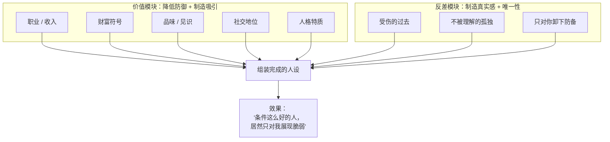
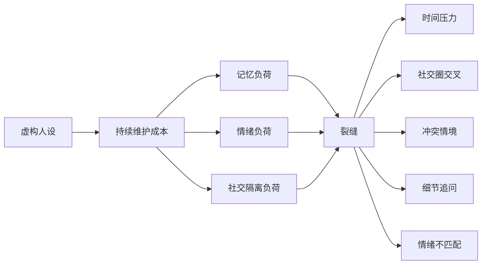
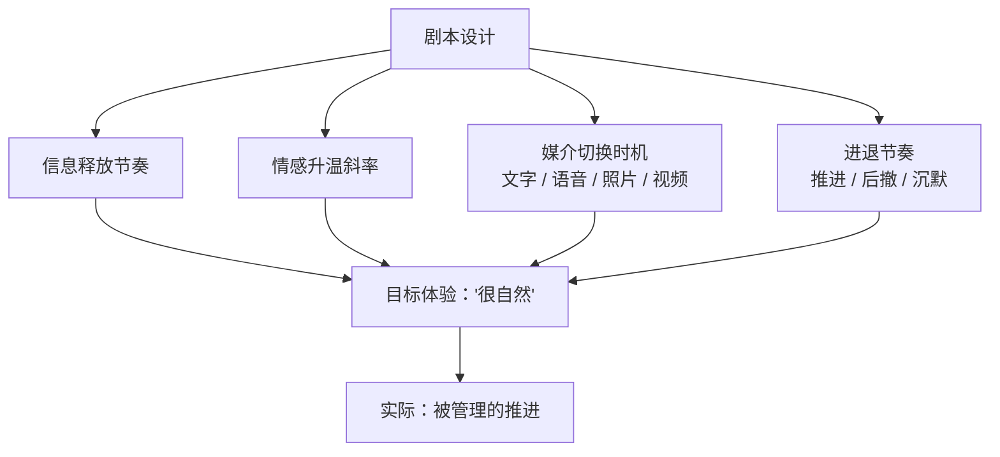
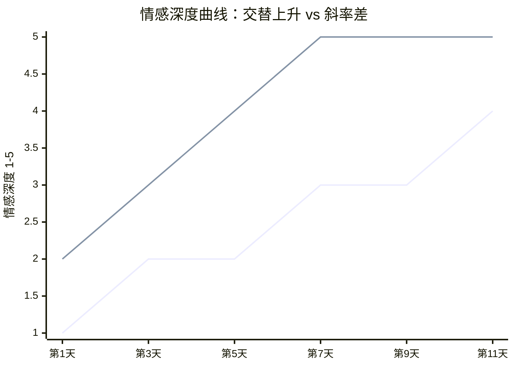

# 第4章 人设的模块化构建与伪装

前一部分讲的是"怎么进入你的生活"。从这一章开始，讲"进入之后，怎么让你留下来"。

一个人要在你心里站稳，靠的不是真实的自己，而是**一个被设计过的形象**。这话听起来刺耳，但你回想一下自己心动过的瞬间：是不是常常因为对方展现出的某种"价值"——事业有成、见多识广、温柔体贴、有故事、有品味——再加上某种"只有你能看到"的脆弱，才觉得"这个人不一样"？

问题是，这些要素可以被拆开、挑选、组装。就像搭积木一样，攻击者可以根据目标的口味，拼出一个"刚好是你喜欢的样子"的人。这一章讲三件事：人设是怎么被模块化组装的，虚假人设为什么会露出裂缝，以及剧本化推进是怎么制造"自然感"的。

---

## 4.1 高社会价值人设与"反差感"制造

### 人设不是"展示真实的自己"

先纠正一个常见的误解：很多人以为，人设就是"装"，装有钱、装有文化、装深情。这只说对了一半。

人设的真正功能，不是展示，而是**降低你的初始防御，同时制造探索欲**。一个高价值的人设，会让你产生两种感觉："这个人条件真好"和"这个人好像还有很多我不知道的地方"。前者让你愿意靠近，后者让你想继续了解。两种感觉合在一起，就是"被吸引"。

在恶性 PUA 的操作里，这一步叫"好奇陷阱"——五步陷阱的第一步。操作者会根据目标的不同，把自己设定成不同的形象：面对崇拜强者的目标，就演"总裁""精英"；面对文艺青年，就演"诗人""浪子"；面对缺爱的目标，就演"深情专一但受过伤的人"。人设不是固定的，是**按目标定制的**。

### 人设的两个模块

拆开来看，一个人设通常由两个模块组成：**价值模块**和**反差模块**。

**价值模块**负责"看起来很好"。常见的有：

- 职业与收入：高管、创业者、医生、律师、投资人、自由职业者。
- 财富符号：车、表、旅行、餐厅、住的小区。
- 品味与见识：读书、艺术、红酒、小众爱好、去过很多地方。
- 社交价值：认识很多人、被很多人需要、在某个圈子里有地位。
- 人格价值：温柔、成熟、有责任心、情绪稳定、会照顾人。

**反差模块**负责"看起来真实，而且只有你能懂"。常见的有：

- 高价值外壳下，藏着一个"受伤的小孩"。
- 在外面很强大，在"你"面前才卸下防备。
- 经历过背叛、孤独、不被理解，所以"不相信任何人，除了你"。
- 有脆弱的一面，但只给你看："这是我第一次跟别人讲。"

这个组合为什么有效？因为它同时满足了两件事：**向上看的安全感**（这个人有价值，跟着 ta 不会吃亏）和**向下看的价值感**（这个人这么强，却需要我、只信任我）。前者让你想靠近，后者让你觉得自己特别。两股力量一拉，人就容易陷进去。

### 伪装的技术原则

素材里讲伪装，有几条原则，放到人设构建上完全适用：

1. **调查越深，成功率越高**。人设不是凭空编的，而是根据目标的口味定制的。你喜欢什么，人设就往什么方向长。这就是为什么第 2 章要讲信息收集——信息是人设的原材料。
2. **植入真实爱好会提高可信度**。一个伪装如果全是编的，被问到细节就会露怯。所以高明的伪装会把自己真正懂的东西嵌进去，让一部分内容是真实的，整个故事就稳了。
3. **越简单越可信**。细节越多，越容易记不住、越容易自相矛盾。一个简洁的人设，反而给目标留出了"脑补"的空间。素材里有个细节：一个销售经理把客户名字"贝姬"一会儿叫成"贝斯"、一会儿叫成"贝蒂"，哪怕条件再优惠，最后还是被拒了。名字叫错这种小事，足以让整场信任崩塌。
4. **要为对方留下合理的下一步**。人设不能只停在"我是谁"，还要自然地带出"所以我们接下来可以做什么"。比如"我下周要去你那个城市出差，要不要见一面""我认识一个朋友正好做你这行，改天介绍你认识"。这些"下一步"让关系看起来有自然的推进逻辑，而不是硬拽。

还有一条更底层的心理机制，叫**认知失调**。简单说，人倾向于让自己的认知保持一致。如果一个人自称"成功投资人"，却对基本的金融常识一问三不知，你心里就会产生一种别扭感——这个别扭感就是"不协调"。为了消除别扭，你要么降低对这个身份的相信，要么找理由解释。攻击者的任务，就是不断提供"协调"的证据，把这个别扭压下去：多发几张看起来像那么回事的照片、多讲几个行业内的细节、多展示一点"成功人士"的生活方式。

### 反差感的杀伤力

在所有模块里，反差感是最容易被低估的。

因为单纯的"高价值"，会让人产生距离感——"这个人太好了，跟我没关系"。而反差感的作用，是把距离感转化成**特殊感**："这个人这么好，但 ta 的脆弱只给我看，说明我对 ta 是特别的。"

这个转化一旦完成，你就会开始主动维护这段关系。因为你不只是在维护一个"喜欢的人"，你还在维护一个"只有我能拯救/理解的人"的身份。后者比前者更难放手，因为它绑定的是你的自我价值。

这也是为什么很多操控关系里，受害者会有一种奇怪的责任感："ta 那么惨，只有我能帮 ta，我走了 ta 怎么办？"这种责任感不是凭空来的，它是在人设阶段就被预装好的。

### 小练习

选一个你近期认识的人（或者公开案例里的攻击者），列出 ta 展示的"高价值身份"和"反差特质"各三条。

给每一条标注三类：

- **可独立核实**：能通过公开渠道、共同朋友、实地见面确认的。
- **只能由对方口头证明**：对方说是就是，你没法查的。
- **无法核实**：连口头证明都很模糊，比如"我以前做过一些不能说的事"。

然后看比例：可核实项越少、表演性细节越丰富，人设的工程化程度越高。

这个练习不是让你去查你朋友的户口，而是训练一种分辨力：**哪些信息是"关系的地基"，哪些只是"装修"**。地基是可以踩的，装修只能看。

---

## 4.2 人设的"一致性维护"成本与裂缝

### 假人设是要"养"的

一个真实的人，不需要"维护"自己。今天说喜欢吃什么，明天还是喜欢；今天说在哪上班，明天还在那。因为真实是一致的，一致不需要用力。

但一个虚构的人设不一样。它需要持续的认知劳动和情绪劳动来维护：

- **记忆劳动**：记住自己跟谁说过什么、编过哪些细节、时间线对不对得上。
- **情绪劳动**：在不同对象面前维持不同版本，随时调整语气、态度、故事。
- **社交劳动**：避免不同圈子的人碰面，避免被问到自己不熟的领域，避免留下可查的痕迹。
- **表演劳动**：时刻注意表情、语气、反应是否符合人设。

这些劳动单看都不难，难的是**同时维持**。就像一个人同时抛好几个球，抛一个很轻松，抛五个就开始手忙脚乱。手忙脚乱的时候，球就会掉——这就是"裂缝"。

### 裂缝通常出现在哪里

人设崩塌，很少是因为某天突然被揭穿，更多是因为一些微小的、当时看起来不起眼的瞬间。常见的裂缝出现在这几个情境：

1. **时间压力**。被突然追问、被要求立刻回答、被临时改变计划。人在赶时间的时候，很难维持精心设计的反应，真实反应会漏出来。
2. **社交圈交叉**。当 ta 的两个"版本"同时出现在一个场合——比如 ta 跟你说的经历，跟 ta 朋友说的对不上；或者你偶然遇到 ta 的另一个"朋友"，发现说法不一致。
3. **冲突情境**。吵架、被质疑、被拒绝的时候，人设的"温柔体贴"最难维持。一个人在冲突里的第一反应，往往比平时的表演更接近真实。
4. **细节追问**。问一个 ta 没准备过的具体问题：那家餐厅的具体位置、那个项目的具体细节、那个朋友的全名。准备过的问题答得流利，没准备过的问题会卡顿、含糊、转移话题。
5. **情绪不匹配**。该悲伤的时候微笑、该惊讶的时候平静、该自然反应的时候出现"延迟的表情"。表情和语境对不上，是最容易被察觉的裂缝之一。

### 为什么"微小瞬间"比"重大暴露"更有用

很多人防御的方式是"等大证据"：等对方露出马脚、等骗局被揭穿、等一个决定性的瞬间。但现实中，大证据往往来得很晚，代价已经很大。

红队的思路相反：**不等大暴露，记录小裂缝。**

因为人设的维护成本是持续的，裂缝是**高频出现**的。你不需要一次抓到"ta 是骗子"的铁证，你只需要积累"说法与行为不一致"的小实例。三个、五个、十个小的不一致放在一起，模式就出来了。

比如：

- ta 说自己是某公司高管，但你从来没见过 ta 的工作场景，ta 也从不视频。
- ta 说"我从来不对别人说这些"，但你发现 ta 对另一个人也说过类似的话。
- ta 说自己很忙，但每天都能秒回你，而且回复时间覆盖全天。
- ta 说某个朋友是"多年好友"，但你问起那个朋友的具体情况，ta 语焉不详。
- ta 在讲某件事时情绪很饱满，但被追问细节时突然变得含糊。

单条都可以解释，放在一起就值得警惕。**解释一件事不难，解释十件事都"恰好"就很难。**

### 你当时的反应，比裂缝本身更重要

这里有一个特别关键的点：裂缝出现的时候，你通常会**自动帮对方合理化**。

"ta 可能只是记错了。"
"ta 可能太忙了，所以没回。"
"ta 可能不想提过去，所以才含糊。"
"ta 说那样的话，一定有 ta 的理由。"

合理化是人类大脑的一种保护机制：当我们已经投入了感情，承认"对方有问题"会带来认知失调，所以大脑会自动找理由把不一致抹平。这不是你笨，是人之常情。

但红队视角要求你做一个动作：**在合理化的同时，把它标记下来。**

不是让你立刻翻脸，而是让你在心里记一笔："这里有一个不一致，我暂时解释了它，但我记得它。"等下次再出现类似的不一致，你就有两个点可以连线。连到第三个、第四个，你就会发现，你之前的"合理化"其实是在替对方圆谎。

### 小练习

记录你在一个人身上观察到的"说法与行为不一致"的三个微小实例。

比如：ta 说喜欢安静，但每次见面都选最吵的酒吧；ta 说很重视家人，但从不提家人的具体事；ta 说讨厌撒谎，但对自己的一些小事前后说法不同。

观察你当时的反应：你是**合理化**它，还是**标记**它？

然后把三个实例写在一起看：它们之间有没有共同点？有没有一个方向？这个练习的目的不是让你变成侦探，而是让你把"自动合理化"这个动作，变成一个可以被看见的动作。

---

## 4.3 剧本化推进与"自然感"的模拟

### 成熟的攻击，是有脚本的

前面讲人设是"横向"的——一个人由哪些模块组成。这一节讲"纵向"的——一段关系按什么节奏推进。

成熟的操控操作，会把对话拆解成**按天、按阶段推进的脚本**。最有名的例子是杀猪盘的"七天剧本"：第一天怎么开场、第二天聊什么话题、第三天怎么从文字过渡到语音、第几天发什么样的照片、第几天开始讲"我的过去"、第几天提出第一个小请求。

这些剧本有一个共同的技术要求：**不能显得像剧本。**

所以脚本不会规定逐字逐句说什么，而是规定**节奏**：

- 什么时间点释放什么信息。
- 情感升温的斜率控制在多少。
- 什么时候该主动，什么时候该"自然地"沉默。
- 什么时候用文字，什么时候用语音，什么时候发照片。
- 什么时候推进关系，什么时候后撤一步。

素材里提到过一个细节：杀猪盘的话术要求"第三天如何自然地打字而非复制粘贴""何时发送 AI 处理的生活照"。这说明剧本已经精细到了"反侦察"的层面——不仅要推进关系，还要避免被看出"工业化"的痕迹。复制粘贴的聊天会有一种奇怪的生硬感；AI 处理过的照片能规避反向搜图；语音比文字更能制造"真人感"。

### 为什么"自然"是可以被模拟的

你可能会问：既然刻意，怎么会显得自然？

答案是：**自然感不等于随机，而等于"符合期待"。**

人对"自然"的判断，不是看这件事有没有被设计过，而是看它符不符合我们对这类关系的想象。一个刚认识的人，如果每天固定时间问候、循序渐进地分享生活、偶尔流露一点脆弱、在你需要的时候及时出现——你会觉得"这就是正常恋爱的节奏"。

问题在于，"正常恋爱的节奏"是可以被总结、被复制的。一旦一个节奏被总结成模板，它就可以被批量执行。你感受到的"自然"，其实是对一个**标准剧本**的熟悉感。

这就引出了剧本化推进最可检测的痕迹：**斜率差**。

### 情感深度曲线与斜率差

设想你和新认识的人聊天。你可以给每段对话的"情感深度"打个分：1 分是天气和吃饭，3 分是工作烦恼和兴趣爱好，5 分是童年创伤、前任、对未来的恐惧。

把时间作为横轴，把情感深度作为纵轴，画出两条曲线：你的曲线和对方的曲线。

健康的关系里，两条曲线大致是**交替上升**的：你先分享一点，ta 回应一点，ta 再分享一点，你再回应一点。像两个人一起爬楼梯，一步一步，彼此跟得上。

而剧本化推进的关系，常常会出现一种特征：**对方的曲线，总是提前在你的曲线前面"等你"。**

比如你还在 2 分（聊爱好），对方已经在 4 分（讲童年创伤）；你刚被带动到 3 分，对方又跳到 5 分（说"只有你让我觉得安全"）。你会有一种被"拉着走"的感觉——不是你在推进关系，而是对方在设定关系的速度，你只是在跟上。

这张图里，两条线的**斜率差**，就是剧本化推进的可视化痕迹。对方不是跟着你的节奏走，而是在用更快的速度把你往深处带。带得越快，你越没时间做一致性检验，越容易在信息不完整的情况下做出情感投入。

当然，斜率差本身不是罪证。有的人就是性格外放、表达直接、升温快。所以判断的关键不是"快不快"，而是"快的同时，有没有给你留出核实和后退的空间"。一个真诚而热烈的人，会在你犹豫的时候停下来；一个按剧本推进的人，会在你犹豫的时候加大力度。

### 小练习

取一段你与新认识的人的早期聊天记录，按时间顺序给每个话题的"情感深度"打 1—5 分。

画出你的深度曲线和对方的深度曲线。

观察：对方是否在你尚未到达某一深度时，就已经在那里"等你"？两条线的斜率差有多大？当你表现出犹豫或后退时，对方是停下来，还是加大推进力度？

这个练习的目的，不是让你给每段关系做体检，而是让你对"关系推进的速度"有一种直观的敏感。速度本身不是问题，**速度背后的意图**才是。

---

## 本章小结

这一章讲了三层：

1. **人设是模块化组装的**。价值模块负责吸引，反差模块负责制造"唯一性"。两者的组合，让你同时产生"想靠近"和"我很特别"的感觉。判断方法是看可核实比例：地基多，还是装修多。
2. **假人设需要持续维护，维护就会产生裂缝**。裂缝常出现在时间压力、社交圈交叉、冲突情境、细节追问和情绪不匹配的时候。比裂缝更重要的，是你当时的反应——你是自动合理化，还是标记下来。
3. **剧本化推进制造"自然感"**。自然感不是随机，而是符合期待。可检测的痕迹是斜率差：对方的曲线是否总在你前面等你，是否在你犹豫时加大力度。

最后留一个贯穿本章的问题：

**你喜欢的，是这个人，还是这个人"刚好长成了你喜欢的样子"？**

这两件事在初期很难分辨，因为表现可以完全一样。但随着时间推移，真实的人会露出不一致、会有让你失望的地方、会有自己的脾气和边界；而一个被组装出来的人设，会在维护成本升高时开始崩裂，或者在你不再"配合"时迅速变脸。

分辨的方法不是靠直觉，而是靠记录：记录可核实的比例，记录不一致的瞬间，记录情感升温的斜率。记录得多了，你自然会知道，你面对的是一个真实的人，还是一个被精心维护的形象。

下一章，我们讲一个更隐蔽的技术：镜像与冷读。你会看到，"太懂我了"有时候不是缘分，而是一种可以批量生产的幻觉。
