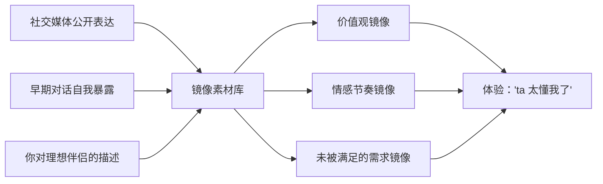
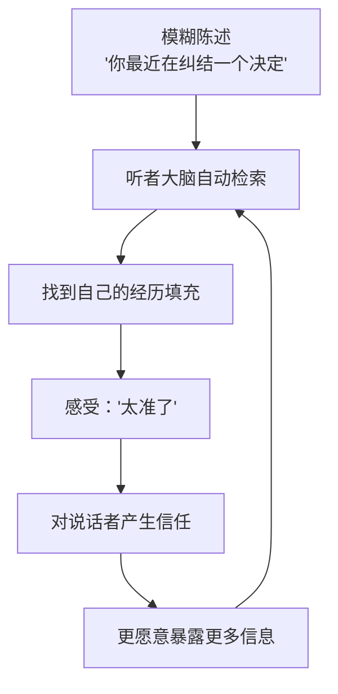
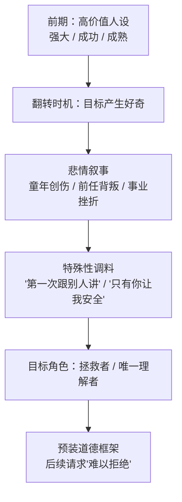

# 第5章 镜像、冷读与"被理解"的幻觉

第 4 章讲的是"对方是谁"。这一章讲的是"对方怎么让你觉得，ta 懂你"。

"懂"这个字，在亲密关系里几乎是最有杀伤力的。一个人可以长得一般、条件一般，但只要让你觉得"ta 懂我"，你就会不由自主地想靠近。因为被理解是人类最深的需求之一——我们终其一生，都在找一个能看见自己的人。

问题是，"被理解"的感觉，是可以被制造出来的。而且制造它，不需要真的懂你，只需要三种技术：**镜像、冷读、悲情叙事**。

这一章会比较扎心，因为它会让你回头审视一些你曾经确信"这就是缘分"的时刻。但看清这些机制，不是为了让你否定过去，而是为了让你以后在遇到"太懂我了"的人时，能多问一句：ta 是真的懂我，还是只是很会让我觉得被懂？

---

## 5.1 镜像技术：成为对方想看到的人

### 镜像不是"假装有共同爱好"

很多人对"镜像"的理解停留在表面：你喜欢看电影，ta 也说喜欢看电影；你喜欢猫，ta 也说喜欢猫。这当然也算一种镜像，但它是最粗糙的一种，很容易被识破，因为一问细节就露馅。

真正高级的镜像，不是复制你的爱好，而是**精确映射三样东西**：

1. **你的价值观**。你觉得什么重要、什么不能忍、什么值得追求。你说"我最受不了虚伪"，ta 就说"我也是，我这个人最讨厌当面一套背后一套"。
2. **你的情感节奏**。你说话快还是慢、喜欢热烈还是含蓄、需要空间还是需要黏着。你慢热，ta 就慢慢来；你直接，ta 就热情回应。
3. **你未被满足的需求**。你渴望什么样的爱、什么样的理解、什么样的对待。你随口说过"我希望有人能在我累的时候什么都不问，就抱着我"，ta 就真的在你累的时候什么都不问，抱着你。

第三样是最致命的。因为前两样只是"像"，第三样是"补"——补上你生命里一直缺的那一块。当一个人精准地补上了你的缺口，你会产生一种近乎生理性的依赖："终于有人懂我了。"

### 镜像的信息从哪里来

镜像不是凭空猜的，它有信息来源。常见的有三类：

- **社交媒体的公开表达**。你发过的动态、点赞过的内容、写过的签名、分享过的歌，都在告诉别人"我在意什么"。一个善于观察的人，翻你三个月的动态，就能大致拼出你的价值观、情感状态和审美偏好。
- **早期对话里的自我暴露**。人在刚开始聊天时，会不自觉地透露很多信息：你说过前任怎么伤你、你说过家里的事、你说过你最怕什么。这些信息，就是镜像的原材料。
- **你对"理想伴侣"的想象性描述**。这是最直接的一类。你可能在聊天里说过"我理想中的关系是……""我最看重对方的一点是……"——你说得越具体，对方能照着演的剧本就越清晰。

### 自恋型虐待循环里的"理想化阶段"

镜像技术最集中、最系统的使用，出现在自恋型虐待循环的**理想化阶段**，也叫"爱情轰炸"阶段。

这个阶段的典型表现是："你喜欢什么，ta 就恰好也喜欢；你渴望什么样的爱，ta 就以那种形式出现。"你会觉得遇到了灵魂伴侣，觉得"这辈子没这么被人懂过"。

但这里有一个关键的时间差：**ta 的"懂"，往往出现在你暴露之后。**

你说了你喜欢什么，ta 才说 ta 也喜欢；你说了你渴望什么，ta 才给你什么。这不是"我们天生合拍"，而是"你先交了底，ta 照着你的底牌出牌"。

这不是说所有"合拍"都是假的。真实的关系里，也会有"我们好像"的惊喜。区别在于顺序和比例：真实的合拍，常常是**双向、交替**的——ta 先暴露一点，你回应一点；你暴露一点，ta 回应一点，两个人在互相了解中慢慢发现共同点。而镜像式的合拍，是**单向、跟随**的：你暴露，ta 匹配；你再暴露，ta 再匹配。ta 的"共同点"总在你之后出现。

### 为什么镜像这么有效

镜像之所以有效，有两个底层原因。

第一，**人天生偏好与自己相似的人**。这是进化和社会化共同塑造的倾向：相似意味着可预测、意味着安全、意味着"我们是一伙的"。素材里讲非语言同步时也提到，匹配对方的呼吸节奏、姿态、语速，能制造无意识的亲近感。语言层面的镜像，是同一套机制的高级版本。

第二，**"被理解"直接击中自我价值**。当一个人准确说出你的感受、你的矛盾、你没说出口的委屈，你会觉得"我的存在被看见了"。这种感觉太美好，美好到你会自动忽略一个问题：ta 是怎么知道的？

答案往往很简单：你说过，或者你写在网上。

### 小练习

回想一段初期让你觉得"太合拍了"的关系。列出五个让你确信"ta 很懂我"的具体表现。

对每一条标注：这条共同点，是对方**先于你暴露的**，还是**在你暴露之后才出现的**？

比如：

- ta 先说自己喜欢某个冷门乐队，你后说自己也是——这是先于你暴露。
- 你先说自己喜欢某个冷门乐队，ta 后说"我也超喜欢"——这是在你暴露之后出现。

统计后者的比例。比例越高，镜像工程化的可能性越大。

当然，单凭比例不能定罪。有的人只是习惯顺着别人的话聊。但如果你发现，ta 的"懂"几乎全部集中在你说过之后，而且每一次都精准得不像巧合，那这个模式就值得记录。

---

## 5.2 冷读与主观验证效应

### 冷读：说一句"很准"的废话

如果说镜像是"照着你演"，那冷读就是"不用照也能让你觉得准"。

冷读（cold reading）是一套通过模糊、通用、情感浓度高的陈述，让听者自己把内容"填满"的技术。它的核心不是说得准，而是**说得让人愿意觉得准**。

典型的冷读句式长这样：

- "你看起来坚强，但其实很累。"
- "你值得被好好对待，只是没人真正看见。"
- "你表面上很随和，心里其实有很多自己的想法。"
- "你最近是不是在纠结一个决定？"
- "你对别人很好，但对自己很苛刻。"

你读这些句子，是不是觉得"有点准"？问题是，这些句子对**大多数人**都挺准的。因为它们描述的是人类的普遍状态：谁不累？谁不觉得自己值得被好好对待？谁没有过纠结？谁不是对别人好、对自己苛刻？

这就是冷读的第一个秘密：**高基础率**。一句话如果对 80% 的人都成立，那它对你成立，并不说明说话的人了解你，只说明这句话足够笼统。

### 主观验证效应：你会自己补全它

冷读的第二个秘密，叫"主观验证效应"，也叫"巴纳姆效应"——人们倾向于把模糊、通用的人格描述，当成对自己精准的刻画。

为什么？因为人有一种天然的倾向：**用自己的经历去填充模糊的信息。**

当有人说"你最近是不是在纠结一个决定"，你的大脑会自动开始搜索："我最近在纠结什么？换工作？要不要跟那个人继续？要不要搬家？"搜到之后，你会觉得"哇，ta 说中了"——但其实，是你自己找到了那个"决定"，对方只是给了一个空筐。

这个循环一旦转起来，就会越转越深：对方说一句模糊的话，你觉得准；你因为觉得准，说得更多；你说得更多，对方能用的素材就更多；于是下一句"更准"；你更信任……最后，你会觉得"这个人简直是世界上唯一懂我的人"。

### 冷读在不同阶段的两种用途

冷读不是只在吸引阶段用。它在整个攻击链里有两种功能：

**第一阶段：制造"ta 太懂我了"的初始冲击。** 在信息还不多的时候，用几句高浓度、模糊但动人的话，快速建立"灵魂共鸣"的错觉。这时候的冷读，是敲门砖。

**第二阶段：测试心理杠杆点。** 在信息充足之后，冷读变成了"探测器"。攻击者会抛出一系列情感浓度高的判断，观察你对哪一个反应最强烈——你哭了、你怒了、你突然沉默、你反复追问——那个反应最强的点，就是你的心理杠杆。后续的施压、操控、情感勒索，都会围绕这个点展开。

这就是为什么第 8 章要专门讲"冷读在信息充足时的杠杆定位"。冷读不只是让你觉得被懂，它还在**给你做心理测绘**。

### 怎么识别冷读

有一个很简单的检验方法，叫"换人检验"。

当你听到一句让你觉得"被说中了"的话，不要急着感动。把这句话记下来，发给一个性格与你不同的朋友，问 ta："这句话套在你身上，准不准？"

如果对方也说"挺准的"，那这句话就是冷读，而不是理解。

因为真正的理解，是**具体的、只属于你的**。它应该包含只有你们俩知道的细节：你上周说的那件小事、你某个特定的习惯、你某次没说出口的反应。而冷读是通用的、可以批量分发的，它套在谁身上都成立。

还有一个辅助判断：**看对方有没有"跟进"。** 真正的理解，会在后续对话里继续深入那个点；冷读则常常说完就换下一个话题，因为它的目的不是理解你，而是制造"被理解"的感觉。

### 小练习

收集三句让你觉得"被说中了"的话（可以是别人对你说的，也可以是网上看到的）。

对每一句做"换人检验"：把它发给一个性格与你不同的朋友，问 ta"这句话套在你身上准不准？"

如果对方也说"挺准的"，这句话就是冷读而非理解。如果对方说"不太准，我不是这样"，那这句话可能确实包含了一些针对你的观察。

这个练习的目的，不是让你变得冷漠，而是让你把"被说中"的感觉，从"感动"切换到"检验"。感动是免费的，检验才值钱。

---

## 5.3 悲情叙事的预置功能

### 人设的"翻转"

第 4 章讲过，人设由"价值模块"和"反差模块"组成。这一节要讲的，是反差模块里最重要的一种：**悲情叙事**。

悲情叙事的操作逻辑是：在目标产生初步好奇之后，**颠覆**之前建立的人设。之前是"高价值、强大、成功"，现在翻过来，露出一个"受伤的、不被理解的、孤独的"内在。

这个翻转的时机很关键。太早，你还没被吸引，不会在意 ta 的伤；太晚，你已经形成固定印象，翻转会显得突兀。最好的时机，是你开始好奇"这个人好像还有另一面"的时候。

在五步陷阱里，这一步叫"探索陷阱"——展示弱点，博取同情。你越同情，越想了解；越想了解，投入越多。

### 悲情叙事的标准结构

悲情叙事看起来千变万化，但结构高度标准化。常见的有三件套：

1. **童年创伤**。"我小时候父母离异""我从小没人管""我一直觉得自己是多余的"。
2. **前任背叛**。"我前女友/前男友把我骗得很惨""我上一段感情付出了全部，最后被背叛"。
3. **事业挫折**。"我曾经创业失败，欠了很多钱""我被合伙人坑过，现在谁都不敢信"。

光有故事还不够，还要加两个"特殊性"的调料：

- **"这是我第一次跟别人讲。"** 这句话的作用是给你一个"被选中"的感觉：ta 把最脆弱的部分只给你看，说明你特殊。
- **"只有你让我觉得安全。"** 这句话的作用是把你放在"唯一理解者"的位置上：别人都不懂，只有你懂。

### 悲情叙事的真正功能：预装一个道德框架

很多人以为，悲情叙事只是为了博取同情。这只说对了一半。它更深的功能，是**为后续的行为预装一个道德框架**。

你想，如果一个人只是"普通朋友"，ta 向你借钱，你拒绝起来毫无心理负担。但如果一个人跟你讲过童年创伤、讲过被前任骗光家产、讲过"只有你能让我觉得安全"，那 ta 再向你提要求时，你拒绝的成本就高多了。你会想："ta 都这么惨了，我怎么好意思拒绝？""ta 那么信任我，我拒绝了是不是太冷血？"

这就是"预装"的意思：故事在请求之前发生，作用是让请求变得"道德上难以拒绝"。

杀猪盘里最常见的两个悲情设定，是"孤儿"和"被前妻骗光家产"。前者让你觉得 ta 无依无靠，你是 ta 唯一的温暖；后者让你觉得 ta 受过伤害，需要你的信任来治愈。两个设定都在为后面的"帮我投一点""借我周转一下"铺路。

### 为什么"拯救者"角色这么难退出

悲情叙事最厉害的地方，是它给你分配了一个角色：**拯救者**。

一旦你接受了这个角色，关系就变了。你不再是在"谈恋爱"，你是在"救一个人"。救人是有道德重量的：你不能半途而废，不能见死不救，不能在对方最需要你的时候离开。

而且，拯救者角色会自我强化。你帮了一次，对方会更依赖你；对方更依赖你，你更觉得自己重要；你更觉得自己重要，越舍不得走。到最后，你离开的阻力不再是"我舍不得这段感情"，而是"我走了 ta 怎么办"——后者比前者沉重得多。

这就是为什么第 9 章和第 15 章要反复讲"拯救者闭环"和"愧疚植入"。悲情叙事是入口，愧疚是锁，两者合起来，就把你关在了一个"不能走"的位置上。

### 小练习

找一段你听过的"悲情叙事"（可以是身边人的，也可以是公开案例里的）。

用红队视角拆解它的功能模块：

1. 它试图把你放在什么角色上？拯救者？唯一理解者？还是"唯一不会离开的人"？
2. 它为你后续的什么行为，预装了"道德上难以拒绝"的框架？是借钱？是投入更多时间？是放弃自己的边界？
3. 这个叙事里，有哪些细节是可核实的？有哪些是只能由对方口头证明的？

这个练习不是让你对每一个诉苦的人都冷眼相待。人有脆弱，倾诉是正常的。你要分辨的是：**这个叙事是在向你求助，还是在给你分配角色？** 前者会尊重你的选择，后者会暗示你"不帮就是你的错"。

---

## 本章小结

这一章讲了三种制造"被理解"幻觉的技术：

1. **镜像**：不是复制爱好，而是精确映射你的价值观、情感节奏和未被满足的需求。可检测的痕迹是顺序——ta 的"合拍"，是不是总在你暴露之后出现？
2. **冷读**：用模糊、通用、情感浓度高的话，让你自己把内容填满。识别方法是"换人检验"：这句话套在别人身上，是不是也准？
3. **悲情叙事**：通过人设翻转，把"高价值的人"变成"受伤的人"，给你分配"拯救者"角色，为后续请求预装道德框架。判断方法是问：这个叙事是在求助，还是在分配角色？

最后，回到本章开头那个问题：ta 是真的懂我，还是只是很会让我觉得被懂？

一个简单的分辨标准是：**真正的理解，是具体的、双向的、经得起核实的；而被制造的理解，是通用的、单向的、经不起追问的。**

真正懂你的人，会记得你说过的具体的事，会在你变化时更新对你的认识，会在你不说话的时候也大致知道你在想什么。而"制造出来的懂"，往往停留在几个高浓度的瞬间，一旦你追问细节，就会变得含糊。

下一章，我们把视角从"语言"转向"身体"。非语言信号——目光、距离、触碰、表情——在恋爱里承载的信息，比语言更密集，也更容易被工具化。
