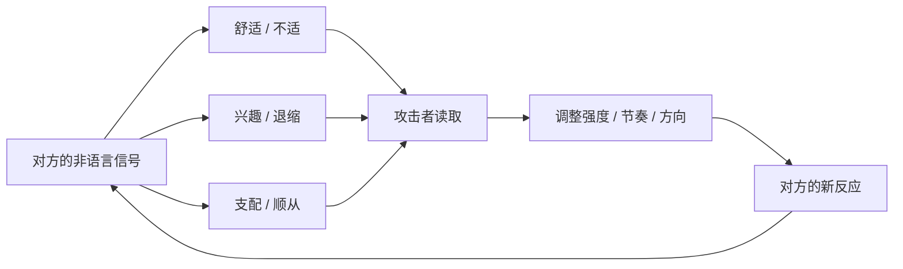
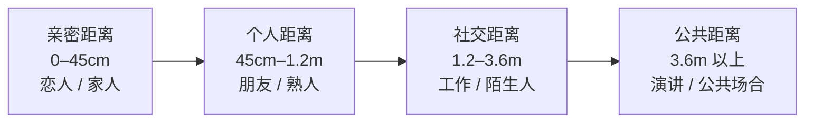
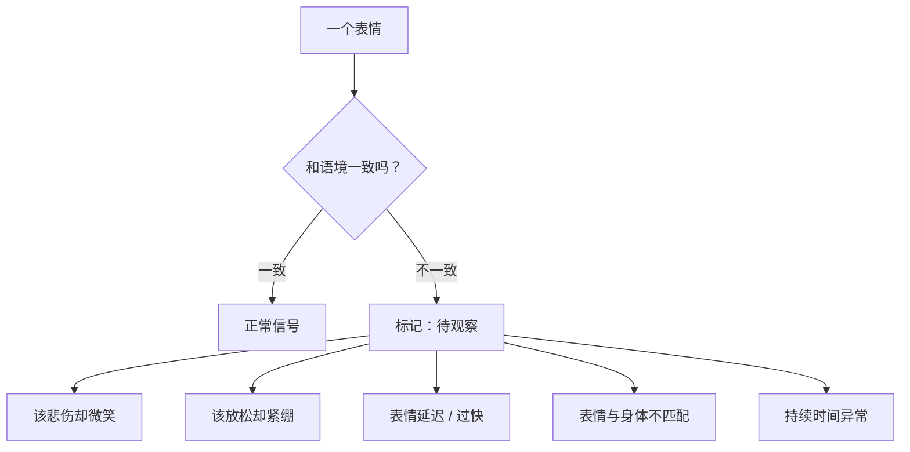

# 第6章 非语言信号的投射与读取

前几章讲的都是"说出来的话"。这一章讲"没说出来的话"。

在恋爱场景里，非语言信号——目光停留、身体朝向、距离、触碰、表情、姿态、呼吸——承载的信息，往往比语言更密集。原因很简单：语言可以准备、可以修饰、可以撒谎；身体反应大多是无意识的，来不及修饰。

但这里要先把一个误区打掉：这一章不是教你"读心术"。没有哪本正经的书能让你看一眼就知道对方在想什么。微表情研究本身也有争议，很多"肢体语言密码"的说法被过度简化了。红队视角关心的是另一件事：**非语言信号是一套实时反馈系统，攻击者会根据你的反应调整策略，你也可以根据对方的反应判断 ta 的意图。**

换句话说，重要的不是"读懂每一个动作"，而是"看见模式的变化"。

---

## 6.1 非语言交流的功能分类

### 身体比嘴巴诚实，但也没那么神

素材里有一个很重要的方法论：观察非语言信号，关键是先建立对方的"日常模样"（baseline），然后看**偏离**。

什么叫日常模样？就是一个人放松、自然状态下的样子：平时说话手怎么放、坐着时腿怎么摆、笑起来眼睛是什么形状、紧张时有没有小动作。每个人都不一样，所以没有一个放之四海皆准的"动作词典"。

真正有信息量的，是**变化**。一个人平时双手自然下垂，看见你走近时突然交叉双臂——这个变化比"交叉双臂等于防御"这个通用结论有用得多。因为变化是相对于 ta 自己的，而不是相对于一本通用手册的。

这也是为什么很多"看眼神就知道 ta 在撒谎"的说法不靠谱：单看一个动作，信息量极低；看动作相对于日常模样的变化，信息量才高。

### 三类功能信号

在恋爱和接近场景里，非语言信号大致可以按功能分成三类：

1. **舒适 / 不适信号**。舒适表现为身体放松、朝向对方、姿态开放、呼吸平稳、自然的目光接触。不适表现为身体后缩、交叉手臂、避免眼神、假笑、脚朝向出口、摸脖子、揉脸、咬唇、遮眼。这一组是最重要的，因为它直接告诉你"边界在哪里"。
2. **兴趣 / 退缩信号**。兴趣表现为身体前倾、距离缩短、脚尖朝向你、找话题、延长互动。退缩表现为身体后仰、看手机、看表、脚尖朝外、回答变短、找理由离开。
3. **支配 / 顺从信号**。支配表现为占据更大空间、挺胸、俯视、打断、控制话题、身体挡路。顺从表现为缩小身体、低头、让路、附和、避免冲突。这一组在支配型关系里特别关键。

这张图是一个闭环。在正常关系里，这个闭环是双向的：你也不舒服，对方也会调整。而在操控关系里，这个闭环是单向的：攻击者读取你的信号，调整自己的策略，但**不打算真正尊重你的不适**——ta 只是把不适当成"需要绕过或压下去的障碍"。

### 攻击者怎么利用这套信号

红队视角下，非语言信号不只是"表达情感"的渠道，更是**攻击者的仪表盘**。ta 会根据你的反应，实时调整：

- 你往后缩，ta 就暂停一下，换个话题，等你放松了再推进。
- 你交叉手臂，ta 就用玩笑重新框定："你别这么严肃嘛，我开玩笑的。"把防御说成"你太认真"。
- 你眼神躲闪，ta 就加大注视强度，用"看着我的眼睛"施加压力。
- 你身体前倾、笑得自然，ta 就顺势推进下一步：靠近一点、碰一下、提一个更大的请求。

这套"读取—调整"的能力，本身是中性的。销售、谈判、心理咨询都在用。区别在于目的：如果目的是让对方更舒服、关系更健康，那是共情；如果目的是绕过对方的边界、把对方带到自己想要的位置，那就是操控。

### 小练习

在安全的社交场合里，观察你自己：当某人让你感到不适时，你的身体最先发出什么信号？

是后缩？是僵硬？是避免眼神？是假笑？是脚不自觉地朝向门口？是手不知道往哪放？

练习在那一刻**给这个信号命名**，而不是忽略它。比如在心里说一句："我现在在往后缩，我不舒服。"

记录三次这样的时刻。这个练习的目的，是让你重新建立"身体—意识"的连接。很多人在关系里被推着走，不是因为没感觉到不适，而是因为感觉到了却习惯性地忽略。命名，是重新拿回判断权的第一步。

---

## 6.2 身体朝向、距离与亲近的物理信号

### 身体朝向：心在哪里，身体就朝向哪里

身体朝向是一个人兴趣和态度的可观测指标。

想象一群朋友坐在一起聊天。谁对谁感兴趣，不用听他们说什么，看身体朝向就知道：躯干倾向谁、脚尖朝向谁，兴趣就在谁那里。素材里有一个细节：一位女士对走过来的男士笑容热情，但她的腿脚没有朝他移动，也没有转向他——那多半说明她礼貌有余、兴趣不足。

腿和脚尤其值得看，因为它们最不受意识控制。人可以控制脸上的表情、控制手的动作，但很少有人会刻意控制脚尖朝哪。所以有一个说法：**脚是身体最诚实的部分。** 一个人上半身对着你、笑得很客气，但脚尖朝着门口，说明 ta 想走；脚尖朝着你，说明 ta 的注意力真的在你这里。

### 距离：四种空间带

人类学家爱德华·霍尔提出过"人际距离学"，把人和人之间的距离分成四个带：

- **亲密距离**（大约 0 到 45 厘米）：只有最亲近的人可以进入。恋人、家人、密友。
- **个人距离**（大约 45 厘米到 1.2 米）：朋友、熟人交谈的常规距离。
- **社交距离**（大约 1.2 米到 3.6 米）：工作、商务、陌生人之间的礼貌距离。
- **公共距离**（3.6 米以上）：演讲、公共场所。

这张图不是精确的科学刻度，不同文化、不同性格的人差异很大。但它给了一个有用的参照：**距离的缩短，本身就是一种关系信号。**

正常关系里，距离是随着信任自然缩短的：先从社交距离开始，聊得来，进到个人距离；关系再近，才进入亲密距离。每一步都有铺垫，也有回退的空间。

而在操控关系里，距离可能被**工具化**：在语言层面还没承诺的时候，身体层面先进入"亲密区域"。比如刚认识不久就靠得很近、说话时前倾到几乎贴脸、找理由制造肢体接触。这么做的作用是制造一种"我们很亲近"的体感，让你的身体先于理性做出反应。身体一旦习惯了近距离，语言层面的关系定义就会显得"跟不上"，你就会不自觉地用"我们是不是已经……"来解释这种体感。

### 空间入侵：用身体传递"你无法拒绝"

距离还有一种用法，是**施压**。

站得太近、占据对方的个人空间、在对方后退时继续跟上、用身体挡住去路——这些动作的共同效果，是用非语言方式传递一个信息："我比你大，我占这个地方，你没法拒绝我靠近。"

这种压力很隐蔽，因为它没有语言，你很难指出"ta 做错了什么"。你只会觉得不舒服、想后退、想快点结束对话。但如果你后退了，ta 又跟上来，你就会产生一种"退无可退"的压迫感。

素材里有一个例子：一个身高近两米的人径直走向坐在沙发上的夫妻，俯身倾向那位男士提问。男士尽量后仰，几乎把自己埋进沙发——这就是典型的"空间入侵引发退缩"的反应。发起者后来也意识到"搞砸了"。

### 距离曲线：谁在缩短，谁在后退

判断一段关系里的距离变化是否健康，有一个很简单的方法：**画距离曲线。**

从初次接触到现在，标出每一次互动时的平均物理距离：是缩短、稳定，还是出现了"对方主动缩短而你后退"的模式？

然后标注每一次距离显著缩短时：**是谁主动的？你当时的舒适程度如何？**

健康的关系里，距离缩短通常是双向的、渐进的，而且双方都舒服。操控性的关系里，距离缩短往往是单向的、突然的，而且伴随着你的不适——只是那个不适被"ta 也没有恶意""可能是我太敏感"给解释掉了。

### 小练习

观察你在一段关系中**物理距离的变化曲线**：从初次接触到最近一次互动，平均距离是缩短、稳定，还是出现"对方主动缩短而你后退"的模式？

标注每一次距离显著缩短时：是谁主动的？你当时的舒适程度如何？你有没有表达过不适？表达之后，对方是退回去了，还是换了个方式继续？

这个练习不是让你对每一次靠近都警惕，而是让你看见：**距离的变化里，藏着权力的方向。** 健康的靠近是"我想靠近你，但你可以说不"；不健康的靠近是"我要靠近你，你的不说不算数"。

---

## 6.3 面部表情的管理与泄露

### 脸是最会演、也最容易漏的地方

面部表情是情感信号里最特殊的一个渠道：它最容易被管理，也最容易泄露。

说它容易被管理，是因为人从小就在学"控制表情"：不该笑的时候忍住，该礼貌的时候微笑，被冒犯的时候保持体面。一个擅长表演的人，可以把脸上的表情控制得相当精确。

说它容易泄露，是因为面部肌肉的某些反应是**无意识**的。真实的情绪会触发特定的肌肉组合，这些组合持续的时间极短——研究里常说的"微表情"，可能只有 1/25 秒。它们往往出现在精心管理的表情之前或之后，像一道一闪而过的裂缝。

但这里要泼一盆冷水：**微表情不是读心术。** 它的识别难度很高，误判率也不低，而且同一个表情可能对应不同的情绪，必须结合语境判断。把它当成"看穿谎言的神器"，多半会失望。红队视角用它，只做一件事：**检测表情与语境的不一致。**

### 不一致，才是关键

识别伪装的关键，不在于"看穿每一个表情"，而在于**检测表情和语境对不上**的地方。

常见的"不一致"有几种：

- **该悲伤时微笑**。讲到一件很惨的事，嘴角却在上扬；或者悲伤来得太快、太标准，像切换开关。
- **该放松时紧绷**。明明在轻松的场景里，下颌却咬得很紧、肩膀耸着、手在搓。
- **该自然反应时出现"延迟的表情"**。听到一个消息，先愣一下，然后才做出"惊讶"或"难过"的表情。真实的惊讶几乎是瞬时的，延迟的表情往往是在"选择该给什么反应"。
- **表情和身体其他部分不匹配**。嘴上说"我没事"，但身体后缩、脚朝门口；脸上在笑，但眼睛没有参与。
- **表情的持续时间不对**。真笑通常持续几秒，假笑可能持续得过长或过短；真悲伤会有一点点失控，表演的悲伤则过于整齐。

### 真笑和假笑：眼睛会出卖嘴角

在所有表情里，"笑"是最常被用来伪装的，也是最常被研究的。

一个粗糙但有用的区分是：**真笑会牵动眼睛周围的肌肉，假笑主要动嘴。**

真笑的时候，眼角会出现细小的皱纹（俗称"鱼尾纹"），眼睛会微微眯起来，整个脸的上半部分和下半部分是一起动的。假笑的时候，嘴角上扬，但眼睛可能没变化，甚至眼神是冷的。素材里反复强调"微笑要真诚"，因为假笑和过度倾斜的头，会让人看起来"精神错乱且不可信"——人对假笑的识别能力，其实比想象中强。

当然，这不是绝对的。有些人天生笑起来眼睛不明显，有些人训练过"眼轮匝肌"的控制。所以 again，不要单看一个特征，要看整体的协调性。

### 表情管理的成本

对人设维护来说，面部表情管理是核心成本之一。

想象一个人要维持"温柔体贴"的人设：ta 需要在你面前保持微笑、保持柔和的语气、保持恰到好处的关心表情。这在短时间内容易，长时间就很难。因为真实情绪会不断冒出来：不耐烦、厌烦、算计、冷漠。每一次冒出来，ta 都要压回去。

压得越久，泄露的概率越高。特别是在几种情况下：

- **疲惫时**。人累的时候，表情管理能力下降，真实反应更容易漏出来。
- **冲突时**。被质疑、被拒绝、被激怒的时候，"温柔"最难维持。
- **放松警惕时**。ta 以为你没在看的时候，脸上会闪过真实的态度。
- **话题触及真实利益时**。聊到钱、聊到 ta 的过去、聊到 ta 不想让你知道的事，表情会短暂失控。

所以，观察一个人的表情，最有信息量的时刻，往往不是 ta"表演"的时候，而是 ta**以为表演结束**的时候。

### 小练习

选一段你熟悉的视频访谈（或者公开案例影像），关掉声音，只看面部表情。

标记：

1. 哪些表情与语境**不匹配**？（比如讲悲惨的事却在笑，讲开心的事却表情僵硬）
2. 哪些表情出现得**太慢或太快**？（延迟的惊讶、过快的悲伤、持续过久的微笑）
3. 哪些时刻，表情和身体其他部分（眼神、姿态、手势）**不一致**？

这个练习的目的，不是训练你"读心"，而是训练你对"表情管理"的敏感度。你要练的不是"一眼看穿"，而是"注意到哪里不对劲"。注意到不对劲，就已经比大多数人强了。

---

## 本章小结

这一章讲了非语言信号的三个层面：

1. **功能分类**。信号可以分成舒适/不适、兴趣/退缩、支配/顺从三组。关键不是背动作词典，而是建立对方的"日常模样"，看**变化**。
2. **身体朝向与距离**。脚尖朝向、躯干倾向、距离缩短，都是关系和权力的信号。健康的靠近是双向、渐进、可回退的；操控性的靠近是单向、突然、伴随你的不适被解释掉。
3. **面部表情的管理与泄露**。脸最会演，也最容易漏。识别关键不是"看穿每个表情"，而是检测表情与语境的不一致：该悲伤时微笑、该放松时紧绷、表情延迟、表情与身体不匹配。

最后留一个特别重要的提醒：

**不要用非语言信号去"定罪"，要用它去"提问"。**

你看到对方脚尖朝外，不代表 ta 一定想走，可能只是脚麻了；你看到对方笑得不自然，不代表 ta 一定在骗你，可能只是紧张。非语言信号的价值，是给你一个"值得多问一句"的理由，而不是给你一个"可以下结论"的证据。

真正可靠的判断，永远来自多个信号、多个时间点、多个渠道的交叉验证。身体会说话，但身体说的话，需要翻译，也需要核实。

下一章，我们讲关系里最温柔、也最容易被武器化的一个机制：互惠。你会看到，"对你好"有时候不是礼物，而是预付款。
