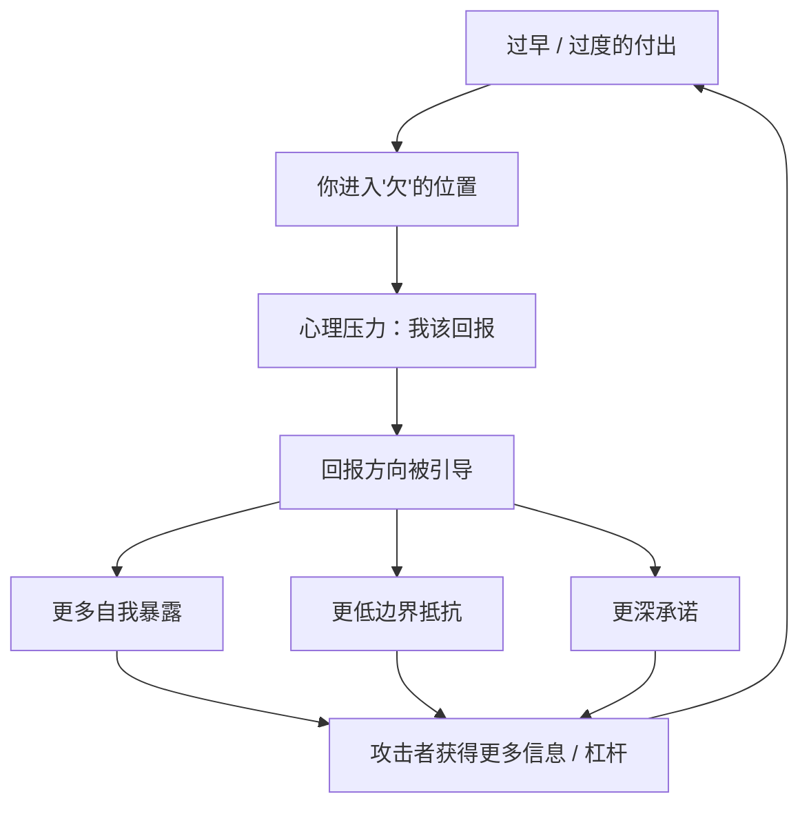
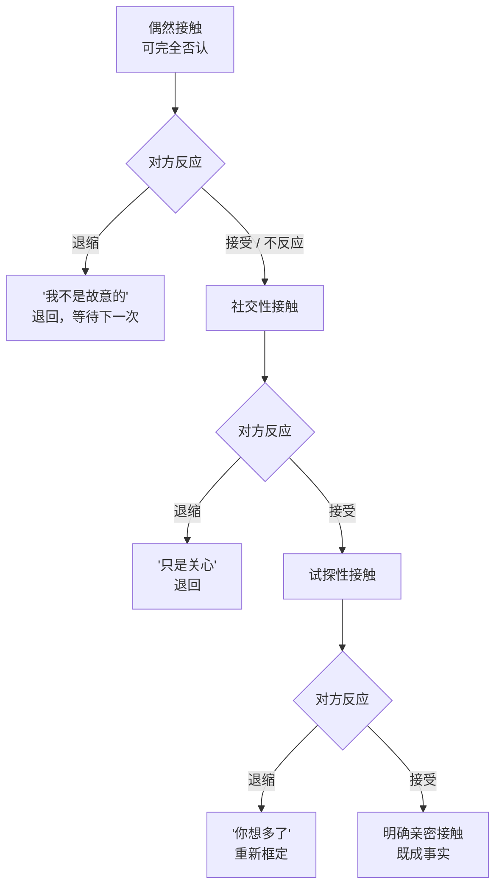

# 第7章 初始互惠与好感建立

这一章讲三样东西：**对你好、懂你、碰你**。

这三样在正常恋爱里都是好东西。对你好是关心，懂你是共鸣，碰你是亲密。但在操控关系里，它们都可以被武器化：对你好变成预付款，懂你变成投喂，碰你变成测试。

这一章会比较细，因为它讲的都是很日常的动作。你可能会在这些描述里看到自己经历过的片段。看清它们的目的，不是让你从此不敢接受别人的好，而是让你在收到"好"的时候，能分辨这是礼物，还是账单。

---

## 7.1 互惠的武器化：过度且过早的付出

### 互惠是一条刻在人性里的规则

互惠原则，说白了就是：**别人对你好，你会想回以善意；别人帮过你，你不好意思害他。**

这条规则深到不需要教。有人替你开门，你会道谢，甚至顺手替下一个人扶住门；同事在你请假时替你代了班，下次 ta 找你帮忙，你多半会调整自己的安排答应。社会学家古尔德纳把互惠称为道德准则里"普遍存在的重要元素"，意思是不管什么文化，这条规则基本都成立。

互惠本身是文明的基石。没有它，合作无法维持，社会早就散了。但正因为它这么深、这么自动，它也很容易被利用。

### 武器化的关键：时机前置 + 剂量放大

互惠的操纵性使用，和正常互惠的区别，不在"对你好"这个动作本身，而在两个变量：**时间点**和**剂量**。

- **时间点前置**：在你还对 ta 没有对等兴趣的时候，ta 就开始密集付出。你还没打算跟 ta 建立什么关系，ta 已经每天早晚问候、记得你所有小事、在你难过时第一时间出现。
- **剂量放大**：付出超过正常社交的分寸。不是顺手帮个忙，而是超额的关注、超额的礼物、超额的"我为你做了很多"。

这两个变量一叠加，你就会进入一个"欠"的位置。你还没想清楚要不要跟这个人发展，但你已经收了一堆好处。人收了好处，就会产生一种心理压力：**我是不是该回报点什么？**

而回报的方式，会被悄悄引导到三个方向：更多的自我暴露、更低的边界抵抗、更深的承诺。

这就是为什么说，这种付出不是"对你好"，而是**在关系账户里预存一笔需要你用自主权偿还的债务**。你以为你收到的是礼物，其实你收到的是预付款；预付款是要还的，而且往往用你不想还的东西还。

### 礼物要"有价值"，还要"不显得是交易"

素材里讲互惠，有几个操作要点，放在恋爱场景里同样成立：

1. **送出的东西得有价值**。廉价的、没用的、明显是敷衍的东西，产生不了受惠感。反过来，越是被你视为有价值的东西——时间、注意力、情绪支持、一条对你有用的信息——越能制造"欠"的感觉。
2. **要制造真正的受惠感**。礼物必须看起来是免费的、不带条件的。一旦对方说"我对你这么好，你欠我的"，受惠感立刻消失，变成反感。所以高明的操作不会把账挂在嘴上，而是让你自己心里记账。
3. **时机到了再提请求**。付出之后，不马上要回报，而是等一个"自然"的时机。比如 ta 刚帮你解决了一个麻烦，过几天再"顺便"提一个请求。这时候你拒绝的成本最高，因为拒绝会显得你"忘恩负义"。

这里有一个很微妙的心理机制：**互惠的压力，往往不是对方施加的，而是你自己施加的。** 对方甚至不需要提要求，你自己就会觉得"我欠 ta 的"。而一旦你有了这个感觉，后面 ta 提的任何要求，你都会先过一遍"我欠不欠 ta"的筛子。

### 怎么分辨"礼物"和"预付款"

有一个很实用的判断方法，看三件事：

1. **你拒绝时，对方的反应**。你拒绝一份好意，对方是轻松接受（"没事，不用客气"），还是明显不高兴、冷脸、说"我一片好心你却这样"？前者是礼物，后者是预付款——因为预付款被拒，意味着交易失败。
2. **你为拒绝付出的解释成本**。你拒绝之后，是不是需要反复解释、反复道歉、反复证明"我不是不领情"？如果拒绝一件小事需要你付出巨大的解释成本，说明这份"好"本身就带着压力。
3. **接受之后的预期**。你接受之后，是不是有一种"下次不好拒绝"的预感？是不是开始担心"ta 会不会觉得我欠 ta"？如果有，说明这份付出在你心里已经被记成了账。

礼物让人温暖，预付款让人紧张。你的身体通常比脑子先知道区别：收到礼物时，你是放松的；收到预付款时，你会有一点点说不清的负担。

### 小练习

回想一次你收到"让你有点压力"的好意（礼物、帮助、密集关注都算）。

记录：

1. 你拒绝时，对方的反应是什么？
2. 你是否为拒绝付出了很高的解释成本？
3. 接受之后，你是否感到一种"下次不好拒绝"的预期？

判断这份付出是**礼物**还是**预付款**。

这个练习不是让你从此拒绝所有好意。好意是关系里最珍贵的东西之一。你要练的是分辨：**这份好，是希望我开心，还是希望我欠着？**

---

## 7.2 喜好原则的滥用：相似性、赞美与熟悉

### 我们天生喜欢"喜欢我们的人"

喜好原则也很简单：**人倾向于喜欢那些喜欢自己的人，也倾向于喜欢和自己相似的人。**

这不是什么阴谋，是正常社交的一部分。别人对你笑，你对 ta 也会客气一点；发现对方跟你喜欢同一支乐队，你会觉得亲切；一个人夸你夸得真诚，你会愿意多聊几句。这些反应都是健康的。

但喜好原则可以被滥用，滥用的标志是：**高浓度、无差别的初期赞美，加上人为制造的相似性。**

### 高浓度初期赞美

正常的赞美，是具体的、有分寸的、跟相处时间匹配的。比如认识一段时间后，对方说"你上次处理那件事的方式，我觉得特别成熟"。

滥用的赞美，是**在极短时间内，给出极高浓度的、几乎是通用的赞美**：

- "你是我见过最特别的人。"
- "我从来没有遇到过像你这样的人。"
- "跟你聊天太舒服了，好像认识了很多年。"
- "你身上有一种别人没有的东西。"

这些话的问题不在于"夸得好听"，而在于**它们出现得太早、太密、太模板化**。你才认识 ta 三天，ta 已经把你捧到了"最特别"的位置。这个位置不是观察出来的，是**投喂**出来的。

被投喂的感觉很好，因为它满足了两件事：被看见、被选中。但你有没有想过：一个认识你三天的人，凭什么觉得你"最特别"？ta 了解你什么？如果 ta 的"最特别"可以这么快说出口，那这个"最特别"的含金量是多少？

### 人为制造的相似性

相似性也一样。正常的相似，是聊着聊着发现的："诶，你也喜欢这个？"而人为制造的相似，是**对方跟着你的话走**：

- 你说你喜欢某个小众乐队，ta 说"我也是，我最喜欢他们的某首歌"。
- 你说你讨厌某种行为，ta 说"我也是，我最受不了这个"。
- 你说你理想中的关系是某种样子，ta 说"这正是我想要的"。

单看每一条都没问题，放在一起就有一个模式：**ta 的"相似"，总是出现在你之后。**

这就是第 5 章讲的镜像。喜好原则里的相似性，是镜像的浅层版本：不需要精确映射你的深层需求，只需要在表面不断附和，就能制造"我们太像了"的感觉。

### 晕轮效应：一个优点照亮整个人

喜好原则还有一个底层机制，叫**晕轮效应**：人们对一个人的某一项突出特质（比如外貌、口才、社会地位）产生好感后，会不自觉地把这种好感扩散到对这个人的整体评价上。

简单说：一个人长得好看，你会觉得 ta 也更聪明、更善良、更可靠；一个人说话好听，你会觉得 ta 也更有能力、更值得信任。这个扩散是无意识的，而且很难完全避免。

素材里提到一个研究，叫《美丽的就是好的》：人们会把外貌吸引力自动延伸到人格、幸福感、职业成就等评价上。营销里到处在用这个：请好看的演员、用有魅力的代言人、把产品和"美好生活"的画面绑在一起。

在恋爱里，晕轮效应的危险在于：**一个突出的优点，会掩盖很多不一致。** 对方很有钱、很会说话、长得很好看、事业很成功——这些优点会让你自动给 ta 的其他方面加分，包括那些你其实观察到了、但不愿意深想的地方。

### 小练习

写一段你收到过（或给出过）的高浓度初期赞美。

把它读三遍。第三遍的时候，问自己：这句话是在描述一个真实的人，还是在制造一种"被选中"的感觉？

判断标准：这句话里有没有**具体的、只属于这个人的细节**？如果有（"你上次说你不喜欢热闹，但你在那个场合照顾了每个人，我觉得这很不容易"），那是观察。如果没有，只有"最特别""从没遇到""不一样"这种通用词，那大概率是投喂。

---

## 7.3 触碰的阶梯化升级

### 手是最会"试探"的部位

在恋爱场景里，手承担着一个很特殊的功能：**试探。**

碰一下手臂、扶一下肩膀、"不小心"碰到手、拨一下头发、拍一下后背——这些动作的共同结构，是**可否认性**。

什么叫可否认性？就是每一次触碰都足够轻、足够短、足够"像意外"，轻到如果对方退缩，可以解释为"我不是故意的"；如果对方接受，就构成下一次更明确触碰的先例。

这个结构非常精巧：它给了发起者两条退路。你退，ta 可以说"你想多了"；你不退，ta 就往前一步。无论你怎么反应，ta 都不必承担"越界"的责任。

### 阶梯：从"偶然"到"明确"

触碰的升级，通常是一个阶梯：

1. **偶然接触**。递东西时碰到手指、走路时肩膀擦过、人多时扶一下手臂。这些都可以解释为意外。
2. **社交性接触**。拍肩膀、碰手臂表示"我懂你"、击掌、搂一下肩。这些在朋友之间也常见，边界模糊。
3. **试探性接触**。碰手停留久一点、拨头发、整理衣领、把手放在你手上。这些已经带有明确的亲密意味，但仍可解释为"关心"。
4. **明确亲密接触**。牵手、搂腰、拥抱、更进一步的接触。到这一步，可否认性基本消失，关系定义被身体先行确认。

这张图最关键的地方，是**每往上一级，可否认性就少一点，而既成事实就多一点**。等到身体已经进入亲密区域，语言层面的关系定义就会显得"跟不上"，你就会不自觉地用"我们都这样了"来解释关系。这就是第 14 章要讲的"制造既成事实"。

### 触碰阶梯是服从测试的非语言版本

上一部分讲服从测试，说的是小请求。触碰阶梯是小请求的**身体版**：观察反应 → 调整幅度 → 再次测试。

它的筛选逻辑和"买花篮"一模一样：

- 你退缩了，ta 知道这条线暂时过不去，可能换个方式再来，也可能判断你"不好推"而降低投入。
- 你没反应（沉默、僵住、假笑），ta 把这当成默许，下一级继续。
- 你主动回应了，ta 知道这条线可以推得更快，于是加速。

特别要注意"沉默"这一种反应。很多人在触碰发生时，会因为惊讶、尴尬、不想把气氛搞僵，而选择"不反应"。但在发起者的解读里，不反应就是接受。你心里的不舒服，ta 读不到；ta 只读到你没躲。

### 边界不是"扫兴"，是"校准"

这里要说一句很重要的话：**在亲密关系里，触碰本身不是问题，问题在于触碰是否被双方自愿、舒适地接受。**

健康的触碰，有一个特征：**它可以被拒绝，而且拒绝不会带来惩罚。** 你说"我现在不想被碰"，对方会停下来，不会冷脸、不会说"你怎么这么敏感"、不会用"我都这么主动了"来让你内疚。

而不健康的触碰，特征是：**它不能被拒绝，或者拒绝的代价很高。** 你一躲，对方就生气；你一说不，对方就说你"装""不解风情""不给面子"。这种反应说明，ta 要的不是"和你亲近"，而是"你必须接受我亲近"。

### 小练习

回想一段你感到"触碰在逐步升级"的互动。

标记每一次触碰的：**位置、时长、以及你的反应**（退缩 / 接受 / 主动回应）。

然后问自己一个问题：**如果我在第一次感到不适的时候就明确后退，后面的升级还会发生吗？**

这个问题不是为了让你后悔，而是为了让你看清一个机制：很多升级之所以发生，不是因为对方"情不自禁"，而是因为你的不适没有被明确表达，被当成了默许。下一次，你可以更早地说出那句"我不太喜欢这样"。

---

## 本章小结

这一章讲了三样被武器化的"好东西"：

1. **互惠**。对你好本身没问题，问题在于"过早 + 过量"。判断标准：你拒绝时的反应、你付出的解释成本、你接受后的"下次不好拒绝"预期。礼物让人温暖，预付款让人紧张。
2. **喜好**。赞美和相似本身没问题，问题在于"高浓度 + 无差别 + 总在你之后"。判断标准：这句话是在描述一个真实的人，还是在制造"被选中"的感觉？有没有具体的、只属于你的细节？
3. **触碰**。触碰本身没问题，问题在于"可否认性 + 不能被拒绝"。判断标准：这段触碰能不能被拒绝？拒绝之后，对方是停下来，还是惩罚你？

最后留一个统一的判断原则：

**健康的"好"，是让你更自由；操控性的"好"，是让你更欠、更依赖、更不敢说不。**

一个人对你好，如果你收下之后觉得轻松、温暖、有力量，那是真的好。如果你收下之后觉得有压力、有负担、有点怕失去，那你收到的可能不是礼物，而是一张账单。

下一章开始第三部分：舒适感建立与信息深化。你会看到，关系里最温柔的时刻——深夜长谈、互相倾诉——也可能是信息采集最密集的时刻。
