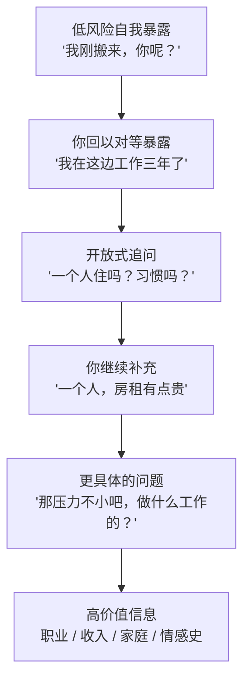
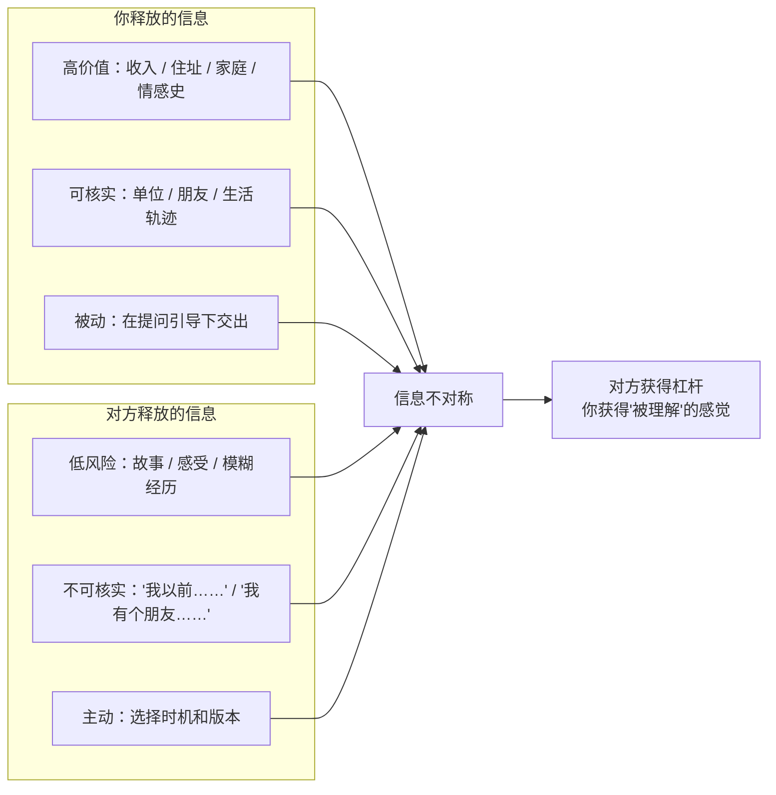
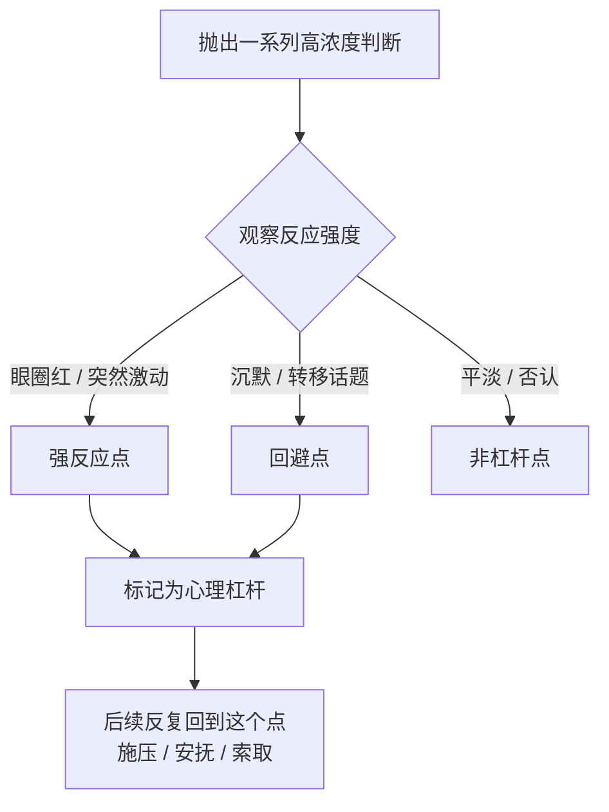

# 第8章 自我暴露的交换结构与信息采集

关系推进到"舒适"阶段，最典型的表现是什么？是你们开始聊一些更深的东西：童年的故事、以前的感情、家里的情况、工作的压力、对未来的打算。你们可能一聊就是半夜，觉得"终于遇到一个能说心里话的人"。

这些时刻是真的美好。但这一章要讲的，是一个不那么美好的角度：**这些"交心"的时刻，也是信息采集最密集的时刻。**

不是所有的深夜长谈都有问题。健康的关系里，互相倾诉是建立亲密的方式，信息是双向流动的。但操控性的关系里，倾诉会被设计成一条**不对称的信息管道**：你越说越多，对方越听越清楚，而你对 ta 的了解，始终停在表面。

这一章讲三件事：ta 怎么让你"自愿"说出信息，信息流向的不对称是怎么形成的，以及当 ta 的信息足够多时，会怎么用它来找到你的软肋。

---

## 8.1 开放式提问与"自然"的信息套取

### 信息收集的进阶形态：让你自己说

第 2 章讲过公开信息收集。那是"你发在网上的东西"。这一章讲的是更高级的形态：**让你在对话里，自愿、主动、愉快地交出来。**

攻击者不会直接问"你收入多少""你上一段为什么分手""你存款大概几位数"。这些问题太直白，会触发警报。他们会把信息需求拆解成一系列看似关心、看似闲聊、看似"我也在跟你分享"的提问。

典型的操作结构是这样的：

1. **先给一个低风险的自我暴露**。比如"我最近刚搬来这个城市，还有点不习惯，你呢，你是本地人吗？"
2. **诱导对等暴露**。你听到对方先说了，会觉得"人家都说了，我也说点吧"，于是回答"我不是本地人，我在这边工作三年了"。
3. **顺势推进到更高价值的信息**。对方接着问"一个人在这边吗？住得还习惯吗？房租贵不贵？"——从"是不是本地人"到"一个人住"到"房租"，每一步都只比上一步深一点点，深到你不好意思说"这个不方便讲"。

这就是一个"漏斗"：上面宽，下面窄；先用中性话题破冰，再用开放式问题展开，最后用更具体的问题把信息引出来。

这个漏斗之所以有效，是因为它利用了**互惠**和**责任感**两个机制：

- 互惠：对方先暴露了，你觉得该回报同等的信息。
- 责任感：对方问了一个问题，你觉得有义务回答，不回答就是不礼貌。

素材里有一个说法很精准："先递话头，制造回应的责任感。"交流中主动先抛信息，会迫使对方回馈同等价值的信息。这不是什么高深技术，就是日常聊天的自然机制。但它可以被有意识地用来采集信息。

### 几种"自然"的套取手法

除了漏斗式提问，还有几种常见的手法，放在恋爱场景里特别隐蔽：

1. **故意说错，让你纠正**。"你们那个行业是不是都挺闲的？"你一听就急了："哪有，我们忙得要死，天天加班到十点。"——你为了纠正一个错误说法，主动交代了工作强度、作息、甚至公司情况。人有一种本能：听到错误表述，就想纠正，好像正确性受到了冒犯。
2. **先亮内行姿态**。对方先抛一点"内行"的信息，让你觉得 ta 懂行，然后你为了"跟上对话"，会主动补充更多细节。"我之前也接触过你们这行，听说某某项目挺难做的？"——你一听对方懂，就放下了戒备，开始讲你知道的。
3. **用"关心"包装问题**。"你最近是不是很累？看你黑眼圈都出来了。"——你为了解释自己为什么累，会说出工作压力、睡眠问题、甚至家庭琐事。
4. **用"自我暴露"换你的自我暴露**。"我跟我前任分手的时候，难受了整整半年。你呢，你上一段是怎么结束的？"——对方先交底，你就觉得该对等回应。

这些手法的共同点，是**把信息需求藏在一个合理的社交动作后面**。你不是被"审问"，你是被"聊天"。聊完之后你甚至觉得挺舒服，因为对方一直在倾听、在回应、在共情。

### 信息采集的起点：那个让你放松警惕的"低风险自我暴露"

所有漏斗都有一个起点：**那个让你放松警惕的低风险自我暴露。**

它可能是一句"我也刚搬来"，可能是一句"我最近心情也不太好"，可能是一句"我这个人不太会跟人打交道"。这句话的作用，是向你证明"我也在敞开"，从而让你觉得"我也可以敞开"。

识别这个起点，是防御信息采集的关键。因为一旦你在这个点上开始对等暴露，后面的漏斗就会自动运转：你说得越多，对方问得越深；对方问得越深，你说得越多。

### 小练习

回看一段你感到"聊完之后对方知道我很多、我知道对方很少"的对话。

画出信息流向图：

- 谁先暴露？暴露了什么层级的信息（浅层：爱好、天气；中层：工作、家庭；深层：创伤、恐惧、情感史）？
- 对方的回应，是**对等暴露**（你说了深层，ta 也说了深层），还是**用问题把你的暴露引向更深**（你说了深层，ta 追问更深）？

标记出信息采集路径的起点——那个让你放松警惕的"低风险自我暴露"。

这个练习的目的，不是让你以后聊天都设防，而是让你看见：**对话的"舒服"，和对话的"对等"，是两件事。** 一场让你很舒服的对话，可能恰恰是信息最不对称的对话，因为对方一直在让你舒服地说。

---

## 8.2 信息流向的不对称性

### 看起来双向，其实单向

舒适阶段的对话，表面上看起来是双向的：你一句我一句，你分享我也分享，你关心我我也关心你。但如果你仔细看信息的**内容**和**可核实程度**，会发现一个结构性的不对称。

具体来说，攻击者获取的信息，远多于 ta 释放的信息。这个不对称体现在三个维度：

1. **深度不对称**。你对 ta 的了解，可能停留在"ta 是做什么的""ta 喜欢什么""ta 说过自己受过伤"。而 ta 对你的了解，可能已经深入到你的情感史、家庭结构、财务习惯、心理软肋。
2. **可核实性不对称**。ta 释放的"个人信息"，往往是低风险的、不可核实的、情感浓度高的——"我以前创业失败过""我被前任骗过""我家里关系不太好"。这些信息听起来很真诚，但你没法查。而你释放的信息，往往是具体的、可核实的、高价值的——你的工作单位、你的收入、你的住址、你的家人情况。
3. **主动性不对称**。ta 的信息，是 ta 选择在什么时候、以什么方式释放的；你的信息，是在对话的引导下，一点一点被动交出来的。

这张图最扎心的地方在最后一行：**对方获得了杠杆，你获得了"被理解"的感觉。** 你以为你们在交换，其实你在付出，ta 在收集；你收获的是情绪价值，ta 收获的是信息资产。

### 为什么"不可核实"的信息反而更动人

这里有一个很反直觉的点：为什么 ta 说的那些"不可核实"的信息，反而让你觉得更真诚？

因为不可核实的信息，往往带有更高的**情感浓度**。一个人说"我在某某公司上班"，这是事实陈述，情感浓度低；一个人说"我从小到大都觉得没人真正理解我"，这是情感陈述，浓度高。高浓度的情感陈述，会激活你的共情，让你觉得"ta 把最脆弱的部分给我了"。

而事实性的、可核实的信息，反而显得"冷冰冰"。所以攻击者会有意多给情感、少给事实，让你在情感上觉得"我们很亲近"，但在事实上对 ta 一无所知。

这就是为什么有些人谈了半年恋爱，回头一想，发现除了对方自己说的那些故事，自己对 ta 的真实生活几乎一无所知：没见过 ta 的同事、没去过 ta 的公司、没见过 ta 的家人、不知道 ta 住哪、不知道 ta 的钱从哪来。所有信息都来自 ta 的口述，而口述是可以编的。

### 信息资产负债表

判断一段关系的信息流向是否健康，有一个很好用的工具：**信息资产负债表。**

拿一张纸，画两栏：

- **左栏（资产）**：你在这段关系里**给出的**高价值信息。你的收入、存款、家庭情况、情感史、心理软肋、住址、工作单位……
- **右栏（负债）**：你**获得的**关于对方的、**可独立验证的**高价值信息。ta 的工作单位（你去过吗？见过同事吗？）、ta 的住址（你去过吗？）、ta 的家庭（见过吗？）、ta 的财务情况（有独立证据吗？）……

然后比较两栏：条目数差多少？可核实比例差多少？

如果左栏显著重于右栏，说明信息流向是单向的。你在这段关系里，是"透明"的一方，而对方是"不透明"的一方。

注意，这里的关键词是"**可独立验证**"。ta 说 ta 有房，不算；你见过房产证、去过那套房，才算。ta 说 ta 在某公司上班，不算；你见过工牌、去过公司、认识同事，才算。口述是信息，但不是可验证的信息。

### 小练习

做一次"信息资产负债表"：

左栏列出你在这段关系中**给出的**高价值信息；右栏列出你**获得的**关于对方的、**可独立验证的**高价值信息。

比较两栏的条目数和可核实比例。如果左栏显著重于右栏，标记这个不对称。

然后问自己一个问题：**这个不对称，是暂时的（因为关系还浅），还是结构性的（对方一直在回避可核实的信息）？**

暂时的，可以随着关系深入慢慢平衡；结构性的，往往意味着对方**不想让你核实**。而一个不想让你核实的人，本身就是一个值得记录的信号。

---

## 8.3 冷读在信息充足时的杠杆定位

### 冷读的两种用法

第 5 章讲过冷读：用模糊、通用、情感浓度高的话，让你自己把内容填满。那时候讲的是冷读在**信息不足**时的用法——维持"懂你"的假象，快速建立亲密感。

这一节讲冷读的第二种用法：**信息充足时的杠杆定位。**

当 ta 已经通过前面的漏斗，收集了足够多的信息，冷读就不再只是"让你觉得被懂"，而是变成了**探测器**：ta 抛出一系列情感浓度高的判断，观察你对哪一个反应最强烈。

你反应最强烈的那个点，就是你的**心理杠杆**。

### 心理杠杆是怎么被找到的

操作方式大概是这样：ta 会在对话里，不经意地抛出一些判断，然后观察你的反应。

- "你是不是从小就觉得，自己必须很懂事，才不会被讨厌？"——你眼圈一红。找到了：你的核心恐惧是"不被需要就被抛弃"。
- "你其实很怕麻烦别人，对吧？"——你愣了一下，然后说"还好吧"，但语气变了。找到了：你的边界是"不能欠人情"。
- "你上一段感情，是不是你付出得比较多？"——你突然激动，开始解释。找到了：你的未完成事件是"付出不被看见"。
- "你看起来好像什么都不在乎，其实心里很在意别人怎么看你。"——你沉默了很久。找到了：你的自我价值依赖外部评价。

注意，ta 不一定每次都"说中"。有时候 ta 是故意说错，看你会不会纠正；你一纠正，就把真实的想法交出去了。这和 8.1 的"故意说错让你纠正"是同一套逻辑，只是目的从"采集信息"变成了"定位杠杆"。

### 杠杆被找到之后会怎样

心理杠杆一旦被定位，后续的操控就会围绕它展开。常见的用法有三种：

1. **施压**。知道你最怕"不被需要"，就在你想离开时说"你走了我怎么办""果然没人会真的留下来"。这句话精准地戳在你的杠杆上，让你走不动。
2. **安抚**。知道你最渴望"被看见"，就在你快要放弃时，突然给你一句"我知道你一直很努力，只有我看得见"。这一句能把你拉回来。
3. **索取**。知道你最怕"欠人情"，就用"我为你做了这么多"来让你无法拒绝。知道你最在意"被认可"，就用"你这样做我才觉得你靠谱"来引导你的行为。

这就是为什么第 15 章要讲"愧疚植入"、第 21 章要讲"间歇性奖赏"——它们都是围绕已经定位好的杠杆来操作的。杠杆本身不是问题，每个人都有软肋；问题是，你的软肋被一个不打算善待它的人掌握了。

### 怎么发现自己的杠杆被定位了

有一个很实用的观察方法：**留意对方是不是反复回到同一个点。**

- 你每次表达不满，ta 都会把话题拉回"你就是太敏感""你就是想太多"。
- 你每次想离开，ta 都会提到"你走了我怎么办""你答应过我的"。
- 你每次取得一点成绩，ta 都会说"你看，还是我当初提醒你吧"。

如果某一个点，被反复地、精准地触碰到，而且每次触碰都让你产生强烈的情绪反应（愤怒、委屈、内疚、被击中），那这个点很可能已经被识别为你的杠杆。

### 小练习

回想一段对话中，对方说了某句话后你反应特别强烈（愤怒、委屈、被击中、突然想哭）。

问自己：

1. 这句话精准地触碰了什么？（你的哪个恐惧、哪个未完成的事件、哪个自我怀疑？）
2. 对方是否在后续互动中，反复回到这个点？
3. 每次回到这个点时，对方是在**安抚**你，还是在**施压 / 索取**？

如果是后者，标记这个点——它可能已被识别为你的心理杠杆。

这个练习不是让你把自己的软肋藏起来。软肋是人之所以为人的部分，不需要藏。你要做的是：**知道自己的软肋在哪里，并且决定谁有资格触碰它。** 一个真正爱你的人，会小心地绕开你的软肋，而不是精准地利用它。

---

## 本章小结

这一章讲了信息采集的三个层面：

1. **开放式提问与漏斗**。信息不是"偷"来的，是让你"自愿"说出来的。漏斗从低风险自我暴露开始，一步步引向高价值信息。识别方法是找到那个让你放松警惕的起点。
2. **信息流向的不对称**。对话看起来双向，实际上你的信息更深、更可核实、更被动；对方的信息更浅、更不可核实、更主动。工具是"信息资产负债表"：比较你给出的和你能独立验证的。
3. **冷读的杠杆定位**。信息充足时，冷读从"制造懂你"变成"探测软肋"。反应最强烈的那个点，就是心理杠杆。识别方法是看对方是否反复回到同一个点，以及回到这个点时是在安抚还是施压。

最后留一个判断问题：

**在这段关系里，你是被了解，还是被采集？**

被了解，是双向的：ta 知道你的故事，你也知道 ta 的故事；ta 了解你的软肋，也愿意让你了解 ta 的。被采集，是单向的：ta 知道你的很多，你对 ta 知道得很少；ta 的"了解"是为了靠近你，还是为了在某个时刻用上它？

下一章，我们讲悲情叙事的升级版：从"我受过伤"到"只有你能帮我"。你会看到，"拯救者"这个角色，是怎么一步步把人锁住的。
