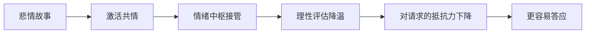
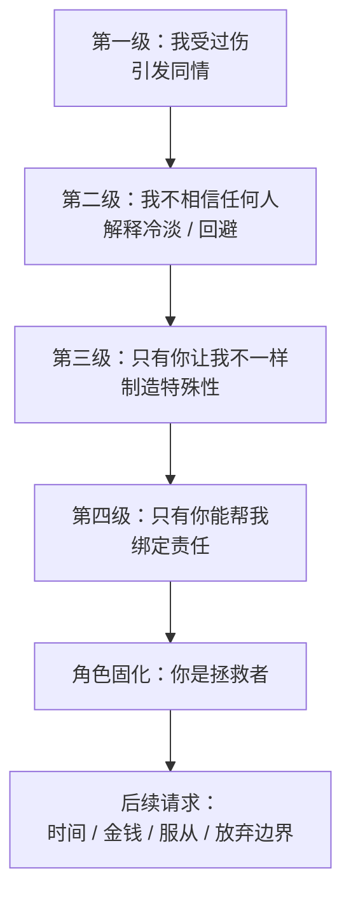
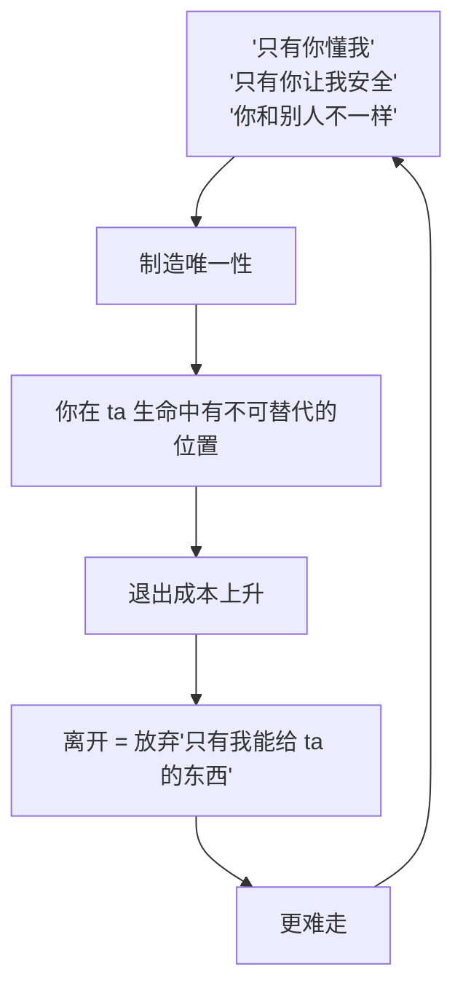
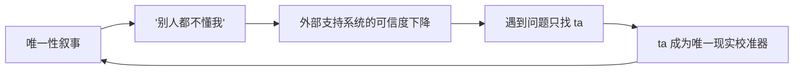

# 第9章 悲情叙事与"拯救者"角色的深化

第 5 章讲过悲情叙事的基本结构：童年创伤、前任背叛、事业挫折，再加上"这是我第一次跟别人讲""只有你让我觉得安全"。那时候讲的是它怎么在吸引阶段制造"被选中"的感觉。

这一章讲它的升级版。悲情叙事不是一次性交付的，而是一个**可以按你的反应逐步加码的阶梯**。你越同情，ta 讲得越深；你越投入，ta 要得越多。到最后，你会发现自己已经不是"在谈恋爱"，而是"在拯救一个人"。

这一章要讲清楚两件事：这个阶梯是怎么一级一级往上走的，以及"特殊性"是怎么把你锁在一个"不能走"的位置上的。

---

## 9.1 悲情叙事的升级：从"受伤"到"只有你能帮我"

### 同情为什么会关掉理性

先讲一个底层机制，理解了它，你就能明白悲情叙事为什么这么有效。

人的大脑在处理信息时，有两条路径：一条是理性的、分析的、慢的；一条是情绪的、本能的、快的。当一个人讲了一个悲惨的故事，激活了你的共情，你的情绪中枢就会接管一部分决策权，理性中枢会暂时"降温"。

素材里有一个很直白的说法：**"故事与共情连起来，理性与逻辑中心立刻被关掉，处理权交给了情绪中枢，决策就基于感觉而非思考。"** 而且，"只要在激发共情后再提请求，许可率会显著提高"。

这解释了一个很多人想不通的现象：为什么平时很精明的人，在感情里会做出明显不理智的决定？不是 ta 变笨了，是 ta 的情绪被激活了，理性暂时退居二线。悲情叙事做的就是这件事：先让你的心软下来，再在你心软的时候提要求。

### 阶梯的四级

悲情叙事的升级，通常有四个台阶：

1. **"我受过伤。"** 这是入口。讲一个过去的创伤：童年、前任、家庭、事业。目的是让你产生同情，觉得"这个人不容易"。
2. **"我不相信任何人。"** 这是加深。告诉你 ta 因为受过伤，所以对所有人都设防，把自己描述成一个"封闭的、难以靠近的人"。目的是让你觉得"ta 的防备是有原因的"，同时也为 ta 后续的冷淡、回避、忽冷忽热提供一个现成的解释。
3. **"只有你让我觉得不一样。"** 这是转折。告诉你 ta 在所有人面前都封闭，唯独对你敞开了。目的是制造"特殊性"，让你觉得自己是那个"例外"，从而产生责任感和优越感。
4. **"只有你能帮我。"** 这是收口。把"你是特殊的"升级成"你是唯一的希望"。目的是把 ta 的困境和你的责任绑定：ta 能不能好起来，取决于你帮不帮。

这个阶梯的关键，不是四级本身，而是**每一级之间的间隔**。好的操控不会一口气讲完，而是隔几天、几周，根据你的反应调整节奏。你反应热烈，ta 就加快；你有点犹豫，ta 就退回上一级，再铺垫一次。

### 每一级都在测试什么

这个阶梯不只是"讲一个更惨的故事"，每一级都在测试一件具体的事：

- 第一级测试：**你会不会同情？** 你同情的程度，决定了 ta 要不要继续。
- 第二级测试：**你会不会接受 ta 的冷淡？** 你接受了"我不相信任何人"，就等于接受了 ta 后续的忽冷忽热、回避、不解释。
- 第三级测试：**你会不会为"特殊性"买单？** 你为"只有你不一样"感动，就等于接受了一个角色：你是 ta 的唯一例外，你有义务维护这个例外。
- 第四级测试：**你会不会承担"拯救"的责任？** 你开始想"如果我不帮 ta，ta 就完了"，你就已经进了拯救者闭环。

这就是为什么很多受害者回头看，会发现自己是"一步一步走进去的"，而不是"一下子被骗的"。因为每一步都只比上一步多一点点，多到你觉得"这没什么""这是应该的"。

### 杀猪盘的两个经典设定

杀猪盘里最常见的两个悲情设定，是"孤儿"和"被前妻骗光家产"。

- **"孤儿"**：无父无母、无依无靠，你是 ta 唯一的温暖。这个设定激活的是你的"照顾欲"和"唯一性"：ta 什么都没有，只有你。
- **"被前妻骗光家产"**：曾经有钱、被最信任的人背叛、现在一无所有。这个设定激活的是你的"同情"和"救赎欲"：ta 不是坏人，ta 只是被伤害过，你可以帮 ta 重新站起来。

这两个设定的功能是一样的：**为后续的资源请求，预装一个道德上难以拒绝的框架。** 当一个人是"孤儿"或"被最亲的人骗过"，你向 ta 要钱，会显得残忍；ta 向你借钱，会显得合理。故事在请求之前发生，作用就是让请求变得"不那么像请求"。

### "您能帮帮我吗"：一句最有穿透力的话

素材里有一句话很值得琢磨：社会工程词汇里，最有穿透力的几个字就是"您能帮帮我吗"。

这句话之所以有穿透力，是因为它同时激活了三样东西：你的同情、你的能力感、你的行动惯性。一个人向你求助，你会本能地想"我能不能帮""我该不该帮"，而"帮"这个动作一旦启动，后续的请求就容易多了。

配合这句话的非语言信号也很重要。素材里提到，求助时的姿态要"低"：声音压低、身体放低、表情适度悲伤，不能挺胸、不能强势、不能过度沮丧。因为**非语言必须和请求的情绪匹配**——一个挺着胸、语气强硬的人说"帮帮我"，你会觉得别扭；一个姿态放低、语气柔软的人说"帮帮我"，你很难拒绝。

这也解释了为什么有些人在关系里特别容易心软：不是 ta 没有原则，而是对方把"求助"的姿态做得太到位了，到位到 ta 的理性来不及启动。

### 小练习

回想一段关系中对方讲述的脆弱叙事。

标记叙事升级的节点：从"我受过伤"到"只有你懂我"到"只有你能帮我"，每一步之间隔了多久？

你当时是否感到一种"被选中"或"被需要"的满足感？这个满足感是否影响了你后续的判断？

然后问一个关键问题：**这个叙事，是在向我求助，还是在给我分配角色？**

求助会尊重你的选择："你能帮就帮，不能帮也没关系。"分配角色会暗示你别无选择："只有你能帮我，你不帮我就完了。"

---

## 9.2 "特殊性"赋予与唯一性制造

### 三句话，一个功能

悲情叙事里，最动人的往往是这几句话：

- "这是我第一次跟别人讲。"
- "只有你让我觉得安全。"
- "你和别人不一样。"

这三句话看起来是在表达感情，实际上在做一个非常具体的操作：**制造唯一性。**

唯一性的心理效果很直接：**提高你的退出成本。**

你想，如果一段关系只是"我喜欢你，你也喜欢我"，那离开的代价是"失去一个喜欢的人"。但如果一段关系是"只有我能让 ta 安心""只有我懂 ta""ta 把最脆弱的部分只给我看"，那离开的代价就变成了"放弃一个只有我能给 ta 的东西"。

后者比前者沉重得多。因为你离开的不只是一段感情，还是一个"我是特别的、我是被需要的、我是无可替代的"的身份。人对身份的执念，往往比对感情的执念更深。

### 特殊性 vs 角色分配：一个关键的区分

"特殊性"这句话，有可能是真的，也有可能是角色分配。区别在哪里？

**真正的特殊性，是关于你的具体特质的。**

- "你处理问题的方式很稳，我遇到事的时候特别想听你的意见。"——这是在描述你的一个具体特质。
- "你笑起来眼睛弯弯的，我第一次见就觉得亲切。"——这是在描述你的一个具体特征。
- "你对朋友特别仗义，我很少见到这样的人。"——这是在描述你的一个具体行为模式。

**角色分配式的特殊性，是关于你在 ta 生命中的功能的。**

- "只有你能让我安心。"——这是在说你的功能：安抚 ta。
- "只有你懂我。"——这是在说你的功能：理解 ta。
- "你是我唯一的依靠。"——这是在说你的功能：支撑 ta。

前者是"我看见了你这个人"，后者是"我需要你扮演这个角色"。前者可以随着关系变化而更新（你变了，ta 依然能看见新的你）；后者是固定的（你只要不扮演这个角色，你就"不爱 ta 了"）。

### 唯一性还会切断你和别人的连接

唯一性还有一个更隐蔽的功能：**它暗示"别人都不行"。**

"只有你懂我"的潜台词是："别人都不懂我。"
"只有你让我安全"的潜台词是："别人都让我不安全。"
"你和别人不一样"的潜台词是："别人都一样，都不值得。"

这些潜台词一旦被你接受，你就会不自觉地**贬低外部支持系统的价值**。你会觉得：我朋友的建议不靠谱，我家人不理解我，只有 ta 懂我。于是，你遇到问题时，越来越不愿意找朋友、找家人，只想找 ta。

这就是第 13 章要讲的"社交隔离"的入口。它不需要明着说"你别见你朋友"，它只需要让你相信"只有我懂你"，你就会自己把别人推开。

### 为什么"被需要"这么难拒绝

最后讲一个心理机制：**"被需要"是一种很强的情感奖赏。**

人都希望自己是有价值的、是被需要的。当一个人告诉你"只有你能帮我""没有你我不行"，你会获得一种强烈的价值感：我很重要，我不可替代。这种感觉太美好了，美好到你会为了维持它，不断付出更多。

而操控者要的，就是这个。ta 不需要真的依赖你，ta 只需要让你**觉得** ta 依赖你。因为"被需要"的感觉，会让你主动留下、主动付出、主动放弃自己的边界。

健康的爱里也有"被需要"，但它是双向的：你需要我，我也需要你；我帮了你，你也帮了我。操控性的"被需要"是单向的：你被需要，ta 被服务；你付出，ta 接受；你想走，ta 就说"你走了我怎么办"。

### 小练习

写下你在关系中被赋予的"特殊性"语句。

对每一句问：这个"特殊"，是关于**你的具体特质**，还是关于**你在 ta 生命中的功能**？

- "只有你能让我安心"——功能。
- "你处理事情很稳，我很信任你的判断"——特质。
- "你是我唯一的依靠"——功能。
- "你特别会照顾人，这点我很欣赏"——特质（但要注意，如果 ta 只欣赏你"照顾人"这一面，那也接近功能）。

前者是关系，后者是角色分配。角色分配不是一定有问题——人在亲密关系里本来就会互相扮演一些角色。但如果你发现，ta 对你的"特殊"**只**集中在你的功能上，而且这个功能是单向服务 ta 的，那就值得警惕了。

---

## 本章小结

这一章讲了两件事：

1. **悲情叙事会升级**。从"我受过伤"到"我不相信任何人"到"只有你让我不一样"到"只有你能帮我"，每一级都在测试你愿意承担多少拯救者的角色。底层机制是：共情激活后，理性评估降温，请求更容易被答应。
2. **特殊性制造唯一性**。唯一性提高退出成本，让你觉得离开就是"放弃一个只有我能给 ta 的东西"。区分真假特殊性的标准是：它关于你的具体特质，还是关于你在 ta 生命中的功能？

最后留一个判断问题：

**你在这段关系里，是被爱，还是被需要？**

被爱是：ta 看见你这个人，包括你的好和你的不好；ta 希望你过得好，哪怕这意味你不总围着 ta 转。
被需要是：ta 需要你扮演一个角色——拯救者、安抚者、唯一理解者；你只要不演这个角色，ta 就说你"变了""不爱 ta 了"。

被需要的感觉很像被爱，因为它也让你觉得自己重要。但被爱让你更自由，被需要让你更累。分辨它们，是这一章最想留给你的一件事。

下一章，我们讲承诺一致性的阶梯化利用。你会看到，"你答应过我的"这句话，是怎么被用来把一个个小承诺，变成一条你解不开的链条。
