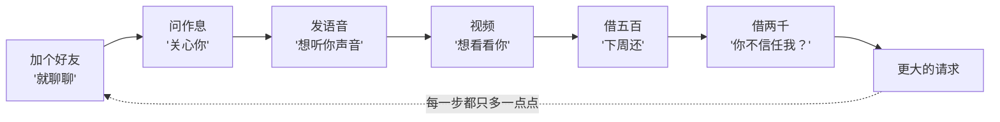
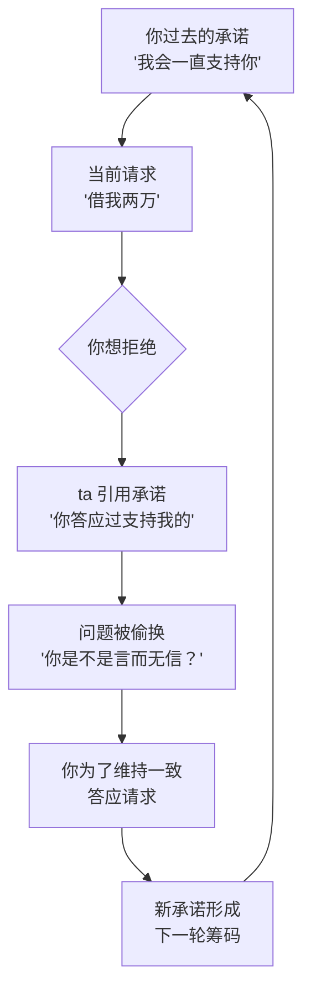
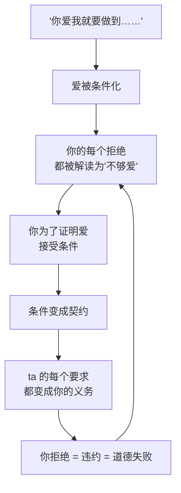
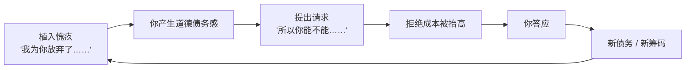

# 第10章 承诺一致性的阶梯化利用

这一章讲一个特别容易被低估的机制：**承诺。**

你可能觉得，承诺是好事。两个人说好了要好好在一起、要互相信任、要坦诚相待——这些承诺让关系稳定。没错，健康的承诺是关系的黏合剂。但承诺也可以被武器化：**它能把一个个小答应，变成一条你解不开的链条。**

这一章讲三种操作：同意链、契约、愧疚植入。它们的共同逻辑是：不直接要求你做大决定，而是让你在一步步的小同意里，自己走到一个"不好反悔"的位置。

---

## 10.1 同意链：从"只是聊聊"到"不可拒绝"

### 不要求"大的服从"，而是设计"每一步都合理"的链条

攻击者很少直接说"你要听我的""你要给我钱""你要跟我在一起"。这些要求太大，会触发警报。

他们用的是另一种方式：设计一条**同意链**。链条上的每一步，单独看都合理、都小、都不好意思拒绝；但连起来看，方向是明确的——把你从"只是聊聊"带到"不可拒绝"。

一条典型的同意链长这样：

1. "加个好友呗，就聊聊。"——合理，拒绝显得你很高冷。
2. "你平时几点睡？我晚上找你聊天。"——合理，关心你的作息。
3. "你声音挺好听的，发个语音呗。"——合理，聊天的自然升级。
4. "我们视频一下吧，我想看看你。"——合理，关系升温的自然一步。
5. "我最近手头有点紧，你能先借我五百吗？下周还你。"——到这里，你已经答应了前面四步，第五步拒绝起来就有心理成本了。
6. "五百不够，能不能再借两千？"——你已经借了五百，不借两千好像显得你不信任 ta。
7. ……

每一步都只比上一步多一点点，多到你来不及问"我们到底在往哪走"。等你回头看，你已经在第十步了，而第一步的"就聊聊"，早就不知道去哪了。

### 五步陷阱的"着迷陷阱"：让你自己表白

在恶性 PUA 的五步陷阱里，第三步叫"着迷陷阱"，核心操作非常典型：**不主动表白，而是暗示目标表白。**

为什么不自己表白？因为"我表白"是我在追求你，"你表白"是你做出了承诺。一旦你表白了，你就把自己放在了一个"我已经选择了 ta"的位置上。这个位置，就是后续所有要求的锚点。

你表白之后，ta 会做一件事：**把这个承诺"契约化"。**

不是简单地说"那我们在一起吧"，而是开始强调条件："你爱我，那你就必须对我坦诚，不可以骗我……你能做到吗？"

注意这个句式："你爱我，那你就必须……你能做到吗？"

它做了三件事：

1. 把你的表白（一个情感表达）转化成了一份**契约**（一组义务）。
2. 把具体的义务（坦诚、不骗、报备、随叫随到）包装成"爱的证明"。
3. 用"你能做到吗"逼你给出一个**明确的"能"**。

你一旦说了"能"，这份契约就成立了。后续 ta 提任何要求，都可以引用这份契约："你当初答应过我的。"

### 承诺一致性的杠杆：用你过去的承诺，压你现在的拒绝

承诺一致性原则，是社会心理学家恰尔迪尼提出的影响力原则之一。用大白话说：**人一旦做出了某个承诺、表明了某个立场，就会倾向于让后续行为与前面的承诺保持一致。**

这个倾向本身是健康的。一个言行一致的人，是可靠的、值得信任的。但正因为它这么强，它也可以被用来施压。

操作方式很简单：当你想拒绝一个当前请求时，ta 不跟你讨论这个请求本身，而是引用你**已经做出的承诺**：

- "你之前说过会一直支持我的。"
- "你答应过我要坦诚的，现在你连这个都不肯告诉我？"
- "你说过你爱我，爱一个人连这点事都不愿意做吗？"
- "你当初说会陪我的，现在你要走？"

这时候，你面对的已经不是"这个请求合不合理"，而是"我是不是一个言而无信的人"。而后一个问题，比前一个问题难回答得多。因为拒绝请求只是拒绝一件事，违背承诺却是否定自己的人格。

这就是承诺一致性最厉害的地方：**它把"拒绝一件不合理的事"，偷换成了"做一个不守信用的人"。**

### 小练习

画一条你近期经历过的"同意链"：从第一个你轻松答应的小请求开始，到最近一个让你感到压力的请求。

每一步旁边写：**我当时同意的真实原因**——是想要？是不好意思拒绝？是怕冲突？是觉得"这没什么"？

然后问自己：**如果我在第三步就说"不"，后面的链条还会发生吗？**

这个练习的目的，不是让你后悔，而是让你看清：链条的强度，来自每一步的"太小了，不值得拒绝"。而破解链条的方法，也恰恰在这里——**在它还小的时候说不。** 第三步的"不"，比第十步的"不"容易得多。

---

## 10.2 "契约"操作与条件化承诺

### 把要求翻译成"你的道德义务"

"契约"操作，是同意链的进阶版。它不只是让你一步步答应，而是把一系列要求**打包成一份契约**，让你的拒绝变成"违约"。

典型的契约话术是这样的：

- "你爱我，就要对我坦诚，不能有任何秘密。"
- "你爱我，就要把我放在第一位，朋友家人都要往后排。"
- "你爱我，就要接受我的一切，包括我的脾气。"
- "你爱我，就要为我改变。"
- "你能做到吗？"

这套话术的核心，是**条件化承诺**：把"爱"这个抽象的情感，拆解成一连串具体的、可检验的条件。你答应了这些条件，才算"爱"；你不答应，就是"不够爱"。

于是一个很微妙的转换发生了：**原本是 ta 在向你提要求，现在变成了你在证明自己。** ta 要你报备行踪，不是 ta 控制欲强，而是"你不坦诚"；ta 要你疏远朋友，不是 ta 想隔离你，而是"你不把 ta 放第一位"；ta 要你忍受坏脾气，不是 ta 不愿改，而是"你不能接受 ta 的一切"。

### 契约的隐蔽之处：它把"要求"变成了"你答应过的事"

契约操作最隐蔽的地方，是它让**施压变得理直气壮**。

在正常关系里，一个人反复提要求，另一方会觉得"你怎么这么多要求"。但在契约关系里，ta 不需要"提要求"，ta 只需要"提醒你履行承诺"。

- "你不是答应过我要坦诚吗？"
- "你不是说过会支持我吗？"
- "你不是说爱我吗？"

每一句都站在道德高地上，每一句都让你无法反驳。因为你确实说过。你只是没想到，你当初说的"爱"，会被解释成这么多具体的义务。

这就是为什么第 10.1 节要强调"逼你给出明确的能"。因为一个模糊的"我爱你"，可以被解释成任何东西；一个明确的"我能做到"，就是一份签了字的合同。

### 契约的重新解释

还有一种更隐蔽的操作，是**对承诺的重新解释**。

你当时答应的，可能是"我会尽量抽时间陪你"；ta 现在引用的版本，变成了"你答应过我随叫随到"。
你当时答应的，可能是"我不会主动骗你"；ta 现在引用的版本，变成了"你任何事都必须告诉我"。
你当时答应的，可能是"我愿意跟你一起努力"；ta 现在引用的版本，变成了"你答应过不会离开我"。

注意，ta 引用的不是完全的捏造，而是**对你原话的夸张、扩大、扭曲**。这种扭曲很难反驳，因为它保留了你原话的"影子"，你很难说"我没说过"，只能说"我不是这个意思"——而"我不是这个意思"这种辩解，在 ta 那里很容易被反驳成"你就是想反悔"。

### 小练习

回想一次对方以"你之前说过 / 你答应过"为由向你施压的情境。

问自己：

1. 我当时"答应"的具体内容是什么？
2. 对方现在引用的版本，和我当时理解的一致吗？
3. 如果不一致，我是怎么回应这个不一致的？是解释了，还是直接妥协了？

如果不一致，这个**承诺的重新解释**就是契约操作的痕迹。

这个练习的关键，是把"我答应过"和"我答应过你说的那个版本"分开。很多时候，你不是不守承诺，而是对方在扩大承诺的范围。看清这一点，你就不那么容易因为"我答应过"而无限让步了。

---

## 10.3 愧疚植入作为服从的前置杠杆

### 在请求之前，先制造一笔"道德债务"

愧疚植入，是承诺操作的配套技术。它的逻辑是：**在提出请求之前，先让你觉得"欠 ta 的"。**

常见的句式有：

- "我为你放弃了那么多……"
- "我因为你才跟我家里闹翻的。"
- "你上次那样说我，我难受了好几天。"
- "我为了陪你，推掉了很重要的机会。"
- "我从来没对别人这样过，只有对你。"

这些话的共同点，是**在请求发出之前，就把拒绝的成本抬高了**。等你听到真正的请求时，你已经背着一笔"道德债务"，拒绝起来就难了。

### 愧疚植入的隐蔽性：素材往往是真的

愧疚植入最厉害的地方，是它用的素材**往往是真的**。

ta 确实为你推掉了一个机会，确实因为你跟家里吵过架，确实在你身上花了很多时间。这些事都真实发生过，所以你没法说"你在编"。

但问题不在于"事情有没有发生"，而在于**这件事被怎么叙述、怎么归因**。

举个例子：ta 本来就不想去那个聚会，正好你那天需要人陪，ta 就留下来陪你。这件事的真相是"ta 做了一个对自己也不亏的选择"。但在愧疚植入的叙述里，它变成了"我为了你，放弃了我很重要的社交"。

再比如：ta 跟家里关系本来就不好，正好因为你的事跟家里起了冲突。真相是"冲突是长期矛盾的爆发"。但在叙述里，它变成了"我因为你，跟家里闹翻了"。

这就是愧疚植入的核心操作：**把 ta 的自主选择，重新叙述成"为你做出的牺牲"。**

一旦这个叙述被你接受，你就欠了 ta 一笔本不该你欠的债。

### 为什么"我欠 ta 的"这么难摆脱

因为"欠"是一种道德状态，不是一种经济状态。

钱债可以还清，道德债很难。你帮 ta 做一件事，ta 可以说"这还不够"；你付出更多，ta 可以说"你本来就该这样"；你想离开，ta 可以说"你欠我的还没还完"。

更麻烦的是，道德债没有账本。你没法核对"我到底欠多少"，只能由 ta 来定义。ta 说你欠，你就欠；ta 说还不够，你就还得继续还。这就形成了一个无底洞。

### 小练习

回想一次你因为"觉得欠对方"而答应的请求。

拆解这个"欠"是怎么被制造出来的：

1. 对方引用了什么事件？
2. 这个事件，是 ta 的**自主选择**，还是**你主动请求的**？
3. 如果是 ta 的自主选择，ta 是怎么把它重新叙述成"为你牺牲"的？

如果是前者，ta 把自主选择重新叙述为"为你牺牲"的这一步，就是愧疚杠杆的支点。

这个练习不是让你变得不知感恩。别人为你付出，你当然应该珍惜。你要分辨的是：**这份付出，是 ta 自愿给的礼物，还是 ta 事后拿来记账的筹码？** 礼物不需要你永远偿还，筹码会跟着你一辈子。

---

## 本章小结

这一章讲了承诺的三种武器化方式：

1. **同意链**。不要求大的服从，而是设计一条每一步都合理的链条。破解方法：在它还小的时候说不。第三步的"不"，比第十步的"不"容易得多。
2. **契约**。把"爱"条件化，把要求翻译成你的道德义务。你拒绝任何具体请求，都变成"违约"。识别方法：分清"我答应过"和"我答应过你说的那个扩大版"。
3. **愧疚植入**。在请求之前制造道德债务，把 ta 的自主选择重新叙述成"为你牺牲"。识别方法：看这个"牺牲"是 ta 自己选的，还是你请求的。

最后留一个判断问题：

**你答应的事，是你真的愿意，还是你不敢不答应？**

愿意，是因为这件事本身你想做；不敢不答应，是因为拒绝会带来愧疚、冲突、被说"不守信用"。前者是选择，后者是服从。

健康的关系里，承诺是两个人一起往前走的约定，可以商量、可以调整、可以重新谈。操控性的关系里，承诺是一份单方面拟定的合同，条款由 ta 解释，违约的后果由你承担。分清这两种承诺，你就知道哪些"你答应过"是真的，哪些只是被拿来压你的。

下一章，我们讲非语言层面的舒适感管理。你会看到，攻击者不只会用语言推进关系，还会用姿态、节奏、沉默，把你带到一个"不知不觉就跟上了"的位置。
