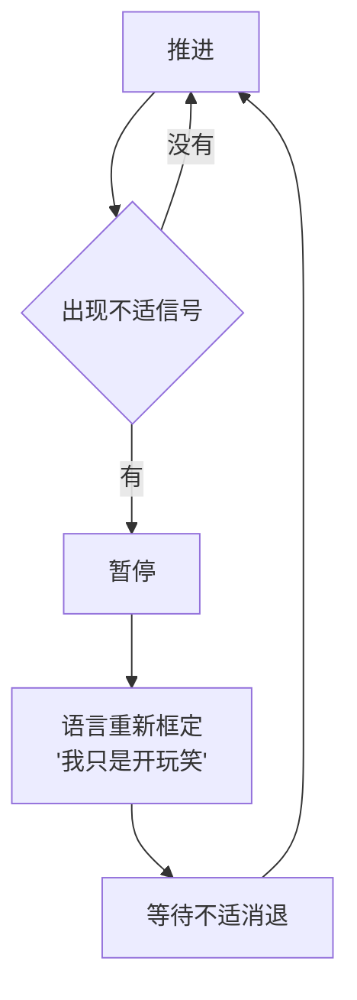

# 第11章 非语言层面的舒适感管理

第 6 章讲了怎么"读"非语言信号。这一章讲另一面：**怎么"管"非语言信号。**

在操控关系里，舒适感不是自然产生的，而是被管理的。攻击者会实时读取你的舒适/不适信号，调整自己的姿态、距离、语速、节奏，把你带到一个"不知不觉就跟上了"的位置。你觉得自己是自然放松的，其实你的放松是被引导出来的。

这一章讲三个层面：怎么读取和校准舒适信号、怎么用同步和节奏带你走、以及人类情感处理器为什么这么容易被利用。

---

## 11.1 舒适与不适信号的读取与校准

### 两组信号

在关系互动里，舒适和不适是攻击者最需要实时读取的两组信号。

**舒适信号**包括：身体放松、朝向对方、自然的目光接触、开放的姿态、呼吸平稳、笑容自然、脚尖朝向你、愿意延长互动。

**不适信号**包括：身体后缩、交叉手臂、避免眼神、假笑、脚朝向出口、摸脖子、揉脸、咬唇、遮眼、频繁看手机或看表、回答变短、找理由离开。

这些信号本身不神秘，第 6 章已经讲过。这一节要讲的是攻击者**怎么处理**这些信号。

### 关键不在于"消除不适"，而在于"重新校准"

很多人以为，操控就是"让对方一直舒服"。不完全是。高手的技术不在于"消除不适"，而在于**在不适信号出现后重新校准**。

具体来说，是三步：

1. **暂停**。你一后退，ta 就停一下，不继续推进。
2. **重新框定**。ta 用语言把刚才的动作解释掉："我只是开个玩笑""我没别的意思""你别想太多"。
3. **等待消退，再继续**。等你放松了，ta 再换个方式推进。

这个循环看起来很体贴，对吧？你一说停，ta 就停；你一不舒服，ta 就解释。但如果你把整个循环拉长看，会发现一个问题：**它没有终点。**

不适出现了，暂停，解释，等你放松，继续；又不适了，再暂停，再解释，再继续。每一次循环，边界都被往前推了一点点。你以为 ta 在尊重你的边界，其实 ta 在**测试你的边界能推到哪**。

这就是为什么"我只是开玩笑"这句话值得警惕。它不一定是在道歉，也可能是在**给越界找一个可否认的包装**。你说"我不喜欢这个玩笑"，ta 说"你太敏感了，我就是开个玩笑"——话题从"ta 越界了"变成了"你是不是太敏感"。下一次，ta 还会开类似的玩笑，因为你没有真正制止，只是表达了一下不舒服。

### 可检测的痕迹：信号出现之后发生了什么

判断一段互动是否健康，有一个很具体的观察点：**不适信号出现之后，互动是暂停了、被重新框定了、还是被无视并继续推进了？**

- **暂停了**：ta 停下来，问你"还好吗""我是不是说到你不舒服的地方了"，然后真的调整。这是尊重。
- **被重新框定了**：ta 用"开玩笑""你想多了""我不是那个意思"把问题解释掉，然后继续。这是**部分尊重**——表面上停了，实际上没有真正承认边界。
- **被无视并继续**：ta 根本没注意到，或者注意到了但不在乎，继续说、继续做。这是**不尊重**。

如果"无视并继续"的模式反复出现，或者"重新框定"之后总是很快又回到同一个越界点，那这个模式就值得标记了。

### 小练习

连续一周，记录你在关系中观察到的不适信号（对方的或你自己的）。

对每一个信号标注：**信号出现后，互动是暂停了、被语言重新框定了、还是被无视并继续推进了？**

如果"无视并继续"的模式反复出现，或者"重新框定"之后总是很快又回到同一个点，标记这个模式。

这个练习不是让你去挑对方的刺，而是让你看见：**一个人的"体贴"，是体现在"你一说停 ta 就真的停"，还是体现在"你一说停 ta 就解释然后继续"。** 前者是尊重，后者是管理。

---

## 11.2 诱导中的非语言同步

### 同步：让你觉得"我们很合拍"

诱导不只是语言技术，也是一套非语言操作。其中最基本的一种叫**同步**（mirroring / pacing）：匹配对方的呼吸节奏、身体姿态、语速、音量、动作幅度。

同步之所以有效，是因为人天生偏好与自己相似的人。当一个人的呼吸、语速、姿态和你接近时，你会产生一种无意识的亲近感，觉得"跟这个人在一起很舒服""我们节奏很合"。

素材里讲得很细：镜像不只是模仿肢体语言，还包括模仿手势；但要注意分寸，不能完全复制，要"模仿，但不要完全相同"。比如对方思考时总把手放下巴，你可以把手放在脸的一侧，或者用手指轻敲几下下巴作为呼应。对方双臂交叉，你不要直接复制（可能被解读为对抗），可以只抱起一只手臂，做出类似的姿态。

这套技术本身是中性的。心理咨询师、销售、谈判者都在用。区别在于目的：如果目的是让对方放松、建立信任，那是专业的共情；如果目的是降低对方的防御、把对方带到自己想要的位置，那就是操控。

### 节奏控制：在你放松时推进，在你紧绷时后退

同步的进阶版，是**节奏控制**。

攻击者会根据你的舒适度，调整推进的速度：

- 你放松的时候，ta 加快：多聊一点、靠近一点、提一个稍微大一点的请求。
- 你紧绷的时候，ta 放慢：后退一点、换个轻松的话题、给你一点空间。
- 你快要不耐烦的时候，ta 收住：说"今天先到这吧"，给你留一个"下次还想聊"的钩子。

这套节奏管理，让你始终处于一个"稍微被推着走，但又不至于反抗"的区间。就像游泳时有人在水里轻轻托着你，你觉得是自己游的，其实方向是别人定的。

杀猪盘的"七天剧本"也是这样。它不只规定说什么，还规定什么时候发照片、什么时候"自然地"沉默、什么时候用语音而不是文字。这些节奏安排的共同目的，是让你觉得"关系在自然地发展"，而不是"有人在按表推进"。

### 可检测的痕迹：节奏是不是跟着你的舒适度走

判断一段对话是否被"节奏管理"了，有一个很具体的观察方法：**回放这段对话，看对方的语速、停顿、姿态，是不是在你放松时加快、在你紧绷时放慢。**

如果是，而且这种"跟随"精准得不像自然反应，那这就是诱导性同步的可检测痕迹。

自然的互动里，节奏是双方共同塑造的，会有错拍、会有尴尬、会有"我没跟上你"的时刻。而被管理的互动里，节奏总是"刚刚好"：你刚要烦，ta 就停；你刚放松，ta 就进。太顺了，顺得不像两个独立的人。

### 小练习

选一段你感到"被带着走"的对话（可以是聊天记录，也可以是回忆）。

回放：对方的语速、停顿、身体姿态，是否在**你放松时加快**、在**你紧绷时放慢**？

这个"节奏跟随你的舒适度"的模式，是诱导性同步的可检测痕迹。

这个练习的目的，不是让你怀疑每一次顺畅的对话，而是让你对"太顺"保持一点敏感。真正健康的关系，不需要一个人精准地管理另一个人的节奏；它允许两个人偶尔不同步，也允许有人说"等等，我跟不上"。

---

## 11.3 人类情感处理器的可利用特征

### 大脑里有一个"快速通道"

我们读取非语言信号，依赖的是一套快速、自动、无意识的系统。素材里把它叫"人类情感处理器"，核心是大脑里的扁桃体（杏仁核）。

这套系统的特点是**快**。研究显示，刺激出现后 50 到 150 毫秒内，扁桃体就被激活，而负责理性思考的皮层通常需要 200 到 300 毫秒。也就是说，**你的情绪反应，比你的思考快了一步。**

这个设计在进化上是有用的：看到蛇，先躲，再想"那是不是蛇"。但在人际互动里，它意味着：你对一个人的判断，很大一部分是在你"想清楚"之前就已经形成了。

这套系统有两个可被利用的特征：

1. **对熟悉感的偏好**。重复接触会提高好感（第 3 章的曝光效应）。
2. **对情感一致性的敏感**。当语言和非语言信号冲突时，人们倾向于相信非语言信号。

### 特征一：熟悉感可以被制造

第一个特征，我们在第 3 章讲过：见得多了，就会喜欢。攻击者可以通过制造接触频率，加速熟悉感。

这里补充一点：熟悉感不只来自"见面次数"，还来自"互动模式"。如果一个人每天在固定时间找你、用固定的语气、说固定类型的话，你的大脑会很快把 ta 归类为"熟悉的、安全的"。这种熟悉感是**被节奏制造出来的**，不是关系自然积累的。

### 特征二：身体"不会说谎"，但可以被表演

第二个特征更微妙：当语言和非语言信号冲突时，人们倾向于相信非语言信号。

这本来是一个有用的本能。一个人嘴上说"我没事"，但身体紧绷、眼神躲闪，你会本能地觉得"ta 有事"。这个本能帮你读到了语言掩盖的东西。

但攻击者可以反过来利用它：**通过控制非语言信号，来"证明"语言的可信度。**

比如，一个人嘴上说"我很在乎你"，同时配合柔和的眼神、前倾的姿态、放慢的语速——你的大脑会把"身体语言"当成"真心"的证据，觉得"ta 的身体不会说谎"。

问题是，身体语言是可以被训练、被表演的。演员、销售、骗子都在练这个。一个训练过的人，可以让你看到"真诚的身体语言"，而那份真诚是设计出来的。

### 扁桃体劫持：先共情，再提要求

素材里有一个很精炼的公式：**感官输入触发共情 + 逻辑中枢关闭 = 扁桃体被劫持 + 提出要求。**

翻译成大白话：先用一个故事、一个表情、一个姿态，激活你的共情；共情一激活，你的理性评估就会降温；这时候再提要求，你答应的概率会显著提高。

这个公式在恋爱里的版本是：

1. 先讲一个悲惨的故事（悲情叙事）。
2. 配合适度的悲伤表情、放低的姿态、放缓的语速（非语言一致）。
3. 在你共情被激活的时候，提出请求（借钱、同居、放弃某个边界）。

这就是为什么第 9 章说"同情会关掉理性"。不是你不够聪明，是这套机制在所有人身上都生效。防御的方法不是"不要有共情"——那不可能，也不必要——而是**在共情被激活的时候，给自己按一个暂停键**。

具体怎么做？当你发现自己被一个故事打动、心里一软、想立刻答应什么的时候，先做一件事：**把决定推迟。**

"我需要想一下。"
"这事我明天回复你。"
"我先看看我的情况。"

这个暂停不需要理由，也不需要道歉。它的作用，是让你的理性评估有时间重新上线。共情是好事，但共情之后做的决定，最好等理性回来再确认一遍。

### 小练习

回想一次你感到"对方的语言很好，但身体让我不舒服"的互动。

记录：

1. 你的身体捕捉到了什么？（紧绷？后退？胃部不适？想快点结束？）
2. 你当时相信了语言，还是相信了身体？
3. 事后看，哪个更准确？

这个练习的目的，是校准你对非语言信号的信任。你的身体往往比你的嘴更早知道"哪里不对"。学会听它，但不要只靠它——身体给的是警报，理性做的是核实。两者结合，才是完整的判断。

---

## 本章小结

这一章讲了非语言层面的三种管理技术：

1. **舒适/不适信号的校准**。关键不在于"消除不适"，而在于"不适出现后暂停、重新框定、等待消退再继续"。可检测的痕迹是：信号出现后，互动是暂停了、被重新框定了，还是被无视并继续了？
2. **同步与节奏控制**。匹配你的呼吸、姿态、语速，制造"合拍"的感觉；在你放松时推进，在你紧绷时后退。可检测的痕迹是：节奏是不是精准地跟着你的舒适度走，顺得不像两个独立的人。
3. **人类情感处理器的利用**。熟悉感可以被制造，身体语言可以被表演，共情可以关闭理性。防御的核心动作是：在共情被激活、想立刻答应的时候，把决定推迟。

最后留一个判断问题：

**在这段关系里，你的"舒服"，是你自己感觉到的，还是被引导出来的？**

健康的舒服，是你可以随时说"不"、随时离开、随时慢下来，而关系依然成立。被管理的舒服，是你只能在对方设定的节奏里舒服；你一偏离，关系就出问题。

分不清的时候，做一件事：**故意慢下来。** 推迟一个决定、拒绝一个小请求、隔一天再回复。看对方的反应。一个尊重你的人，会接受你的慢；一个管理你的人，会因为你的慢而焦虑、施压、或者换一种方式催你。

下一章开始第四部分：着迷与服从建立。你会看到，"太快"本身就是一个信号，而"爱情轰炸"是怎么在你还来不及思考的时候，就把你绑定的。
