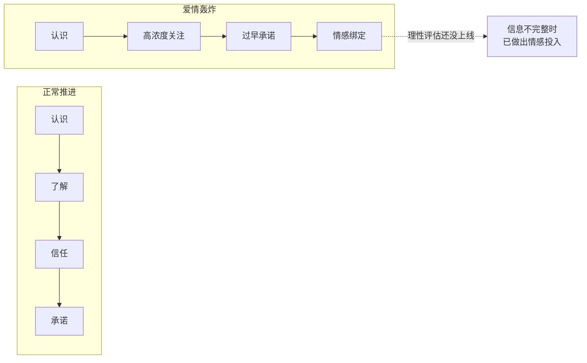
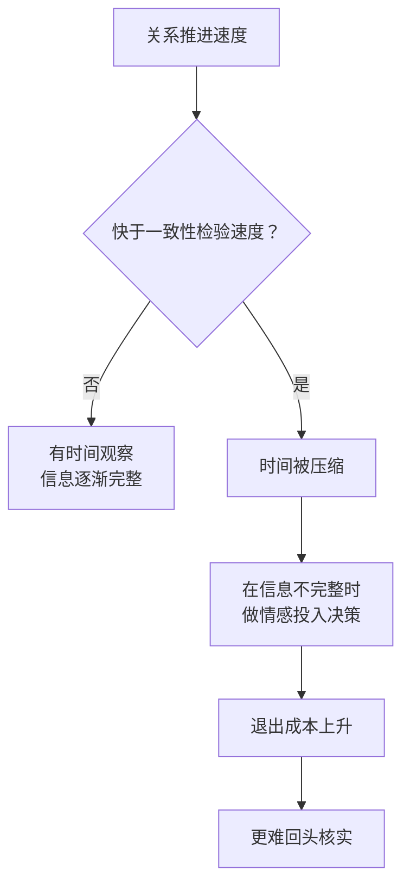
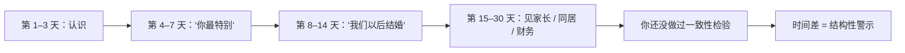

# 第12章 爱情轰炸与时间压缩

这一章讲一个词：**快。**

不是"效率高"的快，是"快到你来不及想"的快。刚认识没几天，对方就说"你是我这辈子遇到的最特别的人"；聊了两周，就开始谈"以后我们住哪""要不要见家长"；一个月不到，已经把你介绍给所有朋友，说"这就是我要找的人"。

很多人把这种快当成浪漫，觉得"遇到对的人，就是会很快"。这一章要讲的，是这种快背后的另一种可能：**它可能不是感情浓，而是时间被压缩了。**

---

## 12.1 密集关注与过早承诺

### 爱情轰炸：在理性上线之前完成绑定

"爱情轰炸"（love bombing）是自恋型虐待循环里的第一个阶段，也叫"理想化阶段"。它的操作方式，是用密集的关注、过早的承诺、超常的亲密表达，制造一种"被选中"的体验。

它的功能，用一句话说就是：**在目标的理性评估系统上线之前，完成情感绑定。**

你想想，一个人正常认识另一个人，需要多长时间才能形成基本判断？大概需要几周到几个月：看 ta 怎么对待服务员、怎么处理冲突、怎么说自己的过去、怎么面对不同意见、在你不顺着 ta 的时候是什么反应。这些信息，需要时间才能收集到。

而爱情轰炸的作用，就是在你还没收集到这些信息之前，先用高浓度的情感把你"绑定"。等你反应过来，你已经投入了很多感情，这时候再发现不对劲，退出的成本就高了。

这张图对比的是两条线。正常推进里，"了解"和"信任"占了大部分时间，承诺是最后才发生的。爱情轰炸里，"了解"这一步被压缩甚至跳过了，直接跳到"高浓度关注"和"过早承诺"。结果就是：你在信息不完整的情况下，做出了完整的情感投入。

### 密集关注：把"被看见"做到极致

爱情轰炸的第一层，是密集关注。

具体表现包括：每天早晚问候、记得你随口说过的每一件小事、你一发动态就秒回、你心情不好时立刻打电话、给你点外卖、给你买小礼物、把你的事情排在他所有事情前面。

这些行为单独看都是好事，甚至很感人。问题在于**密度和速度**：正常的关系里，关注是随着了解慢慢增加的；爱情轰炸里，关注是**一开始就拉满**的。

为什么一开始就拉满？因为密集关注能快速制造一种"被看见"的体验。人都有被看见的需求，尤其是那些平时不太被看见的人。当一个人突然把你放在世界的中心，你会产生一种强烈的感动："终于有人这么在乎我了。"

这种感动本身没有错。但你要注意一件事：**一个人在还不了解你的时候，就能给出这么高浓度的关注，这份关注的对象，可能不是你这个人，而是"一个可以被这样对待的位置"。** 换句话说，ta 不是在关注"你"，ta 是在执行"关注"这个动作。你换成另一个人，ta 可能也会这样。

### 过早承诺：把未来的话说得太早

爱情轰炸的第二层，是过早承诺。

刚认识不久，就开始说："我想跟你结婚""我想跟你有个家""我们以后要养一只猫""我想带你见我爸妈""我这辈子就认定你了"。

这些话在正常关系里，通常出现在两个人已经互相了解、经历过一些事之后。而在爱情轰炸里，它们出现得很早，早到你对 ta 还一无所知。

过早承诺的功能，是**制造一种"未来已经确定"的感觉**。人一旦在心理上进入了"我们有未来"的状态，就会开始为这个未来投入：投入时间、投入感情、投入计划、甚至投入钱。而投入越多，越难退出。

这也是为什么很多受害者在回头看时，会说"我们当时都在计划未来了"。计划未来本身不是问题，问题是：**这个未来，是在你了解对方之前就被画好的。**

### 时间压缩：核心机制

爱情轰炸的核心，不是"对你好"，也不是"说甜话"，而是**时间压缩**。

正常的亲密关系，需要时间来让"一致性"被检验：ta 说的话和做的事对不对得上？ta 在不同场合的表现一致吗？ta 在冲突里的反应和平时一样吗？ta 的过去和现在能对上吗？这些检验，都需要时间。

时间压缩的作用，就是**压缩掉检验所需的时间**。关系的推进速度超过了你做一致性检验的速度，你就被迫在信息不完整的状态下做决定。

你可能会说："可是感觉对了，为什么要等？"感觉当然重要。但感觉是一种快速判断，它擅长告诉你"我想不想靠近"，不擅长告诉你"这个人可不可靠"。后者需要观察、需要时间、需要看 ta 在不同情境下的反应。

### 建立你自己的"速度基准"

防御时间压缩，最有效的方法，是建立你自己的**速度基准**。

具体做法：在进入一段关系之前，先问自己两个问题：

1. 从初次接触到"确定关系"，我通常需要多久？我希望至少观察多久？
2. 从"确定关系"到重大共同决定（同居、财务关联、见家长、结婚），我希望至少观察多久？

这两个问题的答案，就是你的速度基准。它不是死的，可以调整，但你要有一个大概的数。

然后，当你感到"进度有点快"的时候，对照你自己的基准，而不是对照对方的节奏。

为什么要对照自己的基准？因为对方的节奏是可以被设计的。ta 可以说"我们这样就很好""感情不需要时间表""你是不是不够爱我"。如果你没有自己的基准，你就很容易被 ta 的节奏带着走。而如果你有自己的基准，你就可以说："我知道这对我来说太快了，我需要慢一点。"

这句话不需要理由，也不需要道歉。它是你的边界，不是对 ta 的指控。

### 小练习

为你的关系建立一个"速度基准"：

从初次接触到"确定关系"，你通常需要多久？从"确定关系"到重大共同决定（同居、财务关联、见家长），你希望至少观察多久？

下一次你感到"进度有点快"时，对照你自己的基准，而不是对照对方的节奏。

这个练习的目的，不是让你给感情设一个僵硬的期限，而是让你有一个参照系。有参照系的人，不容易被"快"带着走；没有参照系的人，只能跟着对方的速度。

---

## 12.2 "太快"作为结构性警示

### 速度本身就是一个变量

第 12.1 节讲了爱情轰炸的机制。这一节要讲一个更简单的判断原则：**"太快"本身，就是一个需要解释的变量。**

为什么？因为健康的亲密关系，有一个内在的节奏：它需要时间来建立信任、检验一致性、积累共同经历。这个节奏不是谁规定的，是关系的本质决定的。你不能在三天内了解一个人，就像你不能在三天内读完一本书——不是你不努力，是信息量决定了他需要时间。

所以，当一段关系推进得异常快时，你要问的不是"我们是不是太合拍了"，而是"**为什么这么快？**"

可能的原因有几类：

1. **真的合拍**。两个人确实很投缘，聊得来，三观合，进展快。这是存在的。
2. **性格使然**。有的人就是热情、直接、表达浓烈，喜欢快速推进。这也是存在的。
3. **时间压缩**。有人有意压缩时间，让你来不及做一致性检验。这是需要警惕的。

怎么区分？看**快的同时，有没有给你留出核实和后退的空间**。

真的合拍、性格热情的人，会在你犹豫的时候停下来，会说"不着急，你慢慢来"，会接受你说"我想再了解一下"。而时间压缩的人，会在你犹豫的时候加大力度，会说"你是不是不够爱我""感情不需要想那么多""你就是想太多"。

### 高浓度信号的密集出现

"太快"的具体表现，是高浓度信号的密集出现。常见的三个：

1. **过早的承诺**。"我想跟你过一辈子""我们以后一定要结婚""我这辈子没这么确定过"。
2. **超常的亲密表达**。"你是我见过最特别的人""我从来没有对别人这样过""你就是我的命中注定"。
3. **密集的关注**。每天长时间聊天、秒回、随叫随到、把你的事排在最前面。

单独看，每一条都可能是真的。但如果你发现，这三类信号在**极短时间内密集出现**，而且出现在你**对对方还没有形成基本了解**之前，那这个"时间差"就值得标记。

这张图想说的是：**不是"承诺"本身有问题，而是"承诺出现的时间点"有问题。** 承诺应该在了解之后，而不是在了解之前。如果在了解之前就出现，那它承诺的对象，可能不是真实的你，而是 ta 想象中的一个位置。

### 为什么"快"会让人失去判断力

"快"之所以危险，不只是因为它压缩了检验时间，还因为它**劫持了你的注意力**。

当一段关系推进得很快时，你会处于一种持续兴奋的状态：每天有新鲜感、有期待、有大量的情绪起伏。这种状态下，你的注意力被关系占满，很难再抽出来做冷静的评估。

而且，"快"还会制造一种**沉没成本的错觉**：虽然才认识两周，但因为互动密度高，你会觉得"我们已经经历了很多"。这种"经历了很多"的感觉，会让你误以为关系已经很深，从而更愿意投入。

这就是时间压缩的狡猾之处：它不只压缩了客观时间，还压缩了你的主观感受，让你觉得"我们已经很熟了"，而实际上你对 ta 的了解，可能还不如对一个普通同事多。

### 小练习

列出你在一段关系初期收到的三个"高浓度信号"（过早的承诺、超常的亲密表达、密集的关注）。

标注它们出现的时间点（第几天 / 第几周）。

如果这些信号出现在你尚未对对方形成基本了解之前，标记这个时间差。

然后问自己：**如果这段关系放慢一半速度，我还会不会这么投入？**

这个问题的答案，往往能说明你是被"这个人"吸引，还是被"这个速度"带着走。

---

## 本章小结

这一章讲了两件事：

1. **爱情轰炸的核心是时间压缩**。密集关注、过早承诺、超常亲密，共同作用是在你的理性评估上线之前完成情感绑定。它让你在信息不完整时做出完整的情感投入。
2. **"太快"是一个需要解释的变量**。健康的快，会给你留出核实和后退的空间；时间压缩的快，会在你犹豫时加大力度。判断标准不是"快不快"，而是"快的同时，有没有给你留空间"。

最后留一个判断问题：

**你是被这个人吸引，还是被这个速度带着走？**

分辨的方法很简单：**慢下来试试。**

推迟一个决定，拒绝一次密集的邀约，隔一天再回复，说一句"我想再了解一下"。然后看对方的反应。

一个真的喜欢你的人，会接受你的慢，甚至会觉得你谨慎是好事。一个在压缩时间的人，会因为你的慢而焦虑、施压、或者换一种更甜的方式催你。慢下来之后的反应，比快的时候的甜言蜜语，更能说明问题。

下一章，我们讲三角测量与社交隔离的前置操作。你会看到，第三方的出现，有时候不是为了分享生活，而是为了让你不安；而"为你好"的隔离，往往从一句"你那个朋友其实不希望你过得好"开始。
