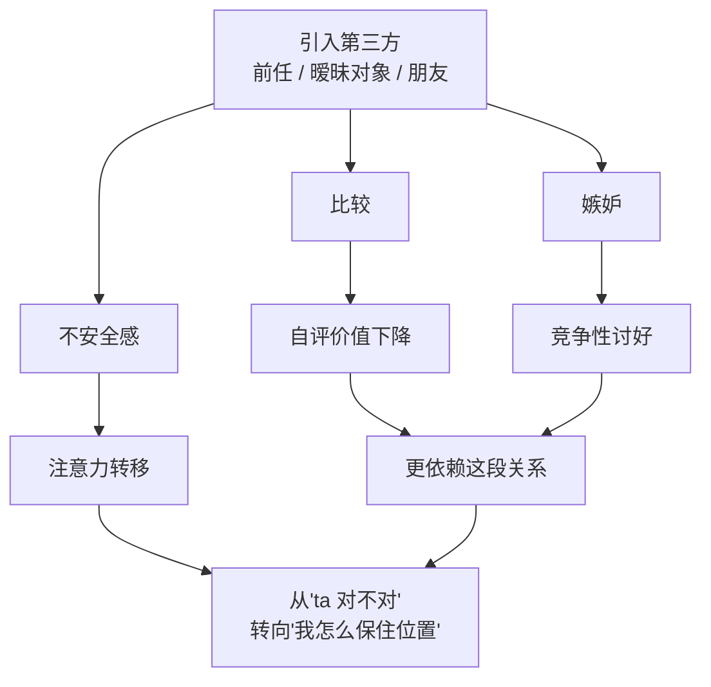
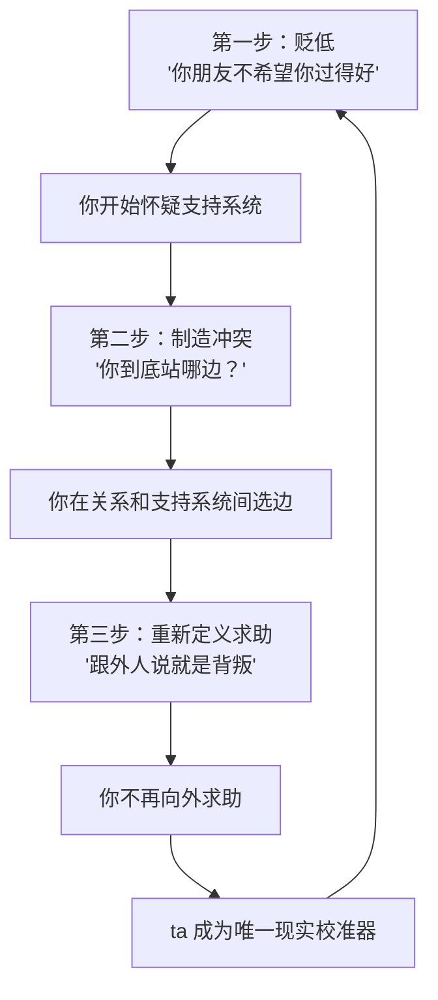

# 第13章 三角测量与社交隔离的前置操作

这一章讲两个动作：**拉进第三个人**和**推开你的身边人**。

听起来是相反的两件事，其实是一套组合拳。拉进第三个人，是为了让你不安、让你比较、让你把注意力从"ta 的行为是否可接受"转移到"我如何保住自己的位置"。推开你的身边人，是为了让你在需要意见时，找不到一个独立于 ta 的参照点。

一个负责搅乱你的内部判断，一个负责切断你的外部支持。两个一起用，你就慢慢变成了一个"只能听 ta 的"的人。

---

## 13.1 三角测量：引入第三方作为压力源

### 什么是三角测量

"三角测量"原本是个几何/测量术语，在关系心理学里，它指的是一种通过引入第三方来调节两人关系的操作。

最常见的形态是：在和你相处的过程中，频繁提到另一个人——前任、暧昧对象、某个"很懂 ta 的朋友"、某个"条件很好但 ta 没选的人"。

提法很讲究，通常不是直接说"你不如 ta"，而是用一种若即若离的方式：

- "我前任以前也会这样，不过 ta 处理得比你好一点。"
- "有个朋友最近一直找我，人挺好的，但我跟 ta 说我有你了。"
- "我以前有个对象，家里条件特别好，但我觉得跟 ta 没感觉。"
- "我朋友说，你这样的性格，一般人受不了。"

这些话的功能，不是分享生活，而是**制造比较、嫉妒和不安全感**。

### 三角测量的三个功能

三角测量在操控关系里，通常承担三个功能：

1. **降低你的自评价值**。"有人比你更合适""别人能做到你做不到的事"——通过比较，让你觉得自己不够好，从而更珍惜这段关系。
2. **制造竞争性讨好**。当你觉得"有别人在觊觎 ta"或"有人比你好"时，你会不自觉地加大投入：更体贴、更顺从、更努力证明自己。这种讨好不是因为你愿意，而是因为你怕失去。
3. **转移注意力**。原本你在想"ta 这样对我，是不是有问题"；三角测量之后，你的注意力变成了"我怎么做才能保住位置"。问题从"ta 的行为"转移到了"我的表现"，而后者正是 ta 想要的。

这张图最值得看的是最后一步：**你的注意力被转移了。** 一段健康的关系里，你会问"这个人对我好不好、这段关系健不健康"；而在三角测量里，你会问"我是不是不够好、我怎么做才能让 ta 更爱我"。前者是关于关系的判断，后者是关于自我的审查。后者更耗人，也更容易被利用。

### 三角测量也用于社交隔离的前置操作

三角测量还有一个更隐蔽的用法：**贬低你的朋友和家人。**

"你那个朋友其实不希望你过得好。"
"你家人根本不理解你，只有我懂。"
"你闺蜜是不是嫉妒我们？她看你的眼神不太对。"

这些话的功能，是逐步削弱你外部支持系统的可信度。当你的朋友、家人被一个个描述成"不怀好意""不理解你""嫉妒你"的时候，你在需要意见时，就会越来越少地去找他们，而越来越多地找 ta。

这就是第 13.2 节要讲的社交隔离的入口。三角测量是"拉进第三方来让你不安"，社交隔离是"推开你的身边人让你孤立"。两者经常配合使用：先通过三角测量让你对身边人产生怀疑，再通过隔离让你彻底失去独立参照。

### 可检测的痕迹：第三方是作为人，还是作为工具

判断三角测量是否在发生，有一个很具体的观察方法：**记录一周内对方提到第三方的所有时刻。**

对每一次标注三件事：

1. **时间点**：这次提及，是不是紧跟在你的不满、你的边界、你的拒绝之后？比如你刚说"我不喜欢你这样"，ta 立刻说"我前任就不会这么计较"。
2. **功能**：这次提及是在做什么？是比较？是贬低你的支持者？是制造竞争感？还是纯粹的信息分享？
3. **你的反应**：你是反驳、沉默，还是开始证明自己？

然后问一个关键问题：**这个第三方，是作为真实的人存在，还是作为调节你行为的工具出现？**

真实的第三方，会有具体的、可核实的信息，会在关系里有自己的位置，提到 ta 的时候不需要特定的时机。工具的第三方，往往只在需要让你不安、让你让步、让你竞争的时候出现，而且信息模糊、不可核实、来去无踪。

### 小练习

记录一周内对方提到第三方的所有时刻。

对每一次标注：提及的**时间点**（是否紧跟在你的不满/边界之后？）、**功能**（比较/贬低你的支持者/制造竞争感/纯信息分享）、以及**你的反应**。

观察第三方是作为真实的人存在，还是作为**调节你行为的工具**出现。

这个练习的目的，不是让你禁止对方提别人，而是让你看见：**有些"别人"，不是被分享的，是被使用的。**

---

## 13.2 社交隔离的渐进启动

### 隔离的目标不是"不让你见人"

很多人对社交隔离的理解是："把对方关起来，不让见朋友。"这是极端形态，现实中更常见的是渐进式的、温和的隔离。

隔离的真正目标，不是"不让你见人"，而是**让你在需要外部意见时，不再有一个可信的、独立于攻击者的参照点。**

这个区别很重要。因为"不让你见人"很容易被识别、被反抗；而"让你不再信任外面的人"，是悄无声息的。你还在见朋友，只是你不再跟他们说真话；你还有家人，只是你觉得他们"不懂你"。形式上你没有被关起来，实际上你已经孤立了。

### 隔离的三步

社交隔离通常分三步走：

**第一步：贬低。**

"你那个朋友其实不希望你过得好。"
"你家人只会给你压力，他们根本不关心你开不开心。"
"你闺蜜就是嫉妒你，你别什么都跟她说。"

贬低的作用，是给你的支持系统打上"不可信"的标签。一旦你开始怀疑朋友/家人的动机，你在找他们之前就会犹豫："ta 说的会不会是真的？"

**第二步：制造冲突。**

在你和朋友/家人之间，制造一个需要你"选边"的事件。

比如：ta 和你朋友发生了小摩擦，然后要求你表态："你到底站哪边？"
或者：ta 说"你朋友上次那句话，是在针对我"，让你去跟朋友对质。
或者：ta 在你和家人之间传话，把 A 的话添油加醋地传给 B，制造误会。

冲突的作用，是让你在"维护关系"和"维护支持系统"之间做选择。选了几次之后，你会越来越倾向于选关系，因为关系的日常接触更密集、压力更直接。

**第三步：重新定义求助。**

把"向朋友/家人倾诉"重新定义成"不成熟""背叛关系""不信任我"。

"我们的事，你为什么要跟外人说？"
"你跟你妈说这些，是想让她觉得我不好吗？"
"真正的亲密关系，是两个人内部解决的，不需要外人插手。"

这一步的作用，是切断你最后的求助渠道。当"向外求助"本身变成一种罪过，你就只能在关系内部消化一切，而关系内部，ta 是唯一的声音。

这三步合起来，就是一个闭环。你越孤立，越依赖 ta 的判断；越依赖 ta 的判断，越觉得外面的人不可信；越觉得外面不可信，越孤立。

### 为什么隔离这么有效

因为人需要**现实校准**。

我们判断一件事是否合理，很大程度上依赖别人的反馈。你觉得"ta 这句话是不是有点过分"，如果朋友说"确实过分"，你就会确认自己的感觉；如果朋友说"还好吧，你想多了"，你可能会怀疑自己。外部意见的作用，不是替你决定，而是给你一个参照，让你知道"我的感觉是不是偏离了常识"。

社交隔离切断的，就是这个参照。当你失去了独立的参照点，ta 就成了你唯一的现实校准器。ta 说你敏感，你就觉得自己敏感；ta 说你小题大做，你就觉得自己小题大做；ta 说你离不开 ta，你就真的觉得自己离不开。

这就是为什么第 28 章要专门讲"支持系统重建"和"第二意见机制"。因为对抗隔离最有效的方法，不是"变得更强"，而是**保持与可信他人的连接**，让现实检验有第二个锚点。

### 可检测的痕迹：联系频率和原因

判断社交隔离是否在发生，有一个很具体的自查方法：

列出你最重要的三个支持者（朋友、家人、咨询师都行）。

回想最近三个月：你和他们联系的频率，与这段关系开始前相比如何？

如果下降了，写下每一次"没有联系"的原因。然后把这些原因分类：

- **自然的生活变化**：大家都很忙、搬家了、工作变了。这类原因是正常的。
- **关系相关的原因**："不想让伴侣不高兴""怕伴侣误会""觉得说了会引发争吵""不想让伴侣知道"。这类原因是隔离的信号。

如果后一类原因反复出现，说明你的外部支持系统正在被侵蚀。不是别人把你关起来了，是你自己开始**为了这段关系，主动减少和外界的连接**。

### 小练习

列出你最重要的三个支持者。

回想最近三个月：你和他们联系的频率与这段关系开始前相比如何？

如果下降了，写下每一次"没有联系"的原因——是自然的生活变化，还是"不想让伴侣不高兴""不想引发争吵"？

把原因分类，观察外部支持系统的侵蚀是否正在发生。

这个练习不是让你在关系和支持系统之间二选一。健康的关系，不需要你放弃朋友和家人；它应该让你有更多的连接，而不是更少。如果你发现自己在为了维持关系而不断减少和外界的联系，那这个"减少"本身，就是最值得注意的信号。

---

## 本章小结

这一章讲了两个动作：

1. **三角测量**。通过引入前任、暧昧对象、朋友、家人，制造比较、嫉妒和不安全感。三个功能：降低你的自评价值、制造竞争性讨好、转移你的注意力。识别方法：看第三方是作为真实的人存在，还是作为调节你行为的工具出现。
2. **社交隔离**。目标不是"不让你见人"，而是"让你失去独立的参照点"。三步：贬低支持系统、制造选边冲突、重新定义求助。识别方法：看你和支持者的联系频率是否下降，以及下降的原因是不是"不想让伴侣不高兴"。

最后留一个判断问题：

**这段关系，是让你和世界连接得更多，还是更少？**

健康的关系，会让你更有力量去面对世界：你更愿意交朋友、更愿意跟家人沟通、更愿意尝试新事物。操控性的关系，会让你越来越收缩：你不敢跟朋友说真话、不敢让家人知道、不敢有自己的社交。

如果你发现自己正在为了这段关系，一点点关掉通往外界的门，那你要做的，不是马上把门全部打开，而是**至少留一扇**。留一扇能让你在需要的时候，听到另一个声音的门。

下一章，我们讲非语言服从测试的升级。你会看到，触碰的阶梯、空间的入侵、理想化残片的投放，是怎么在身体层面把关系"做成既成事实"的。
