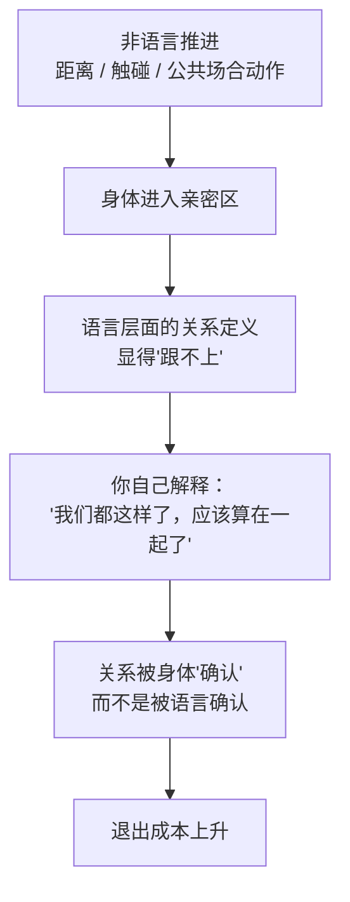
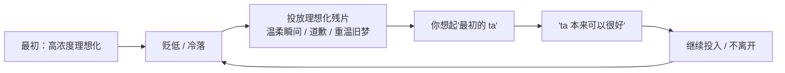

# 第14章 非语言服从测试的升级

第 7 章讲过触碰的阶梯：从"偶然接触"到"明确亲密"，每一级都可否认，每一级都在测试你的反应。

这一章讲这个阶梯的升级版。到了"着迷"阶段，非语言服从测试不再只是"试探性触碰"，而是变成了一套更明确的**空间管理**：站得更近、碰得更频繁、在公共场合做"只有情侣才会做"的动作。

这些动作的共同功能，是**制造既成事实**。

---

## 14.1 触碰阶梯与空间入侵

### 从"试探"到"管理"

第 7 章的触碰阶梯，还处在"试探"阶段：每一次触碰都很轻，都可否认，都在观察你的反应。

到了着迷阶段，触碰的性质变了：它不再只是"试探"，而是开始**管理空间**。

具体表现包括：

- **站得更近**。不管什么场合，都习惯性地缩短距离，站到你个人的"亲密区"里。
- **碰得更频繁**。走路时搂肩、说话时碰手臂、坐着时腿靠过来、递东西时手停留得久一点。
- **公共场合的"情侣动作"**。在朋友面前搂腰、牵手、整理你的衣领、叫你昵称，做给外人看。
- **占据你的空间**。坐你的位置、用你的东西、翻你的手机、不打招呼就出现在你门口。

这些动作单独看，都可以解释为"亲密"。但放在一起看，它们在做一件很具体的事：**把身体层面推进到"亲密区"，让语言层面的关系定义显得"跟不上"。**

### 既成事实：身体先于语言

什么叫"制造既成事实"？

就是让身体层面已经发生的事，倒过来定义关系。你们还没确认关系，但已经牵过手、搂过腰、有过更亲密的接触；这时候你会不自觉地想："我们都这样了，应该算在一起了吧？"

这个"应该算"的推理，就是既成事实的效果。它不是通过语言说服你，而是通过身体经历让你自己得出结论。

这张图的关键，是第三、四步：**关系不是被商量的，是被你"解释"出来的。** 对方甚至不需要说"我们在一起吧"，ta 只需要让身体先走到那一步，你自己会替 ta 把关系定义补上。

这就是为什么第 14.1 节的小练习要问"身体层面进入亲密区域，是在语言层面确认关系之前、同时、还是之后"。如果身体先于语言，那这个时间差，就是非语言服从测试的痕迹。

### 空间入侵：用身体传递"你无法拒绝"

空间入侵，是触碰阶梯的另一面。

它不一定涉及触碰，但一定涉及**空间的占据**：

- 站得太近，近到你要后退。
- 你后退，ta 跟上。
- 用身体挡在门口、挡在过道，让你不好过去。
- 坐得离你极近，腿叉得很开，占据你的空间。
- 不打招呼就进你的房间、翻你的东西、用你的私人物品。

这些动作的共同效果，是用非语言方式传递一个信息："**我占这个空间，你没法拒绝我靠近。**"

这和语言上的施压不一样。语言施压，你可以反驳、可以讲道理；空间施压，你很难指出"ta 做错了什么"，你只会觉得不舒服、想后退、想快点结束。而如果你后退了，ta 又跟上来，你就会产生一种"退无可退"的压迫感。

素材里讲身体语言时提到，人在感到受威胁时，会本能地扩大自己的空间（双脚站开、挺胸），这是一种"宣示领地"的反应。反过来，当一个人不断侵入你的空间，而你不反抗时，你就在非语言层面"让出了领地"。

### 边界不是"扫兴"

这里要再说一遍第 7 章说过的话：**触碰和靠近本身不是问题，问题在于它是否被双方自愿、舒适地接受。**

健康的亲密，有一个特征：**它可以被拒绝，而且拒绝不会带来惩罚。**

你说"我现在不想被碰"，对方会停下来，不会冷脸、不会说"你怎么这么敏感"、不会用"我都这么主动了"来让你内疚。

不健康的亲密，特征是：**它不能被拒绝，或者拒绝的代价很高。** 你一躲，对方就生气；你一说不，对方就说你"装""不解风情""不给面子"。这种反应说明，ta 要的不是"和你亲近"，而是"你必须接受我亲近"。

### 小练习

回想一段关系中，"关系定义"与"身体距离"之间的时间差：

身体层面进入亲密区域，是在语言层面确认关系**之前**、**同时**，还是**之后**？

如果身体先于语言，标记这个时间差——它可能是非语言服从测试的痕迹。

然后问自己：**如果我在身体推进的每一步都说"慢一点"，这段关系还会以同样的速度发展吗？**

这个问题的答案，能帮你看清：这段关系的速度，是两个人共同决定的，还是被一个人的身体推进带着走的。

---

## 14.2 表情管理与"理想化残片"的投放

### 理想化不需要持续维持

到了着迷阶段，攻击者需要维持"理想化"的表演：温柔、体贴、懂你、把你放在第一位。

但这里有一个成本问题：**持续的理想化是很累的。** 一个人不可能 24 小时都保持"完美伴侣"的状态。所以高明的操作不会持续维持，而是**周期性地投放"理想化残片"**。

什么叫"理想化残片"？就是一些短暂的、高浓度的、让你想起"最初那个 ta"的瞬间：

- 一个熟悉的温柔表情。
- 一次精心安排的约会。
- 一句"只有你能让我这样"。
- 一个突然的拥抱、一条深夜的长消息、一份记得你喜好的小礼物。
- 一次"变回最初那个完美的人"的表演：道歉、忏悔、重温旧梦。

这些残片的功能，不是让你一直幸福，而是**维持你对"最初那个 ta"的记忆和期待**。

### 残片为什么有效

因为人有一个倾向：**用最好的时刻，定义整段关系。**

你回想一段关系，最先想起的往往不是平均值，而是峰值：最甜的那次约会、最感动的那句话、最温柔的那个瞬间。这些峰值，会成为你判断"这段关系好不好"的依据。

理想化残片的作用，就是**不断制造新的峰值**，让你觉得"ta 本来可以这么好""我们曾经那么好""只要再努力一点，就能回到那个时候"。

而这个"只要再努力一点"，就是后续贬低阶段的心理基础。当 ta 开始贬低你、冷落你、伤害你时，你会用残片来安慰自己："这不是真正的 ta，真正的 ta 是那个温柔的、懂我的人。"于是你会继续投入，试图"把那个 ta 找回来"。

这个循环，就是第 18 章要讲的"间歇性强化"的情感版。残片是不可预测的奖赏：你不知道它什么时候来，所以你会一直等；它来的时候，你会觉得"果然 ta 还是爱我的"；它走的时候，你又开始怀疑"是不是我哪里做错了"。

### 残片和真心的区别

你可能会问：那怎么分辨"理想化残片"和"真心的好"？

一个粗糙但有用的标准：**看它出现的时间点。**

- 真心的好，是**稳定的**：ta 对你好，不需要特定的时机，不需要你先痛苦、先离开、先反抗。
- 理想化残片，是**有功能的**：它往往出现在你快要放弃的时候、你开始设边界的时候、你准备离开的时候。它的作用是把你拉回来，而不是让你一直好。

换句话说：**真心是常态，残片是急救。** 一个只在你要走的时候才对你好的人，不是"其实很爱你"，而是"知道什么时候该给你一点甜头"。

### 残片对"表情管理"的依赖

理想化残片的投放，很大程度上依赖**表情管理**。

一个温柔的注视、一个恰到好处的微笑、一个"我见犹怜"的脆弱表情——这些都需要精确控制。素材里讲面部表情管理时说，人设维护的核心技术之一，就是"微笑的时机、眼神接触的强度、惊讶或共情的表演，都需要精确控制"。

残片之所以有效，是因为它调动了你的情感记忆：那个表情、那个语气、那个瞬间，让你想起最初的心动。而最初的心动，往往是被精心设计过的（第 5 章的镜像、第 12 章的爱情轰炸）。所以残片本质上是**把最初的设计，再播放一遍**。

### 小练习

写下你当前（或最近）关系中"最好的三个瞬间"和"最差的三个瞬间"。

标注最好的瞬间发生在关系的**哪个阶段**。

如果三个最好的瞬间全部集中在最初三个月，而近三个月只有最差的瞬间，标记这个时间分布。

然后问自己：**我现在坚持的，是这段关系的现在，还是这段关系的过去？**

这个问题的答案，往往很扎心。但它能帮你看清：你是在和一个真实的人相处，还是在等一个已经过去、可能从未真实存在过的"最初的 ta"。

---

## 本章小结

这一章讲了两个层面：

1. **触碰与空间的升级**。从"试探"到"管理"，通过站得更近、碰得更频繁、公共场合的情侣动作、空间入侵，制造"既成事实"——让身体先于语言定义关系。识别方法：看身体进入亲密区，是在语言确认关系之前还是之后。
2. **理想化残片的投放**。不持续维持理想化，而是周期性地投放高浓度瞬间，维持你对"最初的 ta"的记忆和期待，为后续贬低提供"这可能是真的"的证据。识别方法：看这些"好"出现的时间点——是稳定的常态，还是在你要走时才出现的急救。

最后留一个判断问题：

**你对 ta 的期待，是基于 ta 现在是什么样，还是基于 ta 曾经是什么样？**

如果是后者，那你爱的可能不是这个人，而是这个人曾经演给你看的那个版本。而那个版本，可能从一开始就是设计出来的。

下一章，我们讲愧疚植入与情感勒索的深化。你会看到，"如果你真的爱我，你就会……"这句话，是怎么把"爱"和"服从"绑在一起的。
