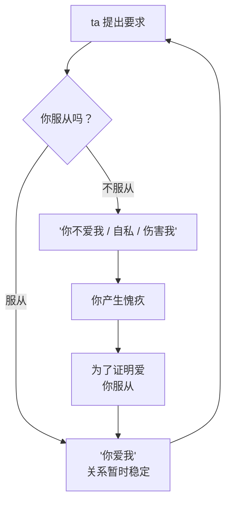
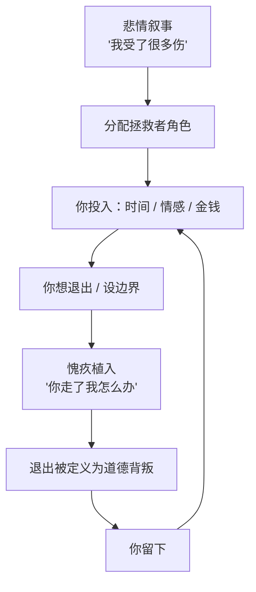
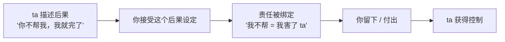

# 第15章 愧疚植入与情感勒索的深化

第 10 章讲过愧疚植入：在请求之前，先让你觉得"欠 ta 的"。

这一章讲它的升级版：**情感勒索。**

愧疚植入是"我为你付出了，你欠我"；情感勒索是"如果你不按我说的做，就说明你不爱我、你自私、你伤害了我"。前者用的是恩情，后者用的是**爱本身**。

这一章会讲清楚两件事：情感勒索是怎么把"爱"和"服从"绑在一起的，以及它和"拯救者"角色是怎么形成一个闭环的。

---

## 15.1 情感勒索：将"爱"与"服从"绑定

### 一句话的结构

情感勒索的典型句式，长这样：

- "我为你做了这么多，你就这样对我？"
- "如果你真的爱我，你就会……"
- "你连这点事都不愿意为我做，你还说你爱我？"
- "你这样做，让我很伤心。"
- "你要是敢走，我就……"

这些句子的共同结构，是**把"爱"和"服从"绑定**：你按我的意愿做，就是爱我；你不按我的意愿做，就是不爱我、自私、伤害我。

这个绑定一旦成立，你面对的就不再是"这个要求合不合理"，而是"我是不是一个坏人"。前者可以讨论，后者只能自证。而自证是没有尽头的：你证明了一次，ta 可以提下一个要求；你再证明，ta 再提。你永远在证明"我爱你"，而 ta 永远可以说"还不够"。

这张图是一个循环。在这个循环里，"爱"不再是两个人之间的感情，而变成了一个**考核指标**：ta 出题，你答题；ta 打分，你补考。你越来越努力，却越来越不确定自己到底"爱不爱"。

### 情感勒索利用的是什么

情感勒索之所以有效，是因为它同时利用了两样东西：

1. **人对冲突的厌恶**。大多数人不想吵架、不想冷战、不想关系紧张。当"不服从"意味着冲突时，很多人会选择服从，来换取和平。
2. **人对"做个好人"的渴望**。我们都希望自己是有爱的、体贴的、不自私的。当对方说"你自私""你冷血""你不爱我"时，我们会本能地想要反驳，而反驳的方式往往是**证明自己不是那样的人**——也就是服从。

这两样东西本身都是好的：厌恶冲突让人与人相处更和谐，想做个好人让人有道德感。但正因如此，它们也最容易被利用。

### 惩罚的隐性形式

情感勒索不一定要明着威胁。更多时候，它用的是**隐性的惩罚**：

- **撤回关爱**。你不服从，ta 就冷脸、不回消息、不接电话、不碰你。
- **沉默**。你不服从，ta 就进入"冷战模式"，让你在沉默里煎熬。
- **阴阳怪气**。你不服从，ta 就说"行，你厉害""你开心就好"，用反话让你难受。
- **自我伤害的暗示**。"你要是走了，我也不知道自己会做出什么事。"
- **威胁离开**。"既然你这样，那我们就算了吧。"（然后等你挽留）

素材里讲惩罚时说，惩罚作为操控手段，会"像催化剂，激发行动或借助强情绪迫使就范"。情感勒索用的就是这种催化：它不一定真的惩罚你，但它让你**预期**到惩罚，于是你提前服从。

### 把边界设定变成道德失败

情感勒索最厉害的地方，是它把"设边界"这件事，重新定义成"道德失败"。

你说："我不想今晚出去，我想休息。"
ta 说："你总是这样，只顾自己。"

你说："我不想把手机密码给你。"
ta 说："你不信任我，我们之间还有什么意思？"

你说："我想周末见见朋友。"
ta 说："行，你去吧，反正我在你心里也不重要。"

在这些对话里，你原本只是在表达一个边界（我想休息、我不想给密码、我想见朋友），但被 ta 重新框定成了"自私""不信任""不在乎"。于是你不仅要处理边界本身，还要处理"我是不是个坏人"的自我怀疑。

这就是情感勒索的核心操作：**它不跟你讨论边界合不合理，它跟你讨论你这个人好不好。** 而后者，你永远辩不赢，因为你自己也在怀疑。

### 小练习

找出你生活中一句让你立刻产生内疚的"关系句式"。

为它写一个**不攻击对方、也不攻击自己**的回应版本。核心是**陈述你的边界，而不是辩护你的动机**。

比如：

- 原句："如果你真的爱我，你就会陪我去。"
- 辩护式回应（不推荐）："我不是不爱你，我只是真的很累，你不要这样想……"（越解释越被动）
- 边界式回应（推荐）："我今天需要休息，去不了。你想去的话，我们可以改天一起。"

边界式回应的特点：不解释"我为什么不爱 ta"，只陈述"我能做什么、不能做什么"。它不攻击对方，也不攻击自己；它把话题从"我好不好"拉回到"这件事怎么办"。

---

## 15.2 内疚与"拯救者"角色的闭环

### 悲情叙事和愧疚，是一对

第 9 章讲过悲情叙事：从"我受过伤"到"只有你能帮我"，给你分配"拯救者"角色。

这一节讲它的配套机制：**愧疚植入。**

悲情叙事负责**建立**拯救者角色，愧疚植入负责**维持**这个角色。当你试图退出这个角色时，愧疚就会上来施压：

- "我这么惨，你还要离开我？"
- "你是唯一能帮我的人，你走了我怎么办？"
- "我好不容易才相信一个人，你也要抛弃我？"
- "你答应过会陪我的，现在你说话不算数了？"

这些语句的功能，是把你的**自主选择**（我想离开、我想保护自己）重新定义为**道德背叛**（你抛弃了一个需要你的人）。

这个闭环的关键，是**退出被道德化**。在健康的关系里，离开是一个选择，会有遗憾，但不涉及"我是不是坏人"。在拯救者闭环里，离开变成了"见死不救"，你不仅要承受失去的痛苦，还要承受道德的审判。后者往往比前者更难承受。

### 为什么"如果我不帮 ta，ta 就完了"这么有力量

因为这句话把**ta 的后果**和**你的责任**绑在了一起。

你想想，如果一个人对你说"我最近很难，但我会自己想办法"，你帮不帮，是一个选择。但如果一个人对你说"如果你不帮我，我就完了"，你帮不帮，就变成了一个道德问题：你不帮，你就是那个"看着别人完了也不伸手"的人。

而"完了"这个后果，往往是 **ta 自己描述的**，不是你独立评估的。

这是最关键的一点。ta 说"你走了我就活不下去""你不借我钱我就完了""你不陪我我就崩溃"——这些后果的严重程度，是 ta 定义的。你可能从来没有独立评估过：ta 真的会完吗？ta 有没有别的办法？ta 是不是在用这个后果来绑住你？

### 拯救者闭环的危险：它会升级

拯救者闭环还有一个特点：**它会升级。**

一开始，你可能只是听 ta 倾诉、陪 ta 聊天。然后 ta 说"只有你能帮我"，你开始花更多时间。然后 ta 说"你能不能借我一点"，你借了。然后 ta 说"这次真的没办法了，只有你能救我"，你借了更多。然后 ta 说"你要是离开我，我就真的完了"，你不敢走了。

每一步都比上一步更重，每一步都用"只有你能帮我"来绑定。你越帮，ta 的"需要"越大；ta 的"需要"越大，你越不敢走。最后你发现，你已经不是在"谈恋爱"，你是在"承担一个人的人生"。

### 小练习

回想一次你因为"如果我不帮 ta，ta 就完了"而做出的决定。

问自己：

1. 这个"如果我不……ta 就……"的后果，是 **ta 自己描述的**，还是**你独立评估的**？
2. 如果是 ta 描述的，ta 有没有给你提供过任何**可核实的证据**，证明后果真的这么严重？
3. 如果 ta 的描述是夸张的，那你当时为什么相信了？

如果是前者（ta 描述的），标记这个叙事框架——它可能是拯救者闭环的入口。

这个练习不是让你变得冷血。人有困难，帮是应该的。你要分辨的是：**这个"帮"，是出于你的选择，还是出于你的恐惧？** 出于选择的帮，帮完你是轻松的；出于恐惧的帮，帮完你是耗尽的，而且下一次更难拒绝。

---

## 本章小结

这一章讲了两件事：

1. **情感勒索**。把"爱"和"服从"绑定：你服从就是爱我，不服从就是不爱我、自私、伤害我。它利用人对冲突的厌恶和对"做好人"的渴望，把边界设定变成道德失败。应对的核心是：陈述边界，不辩护动机。
2. **拯救者闭环**。悲情叙事建立角色，愧疚植入维持角色。退出被重新定义为道德背叛，"如果我不帮 ta，ta 就完了"把 ta 的后果和你的责任绑在一起。识别的关键是：这个后果是 ta 描述的，还是你独立评估的？

最后留一个判断问题：

**你留下，是因为你想留下，还是因为你不敢走？**

想留下，是这段关系里有你珍视的东西；不敢走，是离开会让你觉得自己是个坏人。前者是爱，后者是被愧疚绑架。

一个健康的关系，不会让你在"爱 ta"和"做个好人"之间做选择。它会允许你说"不"，允许你保护自己，允许你离开，而不把你定义成坏人。如果你发现，你每一次想保护自己，都要先过一道"我是不是太自私"的审判，那这道审判本身，就是最需要被看见的东西。

下一章开始第五部分：控制执行。你会看到，贬低是怎么从"为你好"开始的，煤气灯是怎么让你怀疑自己的，抛弃—回吸是怎么让你离不开的。
