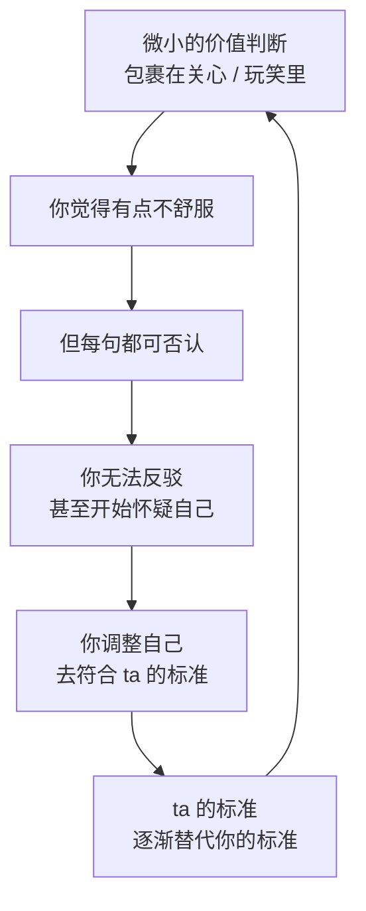
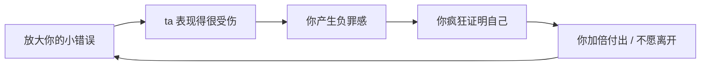
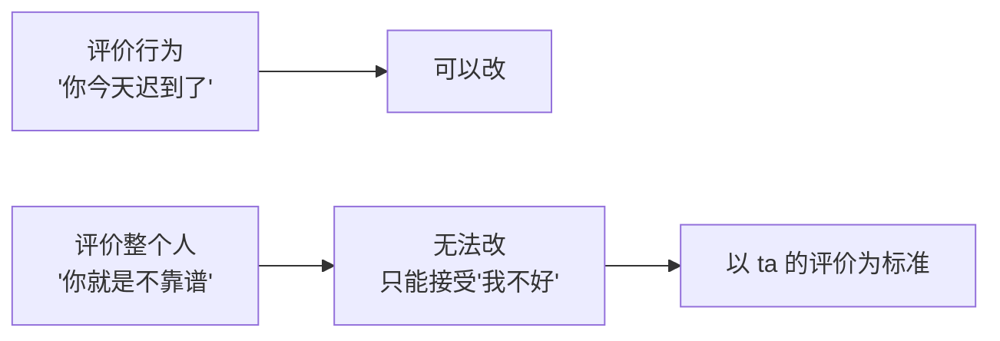
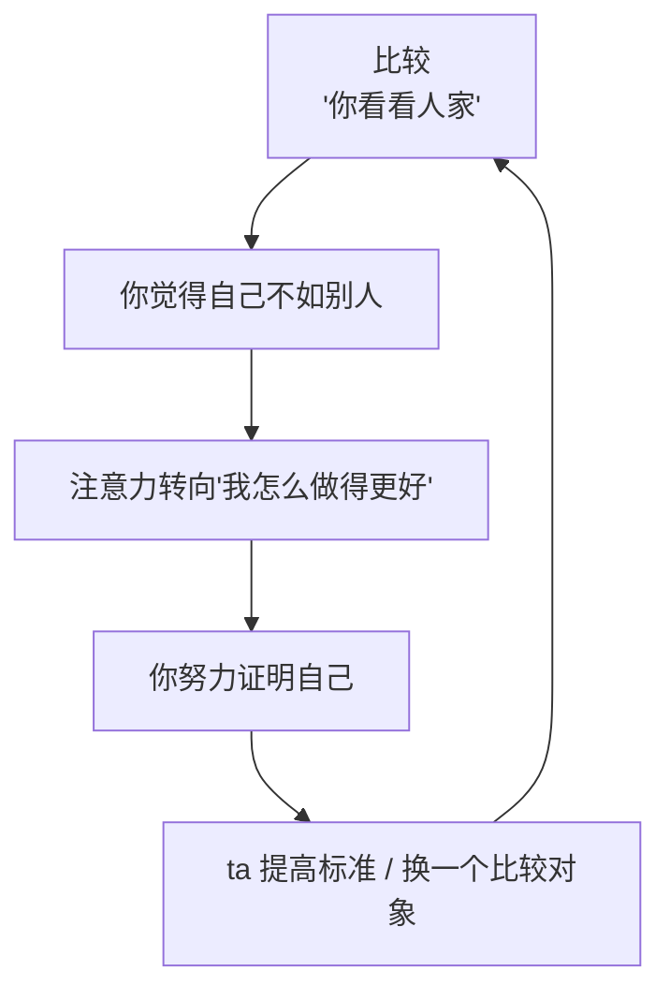
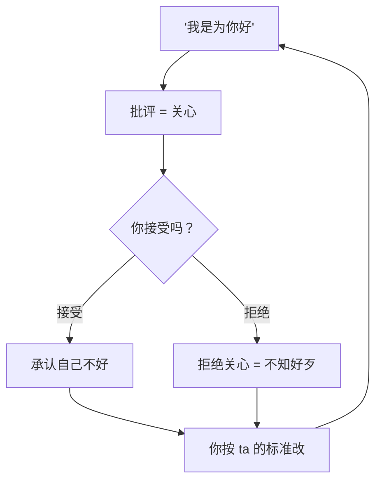

# 第16章 贬低：可否认的价值侵蚀

从这一章开始，进入整本书最沉重的部分：**控制执行。**

前面的章节讲的是"怎么让你进来""怎么让你投入"。这一部分讲的是"进来之后，怎么让你越来越不像自己"。

第一个要讲的，是贬低。

贬低不是骂你、不是打你、不是明显的羞辱。那些太容易被识别了。真正有效的贬低，是**微小的、包裹在"关心"或"玩笑"里的价值判断**。每一句单独看都可以被否认，但累积起来，会慢慢替换掉你对自己的评价标准。

---

## 16.1 微小否定的累积效应

### 贬低不是"持续否定"，而是"微小否定"

很多人以为，贬低就是天天说你不好。现实里，持续否定反而会引起反抗：你天天骂一个人，ta 会要么反击，要么离开。

高明的贬低，是**间歇性的、微小的、可否认的**。

比如：

- "你穿这个颜色更好看。"（听起来是建议，潜台词是"你现在穿得不好看"）
- "你那个朋友其实不希望你过得好。"（听起来是提醒，潜台词是"你的判断不可靠"）
- "你太敏感了，我是在帮你。"（听起来是关心，潜台词是"你的反应有问题"）
- "你今天这个发型……挺有勇气的。"（听起来是调侃，潜台词是"不好看"）
- "你笑起来的时候，眼睛这里有点纹。"（听起来是观察，潜台词是"你老了"）
- "你做的这个菜，跟我妈做的还是有点差距。"（听起来是评价，潜台词是"你不够好"）

这些话的共同特点是：**每一句都可以被解释为"我没有恶意"。** 你如果说"你刚才那句话让我不舒服"，ta 可以说"我只是给个建议""你太敏感了""我开玩笑的"。你没法证明 ta 有恶意，因为 ta 确实没有说任何一句"你不好"。

但累积起来，效果是明确的：你开始注意自己的穿着、开始怀疑自己的朋友、开始觉得自己的反应"是不是真的过度了"、开始在意自己的皱纹、开始觉得自己的付出"不够好"。

### 五步陷阱的"自尊摧毁陷阱"

在恶性 PUA 的五步陷阱里，第四步叫"自尊摧毁陷阱"。它的操作方式是：

1. **放大对方的小错误**。你做了一件小事没做好，ta 把它放大成"你这个人就是这样"。
2. **让你产生深深的负罪感**。ta 表现得非常难过、非常失望，让你觉得"我伤害了 ta"。
3. **你为了自责而疯狂证明自己**。你开始解释、道歉、加倍付出，试图挽回。
4. **你不愿意离开**。因为你觉得"是我不好，我走了就是逃避责任"。

这个循环的精妙之处，是它把"贬低"和"愧疚"绑在了一起。ta 不是直接说"你不好"，而是通过"我因为你很难过"来让你自己得出"我不好"的结论。而人一旦开始"证明自己"，就会越陷越深：你越想证明，越觉得自己不够；越觉得自己不够，越想证明。

### 累积效应：从"评价行为"到"评价整个人"

贬低最危险的地方，不是某一句具体的话，而是它**改变了你评价自己的方式**。

一开始，ta 评价的是你的**行为**："你今天迟到了二十分钟""你这件衣服不太适合这个场合"。这是正常的反馈，你可以改。

慢慢地，评价的对象从"行为"变成了"你这个人"："你就是个不靠谱的人""你就是这样，永远改不了""你这种人，别人受得了你才怪"。

当评价从"行为"变成"人"的时候，你就没法"改"了。因为行为可以改，人改不了。你只能接受"我就是不好"，然后在这个前提下，努力让 ta 满意。

### 小练习

连续一周，记录对方对你说的"评价性语句"，分两栏：

- **针对具体行为**："你今天迟到了二十分钟""你这个方案第三部分可以再改改"。
- **针对你整个人**："你就是个不靠谱的人""你太敏感了""你这种人没人受得了"。

一周后统计比例。如果后者显著增加，而且你开始为这些"定性"做自我辩护（"我不是不靠谱，我只是这次……"），这就是贬低阶段的累积痕迹。

这个练习的目的，不是让你对每一句评价都敏感，而是让你看见：**评价的对象，是在说"这件事"，还是在说"你这个人"。** 前者可以讨论，后者是在定义你。

---

## 16.2 比较与"别人家的伴侣"

### 比较：贬低的横向版本

如果说 16.1 的贬低是"纵向"的（你现在不如以前、你这个人不行），那比较就是"横向"的（你不如别人）。

典型的比较句式：

- "我前任就不会这样。"
- "你看看人家，再看看你。"
- "你朋友对你那么好，你怎么不对我这样？"
- "我同事的男朋友/女朋友，天天接送，你呢？"
- "别人都能做到，怎么就你不行？"
- "你要是有人家一半懂事就好了。"

这些话的功能，是**制造一个永远无法达到的参照系**。

为什么"永远无法达到"？因为参照系是拼凑出来的：前任的温柔 + 同事的体贴 + 朋友的付出 + 网上看到的"别人家的伴侣"。这些优点被挑出来，拼成一个完美的幻影，然后拿这个幻影来跟你比。你当然比不过，因为那个幻影不存在。

### 比较的两个效果

比较有两个效果，一明一暗。

**明面上的效果**：降低你的自我评价。你被反复告知"你不如别人"，慢慢地，你会开始相信"我确实不够好"。

**暗地里的效果**：转移你的注意力。原本你在想"ta 这样对我，是不是有问题"；比较之后，你的注意力变成了"我怎么做才能像别人一样好"。问题从"ta 的行为是否可接受"转移到了"我如何做得更好"。

这个转移非常关键。因为一旦你开始"努力做得更好"，你就进入了 ta 设定的赛道：ta 定标准，你达标；你达标了，ta 再提高标准。你永远在追赶，而 ta 永远在评判。

### 比较的对象，是真实的人还是工具

判断比较是不是在"贬低"，有一个观察点：**比较的对象，是作为真实的人存在，还是作为调节你行为的工具出现？**

真实的比较，通常是具体的、有上下文的："我前任做饭很好吃，所以我一开始以为你也会做饭，后来发现你更擅长别的。"——这是在分享经历，不是在压你。

工具性的比较，是**在特定时机出现的、模糊的、只用来让你不安的**："我前任就不会像你这样。"——这句话没有上下文，没有具体信息，唯一的功能是让你觉得自己不如人。

特别注意一种情况：**比较出现在你表达不满或设边界之后。** 你刚说"我不喜欢你这样"，ta 立刻说"我前任就不会这么计较"。这不是在分享，这是在用比较来惩罚你的边界。

### 小练习

记录一周内对方将你与第三方进行比较的时刻。

对每一次标注：

1. 比较的对象是谁？
2. 比较的维度是什么（外貌 / 付出 / 性格 / 能力）？
3. 你当时的反应是**反驳、沉默，还是试图证明自己**？

如果"试图证明自己"的模式反复出现，标记这个模式——它是比较作为贬低工具的生效标志。

这个练习的核心，是看你的反应。因为"试图证明自己"意味着，你已经接受了对方的比较框架：你认同了"我需要比别人好，才值得被爱"。而这个框架本身，就是最需要被质疑的地方。

---

## 16.3 "为你好"框架下的批评

### 最有效的包装纸

在所有贬低里，"为你好"是最有效的包装。

因为它把三件事重新定义了：

- **批评**被重新定义为**关心**。
- **控制**被重新定义为**保护**。
- **否定**被重新定义为**帮助**。

典型句式：

- "我说这些是因为我在乎你。"
- "别人不会告诉你这些，只有我会。"
- "我是唯一对你说真话的人。"
- "我这样说是为你好，你别不识好歹。"
- "如果我不是真心对你，我才懒得管你。"

这些话的功能，是**让你无法对批评提出异议**。因为反对批评，就等于拒绝关心；拒绝关心，就等于"不知好歹"。

于是你陷入一个两难：你接受了批评，就承认自己不好；你拒绝批评，就承认自己不识好歹。无论怎么选，你都是错的。

### "为你好"的破绽：批评的对象

"为你好"的批评，有一个可以检验的破绽：**它批评的是具体行为，还是你这个人？**

真正"为你好"的批评，针对的是具体行为，而且会给出具体的、可执行的建议：

- "你这次方案里的数据引用有点问题，我建议你再核对一下来源。"
- "你昨晚喝太多了，下次少喝点，对身体不好。"
- "你最近熬夜太多，要不要调整一下作息？"

这种批评，你能感觉到"ta 是在关心这件事"，而不是"ta 在否定我"。

而伪装成"为你好"的贬低，针对的是你这个人：

- "你就是太天真，才会被人骗。"
- "你就是太敏感，才会想这么多。"
- "你就是太不成熟，才会处理不好关系。"
- "你这种性格，走到哪都吃亏。"

这种"批评"，没有具体的、可执行的建议，只有一个结论："你这个人有问题。"它不是帮你改进，而是在给你贴标签。

### 还有一个破绽：批评的场合和频率

真正为你好的人，通常会在**私下**、**合适的时机**、**你需要的时候**给出建议，而且不会反复说同一件事。

而"为你好"的贬低，往往有以下特征：

- **公开场合说**。在朋友面前、在家人面前，用"我这是为你好"来包装对你的贬低，让你当众难堪，还不好反驳。
- **在你脆弱的时候说**。你刚失业、刚生病、刚失恋，ta 说"我早就说过了，你就是……"。
- **反复说**。同一件事，说了无数次，每次都用"为你好"开头。真正的建议说一次就够了，反复说，说明目的不是帮你改，而是让你记住"你不好"。

### 小练习

回想一次对方以"为你好"为由提出的批评。

拆解这个批评的结构：

1. 它针对的是**具体行为**（"你这样做会有后果"），还是**你这个人**（"你就是太天真/太敏感/太不成熟"）？
2. 它有没有给出**具体的、可执行的建议**？
3. 它是在**私下、合适的时机**说的，还是在公开场合、你脆弱的时候说的？
4. 它是**说了一次**，还是**反复说**？

如果它针对的是"你这个人"、没有具体建议、在公开或脆弱时反复说，那"为你好"就是价值侵蚀的包装纸，不是真的关心。

---

## 本章小结

这一章讲了贬低的三种形态：

1. **微小否定的累积**。包裹在关心或玩笑里的价值判断，每一句都可否认，但累积起来会替换你的自我评价标准。识别方法：看评价的对象是"行为"还是"整个人"。
2. **比较**。通过"别人家的伴侣"制造一个永远无法达到的参照系，降低你的自评价值，同时把注意力从"ta 的行为"转移到"我怎么做得更好"。识别方法：看比较的对象是真实的人，还是调节你行为的工具。
3. **"为你好"**。把批评包装成关心，让你无法提出异议。识别方法：看批评的是具体行为还是你这个人，有没有具体建议，是在什么场合、什么频率说的。

最后留一个判断问题：

**ta 的批评，是在帮你，还是在定义你？**

帮你，是告诉你"这件事可以怎么改"，改完之后你还是你，甚至更好。
定义你，是告诉你"你就是这种人"，你改不了，只能接受，只能按 ta 的标准活着。

贬低最可怕的地方，不是它让你难受，而是它让你**开始用 ta 的眼睛看自己**。当你的自我评价标准，从"我觉得我怎么样"变成"ta 觉得我怎么样"，你就已经把定义自己的权力，交出去了。

下一章，我们讲煤气灯。如果说贬低是"让你觉得自己不够好"，那煤气灯就是更狠的一步："让你怀疑自己的感知是不是真的。"
