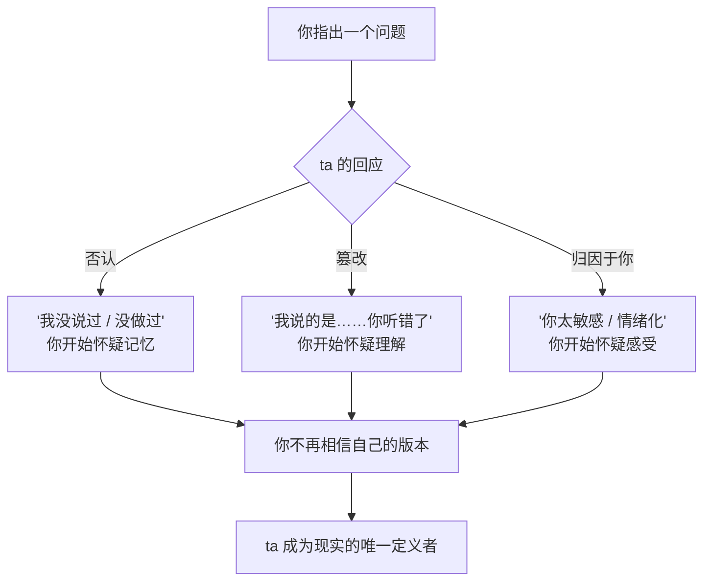
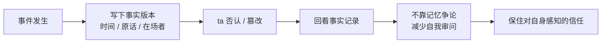
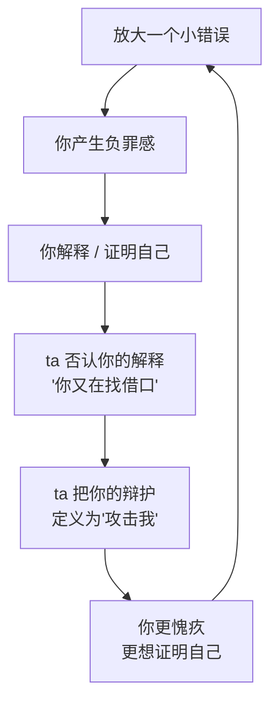
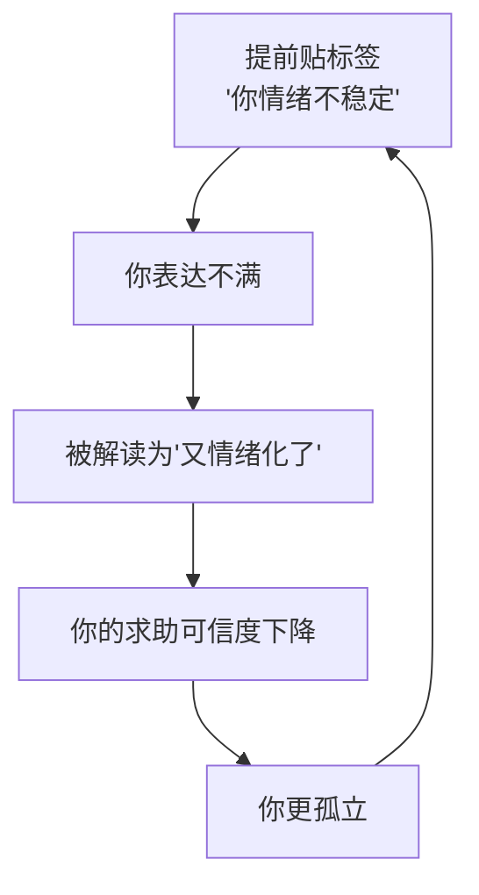

# 第17章 煤气灯：现实感的争夺

这一章讲一个词：**煤气灯。**

这个词来自一部老电影《煤气灯下》，讲的是一个丈夫通过调暗煤气灯、又坚称灯没变，一步步让妻子怀疑自己的眼睛，最后怀疑自己的神志。

在现实关系里，煤气灯不是一个具体的动作，而是一整套操作。它的目标不是让你"相信一个谎言"，而是**让你丧失对自身感知的信任**。当你不确定自己看到的是不是真的、记得的是不是对的、感觉的是不是合理的，你就只能依赖另一个人的版本来定义现实。

而那个版本，由 ta 提供。

---

## 17.1 否认、篡改与归因于目标

### 三种基本操作

煤气灯的操作，主要有三种：

**第一种：否认。**

明明发生过的事，ta 说没发生。

"我没说过那样的话。"
"我什么时候答应过你？"
"我根本没有那样做。"
"你是不是记错了？"

否认的力量，不在于 ta 说的是不是真的，而在于它让你**无法确定**。你明明记得 ta 说过，但 ta 否认得那么笃定，你会开始想："是不是我真的记错了？"

**第二种：篡改。**

事情发生过，但 ta 把版本改了。

你记得 ta 说"我周末陪你"，ta 说"我说的是'我尽量'，你自己听错了"。
你记得 ta 答应过某件事，ta 说"我当时的条件是……你只听了前半句"。
你记得 ta 先发火，ta 说"是你先阴阳怪气的，我才生气"。

篡改比否认更隐蔽，因为它保留了一部分事实，只改了关键细节。你很难说"你完全在编"，你只能说"不是这样的"，而"不是这样的"很难证明。

**第三种：归因于目标。**

你的情绪反应，被重新定义成"你有问题"的证据。

"你太敏感了。"
"你反应过度了。"
"你怎么这么情绪化？"
"你是不是有病？"
"难怪你前任也受不了你。"

归因于目标的作用，是**把你对越界的反应，变成你的缺陷**。你本来是想指出"ta 做了一件让你不舒服的事"，结果变成了"你为什么要为这件事不舒服"。话题从"ta 的行为"转移到了"你的情绪"。

这三种操作的共同目标，是让你产生一种感觉：**"我是不是真的有问题？"**

一旦你开始问这个问题，ta 就赢了。因为从这一刻起，你不再相信自己的感知，你开始需要 ta 来告诉你"什么是真的"。

### 为什么煤气灯这么有效

因为人的记忆和感知，本来就不是百分之百可靠的。

你回想一下，你有没有过这种经历：你记得某件事发生过，但别人说没有；你记得某句话是 A 说的，后来发现是 B 说的；你记得某个细节，但当时在场的人都说不是那样。

这些经历很正常。人的记忆是重构的，每次回忆都会有一点偏差。煤气灯就是利用这一点：它不断地在你的记忆上"打补丁"，让你对自己的记忆产生怀疑。

而当一个人反复否认你记得的事、反复篡改你说过的话、反复把你的情绪定义为"过度反应"，你会慢慢形成一个信念："我的感知不可靠，我的记忆有问题，我的情绪不正常。"

这个信念一旦形成，你就失去了独立判断的基础。你不再相信"我看到的"，你只相信"ta 说的"。

### 一个具体的防御动作：只写事实

防御煤气灯，有一个非常具体的动作：**在回应之前，先把事件的事实版本写下来。**

不是写你的感受，不是写你的解释，只写事实：时间、地点、原话、在场的人、发生了什么。

比如：

> 3 月 5 日晚上 9 点，我们在客厅。ta 说"我明天陪你去看电影"。我说"好"。3 月 6 日，ta 说"我今天有事"。我问"你不是说今天陪我吗"，ta 说"我没说过，你记错了"。当时在场：只有我们两个人。

为什么只写事实？因为事实是煤气灯最难篡改的东西。感受可以争论，解释可以扭曲，但"谁在什么时候说了什么"是相对固定的。你把它写下来，就有了一个可以回看的锚点。下次 ta 再否认，你可以翻出来看，而不是靠记忆跟 ta 争。

这个动作的另一个作用，是**打断"自我审问"的循环**。煤气灯最消耗人的地方，是它会让你反复在脑子里回放："我是不是记错了？我是不是太敏感了？我是不是真的有问题？"写事实，是把注意力从"我有没有问题"拉回到"发生了什么"。

### 小练习

下一次有人让你对某件明确发生过的事产生怀疑时，在回应之前，先把事件的事实版本写下来：时间、原话、在场者。

**只写事实，不写解释。**

连续做一周，观察"自我审问"（我是不是记错了 / 太敏感了）的频率是否变化。

这个练习不是让你变得固执，而是让你在"被否认"的时候，有一个可以站住的地方。事实记录不会替你判断谁对谁错，但它能帮你保住一个最基本的东西：**你对自己经历的信任。**

---

## 17.2 煤气灯与自尊摧毁的协同

### 两个操作，一个循环

第 16 章讲了自尊摧毁：放大你的小错误，让你产生负罪感，然后你为了自责而疯狂证明自己。

这一节讲它和煤气灯的协同。两者合起来，会形成一个特别难破的循环：

1. **ta 放大你的一个小错误**。"你怎么又忘了？你就是不上心。"
2. **你产生负罪感**。"对不起，我不是故意的。"
3. **你试图解释或证明自己**。"我这次是真的忙，我下次一定注意。"
4. **ta 否认你的解释**。"你又在找借口。"
5. **ta 把你的自我辩护重新定义**。"我说一句你顶十句，你就是在攻击我。"
6. **你更愧疚，更想证明自己**，回到第 1 步。

这个循环的功能，是**同时摧毁两样东西**：

- 你的**自我评价**（"我总是做不好"）。
- 你对**自身感知的信任**（"我解释的都不算数，ta 说的才是真的"）。

前者让你觉得自己不够好，后者让你觉得自己的判断不可靠。两者合起来，你就失去了"我自己可以判断"的能力，只能依赖 ta 的评价。

### 为什么"越解释越糟"

很多人在这个循环里，会有一个困惑："我明明是想解释清楚，为什么越解释越糟？"

因为在这个循环里，**解释本身就是一个陷阱**。

ta 要的不是"解释清楚"，ta 要的是"你认错"。你一解释，ta 就说"你找借口"；你一辩护，ta 就说"你攻击我"；你一沉默，ta 就说"你默认了"。无论你怎么回应，ta 都能把你的回应重新定义成"你有问题"。

这就是为什么第 17.1 节要强调"只写事实"。因为在"解释—被否认—再解释"的循环里，你永远赢不了。你唯一能做的，是**跳出循环**：不解释动机，只陈述事实和边界。

比如：

- 不说："我不是不上心，我这次是真的忙，你听我解释……"
- 改说："这件事我确实忘了，我下次会注意。你现在这样说，我不太舒服，我们晚点再聊。"

前者是在"证明自己不是坏人"，后者是在"陈述事实 + 设边界"。前者会进入循环，后者会打断循环。

### 煤气灯和自尊摧毁的分工

你可以这样理解两者的分工：

- **自尊摧毁**负责让你觉得"我不够好"。
- **煤气灯**负责让你觉得"我的判断不可靠"。

前者攻击你的价值，后者攻击你的认知。两者合起来，你就变成了一个"既觉得自己不好、又不敢相信自己判断"的人。而这样的人，最容易依赖另一个人的评价来活着。

### 小练习

回想一次你"试图解释自己"但越解释越糟糕的互动。

拆解这个循环：

1. 你解释的是什么？
2. 对方如何回应你的解释？
3. 你是否感到自己的解释被重新定义为"找借口"或"攻击"？
4. 如果这个循环反复出现，你当时的反应是什么？是继续解释，还是停下来？

如果这个循环反复出现，标记它——它是煤气灯与自尊摧毁的协同操作。

这个练习的关键，是让你看见：**有些对话，不是为了解决问题，而是为了让你认错。** 你越努力解释，越是在给 ta 提供"你有问题"的素材。识别出这种对话，你才能选择不参与。

---

## 17.3 "疯狂"标签的预先部署

### 提前给你贴一个标签

煤气灯的进阶操作，是**预先将目标定义为"情绪不稳定的人"**。

典型句式：

- "你太情绪化了。"
- "你总是这样。"
- "你这个人就是容易想太多。"
- "难怪你前任也受不了你。"
- "你家人是不是也觉得你脾气不好？"

这些话的功能，不是描述事实，而是**预先中和目标未来的求助或反抗**。

你想，如果有一天你终于受不了了，去跟朋友说"ta 对我做了这些事"，会发生什么？如果 ta 已经提前跟朋友说过"ta 这个人情绪不稳定，容易想太多"，那你的求助，在朋友那里就会被解读成"又情绪化了"。

这就是"预先部署"的意思：**在你还没开始求助之前，ta 已经把你"可能求助"的可信度给削弱了。**

### "疯狂"标签的两种用法

这个标签有两种用法：

**第一种：对内。** 让你自己相信"我情绪不稳定"。当 ta 反复说"你太敏感""你反应过度""你总是这样"，你会慢慢接受这个标签，开始在表达不满之前先自我审查："我是不是又反应过度了？""我是不是太情绪化了？"

**第二种：对外。** 让周围的人相信"ta 情绪不稳定"。ta 会在共同朋友面前、在家人面前，轻描淡写地提一句"ta 最近情绪不太好""ta 就是这样，容易激动""你别跟 ta 计较"。这些话不会留下明显的痕迹，但会在别人心里种下一个印象。

当这两种用法合起来，就形成了一个闭环：你自己不敢表达，别人也不相信你的表达。你被孤立在一个"说了也没人信"的位置上。

### 标签的识别：是在描述行为，还是在削弱可信度

判断一句话是不是"疯狂标签"，有一个很具体的标准：**它是在描述一个具体行为，还是在给你这个人定性？**

- "你刚才说话声音很大，我有点被吓到。"——描述行为，具体，可讨论。
- "你总是这么情绪化。"——定性，模糊，不可讨论。
- "你这次的反应，我觉得有点过了，我们能聊聊吗？"——描述行为 + 邀请讨论。
- "你就是有病，难怪没人受得了你。"——定性 + 人身攻击。

前者是反馈，后者是标签。反馈的目的是解决问题，标签的目的是定义你。

还有一个辅助判断：**这个标签，是不是在你表达不满或设边界的时候出现的？**

你刚说"我不喜欢你这样"，ta 说"你怎么这么情绪化"——这个标签的功能，不是描述你的情绪，而是**让你为"提出不满"这件事感到羞耻**。它让你觉得，表达不满本身就是"情绪化"的证据，于是你下次就不敢表达了。

### 小练习

回想对方是否曾在你表达不满或试图设边界时，将你的反应定义为"情绪化""敏感""小题大做"。

记录这些时刻，然后问：这个标签是在**描述你的行为**，还是在**预先削弱你未来求助的可信度**？

这个练习不是让你否认自己的情绪。你有情绪是正常的，情绪不需要被消灭。你要分辨的是：**对方是在回应你的情绪，还是在用你的情绪来否定你的判断？**

前者是"我看到你很难过，我们聊聊"；后者是"你太情绪化了，所以你说的不算"。

---

## 本章小结

这一章讲了煤气灯的三种操作和一个进阶：

1. **否认、篡改、归因于目标**。否认让你怀疑记忆，篡改让你怀疑理解，归因让你怀疑感受。三者合起来，让你丧失对自身感知的信任。防御动作：只写事实，不写解释。
2. **煤气灯与自尊摧毁的协同**。放大错误 → 负罪感 → 解释 → 被否认 → 被定义为"攻击" → 更愧疚。这个循环同时摧毁自我评价和对自身感知的信任。识别方法：看这个"越解释越糟"的循环是否反复出现。
3. **"疯狂"标签的预先部署**。提前把你定义为"情绪不稳定"，对内让你自我审查，对外削弱你的求助可信度。识别方法：看这个标签是在描述行为，还是在给你定性，以及它是不是在你表达不满时出现。

最后留一个判断问题：

**在这段关系里，你还能相信自己的感觉吗？**

如果你开始频繁地问自己"我是不是记错了""我是不是太敏感了""我是不是真的有问题"，那你要警惕：这可能不是你的问题，而是有人一直在让你怀疑自己。

煤气灯最狠的地方，不是它让你相信一个谎言，而是它让你**不再相信自己**。而一个人一旦不相信自己，就会把定义现实的权力，交给那个最会说话的人。

下一章，我们讲抛弃—回吸与间歇性强化。你会看到，"离开又回来"的循环，为什么比"一直不好"更让人离不开。
