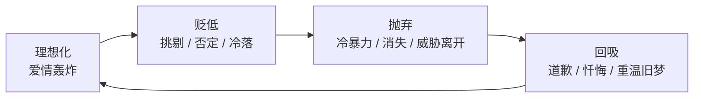
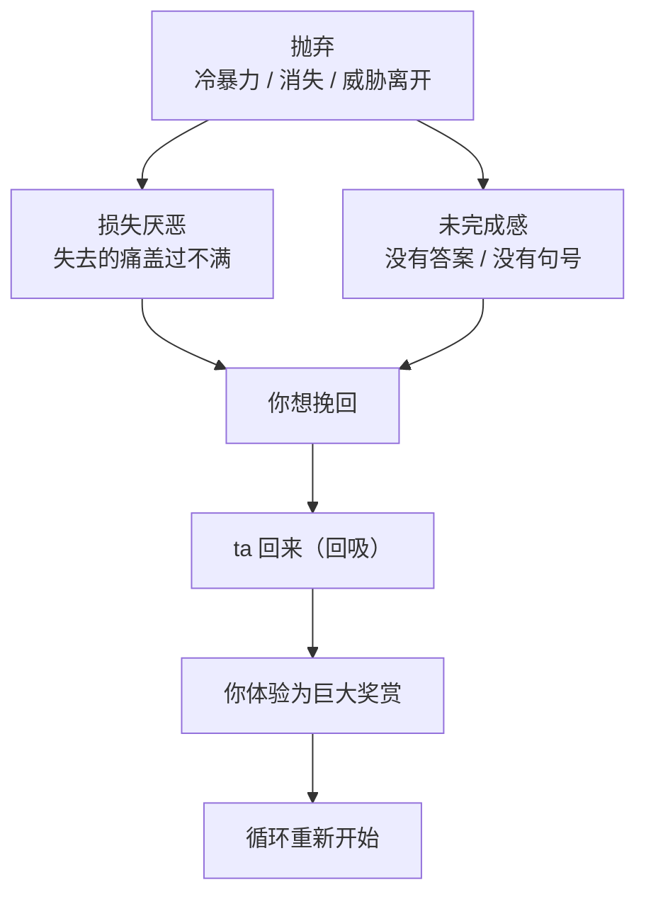
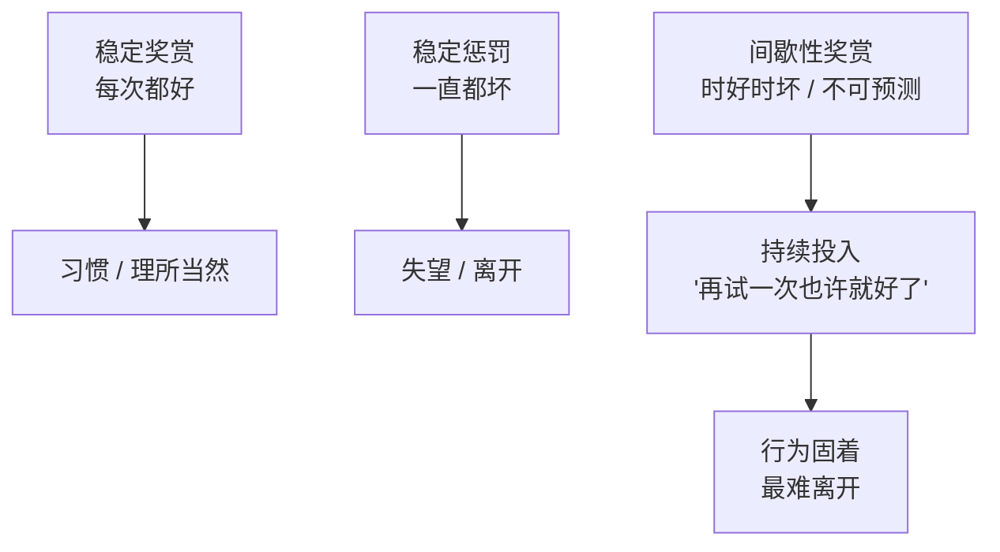
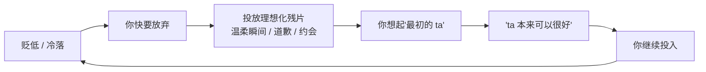

# 第18章 抛弃—回吸与间歇性强化

这一章讲一个循环：**走开，再回来。**

很多人想不通：一段关系明明那么痛苦，为什么受害者不离开？答案往往不是"ta 不够勇敢"，而是这段关系里有一个机制，让人**离不开**。这个机制叫"抛弃—回吸"，它的底层是"间歇性强化"。

简单说：如果一个人一直对你好，你会习惯；如果一个人一直对你坏，你会离开；但如果一个人**时好时坏、不可预测**，你会被牢牢钩住。

这一章讲清楚这个循环是怎么运转的，以及为什么它比"一直不好"更难摆脱。

---

## 18.1 抛弃：损失厌恶与未完成感

### 自恋型虐待循环的四个阶段

在自恋型虐待的研究里，一段操控关系通常会经历四个阶段：

1. **理想化**（爱情轰炸）：高浓度关注、过早承诺、把你捧上天。
2. **贬低**：开始挑剔、否定、比较、冷落。
3. **抛弃**：冷暴力、突然消失、威胁分手、断崖式撤出。
4. **回吸**：道歉、忏悔、重温旧梦、变回"最初那个完美的人"。

这四个阶段不是一次性的，而是**循环**的。理想化 → 贬低 → 抛弃 → 回吸 → 理想化 → 贬低 → ……每转一圈，受害者就陷得更深一点。

这一节先讲"抛弃"。

### 抛弃的几种形式

抛弃不一定是"分手"。它有很多种形式：

- **冷暴力**。突然不回消息、不接电话、回家不说话，用沉默惩罚你。
- **突然消失**。毫无预兆地断联几天，让你不知道发生了什么。
- **威胁分手**。"既然你这样，那我们算了吧。"
- **断崖式抛弃**。在你最依赖 ta 的时候（生病、失业、怀孕、家人去世），突然撤出。
- **情感撤离**。人还在，但温度没了：不再关心你、不再碰你、不再回应你的情绪。

这些形式的共同点，是**制造失去的恐惧**。

### 损失厌恶：失去比得到更痛

人有一种心理倾向，叫"损失厌恶"：**失去一样东西的痛苦，比得到同样东西的快乐更强烈。**

你捡到一百块的快乐，大概持续半天；你丢了一百块的难受，可能持续好几天。这就是损失厌恶。

抛弃利用的就是这个：当 ta 突然撤出，你感受到的不是"少了一个人"，而是"失去了一段关系、一个未来、一个身份"。这种失去的痛，会盖过你之前所有的不满。你会开始想："是不是我做错了什么？""是不是我不够好？""只要 ta 回来，我什么都愿意改。"

于是，之前那些让你痛苦的贬低、冷落、控制，在"失去"面前，突然变得可以忍受了。这就是抛弃的第一个功能：**用失去的恐惧，覆盖掉关系里的问题。**

### 未完成感：没有结局的结局

抛弃还有一个更隐蔽的功能：**制造未完成感。**

如果一段关系有一个清晰的结局——比如 ta 明确说"我们结束了，原因是什么，以后不再联系"——你反而容易走出来。因为你有答案，有句号，可以开始哀悼和放下。

但抛弃往往没有句号。ta 突然消失，你不知道为什么；ta 冷暴力，你不知道自己错在哪；ta 说"我们算了吧"，但过几天又回来。这种"没有结局"的状态，会让你的大脑一直处于"未完成"的紧张里，反复回放、反复猜测、反复等待。

心理学里有个"蔡格尼克效应"：人对未完成的事，记得比已完成的事更清楚。未完成的关系，就像一首没听完的歌，会在你脑子里循环播放，让你无法放下。

### 抛弃不只是惩罚，更是"重置"

很多人以为，抛弃是"惩罚"——ta 生气了，所以冷落你。这不完全对。

抛弃更深的功能，是**重置关系**。

在目标经历失去的恐惧之后，任何形式的"回来"，都会被体验为巨大的奖赏。ta 不需要做什么特别的事，只需要"回来"，你就会感激涕零。于是关系被重置了：之前的不满被清空，你又回到了"只要 ta 在就好"的状态。

这就是为什么很多受害者会说："ta 每次回来，我都觉得我们重新开始了。"不是真的重新开始，是**循环重新开始**。而每转一圈，你的底线就低一点，ta 的控制就深一点。

### 小练习

如果你经历过关系中的"突然冷却"或"威胁离开"，记录当时你的身体反应：焦虑？失眠？反复查看消息？吃不下饭？心慌？

然后问：这个反应是针对**失去这段关系**，还是针对**失去对关系的控制感**？

这个区分很重要。如果是前者，说明你确实在乎这段关系；如果是后者，说明你被"不确定"钩住了——你不一定多爱 ta，你只是受不了"不知道结局"。

而"受不了不确定"，正是间歇性强化最想要的反应。

---

## 18.2 回吸：不可预测的奖赏与行为固着

### 回吸：变回"最初那个完美的人"

"回吸"（hoovering，原意是"用吸尘器把你吸回来"）是循环的第四个阶段。

它的典型形态是：ta 突然变回"最初那个完美的人"。

- 道歉："我知道我错了，我以后不会了。"
- 忏悔："我这几天想了很多，我不能没有你。"
- 重温旧梦："还记得我们第一次去的那家店吗？我带你去。"
- 承诺："我改了，你再给我一次机会。"
- 脆弱："我其实很怕失去你，只是我不会表达。"

这些表演的功能，是**验证"这招对你有效"**。一旦你回头，ta 就知道：只要我道歉、只要我变回那个温柔的人，你就会回来。于是循环重新开始，而且往往升级——因为 ta 知道你的底线在哪，下一次可以推得更深。

### 间歇性强化：为什么"时好时坏"比"一直坏"更钩人

回吸之所以有效，是因为它提供的是**不可预测的奖赏**。

行为心理学里有一个经典发现：**间歇性强化（intermittent reinforcement）产生的行为固着，比稳定强化更强。**

什么意思？举个例子：

- 如果一只老鼠每次按杠杆都有食物，它饿了会按，饱了就不按。
- 如果一只老鼠按杠杆**有时**有食物、**有时**没有，而且没有规律，它会**一直按**，按到精疲力竭。

人也是一样。如果一个人稳定地对你好，你会习惯，甚至觉得理所当然；如果一个人稳定地对你坏，你会离开；但如果一个人**时好时坏、毫无规律**，你会陷入一种"再试一次，也许这次就有回报"的状态，不断地投入、不断地等待。

赌场就是靠这个运转的：不是每次都赢，也不是每次都输，而是"不知道下一次会不会赢"。这种不确定，比确定的奖励更让人上瘾。

### 为什么"再努力一点"是个陷阱

间歇性强化的核心陷阱，是让你相信"**再努力一点，就能回到最初**"。

你会想："ta 以前那么好，现在只是暂时这样。只要我再体贴一点、再包容一点、再改一点，ta 就会变回那个温柔的人。"

这个想法之所以难破，是因为它**部分是真的**：ta 确实曾经温柔过，而且 ta 偶尔还会温柔一下（理想化残片）。这些"偶尔的温柔"，就是间歇性强化里的"奖赏"，它们让你相信"那个 ta 还在"，只是"需要你更努力才能唤醒"。

但真相是：**那个"温柔"不是被你的努力唤醒的，而是被 ta 的策略投放的。** ta 在你快要放弃的时候温柔一下，不是因为你做对了什么，而是因为你需要被拉回来。

### 回吸的时间点：它是跟着你的退出信号走的

判断回吸，有一个很具体的观察方法：**看"回来"的时间点。**

- 如果 ta 的"回来"，是发生在**你准备离开**的时候，那它不是"关系自然修复"，而是"回吸"。
- 如果 ta 的"回来"，是发生在**关系自然需要改善**的时候（比如你们好好沟通之后、双方都愿意调整），那它可能是真的修复。

区别在于：回吸是被你的**退出信号**触发的，修复是被**关系本身的需要**触发的。

你可以把每一次"回来"的时间点标出来，然后看它们跟你"想走"的时间点，有没有相关性。如果每次 ta 变好，都恰好在你开始冷淡、开始设边界、开始提分手之后，那这个"变好"就很可能是策略，而不是改变。

### 小练习

如果你经历过"离开后又回来"的循环，标记每一次"回来"的时间点。

然后问：这些"回来"是发生在我**准备离开**的时候，还是发生在关系**自然需要改善**的时候？

把时间点标出来后，观察"回吸"与"我的退出信号"之间的相关性。

这个练习不是让你否定所有的"和好"。和好是可能的，改变也是可能的。但真正的改变，会伴随着**持续的行为变化**，而不是只在你要走的时候出现。如果"改变"只在你走的时候出现，那你看到的不是改变，是急救。

---

## 18.3 理想化残片的维持功能

### 残片：为"这可能是真的"提供证据

第 14 章讲过"理想化残片"：短暂的、高浓度的、让你想起"最初那个 ta"的瞬间。

在抛弃—回吸的循环里，残片承担一个更具体的功能：**为间歇性强化提供"这可能是真的"的证据。**

你想，如果 ta 一直坏，你早就走了。你之所以留下，是因为 ta 偶尔会好。那些"偶尔的好"，就是残片。它们让你相信："ta 本来可以很好，只是现在遇到了问题""只要解决了问题，我们就能回到从前。"

残片不需要多，也不需要持续。一次温柔的眼神、一句"只有你能让我这样"、一次精心安排的约会，就足够让你再撑一段时间。

### 残片是"情感工资"，而且越来越少

有一个比喻很形象：**残片是 ta 支付给你的"情感工资"。**

在关系初期，ta 支付得很慷慨：密集的关注、大量的甜言蜜语、频繁的温柔瞬间。你被这份"工资"吸引，投入了感情。

到了贬低阶段，工资开始减少：温柔变少了，关注变少了，甜言蜜语变少了。但 ta 不会完全停发，因为完全停发，你就会走。ta 会**偶尔发一点**，刚好够你留下来。

到了后期，工资越来越少，但你对"工资"的依赖越来越深。你已经投入了太多，离开的成本太高，所以你只能靠那一点点残片活着。这就是为什么很多受害者会说："ta 现在虽然不像以前那么好，但偶尔还是会对我好的。"

这句话的潜台词是：**我正在用越来越少的回报，维持一个越来越大的投入。**

### 时间分布：最好的瞬间在哪里

判断残片是不是在"支付工资"，有一个很直观的方法：**看最好的瞬间，分布在关系的哪个阶段。**

写下你当前（或最近）关系中"最好的三个瞬间"和"最差的三个瞬间"。

然后标注：最好的瞬间，发生在关系的哪个阶段？

- 如果三个最好的瞬间，全部集中在最初三个月，而近三个月只有最差的瞬间，那说明"工资"在递减。
- 如果最好的瞬间，均匀分布在整段关系里，那说明关系有稳定的好。
- 如果最好的瞬间，总是出现在你快要放弃的时候，那说明残片是"急救"，不是"常态"。

这个时间分布，比任何单次的感受都更能说明问题。因为单次的感受会被情绪放大，而时间分布是客观的。

### 小练习

写下你当前（或最近）关系中"最好的三个瞬间"和"最差的三个瞬间"。

标注最好的瞬间发生在关系的**哪个阶段**。

如果最好的瞬间全部集中在最初三个月，而近三个月只有最差的瞬间，标记这个时间分布——理想化残片是否正在被用来支付越来越少的"情感工资"？

这个练习可能会让你很难受，因为它逼你面对一个事实：**你坚持的，可能不是这段关系的现在，而是它的过去。** 但看清这个事实，是走出来的第一步。

---

## 本章小结

这一章讲了一个循环：

1. **抛弃**。用冷暴力、消失、威胁离开，制造损失厌恶和未完成感。功能不只是惩罚，更是**重置关系**：在失去的恐惧之后，任何"回来"都被体验为巨大奖赏。
2. **回吸**。变回"最初那个完美的人"，提供不可预测的奖赏。间歇性强化的行为固着，比稳定奖赏更强，让你陷入"再努力一点就能回去"的陷阱。识别方法：看"回来"的时间点，是不是跟着你的退出信号走。
3. **理想化残片**。为"这可能是真的"提供证据，是 ta 支付给你的"情感工资"，而且越来越少。识别方法：看最好的瞬间分布在关系的哪个阶段。

最后留一个判断问题：

**你留下的原因，是这段关系现在很好，还是你还在等它变回从前？**

如果现在很好，那留下是选择。
如果你在等它变回从前，那你要问自己：那个"从前"，是真实存在过，还是被精心设计过？而那个"变回去"的承诺，是改变，还是下一次循环的入场券？

下一章，我们讲社交隔离与叙事控制。你会看到，"为你好"的隔离、飞猴的传话、先发制人的抹黑，是怎么让你在需要帮助时，发现身边已经没有人的。
