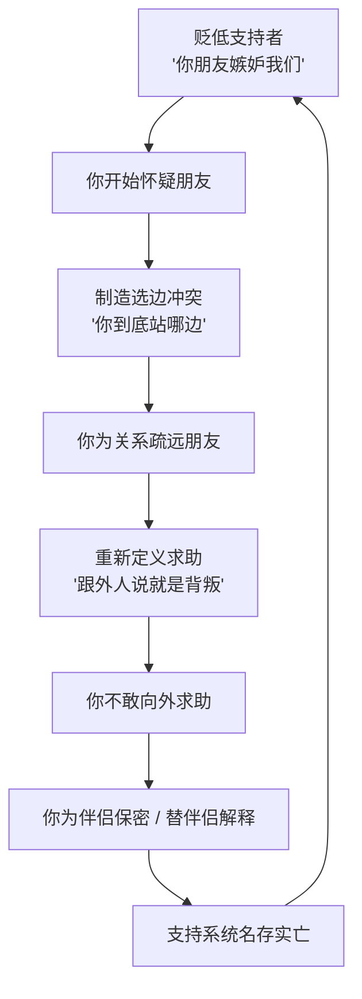
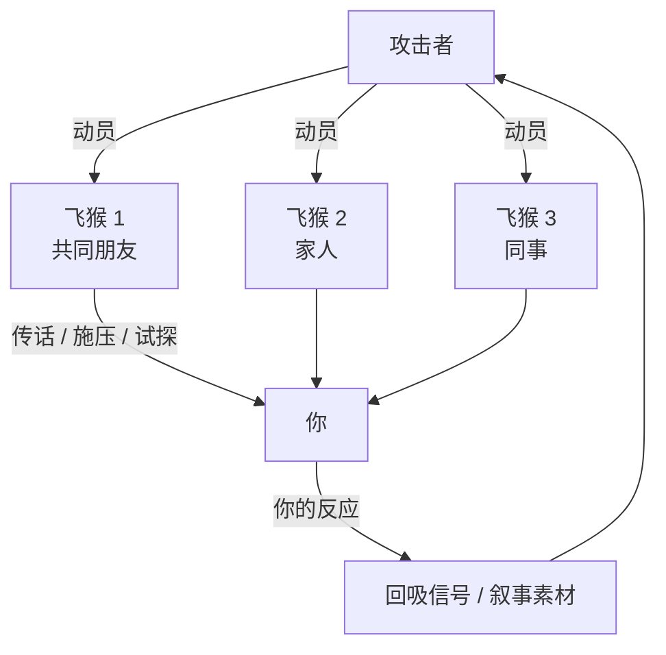
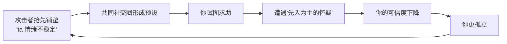

# 第19章 社交隔离与叙事控制

第 13 章讲了社交隔离的"前置操作"：贬低你的朋友、制造选边冲突、把求助重新定义成背叛。

这一章讲它的"完成形态"：**当你需要外部意见时，你发现身边已经没有一个人能给你独立的参照。**

这一章还讲一个配套操作：**叙事控制。** 攻击者不仅让你孤立，还提前定义"你是什么样的人"，让你在试图求助时，遭遇"先入为主"的怀疑。

一个负责切断你的连接，一个负责污染你的名声。两个一起用，你就变成了一个"说了也没人信"的人。

---

## 19.1 社交隔离的渐进完成

### 完成形态：不是"没有朋友"，而是"没有可信的参照"

社交隔离的完成形态，不是"你被关在家里，谁也见不到"。那太明显了，容易被识别、被反抗。

它的完成形态是：**你还有朋友，还有家人，但你在需要意见时，不再找他们；或者找了，也不说真话；或者说了，也觉得他们"不懂"。**

形式上，你的社交圈还在；实质上，你的支持系统已经空了。

这个区别很重要。因为"没有朋友"是一个看得见的困境，容易引起警觉；而"有朋友但不敢说"是一个看不见的困境，你自己都可能意识不到。

### 隔离完成的几个标志

社交隔离完成时，通常有这几个标志：

1. **你开始为伴侣"保密"**。朋友问起你们的情况，你会说"挺好的"，哪怕你心里有很多不满。你不想让朋友知道，因为"说了会引发争吵""伴侣会不高兴"。
2. **你开始替伴侣"解释"**。朋友说"ta 这样不太好吧"，你会说"ta 最近压力大""ta 不是故意的""你不了解 ta"。你在朋友面前，成了伴侣的辩护人。
3. **你开始觉得"外人不懂"**。你慢慢相信"只有 ta 懂我""我们的事，外人插不了手"。这不是因为外人真的不懂，而是因为你的叙事已经被 ta 垄断了。
4. **你减少了"单独"的社交**。你和朋友见面，总要带上伴侣，或者要报备、要解释、要提前"申请"。慢慢地，你就不想见了，因为见一次太麻烦。
5. **你在需要帮助时，第一反应是"不能说"**。你遇到困难，脑子里第一个念头不是"找谁帮忙"，而是"不能让 ta 知道""不能让朋友知道""说了会更麻烦"。

### 叙事垄断：ta 成为唯一的现实校准器

隔离完成之后，会发生一件很关键的事：**ta 成为你唯一的现实校准器。**

什么叫现实校准器？就是我们判断一件事是否合理时，依赖的那个参照。

你觉得"ta 这句话是不是有点过分"，如果朋友说"确实过分"，你就确认了自己的感觉；如果朋友说"还好吧"，你可能会怀疑自己。外部意见的作用，不是替你决定，而是给你一个参照。

当这个参照被切断，你就只能依赖 ta 的判断。ta 说你敏感，你就觉得自己敏感；ta 说你小题大做，你就觉得自己小题大做；ta 说你离不开 ta，你就真的觉得自己离不开。

这就是隔离最危险的地方：它不只是让你"没人陪"，而是让你**失去了判断现实的能力**。而一个人一旦失去判断现实的能力，就很难再靠自己走出来。

### 支持系统健康度自查

判断你的支持系统是否健康，有一个很具体的自查方法：

列出三个你在感到困惑时可以立即联系的人。

然后问：在过去三个月里，你是否曾在需要他们的时候**没有联系**？

如果原因中出现以下这些，标记这个原因：

- "不想让伴侣知道。"
- "怕伴侣不高兴。"
- "觉得说了会引发争吵。"
- "说了伴侣会觉得我背叛 ta。"
- "朋友可能会劝我分手，我不想听。"

这些原因，是隔离机制正在运作的可检测痕迹。不是别人把你关起来了，是你自己开始**为了这段关系，主动减少和外界的连接**。

### 小练习

做一次"支持系统健康度"自查：

列出三个你在感到困惑时可以立即联系的人。然后问：在过去三个月里，你是否曾在需要他们的时候没有联系？

如果原因中出现"不想让伴侣知道""怕伴侣不高兴""觉得说了会引发争吵"，标记这个原因。

这个练习不是让你在关系和朋友之间二选一。健康的关系，不需要你放弃朋友；它应该让你有更多的连接，而不是更少。如果你发现自己在为了维持关系而不断减少和外界的联系，那这个"减少"本身，就是最值得注意的信号。

---

## 19.2 飞猴与先发抹黑

### 飞猴：被动员来传话的第三方

"飞猴"这个词，来自《绿野仙踪》：邪恶女巫派一群飞猴去执行她的命令。

在操控关系里，飞猴指的是**被利用来传递信息、施压或监视的第三方**。他们可能是共同朋友、家人、同事，甚至是不太熟的人。

飞猴的常见任务包括：

- **传话**。"ta 让我跟你说，ta 其实很关心你。"
- **施压**。"ta 都这样了，你就不能原谅 ta 吗？"
- **监视**。"ta 最近怎么样？有没有跟别人来往？"
- **试探**。"ta 说想跟你聊聊，你愿不愿意见？"
- **背书**。"ta 人其实挺好的，你别想太多。"

飞猴的关键特征，是**他们往往不知道自己在被利用**。他们以为自己是在"帮忙""关心""调解"，实际上是在执行攻击者无法直接完成的社交控制。

这就是飞猴的可怕之处：它把操控**外包**了。攻击者不需要亲自出场，就能传递信息、施加压力、试探你的状态。而且因为是"第三方"在说，你会更难反驳，因为反驳会被解读为"你不识好人心"。

这张图最关键的是最后一步：**你的反应，会被反馈给攻击者。**

如果你对飞猴传递的信息表现出软化（"其实我也挺想 ta 的"），攻击者就获得了"回吸可以开始"的信号。如果你表现冷淡（"我不想谈这个"），攻击者就获得了"ta 果然不可理喻"的叙事素材。

所以，飞猴不只是传话工具，还是**情报收集工具**。你每一次回应，都在给对方提供信息。

### 先发抹黑：在你醒悟之前，先定义叙事

飞猴的另一个功能，是配合"先发抹黑"。

先发抹黑，指的是：在目标可能醒悟或退出之前，攻击者**抢先定义叙事的版本**。

ta 会在共同社交圈里铺垫：

- "ta 最近情绪不太稳定。"
- "ta 有点问题，总是想太多。"
- "ta 才是问题的一方，我一直在忍。"
- "我们的事，ta 跟外人说的都不是真的。"

这些话的目的，是**预先摧毁目标的可信度**。等你终于想要求助时，你会发现，朋友们已经听过一个"版本"了：在那个版本里，你是"情绪不稳定"的那一个，ta 是"一直在忍"的那一个。

于是你的求助，会遭遇"先入为主"的怀疑："是不是你想多了？""ta 看起来不像你说的那样啊。""你们是不是都有问题？"

### 为什么先发抹黑这么有效

因为人有一个认知倾向，叫"**首因效应**"：先听到的信息，会影响后续信息的解读。

如果朋友先听到"ta 情绪不稳定"，后来再听你说"ta 对我做了这些事"，朋友的大脑会自动用"情绪不稳定"来解释你的叙述："ta 可能是情绪上头了，夸大了。""ta 说的可能不是全部。"

这不是朋友坏，是人的认知本来就容易受第一印象影响。攻击者利用的，就是这个。

### 叙事溯源：这个说法最初从哪来

判断你是否正在被"先发抹黑"，有一个很具体的动作：**叙事溯源。**

具体做法：最近一次你从共同朋友那里听到关于自己的负面评价，或者"关心式担忧"（"我听说你最近状态不太好？"），顺着传播链往回推：

1. 这个说法，最初是从谁那里来的？
2. 它是在什么时候开始流传的？
3. 它是在你**做出任何需要被担忧的行为之前**，还是之后？

如果源头指向对方，而且这个说法在你**尚未做出任何需要被担忧的行为之前**就已经开始流传，标记这个时间差。

因为一个真实的"担忧"，通常是在你确实表现出问题之后才出现的；而一个"先发抹黑"，是在你还没做什么之前，就已经被安排好了。

### 小练习

做一次"叙事溯源"：

最近一次你从共同朋友那里听到关于自己的负面评价或"关心式担忧"，顺着传播链往回推——这个说法最初是从谁那里来的？

如果源头指向对方，且该说法在你**尚未做出任何需要被担忧的行为之前**就已经开始流传，标记这个时间差。

这个练习的目的，不是让你去跟朋友对质，而是让你看见：**有些"关心"，不是关心，是叙事管理的延伸。** 看清这一点，你才不会在求助时，被一个已经预设好的版本困住。

---

## 本章小结

这一章讲了隔离的完成和叙事的控制：

1. **社交隔离的完成形态**。不是"没有朋友"，而是"没有可信的参照"。标志是：为伴侣保密、替伴侣解释、觉得"外人不懂"、减少单独社交、需要帮助时第一反应是"不能说"。自查方法：看你和三个支持者的联系频率，以及"没有联系"的原因。
2. **飞猴与先发抹黑**。飞猴是被动员来传话、施压、试探的第三方，他们往往不知道自己被利用。先发抹黑是在你醒悟前抢先定义叙事，让你求助时遭遇"先入为主的怀疑"。识别方法：叙事溯源，看这个说法最初从哪来，以及它是不是在你"做出需要被担忧的行为之前"就开始流传。

最后留一个判断问题：

**当你需要帮助时，你身边还有没有一个人，是 ta 影响不到的？**

健康的关系，会允许你有独立的朋友、独立的判断、独立的支持系统。操控性的关系，会慢慢让你失去这些：不是明着禁止，而是让你自己不想联系、不敢说真话、觉得"说了也没用"。

如果你发现，你所有的求助渠道，都要经过 ta，或者都会被 ta 知道，那你已经处在一个很危险的位置上了。你需要做的，不是立刻对抗，而是**悄悄留一条 ta 不知道的线**：一个能说真话的朋友，一个能给你第二意见的人，一个在你需要时能接住你的人。

下一章，我们讲数字监控与经济杠杆。你会看到，"关心"是怎么变成监控的，"共同规划"是怎么变成经济控制的。
