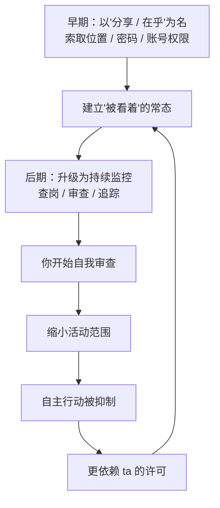
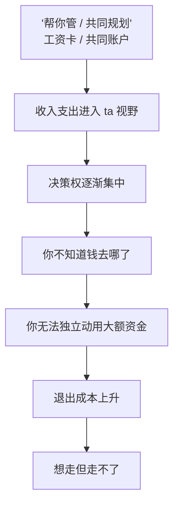
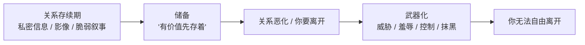

# 第20章 数字监控与经济杠杆

前几个阶段，讲的是心理层面：你觉得自己不好、怀疑自己的判断、离不开这个循环。

这一章讲两个更"硬"的层面：**数字监控**和**经济控制**。

它们不像心理操控那么隐蔽，但同样被一整套话术包装着。位置共享被说成"安全感"，查岗被说成"在乎你"，帮你管钱被说成"为我们的未来负责"。

这一章要做的，是把这些包装拆开，看看里面到底是什么。

---

## 20.1 数字监控的"关怀化"包装

### 监控是怎么被包装成"爱"的

数字监控在操控关系里的常见形态，你大概率听过或见过：

- **位置共享**。"打开定位呗，这样我知道你安全，我也放心。"
- **密码索取**。"把你的手机密码给我，夫妻之间不该有秘密。"
- **视频查岗**。"你在哪？拍个视频看看。你怎么不像是在你说的地方？"
- **社交账号审查**。"让我看看你手机，谁老是给你发消息？"
- **消费通知**。"你这个月怎么花了这么多？这笔是什么消费？"
- **消息监控**。"你回消息为什么不及时？你是不是在跟别人聊？"

这些行为，在 coercive control（强制控制）的研究里，被称为"无处不在行为"：攻击者在关系早期，就以"分享"和"在乎"为框架索取访问权；到了后期，再把这套东西升级为持续监控。

它们的共同包装是：**关心、安全感和承诺的证明。**

- "我不是不信任你，我是太在乎你了。"
- "别人家对象都这样，这很正常。"
- "你愿意把这些给我看，才说明你把我当自己人。"

这套话术最厉害的地方，是它把"交出隐私"重新定义成"给出爱"。你拒绝，就变成了"你不信任我""你藏着东西""你对我不坦诚"。

### 监控的两个功能

数字监控在操控关系里，承担两个功能：

**功能一：获取信息。**

这是最直接的。通过位置共享、消费通知、消息监控，攻击者能掌握你的行踪、你的财务状况、你的社交关系、你的情绪波动。这些信息的用途，不只是"了解你"，更是"评估你"：你值不值得信任、你有没有背着我做什么、你有没有机会接触别人。

**功能二：传递"你被看着"的信号。**

这个功能更隐蔽，也更重要。

监控的功能不只是获取信息，更是**持续传递一个信号：你被看着。**

当一个行为长期处于被监控状态时，会发生什么？你不会再"自由地"做这件事，你会**自我审查**。下班想跟同事吃饭，先想"ta 看到定位会不会问"；想买件外套，先想"ta 看到消费记录会不会说"；想见朋友，先想"ta 知道我去了哪里会不会不高兴"。

这就是监控抑制自主行动的方式：**不是禁止你做什么，而是让你自己不敢做。** 你不需要被锁起来，你只需要觉得"被看着"，就会自己缩小活动范围。

### 判断监控是不是"控制"的两把尺子

位置共享、查岗、看手机，这些行为本身不一定是控制。有的情侣确实互相分享位置，也确实觉得很安心。但判断它是不是滑向了控制，有两把尺子：

**尺子一：是"我主动给的"还是"ta 要求的"？**

如果是我主动想分享、我觉得开心，那是关系里的亲密。
如果是 ta 要求的、我其实不想给、但拒绝就要吵架，那是索取。

**尺子二：停止共享的后果是什么？**

如果我说"我想关掉位置共享"，ta 的反应是"好呀，你想关就关"，那是亲密。
如果 ta 的反应是"你为什么要关？！你是不是有事瞒我？你是不是不爱我了？"——从"讨论"变成"危机"，那这份"共享"已经不是分享，是锁链。

### 小练习

列出你当前在关系中共享的所有数字访问权：位置、密码、聊天记录、消费通知、社交账号。

对每一项问两个问题：

1. 这是我**主动提出**的，还是对方**要求**的？
2. 如果我明天单方面停止共享，对方的反应会是什么？

如果预期是"危机"而非"讨论"，标记这一项。

这个练习不是让你立刻关掉所有共享。亲密关系里有共享是正常的。你要分清楚的是：**这个共享，是它本来就让你安心，还是因为停止它的代价太高，所以你以为自己不想停？**

---

## 20.2 经济杠杆与依赖制造

### 从"共同规划"到"经济控制"

经济控制的起点，往往非常合理：**帮你管理、共同规划。**

"你的工资卡放我这，我来管账，你就不用操心了。"
"我们以后要结婚的，钱放在一起管理很正常。"
"你花钱太大手大脚，我替你把把关。"
"创业/买房/投资，需要我们一起凑钱。"

这些安排单独看，都可以解释为爱和负责。但经济控制的关键，不是"ta 管钱"这个动作，而是**控制的程度和时间**。

健康的共同规划，是两个人都有知情权、使用权、决策权，可以随时查看、可以提出异议、可以调整。
经济控制的形态是：你的收入、支出、存款，全部在 ta 的视野和决定权之下。你不知道钱去哪了，你不能动大额的钱，你做任何财务决定都要"请示"，甚至你在为自己花一点钱时，都要先过 ta 那一关。

经济控制还有一个标志：**它会提高你的退出成本。**

你想，一个人经济独立时，想离开随时可以走；但如果你和 ta 共同负债、ta 掌握你的存款、你为 ta 辞了工作、你的收入都进了共同账户，那你要离开，就要先把自己经济上"拆出来"。这个"拆"的代价，会让我很多人不敢走。

### 杀猪盘的收割：经济杠杆的极端外部版本

杀猪盘的收割阶段，是经济控制的一个极端外部版本。它的套路很熟悉：

1. **小额试水给出甜头**。先让你投一两百，然后"赚"了，还提现给你看。你信了"这个渠道靠谱"。
2. **建立信任**。"我已经跟你说了这是我吃饭的本事，别人我不告诉，因为你是自己人。"
3. **诱导大额投入**。"现在平台有活动，我帮你算过了，投五万一个月能拿八千。"
4. **借贷加码**。"你自己钱不够？可以借，我陪你借。你朋友那边能不能周转一下？"
5. **保密要求**。"这事先别跟别人说，赚钱的事越少人知道越好。家里人知道了反而坏事。"

这套操作的核心，是**先让你尝到甜头，再让你越陷越深**。甜头建立"可靠"的认知，然后在这个认知上放大投入，投入越大越不好收手，最后收割。

注意"保密要求"这一点：它同时做到两件事——防止有人给你提醒（第 19 章的隔离），以及防止你向外求救。

### 财务决策权曲线

判断一段关系的经济控制程度，有一个很直观的方法：**画财务决策权曲线。**

从关系开始到现在，标注每个重要财务决定是谁做的：

- **共同决定**：两个人商量，都有知情权和否决权。
- **你决定**：你根据自己的判断决定。
- **对方决定**：ta 决定，但你知情。
- **对方决定但你被"告知"**：ta 已经定了，你只是最后知道。

然后观察：决策权是否在向一端集中？

如果最开始是"共同决定"，后来变成"对方决定"，再后来变成"对方决定但你被告知"，那这条曲线就是在提醒你：**你和这段关系的经济利益，正在被单方面接管。**

### 小练习

画一条你当前（或最近）关系中的"财务决策权曲线"：

从关系开始到现在，标注每个重要财务决定是**共同决定、你决定、对方决定、还是对方决定但你被"告知"**。

观察决策权是否在向一端集中。然后做一个思想实验：**如果明天关系结束，你的经济状况会怎样？**

这个思想实验很重要。它不是让你现在就走，而是让你提前看清：**这段关系在你经济上留下的印记，是你可以随时拆开的，还是拆开会很疼的？** 如果拆开会很疼，那"疼"这件事本身，就是关系的一部分。

---

## 20.3 信息收割与私密材料储备

### 亲密关系赋予天然的信息访问权

亲密关系有一件很特别的事：它赋予了你访问对方私密信息的天然权利。

你知道 ta 的脆弱、ta 的秘密、ta 对亲友的真实看法；你可能有 ta 的照片、聊天记录、语音；你见证了 ta 最真实的时刻。

这些信息，在关系存续期间，是爱的表达和信任的证明。但如果这段关系进入控制阶段，它们就可能变成**武器**。

这就是"信息收割"：在关系存续期间，有策略地收集可用于日后胁迫、羞辱或控制的**私密材料（raw material）**。

### 储备逻辑：有价值的东西先存着

信息收割的一个关键特点，是**收割者未必在收集时就计划使用**。

你可能以为，如果 ta 没打算用，那收集就没问题。但社会工程视角下，有一种"储备逻辑"：**有价值的东西先存着，需要时再用。**

就像情报机构不会等要用的时候才去要情报；收割者会在关系里，大量、有意无意地收集你的私密材料，存下来。平时不用，一旦关系恶化、你要离开、你想求助于别人，这些材料就有了用途：

- 威胁你："你把这些发给你的同事/老公/爸妈看看。"
- 羞辱你："你当时跟我说这些的时候，可不是这个态度。"
- 控制你："你希望这些内容不被传出去吧？那你最好别乱说话。"
- 抹黑你："你看 ta 平时跟我发的这些，是正常朋友会说出来的吗？"（配上截图）

### 什么是"私密材料"

常见的私密材料包括：

1. **私密影像**。照片、视频、聊天里的亲密内容。
2. **聊天记录**。那些"你不该让外人看到"的对话。
3. **对亲友的负面叙述**。你吐槽过同事、家人、朋友的内容。
4. **脆弱时刻的自我暴露**。你生病时的样子、你崩溃时的倾诉、你最深的不安。
5. **财务秘密**。你偷偷存的钱、你不想让人知道的消费。

这些材料的关键特征，是它们**脱离语境后会产生完全不同的解读**。你当时说某句话，是因为信任；但如果被单独拿出来，配上另一个叙事，它就能变成伤害你的工具。

这也是为什么我们要讲"最小必要暴露"。

### 最小必要暴露：不是让你闭嘴，是让你有意识

"最小必要暴露"的意思，不是让你在亲密关系里也说话小心翼翼，而是让你**有意识**地分辨：哪些信息，是可以放心给的；哪些信息，如果关系以最不体面的方式结束，可能被用来伤害你。

这不需要你做一个冷冰冰的、处处设防的人。你只需要在做两个动作：

1. **满意再给**。"这项信息，我是因为这份关系值得，才给的。"（而不是因为被要求、被诱导、被绑架才给的）
2. **不给可以后收**。影像、债务、不可撤回的承诺，这些"给了就收不回"的东西，值得放慢一点。

你不需要为"我曾经信任过 ta"而羞耻。信任不是错误，人性不是漏洞。但"最小必要暴露"能帮你把一些特别重要的东西，留一个可以撤销的余地。

### 小练习

回想你在关系中分享过的私密内容：脆弱叙事、影像、对亲友的负面评价。

对每一项问：**如果这段关系以最不体面的方式结束，这项信息是否可能被用来伤害我？**

然后建立一条原则："什么信息，我永远不会用影像 / 文字的形式留下。"
以及："什么内容，我不在任何情绪的顶点时拿手机录下来或发出去。"

这不是制造恐惧，而是建立"最小必要暴露"的意识。真正的安全，不是你什么都不给，而是**你给的每一份，都经过你的选择，而不是被拿走。**

---

## 本章小结

这一章讲了三个硬层面的控制：

1. **数字监控**。位置共享、密码索取、视频查岗，被包装成关心、安全感、承诺的证明。它的功能不只是获取信息，更是持续传递"你被看着"的信号，抑制你的自主行动。判断的两把尺子：是我主动给的还是 ta 要求的？停止共享的后果是"讨论"还是"危机"？
2. **经济杠杆**。从"帮你管/共同规划"开始，逐步接管你的收入、支出和决策权，提高退出成本。判断方法：财务决策权曲线是否在向一端集中。
3. **信息收割**。在关系里收集可用于日后胁迫、羞辱、控制的私密材料，遵循"储备逻辑"：有价值就存着，需要时再用。防御方法：最小必要暴露——给的每一份，都经过你的选择。

最后留一个判断问题：

**在这段关系里，哪些东西是你自己的，ta 无法触碰？**

你的手机、你的密码、你的钱、你的私密内容、你的社交圈、你的支持系统、你单独决定的权利——这些"属于你的"的部分，还剩多少？

健康的关系，是两个人各自保有边界，然后在边界之内亲密。操控性的关系，是逐渐吞掉你的边界，让你的一切都在 ta 的视线之内、决策之中、掌控之下。

如果你发现，"属于你的"越来越少，那你要做的，不是立刻反击，而是**先悄悄恢复一些自主权**：一个 ta 不知道的账户、一条 ta 不知道的线、一项可以随时停止的共享。这些不是背叛，是你作为一个独立的人，本应保留的部分。

下一章开始第六部分：维持、退出与反取证。你会看到，关系是怎么在"忽冷忽热"里被维持的，攻击者是怎么计算退出时机的，以及"你太敏感了"这句话，为什么这么难反驳。