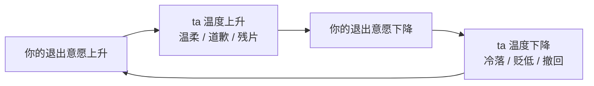
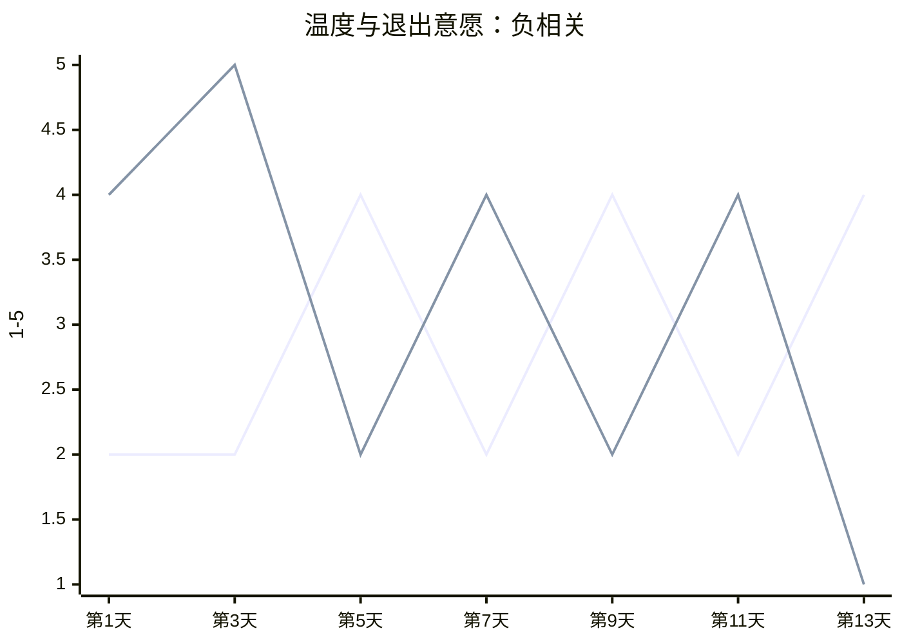
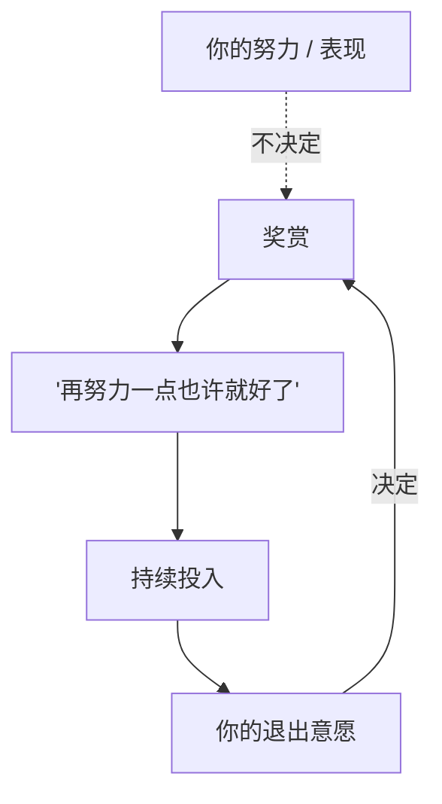

# 第21章 间歇性奖赏的节奏管理

第 18 章讲了"抛弃—回吸"的大循环。这一章讲维持阶段的精细版本：**节奏管理。**

到了关系后期，控制不再依赖持续的贬低，也不依赖持续的理想化。它依赖的是一种更精细的操作：**精确管理奖赏出现的时机。**

你快要放弃的时候，ta 给你一个温暖瞬间；你开始觉得安全的时候，ta 又撤回关注。你被放在一个持续的不确定里：既无法通过"表现好"获得稳定的善待，也无法下定决心离开。

这一章讲清楚这个节奏是怎么被管理的，以及为什么"不可预测"比"一直不好"更让人走不掉。

---

## 21.1 温度与退出意愿的相关性

### 维持阶段的新问题

到了关系的维持阶段，攻击者面对一个矛盾：

- 如果继续贬低，目标可能会受不了，走掉。
- 如果一直理想化，目标会觉得安全，可能开始要求更多，甚至离开。

所以，维持阶段不能走极端，只能走中间：**时冷时热，精确控制。**

这里的"温度"，指的是关系里的温暖程度：关注、温柔、亲密、回应。温度高，是理想化的残片；温度低，是贬低、冷落、撤回。

维持阶段的操作，不是"一直高"或"一直低"，而是**让温度在高低之间波动，而且波动的时机很有讲究**。

### 温度跟随的，是你的退出意愿

一个很关键的观察点是：**温度的变化，跟随的是什么？**

在健康的关系里，温度大致跟随"关系的实际状态"：两个人相处得好，温度就高；有矛盾，温度就低；矛盾解决了，温度又回来。它是双向的、有因果的。

在操控关系里，温度往往跟随一个很特定的变量：**你的退出意愿。**

- 你开始冷淡、开始设边界、开始提分手——ta 突然变暖。
- 你开始放松、开始觉得"也许 ta 真的改了"、开始投入更多——ta 突然变冷。
- 你快要放弃——ta 给一个温柔瞬间。
- 你重新燃起希望——ta 又回到冷淡。

这个模式，就是"温度跟随退出意愿"。它的目的不是让关系变好，而是**让你保持在"想走又走不了"的区间里**。

这张图是一个负反馈循环：你越想走，ta 越暖；你越留下，ta 越冷。循环的结果，是你永远停在中间：走不掉，也过不好。

### 为什么"温度跟随退出意愿"比"一直冷"更有效

如果一个人一直冷，你会失望，然后离开。失望是一种可以消化的情绪，它会推动你做决定。

但如果一个人时冷时热，你会陷入另一种情绪：**希望。**

希望比失望更难摆脱。因为失望是"结束了"，希望是"还没结束"。你会不断想："ta 这次是真的改了吧？""ta 刚才那个温柔，是不是说明 ta 还在乎我？""只要我再努力一点，也许就能回到从前。"

希望让你不断投入，而每一次投入，都会让你更难离开。

### 怎么观察温度曲线

判断一段关系的温度是不是被"管理"了，有一个很具体的方法：**记录两条曲线。**

连续两周，每天给两样东西打分（1—5 分）：

- **关系温度**：今天 ta 对你有多温暖？（关注、温柔、回应、亲密）
- **你的退出意愿**：今天你有多想离开这段关系？

然后把两条曲线画在一起，观察：温度曲线是**跟随你的退出意愿曲线**，还是跟随你的"表现"或"沟通努力"？

- 如果温度跟着你的退出意愿走（你想走，ta 就暖；你留下，ta 就冷），那说明温度是被管理的。
- 如果温度跟着你的表现走（你做得好，ta 就暖；你做得不好，ta 就冷），那说明关系是条件化的，但至少还有规律。
- 如果温度跟着关系本身走（有矛盾就冷，解决了就暖），那可能是相对健康的。

这张图是一个示意：温度高的时候，退出意愿低；温度低的时候，退出意愿高。两条线像跷跷板一样此起彼伏。如果你的记录里出现这种模式，那这段关系的温度，很可能不是自然波动，而是被调节的。

### 小练习

连续两周，记录每天的关系"温度"（1—5 分）和你的"退出意愿"（1—5 分）。

画两条曲线，观察温度曲线是**跟随退出意愿曲线**，还是跟随你的"表现"或"沟通努力"。

如果温度跟随退出意愿，标记这个模式。

这个练习的目的，不是让你给关系打分打到神经质，而是让你看见一个你可能已经感觉到、但说不清的模式：**这段关系的好坏，好像不是由"我们相处得怎么样"决定的，而是由"我有多想走"决定的。**

---

## 21.2 不可预测性的制造

### 间歇性强化的核心变量：不可预测

间歇性强化的核心，是**不可预测性**。

但这里有一个精细的区别：**完全随机，和"有规律的不可预测"，是两回事。**

如果奖赏完全随机（比如你今天对 ta 好，ta 可能理你，也可能不理，跟你的行为完全无关），会发生什么？你会慢慢失去控制感，觉得"我怎么努力都没用"，然后放弃。完全随机，反而会让人走掉。

所以高明的操作，不会让奖赏完全随机。它会让奖赏：

- **与你的努力脱钩**（你表现好，不一定有奖赏；你表现不好，也不一定被惩罚）。
- **与你的退出意愿相关**（你想走，ta 就给一点；你留下，ta 就收回去）。

这样，你就被放进了一个"有希望但不可控"的状态：你会觉得"再努力一点，也许就有回报"，但这个回报永远不会稳定出现。

这张图的关键，是那条虚线：**你的努力，不决定奖赏。** 你做得再好，也不保证 ta 对你好；你做得再差，也不一定被惩罚。奖赏的真正开关，在"你想不想走"那里。

这就是为什么很多受害者会觉得"我怎么做都不对""我明明很努力了，ta 还是这样"。不是 ta 没看到你的努力，而是**你的努力，从来就不是奖赏的开关**。

### "忽冷忽热"的观察点：热出现的时机

判断一段关系是不是"间歇性强化"，有一个很具体的观察点：**"热"出现的时机。**

回想一段你感到"忽冷忽热"的关系，记录一周内对方"热"的时刻和"冷"的时刻。

然后问：这些"热"，是出现在你**做了什么**之后，还是出现在你**准备放弃**之后？

- 如果"热"出现在你做了某件事之后（你体贴、你让步、你道歉），那它是**条件化的奖赏**：你做对了，ta 给你。这种关系虽然累，但至少有规律。
- 如果"热"出现在你准备放弃之后（你冷淡、你设边界、你提分手），那它是**回吸式奖赏**：你不想走了，ta 才给。这种关系是没有规律的，因为你永远不知道"我做什么"才能换来 ta 的好。

后者更危险，因为它让你永远在"努力"和"放弃"之间来回：你努力的时候，ta 冷；你想放弃的时候，ta 热。你被卡在中间，既走不了，也过不好。

### 为什么"不可预测"让人上瘾

因为不可预测的奖赏，会激活大脑的"期待系统"。

你可以想想赌场：老虎机不是每次都赢，也不是每次都输，而是"不知道下一次会不会赢"。这种不确定，会让人一直投币、一直拉杆，因为"下一次也许就中了"。

关系里的间歇性强化，是同一套机制：你不知道 ta 什么时候会对你好，所以你一直在等；ta 偶尔对你好一次，你会觉得"果然 ta 还是爱我的"；然后 ta 又冷了，你开始怀疑"是不是我哪里做错了"，然后更努力。这个循环，比稳定的好或稳定的坏，都更难打破。

### 小练习

回想一段你感到"忽冷忽热"的关系。

记录一周内对方"热"的时刻和"冷"的时刻。然后问：这些"热"是出现在你**做了什么**之后，还是出现在你**准备放弃**之后？

如果是后者，标记这个模式。

这个练习的核心，是看"热"的开关在谁手里。如果开关在你的"表现"上，那你至少知道怎么努力；如果开关在你的"退出意愿"上，那你永远努力不对，因为 ta 要的本来就不是你"表现好"，而是你"走不掉"。

---

## 本章小结

这一章讲了维持阶段的节奏管理：

1. **温度跟随退出意愿**。维持阶段不再依赖持续的贬低或理想化，而是精确管理奖赏的时机：你想走，ta 就暖；你留下，ta 就冷。目的是让你停在"想走又走不了"的区间。识别方法：画温度曲线和退出意愿曲线。
2. **不可预测性的制造**。奖赏与你的努力脱钩，与你的退出意愿相关。你努力不一定有回报，你想走才有回应。识别方法：看"热"出现在你"做了什么"之后，还是"准备放弃"之后。

最后留一个判断问题：

**这段关系里的"好"，是你能挣来的，还是只能等来的？**

如果能挣来（你做对了，ta 就对你好），那它有规律，可以商量。
如果只能等来（你不知道 ta 什么时候会对你好，只能等 ta 心情好、等 ta 想留你），那它没有规律，你永远在被动地等。

而一个让你永远在等的关系，不是爱，是上瘾。它给你的不是稳定，是"下一次也许会更好"的幻觉。而那个"下一次"，永远不会真正到来。

下一章，我们讲退出时机的计算。你会看到，攻击者不是随机离开的，他们的离开，往往发生在某个特定的节点之后。
