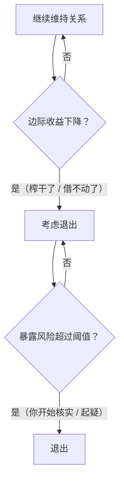
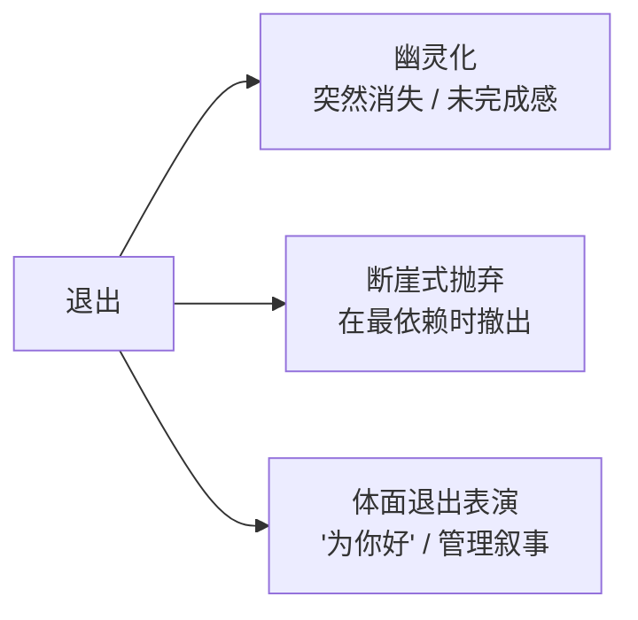
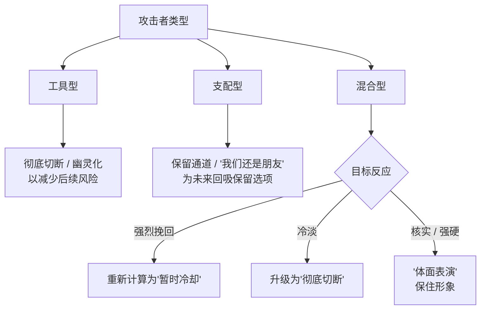

# 第22章 退出时机的计算

这一章讲**退出**。

你可能会觉得奇怪：前面讲了那么多"留住你"的技术，怎么现在讲退出了？

因为退出，是攻击链的重要一环。攻击者不是永远留在一段关系里，他们也会离开，而且**离开的方式、离开的时机，同样是被计算的。**

对受害者来说，关系的结束往往让人痛苦、迷茫："我做错了什么？""为什么突然这样？"而这一章要讲的，是这个结束的另一面：**它可能不是你做错了什么，而是对方算到了什么。**

---

## 22.1 收益递减与风险上升的阈值

### 攻击者也会算"值不值得继续"

我们前面讲过，工具型攻击者的逻辑是"关系作为渠道"，情感投入是成本、资源请求是转化。这个逻辑延伸到最后，就是一个成本收益计算：**这段关系，还值不值得继续？**

当两个条件出现时，理性的工具型攻击者就会退出：

**条件一：边际收益下降。**

你已经榨不出更多了。存款没了、借不动了、家人朋友都借遍了、再要就要闹翻了。继续留在这段关系里，投入产出比不划算。

杀猪盘的退出，就发生在这个时候：目标"无力支付"，或者开始强烈要求核实（要视频、要见面、要查平台是不是真的）。当目标既榨不出钱、又开始起疑的时候，骗子就不会再在 ta 身上浪费时间，而是直接消失，去寻找下一个目标。

**条件二：暴露风险超过阈值。**

你开始核实、开始追问、开始找共同朋友查证、开始提到报警。这些"核实行动"，会显著提高攻击者的暴露风险。风险一旦超过收益，攻击者就会选择退出，因为"不暴露"比"多赚一笔"更重要。

这张图的关键是：**退出的阈值，跟你的行为有关。**

你开始核实、开始设边界、开始不再无条件配合——这些"防御动作"，在攻击者的计算里，会被翻译成"成本上升"或"风险上升"。当风险高到一定程度，攻击者就会退出。

这就是为什么很多受害者会在攻击者消失后自责："是不是我做错了什么，他/她才走的？"——不一定是错的，你只是不小心踩到了一个阈值。

### 支配型攻击者的退出：抛弃本身就是控制

支配型攻击者的退出，比工具型更复杂。因为工具型的目标是"收割完就走"，而支配型的目标是"控制"，退出本身也可以是控制的一种。

支配型攻击者的退出，通常有两种形态：

**形态一：抛弃作为控制手段。**

用离开来惩罚你。"我走了，你就知道珍惜了。"这种退出不是真的想结束，而是想通过"失去的恐惧"来重新获得控制。它通常会回到"回吸"阶段，重新循环。

**形态二：保留未来重新进入的选项。**

不是彻底切断，而是"我们需要冷静一下""我们还是朋友""我暂时需要空间"。这种退出的特点是**不断线**：ta 保留了未来回吸的可能性，也保留了对你的情感影响。

### 退出的三种形式

具体到操作层面，退出的形式大概有三种：

1. **幽灵化（ghosting）**。突然消失，不解释、不告别，联系方式拉黑或不再回复。功能是制造**未完成感**（第 18 章讲过），让你困在"为什么"里。工具型攻击者偏好这种，因为它风险低、成本低：不解释就没有被反驳的机会。
2. **断崖式抛弃**。在你最依赖 ta 的时候撤出（你生病、失业、怀孕、家里出事）。功能是最大程度地制造痛苦和控制感。支配型攻击者偏好这种，因为"在你最需要的时候离开"是权力的极致展示。
3. **"体面退出"的表演**。把结束包装成"为你好"："你值得更好的人""是我配不上你""我不想耽误你"。功能是**管理叙事**：让自己显得高尚，同时把"关系失败"的责任推给一个模糊的"不合适"。

### 退出的时机：通常跟你的某个动作有关

判断退出是不是"策略性的"，有一个很具体的观察点：**退出发生的时间点。**

回想一段关系的突然结束，标注结束方式属于哪一类（渐退 / 断崖 / 幽灵化 / 体面表演）。

然后问：结束的**时间点**，是否恰好落在某个节点之后？

- 你开始要求核实之后？
- 你开始设边界之后？
- 你不再能提供某样东西之后（钱、时间、情绪劳动、无条件服从）？
- 你开始表现出"要离开"的迹象之后？

如果退出的时间点，恰好落在这些节点之后，那这个退出就很可能不是"自然发展"，而是"计算后的结果"。它不是因为你"不够好"，而是因为你**不再符合对方的成本收益。**

### 小练习

回想一段关系的突然结束。

标注结束方式属于哪一类：渐退 / 断崖 / 幽灵化 / 体面表演。

然后问：结束的**时间点**，是否恰好落在某个"你开始要求核实 / 你开始设边界 / 你不再能提供某样东西"的节点之后？

如果时间点对得上，标记它。这个练习的目的，不是让你对一段已经结束的关系反复盘算，而是让你看见：**有些离开，不是因为你做错了，而是因为你不再"好用"了。** 看清这一点，你才能停止自责。

---

## 22.2 退出方式的类型学

### 退出方式取决于攻击者的目标函数

不同类型的攻击者，会选择不同的退出方式。退出方式本身，就是攻击者动机的一面镜子。

**工具型攻击者：收割完成后，倾向于彻底切断。**

工具型的目标是"资源"。收割完了，关系就失去了价值，继续留着反而有风险。所以工具型攻击者倾向于**幽灵化**：突然消失，彻底切断，减少后续风险。他们不想解释、不想告别、不想留下任何可追查的痕迹。这也是为什么"杀猪盘"的受害者往往是在对方突然消失后，才发现自己被骗了。

**支配型攻击者：可能选择保留通道的退出。**

支配型的目标是"控制"。彻底切断意味着失去控制对象，所以支配型攻击者更可能选择**保留通道**："我们还是朋友""我需要时间冷静""等我调整好再来找你"。这些退出的共同点，是不把门关死，为未来的回吸保留选项。

**混合型攻击者：根据目标的反应实时调整。**

混合型攻击者没有固定的退出策略，他们会看你的反应：

- 如果你表现出强烈的挽回意愿，退出可能被重新计算为"暂时冷却"——不是真的走，是想让你更离不开。
- 如果你表现出冷淡、不在乎，退出可能升级为"彻底切断"。
- 如果你开始核实、开始强硬，退出可能变成"体面表演"——用"为你好"来保住自己的形象。

### 判断退出是"策略性"还是"自然发展"的方法

判断一段关系的结束，是策略性的，还是自然发展的结果，有一个很实用的方法：**看退出方式，与关系中的投入模式是否匹配。**

一段自然结束的关系，它的退出方式，通常与投入模式一致：

- 如果一直是渐进的、沟通的，那结束也是渐进的、交代清楚的。
- 如果有矛盾、有争吵，最后协商分开，那结束也带着协商的痕迹。
- 如果两个人都在淡出，那结束就像水流干一样自然。

而不匹配的情况，是退出方式的"跳变"：

- 关系里一直只有"冷暴力 + 忽冷忽热"，没有任何沟通基础，最后却突然"体面告别"——这种"体面"很可能是表演，因为一个人没有"体面沟通"的习惯，只有在需要管理形象的时候才会"体面"。
- 关系里一直很"亲密"，突然毫无预兆地幽灵化——这种跳变说明，对方的"亲密"和你感受到的"亲密"，不是同一个东西。对 ta 来说，关系可能早已进入了"收割完成"或"风险超标"的状态，只是你不知道。
- 关系里你在不断付出、ta 在不断索取，最后 ta 用"我们不适合"收尾——这个"不合适"，可能不是性格不合，而是"你不再能满足我"。

如果退出方式与投入模式明显不匹配，标记这个不匹配——它可能说明，退出是策略性的，而不是关系自然发展的结果。

### 小练习

回想一段你经历过的关系结束。

对方的退出是**彻底切断**、**保留通道**、还是**反复摇摆**？

这个退出方式，与关系中的投入模式匹配吗？

如果不匹配，标记这个不匹配——它可能说明退出是策略性的，而非关系自然发展的结果。

这个练习的目的，是让你看清一个事实：**有些分开，不是两个人慢慢不再相爱，而是一方算到了该结束的时机。** 这两种"分开"，给人的感受完全不同。前者可以哀悼，后者需要警惕——因为一个能策略性离开的人，也可能策略性回来。

---

## 本章小结

这一章讲了两件事：

1. **退出时机的计算**。工具型攻击者在边际收益下降或暴露风险超过阈值时退出，这个阈值往往跟你的行为相关（你开始核实、设边界、不再配合）。支配型攻击者的退出更复杂：抛弃本身就是控制。退出方式包括幽灵化、断崖式抛弃、体面退出的表演。
2. **退出方式的类型学**。工具型倾向彻底切断，支配型倾向保留通道，混合型根据你的反应实时调整。判断退出是策略性还是自然发展的方法：看退出方式与投入模式是否匹配。

最后留一个判断问题：

**这段关系的结束，是你们一起走到的，还是对方算到的？**

一起走到，是两个人的事有因果、有过程、有交代，即使痛苦，也完整。
对方算到，是一个人的计算：退出时机、退出方式、退出后的叙事，都经过设计。这种结束，往往猝不及防，而且带着一个疑问："为什么偏偏是这个时候？"

如果你在关系结束后，反复问"为什么偏偏是这个时候"，那就值得问第二个问题：**那个时间点，我做了什么让 ta 算到"该走了"？** 而这个问题的答案，往往不是"我错了"，而是"我不再符合 ta 的成本收益了"。

下一章，我们讲反取证与可否认性维护。你会看到，为什么很多伤害说不清，以及"你太敏感了"这句话，为什么是反取证的核心工具。