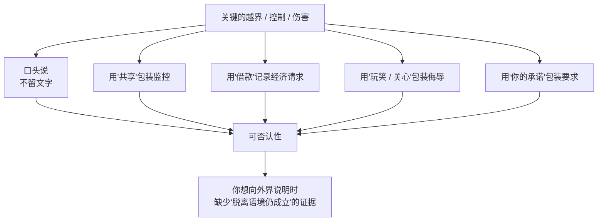
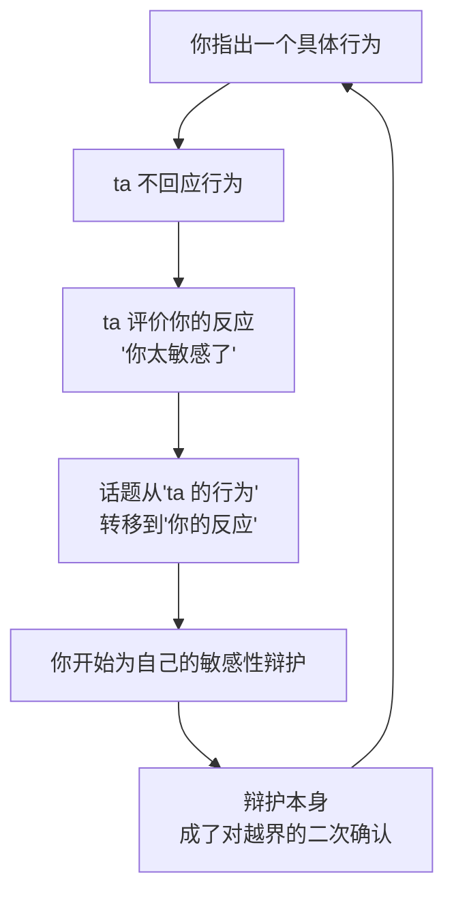

# 第23章 反取证与可否认性维护

这一章讲一个很"技术"的概念：**可否认性。**

简单说，可否认性就是：**我做了这件事，但我可以合理地说"我没做"或"我不是那个意思"。**

在操控关系里，可否认性不是偶然的，而是被**结构性维护**的。攻击者会刻意让关键的越界"留不下证据"，让关键的伤害"说不清"。等你终于想向别人解释"ta 对我做了什么"时，你会发现自己手里没有一样东西，是脱离语境后仍然成立的。

这一章讲两件事：可否认性是怎么被维护的，以及"你太敏感了"这句话为什么是反取证的核心工具。

---

## 23.1 可否认性的结构性维护

### 同样的伤害，不同的"留痕方式"

想象两种伤害方式：

**方式一**：ta 在微信上给你发："你就是个废物，离了我你什么都不是。"

**方式二**：ta 在只有你们两个人的时候，用轻蔑的语气说："哎呀，你离开我可怎么办呢？"说完还笑一下。

这两种方式，造成的伤害可能差不多。但它们的"留痕"完全不同。

方式一有截图，有文字，有明确的时间，你拿给任何人看，都能说"这是侮辱"。
方式二没有留痕：口头说的，没有录音；语气和表情，截不下来；那句话本身，还可以解释为"关心""玩笑""我是在担心你"。

方式二，就是"可否认性"的典型操作。

### 可否认性的几种维护方式

攻击者在整个过程中，会刻意维护可否认性，常见的方式有：

1. **关键越界用口头说，不用文字**。重要的控制、威胁、羞辱，尽量当面说或打电话说，不在聊天记录里留证据。
2. **监控用"共享"的名义**。位置共享、账号密码，都是"你自愿给的""我们一起用的"，不是"我监控你"。
3. **经济请求用"借款"或"共同投资"记录**。转账备注写"借款""共同投资"，将来可以说"这是你自愿借我的""这是我们一起做的决定"。
4. **侮辱包裹在"玩笑"或"关心"里**。"我开玩笑的""我是为你好""你怎么这么开不起玩笑"——让伤害没有明确的"攻击"形态。
5. **把要求包装成"你的承诺"**。第 10 章讲的"契约"操作，同样服务于可否认性：条件以"你爱我就要做到"的框架提出，后续的施压就可以被叙述为"你违背了自己的承诺"，而不是"我在逼你"。

### 可否认性的目的：让你"说不清"

可否认性的目的，不是"骗过所有人"，而是**让受害者在试图说明时，缺乏可展示的、脱离语境后仍然成立的证据**。

你想向朋友求助，你说："ta 总是贬低我。"
朋友问："ta 怎么说的？"
你说："ta 说'你离开我可怎么办'……还笑了一下。"
朋友说："这……好像也没什么吧？可能是关心你？"

你想说"ta 控制我"，但 ta 没有限制你的自由，只是"希望你多陪 ta"。
你想说"ta 威胁我"，但 ta 没有说"你不听话我就……"，只是"如果你真的爱我，你就会……"。
你想说"ta 骗我钱"，但转账记录上写的是"借款"，而且是你自己转的。

这就是可否认性最厉害的地方：**它让伤害真实发生，却让伤害无法被证明。** 你受伤了，但你说不清；你说不清，别人就不信；别人不信，你就更怀疑自己。

### 为什么"明确越界"总是紧跟着"可否认"

有一个很值得观察的结构：**明确越界的语句，往往紧跟在可否认的语句之后，作为"试探—确认"的配对。**

比如：

- "我开玩笑的，你别当真。"（可否认）→ "不过你确实该减减肥了。"（明确越界）
- "我不是要控制你。"（可否认）→ "但你要是真在乎我，就不会去。"（明确越界）
- "我没有怪你的意思。"（可否认）→ "只是你每次都这样，我真的很累。"（明确越界）

可否认的句子，是"安全垫"：它让后面的越界有一个可以退回去的解释。你如果抗议，ta 就退回到"我不是那个意思"；你不抗议，越界就成立了。

### 小练习

取一段让你感到不适但难以说清的对话记录。

逐句标记：这句话**如果被截图公开，对方是否可以合理否认恶意**？

统计可否认语句与明确越界语句的比例和排列方式。

观察：明确越界语句，是否**总是紧跟在可否认语句之后**，作为"试探—确认"的配对？

这个练习的目的，不是让你去收集"证据"跟对方对质，而是让你看见：**你的"说不清"，不是因为你表达能力差，而是因为对方的表达方式，本来就是设计成"说不清"的。**

---

## 23.2 "你太敏感了"作为反取证工具

### 一句最常见、也最有效的话

如果要在所有操控话术里，选一句"最有效"的，大概就是：**"你太敏感了。"**

这句话的变体很多："你想多了""你反应过度了""你怎么这么开不起玩笑""你是不是有被害妄想""别人都不觉得有问题，就你觉得"。

它们的共同功能，不是描述事实，而是**把目标对越界的反应，重新定义为目标的缺陷**。

你指出一个问题，ta 不回应问题本身，而是攻击你"提出问题的资格"。你本来是在说"你刚才那句话让我不舒服"，ta 把话题变成了"你这个人太敏感"。于是，你从"指出问题的人"，变成了"需要为自己辩护的人"。

这张图最关键的是最后一步：**辩护本身，成了对越界的二次确认。**

你为了证明"我不是太敏感"，会开始解释："我不是敏感，是你刚才那句话真的让我不舒服……"——你一解释，就等于承认了"这件事值得讨论"，而讨论的焦点已经从"ta 该不该说那句话"变成了"你是不是反应过度"。

更麻烦的是，下一次再发生类似的事，你会先自我审查："我是不是又太敏感了？"——于是你还没开口，就已经被这句话拦住了。

### 为什么这句话这么难反驳

因为"敏感"是一个**无法证伪**的词。

你说"我不敏感"，ta 说"你看，你又在辩解，这就是敏感"。
你说"我只是表达我的感受"，ta 说"正常人不会为这点小事有感受"。
你说"那你觉得怎样才算不敏感"，ta 说"你看，你又在钻牛角尖"。

无论你怎么回应，ta 都可以把你的回应，重新解读为"敏感"的证据。这就像一个没有出口的迷宫：你越想证明自己不敏感，越显得你在意；你越在意，越像"敏感"。

### 反取证的核心：让你不敢记录、不敢说明

"你太敏感了"之所以是反取证的核心工具，是因为它**在源头上阻止你记录和说明**。

你想记录一次越界，但你会想："是不是我太敏感了？这点小事也值得记？"
你想跟朋友说，但你会想："朋友会不会觉得我太敏感？"
你想设一个边界，但你会想："我是不是反应过度了？"

于是，你什么都没记，什么都没说，什么都没设。而攻击者，什么都不用做，只需要偶尔说一句"你太敏感了"，就能让你自己把证据、把求助、把边界，全部收回去。

这就是为什么这一章要把它单独拿出来讲：**它不是一句普通的话，它是一套让你"不敢取证"的机制。**

### 识别：这句话之前，你指出了什么

判断"你太敏感了"是不是在反取证，有一个很具体的观察方法：**看这句话之前，你指出了什么。**

- 如果你在指出一个**具体行为**（"你刚才当着朋友的面说我胖"），而 ta 回应"你太敏感了"——那这句话的功能，是把"ta 的行为"转移成"你的反应"。
- 如果你在表达一个**具体感受**（"你那样说，我有点难过"），而 ta 回应"你太敏感了"——那这句话的功能，是否定你感受的合理性。
- 如果你在**设一个边界**（"我不喜欢你翻我手机"），而 ta 回应"你太敏感了"——那这句话的功能，是让你为设边界感到羞耻。

这三种情况，共同点是：**ta 没有回应你指出的内容，而是评价了你"提出内容"这件事本身。**

### 小练习

记录一周内你听到"你太敏感了""你想多了""你反应过度了"的时刻。

对每一次标注：

1. **在这句话之前，你指出了什么具体行为？**
2. **这句话之后，对话的焦点，是否从"对方的行为"转移到了"你的反应"？**

如果转移发生了，标记这个模式。

这个练习的目的，不是让你以后听到这句话就炸毛，而是让你看见：**"你太敏感了"这句话，往往不是在对你说"你的感受不成立"，而是在对你说"你别再往下说了"。** 它的功能是关闭对话，不是澄清事实。

---

## 本章小结

这一章讲了两件事：

1. **可否认性的结构性维护**。关键越界用口头说、监控用"共享"包装、经济请求用"借款"记录、侮辱用"玩笑"包装、要求用"你的承诺"包装。目的是让你在试图说明时，缺乏脱离语境仍成立的证据。可检测的痕迹：明确越界语句是否总紧跟在可否认语句之后。
2. **"你太敏感了"作为反取证工具**。它不回应你指出的问题，而是评价你"提出问题的资格"，把焦点从"ta 的行为"转移到"你的反应"。它的功能是让你不敢记录、不敢说明、不敢设边界。识别方法：看这句话之前你指出了什么，之后焦点是否转移了。

最后留一个判断问题：

**在这段关系里，你说的话，有多少是"说得出、也说得清"的？**

健康的关系，允许你把不舒服说出来，而且说出来的东西，是能被听懂的、能被回应的。
操控性的关系，会让你觉得"我说不清""我说了也没用""说了反而显得我有问题"。不是你表达能力差，而是对方一直在维护一种"让你说不清"的结构。

如果你发现自己反复陷入"我想说，但说不清"的状态，那你要做的，不是继续努力"说清楚"，而是**先记录下来**：时间、原话、你的感受、对方的反应。记录不是为了对质，是为了让你自己确认：**我没有疯，我确实经历了我经历的事。**

下一章，我们讲退出后的叙事管理。你会看到，"疯狂前任"这个标签，是怎么在关系结束后，继续影响你的社交生活的。
