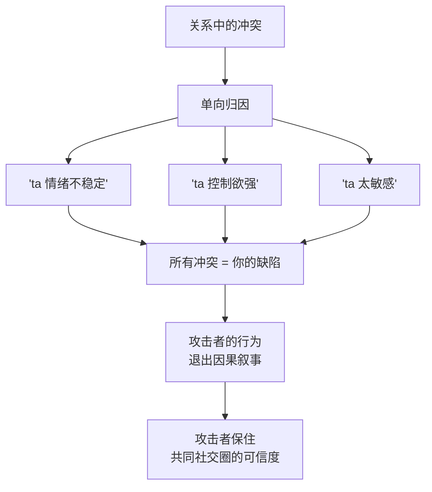
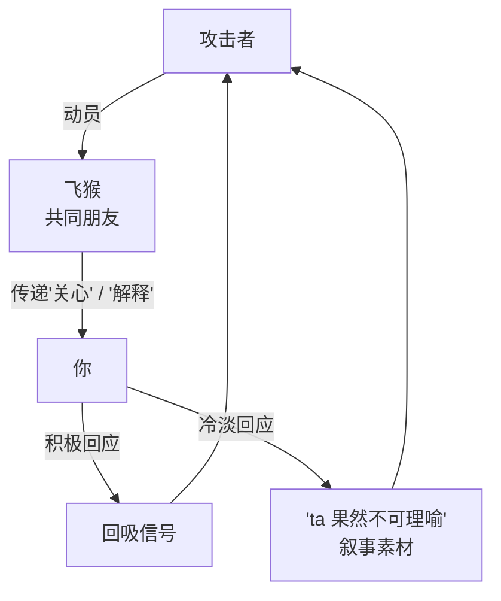

# 第24章 退出后的叙事管理

上一章讲的是关系里的"说不清"。这一章讲关系结束之后的"说不清"。

很多人以为，分开就是结束。但对操控型关系来说，**退出不是攻击链的终点，而是叙事管理的起点。**

关系结束后，攻击者还有一件事要做：**管理别人怎么讲这个故事。** 具体来说，就是让共同社交圈相信"是你有问题""是你不讲理""是 ta 受委屈了"。

这一章讲两件事：**"疯狂前任"标签**和**飞猴的退出后动员。**

---

## 24.1 "疯狂前任"标签与单向归因

### 关系结束后，叙事还在继续

一段关系结束，两个人分开了，但故事还在传播。

你可能会发现，共同朋友对你的态度变了：有人欲言又止，有人旁敲侧击，有人突然疏远，有人用"关心"的语气问你"最近还好吗，听说你状态不太好？"

这些变化的背后，往往有一个共同的原因：**对方在共同社交圈里，讲了一个关于你的版本。**

这个版本的核心，是"疯狂前任"标签。

### 什么是"疯狂前任"标签

"疯狂前任"标签，是把关系结束的原因，**单向归因于目标的人格缺陷**。

常见版本：

- "ta 情绪不稳定，动不动就崩溃。"
- "ta 控制欲太强，什么都要管。"
- "ta 太敏感，一点小事就上纲上线。"
- "ta 有心理问题，我一直在忍。"
- "ta 分手后到处说我坏话，你看 ta 多偏激。"

这些版本的功能，是**把关系中发生的所有冲突，都归结为"你有问题"**，从而让攻击者自己的行为，完全退出因果叙事。

你想想，如果故事是"ta 情绪不稳定，我一直在忍，最后实在受不了才分开"，那在这个故事里，ta 是受害者，你是问题源。ta 不需要解释自己做过什么，因为"你情绪不稳定"已经解释了一切。你所有的委屈、所有的指认，都可以被装进"你就是情绪不稳定"这个筐里。

### 单向归因的狡猾之处

单向归因之所以有效，是因为它**不需要撒谎**。

ta 可以说："ta 确实情绪崩溃过。"——这是真的，你确实崩溃过。
ta 可以说："ta 确实很敏感。"——这也是真的，你确实对很多事有反应。
ta 可以说："ta 分手后确实情绪很激动。"——这还是真的，你确实很痛苦。

ta 不需要编造事实，只需要**选择性地呈现事实，并隐去原因**。你崩溃，是因为长期被贬低；你敏感，是因为长期被煤气灯；你分手后激动，是因为你被伤害了。但在 ta 的版本里，这些"原因"被删掉了，只剩下"结果"，而结果看起来，就是你"有问题"。

这就是单向归因最狠的地方：**它用真话，讲了一个假故事。**

### 为什么受害者很难反驳

受害者很难反驳，有几个原因：

1. **你没有"证据"**。第 23 章讲过，操控关系里的伤害，大多是"说不清"的。你没法拿出截图证明"ta 长期贬低我"，因为 ta 都是口头说的。
2. **你的情绪反应，反而成了"证据"**。你越痛苦、越激动、越想解释，越容易被解读为"你看，ta 果然情绪不稳定"。
3. **"疯狂前任"是一个现成的剧本**。人对"分手后互相指责"这件事，本来就有一个刻板印象：双方都有问题，谁说得激动，谁更像"有问题"的那一个。
4. **你没有"叙事权"**。ta 可能比你更早、更系统地在共同圈子里铺垫；等你反应过来，故事已经讲完了。

### 叙事对比：看见差异，不急于纠正

面对这种情况，有一个练习可以做，叫"**叙事对比**"。

如果你经历过关系结束后的社交圈变化，做一次对比：

对方在共同社交圈中呈现的**结束原因**，与你亲身经历的事实版本，差距最大的三个点在哪里？

比如：

- ta 说"我们是因为性格不合分开的"，你记得的是"ta 长期冷暴力，我实在撑不住了"。
- ta 说"ta 分手后一直骚扰我"，你记得的是"我只是想要一个解释，ta 一直回避"。
- ta 说"ta 情绪有问题"，你记得的是"我在长期被否定之后，第一次爆发"。

这个练习的目的，**不是纠正叙事**，而是**看见叙事管理的存在**。

你不需要去共同圈子里"澄清"，因为澄清往往会变成"互相撕"，而撕的过程，又会被解读为"你看，ta 果然情绪不稳定"。你要做的，是**在心里分清**：哪个版本是 ta 讲的，哪个版本是你经历的。分清之后，你就不会那么容易被他人的版本动摇。

### 小练习

如果经历过关系结束后的社交圈变化，做一次"叙事对比"：

对方在共同社交圈中呈现的**结束原因**，与你亲身经历的事实版本，差距最大的三个点在哪里？

写下这三点。然后问自己：**这个差距，是"记忆不同"，还是"叙述被选择"？**

这个练习不是为了让你去纠正谁，而是为了让你看见：**退出后的叙事管理，是真实存在的。** 你不需要赢下这场叙事，你只需要知道，那个被传播的版本，不是全部的事实。

---

## 24.2 飞猴的退出后动员

### 关系结束后，飞猴还在工作

第 19 章讲过飞猴：被利用来传话、施压、试探的第三方。

关系结束后，飞猴往往不会立刻消失，反而会进入一个新的工作阶段：**退出后的叙事管理。**

你会遇到这样的情况：

- 共同朋友突然找你："ta 其实挺关心你的，ta 说你误会了。"
- 有人转告："ta 说 ta 很后悔，希望你好好的。"
- 有人试探："ta 问你现在怎么样，有没有新对象。"
- 有人劝和："你们都冷静这么久了，要不要再聊聊？"

这些"关心"和"转告"，很多时候不是朋友自发的，而是**被对方动员的**。

### 飞猴的三个功能

退出后的飞猴，通常承担三个功能：

1. **维持叙事控制**。在攻击者不直接出场的情况下，继续影响共同圈子里对你的看法。"ta 其实很关心你""ta 说你误会了"——这些话让攻击者保持"好人"形象，同时让你显得"不领情"。
2. **试探你的状态**。飞猴会观察你的反应：你是否软化？你是否还愿意谈？你是否有了新生活？这些信息会被反馈给攻击者，用来判断"回吸"是否可行。
3. **为叙事收集素材**。如果你的反应是积极的（"其实我也挺想 ta 的"），攻击者获得"回吸信号"；如果你的反应是冷淡的（"我不想谈这个"），攻击者获得"ta 果然不可理喻"的叙事素材。

这张图最关键的是：**无论你怎么回应，攻击者都能获益。**

你软化了，ta 知道可以回吸；你冷淡了，ta 有了"你看 ta 多绝情"的素材。你被放在一个"怎么回应都不对"的位置上。这就是为什么面对飞猴，最好的策略往往不是"回应"，而是"不参与"。

### 怎么分辨"关心"和"动员"

朋友的"关心"和"被动员的关心"，有一个区别：**信息的内容，是关于事实，还是关于对方的善意。**

- 真正的关心："我听说你最近不太好，你还好吗？需要我做什么吗？"——关注你的状态，信息是关于你的。
- 被动员的关心："ta 说 ta 其实很关心你，ta 希望你别误会。"——关注 ta 的形象，信息是关于 ta 的善意的。

前者是朋友在关心你，后者是朋友在替 ta 传话。前者你可以接受，后者你可以礼貌地不接。

还有一个区别：**这个朋友是主动来的，还是被对方动员的？**

如果是朋友自己担心你，主动找你，那这份关心是真的。如果是朋友"受人之托"来找你，而且话题总是绕回"ta 其实……"，那这份"关心"，可能就是叙事管理的延伸。

### 不参与，不等于敌对

面对飞猴，很多人会陷入两难：回应吧，怕被利用；不回应吧，怕得罪朋友。

其实有第三条路：**不参与叙事，但保持关系。**

比如，朋友说"ta 说 ta 很关心你"，你可以说："谢谢你告诉我。不过我暂时不想讨论 ta 的事，我们聊点别的吧。"

这句话做了三件事：
1. 感谢朋友的善意（不攻击朋友）。
2. 明确不参与叙事（不提供素材）。
3. 保持关系（把话题转开，而不是切断联系）。

你不需要跟朋友翻脸，也不需要向朋友证明"ta 是坏人"。你只需要**不让朋友成为传话筒**，也不让自己成为叙事素材。

### 小练习

回想关系结束后，是否有共同朋友向你传递过对方的"关心"或"解释"。

记录：

1. 这个朋友是**主动**来找你的，还是**被对方动员**的？
2. 传递的信息是**关于事实**，还是**关于对方的善意**？
3. 你当时的回应是什么？你的回应，有没有可能被反馈给对方？

如果是后者（关于善意），标记这个信息的功能——它可能不是关心，而是叙事管理的延伸。

这个练习的目的，不是让你怀疑所有朋友的关心，而是让你看见：**有些"关心"，是有发件人的。** 看清楚发件人，你才知道该怎么回应。

---

## 本章小结

这一章讲了两件事：

1. **"疯狂前任"标签与单向归因**。关系结束后，攻击者会在共同社交圈里把结束原因单向归因于你的人格缺陷，"用真话讲一个假故事"：你确实崩溃过、敏感过、激动过，但原因被删掉了。这个练习的目的不是纠正叙事，而是让你看见叙事管理的存在。
2. **飞猴的退出后动员**。共同朋友被动员来传递"关心""解释"，功能是维持叙事控制、试探你的状态、收集叙事素材。识别方法：看信息是关于事实还是关于对方的善意，看朋友是主动来的还是被动员的。

最后留一个判断问题：

**关系结束后，你听到的"关于你自己的故事"，是谁讲的？**

如果是你自己讲的，那它是你的叙事，你可以选择讲、选择不讲、选择讲给谁听。
如果是别人讲的，而且讲的人不是你，那你要问：**这个故事，是为了让我好，还是为了让讲的人好？**

你不需要赢下所有关于你的叙事。你只需要知道：**别人怎么讲你，不等于你是谁。** 那个被传播的版本，可能很伤人，但它不是全部的事实。而你亲身经历的那些事，那些说不清、没证据、只有你自己知道的事，是真实的。它们不需要被所有人相信，才成立。

下一章开始第七部分：防御与反制。前面的章节，讲的是"攻击是怎么发生的"；接下来的章节，讲的是"你能做什么"。你会看到，攻击链其实有很多断裂点，而你，可以在很早的地方，就把它断掉。