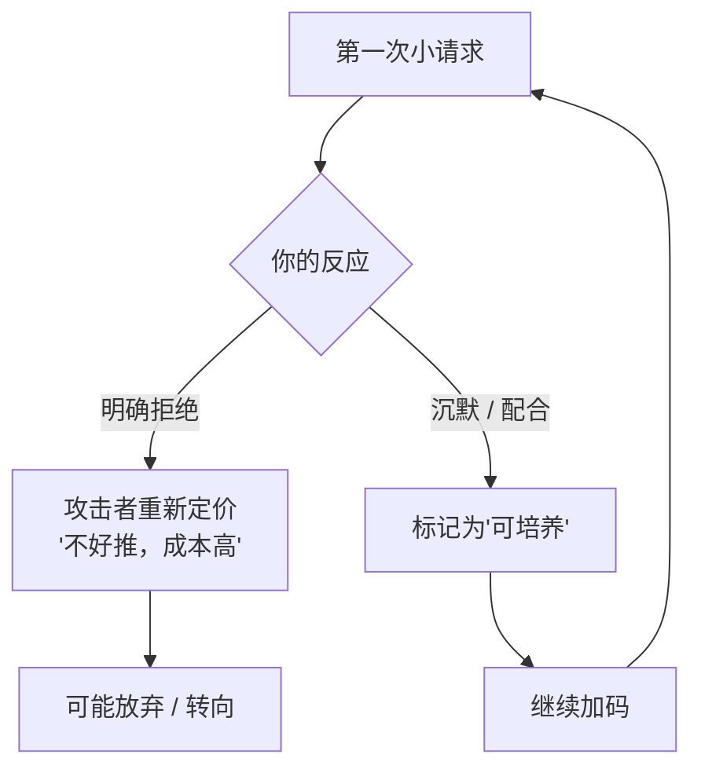
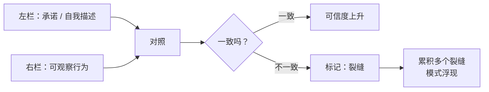
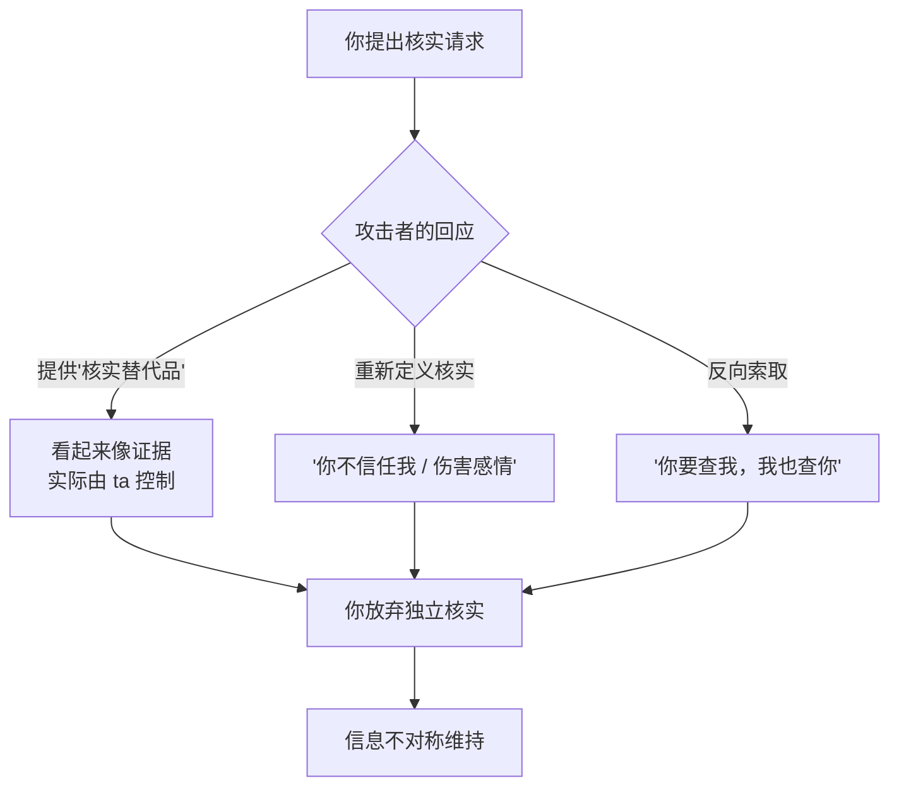

# 第25章 早期识别：攻击链的断裂点

从这一章开始，进入最后一部分：**防御与反制。**

前面二十四章，讲的是"攻击是怎么发生的"。接下来的四章，讲"你能做什么"。

这一章讲一个好消息：**攻击链不是铁板一块，它有很多断裂点。而且，越早的断裂点，越容易断。**

你不需要识破整个骗局，不需要变成福尔摩斯，不需要跟操控者斗智斗勇。你只需要在很早期的几个节点上，做几个简单的动作，很多攻击链就会自己断掉。

---

## 25.1 第一个"不"的筛选功能

### 攻击链对"早期抵抗"高度敏感

攻击者不是无差别地投入。他们有成本意识，会在早期用极低的成本做筛选，把"不好搞"的人迅速放弃。

这就是为什么说，攻击链对**早期抵抗**高度敏感。

一个在微小越界阶段，就能明确、低成本地表达边界的 target，在攻击者的成本收益计算里，会被**重新定价**：这个人不好推，继续投入可能不划算，不如换一个。

很多攻击的终止，不是因为目标"识破了全局"，而是因为**第一次小请求，没有被顺利通过**。

杀猪盘的"买花篮"筛选，就是这一逻辑的反面证明：让你花几百块买个花篮，愿意付的人被标记为"可培养"，不愿意付的人被备注为"死"然后放弃。骗子的逻辑很清楚：连几百块都不愿意为"关系"付的人，后面不可能付大钱，不值得继续投入。

换句话说：**你的第一个"不"，可能就直接把你从对方的名单里划掉了。**

### "不"的质量，决定断裂的效果

并不是所有的"不"，都能起到筛选作用。**"不"的质量，决定了它在攻击链上的断裂效果。**

一个高质量的"不"，有三个特点：

1. **短**。一句话，不解释一大堆。
2. **不需要辩护**。你不需要证明"我为什么拒绝"，你只需要说"我不方便"。
3. **可执行**。你说到做到，而不是说完又妥协。

一个低质量的"不"，则相反：你解释了很久、道了很多歉、反复证明"我不是不领情"，最后还是半推半就答应了。这种"不"，在攻击者眼里不是拒绝，而是"需要多推几下"。

举个例子：

- 高质量："这个我不方便，抱歉。"（一句话，不解释，不道歉到卑微）
- 低质量："啊，这个……其实我也想帮你，但是我最近真的很忙，不是我不想，你千万别误会，我下次一定……要不这样，我先看看……"（解释一大堆，最后可能还是答应）

前者是"门关了"，后者是"门虚掩着，你在门口解释为什么不想开"。

### 为什么"不"越短，断裂成本越低

因为攻击者读的是**行为**，不是你的**内心**。

你心里可能已经很不舒服了，但你嘴上解释了一大堆，行为上还是配合了。在攻击者看来，这就是"可以继续"。

而你说了一句短短的"不"，行为上没有配合，攻击者就收到了明确的信号：这个人有边界，推不动。

所以，"不"的短，不是为了显得冷漠，而是为了**让信号清晰**。你解释得越多，信号越模糊；信号越模糊，对方越会继续试探。

### 小练习

回想一次你在关系早期说"不"的经历。

记录三件事：

1. 你说"不"时，**用了多少解释**？（一句话？一段话？反复道歉？）
2. 对方收到"不"之后的反应？（接受 / 施压 / 冷脸 / 消失）
3. 关系此后的走向，是否发生了变化？

你的"不"越短、越不需要辩护，攻击链在那个节点的断裂成本就越低。

这个练习的目的，不是让你以后对所有人都冷冰冰，而是让你知道：**你说"不"的方式，本身就是一种筛选。** 你说得越清楚，越容易把不合适的人筛掉；你说得越含糊，越容易把试探的人留下来。

---

## 25.2 不一致性检测

### 裂缝不在单句话里，而在"说法与行为"之间

操控的裂缝，往往不在某一句具体的话里，而在**不一致**里。

什么不一致？三种最常见：

1. **言语与行为的不一致**。ta 说"我很重视你"，但从不记得你说过的事；ta 说"我最讨厌撒谎"，但自己的说法前后矛盾。
2. **此刻与过去的不一致**。ta 今天说"我从来没这样爱过一个人"，但你发现 ta 上个月对另一个人说过同样的话；ta 说"我单身很久了"，但时间线对不上。
3. **公开与私下的不一致**。ta 在朋友面前是"体贴的伴侣"，私下却冷漠、贬低；ta 在朋友圈是"岁月静好"，私下却情绪失控。

单看任何一句，都可能被解释；但把"说"和"做"放在一起，把"此刻"和"过去"放在一起，把"公开"和"私下"放在一起，模式就出来了。

### 为什么人设维护成本越高，不一致越多

第 4 章讲过，虚假人设需要持续的认知和情绪劳动来维护。维护成本越高，越容易出错。

具体来说：

- 记忆负荷：要记住自己跟谁说过什么、编过哪些细节。
- 情绪负荷：要在不同人面前维持不同版本。
- 社交负荷：要避免不同圈子的人碰面。
- 表演负荷：要时刻注意表情、语气、反应。

这些负荷叠加起来，人设就很容易在**时间压力、社交圈交叉、冲突情境、细节追问**的时候露出裂缝。

所以，观察不一致，不需要你变成侦探，只需要你**系统地记录**。记录得多了，模式自然会浮出来。

### 言行对照表

判断一段关系是否健康，有一个很好用的工具：**言行对照表。**

拿一张纸，画两栏：

- **左栏**：对方做出的承诺，或者对自己的描述。"我会一直对你好""我从来不骗人""我最看重真诚""我下个月就带你见家长"。
- **右栏**：与之对应的**可观察行为**。ta 实际做了什么？承诺兑现了吗？时间对得上吗？有具体行动吗？

一周后回看，计算一致与不一致的比例。

注意，这里的关键词是"**可观察行为**"，不是"ta 的解释"。ta 说"我本来要做的，但是……"，这是解释，不是行为。行为是：ta 到底做了没有。

### 小练习

选择一段你正在观察的关系，做一份"言行对照表"：

左栏写对方做出的承诺或自我描述，右栏写与之对应的可观察行为。

一周后回看，计算一致与不一致的比例。

这个练习的目的，不是让你给关系打分，而是让你把"感觉哪里不对"，变成"具体哪里对不上"。感觉容易被情绪影响，具体的不一致则是客观的。

---

## 25.3 核实请求与叙事垄断的破裂

### 攻击者最不希望你做的一件事

如果问"攻击者最不希望目标做什么"，答案大概是：**独立核实。**

因为攻击链的很多环节，都建立在"信息不对称"上：你不知道 ta 的真实身份、真实住址、真实财务状况、真实社交关系。一旦你开始核实，这些信息就可能对上或对不上，而对不上，就是裂缝。

所以，攻击者会极力阻止你核实。

### 核实请求带来的两难

当你开始要求核实（视频通话、线下见面、共同朋友交叉验证、财务信息独立确认）时，攻击者会面临一个两难：

- **配合核实**：可能暴露人设的裂缝。
- **拒绝核实**：会加速你的怀疑。

成熟攻击者的策略，不是简单地"拒绝"，而是**制造核实的替代品**：

- 提供"看起来像核实"的东西。比如发几张照片（可能是网图）、发一段语音（可能是 AI 合成）、让"朋友"来证明（可能是同伙）。
- 把真正的独立核实，重新定义为"不信任""伤害感情"。"你为什么要查我？我们之间连这点信任都没有吗？"
- 用"核实"来反向索取。"你要看我手机，那我也要看你的。"

这套操作的目的，是让你在"核实"和"信任"之间做选择：你要么放弃核实，要么承认自己"不信任对方"。而很多人为了证明自己"信任"，会选择放弃核实。

### 为什么"尝到核实的甜头"很关键

一旦你真正做了一次独立核实，并且**发现了一个谎言**，事情就会发生变化。

你会开始系统性地扩大核实范围：ta 说的这个，是不是真的？ta 说的那个，是不是也有问题？你会从"信任默认"切换到"核实默认"。

而攻击者无法预制所有核实的答案。因为一个谎言，需要更多的谎言来圆；而谎言越多，漏洞越多。当你的核实范围扩大，ta 的叙事垄断就会破裂。

这就是为什么"第一次独立核实"这么重要：**它不只是验证一个事实，它是打破"ta 是唯一现实校准器"的开始。**

### 小练习

回想一次你向对方提出核实请求的经历。

记录：

1. 你请求核实的是什么？
2. 对方提供的是**可独立验证的证据**，还是**由 ta 控制的"核实替代品"**？
3. 对方的反应是配合、转移话题，还是质疑你的动机？

这个练习的核心，是分清"证据"和"替代品"。可独立验证的证据，是你能通过**不经过 ta 的渠道**确认的；替代品，是 ta 给你看的、但只有 ta 能控制的东西。

一个真实的、经得起核实的人，不会害怕你核实；一个虚构的、经不起核实的人，才会把"核实"当成威胁。

---

## 本章小结

这一章讲了三个断裂点：

1. **第一个"不"**。攻击链对早期抵抗高度敏感。一个短、不需要辩护、可执行的"不"，可能直接把你从对方的名单里划掉。"不"越短，断裂成本越低。
2. **不一致性检测**。裂缝不在单句话里，而在言语与行为、此刻与过去、公开与私下之间。工具是"言行对照表"：左栏承诺，右栏可观察行为。
3. **核实请求**。攻击者最怕你独立核实。他们会提供"核实替代品"，或把核实重新定义为"不信任"。第一次真正核实并发现谎言，是打破叙事垄断的开始。

最后留一个判断问题：

**在这段关系里，你有没有"核实"的权利？**

健康的关系，允许你核实：你可以问、可以查、可以要求见面、可以交叉验证。操控性的关系，会让你觉得"核实"是一种罪过：你不信任 ta、你伤害感情、你太敏感。

如果你发现，你连"核实"都不敢提，或者一提就被扣上"不信任"的帽子，那你要问自己：**我是在信任一个人，还是在被迫相信一个人？**

信任是"我愿意相信你"，被迫相信是"我不敢不信你"。前者是自由，后者是恐惧。而恐惧，从来不是爱。

下一章，我们讲边界设定与关系政策。你会看到，边界不是"惩罚对方"，而是"告知对方你的可接受范围，并执行你所能执行的部分"。