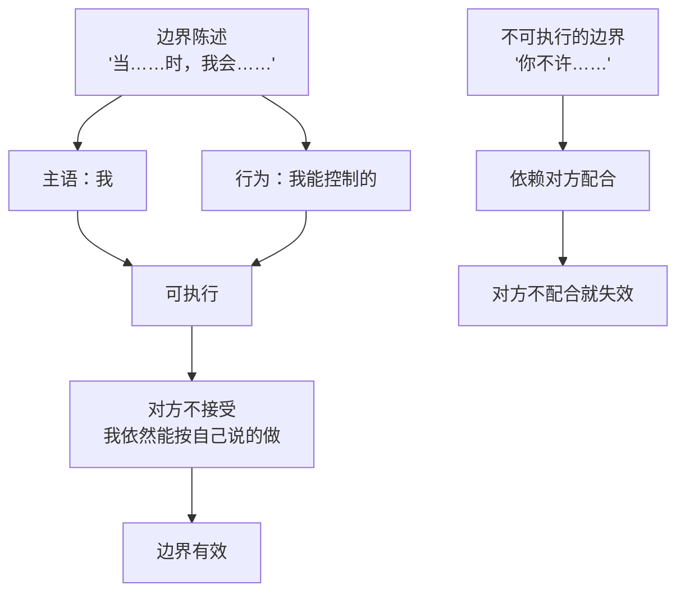
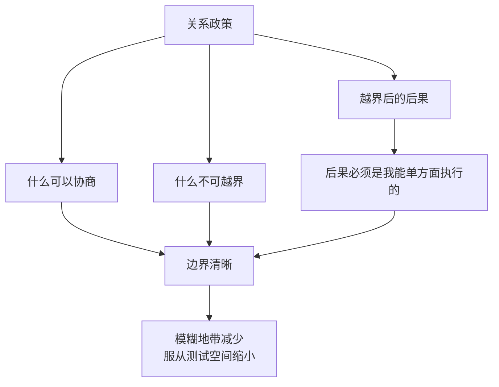
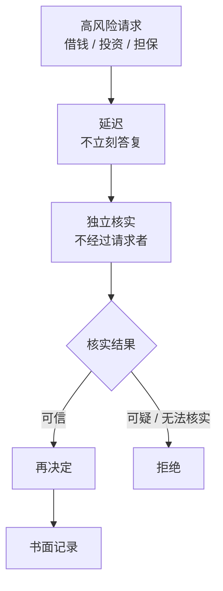

# 第26章 边界设定与关系政策

这一章讲一个很多人不太会的东西：**边界。**

你可能听过"要设边界"这句话，但具体怎么设，很多人是模糊的。有人以为边界是"威胁对方"："你再这样我就走。"有人以为边界是"惩罚对方"："你今天别想跟我说话。"这些都不是边界，这些是情绪。

真正的边界，用一句话说就是：**告知对方你的可接受范围，并执行你所能执行的部分。**

这一章讲三件事：边界陈述怎么做才可执行、关系政策是什么、以及数字与财务的防火墙怎么设。

---

## 26.1 边界陈述的可执行性

### 边界不是"惩罚对方"

先纠正一个常见的误解。

很多人设边界的方式是："你要是再这样，我就……"——这是在用"后果"威胁对方，本质上是**试图改变对方的行为**。

但问题是：你控制不了对方。你没法强迫 ta 不晚归、不冷脸、不翻你手机。你越是想"让 ta 改"，越容易陷入"我说了 ta 不听，我生气，我更用力地说，ta 更不听"的循环。

真正的边界，不是"你要改"，而是"**我会怎么做**"。

反 PUA 实践里有一个"设定边界法"，核心是把决策权从"ta 会不会不高兴"拉回到"**我是否愿意**"。这个转变很关键：边界不是关于对方的，是关于你自己的。

### 边界陈述的句式

一个可执行的边界陈述，通常长这样：

> **"当……时，我会……"**

注意，后半句的主语必须是"我"，而且必须是**你能控制的行为**。

比如：

- "当你晚上十一点后给我发非紧急消息时，我会第二天再回。"
- "当你要看我手机时，我会说'不'，但我可以跟你聊任何你担心的事。"
- "当你用'你太敏感了'来回应我的感受时，我会暂停对话，等我们都冷静再聊。"
- "当你要我为你借超出我能力的钱时，我会拒绝。"

这些句子的共同特点：
1. 前半句描述一个**具体情境**，不是"你总是……"这种泛泛的指责。
2. 后半句是"**我会做什么**"，不是"你必须做什么"。
3. 后果是**你能单方面执行的**，不需要对方配合。

对比一下不可执行的边界：

- "你以后不许晚归。"——你控制不了 ta 晚归，你只能控制自己怎么反应。
- "你不许再翻我手机。"——你控制不了 ta 翻不翻，你只能控制自己给不给密码。
- "你要对我好一点。"——太模糊，没法执行。

### 边界的可执行性，决定它的有效性

一条边界有没有用，不取决于你说得多坚决，而取决于**你能不能执行**。

什么叫能执行？就是：**如果对方不接受，你依然能按你说的做。**

比如：

- "当你对我大吼时，我会离开房间。"——你能执行，因为你可以走。
- "当你要看我手机时，我会拒绝。"——你能执行，因为你可以不给。
- "当你要我借钱时，我会说'不'。"——你能执行，因为钱在你手里。

而：

- "你不许再吼我。"——你执行不了，因为你没法让 ta 闭嘴。
- "你不许再看我手机。"——你执行不了，因为你没法阻止 ta 抢。
- "你不许再跟你要钱。"——你执行不了，因为你没法控制 ta 开不开口。

边界的力量，不在于"我要求你怎样"，而在于"**我决定我怎样**"。你把你那部分做好，对方那部分，是 ta 的事。

### 小练习

选择一个你一直不敢设定的小边界（比如"晚上十一点后不回复非紧急消息""不分享手机密码""每周留一个晚上给自己"）。

写下一条**一句话边界陈述**，句式："当……时，我会……"。（只包含你能控制的行为）

在接下来一周内执行一次，记录对方的反应和你自己的感受。

这个练习的重点，不是"对方会不会接受"，而是"**你能不能执行**"。哪怕对方不接受，你按你说的做了，这条边界就成立了一半。剩下的一半，是你能不能在对方施压时，继续执行。

---

## 26.2 关系政策：规则、边界与后果

### 关系也需要"政策"

企业用政策来约束行为、设定边界、明确后果。恋爱关系同样需要"政策"。

这里的"政策"，不是写在纸上的合同，而是**双方对可接受行为、隐私边界、财务独立、社交自由的明确共识**。

你可能会觉得，谈恋爱谈"政策"太生硬了。但你想一想：那些让你最难受的事，往往不是因为"对方做了一件坏事"，而是因为"这件事到底算不算越界，我们从来没说清楚"。

- 手机能不能看？没说过。
- 和异性朋友单独吃饭算不算越界？没说过。
- 钱怎么管？没说过。
- 吵架时能不能冷战？没说过。

没说过的地方，就是**模糊地带**。而攻击者最擅长的，就是利用模糊地带：在没有明确边界的地方，反复进行服从测试，每一次都"试探一下"，每一次都"看看你的反应"。

### 关系政策的功能：让边界从模糊变可执行

关系政策的功能，不是"控制对方"，而是**让边界从模糊变得可执行**。

具体来说，一条好的关系政策，要回答三个问题：

1. **什么可以协商？** 比如周末怎么安排、家务怎么分、节日去谁家。
2. **什么不可越界？** 比如不能动手、不能翻手机、不能经济控制、不能限制社交。
3. **越界后的后果是什么？** 而且这个后果，必须是**你能单方面执行的**。

第三条特别重要。因为很多人的"政策"只写到"不可越界"，没写"越界了怎么办"。结果就是：越界发生了，你生气了，但你没想好怎么办，最后要么忍了，要么爆发，要么反复拉扯。

而一条可执行的政策，会提前想好："如果 ta 越界，我会怎么做？"——注意，是"我会怎么做"，不是"ta 必须怎么做"。

比如：

- "如果 ta 动手，我会立刻离开，并联系朋友。"
- "如果 ta 翻我手机，我会改密码，并明确告诉 ta 这是我的边界。"
- "如果 ta 用经济手段控制我，我会保留自己的独立账户，并寻求专业帮助。"

### 为什么"后果必须我能单方面执行"

因为如果后果需要对方配合，那它就只是一句愿望。

"如果 ta 再这样，ta 就必须道歉。"——这需要对方配合，对方不道歉，你的"后果"就落空了。

"如果 ta 再这样，我会停止这次对话，去做自己的事。"——这是你能执行的，对方配不配合都不影响。

一条政策有没有用，就看最后这一句：**如果对方不配合，我还能不能做到我说的？** 能，就是政策；不能，就是愿望。

### 小练习

为你自己写三条"关系政策"。比如：

- "我不共享手机密码，但可以讨论任何你担心的事。"
- "任何超过日常额度的财务请求，需要 48 小时冷静期。"
- "我与朋友的单独见面，不需要事前审批。"

对每一条问：**如果对方不接受，我能单方面执行这条政策吗？**

如果不能，把它改写成你能执行的形式。

这个练习的目的，不是让你变得强硬，而是让你**把"我希望关系是怎样的"，变成"我准备怎么保护这个希望"**。前者是愿望，后者是能力。

---

## 26.3 数字与财务防火墙

### 把防御落到操作层面

前面讲的边界和政策，还比较"原则"。这一节讲更具体的：**数字与财务的防火墙。**

社会工程的防御，有三个核心原则：**验证、延迟、独立渠道确认。** 这三条，同样适用于亲密关系里的高风险请求。

### 数字防火墙

数字防火墙，主要是管理**访问权**。

具体包括：

- **密码管理**。自己的手机、账号、支付密码，不轻易共享。如果确实需要共享（比如共同管理某个账户），也要清楚"共享的范围"和"撤回的方式"。
- **位置信息最小化**。位置共享不是不能有，但要清楚：这是你主动的，还是被要求的？如果哪天你想关，能不能关？
- **账号独立性**。重要的社交账号、支付账号、邮箱，保持独立。不要把所有账号都绑定在对方的手机号或设备上。
- **设备边界**。你的手机、电脑、平板，是你个人的空间。别人可以借用，但不等于可以随意翻看。

这些不是"防着对方"，而是**保留一个"属于你自己的空间"**。一个健康的关系，不需要你把所有数字空间都交出去；它应该允许你有自己的隐私，就像你也尊重对方的隐私。

### 财务防火墙

财务防火墙，主要是管理**独立性和冷静期**。

具体包括：

- **独立账户的底线**。无论关系多亲密，保留一个只有你自己能动的账户，里面有一笔"随时能走"的钱。这笔钱不需要很多，但要有。
- **大额请求的冷静期**。任何超出日常额度的资金请求（借钱、投资、共同创业、担保），都要有一个冷静期。不是"我现在就答复你"，而是"我需要时间想一下"。
- **独立核实**。核实对象不能是请求者本人推荐的"第三方"。因为那个"第三方"，可能是同伙，也可能是被安排好的"证明"。
- **书面记录**。大额的资金往来，尽量有书面记录（借条、转账备注、聊天记录）。不是为了"防对方"，而是为了让事实清楚。

### 为什么"延迟"这么重要

因为很多操控性的请求，靠的就是**时间压力**。

"你现在就答复我。"
"这个机会只有今天。"
"你要是不帮我，我就完了。"

时间压力会压缩你的理性评估，让你在情绪里做决定。而"延迟"的作用，就是把时间还给你：让你从"现在必须决定"，变成"我可以想一想"。

一个真正需要你帮助的人，会接受你的"我想一下"；一个在利用你的人，会因为你的"慢"而焦虑、施压、或者换一种方式催你。

### 小练习

设置一条你自己的"财务冷静规则"：

任何来自伴侣的、超出日常额度的资金请求，必须经过不少于 ____ 小时的独立核实期，且核实对象不包括请求者本人推荐的"第三方"。

把这条规则写下来，放在你能看到的地方。

这个练习的目的，不是让你对伴侣设防，而是让你在"被请求"的那一刻，有一个**默认动作**：不是"答应或拒绝"，而是"先等一等"。这个默认动作，能帮你挡掉很多"时间压力"式的操控。

---

## 本章小结

这一章讲了三件事：

1. **边界陈述的可执行性**。边界不是"惩罚对方"，而是"告知对方你的可接受范围，并执行你所能执行的部分"。句式是"当……时，我会……"，主语是"我"，行为是你能控制的。边界有没有用，取决于你能不能执行。
2. **关系政策**。关系需要明确"什么可以协商、什么不可越界、越界后的后果是什么"，而且后果必须是你单方面能执行的。功能是让边界从模糊变可执行，缩小服从测试的空间。
3. **数字与财务防火墙**。密码管理、位置最小化、账号独立、设备边界；独立账户底线、大额请求冷静期、独立核实、书面记录。核心原则是：验证、延迟、独立渠道确认。

最后留一个判断问题：

**你的边界，是"我说说而已"，还是"我能做到"？**

说说而已的边界，是"你不许……""你要……""你再这样我就……"。它依赖对方配合，对方不配合就失效。
能做到的边界，是"当……时，我会……"。它只依赖你自己，对方配不配合，你都能按你说的做。

边界不是用来改变对方的，边界是用来**保护你自己的**。你没法让一个不尊重边界的人变得尊重，但你可以决定：当边界被越过时，你怎么做。

下一章，我们讲中断技术与信息节食。你会看到，当一段对话正在消耗你时，怎么用"灰岩法"把自己从情绪供给的位置上撤出来；以及怎么通过"信息节食"，减少自己被利用的攻击面。