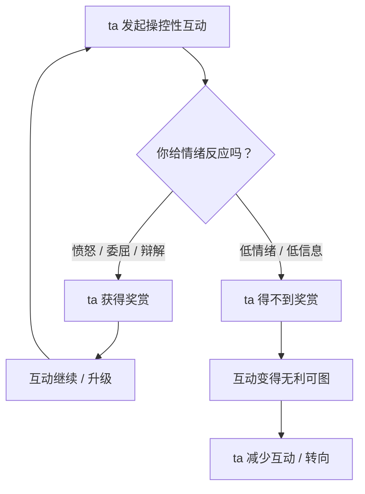
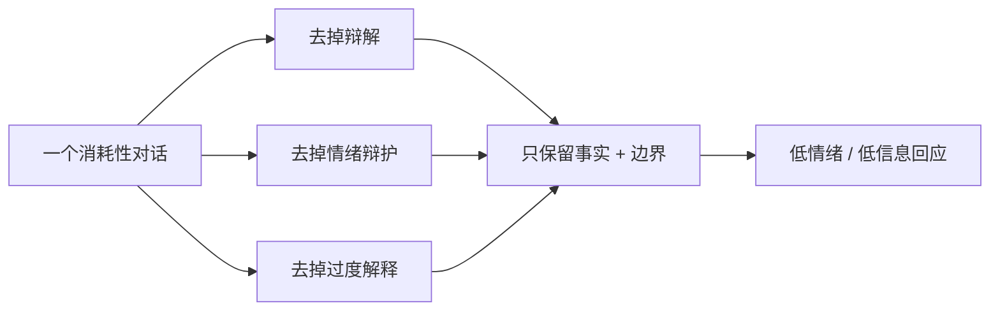
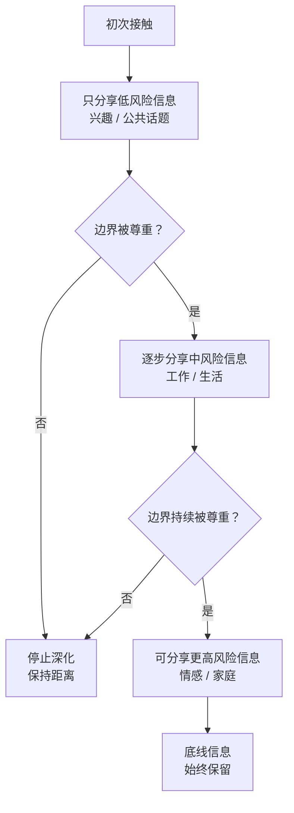

# 第27章 中断技术与信息节食

第 26 章讲的是"设边界"。这一章讲两个更具体的动作：**中断**和**节食**。

中断，是在一段正在消耗你的对话里，怎么把自己撤出来。
节食，是在一段关系里，怎么减少自己被利用的信息面。

这两个动作听起来都不太"浪漫"，但它们很实用。尤其是在你还没准备好离开、或者暂时离不开的时候，它们能帮你在关系里保存一点自己。

---

## 27.1 灰岩法：低情绪反应、低信息量回应

### 什么是灰岩法

"灰岩法"（grey rock）是应对操控性互动的一种策略。

核心很简单：**用低情绪反应、低信息量的方式回应，使对方无法从你身上获得情绪供给。**

为什么叫"灰岩"？因为一块灰色的石头，无聊、无趣、没有反应。你踢它一脚，它不会疼；你骂它，它不会哭；你跟它讲道理，它不会反驳。你想从它身上得到情绪反馈，得不到。

灰岩法的目标，就是让自己在操控性互动里，变得像一块灰石头：不提供情绪燃料，不提供戏剧性，不提供可以攻击的抓手。

### 操控性互动靠什么维持

要理解灰岩法为什么有效，得先理解操控性互动靠什么维持。

操控性互动，靠的是目标的**情绪反应**：

- 你愤怒，ta 就有了"你看你多暴躁"的素材。
- 你委屈，ta 就有了"你看你又来这套"的素材。
- 你辩解，ta 就有了"你看你又在找借口"的素材。
- 你证明自己，ta 就有了"你看你多在意"的把柄。

这些反应，本身就是攻击者的"奖赏"。ta 说一句话，你反应越强烈，ta 越有成就感；你越解释，ta 越有得聊；你越痛苦，ta 越确认自己有控制力。

这就是为什么很多操控性对话，越吵越停不下来：不是问题没解决，而是**情绪供给不断**。你每回应一次，就续了一次费。

灰岩法的作用，就是**切断情绪供给**。你不愤怒、不委屈、不辩解、不证明，只给最低限度的、事实性的回应。ta 说十句，你回一句"嗯""知道了""这个我不方便"。ta 想吵，吵不起来；ta 想激怒你，激怒不了；ta 想让你自证，你不接招。

慢慢地，互动对 ta 来说变得"无利可图"，ta 可能就会减少这种互动，或者转向别的目标。

### 灰岩法不是"冷暴力"

这里要特别说明：**灰岩法不是冷暴力。**

冷暴力是"用沉默惩罚对方"，目的是让对方难受、让对方来哄你。灰岩法是"用低反应保护自己"，目的是不被卷入情绪漩涡，不给对方提供攻击素材。

两者的区别在于**目的**：

- 冷暴力：我想让你痛苦，所以我不理你。
- 灰岩法：我不想被消耗，所以我不过度反应。

灰岩法也不是"永远不表达情绪"。在安全的关系里，你当然可以表达愤怒、委屈、难过。灰岩法只适用于**操控性的、消耗性的互动**——那种你说什么都会被扭曲、你越解释越糟糕的对话。

### 怎么写一个"灰岩版本"的回应

灰岩法的回应，有三个"去掉"：

1. **去掉辩解**。不解释"我为什么这样做"，不证明"我不是那种人"。
2. **去掉情绪辩护**。不辩护"我的感受是合理的"，不争论"我有没有资格生气"。
3. **去掉过度解释**。一句话能说完的，不说三句。

只保留两样：

1. **事实**。发生了什么，你知道什么。
2. **边界**。你能做什么，不能做什么。

比如：

- 原回应："我不是不爱你，我只是最近真的很累，你能不能理解我一下？我也有我的难处，你不能总是这样说我……"（辩解 + 情绪辩护 + 过度解释）
- 灰岩版本："我今天很累，需要休息。明天再聊。"

- 原回应："你凭什么说我敏感？我哪里敏感了？你才敏感！你每次都这样，明明是你先……"（情绪反应 + 反击）
- 灰岩版本："我听到了。我不认同这个说法。这个话题我们到此为止。"

- 原回应："好好好，都是我的错，行了吧？我做什么你都不满意，我还能怎么办？"（委屈 + 讽刺 + 情绪供给）
- 灰岩版本："这件事我确实没做好。我会改。你现在的要求我做不到。"

### 小练习

选择一个你感到被消耗的互动场景，写一个"灰岩版本"的回应：

去掉辩解、去掉情绪辩护、去掉过度解释，只保留事实和边界。

在安全的环境里朗读一遍，感受它是否可行。

这个练习的目的，不是让你变成一个冷漠的人，而是让你在"必须回应"的时候，有一个**不被卷入**的选项。你不一定要用灰岩法应对所有人，但在那些"越说越糟"的对话里，它会帮你保存能量。

---

## 27.2 信息节食：减少可被利用的攻击面

### 信息节食是什么

信息节食，指的是**有意识地减少向操控者提供可被利用的个人信息**。

前面讲过，社会工程的信息收集，依赖目标的主动暴露。你暴露得越多，对方可用的素材就越多：你的软肋、你的恐惧、你的财务状况、你的社交关系、你的情感史。

信息节食的作用，就是**降低可被社会工程利用的攻击面**。你给的信息越少，对方能用来操控你的抓手就越少。

### 信息节食不是"对所有人关闭"

这里要特别强调：信息节食不是"对所有人关闭"，不是"从此不跟任何人说真心话"。

那样的话，你不是在防御，你是在孤立自己。而孤立，恰恰是操控者最想要的状态（第 19 章）。

信息节食的正确做法，是**按关系阶段和信任水平分级释放信息**：

- **早期关系**：不提供高价值信息。聊兴趣、聊天气、聊公共话题，不聊收入、住址、家庭矛盾、情感创伤。
- **关系稳定后**：在边界被尊重的前提下，逐步深化。你分享一点，看对方怎么回应；对方尊重你的边界，你再分享多一点。
- **底线信息**：无论关系多久，都不放弃。比如你的核心财务信息、你的私密影像、你的独立账户、你的支持系统联系方式。

这个分级，不是"不信任"，而是"**信任是需要积累的**"。健康的关系，本来就该是渐进的：你先给一点，对方接住了、尊重了，你再给多一点。而不是一上来就把所有底牌都亮出来。

### 为什么要"分级"

因为攻击者最擅长的，就是**用早期的一点信息，撬动更多的信息**。

你早期随口说了一句"我家里关系不太好"，对方记住了。过几天，ta 用"关心"的方式问："你上次说家里关系不好，是怎么回事啊？"你被这份"记得"打动，就说得更多。再说下去，你的家庭矛盾、你的童年创伤、你的情感软肋，就都交出去了。

而如果你早期不给这些信息，对方就没有"撬动"的支点。ta 只能从公共话题开始，慢慢地、一点点地建立信任。而这个过程，也给了你时间去观察：ta 是尊重你的节奏，还是急着往深里挖？

### 小练习

为你的信息释放设定一个"分级表"：

1. **初次接触可以分享的**：兴趣、公共话题、无关紧要的日常。
2. **关系稳定后可以分享的**：工作、生活状态、一些个人观点。
3. **无论多久都不能放弃的底线信息**：核心财务信息、私密影像、独立账户、支持系统联系方式。

把分级表放在你能看到的地方，作为未来互动的参照。

这个练习的目的，不是让你变成一个"什么都不说"的人，而是让你在分享之前，多一个动作：**先判断，这个信息，现在给，合适吗？**

---

## 本章小结

这一章讲了两个中断技术：

1. **灰岩法**。用低情绪反应、低信息量的方式回应操控性互动，切断对方的情绪供给。三个"去掉"：去掉辩解、去掉情绪辩护、去掉过度解释；只保留事实和边界。它不是冷暴力，目的是保护自己，不是惩罚对方。
2. **信息节食**。有意识地减少向操控者提供可被利用的个人信息，按关系阶段和信任水平分级释放。不是"对所有人关闭"，而是"信任需要积累"。

最后留一个判断问题：

**在这段关系里，你是在"被了解"，还是在"被采集"？**

被了解，是双向的、渐进的、有边界的：你分享一点，对方也分享一点；你设边界，对方尊重。
被采集，是单向的、加速的、无底线的：对方不断挖，你不断给；你设边界，对方就施压。

灰岩法和信息节食，不是让你永远防御，而是让你在"被采集"的关系里，**把自己的信息主权拿回来**。你决定给什么、给多少、什么时候给。这个决定权，本来就是你的。

下一章，也是最后一章，我们讲支持系统重建与第二意见机制。你会看到，对抗操控最有效的方式，不是一个人变得更强，而是**重新连接**——让自己身边，重新有一个能说真话、能给你第二意见的人。