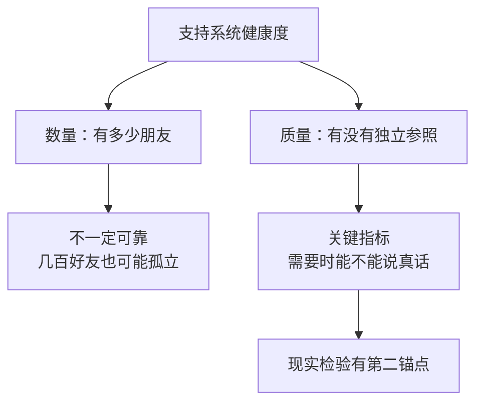
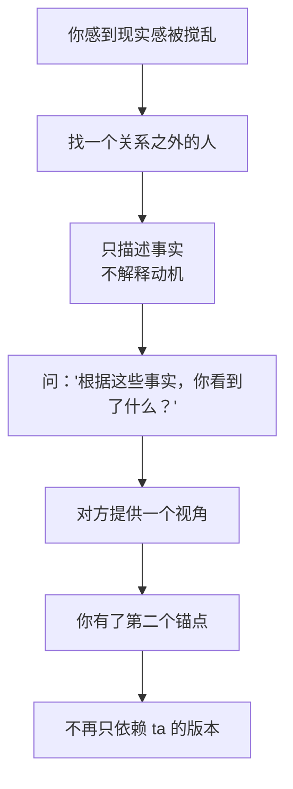

# 第28章 支持系统重建与第二意见机制

这是最后一章。

前面二十七章，我们拆解了攻击链的每一个阶段：怎么挑人、怎么接近、怎么建立人设、怎么制造"被理解"的幻觉、怎么收集信息、怎么用承诺和愧疚绑定、怎么贬低、怎么煤气灯、怎么抛弃回吸、怎么隔离、怎么监控、怎么反取证、怎么管理退出后的叙事。

这一章要讲的，是所有这些技术的"总解药"：**重新连接。**

不是一个人变得更强，而是重新和可信的人连上；不是一个人识破所有谎言，而是让现实检验有第二个锚点。

---

## 28.1 支持系统的健康度自查

### 隔离为什么有效

第 19 章讲过，社交隔离之所以有效，是因为目标失去了外部参照。

人判断一件事是否合理，很大程度上依赖别人的反馈。你觉得"ta 这句话是不是有点过分"，如果朋友说"确实过分"，你就确认了自己的感觉；如果朋友说"还好吧"，你可能会怀疑自己。

当这个外部参照被切断，ta 就成了你唯一的现实校准器。ta 说你敏感，你就觉得自己敏感；ta 说你想多了，你就觉得自己想多了。

所以，防御的关键，不是"独自变得更强"，而是**保持与可信他人的连接**，让现实检验有第二个锚点。

反 PUA 实践里有一个"共同决策法"，核心就是借助外力降低风险：当你在一段关系里感到困惑、感到不对劲时，不要一个人扛，也不要只跟对方一个人商量，而是**找一个关系之外的人**，一起看看。

### 健康度不在"有多少朋友"，而在"有没有独立参照"

支持系统的健康度，不在于"你有多少个朋友"，而在于**在需要外部意见时，有没有一个未被污染的、独立于操控者的参照点。**

你可能有几百个微信好友，但如果你在需要的时候，一个都不敢找、一个都不能说真话，那你的支持系统就是空的。

反过来，你可能只有一两个能说真话的朋友，但他们在你需要的时候能接住你、能给你一个不同的视角，那你的支持系统就是健康的。

### 支持系统健康度自查

判断你的支持系统是否健康，有一个很具体的自查方法：

列出三个你在感到困惑时可以**立即联系**的人。

然后问：在过去三个月里，你是否曾在需要他们的时候**没有联系**？

如果原因中出现以下这些，标记这个原因：

- "不想让伴侣知道。"
- "怕伴侣不高兴。"
- "觉得说了会引发争吵。"
- "说了伴侣会觉得我背叛 ta。"
- "朋友可能会劝我分手，我不想听。"

这些原因，是隔离机制正在运作的可检测痕迹。

注意，这个自查不是为了让你"多交朋友"，而是为了让你看见：**你是不是正在为了这段关系，主动减少和外界的连接。** 如果是，那这个"减少"本身，就是最值得注意的信号。

### 小练习

列出三个你在感到困惑时可以立即联系的人。然后问：在过去三个月里，你是否曾在需要他们的时候没有联系？

如果原因中出现"不想让伴侣知道""怕伴侣不高兴"，标记这个原因——它是隔离机制正在运作的可检测痕迹。

这个练习的目的，不是让你立刻去找朋友倾诉，而是让你**先确认：那条线还在不在。** 如果线还在，你随时可以接上；如果线断了，你要做的第一件事，是把它重新接上。

---

## 28.2 第二意见机制：让现实检验有第二个锚点

### 操控的核心：垄断现实的定义权

操控的核心技术之一，是**垄断现实的定义权**。

什么叫垄断现实的定义权？就是：关于"发生了什么""谁对谁错""你是不是敏感""你是不是有问题"，只有一个声音说了算。那个声音，就是操控者。

煤气灯（第 17 章）是垄断现实的技术，社交隔离（第 19 章）是维护垄断的技术，叙事控制（第 24 章）是退出后继续垄断的技术。它们共同作用，让你失去"另一个版本"。

第二意见机制的作用，就是打破这种垄断。

### 第二意见不是"找个人评判谁对谁错"

这里要特别说清楚：第二意见机制，**不是**"找个人来评判谁对谁错"。

因为"谁对谁错"往往很难判断，而且如果你把朋友拉进"评判"的位置，朋友也会为难：ta 只听到你的版本，没法判断全貌；ta 说"你对了"，你可能觉得被支持，但也可能被推向更激烈的对抗；ta 说"也许你也有问题"，你可能会觉得被背叛。

第二意见机制的核心，不是"判断对错"，而是**提供一个未被污染的观测点**。

具体做法是：当你感到现实感被搅乱时，你的任务不是向支持者证明谁对谁错，而是请 ta 帮你回答一个问题：

> **"根据我告诉你的事实，你看到了什么？"**

注意这个问题：
- 它不给结论，只请对方**描述 ta 看到的**。
- 它不要求对方站队，只要求对方**提供一个视角**。
- 它把"事实"和"解释"分开：你只讲事实，对方只讲 ta 看到的。

比如：

> "我跟你说件事，你帮我看看。昨天我下班回家，ta 问我为什么晚了十分钟。我说路上堵车。ta 说'你每次都找借口'。我说'真的是堵车'。ta 说'你就是在骗我'。然后我们吵了起来。ta 后来说，是我先情绪化的。我想问问你，根据我说的这些，你看到了什么？"

朋友可能会说："我听到的是，你在解释，ta 在质疑你的解释，然后 ta 把你的反应定义成了情绪化。"——这就是一个未被污染的观测点。它不判断谁对谁错，但它让你看到：**你经历的，和你描述的一致；你的感受，是有事实基础的。**

### 为什么"只描述事实"这么重要

因为如果你在描述里加入大量"ta 就是想控制我""ta 就是坏人"的解释，朋友的回应就会被你的框架带跑：ta 要么附和你的解释（这不能帮你校准现实，只能帮你强化情绪），要么质疑你的解释（这又会让你觉得被否定）。

而如果你只描述事实，朋友就能给你一个**相对中立的观察**。这个观察，可能和你的感受一致，也可能让你看到一些你没注意到的角度。无论哪种，它都比"只有一个声音"要好。

### 小练习

选择一位你信任、且不在这段关系内部的人，约定一个"第二意见"信号。

当你感到现实感被搅乱时，使用这个信号。练习一次：向 ta 描述一个具体事件（只描述事实，不解释动机），然后问："根据我告诉你的事实，你看到了什么？"

这个练习的目的，不是让你变成一个"凡事都要问别人"的人，而是让你在"现实感被搅乱"的时候，有一个**可以校准的地方**。一个人判断，容易偏；两个人看，至少有两个锚点。

---

## 28.3 羞耻的解构与责任归位

### 被操控之后，最容易产生的情绪是羞耻

很多人在经历操控之后，最强烈的情绪不是愤怒，而是**羞耻**。

"我怎么这么蠢？"
"我怎么会相信那种话？"
"我早就觉得不对劲了，为什么不早点走？"
"别人会不会觉得我很傻？"

这种羞耻，往往比操控本身更伤人。因为它让你把"被操控"等同于"愚蠢"或"活该"，让你在受伤之后，还要再责备自己一遍。

### 责任归位：利用人性弱点是攻击者的选择

社会工程的视角，有助于责任归位。

核心的一句话是：**利用人性弱点是攻击者的选择，不是弱点的拥有者的过错。**

你想想：人有被爱的需求，有被理解的需求，有害怕孤独的需求，有希望被选中的需求。这些需求，是人性的一部分，是所有人都有的。攻击者利用的，就是这些正常的需求。

你被"你是我见过最特别的人"打动，不是因为你蠢，而是因为"被看见"是人的基本需求。
你在孤独时接受了密集的关注，不是因为你软弱，而是因为"被陪伴"是人的基本需求。
你在被贬低后努力证明自己，不是因为你没骨气，而是因为"被认可"是人的基本需求。

这些需求本身，一点都不羞耻。羞耻的是**利用这些需求去伤害别人的人**，不是拥有这些需求的人。

### 一个关键区分

责任归位的核心区分是：

> **你当时的情感需求是什么（这不羞耻），对方系统性地利用这些需求做了什么（这是对方的选择）。**

把这两件事分开，你就能看清：

- 你需要被爱——这很正常。
- 对方用"爱"的承诺来骗取你的信任和金钱——这是对方的选择。

- 你需要被理解——这很正常。
- 对方用"只有我懂你"来隔离你和其他人——这是对方的选择。

- 你害怕孤独——这很正常。
- 对方用"离开我你就什么都没有"来让你不敢走——这是对方的选择。

你的需求是土壤，对方的选择是种子。土壤本身没有错，错的是有人往里面种了毒。

### 理解机制，是为了解除羞耻，不是追加自责

这本书讲了这么多攻击技术，目的不是让你在读完以后，回头把自己骂一遍："我怎么没看出来？"

恰恰相反。理解机制，是为了让你知道：**你不是输给了自己的愚蠢，你是输给了一套专门针对人性的设计。**

这套设计，连受过训练的人都会中招。它利用的是人类共有的心理机制：互惠、承诺一致、损失厌恶、共情、对熟悉感的偏好。这些机制不是缺陷，是文明的基础。攻击者只是把它们武器化了。

所以，你不需要为"我曾经相信过"而羞耻。你需要的是：**把责任放回它该在的地方。**

### 小练习

写一封信（不必寄出）给"当时那个被卷入的自己"。

在信中区分两件事：
1. 你当时的情感需求是什么（这不羞耻）。
2. 对方系统性地利用这些需求做了什么（这是对方的选择）。

把这两件事分开写，不加评判。

这封信不需要写得漂亮，也不需要得出什么结论。它只是让你练习一个动作：**把"我的需求"和"对方的利用"分开。** 分开之后，你会发现，那个"当时的自己"，不是愚蠢，只是在一个脆弱的时候，遇到了一套精密的利用。

---

## 本章小结

这一章讲了支持系统的重建：

1. **支持系统的健康度**。不在"有多少朋友"，而在"有没有独立参照"。自查方法：列出三个可以立即联系的人，看过去三个月有没有"需要却没联系"，以及原因是不是"不想让伴侣知道"。
2. **第二意见机制**。操控的核心是垄断现实的定义权，第二意见的作用是提供未被污染的观测点。做法：只描述事实，问"根据这些事实，你看到了什么？"
3. **羞耻的解构与责任归位**。利用人性弱点是攻击者的选择，不是弱点的拥有者的过错。核心区分：你的情感需求（不羞耻）vs 对方系统性的利用（对方的选择）。

最后，全书留一个总判断：

**红队视角的终点，不是让你变得怀疑一切，而是让你在关系里，保留判断的自由。**

理解攻击者的阶段部署和成本计算，是为了把识别点前移到更早的环节；但理解不等于中立化，分析的终点，是**增加关系中双方的判断自由**。

你不需要变成一个处处设防的人。你只需要知道：哪些时刻你最容易有缝、哪些信号值得记录、哪些边界必须能执行、哪些人必须在你的支持系统里。

然后，在那些你感到"不对劲"的时刻，允许自己慢一点、问一句、核实一下、找个人聊聊。

这不是多疑，这是把判断权，留在自己手里。

---

## 写在最后

这本书从一个红队视角出发，拆解了情感操控的完整攻击链。

但写到这里，我想说一句可能有点"跑题"的话：

**这本书的目的，从来不是教你"防人"，而是教你"识人"。**

防人，是把所有人都当成潜在的敌人，活在恐惧里。
识人，是知道人有光明也有阴影，知道哪些行为是正常的，哪些行为是操控，然后**做出自己的选择**。

你可以选择信任，但你知道自己在信任什么。
你可以选择投入，但你知道自己在投入什么。
你可以选择留下，但你知道自己为什么留下。
你也可以选择离开，而且你知道，自己走得掉。

这就是判断的自由。

而一段健康的关系，从来不是"谁控制谁"，而是**两个人都保有判断的自由，然后选择彼此**。

愿你在关系里，既不被操控，也不因恐惧而关闭自己。

愿你有爱人的能力，也有离开的底气。

愿你自由。
